# ISS-00 · Requisitos previos

**Fase:** I · **Bloqueado por:** nada · **Habilita:** ISS-01

> **Backend de referencia:** `~/ia-lab/projects/dw/pry-jquintero/app-storelab-express-ii` (Express 5 + TypeScript + Sequelize). Sus ISS están en `docs/construir/` y el cuaderno en `docs/aprender/`. La tabla de trazabilidad está en el `README`.

## Objetivo

Dejar el equipo listo para construir el frontend: Node, npm, Angular CLI, navegador, backend Express corriendo y base de datos sembrada. Al terminar este ISS **no se ha escrito código de Angular todavía**; solo se comprueba el entorno.

------------------------------------------------------------------------

## 0.1 Versiones del laboratorio

| Herramienta | Versión usada | Verificación |
|------------------------|------------------------|------------------------|
| Node.js | 22 LTS o superior (lab: 24.x) | `node -v` |
| npm | 10 o superior | `npm -v` |
| Angular CLI | 22.x | `npx @angular/cli version` |
| Backend | Express 5 + Sequelize 6 | `curl http://localhost:4000/api/sesion/perfil` |
| Navegador | Chrome / Edge / Firefox actual | Abrir `http://localhost:4200` |

``` bash
node -v
npm -v
npx @angular/cli@22 version
```

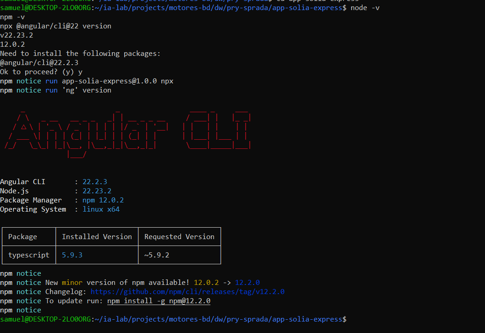

**Criterio de aceptación:** los tres comandos responden sin errores y Angular CLI reporta una versión 22.x.

------------------------------------------------------------------------

## 0.2 Backend en marcha

El frontend no funciona solo: consume la API en `http://localhost:4000/api`. Levanta el backend correcto:

``` bash
cd ~/ia-lab/projects/motores-bd/dw/pry-sprada/app-solia-express
npm install
npm run db:seed
npm run dev
```

``` text
🔗 Intentando conectar a: MYSQL
📦 Base de datos sincronizada exitosamente
🚀 Servidor ejecutándose en puerto 4000
```

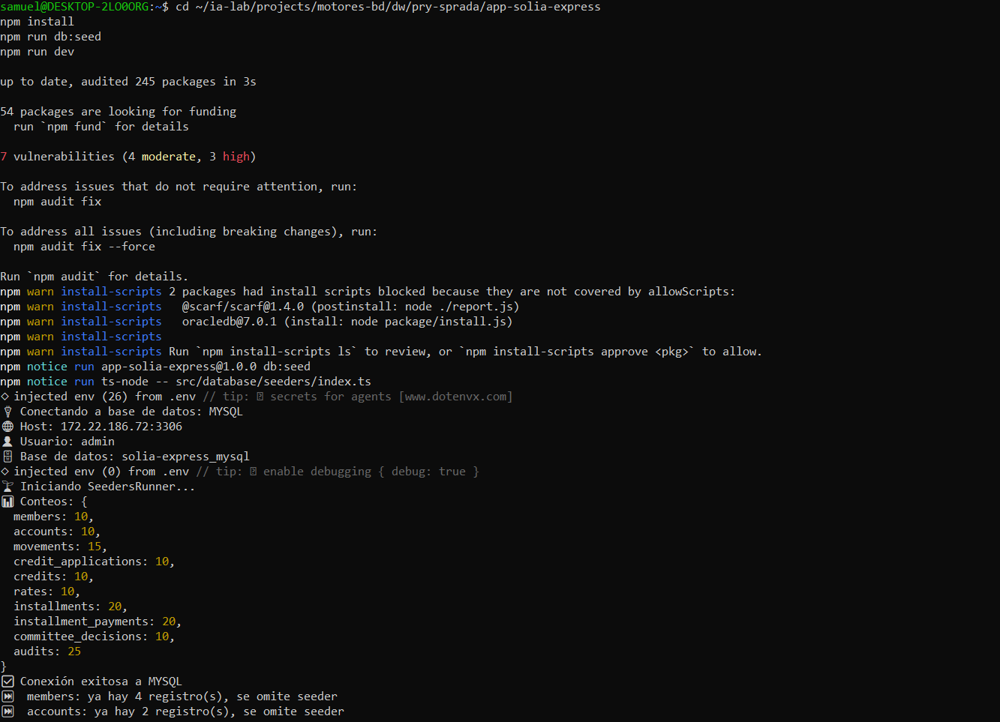

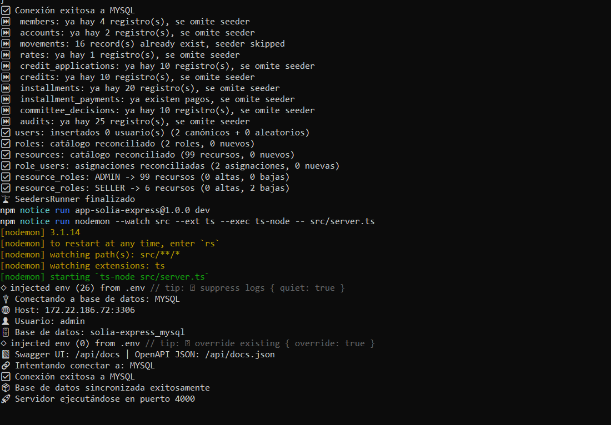

Si falla la conexión, revisa `.env` (`DB_ENGINE`, `MYSQL_*` o `POSTGRES_*`) y que el motor esté escuchando. El backend no arranca sin base de datos.

### Las tres modalidades del backend

| Modalidad | Qué exige | Ejemplos |
|------------------------|------------------------|------------------------|
| **OPEN** | nada | `POST /api/sesion/login`, `/refresh`, `/logout`, `/api/docs` |
| **JWT** | access token válido | `GET /api/sesion/perfil`, `GET /api/permisos`, `/api/sesiones/*` |
| **JWT + RBAC** | token + concesión `(method, path)` | todo el CRUD de negocio y de administración |

> **Importante para la Fase I.** En el backend final (`app-storelab-express-ii`) las rutas de negocio ya llevan `authenticate` + `authorize`. Por eso el frontend de la Fase I se construye contra la versión del backend **antes de ISS-13** (cuando las rutas aún no tienen middlewares) o con un login mínimo. Al terminar la Fase II, `requireAuth = true` y todo pasa por JWT + RBAC.

### Comprobación de la matriz de permisos

``` bash
curl -i http://localhost:4000/api/members
```

-   `401 Unauthorized` → el backend está protegido (estado final). Correcto.

-   `200` con `{ "clients": [...] }` → backend en Fase I (sin middlewares).

-   `ECONNREFUSED` → el backend no está escuchando en el puerto 4000.

    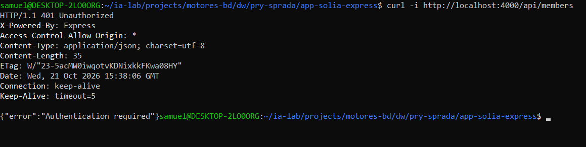

------------------------------------------------------------------------

## 0.3 Login y permisos

El login del backend devuelve **solo el par de tokens**. El perfil y los permisos se piden aparte:

``` bash
# 1. Login (OPEN)
cd ~/ia-lab/projects/motores-bd/dw/pry-sprada/app-solia-express

TOKEN=$(curl -s -X POST http://localhost:4000/api/sesion/login \
  -H "Content-Type: application/json" \
  -d '{"identifier":"admin","password":"Admin123!"}' \
  | python3 -c 'import json,sys; print(json.load(sys.stdin).get("access_token", ""))')

if [ -z "$TOKEN" ]; then
  echo "ERROR: no se obtuvo access_token. Revisa la respuesta del login."
else
  echo "Token obtenido correctamente."
fi
```

``` json
# 2. Perfil (JWT)
curl -i http://localhost:4000/api/sesion/perfil \
  -H "Authorization: Bearer $TOKEN"
```

``` bash
# 3. Permisos efectivos (JWT)
curl -i http://localhost:4000/api/permisos \
  -H "Authorization: Bearer $TOKEN"
```

`GET /api/permisos` devuelve una fila por permiso efectivo:

``` json
{
  "permissions": [
    {
      "resource_id": 1,
      "method": "GET",
      "path": "/api/clientes",
      "description": "Listar clientes",
      "role_id": 1,
      "role_name": "ADMIN"
    }
  ]
}
```

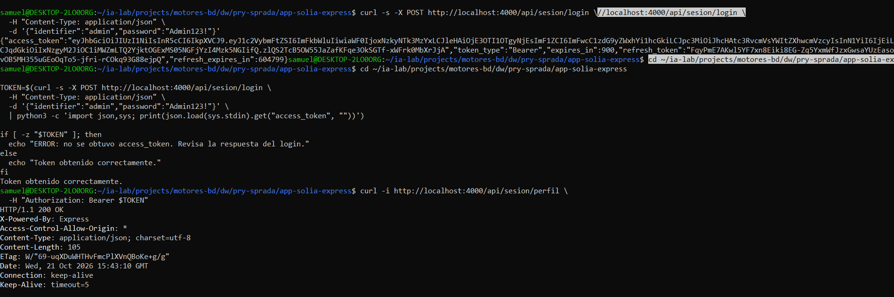

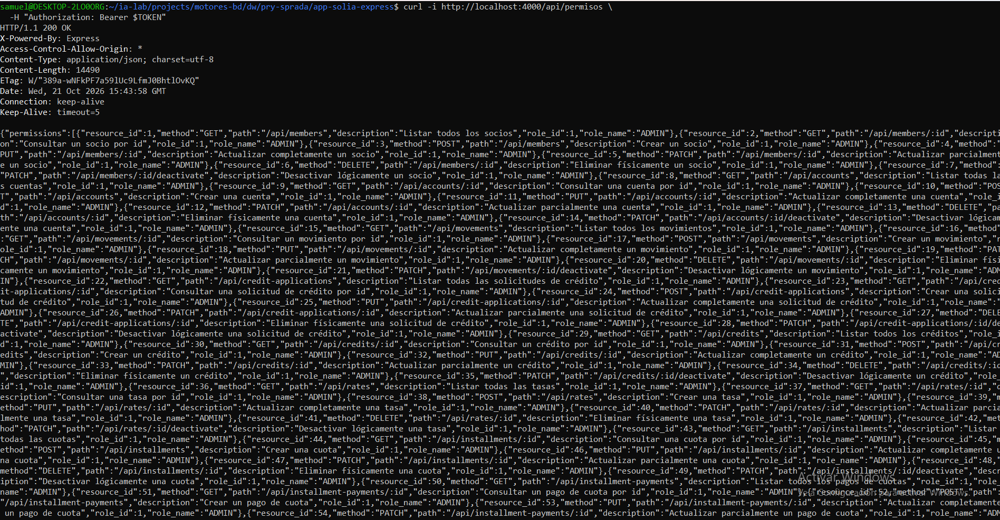

Esa forma es la que consumirá `SessionStore` en ISS-08. El frontend **no** recibe `user`, `roles` ni `resources` en el login.

------------------------------------------------------------------------

## 0.4 Credenciales del seeder

| Usuario  | Password     | Rol    | Permisos    |
|----------|--------------|--------|-------------|
| `admin`  | `Admin123!`  | ADMIN  | 58 recursos |
| `seller` | `Seller123!` | SELLER | 7 recursos  |

El seeder de backend crea además usuarios aleatorios **sin rol**: sirven para comprobar que estar autenticado no basta (recibirán `403`).

Los permisos no están hardcodeados en el frontend: salen de `/api/permisos`, que ejecuta la misma consulta que el middleware `authorize` (`role_users → roles → resource_roles → resources`, todos los eslabones activos).

------------------------------------------------------------------------

## 0.5 Navegador y herramientas

-   Abre DevTools (`F12`) → **Console** y **Network**. En cada ISS comprobarás que las peticiones llevan `Authorization: Bearer ...`.
-   Instala **Angular DevTools** (opcional) para inspeccionar componentes y signals.
-   Desactiva bloqueadores que intercepten `localhost` si el login falla sin motivo.

------------------------------------------------------------------------

## 0.6 Estructura de trabajo

El proyecto se crea dentro de la carpeta existente:

``` text
~/ia-lab/projects/motores-bd/dw/pry-sprada/app-solia-express
```

No se debe crear una subcarpeta adicional. En ISS-01 se explica el comando exacto (`ng new front-storelab-express-ii --directory .`) y por qué `ng new .` falla en Angular CLI 22.

------------------------------------------------------------------------

## Criterios de aceptación (ISS-00)

-   [x] `node -v` ≥ 22 y `npm -v` ≥ 10.
-   [x] `npx @angular/cli@22 version` muestra Angular CLI 22.x.
-   [x] `npm run db:seed && npm run dev` del backend `app-storelab-express-ii` deja el puerto 4000 escuchando.
-   [x] `POST /api/sesion/login` con `admin` / `Admin123!` devuelve `access_token` y `refresh_token`.
-   [x] `GET /api/permisos` con ese token devuelve `permissions` (58 para admin).
-   [x] La carpeta `front-storelab-express-ii` existe y está vacía (o solo contiene archivos de configuración del repositorio).

## Comprobación final

``` bash
# 1. Versiones
node -v && npm -v && npx @angular/cli@22 version

# 2. Backend vivo
curl -s -o /dev/null -w "HTTP %{http_code}\n" http://localhost:4000/api/members

# 3. Login + permisos
TOKEN=$(curl -s -X POST http://localhost:4000/api/sesion/login \
  -H "Content-Type: application/json" \
  -d '{"identifier":"admin","password":"Admin123!"}' \
  | grep -o '"access_token":"[^"]*' | cut -d'"' -f4)

if [ -z "$TOKEN" ]; then
  echo "ERROR: no se obtuvo el access_token"
else
  echo "Login correcto"
  curl -s -w "\nHTTP %{http_code}\n" \
    http://localhost:4000/api/permisos \
    -H "Authorization: Bearer $TOKEN" | head -c 500
  echo
fi
```

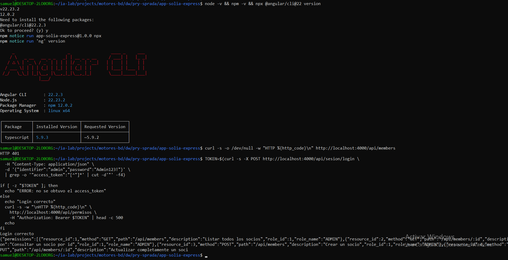

Si el paso 3 imprime `"permissions"`, el entorno está listo para ISS-01.

# ISS-01 · Bootstrap Angular 22 con CLI, Tailwind y PrimeNG

**Fase:** I · **Bloqueado por:** ISS-00 · **Habilita:** ISS-02

## Objetivo

Crear el proyecto Angular 22 sin una carpeta adicional, integrar Tailwind CSS 4, instalar PrimeNG 22 y dejar el tema Aura funcionando. Al final, `ng serve` debe mostrar la pantalla inicial sin errores.

------------------------------------------------------------------------

## 1.1 Crear el proyecto en la carpeta actual

Desde la carpeta del proyecto:

``` bash
cd ~/ia-lab/projects/motores-bd/dw/pry-sprada/app-solia-express
npx @angular/cli@22 new front-solia-express- \
  --directory . \
  --style=tailwind \
  --ssr=false \
  --routing \
  --zoneless \
  --skip-git \
  --package-manager=npm
```

**Flags usados:**

| Flag               | Efecto                                            |
|--------------------|---------------------------------------------------|
| `--directory .`    | Escribe en la carpeta actual, sin subcarpetas     |
| `--style=tailwind` | Configura Tailwind CSS 4 y PostCSS                |
| `--routing`        | Genera `app.routes.ts` y `provideRouter`          |
| `--zoneless`       | Sin `zone.js`; change detection basada en signals |
| `--ssr=false`      | Solo SPA, sin server-side rendering               |
| `--skip-git`       | No inicializa un repo nuevo                       |

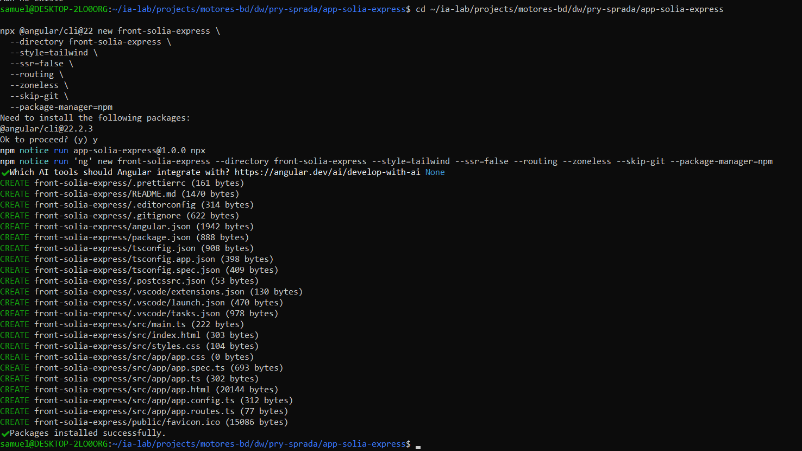

**Criterio de aceptación:** existen `angular.json`, `package.json`, `src/main.ts` y `src/app/app.config.ts` directamente en la carpeta del proyecto.

------------------------------------------------------------------------

## 1.2 Instalar PrimeNG 22 y sus temas

PrimeNG 22 cambió el paquete de temas: ya no se usa `primeng/resources/themes`. El preset **Aura** vive en `@primeuix/themes`.

``` bash
npm install primeng @primeuix/themes primeicons @angular/cdk
```

Verifica versiones:

``` bash
npm ls primeng @primeuix/themes primeicons @angular/cdk --depth=0
```

Salida esperada (puede variar el patch):

``` text
├── @angular/cdk@22.x
├── @primeuix/themes@3.x
├── primeicons@8.x
└── primeng@22.x
```

> 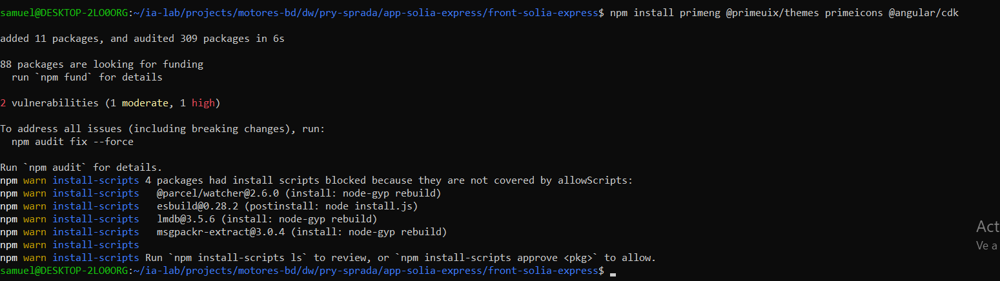
>
> 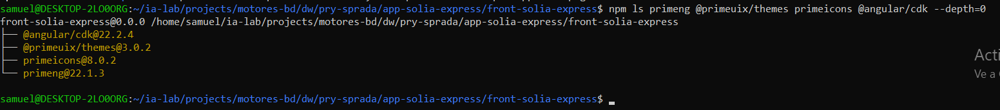
>
> `@angular/cdk` es *peer dependency* de PrimeNG 22. Si falta, el build falla al resolver overlays y focus trap.

------------------------------------------------------------------------

## 1.3 Estilos globales

Crea/reemplaza `src/styles.css`:

``` bash
cat > src/styles.css <<'EOF'
/* Tailwind 4 (lo configuró `ng new --style=tailwind`) */
@import 'tailwindcss';
/* Iconos usados por PrimeNG (pi pi-*) */
@import 'primeicons/primeicons.css';

:root {
  color-scheme: light;
}

html,
body {
  height: 100%;
}

body {
  margin: 0;
  font-family:
    Inter,
    ui-sans-serif,
    system-ui,
    -apple-system,
    'Segoe UI',
    Roboto,
    sans-serif;
  background-color: #f1f5f9; /* slate-100 */
  color: #0f172a; /* slate-900 */
}

/* Los controles de PrimeNG ocupan el ancho de su contenedor. */
.p-inputtext,
.p-select,
.p-password,
.p-inputnumber,
.p-datepicker,
.p-textarea {
  width: 100%;
}

/* Tarjetas reutilizables */
@layer components {
  .card {
    @apply rounded-2xl border border-slate-200 bg-white shadow-sm;
  }
  .card-body {
    @apply p-4 sm:p-6;
  }
  .field-label {
    @apply mb-1 block text-sm font-medium text-slate-700;
  }
  .field-error {
    @apply mt-1 block text-xs font-medium text-red-600;
  }
}

/* Ajustes finos de la tabla */
.p-datatable .p-datatable-header {
  background: transparent;
  border: 0;
  padding: 0 0 1rem 0;
}

/* Scrollbar discreto */
::-webkit-scrollbar {
  width: 10px;
  height: 10px;
}
::-webkit-scrollbar-thumb {
  background: #cbd5e1;
  border-radius: 9999px;
}
::-webkit-scrollbar-track {
  background: transparent;
}
EOF
```

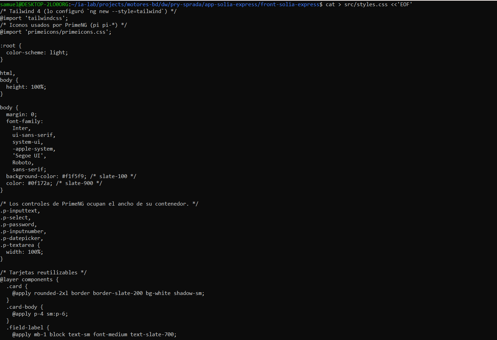

------------------------------------------------------------------------

## 1.4 Configurar PrimeNG en `app.config.ts`

Reemplaza `src/app/app.config.ts`:

``` bash
cat > src/app/app.config.ts <<'EOF'
import {
  ApplicationConfig,
  provideBrowserGlobalErrorListeners,
} from '@angular/core';
import {
  provideRouter,
  withComponentInputBinding,
  withInMemoryScrolling,
} from '@angular/router';
import { ConfirmationService, MessageService } from 'primeng/api';
import { providePrimeNG } from 'primeng/config';
import Aura from '@primeuix/themes/aura';

import { routes } from './app.routes';

export const appConfig: ApplicationConfig = {
  providers: [
    provideBrowserGlobalErrorListeners(),

    provideRouter(
      routes,
      withComponentInputBinding(),
      withInMemoryScrolling({ scrollPositionRestoration: 'top' }),
    ),

    // PrimeNG 22: tema Aura. El modo oscuro se activa con la clase .app-dark.
    providePrimeNG({
      ripple: true,
      inputVariant: 'outlined',
      theme: {
        preset: Aura,
        options: {
          darkModeSelector: '.app-dark',
          cssLayer: false,
        },
      },
    }),

    MessageService,
    ConfirmationService,
  ],
};
EOF
```

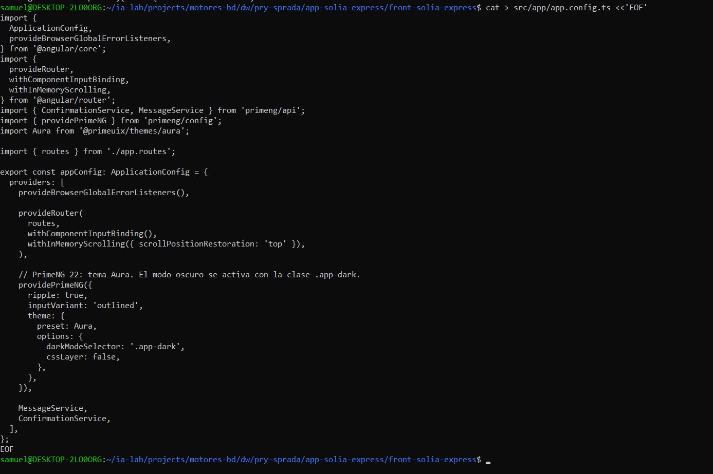

En ISS-02 se añadirán `provideHttpClient` y los interceptores encima de `provideRouter` (o debajo, el orden entre providers no importa; el orden de los **interceptores** sí).

------------------------------------------------------------------------

## 1.5 Limpiar la pantalla por defecto

El `app.html` generado por CLI no se usará: el shell de ISS-02 será la pantalla real. Deja un `router-outlet` mínimo:

``` bash
cat > src/app/app.html <<'EOF'
<router-outlet />
EOF

cat > src/app/app.ts <<'EOF'
import { Component } from '@angular/core';
import { RouterOutlet } from '@angular/router';

@Component({
  selector: 'app-root',
  imports: [RouterOutlet],
  templateUrl: './app.html',
  styleUrl: './app.css',
})
export class App {}
EOF
```

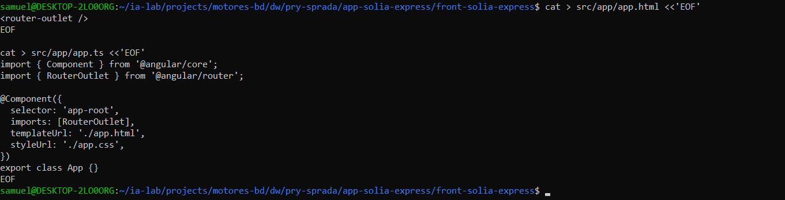

`src/app/app.css` puede quedar vacío.

------------------------------------------------------------------------

## 1.6 Personalizar `index.html`

``` bash
cat > src/index.html <<'EOF'
<!doctype html>
<html lang="es">
<head>
  <meta charset="utf-8">
  <title>StoreLab Express II · Angular 22</title>
  <base href="/">
  <meta name="viewport" content="width=device-width, initial-scale=1">
  <meta name="description" content="Frontend Angular 22 con Signals, PrimeNG y Tailwind para StoreLab Express.">
  <link rel="icon" type="image/x-icon" href="favicon.ico">
</head>
<body>
  <app-root></app-root>
</body>
</html>
EOF
```

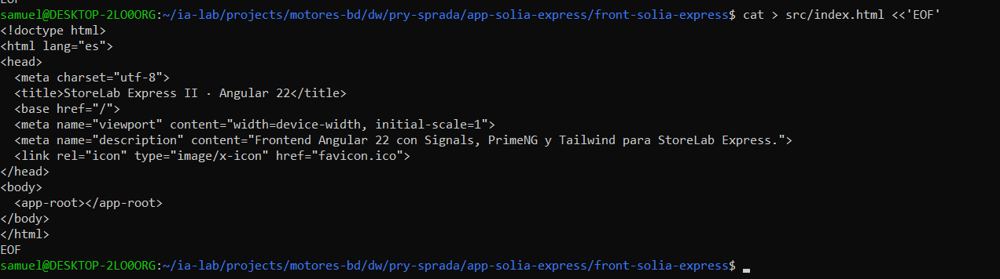

------------------------------------------------------------------------

## 1.7 Ajustar el presupuesto de build

El bundle inicial con PrimeNG supera los 500 kB por defecto. En `angular.json`, dentro de `projects → ... → architect → build → configurations → production → budgets`, cambia el primer presupuesto:

``` json
{
  "type": "initial",
  "maximumWarning": "750kB",
  "maximumError": "1MB"
}
```

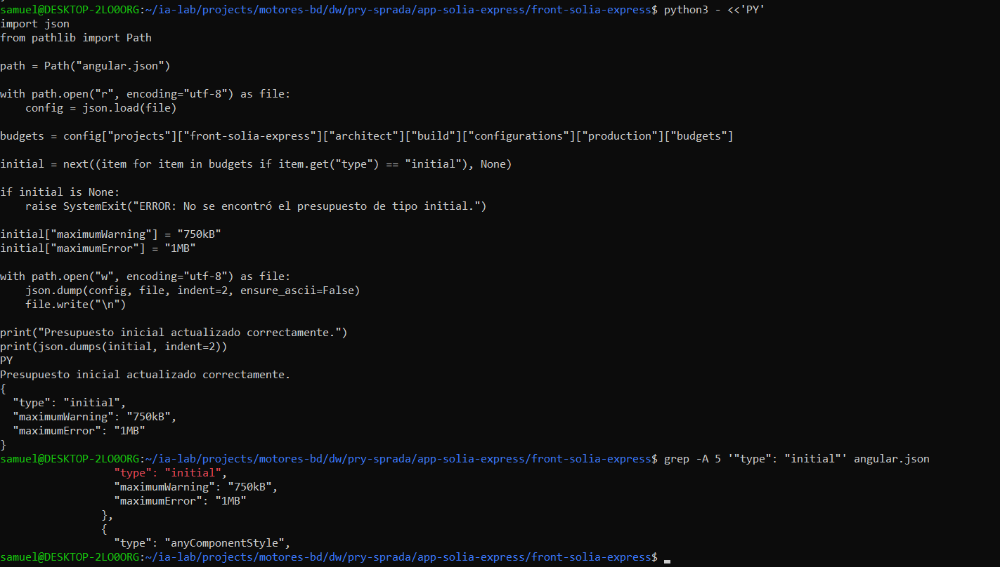

Sin este ajuste, `ng build` termina con un *warning* (no error). En ISS-11 se explica por qué no conviene subirlo más allá de 1 MB.

------------------------------------------------------------------------

## 1.8 Primera ejecución

``` bash
npm start
```

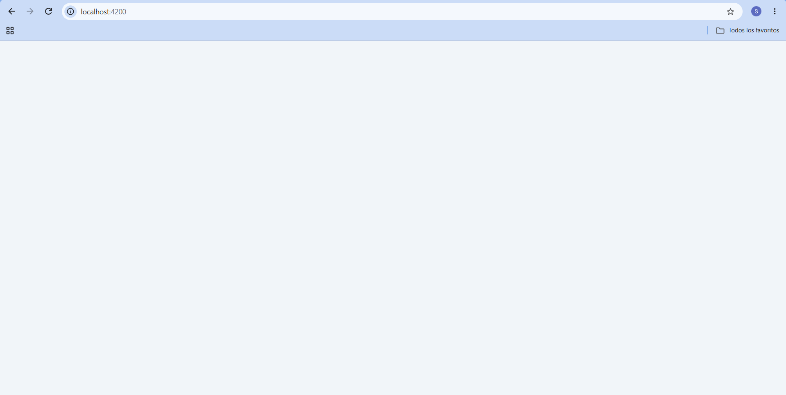

Abre `http://localhost:4200`. Debe mostrarse una página vacía (sin errores en consola). Es correcto: aún no hay rutas ni componentes de negocio.

### Comprobaciones en DevTools

-   **Console** no debe mostrar errores rojos.
-   **Network** debe cargar `styles.css`, `main.js` y los chunks con estado `200`.
-   El `<title>` de la pestaña debe ser `StoreLab Express II · Angular 22`.

------------------------------------------------------------------------

## Criterios de aceptación (ISS-01)

-   [x] `npm ls primeng @primeuix/themes` muestra versiones 22.x y 3.x.
-   [x] `src/styles.css` importa `tailwindcss` y `primeicons`.
-   [x] `providePrimeNG` usa el preset Aura y `darkModeSelector: '.app-dark'`.
-   [x] `ng serve` compila sin errores y `http://localhost:4200` responde.
-   [x] La consola del navegador no muestra errores de dependencias ni de tema.

## Comprobación desde terminal

``` bash
# El servidor debe compilar
npx ng build 2>&1 | tail -20

# Debe imprimir la configuración de Tailwind/PrimeNG
grep -R "providePrimeNG\|@import 'tailwindcss'" src | head
```

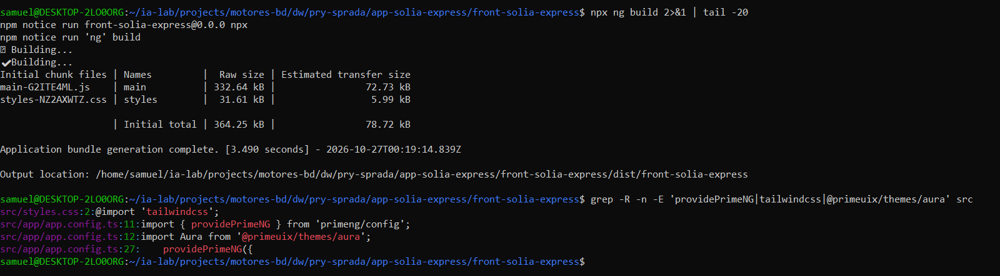

**Siguiente:** ISS-02 crea modelos, `environment`, servicios base, shell y rutas.
