# 29. FondoSolidario - Cooperativa de ahorro y crédito

**Dominio:** Socios / cuentas / créditos / movimientos

## NARRATIVA DEL PROYECTO

FondoSolidario es una cooperativa de ahorro y crédito que administra los aportes de sus asociados, sus cuentas de ahorro y sus operaciones crediticias.

El sistema debe permitir registrar socios, administrar sus cuentas, gestionar solicitudes de crédito y controlar los créditos aprobados. También debe registrar movimientos financieros con su partida y referencia correspondiente, calcular intereses y cuotas de acuerdo con las tasas aprobadas, aplicar pagos y mantener saldos reproducibles.

Las decisiones de crédito, los reversos de movimientos y los ajustes financieros son operaciones sensibles que requieren autorización segregada, control de permisos mediante RBAC y trazabilidad mediante registros de auditoría.

El sistema debe garantizar la integridad de las operaciones financieras, la consistencia de los saldos y la trazabilidad de las acciones realizadas por los usuarios.

## ENTIDADES DE NEGOCIO

| Entidad de dominio | Atributos / claves sugeridos |
|------------------------------------|------------------------------------|
| Socio (`Member`) | `id`, `name`, `description`, `is_active`, `created_at`, `updated_at` |
| Cuenta (`Account`) | `id`, `member_id` (FK), `name`, `description`, `status`, `created_at`, `updated_at` |
| Movimiento (`Movement`) | `id`, `account_id` (FK), `reference_id` (FK), `type`, `date`, `amount`, `observations`, `status` |
| Solicitud de crédito (`CreditApplication`) | `id`, `member_id` (FK), `reference_id` (FK), `date`, `amount`, `status`, `observations` |
| Crédito (`Credit`) | `id`, `credit_application_id` (FK), `rate_id` (FK), `date`, `amount`, `status`, `observations` |
| Cuota (`Installment`) | `id`, `credit_id` (FK), `installment_number`, `due_date`, `principal_amount`, `interest_amount`, `total_amount`, `balance`, `status` |
| Pago de cuota (`InstallmentPayment`) | `id`, `installment_id` (FK), `movement_id` (FK), `payment_date`, `amount`, `observations`, `status` |
| Tasa (`Rate`) | `id`, `name`, `description`, `rate_value`, `valid_from`, `valid_until`, `status`, `created_at`, `updated_at` |
| Decisión del comité (`CommitteeDecision`) | `id`, `credit_application_id` (FK), `decision`, `decision_date`, `observations`, `status` |
| Auditoría (`Audit`) | `id`, `actor_user_id`, `action`, `entity`, `entity_id`, `data`, `created_at` |

**Nota:** Los nombres en inglés corresponden a los identificadores del código y del backend de Solia Express. Los nombres en español se utilizan en la documentación y en la interfaz de usuario.

## RELACIONES DE NEGOCIO

-   Socio `1:N` Cuenta.
-   Cuenta `1:N` Movimiento.
-   Socio `1:N` Solicitud de crédito.
-   Solicitud de crédito `0..1:1` Crédito.
-   Tasa `1:N` Crédito.
-   Crédito `1:N` Cuota.
-   Cuota `1:N` Pago de cuota.
-   Movimiento `1:N` Pagos de cuota, cuando un movimiento permite registrar aplicaciones de pago según las reglas del negocio.
-   Solicitud de crédito `1:N` Decisión del comité.
-   Usuario `1:N` Auditoría.
-   Las operaciones sensibles generan registros de auditoría.

## RBAC APLICADO

### Roles iniciales

| Rol | Responsabilidad |
|------------------------------------|------------------------------------|
| `ADMIN` | Administración general del sistema, usuarios, roles, recursos y permisos. |
| `CAJERO` | Registro de movimientos y aplicación de pagos autorizados. |
| `ANALISTA_CREDITO` | Revisión y análisis de solicitudes de crédito. |
| `COMITE` | Evaluación y registro de decisiones sobre solicitudes de crédito. |
| `AUDITOR` | Consulta de operaciones, movimientos y registros de auditoría, sin autorización para modificar información financiera. |

### Recursos de referencia

Los permisos se definen mediante el método HTTP y la ruta del recurso. Las siguientes rutas representan las operaciones sensibles del dominio:

| Operación | Recurso de referencia | Control esperado |
|------------------------|------------------------|------------------------|
| Registrar movimiento | `POST /api/movements` | Autorización del rol correspondiente. |
| Crear solicitud de crédito | `POST /api/credit-applications` | Autorización del rol correspondiente. |
| Registrar decisión del comité | `POST /api/committee-decisions` | Permiso exclusivo del rol autorizado. |
| Registrar pago de cuota | `POST /api/installment-payments` | Autorización del rol correspondiente. |

**Importante:** las rutas anteriores utilizan los nombres reales de los recursos del backend de Solia Express. No deben confundirse con las rutas de ejemplo en español (`/movimientos`, `/solicitudes-credito`, `/decisiones`, `/pagos-cuota`), que no corresponden necesariamente a los endpoints implementados.

### Principios de autorización

-   Aplicar mínimo privilegio a cada rol.
-   Separar el registro de movimientos de la autorización de decisiones crediticias.
-   Restringir las decisiones del comité a usuarios autorizados.
-   Evitar que un usuario apruebe operaciones que él mismo registró cuando las reglas de segregación lo prohíban.
-   Mantener trazabilidad de las operaciones financieras sensibles.
-   Validar permisos tanto en el frontend como en el backend.
-   No considerar la ocultación de botones como sustituto de la autorización del servidor.

# ISS-00 · Requisitos previos

**Fase:** I · **Bloqueado por:** nada · **Habilita:** ISS-01

> **Backend de referencia:** `~/ia-lab/projects/dw/pry-jquintero/app-storelab-express-ii` (Express 5 + TypeScript + Sequelize). Sus ISS están en `docs/construir/` y el cuaderno en `docs/aprender/`. La tabla de trazabilidad está en el `README`.

## Objetivo

Dejar el equipo listo para construir el frontend: Node, npm, Angular CLI, navegador, backend Express corriendo y base de datos sembrada. Al terminar este ISS **no se ha escrito código de Angular todavía**; solo se comprueba el entorno.

------------------------------------------------------------------------

## 0.1 Versiones del laboratorio

| Herramienta | Versión usada | Verificación |
|------------------------|------------------------|------------------------|
| Node.js | 22 LTS o superior (lab: 24.x) | `node -v` |
| npm | 10 o superior | `npm -v` |
| Angular CLI | 22.x | `npx @angular/cli version` |
| Backend | Express 5 + Sequelize 6 | `curl http://localhost:4000/api/sesion/perfil` |
| Navegador | Chrome / Edge / Firefox actual | Abrir `http://localhost:4200` |

``` bash
node -v
npm -v
npx @angular/cli@22 version
```

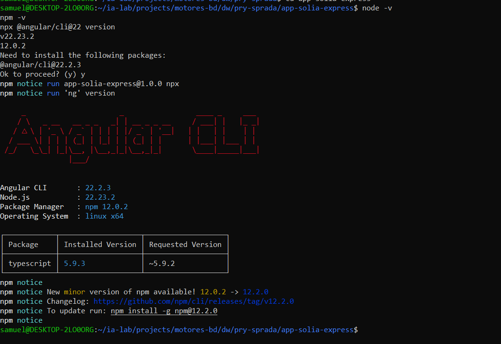

**Criterio de aceptación:** los tres comandos responden sin errores y Angular CLI reporta una versión 22.x.

------------------------------------------------------------------------

## 0.2 Backend en marcha

El frontend no funciona solo: consume la API en `http://localhost:4000/api`. Levanta el backend correcto:

``` bash
cd ~/ia-lab/projects/motores-bd/dw/pry-sprada/app-solia-express
npm install
npm run db:seed
npm run dev
```

``` text
🔗 Intentando conectar a: MYSQL
📦 Base de datos sincronizada exitosamente
🚀 Servidor ejecutándose en puerto 4000
```

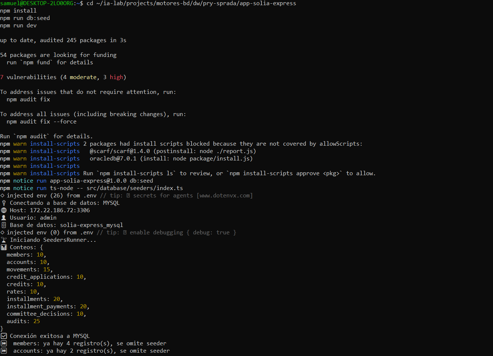

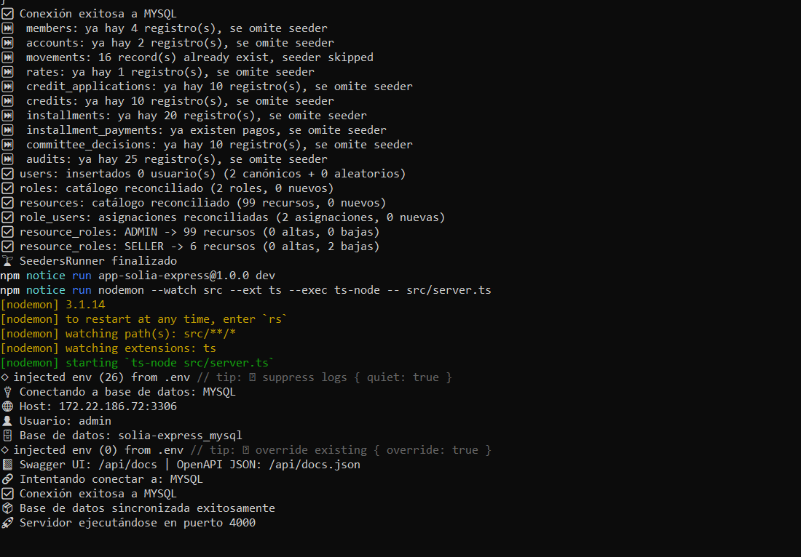

Si falla la conexión, revisa `.env` (`DB_ENGINE`, `MYSQL_*` o `POSTGRES_*`) y que el motor esté escuchando. El backend no arranca sin base de datos.

### Las tres modalidades del backend

| Modalidad | Qué exige | Ejemplos |
|------------------------|------------------------|------------------------|
| **OPEN** | nada | `POST /api/sesion/login`, `/refresh`, `/logout`, `/api/docs` |
| **JWT** | access token válido | `GET /api/sesion/perfil`, `GET /api/permisos`, `/api/sesiones/*` |
| **JWT + RBAC** | token + concesión `(method, path)` | todo el CRUD de negocio y de administración |

> **Importante para la Fase I.** En el backend final (`app-storelab-express-ii`) las rutas de negocio ya llevan `authenticate` + `authorize`. Por eso el frontend de la Fase I se construye contra la versión del backend **antes de ISS-13** (cuando las rutas aún no tienen middlewares) o con un login mínimo. Al terminar la Fase II, `requireAuth = true` y todo pasa por JWT + RBAC.

### Comprobación de la matriz de permisos

``` bash
curl -i http://localhost:4000/api/members
```

-   `401 Unauthorized` → el backend está protegido (estado final). Correcto.

-   `200` con `{ "clients": [...] }` → backend en Fase I (sin middlewares).

-   `ECONNREFUSED` → el backend no está escuchando en el puerto 4000.

    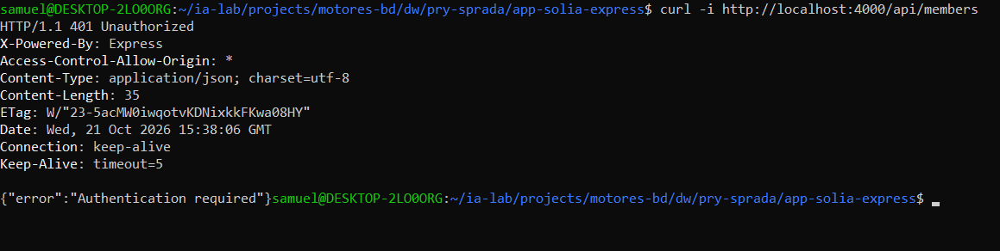

------------------------------------------------------------------------

## 0.3 Login y permisos

El login del backend devuelve **solo el par de tokens**. El perfil y los permisos se piden aparte:

``` bash
# 1. Login (OPEN)
cd ~/ia-lab/projects/motores-bd/dw/pry-sprada/app-solia-express

TOKEN=$(curl -s -X POST http://localhost:4000/api/sesion/login \
  -H "Content-Type: application/json" \
  -d '{"identifier":"admin","password":"Admin123!"}' \
  | python3 -c 'import json,sys; print(json.load(sys.stdin).get("access_token", ""))')

if [ -z "$TOKEN" ]; then
  echo "ERROR: no se obtuvo access_token. Revisa la respuesta del login."
else
  echo "Token obtenido correctamente."
fi
```

``` json
# 2. Perfil (JWT)
curl -i http://localhost:4000/api/sesion/perfil \
  -H "Authorization: Bearer $TOKEN"
```

``` bash
# 3. Permisos efectivos (JWT)
curl -i http://localhost:4000/api/permisos \
  -H "Authorization: Bearer $TOKEN"
```

`GET /api/permisos` devuelve una fila por permiso efectivo:

``` json
{
  "permissions": [
    {
      "resource_id": 1,
      "method": "GET",
      "path": "/api/clientes",
      "description": "Listar clientes",
      "role_id": 1,
      "role_name": "ADMIN"
    }
  ]
}
```

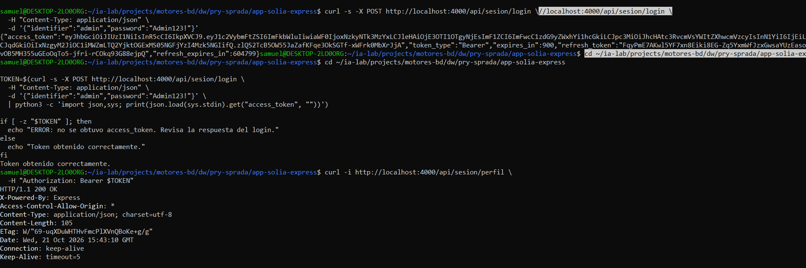

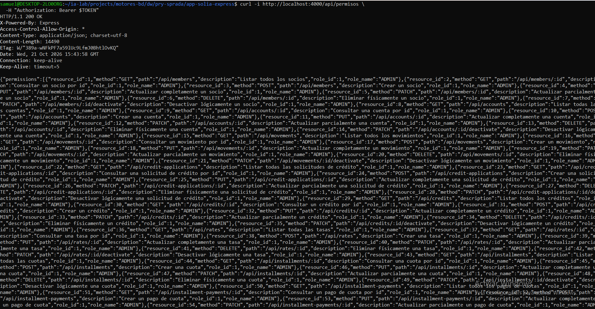

Esa forma es la que consumirá `SessionStore` en ISS-08. El frontend **no** recibe `user`, `roles` ni `resources` en el login.

------------------------------------------------------------------------

## 0.4 Credenciales del seeder

| Usuario  | Password     | Rol    | Permisos    |
|----------|--------------|--------|-------------|
| `admin`  | `Admin123!`  | ADMIN  | 58 recursos |
| `seller` | `Seller123!` | SELLER | 7 recursos  |

El seeder de backend crea además usuarios aleatorios **sin rol**: sirven para comprobar que estar autenticado no basta (recibirán `403`).

Los permisos no están hardcodeados en el frontend: salen de `/api/permisos`, que ejecuta la misma consulta que el middleware `authorize` (`role_users → roles → resource_roles → resources`, todos los eslabones activos).

------------------------------------------------------------------------

## 0.5 Navegador y herramientas

-   Abre DevTools (`F12`) → **Console** y **Network**. En cada ISS comprobarás que las peticiones llevan `Authorization: Bearer ...`.
-   Instala **Angular DevTools** (opcional) para inspeccionar componentes y signals.
-   Desactiva bloqueadores que intercepten `localhost` si el login falla sin motivo.

------------------------------------------------------------------------

## 0.6 Estructura de trabajo

El proyecto se crea dentro de la carpeta existente:

``` text
~/ia-lab/projects/motores-bd/dw/pry-sprada/app-solia-express
```

No se debe crear una subcarpeta adicional. En ISS-01 se explica el comando exacto (`ng new front-storelab-express-ii --directory .`) y por qué `ng new .` falla en Angular CLI 22.

------------------------------------------------------------------------

## Criterios de aceptación (ISS-00)

-   [x] `node -v` ≥ 22 y `npm -v` ≥ 10.
-   [x] `npx @angular/cli@22 version` muestra Angular CLI 22.x.
-   [x] `npm run db:seed && npm run dev` del backend `app-storelab-express-ii` deja el puerto 4000 escuchando.
-   [x] `POST /api/sesion/login` con `admin` / `Admin123!` devuelve `access_token` y `refresh_token`.
-   [x] `GET /api/permisos` con ese token devuelve `permissions` (58 para admin).
-   [x] La carpeta `front-storelab-express-ii` existe y está vacía (o solo contiene archivos de configuración del repositorio).

## Comprobación final

``` bash
# 1. Versiones
node -v && npm -v && npx @angular/cli@22 version

# 2. Backend vivo
curl -s -o /dev/null -w "HTTP %{http_code}\n" http://localhost:4000/api/members

# 3. Login + permisos
TOKEN=$(curl -s -X POST http://localhost:4000/api/sesion/login \
  -H "Content-Type: application/json" \
  -d '{"identifier":"admin","password":"Admin123!"}' \
  | grep -o '"access_token":"[^"]*' | cut -d'"' -f4)

if [ -z "$TOKEN" ]; then
  echo "ERROR: no se obtuvo el access_token"
else
  echo "Login correcto"
  curl -s -w "\nHTTP %{http_code}\n" \
    http://localhost:4000/api/permisos \
    -H "Authorization: Bearer $TOKEN" | head -c 500
  echo
fi
```

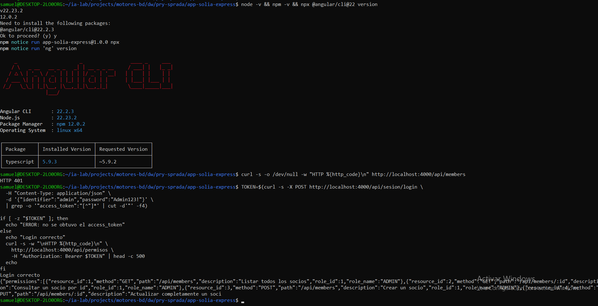

Si el paso 3 imprime `"permissions"`, el entorno está listo para ISS-01.

# ISS-01 · Bootstrap Angular 22 con CLI, Tailwind y PrimeNG

**Fase:** I · **Bloqueado por:** ISS-00 · **Habilita:** ISS-02

## Objetivo

Crear el proyecto Angular 22 sin una carpeta adicional, integrar Tailwind CSS 4, instalar PrimeNG 22 y dejar el tema Aura funcionando. Al final, `ng serve` debe mostrar la pantalla inicial sin errores.

------------------------------------------------------------------------

## 1.1 Crear el proyecto en la carpeta actual

Desde la carpeta del proyecto:

``` bash
cd ~/ia-lab/projects/motores-bd/dw/pry-sprada/app-solia-express
npx @angular/cli@22 new front-solia-express- \
  --directory . \
  --style=tailwind \
  --ssr=false \
  --routing \
  --zoneless \
  --skip-git \
  --package-manager=npm
```

**Flags usados:**

| Flag               | Efecto                                            |
|--------------------|---------------------------------------------------|
| `--directory .`    | Escribe en la carpeta actual, sin subcarpetas     |
| `--style=tailwind` | Configura Tailwind CSS 4 y PostCSS                |
| `--routing`        | Genera `app.routes.ts` y `provideRouter`          |
| `--zoneless`       | Sin `zone.js`; change detection basada en signals |
| `--ssr=false`      | Solo SPA, sin server-side rendering               |
| `--skip-git`       | No inicializa un repo nuevo                       |

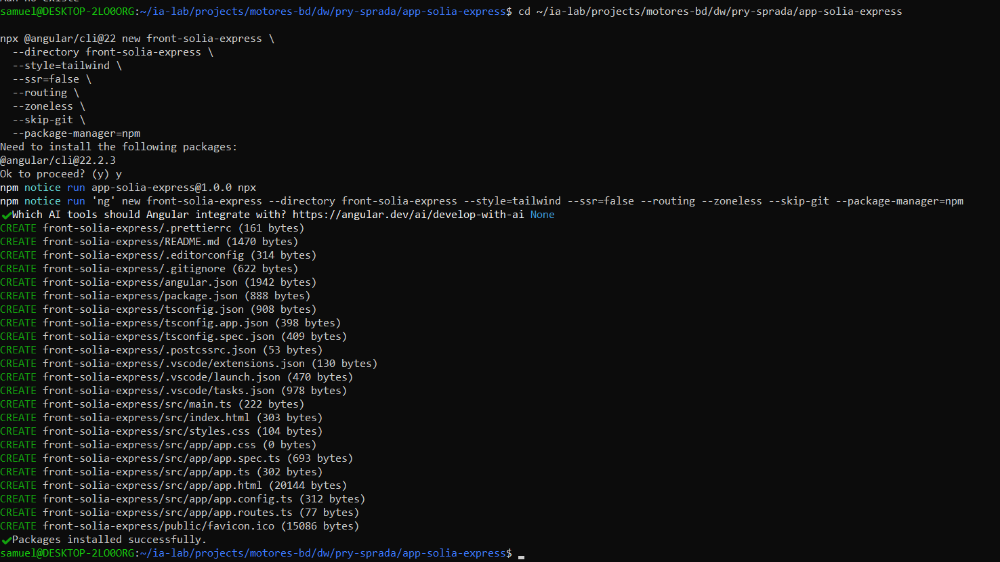

**Criterio de aceptación:** existen `angular.json`, `package.json`, `src/main.ts` y `src/app/app.config.ts` directamente en la carpeta del proyecto.

------------------------------------------------------------------------

## 1.2 Instalar PrimeNG 22 y sus temas

PrimeNG 22 cambió el paquete de temas: ya no se usa `primeng/resources/themes`. El preset **Aura** vive en `@primeuix/themes`.

``` bash
npm install primeng @primeuix/themes primeicons @angular/cdk
```

Verifica versiones:

``` bash
npm ls primeng @primeuix/themes primeicons @angular/cdk --depth=0
```

Salida esperada (puede variar el patch):

``` text
├── @angular/cdk@22.x
├── @primeuix/themes@3.x
├── primeicons@8.x
└── primeng@22.x
```

> 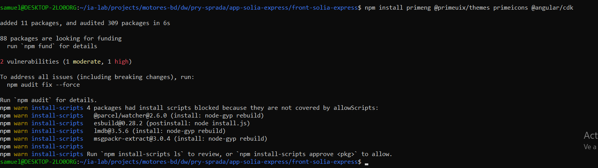
>
> 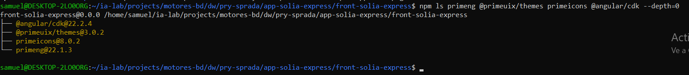
>
> `@angular/cdk` es *peer dependency* de PrimeNG 22. Si falta, el build falla al resolver overlays y focus trap.

------------------------------------------------------------------------

## 1.3 Estilos globales

Crea/reemplaza `src/styles.css`:

``` bash
cat > src/styles.css <<'EOF'
/* Tailwind 4 (lo configuró `ng new --style=tailwind`) */
@import 'tailwindcss';
/* Iconos usados por PrimeNG (pi pi-*) */
@import 'primeicons/primeicons.css';

:root {
  color-scheme: light;
}

html,
body {
  height: 100%;
}

body {
  margin: 0;
  font-family:
    Inter,
    ui-sans-serif,
    system-ui,
    -apple-system,
    'Segoe UI',
    Roboto,
    sans-serif;
  background-color: #f1f5f9; /* slate-100 */
  color: #0f172a; /* slate-900 */
}

/* Los controles de PrimeNG ocupan el ancho de su contenedor. */
.p-inputtext,
.p-select,
.p-password,
.p-inputnumber,
.p-datepicker,
.p-textarea {
  width: 100%;
}

/* Tarjetas reutilizables */
@layer components {
  .card {
    @apply rounded-2xl border border-slate-200 bg-white shadow-sm;
  }
  .card-body {
    @apply p-4 sm:p-6;
  }
  .field-label {
    @apply mb-1 block text-sm font-medium text-slate-700;
  }
  .field-error {
    @apply mt-1 block text-xs font-medium text-red-600;
  }
}

/* Ajustes finos de la tabla */
.p-datatable .p-datatable-header {
  background: transparent;
  border: 0;
  padding: 0 0 1rem 0;
}

/* Scrollbar discreto */
::-webkit-scrollbar {
  width: 10px;
  height: 10px;
}
::-webkit-scrollbar-thumb {
  background: #cbd5e1;
  border-radius: 9999px;
}
::-webkit-scrollbar-track {
  background: transparent;
}
EOF
```

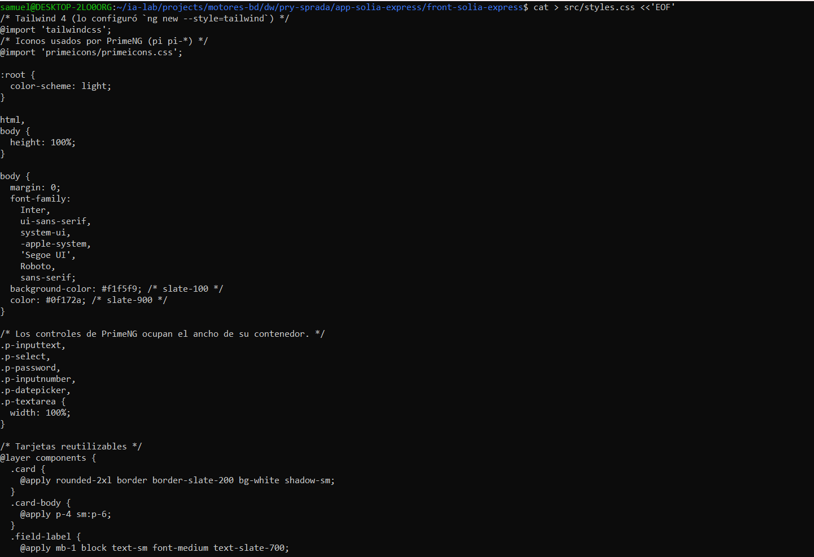

------------------------------------------------------------------------

## 1.4 Configurar PrimeNG en `app.config.ts`

Reemplaza `src/app/app.config.ts`:

``` bash
cat > src/app/app.config.ts <<'EOF'
import {
  ApplicationConfig,
  provideBrowserGlobalErrorListeners,
} from '@angular/core';
import {
  provideRouter,
  withComponentInputBinding,
  withInMemoryScrolling,
} from '@angular/router';
import { ConfirmationService, MessageService } from 'primeng/api';
import { providePrimeNG } from 'primeng/config';
import Aura from '@primeuix/themes/aura';

import { routes } from './app.routes';

export const appConfig: ApplicationConfig = {
  providers: [
    provideBrowserGlobalErrorListeners(),

    provideRouter(
      routes,
      withComponentInputBinding(),
      withInMemoryScrolling({ scrollPositionRestoration: 'top' }),
    ),

    // PrimeNG 22: tema Aura. El modo oscuro se activa con la clase .app-dark.
    providePrimeNG({
      ripple: true,
      inputVariant: 'outlined',
      theme: {
        preset: Aura,
        options: {
          darkModeSelector: '.app-dark',
          cssLayer: false,
        },
      },
    }),

    MessageService,
    ConfirmationService,
  ],
};
EOF
```

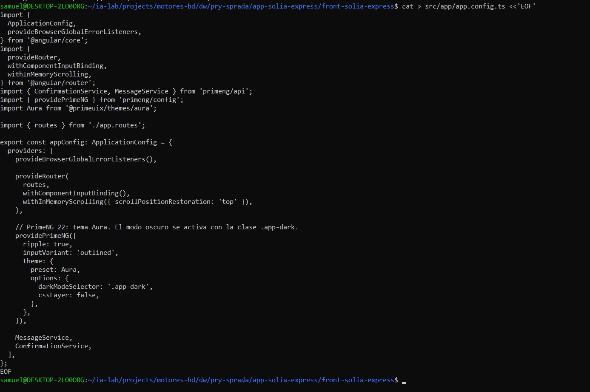

En ISS-02 se añadirán `provideHttpClient` y los interceptores encima de `provideRouter` (o debajo, el orden entre providers no importa; el orden de los **interceptores** sí).

------------------------------------------------------------------------

## 1.5 Limpiar la pantalla por defecto

El `app.html` generado por CLI no se usará: el shell de ISS-02 será la pantalla real. Deja un `router-outlet` mínimo:

``` bash
cat > src/app/app.html <<'EOF'
<router-outlet />
EOF

cat > src/app/app.ts <<'EOF'
import { Component } from '@angular/core';
import { RouterOutlet } from '@angular/router';

@Component({
  selector: 'app-root',
  imports: [RouterOutlet],
  templateUrl: './app.html',
  styleUrl: './app.css',
})
export class App {}
EOF
```

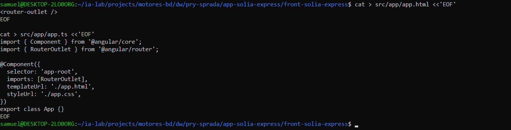

`src/app/app.css` puede quedar vacío.

------------------------------------------------------------------------

## 1.6 Personalizar `index.html`

``` bash
cat > src/index.html <<'EOF'
<!doctype html>
<html lang="es">
<head>
  <meta charset="utf-8">
  <title>StoreLab Express II · Angular 22</title>
  <base href="/">
  <meta name="viewport" content="width=device-width, initial-scale=1">
  <meta name="description" content="Frontend Angular 22 con Signals, PrimeNG y Tailwind para StoreLab Express.">
  <link rel="icon" type="image/x-icon" href="favicon.ico">
</head>
<body>
  <app-root></app-root>
</body>
</html>
EOF
```

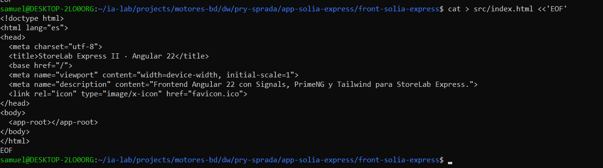

------------------------------------------------------------------------

## 1.7 Ajustar el presupuesto de build

El bundle inicial con PrimeNG supera los 500 kB por defecto. En `angular.json`, dentro de `projects → ... → architect → build → configurations → production → budgets`, cambia el primer presupuesto:

``` json
{
  "type": "initial",
  "maximumWarning": "750kB",
  "maximumError": "1MB"
}
```

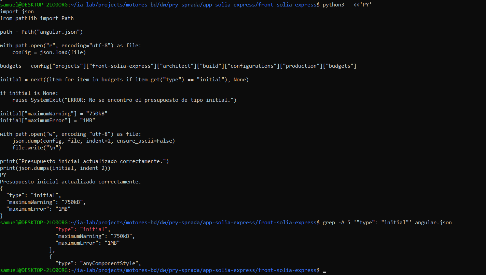

Sin este ajuste, `ng build` termina con un *warning* (no error). En ISS-11 se explica por qué no conviene subirlo más allá de 1 MB.

------------------------------------------------------------------------

## 1.8 Primera ejecución

``` bash
npm start
```

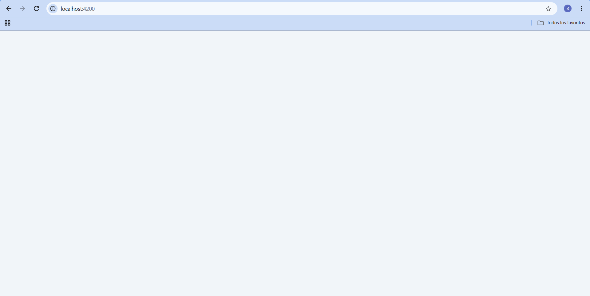

Abre `http://localhost:4200`. Debe mostrarse una página vacía (sin errores en consola). Es correcto: aún no hay rutas ni componentes de negocio.

### Comprobaciones en DevTools

-   **Console** no debe mostrar errores rojos.
-   **Network** debe cargar `styles.css`, `main.js` y los chunks con estado `200`.
-   El `<title>` de la pestaña debe ser `StoreLab Express II · Angular 22`.

------------------------------------------------------------------------

## Criterios de aceptación (ISS-01)

-   [x] `npm ls primeng @primeuix/themes` muestra versiones 22.x y 3.x.
-   [x] `src/styles.css` importa `tailwindcss` y `primeicons`.
-   [x] `providePrimeNG` usa el preset Aura y `darkModeSelector: '.app-dark'`.
-   [x] `ng serve` compila sin errores y `http://localhost:4200` responde.
-   [x] La consola del navegador no muestra errores de dependencias ni de tema.

## Comprobación desde terminal

``` bash
# El servidor debe compilar
npx ng build 2>&1 | tail -20

# Debe imprimir la configuración de Tailwind/PrimeNG
grep -R "providePrimeNG\|@import 'tailwindcss'" src | head
```

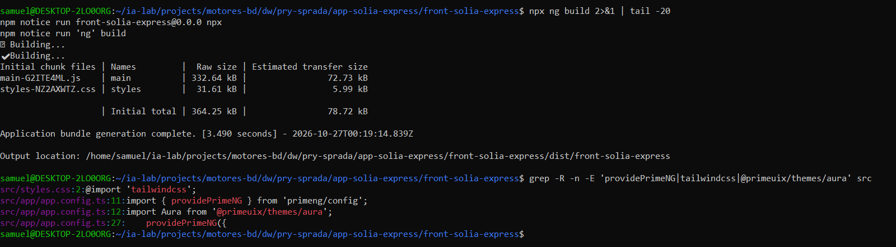

**Siguiente:** ISS-02 crea modelos, `environment`, servicios base, shell y rutas.

# Fase I: Frontend — ISS-02 — Núcleo: environment, modelos, servicios y layout

> **Vigencia · revisión local del 23-oct-2026.** En el incremento didáctico se registra `HttpClient` sin interceptores de sesión. El consolidado ya incorpora la Fase II: `authInterceptor` y `errorInterceptor`. `Shell` reutiliza `Header`/`Aside`/`Footer`. `requireAuth=true` existe en ambos entornos; no demuestra que el backend activo tenga `AUTH_ENABLED=true`. Los bloques de código de la guía pueden representar incrementos; los archivos locales citados son la referencia consolidada.

> **Vigencia · revisión local del 23-oct-2026.** Los pasos describen una construcción incremental en una copia de práctica. El código consolidado puede incluir fases posteriores. Los resultados importados son reportes de la fuente, no pruebas repetidas en esta actualización. Véase *estado y trazabilidad*.

> **Contexto mínimo (autosuficiente).** Si abres este archivo aislado —o lo llevas a otra IA—, esto es lo que hay que saber antes de ejecutarlo.
>
> -   **Proyecto:** `front-storelab-express-ii` — Angular 22 (standalone + zoneless + signals), PrimeNG 22 en modo *styled* con Aura y Tailwind CSS 4. Sin CSS de negocio ni PrimeFlex.
> -   **Backend:** `app-storelab-express-ii` (Express + TypeScript + Sequelize) en `http://localhost:4000`, prefijo `/api`.
> -   **Estado al terminar ISS-01B:** existe `features/construir` con el prototipo (Header, Aside con PanelMenu, Drawer, Footer), `App` es solo `<router-outlet />` y la ruta `construir` se carga diferida. No hay HTTP ni modelos.
> -   **Patrón visual:** `PATRON-VISUAL.md`.

| Este ISS |   |
|------------------------------------|------------------------------------|
| **Título** | Núcleo: environment, modelos, servicios y layout |
| **Feature / tabla** | `core/models`, `core/services`, `core/utils`, un `feature/*-api` por entidad, `shared/ui`, `layout/shell` |
| **API** | contrato REST completo (solo se declara; todavía no se consume en pantalla) |
| **Depende de** | ISS-01B — Menú PrimeNG e interacción |
| **Habilita** | ISS-03 — CRUD de clientes |

## Contenido de este ISS

-   2.1 `environment`: una sola URL para todo el frente
-   2.2 Modelos: reflejar el backend, no inventarlo
-   2.3 Servicios HTTP por feature: desenvolver la respuesta
-   2.4 Utilidades transversales: `toApiMessage` y `NotificationService`
-   2.5 Componentes compartidos: `PageHeader`, `EmptyState`, `StatusTag`
-   2.6 Shell: conservar el esqueleto al navegar
-   2.7 Registrar `HttpClient` sin interceptores de sesión
-   2.8 Comprobar antes de avanzar
-   Verificación del ISS
-   Cierre del ISS

**Objetivo:** dejar lista la capa de infraestructura del frontend antes de tocar pantallas de negocio:

-   `environment` con la URL del backend y el interruptor de autenticación.
-   Interfaces TypeScript que reflejan el contrato REST de Express.
-   Servicios HTTP que devuelven `Observable<T>` ya desenvuelto.
-   Utilidades transversales (`toApiMessage`, `NotificationService`).
-   Componentes de UI reutilizables y el layout `Shell`.

**Bloqueado por:** ISS-01B.

**Evidencia de aprendizaje:** dibuja y explica la cadena *plantilla → componente → `ClientApi` → Express → respuesta → signal*, e indica en qué eslabón se desenvuelve la respuesta.

**Equipo y terminal:** Ubuntu WSL, terminal del editor, carpeta del frontend. Los ejemplos con `cat >` se ejecutan en una copia de práctica; en el workspace consolidado inspecciona y ajusta los archivos existentes.

## Criterios de aceptación (ISS-02) — consolidados

-   [x] 2.1 `environment.apiUrl === 'http://localhost:4000/api'`, sin slash final
-   [x] 2.1 `environment` y `environment.development.ts` existen y `angular.json` aplica `fileReplacements`
-   [x] 2.2 Los 13 modelos compilan y coinciden campo a campo con las tablas del backend
-   [x] 2.2 `Money` acepta `number | string` y `toNumber()` normaliza `DECIMAL`
-   [x] 2.2 `status` no viaja en los DTO de edición: solo el backend lo cambia con `/deactivate`
-   [x] 2.3 Cada servicio usa `this.base` construido desde `environment.apiUrl`
-   [x] 2.3 `list()`/`get()`/`create()` devuelven la entidad, no la envoltura (`{ clients }` → `Client[]`)
-   [x] 2.3 Las envolturas pivote son `{ assignments }` y `{ grants }`, no `{ role_users }`
-   [x] 2.4 `toApiMessage` distingue `status === 0` (backend caído) de un 403
-   [x] 2.4 `NotificationService` traduce a `MessageService` con duraciones por severidad
-   [x] 2.5 `PageHeader`, `EmptyState` y `StatusTag` compilan como standalone y no añaden CSS
-   [x] 2.5 `StatusTag` se repinta al cambiar el input gracias a `computed`
-   [x] 2.6 `Shell` compone Header/aside/router-outlet/Footer una sola vez; el botón del Header alterna el Aside en escritorio y abre el Drawer en móvil
-   [x] 2.6 `app.routes.ts` carga `Shell` con `loadComponent` y conserva el prototipo
-   [x] 2.7 `provideHttpClient()` está registrado y no hay interceptores de sesión
-   [x] 2.8 `ng build` termina con código 0 y `shell` aparece como chunk diferido
-   [x] 2.8 Las pruebas pasan: 8 archivos, 33 casos

> `demo/ejemplo` sigue fuera. La introducción a Angular quedó en ISS-01: no tiene ruta, no está en el menú y no se compone aquí.

------------------------------------------------------------------------

## 2.1 `environment`: una sola URL para todo el frente

**Criterios de este sub-ítem**

-   [x] `apiUrl` termina en `/api`, nunca en `/`
-   [x] Existen `environment.ts` (build) y `environment.development.ts` (`ng serve`)
-   [x] `angular.json` sustituye el archivo en la configuración `development`
-   [x] `primeUiLicense` está documentado en ambos archivos (clave Community PrimeUI; ISS-01 §1.4.1)

``` bash
ng generate environments
```

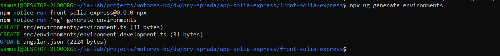

Crea los dos archivos y registra el reemplazo. Si ya existen, edítalos sin repetir el generador.

**`src/environments/environment.ts`** — lo usa `ng build`, es el base:

``` typescript
cat > src/environments/environment.ts <<'EOF'
/**
 * Base environment used by production builds.
 *
 * apiUrl must end in /api without a trailing slash.
 * primeUiLicense is reserved for the applicable PrimeUI license key.
 * Do not commit commercial license keys.
 */
export const environment = {
  production: true,
  appName: 'Solia Express',
  apiUrl: 'http://localhost:4000/api',
  requireAuth: true,
  primeUiLicense: '',
};
EOF
```

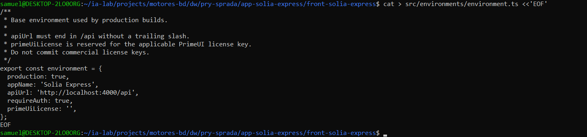

**`src/environments/environment.development.ts`** — lo usa `ng serve` y `npm test`:

``` typescript
cat > src/environments/environment.development.ts <<'EOF'
/**
 * Development environment used by ng serve.
 *
 * Keep apiUrl consistent with the base environment.
 * primeUiLicense is reserved for the applicable PrimeUI license key.
 */
export const environment = {
  production: false,
  appName: 'Solia Express',
  apiUrl: 'http://localhost:4000/api',
  requireAuth: true,
  primeUiLicense: '',
};
EOF
```

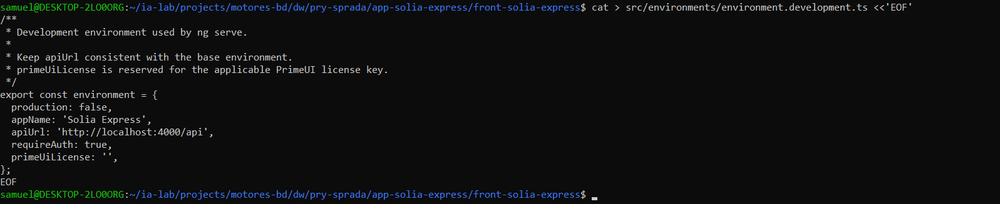

### 2.1.1 Licencia PrimeUI (`primeUiLicense`)

Tras ISS-01, `app.config.ts` registra PrimeNG así:

``` typescript
providePrimeNG({
  license: environment.primeUiLicense || undefined,
  // ...
});
```

Pasos:

1.  Solicita la **Community License** (gratuita para estudiantes) en <https://primeui.dev>.
2.  Copia la clave del correo (cadena larga, suele empezar por `eyJ…`).
3.  Pégala en `primeUiLicense` de `environment.development.ts` (para `ng serve`).
4.  Repite el mismo valor en `environment.ts` (para `ng build` / entrega).
5.  Reinicia `ng serve` y recarga el navegador: desaparecen `[PrimeUI] No license key configured` y la banda *Invalid PrimeUI License*.

Si trabajas sin clave, mantén `primeUiLicense: ''` y documenta el aviso en la evidencia (ISS-01 §1.4.1).

**`angular.json` → `projects.<proyecto>.architect.build.configurations.development`:**

``` json
"development": {
  "optimization": false,
  "extractLicenses": false,
  "sourceMap": true,
  "fileReplacements": [
    {
      "replace": "src/environments/environment.ts",
      "with": "src/environments/environment.development.ts"
    }
  ]
}
```

| Idea | Consecuencia |
|------------------------------------|------------------------------------|
| `environment.ts` es el base | El build de producción no necesita reemplazo |
| `development` reemplaza por `environment.development.ts` | `ng serve` compila con `production: false` |
| Solo cambia lo que difiere | `apiUrl` aparece una vez por archivo; los servicios la importan |

> **El slash final no es cosmético.** Con `apiUrl = 'http://localhost:4000/api/'`, el servicio armaría `${apiUrl}/clientes` y la URL real sería `http://localhost:4000/api//clientes`. Express compara rutas literales: `//clientes` no coincide con `/api/clientes` y responde 404.

**Sobre `requireAuth`.** En ISS-02 nadie lo lee todavía: es el interruptor que ISS-08 consumirá desde `SessionStore`. Se declara ahora para que la URL y la configuración vivan en el mismo lugar. Es la mitad frontal de un interruptor de dos piezas:

| Pieza | Repositorio | Efecto |
|------------------------|------------------------|------------------------|
| `requireAuth` | Frontend (`environment*.ts`) | Guards, directiva, menú y refresh |
| `AUTH_ENABLED` | Backend (`.env`) | `authenticate` y `authorize` de las rutas de negocio |

Con el backend consolidado (JWT + RBAC activo) las dos valen `true`. Si cambias solo el frontend a `false`, las peticiones salen sin `Bearer` y Express responde 401: no existe forma de «abrir» la API desde el cliente. Las dos banderas se mueven juntas (ISS-11 §11.1). No es lo que hace que la Fase I funcione: la Fase I simplemente no tiene guards, directiva ni interceptor.

------------------------------------------------------------------------

## 2.2 Modelos: reflejar el backend, no inventarlo

**Criterios de este sub-ítem**

-   [x] Cada entidad tiene su interfaz y su `Payload` de escritura
-   [x] Los modelos de lectura no exponen `password`
-   [x] `Money` cubre `number | string`; `toNumber()` normaliza
-   [x] Los campos son los del backend, en `snake_case`

``` bash
ng generate interface core/models/api --type=model --defaults
ng generate interface core/models/money --type=model --defaults
ng generate interface core/models/member --type=model --defaults
ng generate interface core/models/account --type=model --defaults
ng generate interface core/models/movement --type=model --defaults
ng generate interface core/models/credit-application --type=model --defaults
ng generate interface core/models/credit --type=model --defaults
ng generate interface core/models/rate --type=model --defaults
ng generate interface core/models/installment --type=model --defaults
ng generate interface core/models/installment-payment --type=model --defaults
ng generate interface core/models/committee-decision --type=model --defaults
ng generate interface core/models/audit --type=model --defaults
ng generate interface core/models/user --type=model --defaults
ng generate interface core/models/role --type=model --defaults
ng generate interface core/models/resource --type=model --defaults
ng generate interface core/models/role-user --type=model --defaults
ng generate interface core/models/resource-role --type=model --defaults
ng generate interface core/models/auth --type=model --defaults
ng generate interface core/models/dashboard --type=model --defaults
```

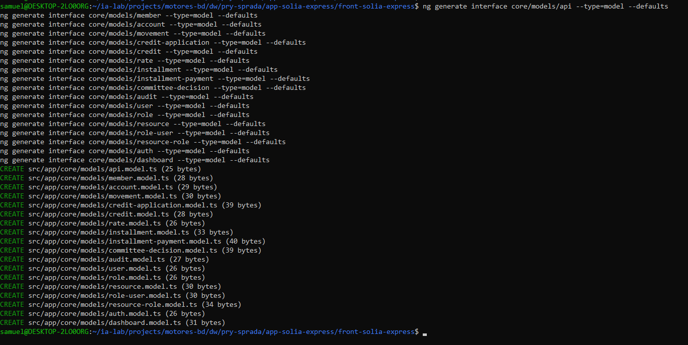

Cada comando crea un `*.model.ts` con una interfaz vacía. Reemplaza también el nombre exportado: el archivo se llama `client.model.ts`, pero el export es `Client`, no `ClientModel`.

### `api.model.ts` — los tipos que comparten todos

``` typescript

export type Status = 'active' | 'inactive';

export type Money = number | string;

export interface ApiError {
  error: string;
  detail?: string;
}

/**
 * Minimal shape of Sequelize objects returned by the backend.
 */
export interface Timestamps {
  createdAt?: string;
  updatedAt?: string;
}

export function toNumber(value: Money | null | undefined): number {
  const parsed = Number(value ?? 0);
  return Number.isFinite(parsed) ? parsed : 0;
}
```

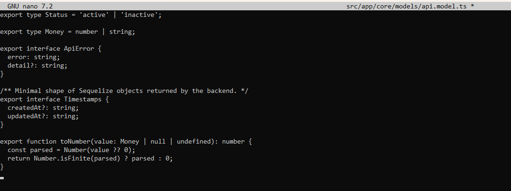

**Por qué `Money` es una unión.** Sequelize define `price`, `total`, `unit_price` como `DECIMAL(12,2)`. Según el motor y el driver, ese valor llega como `number` o como `string` (`"12.50"`). Si el modelo dijera solo `number`, TypeScript mentiría y una suma como `price + tax` concatenaría texto. `toNumber()` convierte en un solo lugar.

### Las entidades

**`src/app/core/models/member.model.ts`**

``` typescript
import { Status, Timestamps } from './api.model';

/** Tabla `clients` — /api/clientes */
export interface Client extends Timestamps {
  id: number;
  name: string;
  address: string | null;
  phone: string | null;
  email: string | null;
  status: Status;
}

/** El backend acepta password en Client (residual del ISS-03), pero la UI no lo usa. */
export interface ClientPayload {
  name: string;
  address?: string | null;
  phone?: string | null;
  email?: string | null;
  status?: Status;
}
```

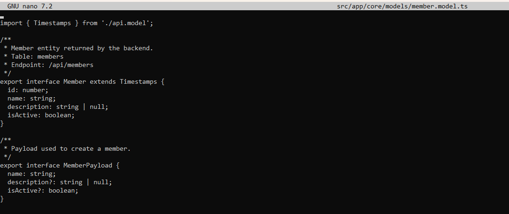

**`rate.model.ts`, `credit.model.ts`, `installment-payment.model.ts`.**

``` typescript

import { Status, Timestamps, Money } from './api.model';

/**
 * Interest rate entity returned by the backend.
 * Table: rates
 * Endpoint: /api/tasas
 */
export interface Rate extends Timestamps {
  id: number;
  name: string;
  percentage: Money;
  type: 'monthly' | 'annual';
  description: string | null;
  status: Status;
}

export interface RatePayload {
  name: string;
  percentage: number;
  type: 'monthly' | 'annual';
  description?: string | null;
  status?: Status;
}


import { Status, Timestamps, Money } from './api.model';

export type CreditStatus = 'active' | 'paid' | 'cancelled';

export interface Credit extends Timestamps {
  id: number;
  credit_application_id: number;
  rate_id: number;
  date: string;
  approved_amount: Money;
  term: number;
  interest_rate: Money;
  status: CreditStatus;
  observations: string | null;
}

export interface CreditPayload {
  credit_application_id: number;
  rate_id: number;
  date: string;
  approved_amount: number;
  term: number;
  interest_rate: number;
  status?: CreditStatus;
  observations?: string | null;
}


import { Timestamps, Money } from './api.model';

export type PaymentMethod = 'cash' | 'transfer' | 'deposit' | 'other';

export type InstallmentPaymentStatus = 'active' | 'cancelled';

export interface InstallmentPayment extends Timestamps {
  id: number;
  installment_id: number;
  payment_date: string;
  amount: Money;
  reference: string | null;
  method: PaymentMethod;
  status: InstallmentPaymentStatus;
}

export interface InstallmentPaymentPayload {
  installment_id: number;
  payment_date: string;
  amount: number;
  reference?: string | null;
  method: PaymentMethod;
  status?: InstallmentPaymentStatus;
}
```

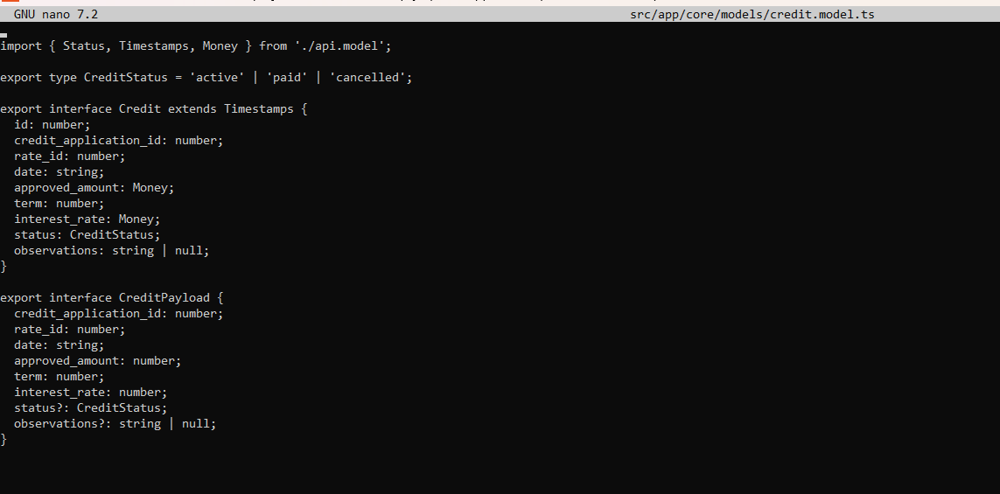

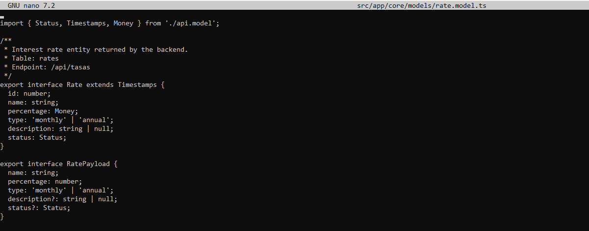

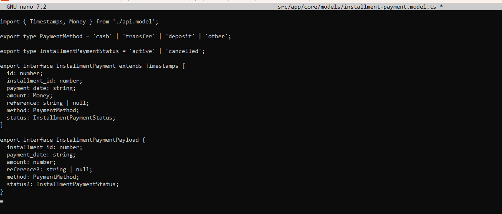

**`account.model.ts, mavement.model.ts, credit-application.model.ts`** — la cabecera y sus dos payloads.

``` typescript
import { Status, Timestamps } from './api.model';

/** Account entity returned by the backend. */
export interface Account extends Timestamps {
  id: number;
  member_id: number;
  name: string;
  description: string | null;
  status: Status;
}

export interface AccountPayload {
  member_id: number;
  name: string;
  description?: string | null;
  status?: Status;
}
EOF

cat > src/app/core/models/movement.model.ts <<'EOF'
import { Money, Status, Timestamps } from './api.model';

/** Movement entity returned by the backend. */
export interface Movement extends Timestamps {
  id: number;
  account_id: number;
  reference_id: number | null;
  type: string;
  date: string;
  amount: Money;
  observations: string | null;
  status: Status;
}

export interface MovementPayload {
  account_id: number;
  reference_id?: number | null;
  type: string;
  date: string;
  amount: number;
  observations?: string | null;
  status?: Status;
}
EOF

cat > src/app/core/models/credit-application.model.ts <<'EOF'
import { Money, Timestamps } from './api.model';

export type CreditApplicationStatus =
  | 'pending'
  | 'approved'
  | 'rejected'
  | 'cancelled';

/** Credit application entity returned by the backend. */
export interface CreditApplication extends Timestamps {
  id: number;
  member_id: number;
  reference_id: number | null;
  date: string;
  amount: Money;
  status: CreditApplicationStatus;
  observations: string | null;
}

export interface CreditApplicationPayload {
  member_id: number;
  reference_id?: number | null;
  date: string;
  amount: number;
  status?: CreditApplicationStatus;
  observations?: string | null;
}
```

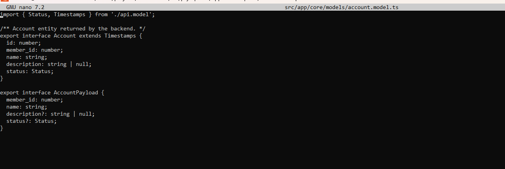

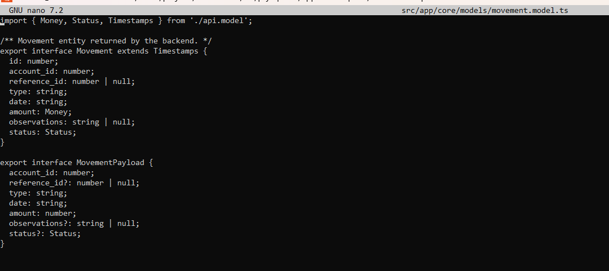

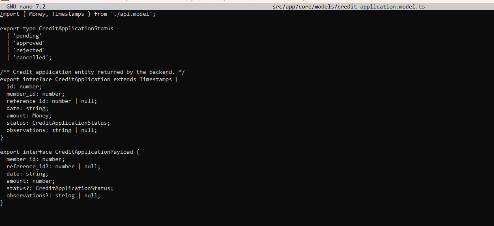

**`installment.model.ts, committe-decision.model.ts, audit.model.ts,`** — la cabecera y sus dos payloads.

``` typescript
import { Money, Timestamps } from './api.model';

export type InstallmentStatus =
  | 'pending'
  | 'paid'
  | 'overdue'
  | 'cancelled';


  id: number;
  credit_id: number;
  number: number;
  due_date: string;
  principal_amount: Money;
  interest_amount: Money;
  total_amount: Money;
  paid_amount: Money;
  status: InstallmentStatus;
}

export interface InstallmentPayload {
  credit_id: number;
  number: number;
  due_date: string;
  principal_amount: number;
  interest_amount: number;
  total_amount: number;
  paid_amount?: number;
  status?: InstallmentStatus;
}

import { Timestamps } from './api.model';

export type CommitteeDecisionType =
  | 'pending'
  | 'approved'
  | 'rejected'
  | 'observed';


export interface CommitteeDecision extends Timestamps {
  id: number;
  credit_application_id: number;
  decision: CommitteeDecisionType;
  decision_date: string | null;
  comments: string | null;
  decided_by: number | null;
  status: CommitteeDecisionStatus;
}

export interface CommitteeDecisionPayload {
  credit_application_id: number;
  decision: CommitteeDecisionType;
  decision_date?: string | null;
  comments?: string | null;
  decided_by?: number | null;
  status?: CommitteeDecisionStatus;
}

export interface Audit {
  id: number;
  actor_user_id: number;
  action: string;
  entity: string;
  entity_id: number;
  data: string | null;
  createdAt?: string;
}
```

> 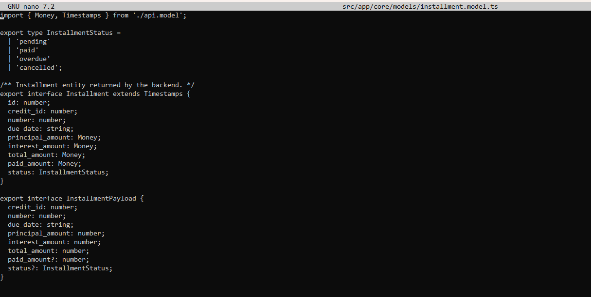
>
> 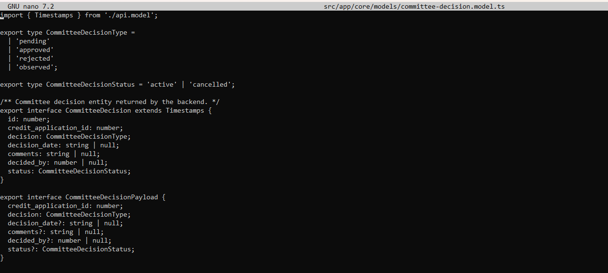
>
> 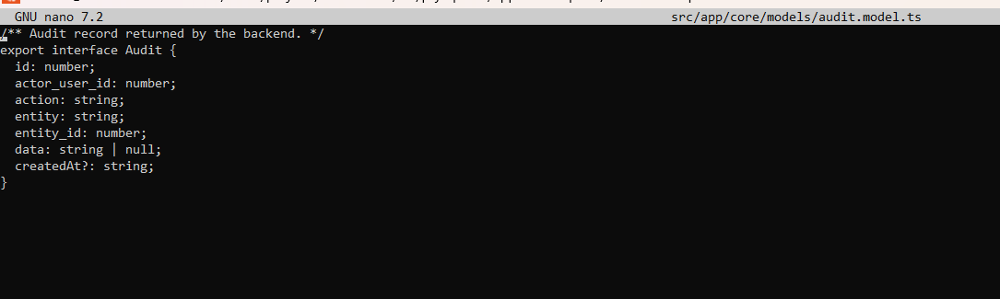`SaleCreatePayload` **no lleva `total`**. El total lo calcula Express a partir de las líneas y del stock real. Enviarlo desde la UI sería confiar en el cliente para un dato contable.

**`user.model.ts`, `role.model.ts`, `resource.model.ts`.**

``` typescript
import { Status, Timestamps } from './api.model';

/** User information returned by the backend. */
export interface User extends Timestamps {
  id: number;
  username: string;
  email: string;
  avatar: string | null;
  status: Status;
}

/** Payload used to create a user. */
export interface CreateUserPayload {
  username: string;
  email: string;
  password: string;
  avatar?: string | null;
  status?: Status;
}

/** Payload used to update a user's profile. */
export interface UpdateUserPayload {
  username: string;
  email: string;
  avatar?: string | null;
}

import { Status, Timestamps } from './api.model';

/** Role entity returned by the backend. */
export interface Role extends Timestamps {
  id: number;
  name: string;
  description: string | null;
  status: Status;
}

export interface RolePayload {
  name: string;
  description?: string | null;
  status?: Status;
}

import { Status, Timestamps } from './api.model';

/** Protected API resource returned by the backend. */
export interface Resource extends Timestamps {
  id: number;
  method: string;
  path: string;
  description: string | null;
  status: Status;
}

export interface ResourcePayload {
  method: string;
  path: string;
  description?: string | null;
  status?: Status;
}
```

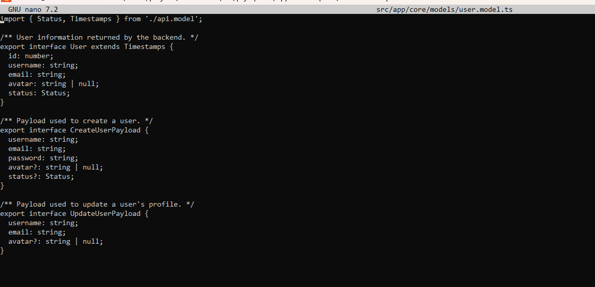

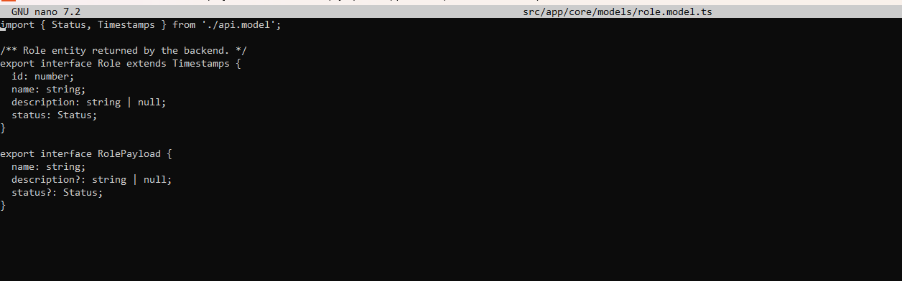

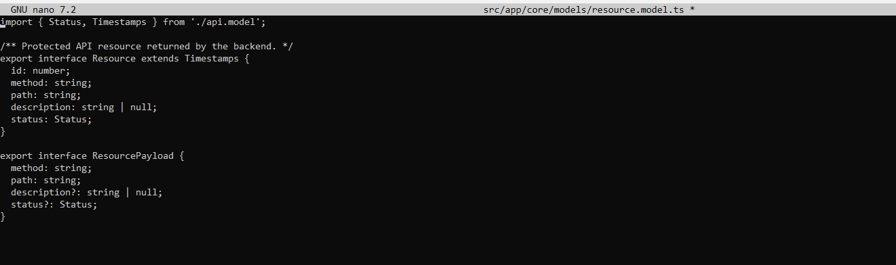

**`role-user.model.ts` y `resource-role.model.ts`** — los dos pivotes.

``` typescript
import { Status, Timestamps } from './api.model';

export interface RoleUserDetails {
  id: number;
  username: string;
  email: string;
}

export interface RoleSummary {
  id: number;
  name: string;
}

/** User-to-role assignment. */
export interface RoleUser extends Timestamps {
  id: number;
  user_id: number;
  role_id: number;
  status: Status;
  user?: RoleUserDetails | null;
  role?: RoleSummary | null;
}

export interface RoleUserPayload {
  user_id: number;
  role_id: number;
  status?: Status;
}

import { Status, Timestamps } from './api.model';

export interface ResourceRoleSummary {
  id: number;
  name: string;
}

export interface ResourceSummary {
  id: number;
  method: string;
  path: string;
  description: string | null;
}

/** Resource permissions assigned to a role. */
export interface ResourceRole extends Timestamps {
  id: number;
  role_id: number;
  resource_id: number;
  status: Status;
  role?: ResourceRoleSummary | null;
  resource?: ResourceSummary | null;
}

export interface ResourceRolePayload {
  role_id: number;
  resource_id: number;
  status?: Status;
}
```

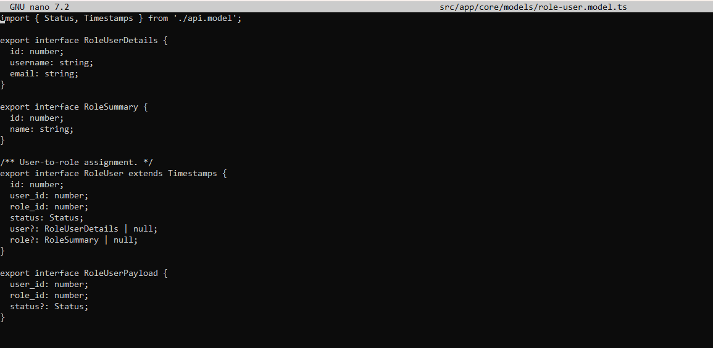

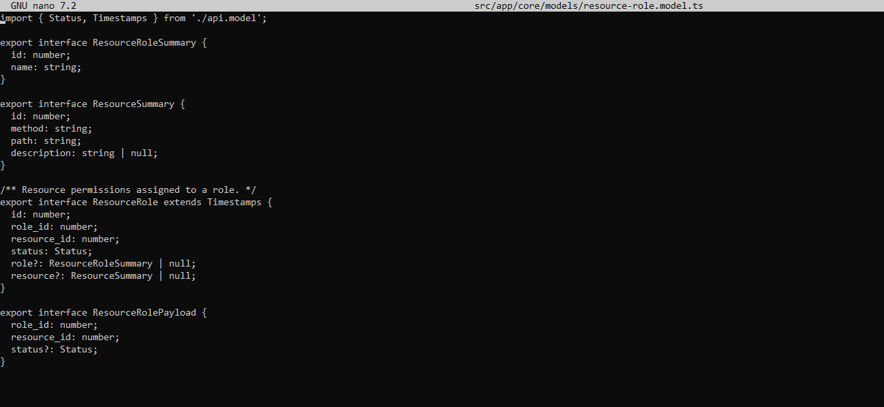

**`auth.model.ts` y `dashboard.model.ts`** — se declaran ahora, se consumen en ISS-08 e ISS-07.

``` typescript
import { Status } from './api.model';

/** Credentials submitted to the login endpoint. */
export interface LoginPayload {
  identifier: string;
  password: string;
}

/** Tokens returned after a successful login or refresh. */
export interface SessionTokens {
  access_token: string;
  token_type: 'Bearer';
  expires_in: number;
  refresh_token: string;
  refresh_expires_in: number;
}

/** Authenticated user profile. */
export interface AuthUser {
  id: number;
  username: string;
  email: string;
  avatar: string | null;
  status: Status;
}

/** Profile endpoint response. */
export interface ProfileResponse {
  user: AuthUser;
}

/** Effective permission granted to the authenticated user. */
export interface EffectivePermission {
  resource_id: number;
  method: string;
  path: string;
  description: string | null;
  role_id: number;
  role_name: string;
}

/** Permissions endpoint response. */
export interface PermissionsResponse {
  permissions: EffectivePermission[];
}

/** Payload used to refresh or log out a session. */
export interface RefreshTokenPayload {
  refresh_token: string;
}
```

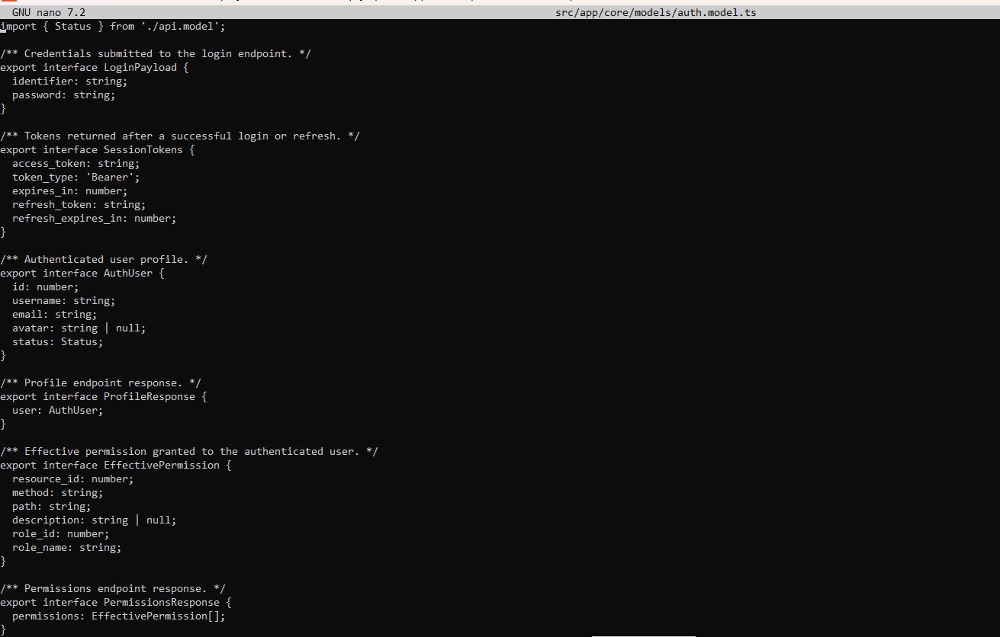

**La regla que se repite en todos los modelos.** `status` aparece en la interfaz de lectura y como opcional en el `Payload` de creación, pero los DTO de `PUT`/`PATCH` lo excluyen: el estado solo cambia con `PATCH /:id/deactivate`. Si el formulario de edición enviara `status`, el backend lo ignoraría o respondería 400 — y la UI estaría prometiendo algo que no puede hacer.

------------------------------------------------------------------------

## 2.3 Servicios HTTP por feature: desenvolver la respuesta

**Criterios de este sub-ítem**

-   [x] Cada servicio es `@Injectable({ providedIn: 'root' })` y usa `inject(HttpClient)`
-   [x] `base` se construye una vez desde `environment.apiUrl`
-   [x] Los métodos devuelven `Observable<Entidad>`, no `Observable<{ entidad }>`
-   [x] Ninguna URL se escribe completa dentro de un método

``` bash
npx ng generate service features/members/member-api --skip-tests --defaults
npx ng generate service features/accounts/account-api --skip-tests --defaults
npx ng generate service features/movements/movement-api --skip-tests --defaults
npx ng generate service features/credit-applications/credit-application-api --skip-tests --defaults
npx ng generate service features/credits/credit-api --skip-tests --defaults
npx ng generate service features/rates/rate-api --skip-tests --defaults
npx ng generate service features/installments/installment-api --skip-tests --defaults
npx ng generate service features/installment-payments/installment-payment-api --skip-tests --defaults
npx ng generate service features/committee-decisions/committee-decision-api --skip-tests --defaults
npx ng generate service features/admin/users/user-api --skip-tests --defaults
npx ng generate service features/admin/roles/role-api --skip-tests --defaults
npx ng generate service features/admin/resources/resource-api --skip-tests --defaults
npx ng generate service features/admin/role-users/role-user-api --skip-tests --defaults
npx ng generate service features/admin/resource-roles/resource-role-api --skip-tests --defaults
npx ng generate service features/admin/audits/audit-api --skip-tests --defaults
npx ng generate service features/auth/auth-api --skip-tests --defaults
npx ng generate service core/services/notification --skip-tests --defaults
```

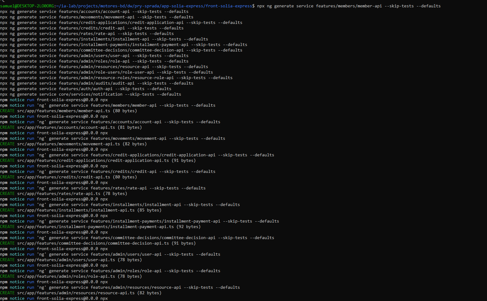

`--skip-tests` aquí sí es deliberado: los servicios se prueban en un mismo `client-api.spec.ts` con `HttpTestingController` (más abajo), no con un stub vacío por archivo.

### El contrato real del backend

Express responde **envolturas**, y el nombre de la clave no siempre coincide con el nombre de la tabla. Esta tabla es la fuente de verdad:

| Recurso | Ruta | Colección | Elemento |
|------------------|------------------|------------------|------------------|
| Socios | `/api/members` | `members` | `member` |
| Cuentas | Por verificar | Por verificar | Por verificar |
| Movimientos | `/api/movements` | `movements` | `movement` |
| Solicitudes de crédito | `/api/credit-applications` | `credit_applications` | `credit_application` |
| Créditos | `/api/credits` | `credits` | `credit` |
| Tasas | `/api/rates` | `rates` | `rate` |
| Cuotas | `/api/installments` | `installments` | `installment` |
| Pagos de cuotas | `/api/installment-payments` | `installment_payments` | `installment_payment` |
| Decisiones del comité | `/api/committee-decisions` | `committee_decisions` | `committee_decision` |
| Usuarios | `/api/usuarios` | `users` | `user` |
| Roles | `/api/roles` | `roles` | `role` |
| Recursos | `/api/recursos` | `resources` | `resource` |
| Asignaciones de usuarios a roles | `/api/asignaciones-rol` | `assignments` | `assignment` |
| Concesiones de recursos a roles | Por verificar | `grants` | `grant` |

Las dos últimas filas son la trampa del contrato: la tabla se llama `role_users` y `resource_roles`, pero la respuesta usa `assignments` y `grants`. Escribir `{ role_users }` compila —TypeScript no valida el nombre que tú declaras— y falla en ejecución con `undefined`.

### `member-api.ts` — el patrón completo

``` typescript
import { HttpClient } from '@angular/common/http';
import { Injectable, inject } from '@angular/core';
import { Observable, map } from 'rxjs';
import { environment } from '../../../environments/environment';
import { Client, ClientPayload } from '../../core/models/client.model';

/** Contrato exacto de `features/business/clients` en Express. */
@Injectable({ providedIn: 'root' })
export class ClientApi import { HttpClient } from '@angular/common/http';
import { Injectable, inject } from '@angular/core';
import { Observable, map } from 'rxjs';
import { environment } from '../../../environments/environment';
import { Member, MemberPayload } from '../../core/models/member.model';

@Injectable({ providedIn: 'root' })
export class MemberApi {
  private readonly http = inject(HttpClient);
  private readonly base = `${environment.apiUrl}/socios`;

  list(): Observable<Member[]> {
    return this.http
      .get<{ members: Member[] }>(this.base)
      .pipe(map((response) => response.members));
  }

  get(id: number): Observable<Member> {
    return this.http
      .get<{ member: Member }>(`${this.base}/${id}`)
      .pipe(map((response) => response.member));
  }

  create(payload: MemberPayload): Observable<Member> {
    return this.http
      .post<{ member: Member }>(this.base, payload)
      .pipe(map((response) => response.member));
  }

  update(id: number, payload: Partial<MemberPayload>): Observable<Member> {
    return this.http
      .patch<{ member: Member }>(`${this.base}/${id}`, payload)
      .pipe(map((response) => response.member));
  }
  /** Physical deletion: DELETE. */
remove(id: number): Observable<unknown> {
  return this.http.delete(`${this.base}/${id}`);
  }
}
```

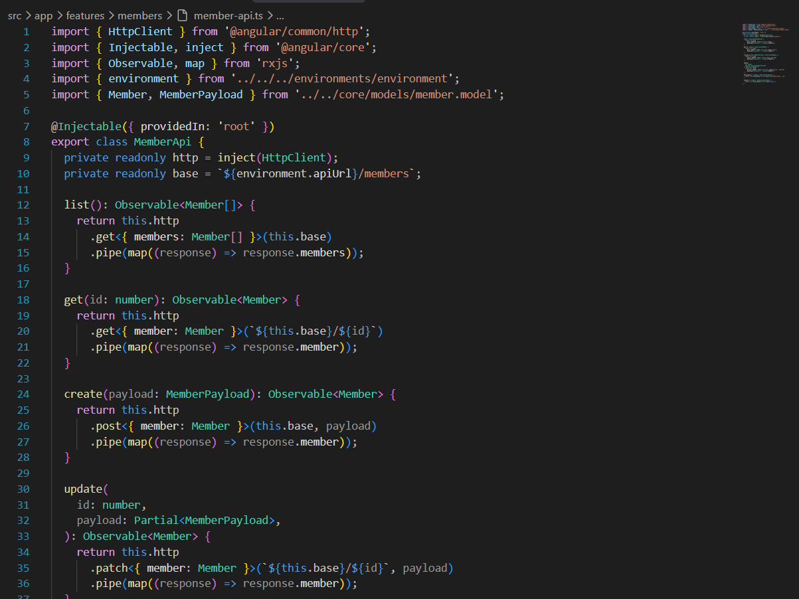

**Dónde se desenvuelve.** En el `.pipe(map(...))` del servicio, no en el componente:

``` text
list(): Observable<Member[]> {
  return this.http
    .get<{ members: Member[] }>(this.base)
    .pipe(map((response) => response.members));
}
```

Si el componente recibiera la envoltura, cada pantalla tendría que recordar el nombre de la clave —y `assignments`/`grants` romperían esa memoria.

### Los otros servicios, en una línea cada uno

``` typescript
cd ~/ia-lab/projects/motores-bd/dw/pry-sprada/app-solia-express

python3 <<'PY'
from pathlib import Path
from datetime import datetime
import shutil

root = Path("front-solia-express/src/app")
backup = Path("/tmp/solia-api-backup-" + datetime.now().strftime("%Y%m%d-%H%M%S"))

files = {
    "features/accounts/account-api.ts": r"""
import { HttpClient } from '@angular/common/http';
import { Injectable, inject } from '@angular/core';
import { Observable, map } from 'rxjs';
import { environment } from '../../environments/environment';
import { Account, AccountPayload } from '../../core/models/account.model';

@Injectable({ providedIn: 'root' })
export class AccountApi {
  private readonly http = inject(HttpClient);
  private readonly base = `${environment.apiUrl}/accounts`;

  list(): Observable<Account[]> {
    return this.http.get<{ accounts: Account[] }>(this.base)
      .pipe(map((response) => response.accounts));
  }

  get(id: number): Observable<Account> {
    return this.http.get<{ account: Account }>(`${this.base}/${id}`)
      .pipe(map((response) => response.account));
  }

  create(payload: AccountPayload): Observable<Account> {
    return this.http.post<{ account: Account }>(this.base, payload)
      .pipe(map((response) => response.account));
  }

  update(id: number, payload: Partial<AccountPayload>): Observable<Account> {
    return this.http.patch<{ account: Account }>(`${this.base}/${id}`, payload)
      .pipe(map((response) => response.account));
  }

  deactivate(id: number): Observable<unknown> {
    return this.http.patch(`${this.base}/${id}/deactivate`, {});
  }

  remove(id: number): Observable<unknown> {
    return this.http.delete(`${this.base}/${id}`);
  }
}
""",
    "features/admin/audits/audit-api.ts": r"""
import { HttpClient } from '@angular/common/http';
import { Injectable, inject } from '@angular/core';
import { Observable, map } from 'rxjs';
import { environment } from '../../../environments/environment';
import { Audit } from '../../../core/models/audit.model';

@Injectable({ providedIn: 'root' })
export class AuditApi {
  private readonly http = inject(HttpClient);
  private readonly base = `${environment.apiUrl}/audits`;

  list(): Observable<Audit[]> {
    return this.http.get<{ audits: Audit[] }>(this.base)
      .pipe(map((response) => response.audits));
  }

  get(id: number): Observable<Audit> {
    return this.http.get<{ audit: Audit }>(`${this.base}/${id}`)
      .pipe(map((response) => response.audit));
  }

  create(payload: Omit<Audit, 'id' | 'createdAt'>): Observable<Audit> {
    return this.http.post<{ audit: Audit }>(this.base, payload)
      .pipe(map((response) => response.audit));
  }
}
""",
    "features/admin/resource-roles/resource-role-api.ts": r"""
import { HttpClient } from '@angular/common/http';
import { Injectable, inject } from '@angular/core';
import { Observable, map } from 'rxjs';
import { environment } from '../../../environments/environment';
import {
  ResourceRole,
  ResourceRolePayload,
} from '../../../core/models/resource-role.model';

@Injectable({ providedIn: 'root' })
export class ResourceRoleApi {
  private readonly http = inject(HttpClient);
  private readonly base = `${environment.apiUrl}/concesiones-rol`;

  list(): Observable<ResourceRole[]> {
    return this.http.get<{ grants: ResourceRole[] }>(this.base)
      .pipe(map((response) => response.grants));
  }

  get(id: number): Observable<ResourceRole> {
    return this.http.get<{ grant: ResourceRole }>(`${this.base}/${id}`)
      .pipe(map((response) => response.grant));
  }

  create(payload: ResourceRolePayload): Observable<ResourceRole> {
    return this.http.post<{ grant: ResourceRole }>(this.base, payload)
      .pipe(map((response) => response.grant));
  }

  deactivate(id: number): Observable<unknown> {
    return this.http.patch(`${this.base}/${id}/deactivate`, {});
  }

  reactivate(id: number): Observable<unknown> {
    return this.http.patch(`${this.base}/${id}/reactivate`, {});
  }
}
""",
    "features/admin/resources/resource-api.ts": r"""
import { HttpClient } from '@angular/common/http';
import { Injectable, inject } from '@angular/core';
import { Observable, map } from 'rxjs';
import { environment } from '../../../environments/environment';
import { Resource, ResourcePayload } from '../../../core/models/resource.model';

@Injectable({ providedIn: 'root' })
export class ResourceApi {
  private readonly http = inject(HttpClient);
  private readonly base = `${environment.apiUrl}/recursos`;

  list(): Observable<Resource[]> {
    return this.http.get<{ resources: Resource[] }>(this.base)
      .pipe(map((response) => response.resources));
  }

  get(id: number): Observable<Resource> {
    return this.http.get<{ resource: Resource }>(`${this.base}/${id}`)
      .pipe(map((response) => response.resource));
  }

  create(payload: ResourcePayload): Observable<Resource> {
    return this.http.post<{ resource: Resource }>(this.base, payload)
      .pipe(map((response) => response.resource));
  }

  update(id: number, payload: Partial<ResourcePayload>): Observable<Resource> {
    return this.http.patch<{ resource: Resource }>(`${this.base}/${id}`, payload)
      .pipe(map((response) => response.resource));
  }

  deactivate(id: number): Observable<unknown> {
    return this.http.patch(`${this.base}/${id}/deactivate`, {});
  }

  remove(id: number): Observable<unknown> {
    return this.http.delete(`${this.base}/${id}`);
  }
}
""",
    "features/admin/role-users/role-user-api.ts": r"""
import { HttpClient } from '@angular/common/http';
import { Injectable, inject } from '@angular/core';
import { Observable, map } from 'rxjs';
import { environment } from '../../../environments/environment';
import { RoleUser, RoleUserPayload } from '../../../core/models/role-user.model';

@Injectable({ providedIn: 'root' })
export class RoleUserApi {
  private readonly http = inject(HttpClient);
  private readonly base = `${environment.apiUrl}/asignaciones-rol`;

  list(): Observable<RoleUser[]> {
    return this.http.get<{ assignments: RoleUser[] }>(this.base)
      .pipe(map((response) => response.assignments));
  }

  get(id: number): Observable<RoleUser> {
    return this.http.get<{ assignment: RoleUser }>(`${this.base}/${id}`)
      .pipe(map((response) => response.assignment));
  }

  create(payload: RoleUserPayload): Observable<RoleUser> {
    return this.http.post<{ assignment: RoleUser }>(this.base, payload)
      .pipe(map((response) => response.assignment));
  }

  deactivate(id: number): Observable<unknown> {
    return this.http.patch(`${this.base}/${id}/deactivate`, {});
  }

  reactivate(id: number): Observable<unknown> {
    return this.http.patch(`${this.base}/${id}/reactivate`, {});
  }
}
""",
    "features/admin/roles/role-api.ts": r"""
import { HttpClient } from '@angular/common/http';
import { Injectable, inject } from '@angular/core';
import { Observable, map } from 'rxjs';
import { environment } from '../../../environments/environment';
import { Role, RolePayload } from '../../../core/models/role.model';

@Injectable({ providedIn: 'root' })
export class RoleApi {
  private readonly http = inject(HttpClient);
  private readonly base = `${environment.apiUrl}/roles`;

  list(): Observable<Role[]> {
    return this.http.get<{ roles: Role[] }>(this.base)
      .pipe(map((response) => response.roles));
  }

  get(id: number): Observable<Role> {
    return this.http.get<{ role: Role }>(`${this.base}/${id}`)
      .pipe(map((response) => response.role));
  }

  create(payload: RolePayload): Observable<Role> {
    return this.http.post<{ role: Role }>(this.base, payload)
      .pipe(map((response) => response.role));
  }

  update(id: number, payload: Partial<RolePayload>): Observable<Role> {
    return this.http.patch<{ role: Role }>(`${this.base}/${id}`, payload)
      .pipe(map((response) => response.role));
  }

  deactivate(id: number): Observable<unknown> {
    return this.http.patch(`${this.base}/${id}/deactivate`, {});
  }

  remove(id: number): Observable<unknown> {
    return this.http.delete(`${this.base}/${id}`);
  }
}
""",
    "features/admin/users/user-api.ts": r"""
import { HttpClient } from '@angular/common/http';
import { Injectable, inject } from '@angular/core';
import { Observable, map } from 'rxjs';
import { environment } from '../../../environments/environment';
import { EffectivePermission } from '../../../core/models/auth.model';
import {
  CreateUserPayload,
  UpdateUserPayload,
  User,
} from '../../../core/models/user.model';

@Injectable({ providedIn: 'root' })
export class UserApi {
  private readonly http = inject(HttpClient);
  private readonly base = `${environment.apiUrl}/usuarios`;

  list(): Observable<User[]> {
    return this.http.get<{ users: User[] }>(this.base)
      .pipe(map((response) => response.users));
  }

  get(id: number): Observable<User> {
    return this.http.get<{ user: User }>(`${this.base}/${id}`)
      .pipe(map((response) => response.user));
  }

  create(payload: CreateUserPayload): Observable<User> {
    return this.http.post<{ user: User }>(this.base, payload)
      .pipe(map((response) => response.user));
  }

  update(id: number, payload: Partial<UpdateUserPayload>): Observable<User> {
    return this.http.patch<{ user: User }>(`${this.base}/${id}`, payload)
      .pipe(map((response) => response.user));
  }

  deactivate(id: number): Observable<unknown> {
    return this.http.patch(`${this.base}/${id}/deactivate`, {});
  }

  remove(id: number): Observable<unknown> {
    return this.http.delete(`${this.base}/${id}`);
  }

  effectivePermissions(id: number): Observable<EffectivePermission[]> {
    return this.http
      .get<{ permissions: EffectivePermission[] }>(`${this.base}/${id}/permisos`)
      .pipe(map((response) => response.permissions));
  }
}
""",
    "features/auth/auth-api.ts": r"""
import { HttpClient } from '@angular/common/http';
import { Injectable, inject } from '@angular/core';
import { Observable, map } from 'rxjs';
import { environment } from '../../environments/environment';
import {
  EffectivePermission,
  LoginPayload,
  ProfileResponse,
  RefreshTokenPayload,
  SessionTokens,
  AuthUser,
} from '../../core/models/auth.model';

@Injectable({ providedIn: 'root' })
export class AuthApi {
  private readonly http = inject(HttpClient);
  private readonly base = `${environment.apiUrl}/sesion`;
  private readonly sessionsBase = `${environment.apiUrl}/sesiones`;

  login(payload: LoginPayload): Observable<SessionTokens> {
    return this.http.post<SessionTokens>(`${this.base}/login`, payload);
  }

  refresh(payload: RefreshTokenPayload): Observable<SessionTokens> {
    return this.http.post<SessionTokens>(`${this.base}/refresh`, payload);
  }

  logout(payload: RefreshTokenPayload): Observable<unknown> {
    return this.http.post(`${this.base}/logout`, payload);
  }

  profile(): Observable<AuthUser> {
    return this.http.get<ProfileResponse>(`${this.base}/perfil`)
      .pipe(map((response) => response.user));
  }

  permissions(): Observable<EffectivePermission[]> {
    return this.http
      .get<{ permissions: EffectivePermission[] }>(`${environment.apiUrl}/permisos`)
      .pipe(map((response) => response.permissions));
  }

  listSessions(): Observable<unknown[]> {
    return this.http.get<{ sessions: unknown[] }>(this.sessionsBase)
      .pipe(map((response) => response.sessions));
  }

  getSession(id: number): Observable<unknown> {
    return this.http.get<{ session: unknown }>(`${this.sessionsBase}/${id}`)
      .pipe(map((response) => response.session));
  }

  deactivateSession(id: number): Observable<unknown> {
    return this.http.patch(`${this.sessionsBase}/${id}/deactivate`, {});
  }

  deactivateAllSessions(): Observable<unknown> {
    return this.http.patch(`${this.sessionsBase}/deactivate-all`, {});
  }

  purgeSessions(): Observable<unknown> {
    return this.http.delete(this.sessionsBase);
  }
}
""",
    "features/committee-decisions/committee-decision-api.ts": r"""
import { HttpClient } from '@angular/common/http';
import { Injectable, inject } from '@angular/core';
import { Observable, map } from 'rxjs';
import { environment } from '../../environments/environment';
import {
  CommitteeDecision,
  CommitteeDecisionPayload,
} from '../../core/models/committee-decision.model';

@Injectable({ providedIn: 'root' })
export class CommitteeDecisionApi {
  private readonly http = inject(HttpClient);
  private readonly base = `${environment.apiUrl}/committee-decisions`;

  list(): Observable<CommitteeDecision[]> {
    return this.http.get<{ committee_decisions: CommitteeDecision[] }>(this.base)
      .pipe(map((response) => response.committee_decisions));
  }

  get(id: number): Observable<CommitteeDecision> {
    return this.http
      .get<{ committee_decision: CommitteeDecision }>(`${this.base}/${id}`)
      .pipe(map((response) => response.committee_decision));
  }

  create(payload: CommitteeDecisionPayload): Observable<CommitteeDecision> {
    return this.http
      .post<{ committee_decision: CommitteeDecision }>(this.base, payload)
      .pipe(map((response) => response.committee_decision));
  }

  update(id: number, payload: Partial<CommitteeDecisionPayload>): Observable<CommitteeDecision> {
    return this.http
      .patch<{ committee_decision: CommitteeDecision }>(`${this.base}/${id}`, payload)
      .pipe(map((response) => response.committee_decision));
  }

  deactivate(id: number): Observable<unknown> {
    return this.http.patch(`${this.base}/${id}/deactivate`, {});
  }

  remove(id: number): Observable<unknown> {
    return this.http.delete(`${this.base}/${id}`);
  }
}
""",
    "features/credit-applications/credit-application-api.ts": r"""
import { HttpClient } from '@angular/common/http';
import { Injectable, inject } from '@angular/core';
import { Observable, map } from 'rxjs';
import { environment } from '../../environments/environment';
import {
  CreditApplication,
  CreditApplicationPayload,
} from '../../core/models/credit-application.model';

@Injectable({ providedIn: 'root' })
export class CreditApplicationApi {
  private readonly http = inject(HttpClient);
  private readonly base = `${environment.apiUrl}/credit-applications`;

  list(): Observable<CreditApplication[]> {
    return this.http.get<{ credit_applications: CreditApplication[] }>(this.base)
      .pipe(map((response) => response.credit_applications));
  }

  get(id: number): Observable<CreditApplication> {
    return this.http
      .get<{ credit_application: CreditApplication }>(`${this.base}/${id}`)
      .pipe(map((response) => response.credit_application));
  }

  create(payload: CreditApplicationPayload): Observable<CreditApplication> {
    return this.http
      .post<{ credit_application: CreditApplication }>(this.base, payload)
      .pipe(map((response) => response.credit_application));
  }

  update(id: number, payload: Partial<CreditApplicationPayload>): Observable<CreditApplication> {
    return this.http
      .patch<{ credit_application: CreditApplication }>(`${this.base}/${id}`, payload)
      .pipe(map((response) => response.credit_application));
  }

  deactivate(id: number): Observable<unknown> {
    return this.http.patch(`${this.base}/${id}/deactivate`, {});
  }

  remove(id: number): Observable<unknown> {
    return this.http.delete(`${this.base}/${id}`);
  }
}
""",
    "features/credits/credit-api.ts": r"""
import { HttpClient } from '@angular/common/http';
import { Injectable, inject } from '@angular/core';
import { Observable, map } from 'rxjs';
import { environment } from '../../environments/environment';
import { Credit, CreditPayload } from '../../core/models/credit.model';

@Injectable({ providedIn: 'root' })
export class CreditApi {
  private readonly http = inject(HttpClient);
  private readonly base = `${environment.apiUrl}/credits`;

  list(): Observable<Credit[]> {
    return this.http.get<{ credits: Credit[] }>(this.base)
      .pipe(map((response) => response.credits));
  }

  get(id: number): Observable<Credit> {
    return this.http.get<{ credit: Credit }>(`${this.base}/${id}`)
      .pipe(map((response) => response.credit));
  }

  create(payload: CreditPayload): Observable<Credit> {
    return this.http.post<{ credit: Credit }>(this.base, payload)
      .pipe(map((response) => response.credit));
  }

  update(id: number, payload: Partial<CreditPayload>): Observable<Credit> {
    return this.http.patch<{ credit: Credit }>(`${this.base}/${id}`, payload)
      .pipe(map((response) => response.credit));
  }

  deactivate(id: number): Observable<unknown> {
    return this.http.patch(`${this.base}/${id}/deactivate`, {});
  }

  remove(id: number): Observable<unknown> {
    return this.http.delete(`${this.base}/${id}`);
  }
}
""",
    "features/installment-payments/installment-payment-api.ts": r"""
import { HttpClient } from '@angular/common/http';
import { Injectable, inject } from '@angular/core';
import { Observable, map } from 'rxjs';
import { environment } from '../../environments/environment';
import {
  InstallmentPayment,
  InstallmentPaymentPayload,
} from '../../core/models/installment-payment.model';

@Injectable({ providedIn: 'root' })
export class InstallmentPaymentApi {
  private readonly http = inject(HttpClient);
  private readonly base = `${environment.apiUrl}/installment-payments`;

  list(): Observable<InstallmentPayment[]> {
    return this.http.get<{ installment_payments: InstallmentPayment[] }>(this.base)
      .pipe(map((response) => response.installment_payments));
  }

  get(id: number): Observable<InstallmentPayment> {
    return this.http
      .get<{ installment_payment: InstallmentPayment }>(`${this.base}/${id}`)
      .pipe(map((response) => response.installment_payment));
  }

  create(payload: InstallmentPaymentPayload): Observable<InstallmentPayment> {
    return this.http
      .post<{ installment_payment: InstallmentPayment }>(this.base, payload)
      .pipe(map((response) => response.installment_payment));
  }

  update(id: number, payload: Partial<InstallmentPaymentPayload>): Observable<InstallmentPayment> {
    return this.http
      .patch<{ installment_payment: InstallmentPayment }>(`${this.base}/${id}`, payload)
      .pipe(map((response) => response.installment_payment));
  }

  deactivate(id: number): Observable<unknown> {
    return this.http.patch(`${this.base}/${id}/deactivate`, {});
  }

  remove(id: number): Observable<unknown> {
    return this.http.delete(`${this.base}/${id}`);
  }
}
""",
    "features/installments/installment-api.ts": r"""
import { HttpClient } from '@angular/common/http';
import { Injectable, inject } from '@angular/core';
import { Observable, map } from 'rxjs';
import { environment } from '../../environments/environment';
import { Installment, InstallmentPayload } from '../../core/models/installment.model';

@Injectable({ providedIn: 'root' })
export class InstallmentApi {
  private readonly http = inject(HttpClient);
  private readonly base = `${environment.apiUrl}/installments`;

  list(): Observable<Installment[]> {
    return this.http.get<{ installments: Installment[] }>(this.base)
      .pipe(map((response) => response.installments));
  }

  get(id: number): Observable<Installment> {
    return this.http.get<{ installment: Installment }>(`${this.base}/${id}`)
      .pipe(map((response) => response.installment));
  }

  create(payload: InstallmentPayload): Observable<Installment> {
    return this.http.post<{ installment: Installment }>(this.base, payload)
      .pipe(map((response) => response.installment));
  }

  update(id: number, payload: Partial<InstallmentPayload>): Observable<Installment> {
    return this.http.patch<{ installment: Installment }>(`${this.base}/${id}`, payload)
      .pipe(map((response) => response.installment));
  }

  deactivate(id: number): Observable<unknown> {
    return this.http.patch(`${this.base}/${id}/deactivate`, {});
  }

  remove(id: number): Observable<unknown> {
    return this.http.delete(`${this.base}/${id}`);
  }
}
""",
    "features/movements/movement-api.ts": r"""
import { HttpClient } from '@angular/common/http';
import { Injectable, inject } from '@angular/core';
import { Observable, map } from 'rxjs';
import { environment } from '../../environments/environment';
import { Movement, MovementPayload } from '../../core/models/movement.model';

@Injectable({ providedIn: 'root' })
export class MovementApi {
  private readonly http = inject(HttpClient);
  private readonly base = `${environment.apiUrl}/movements`;

  list(): Observable<Movement[]> {
    return this.http.get<{ movements: Movement[] }>(this.base)
      .pipe(map((response) => response.movements));
  }

  get(id: number): Observable<Movement> {
    return this.http.get<{ movement: Movement }>(`${this.base}/${id}`)
      .pipe(map((response) => response.movement));
  }

  create(payload: MovementPayload): Observable<Movement> {
    return this.http.post<{ movement: Movement }>(this.base, payload)
      .pipe(map((response) => response.movement));
  }

  update(id: number, payload: Partial<MovementPayload>): Observable<Movement> {
    return this.http.patch<{ movement: Movement }>(`${this.base}/${id}`, payload)
      .pipe(map((response) => response.movement));
  }

  deactivate(id: number): Observable<unknown> {
    return this.http.patch(`${this.base}/${id}/deactivate`, {});
  }

  remove(id: number): Observable<unknown> {
    return this.http.delete(`${this.base}/${id}`);
  }
}
""",
    "features/rates/rate-api.ts": r"""
import { HttpClient } from '@angular/common/http';
import { Injectable, inject } from '@angular/core';
import { Observable, map } from 'rxjs';
import { environment } from '../../environments/environment';
import { Rate, RatePayload } from '../../core/models/rate.model';

@Injectable({ providedIn: 'root' })
export class RateApi {
  private readonly http = inject(HttpClient);
  private readonly base = `${environment.apiUrl}/rates`;

  list(): Observable<Rate[]> {
    return this.http.get<{ rates: Rate[] }>(this.base)
      .pipe(map((response) => response.rates));
  }

  get(id: number): Observable<Rate> {
    return this.http.get<{ rate: Rate }>(`${this.base}/${id}`)
      .pipe(map((response) => response.rate));
  }

  create(payload: RatePayload): Observable<Rate> {
    return this.http.post<{ rate: Rate }>(this.base, payload)
      .pipe(map((response) => response.rate));
  }

  update(id: number, payload: Partial<RatePayload>): Observable<Rate> {
    return this.http.patch<{ rate: Rate }>(`${this.base}/${id}`, payload)
      .pipe(map((response) => response.rate));
  }

  deactivate(id: number): Observable<unknown> {
    return this.http.patch(`${this.base}/${id}/deactivate`, {});
  }

  remove(id: number): Observable<unknown> {
    return this.http.delete(`${this.base}/${id}`);
  }
}
""",
}

# Preflight: abort before writing if any target no longer looks like a skeleton.
for rel in files:
    path = root / rel
    if not path.is_file():
        raise SystemExit(f"ABORTADO: no existe el archivo esperado: {path}")
    content = path.read_text()
    if "Service" not in content and "@Injectable" in content:
        raise SystemExit(f"ABORTADO: el archivo parece tener implementación: {path}")

backup.mkdir(parents=True, exist_ok=True)
for rel, content in files.items():
    path = root / rel
    shutil.copy2(path, backup / rel.replace("/", "__"))
    path.write_text(content.strip() + "\n")

print(f"Servicios actualizados: {len(files)}")
print(f"Copias de seguridad: {backup}")
for rel in files:
    print(f"  {root / rel}")
PY
```

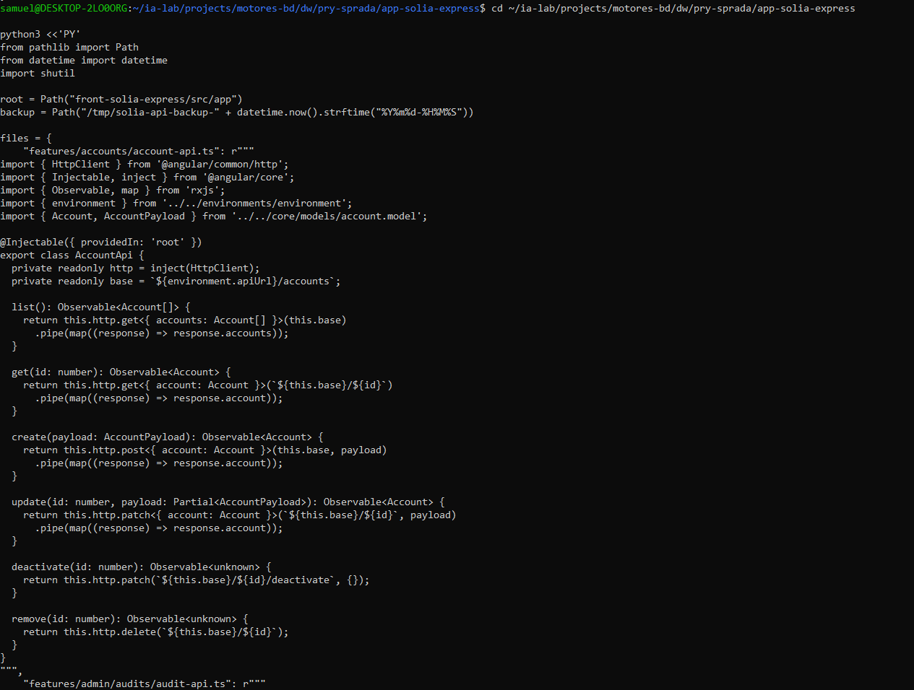

### Prueba del servicio con `HttpTestingController`

**`src/app/features/member/member-api.spec.ts`**

``` typescript
import { provideHttpClient } from '@angular/common/http';
import {
  HttpTestingController,
  provideHttpClientTesting,
} from '@angular/common/http/testing';
import { TestBed } from '@angular/core/testing';
import { environment } from '../../../environments/environment';
import { Member } from '../../core/models/member.model';
import { MemberApi } from './member-api';

const BASE = `${environment.apiUrl}/members`;

const MEMBER: Member = {
  id: 1,
  name: 'Test member',
  description: null,
  isActive: true,
};

describe('MemberApi', () => {
  let api: MemberApi;
  let http: HttpTestingController;

  beforeEach(() => {
    TestBed.configureTestingModule({
      providers: [provideHttpClient(), provideHttpClientTesting()],
    });

    api = TestBed.inject(MemberApi);
    http = TestBed.inject(HttpTestingController);
  });

  afterEach(() => http.verify());

  it('should unwrap { members } into Member[]', () => {
    let result: Member[] | undefined;

    api.list().subscribe((members) => {
      result = members;
    });

    const request = http.expectOne(BASE);

    expect(request.request.method).toBe('GET');

    request.flush({ members: [MEMBER] });

    expect(result).toEqual([MEMBER]);
  });

  it('should use environment.apiUrl', () => {
    expect(environment.apiUrl.endsWith('/api')).toBe(true);
```

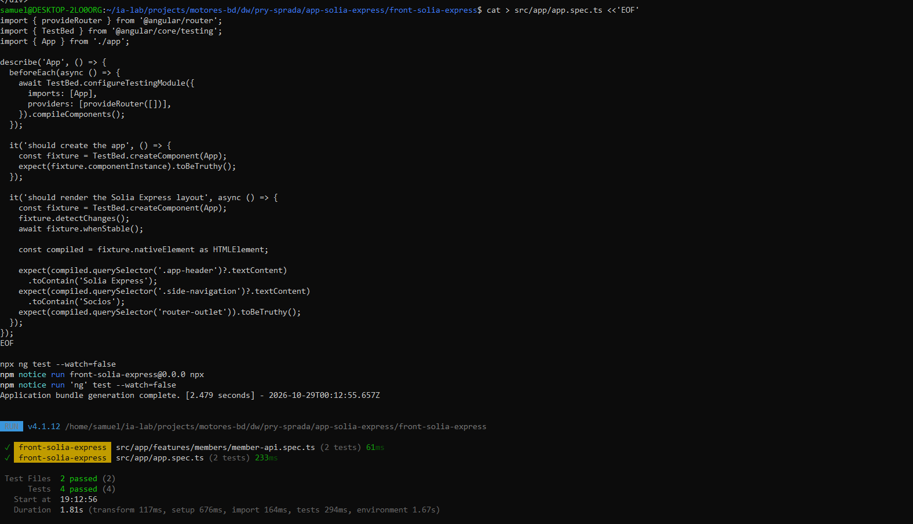

`HttpTestingController` no necesita el backend levantado: simula la respuesta y permite afirmar dos cosas: la URL construida y que la envoltura desaparece. `http.verify()` falla si quedó una petición sin responder, así que también detecta llamadas de más.

------------------------------------------------------------------------

## 2.4 Utilidades transversales: `toApiMessage` y `NotificationService`

**Criterios de este sub-ítem**

-   [x] Un único lugar traduce el error HTTP a texto legible
-   [x] `status === 0` se explica como backend caído
-   [x] `NotificationService` fija la duración por severidad

**`src/app/core/utils/api-error.ts`**

``` typescript
import { HttpErrorResponse } from '@angular/common/http';

/**
 * Traduce los errores HTTP a mensajes legibles para el usuario.
 * Los errores 403 son opacos a propósito para no revelar detalles de RBAC.
 */
export function toApiMessage(error: unknown): string {
  if (error instanceof HttpErrorResponse) {
    const body = error.error as
      | { error?: string; detail?: string }
      | string
      | null;

    if (error.status === 0) {
      return 'No se pudo conectar con el backend. Verifica que esté en http://localhost:4000.';
    }

    if (error.status === 403) {
      return 'Forbidden';
    }

    if (typeof body === 'string' && body.trim()) {
      return body;
    }

    if (body && typeof body === 'object' && body.error) {
      return body.detail
        ? `${body.error} — ${body.detail}`
        : body.error;
    }

    return error.message;
  }

  return error instanceof Error
    ? error.message
    : 'Error inesperado';
}
```

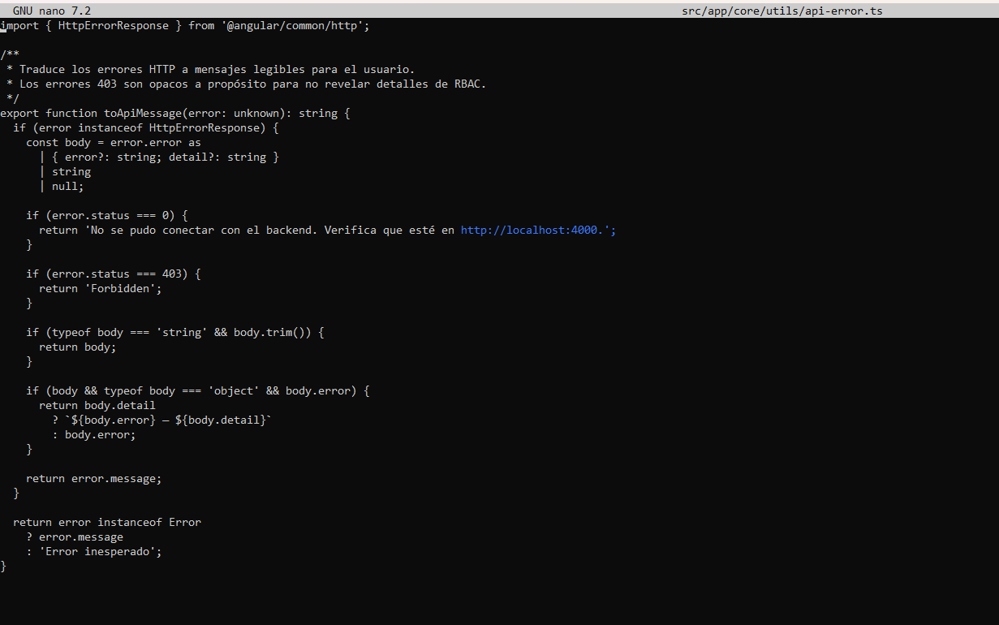

Los cuatro casos que importan:

| Situación | `status` | Mensaje |
|------------------------|------------------------|------------------------|
| Backend apagado o CORS rechazado | `0` | «No se pudo conectar con el backend…» |
| Validación de Express | `400` | `Validation error — name must be a string` |
| Permiso denegado por RBAC | `403` | Solo `Forbidden` |
| Cuerpo de texto plano | cualquiera | El texto tal cual |

`status === 0` merece su propia rama porque no es un error del servidor: es un error de red o de CORS. Mostrar «Unknown Error» ahí deja al estudiante buscando el fallo en el lugar equivocado.

**`src/app/core/services/notification.ts`**

``` typescript
import { Injectable, inject } from '@angular/core';
import { MessageService } from 'primeng/api';

/**
 * Centraliza las notificaciones de PrimeNG y sus duraciones.
 */
@Injectable({ providedIn: 'root' })
export class NotificationService {
  private readonly messages = inject(MessageService);

  success(summary: string, detail?: string): void {
    this.messages.add({
      severity: 'success',
      summary,
      detail,
      life: 3000,
    });
  }

  info(summary: string, detail?: string): void {
    this.messages.add({
      severity: 'info',
      summary,
      detail,
      life: 3500,
    });
  }

  warn(summary: string, detail?: string): void {
    this.messages.add({
      severity: 'warn',
      summary,
      detail,
      life: 4500,
    });
  }

  error(summary: string, detail?: string): void {
    this.messages.add({
      severity: 'error',
      summary,
      detail,
      life: 6000,
    });
  }
}
```

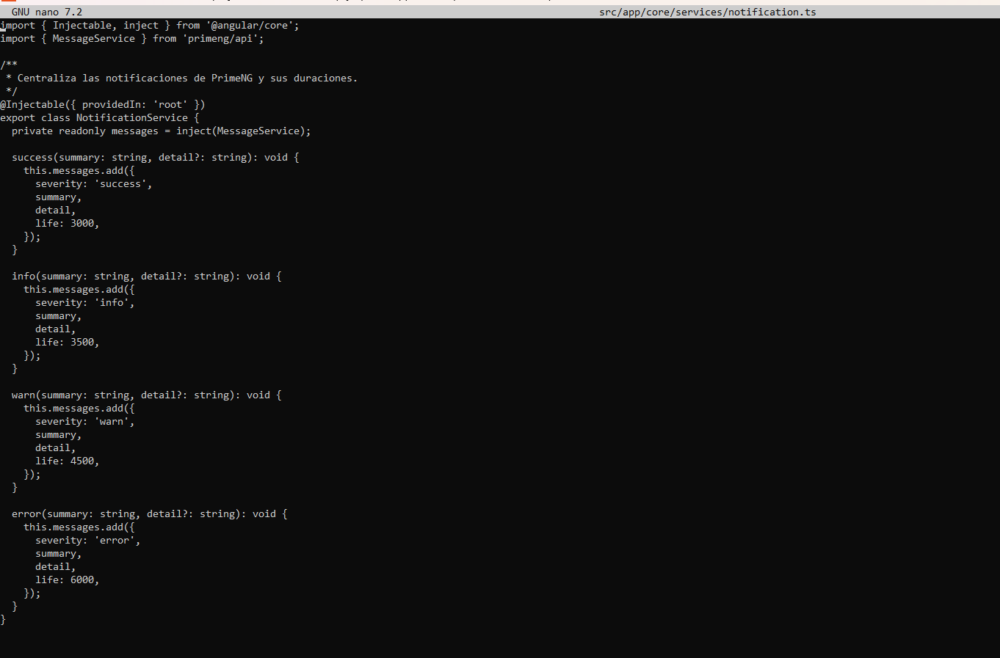

`NotificationService` no reemplaza a `MessageService`: lo envuelve. La diferencia es que la duración deja de ser una decisión repetida en cada componente —un error debe leerse más tiempo que un «guardado»— y queda en un solo archivo.

------------------------------------------------------------------------

## 2.5 Componentes compartidos: `PageHeader`, `EmptyState`, `StatusTag`

**Criterios de este sub-ítem**

-   [x] Los tres son standalone y usan `input()` con valor por defecto o `input.required`
-   [x] `PageHeader` y `EmptyState` proyectan contenido con `<ng-content />`
-   [x] `StatusTag` deriva texto y color con `computed`
-   [x] Los tres `.css` quedan vacíos

``` bash
ng generate component shared/ui/page-header --skip-tests --defaults
ng generate component shared/ui/empty-state --skip-tests --defaults
ng generate component shared/ui/status-tag --skip-tests --defaults
```

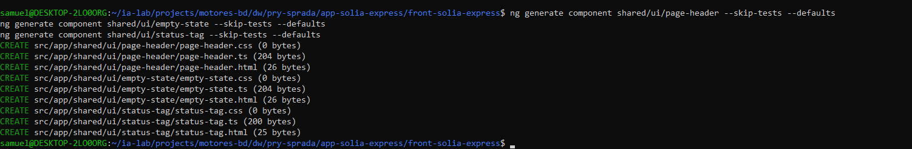

**`src/app/shared/ui/page-header/page-header.ts`**

``` typescript
import { Component, input } from '@angular/core';

@Component({
  host: { class: 'block' },
  selector: 'app-page-header',
  templateUrl: './page-header.html',
  styleUrl: './page-header.css',
})
export class PageHeader {
  readonly title = input.required<string>();
  readonly subtitle = input<string>('');
}
```

**`page-header.html`**

``` html
<header class="mb-6 flex flex-col gap-4 md:flex-row md:items-end md:justify-between">
  <div>
    <h1 class="text-2xl font-semibold tracking-tight text-slate-900">{{ title() }}</h1>
    @if (subtitle()) {
      <p class="mt-1 max-w-2xl text-sm text-slate-500">{{ subtitle() }}</p>
    }
  </div>
  <div class="flex flex-wrap items-center gap-2">
    <ng-content />
  </div>
</header>
```

Uso desde una pantalla de negocio:

``` html
<app-page-header title="Clientes" subtitle="Alta, edición y baja de clientes.">
  <button pButton label="Nuevo"></button>
</app-page-header>
```

`input.required` es la decisión importante: una pantalla sin título no se puede identificar, así que el compilador debe impedirla. `subtitle` sí es opcional, y el `@if` evita dejar un `<p>` vacío con margen.

**`src/app/shared/ui/empty-state/empty-state.ts`**

``` typescript
@Component({
  host: { class: 'block' },
  selector: 'app-empty-state',
  templateUrl: './empty-state.html',
  styleUrl: './empty-state.css',
})
export class EmptyState {
  readonly icon = input<string>('pi pi-inbox');
  readonly title = input<string>('Sin registros');
  readonly message = input<string>('Todavía no hay datos para mostrar.');
}
```

**`empty-state.html`**

``` html
<div class="flex flex-col items-center justify-center gap-2 px-6 py-12 text-center">
  <div class="flex h-12 w-12 items-center justify-center rounded-full bg-slate-100 text-slate-500">
    <i [class]="icon()" class="text-xl"></i>
  </div>
  <p class="mt-2 text-sm font-semibold text-slate-700">{{ title() }}</p>
  <p class="max-w-sm text-sm text-slate-500">{{ message() }}</p>
  <div class="mt-3"><ng-content /></div>
</div>
```

**`src/app/shared/ui/status-tag/status-tag.ts`**

``` typescript
import { Component, computed, input } from '@angular/core';
import { TagModule } from 'primeng/tag';
import { Status } from '../../../core/models/api.model';

@Component({
  host: { class: 'inline-block' },
  selector: 'app-status-tag',
  imports: [TagModule],
  templateUrl: './status-tag.html',
  styleUrl: './status-tag.css',
})
export class StatusTag {
  readonly status = input.required<Status>();

  readonly label = computed(() => (this.status() === 'active' ? 'Activo' : 'Inactivo'));
  readonly severity = computed<'success' | 'danger'>(() =>
    this.status() === 'active' ? 'success' : 'danger',
  );
}
```

**`status-tag.html`**

``` html
<p-tag [value]="label()" [severity]="severity()" [rounded]="true" />
```

**Por qué `computed` y no un método.** Un método se reevaluaría en cada ciclo de detección; un `computed` guarda el resultado y solo se recalcula cuando `status()` cambia. La prueba lo demuestra: al hacer `setInput('status', 'inactive')`, texto y severidad cambian sin tocar la plantilla.

**`src/app/shared/ui/status-tag/status-tag.spec.ts`**

``` typescript
it('should react when the input changes to inactive', async () => {
  const fixture = TestBed.createComponent(StatusTag);
  fixture.componentRef.setInput('status', 'active');
  await fixture.whenStable();

  fixture.componentRef.setInput('status', 'inactive');
  await fixture.whenStable();

  expect(fixture.componentInstance.label()).toBe('Inactivo');
  expect(fixture.componentInstance.severity()).toBe('danger');
});
```

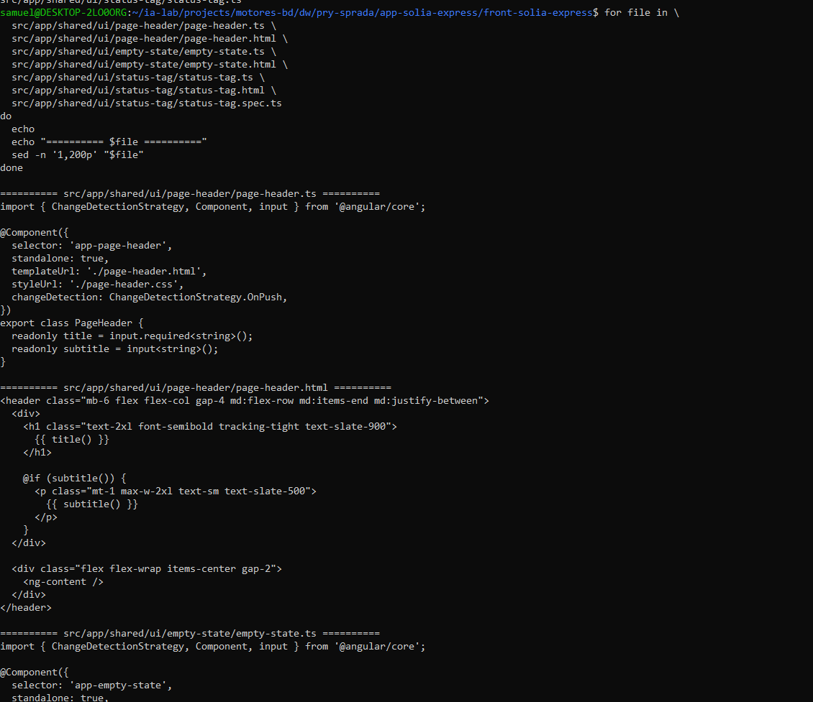

------------------------------------------------------------------------

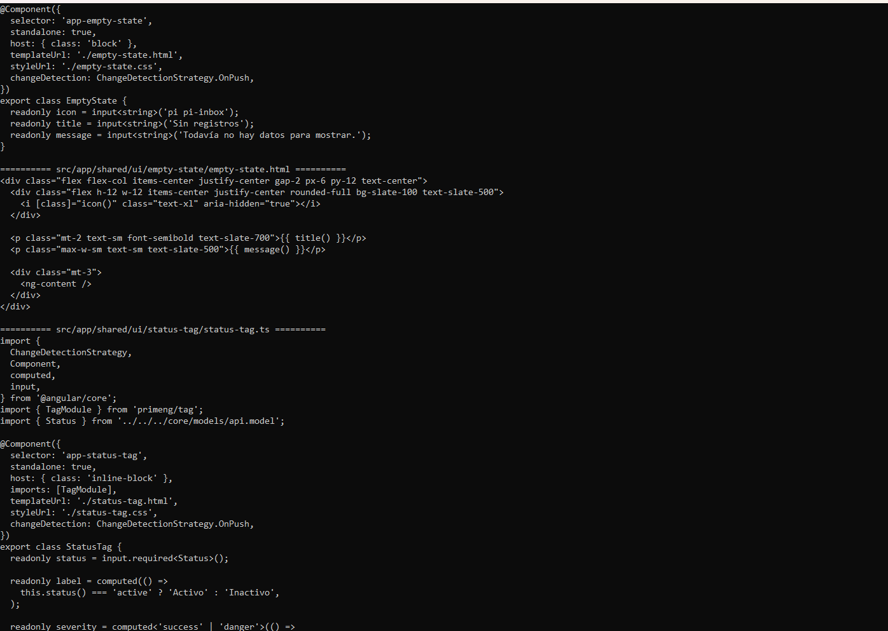

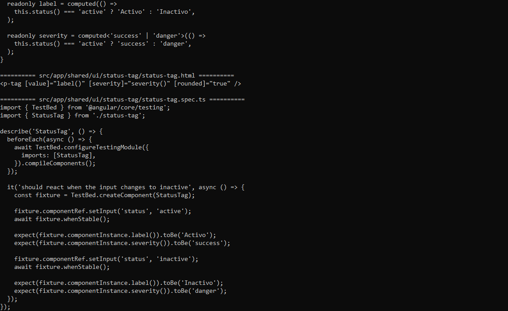

## 2.6 Shell: conservar el esqueleto al navegar

**Criterios de este sub-ítem**

-   [x] `Shell` monta Header, Aside, `router-outlet` y Footer
-   [x] Solo el contenido central cambia al navegar
-   [x] El Drawer móvil reutiliza el mismo `Aside` y la misma lista `items`
-   [x] El botón de menú está siempre visible y alterna el Aside en escritorio (misma lógica que ISS-01B)
-   [x] `<p-toast />` y `<p-confirmdialog />` viven en el Shell, una sola vez
-   [x] En Fase I no inyecta `AuthService` ni `SessionStore`

``` bash
ng generate component layout/shell --skip-tests --defaults
```

**`src/app/layout/shell/shell.ts`**

``` typescript
import { Component, signal } from '@angular/core';
import { RouterOutlet } from '@angular/router';
import { MenuItem } from 'primeng/api';
import { ConfirmDialogModule } from 'primeng/confirmdialog';
import { DrawerModule } from 'primeng/drawer';
import { ToastModule } from 'primeng/toast';
import { watchMediaQuery } from '../../core/utils/media-query';
import { Aside } from '../aside/aside';
import { Footer } from '../footer/footer';
import { Header } from '../header/header';

/**
 * Layout persistente de la aplicación.
 *
 * El Header, el Aside y el Footer se montan **una sola vez**; solo la región
 * central cambia con `<router-outlet />`. Reutilizar el layout evita
 * remontar el menú (y perder el scroll o el foco) al navegar.
 *
 * Fase I: sin `AuthService` ni `SessionStore`. Las rutas de negocio se agregan
 * como hijas de `Shell` desde ISS-03; la sesión, en ISS-08.
 */
@Component({
  host: { class: 'block' },
  selector: 'app-shell',
  imports: [RouterOutlet, Header, Aside, Footer, ConfirmDialogModule, DrawerModule, ToastModule],
  templateUrl: './shell.html',
  styleUrl: './shell.css',
})
export class Shell {
  /** `lg` de Tailwind: desde aquí el Aside es fijo y el botón lo alterna. */
  private readonly isDesktop = watchMediaQuery('(min-width: 1024px)');

  /** Escritorio: Aside fijo visible u oculto. */
  readonly sidebarCollapsed = signal(false);

  /** Móvil: Drawer abierto. */
  readonly mobileOpen = signal(false);

  /**
   * Menú mínimo de la Fase I (ISS-02). En el proyecto consolidado ISS-08/09
   * sustituyen este arreglo por `navGroups` + `NAV` en
   * `layout/shell/nav.config.ts` (Operación, Seguridad, permisos y sesión).
   */
  readonly items: MenuItem[] = [
    { label: 'Clientes', icon: 'pi pi-users', routerLink: '/clientes' },
    { label: 'Prototipo', icon: 'pi pi-desktop', routerLink: '/construir' },
  ];

  /**
   * Un solo botón, dos disposiciones: en escritorio alterna el Aside fijo; por
   * debajo de `lg` abre el Drawer.
   */
  protected onMenuToggle(): void {
    if (this.isDesktop()) {
      this.sidebarCollapsed.update((collapsed) => !collapsed);
      return;
    }
    this.mobileOpen.set(true);
  }
}
```

**`src/app/layout/shell/shell.html`**

``` html
<div class="flex min-h-screen flex-col bg-slate-100">
  <app-header (menuRequested)="onMenuToggle()" />

  <div class="flex flex-1">
    <!--
      Escritorio: Aside fijo que el botón del Header puede ocultar.
      Por debajo de lg no se pinta: el menú vive en el Drawer.
    -->
    @if (!sidebarCollapsed()) {
      <aside class="hidden w-72 shrink-0 lg:block">
        <app-aside [items]="items" (navigated)="mobileOpen.set(false)" />
      </aside>
    }

    <main id="contenido" class="min-w-0 flex-1 p-4 sm:p-6">
      <div class="mx-auto w-full max-w-7xl">
        <router-outlet />
      </div>
    </main>
  </div>

  <app-footer />
</div>

<!-- Móvil: el mismo Aside, otra disposición. -->
<p-drawer [(visible)]="mobileOpen" header="Menú" position="left" styleClass="w-72">
  <app-aside [items]="items" (navigated)="mobileOpen.set(false)" />
</p-drawer>

<!-- Anfitriones de las notificaciones y confirmaciones del CRUD (ISS-03). -->
<p-toast position="top-right" />
<p-confirmdialog />
```

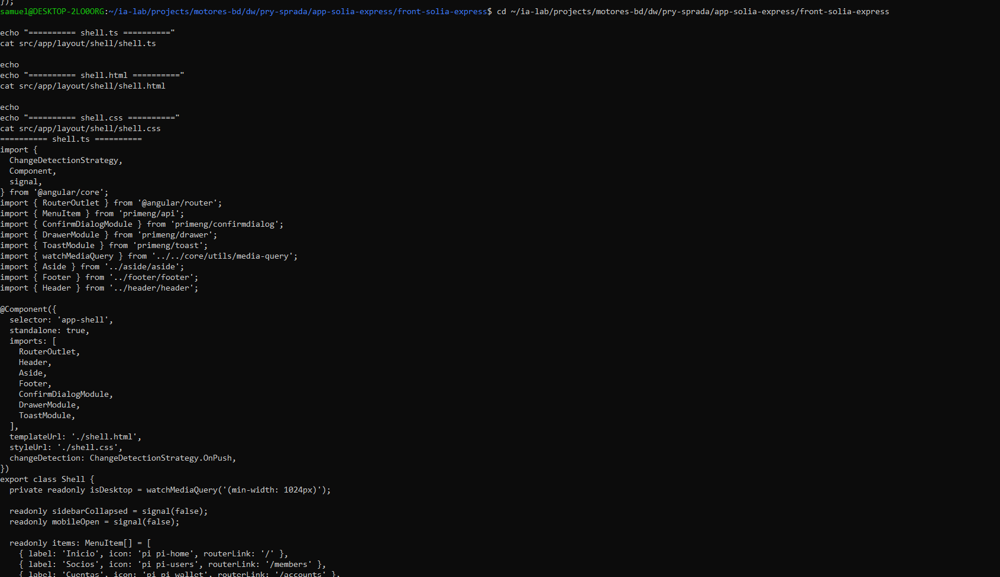

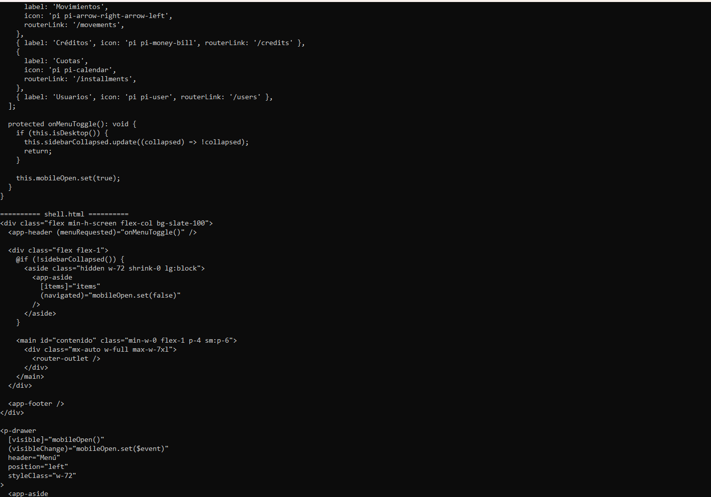

### Qué cambia respecto a Construir

| Pieza | Construir (ISS-01B) | Shell (ISS-02) |
|------------------------|------------------------|------------------------|
| Layout | Lo compone el propio prototipo | Lo compone el layout, una vez |
| Contenido | Fijo dentro del componente | `<router-outlet />` |
| Menú | `command` que cambia un título | `routerLink` que navega |
| Sesión | No | No (ISS-08) |
| Botón de menú | `onMenuToggle()` con `watchMediaQuery` | El mismo método y el mismo helper |

`Shell` es la razón por la que el prototipo no se borra: sirve de referencia visual mientras el layout real gana pantallas.

**El helper se reutiliza, no se copia.** `watchMediaQuery('(min-width: 1024px)')` se creó en ISS-01B (`core/utils/media-query.ts`) y aquí se vuelve a usar. Si la frontera cambiara —por ejemplo a `xl`— se cambia en la llamada y no hay dos `@media` desincronizadas con Tailwind.

**`Shell` nace sin hijos y los gana en ISS-03.** En ISS-02 la ruta `''` monta el Shell y su única hija redirige a `/construir`, así que al abrir `/` se veía el prototipo. Desde ISS-03 esa misma hija redirige a `clientes`: ahora `/` sí monta el Shell con su primera pantalla de negocio. La composición del Shell se verifica además con pruebas (`shell.spec.ts`) y con el chunk diferido del build.

### 

**`src/app/app.routes.ts`**

``` typescript
import { Routes } from '@angular/router';

export const routes: Routes = [
  {
    path: 'construir',
    loadComponent: () =>
      import('./features/construir/construir').then((m) => m.Construir),
  },
  {
    path: '',
    loadComponent: () =>
      import('./layout/shell/shell').then((m) => m.Shell),
    children: [
      {
        path: '',
        pathMatch: 'full',
        redirectTo: 'construir',
      },
    ],
  },
  { path: '**', redirectTo: 'construir' },
];
```

| Ruta | Qué hace |
|------------------------------------|------------------------------------|
| `construir` | Prototipo con su propio layout (ISS-01B) |
| `''` | Monta `Shell`; sus hijas son las pantallas de negocio |
| `''` hija con `pathMatch: 'full'` | Entra a la primera entidad (`clientes`) |
| `**` | Cualquier URL desconocida vuelve a `/construir` |


`Shell` se carga con `loadComponent`: el build lo confirma emitiendo un chunk `shell` aparte del bundle inicial.

**`src/app/layout/shell/shell.spec.ts`**

``` typescript
import { provideRouter } from '@angular/router';
import { TestBed } from '@angular/core/testing';
import { ConfirmationService, MessageService } from 'primeng/api';
import { Shell } from './shell';

describe('Shell', () => {
  const originalMatchMedia = window.matchMedia;

  async function crearShell() {
    await TestBed.configureTestingModule({
      imports: [Shell],
      providers: [
        provideRouter([]),
        MessageService,
        ConfirmationService,
      ],
    }).compileComponents();

    const fixture = TestBed.createComponent(Shell);
    fixture.detectChanges();
    await fixture.whenStable();
    fixture.detectChanges();

    return {
      fixture,
      compilado: fixture.nativeElement as HTMLElement,
    };
  }

  afterEach(() => {
    window.matchMedia = originalMatchMedia;
    TestBed.resetTestingModule();
  });

  it('should compose header, aside, main, footer and the router outlet', async () => {
    window.matchMedia = (() => ({
      matches: true,
      media: '(min-width: 1024px)',
      onchange: null,
      addEventListener: () => {},
      removeEventListener: () => {},
      addListener: () => {},
      removeListener: () => {},
      dispatchEvent: () => false,
    })) as typeof window.matchMedia;

    const { compilado } = await crearShell();

    expect(compilado.querySelector('app-header')).toBeTruthy();
    expect(compilado.querySelector('aside app-aside')).toBeTruthy();
    expect(
      compilado.querySelector('main#contenido router-outlet'),
    ).toBeTruthy();
    expect(compilado.querySelector('app-footer')).toBeTruthy();
  });

  it('should open the mobile drawer from the header button', async () => {
    window.matchMedia = (() => ({
      matches: false,
      media: '(min-width: 1024px)',
      onchange: null,
      addEventListener: () => {},
      removeEventListener: () => {},
      addListener: () => {},
      removeListener: () => {},
      dispatchEvent: () => false,
    })) as typeof window.matchMedia;

    const { fixture, compilado } = await crearShell();

    const boton = compilado.querySelector(
      'app-header button[aria-label="Abrir o cerrar menú"]',
    ) as HTMLButtonElement | null;

    expect(boton).toBeTruthy();
    boton!.click();
    fixture.detectChanges();
    await fixture.whenStable();

    expect(fixture.componentInstance.mobileOpen()).toBe(true);
  });

  it('should hide the desktop aside when the header button is clicked', async () => {
    window.matchMedia = (() => ({
      matches: true,
      media: '(min-width: 1024px)',
      onchange: null,
      addEventListener: () => {},
      removeEventListener: () => {},
      addListener: () => {},
      removeListener: () => {},
      dispatchEvent: () => false,
    })) as typeof window.matchMedia;

    const { fixture, compilado } = await crearShell();

    expect(compilado.querySelector('aside app-aside')).toBeTruthy();

    const boton = compilado.querySelector(
      'app-header button[aria-label="Abrir o cerrar menú"]',
    ) as HTMLButtonElement | null;

    expect(boton).toBeTruthy();
    boton!.click();
    fixture.detectChanges();
    await fixture.whenStable();
    fixture.detectChanges();

    expect(compilado.querySelector('aside app-aside')).toBeFalsy();
    expect(fixture.componentInstance.sidebarCollapsed()).toBe(true);
    expect(fixture.componentInstance.mobileOpen()).toBe(false);
  });
```


La prueba necesita `provideRouter([])` (por `<router-outlet />`) y los proveedores de PrimeNG (`MessageService`, `ConfirmationService`) que consumen `<p-toast />` y `<p-confirmdialog />`. Como jsdom no implementa `matchMedia`, `watchMediaQuery` devuelve `false` y la prueba ejercita la rama móvil; la rama de escritorio se cubre en `construir.spec.ts` sustituyendo `window.matchMedia`.

------------------------------------------------------------------------

## 2.7 Registrar `HttpClient` sin interceptores de sesión

**Criterios de este sub-ítem**

-   [x] `provideHttpClient()` está en `app.config.ts`
-   [x] No hay `withInterceptors(...)` todavía
-   [x] `MessageService` y `ConfirmationService` siguen registrados (los usan los hosts del Shell)

**`src/app/app.config.ts`** — debajo de los imports y antes de `MessageService`:

``` typescript
import { provideHttpClient } from '@angular/common/http';

import {
  ApplicationConfig,
  provideBrowserGlobalErrorListeners,
} from '@angular/core';
import {
  provideRouter,
  withComponentInputBinding,
  withInMemoryScrolling,
} from '@angular/router';
import { ConfirmationService, MessageService } from 'primeng/api';
import { providePrimeNG } from 'primeng/config';
import Aura from '@primeuix/themes/aura';
import { environment } from '../environments/environment';

import { routes } from './app.routes';

export const appConfig: ApplicationConfig = {
  providers: [
    provideHttpClient(),
    provideBrowserGlobalErrorListeners(),

    provideRouter(
      routes,
      withComponentInputBinding(),
      withInMemoryScrolling({ scrollPositionRestoration: 'top' }),
    ),

    // PrimeNG 22: configure the Aura theme and license.
    providePrimeNG({
      license: environment.primeUiLicense || undefined,
      ripple: true,
      inputVariant: 'outlined',
      theme: {
        preset: Aura,
        options: {
          darkModeSelector: '.app-dark',
          cssLayer: false,
        },
      },
    }),

    MessageService,
    ConfirmationService,
  ],
};
```


`provideHttpClient()` habilita la inyección de `HttpClient`; **no** configura autenticación. El `authInterceptor` (adjuntar el `Bearer`, refrescar el token en 401) es ISS-08. Añadirlo ahora significaría escribir un interceptor que lee un `SessionStore` que aún no existe.

------------------------------------------------------------------------

## 2.8 Comprobar antes de avanzar

**Criterios de este sub-ítem**

-   [x] `ng build` termina con código 0 y sin `✘ [ERROR]`
-   [x] `shell` aparece como chunk diferido
-   [x] `npm test` pasa completo
-   [x] `/` redirige a `/construir` y la pantalla del prototipo sigue funcionando
-   [x] Network no registra llamadas `/api` en ninguna pantalla

``` bash
ng build
npm test -- --watch=false
npm start
```


### Problemas frecuentes

| Síntoma | Causa | Solución |
|------------------------|------------------------|------------------------|
| `Cannot find module '../../core/models/...'` | Profundidad de `../` incorrecta | Cuenta carpetas desde el archivo del servicio |
| `Cannot find name 'Injectable'` | Falta el import de Angular | Importa `Injectable` desde `@angular/core` |
| `NG8001: 'p-tag' is not a known element` | Falta `TagModule` en `imports` | Añádelo al array `imports` del componente |
| `NullInjectorError: No provider for HttpClient!` | Falta `provideHttpClient()` | Regístralo en `app.config.ts` |
| `resultado` es `undefined` en la prueba del servicio | No se llamó `flush` | Responde la petición con `peticion.flush({...})` |
| `list()` devuelve `undefined` en ejecución | Envoltura mal escrita (`role_users` en vez de `assignments`) | Revisa la tabla de envolturas |
| 404 en todas las llamadas | `apiUrl` con slash final | Deja `.../api`, sin `/` |

**Siguiente:** ISS-03 — CRUD de clientes usa `ClientApi` en una pantalla real, como hija de `Shell`.

------------------------------------------------------------------------

## Verificación del ISS

``` bash
cd ~/ia-lab/projects/motores-bd/dw/pry-sprada/app-solia-express/front-solia-express

echo "========== 1. BUILD Y CHUNKS DIFERIDOS =========="
ng build
BUILD_STATUS=$?
echo "Resultado build: $BUILD_STATUS"

echo
echo "========== 2. API URL EN LOS ENTORNOS =========="
grep -n "apiUrl" src/environments/environment.ts \
  src/environments/environment.development.ts

echo
echo "========== 3. MODELOS =========="
find src/app/core/models -maxdepth 1 -type f -name '*.model.ts' -print | sort

echo
echo "========== 4. SERVICIOS QUE USAN map =========="
grep -rn "\.pipe(map" src/app/features src/app/core --include='*.ts' | wc -l

echo
echo "========== 5. HTTPCLIENT E INTERCEPTORES =========="
grep -n "provideHttpClient" src/app/app.config.ts
if grep -n "withInterceptors" src/app/app.config.ts; then
  echo "ATENCIÓN: hay interceptores configurados"
else
  echo "Sin withInterceptors: correcto para esta fase"
fi

echo
echo "========== 6. ENVOLTURAS ASSIGNMENTS Y GRANTS =========="
grep -rn -E "assignments|grants" src/app/features/admin \
  --include='*-api.ts' || echo "No se encontraron coincidencias con ese patrón"

echo
echo "========== 7. CSS COMPARTIDOS SIN REGLAS =========="
CSS_FOUND=0
for f in src/app/shared/ui/*/*.css src/app/layout/shell/shell.css; do
  if [ -f "$f" ]; then
    if grep -q '[{}]' "$f"; then
      echo "REGLAS EN $f"
      CSS_FOUND=1
    else
      echo "OK: $f"
    fi
  fi
done
if [ "$CSS_FOUND" -eq 0 ]; then
  echo "No se encontraron reglas CSS en los archivos revisados"
fi

echo
echo "========== 8. PRUEBAS =========="
npm test -- --watch=false
TEST_STATUS=$?
echo "Resultado tests: $TEST_STATUS"

echo
echo "========== RESUMEN =========="
echo "Build: $BUILD_STATUS"
echo "Tests: $TEST_STATUS"
```


### Resultado reportado por la fuente (23-oct-2026)

| Comprobación | Resultado |
|------------------------------------|------------------------------------|
| `ng build` | código 0; Initial total 548.57 kB (\< 750 kB, sin warning) |
| Chunks diferidos | `client-list` 568.09 kB · `shell` 60.26 kB · `construir` 7.76 kB |
| `npm test -- --watch=false` | 11 archivos, 55 pruebas |
| `/` | Redirige a `/clientes` (ISS-03); `/construir` sigue accesible |
| `/construir` | Prototipo intacto: Header, Aside con 5 opciones, Drawer y Footer |
| Shell en escritorio 1280 px | `aside` 288 px, `main#contenido router-outlet`, Footer al borde inferior (800 px), `scrollWidth = clientWidth = 1280` |
| Shell en escritorio, botón de menú | `display: flex`: visible también a 1280 px (antes `lg:hidden` lo escondía) |
| Shell en escritorio, clic en el botón | `aside` sale del DOM; no aparece Drawer; el contenido ocupa el ancho |
| Shell en móvil 390 px | Aside oculto; el botón abre el Drawer con el mismo menú |
| Menú del Shell | Enlaces reales `href="/clientes"` y `href="/construir"` |
| Hosts del CRUD | `p-toast` y `p-confirmdialog` presentes en el DOM |
| Network | 0 peticiones `/api` en `/` y `/construir` |
| Envolturas pivote | `assignments` y `grants` verificadas en su servicio |

La verificación visual del Shell se hizo exponiendo el componente en una ruta temporal (`/shell-preview`), que se retiró antes del build final. El estado entregado es el de la tabla anterior: desde `/` se monta el Shell con la pantalla de clientes de ISS-03, y el Shell se valida además con `shell.spec.ts`.

## Cierre del ISS

La capa de infraestructura está completa: una URL de backend, 13 modelos que reflejan las tablas, 11 servicios que desenvuelven la respuesta de Express, dos utilidades transversales, tres componentes de UI y un Shell que conserva el layout al navegar.

No hay pantallas de negocio todavía y no se ha hecho ni una petición HTTP real: eso empieza en ISS-03. `SessionStore`, `AuthService` y la directiva `*appHasPermission` pertenecen a ISS-08/ISS-09 y se documentan allí; adelantarlos aquí dejaría código que nadie consume.

**Siguiente:** ISS-03 — CRUD de clientes.

------------------------------------------------------------------------

# ISS-03 · CRUD de clientes con Signals

## 3.1 Generar componentes con CLI

``` bash
ng generate component features/members/member-list --skip-tests --defaults
ng generate component features/members/member-form --skip-tests --defaults
```


------------------------------------------------------------------------

## 3.2 Utilidad de filtro local

PrimeNG 22 eliminó el input `globalFilter` de `p-table`. En su lugar filtramos el arreglo con una función pura y entregamos el resultado a `[value]`.

**`src/app/core/utils/filter-rows.ts`**

``` typescript
/**
 * Filtro local reutilizable para tablas PrimeNG 22.
 *
 * PrimeNG 22 eliminó el input `globalFilter` de `p-table`, así que filtramos el
 * arreglo **antes** de entregarlo a `[value]`. Es una función pura: no depende
 * del DOM, de la tabla ni de Angular, y por eso se prueba sin montar nada.
 */
export function filterRows<T>(
  rows: readonly T[],
  query: string,
  pick: (row: T) => Array<string | number | null | undefined>,
): T[] {
  const term = query.trim().toLowerCase();

  // Sin término se devuelve una copia: el llamador puede mutar el resultado sin
  // tocar el arreglo original que vive en el signal.
  if (!term) {
    return [...rows];
  }

  return rows.filter((row) =>
    pick(row).some((value) => (value ?? '').toString().toLowerCase().includes(term)),
  );
}
```

| Decisión | Por qué |
|------------------------------------|------------------------------------|
| `pick` recibe la fila | La utilidad no adivina qué campos son buscables; lo decide el llamador |
| `[...rows]` sin término | El `computed` no comparte referencia con el signal original |
| `(value ?? '')` | `email` y `phone` son `null` en la base y no deben romper el filtro |


**Ventaja didáctica:** el filtro es una función pura, fácil de testear, sin depender de la tabla ni del DOM.

------------------------------------------------------------------------

## 3.3 Formulario reactivo reutilizable

El mismo componente sirve para crear y editar. Recibe `client` y `resetKey` como `input()`, y emite `saved` / `cancelled` como `output()`.

**`client-form.ts`**

``` typescript
import { Component, effect, inject, input, output } from '@angular/core';
import { NonNullableFormBuilder, ReactiveFormsModule, Validators } from '@angular/forms';
import { ButtonModule } from 'primeng/button';
import { InputTextModule } from 'primeng/inputtext';
import { MessageModule } from 'primeng/message';
import { SelectModule } from 'primeng/select';
import { TextareaModule } from 'primeng/textarea';
import { Status } from '../../../core/models/api.model';
import { Client, ClientPayload } from '../../../core/models/client.model';

/**
 * Formulario de cliente, reutilizado para crear y editar.
 *
 * No llama a la API: recibe `client` (o `null` para crear) y emite el payload
 * con `saved`. El padre decide entre `POST` y `PATCH` y controla el diálogo, así
 * que este componente sirve igual dentro de un Dialog que en una página.
 */
@Component({
  host: { class: 'block' },
  selector: 'app-client-form',
  imports: [
    MessageModule,
    ReactiveFormsModule,
    ButtonModule,
    InputTextModule,
    SelectModule,
    TextareaModule,
  ],
  templateUrl: './client-form.html',
  styleUrl: './client-form.css',
})
export class ClientForm {
  /** Cliente a editar. `null` deja el formulario en modo creación. */
  readonly client = input<Client | null>(null);

  /**
   * Cambia cada vez que el padre abre el diálogo.
   *
   * Sin esto, reabrir «Nuevo cliente» tras cancelar conservaría lo escrito:
   * `client` sigue siendo `null`, así que el `effect()` no volvería a correr.
   * Es una llave explícita para reiniciar, no un estado duplicado.
   */
  readonly resetKey = input(0);

  /** Petición en curso: deshabilita el botón y muestra su spinner. */
  readonly saving = input(false);

  readonly saved = output<ClientPayload>();
  readonly cancelled = output<void>();

  private readonly fb = inject(NonNullableFormBuilder);

  readonly statusOptions = [
    { label: 'Activo', value: 'active' },
    { label: 'Inactivo', value: 'inactive' },
  ];

  readonly form = this.fb.group({
    name: ['', [Validators.required, Validators.maxLength(120)]],
    address: [''],
    phone: [''],
    email: ['', [Validators.email]],
    status: ['active' as Status, [Validators.required]],
  });

  constructor() {
    // `effect()` reacciona al input `client()`: el mismo formulario sirve para
    // crear y editar sin `ngOnChanges` ni comparar objetos a mano.
    effect(() => {
      const current = this.client();
      // `resetKey` se lee a propósito: abrir de nuevo el diálogo debe vaciar el
      // formulario aunque `client` siga siendo `null`.
      this.resetKey();

      this.form.reset({
        name: current?.name ?? '',
        address: current?.address ?? '',
        phone: current?.phone ?? '',
        email: current?.email ?? '',
        status: current?.status ?? 'active',
      });

      // El backend solo cambia `status` con PATCH /deactivate. Si el campo
      // siguiera habilitado, el formulario prometería algo que el backend ignora.
      if (current) {
        this.form.controls.status.disable();
      } else {
        this.form.controls.status.enable();
      }
    });
  }

  submit(): void {
    if (this.form.invalid) {
      this.form.markAllAsTouched();
      return;
    }

    const value = this.form.getRawValue();
    const payload: ClientPayload = {
      name: value.name.trim(),
      address: value.address.trim() || null,
      phone: value.phone.trim() || null,
      email: value.email.trim() || null,
    };

    // `status` solo se envía al crear: en edición lo gobierna /deactivate.
    this.saved.emit(this.client() ? payload : { ...payload, status: value.status });
  }
}
```


**`client-form.html`**

``` html
<form [formGroup]="form" (ngSubmit)="submit()" class="space-y-4">
  <div>
    <label for="client-name" class="mb-1 block text-sm font-medium text-slate-700">
      Nombre <span class="text-red-500">*</span>
    </label>
    <input
      id="client-name"
      pInputText
      formControlName="name"
      placeholder="Tienda La Esquina"
      autocomplete="organization"
      class="w-full"
    />
    @if (form.controls.name.touched && form.controls.name.invalid) {
      <p-message severity="error" size="small" variant="simple" styleClass="mt-1">
        El nombre es obligatorio (máximo 120 caracteres).
      </p-message>
    }
  </div>

  <div class="grid gap-4 sm:grid-cols-2">
    <div>
      <label for="client-phone" class="mb-1 block text-sm font-medium text-slate-700">
        Teléfono
      </label>
      <input
        id="client-phone"
        pInputText
        formControlName="phone"
        placeholder="300 000 0000"
        autocomplete="tel"
        class="w-full"
      />
    </div>

    <div>
      <label for="client-email" class="mb-1 block text-sm font-medium text-slate-700">
        Email
      </label>
      <input
        id="client-email"
        type="email"
        pInputText
        formControlName="email"
        placeholder="cliente@correo.com"
        autocomplete="email"
        class="w-full"
      />
      @if (form.controls.email.touched && form.controls.email.invalid) {
        <p-message severity="error" size="small" variant="simple" styleClass="mt-1">
          Formato de email inválido.
        </p-message>
      }
    </div>
  </div>

  <div>
    <label for="client-address" class="mb-1 block text-sm font-medium text-slate-700">
      Dirección
    </label>
    <textarea
      id="client-address"
      pTextarea
      formControlName="address"
      rows="2"
      placeholder="Calle 1 # 2-3"
      class="w-full"
    ></textarea>
  </div>

  <div>
    <label for="client-status" class="mb-1 block text-sm font-medium text-slate-700">
      Estado
    </label>
    <p-select
      inputId="client-status"
      formControlName="status"
      [options]="statusOptions"
      optionLabel="label"
      optionValue="value"
      [fluid]="true"
    />
    @if (client()) {
      <p class="mt-1 text-xs text-slate-500">
        El estado de un cliente existente solo cambia con la baja lógica.
      </p>
    }
  </div>

  <div class="flex justify-end gap-2 border-t border-slate-100 pt-4">
    <button pButton type="button" severity="secondary" outlined (click)="cancelled.emit()">
      <span pButtonLabel>Cancelar</span>
    </button>
    <button pButton type="submit" [loading]="saving()">
      <i pButtonIcon class="pi pi-check"></i>
      <span pButtonLabel>Guardar</span>
    </button>
  </div>
</form>
```


`client-form.css` queda sin reglas.

------------------------------------------------------------------------

## 3.4 Lista con estado en Signals

**`member-list.ts`**

``` typescript
import { Component, computed, inject, signal } from '@angular/core';
import { ConfirmationService } from 'primeng/api';
import { ButtonModule } from 'primeng/button';
import { DialogModule } from 'primeng/dialog';
import { InputTextModule } from 'primeng/inputtext';
import { MessageModule } from 'primeng/message';
import { TableModule } from 'primeng/table';
import { TagModule } from 'primeng/tag';
import { TooltipModule } from 'primeng/tooltip';
import { Client, ClientPayload } from '../../../core/models/client.model';
import { NotificationService } from '../../../core/services/notification';
import { toApiMessage } from '../../../core/utils/api-error';
import { filterRows } from '../../../core/utils/filter-rows';
import { EmptyState } from '../../../shared/ui/empty-state/empty-state';
import { PageHeader } from '../../../shared/ui/page-header/page-header';
import { StatusTag } from '../../../shared/ui/status-tag/status-tag';
import { ClientApi } from '../client-api';
import { ClientForm } from '../client-form/client-form';

/**
 * Lista de clientes con todas las operaciones del CRUD.
 *
 * Todo el estado vive en signals: la tabla y los contadores se repintan solos y
 * `visibleRows` se recalcula solo cuando cambian `rows()` o `filter()`.
 */
@Component({
  host: { class: 'block' },
  selector: 'app-client-list',
  imports: [
    ButtonModule,
    DialogModule,
    EmptyState,
    InputTextModule,
    MessageModule,
    PageHeader,
    StatusTag,
    TableModule,
    TagModule,
    TooltipModule,
    ClientForm,
  ],
  templateUrl: './client-list.html',
  styleUrl: './client-list.css',
})
export class ClientList {
  private readonly api = inject(ClientApi);
  private readonly notify = inject(NotificationService);
  private readonly confirmation = inject(ConfirmationService);

  /** Datos del backend (`GET /api/clientes` solo devuelve `active`). */
  readonly rows = signal<Client[]>([]);
  readonly loading = signal(true);
  readonly saving = signal(false);
  readonly error = signal<string | null>(null);
  readonly filter = signal('');

  /** Resultado de aplicar el buscador; `computed` lo memoriza. */
  readonly visibleRows = computed(() =>
    filterRows(this.rows(), this.filter(), (client) => [
      client.name,
      client.email,
      client.phone,
      client.address,
    ]),
  );

  readonly dialogVisible = signal(false);
  readonly editing = signal<Client | null>(null);
  readonly resetKey = signal(0);

  readonly title = computed(() => (this.editing() ? 'Editar cliente' : 'Nuevo cliente'));

  constructor() {
    this.load();
  }

  /** `GET /api/clientes`: recarga la tabla y limpia el error anterior. */
  load(): void {
    this.loading.set(true);
    this.error.set(null);

    this.api.list().subscribe({
      next: (rows) => {
        this.rows.set(rows);
        this.loading.set(false);
      },
      error: (error: unknown) => {
        this.rows.set([]);
        this.error.set(toApiMessage(error));
        this.loading.set(false);
      },
    });
  }

  openCreate(): void {
    this.editing.set(null);
    this.resetKey.update((key) => key + 1);
    this.dialogVisible.set(true);
  }

  openEdit(client: Client): void {
    this.editing.set(client);
    this.resetKey.update((key) => key + 1);
    this.dialogVisible.set(true);
  }

  /**
   * El mismo manejador para crear y editar: el `editing()` decide el verbo.
   * Tras el éxito se cierra el diálogo y se recarga (el backend es la verdad).
   */
  save(payload: ClientPayload): void {
    const current = this.editing();
    this.saving.set(true);

    const request = current ? this.api.update(current.id, payload) : this.api.create(payload);

    request.subscribe({
      next: () => {
        this.saving.set(false);
        this.dialogVisible.set(false);
        this.notify.success(current ? 'Cliente actualizado' : 'Cliente creado');
        this.load();
      },
      error: (error: unknown) => {
        this.saving.set(false);
        this.notify.error('No se pudo guardar', toApiMessage(error));
      },
    });
  }
}
```


## 3.5 Plantilla de la lista

**`src/app/features/clients/client-list/client-list.html`**

``` html
<app-page-header
  title="Clientes"
  subtitle="El backend solo lista los clientes activos; la baja lógica cambia su estado."
>
  <p-tag [value]="rows().length + ' activos'" severity="info" [rounded]="true" />
  <button pButton type="button" (click)="openCreate()">
    <i pButtonIcon class="pi pi-plus"></i>
    <span pButtonLabel>Nuevo cliente</span>
  </button>
</app-page-header>

@if (error()) {
  <p-message severity="error" styleClass="mb-4 w-full">
    {{ error() }}
  </p-message>
}

<div class="rounded-xl border border-slate-200 bg-white">
  <p-table
    [value]="visibleRows()"
    [loading]="loading()"
    [paginator]="visibleRows().length > 10"
    [rows]="10"
    dataKey="id"
    tableStyleClass="min-w-3xl"
  >
    <ng-template #caption>
      <div class="flex items-center gap-2">
        <i class="pi pi-search text-slate-400"></i>
        <input
          pInputText
          type="search"
          aria-label="Buscar clientes"
          placeholder="Buscar por nombre, email, teléfono o dirección…"
          [value]="filter()"
          (input)="filter.set($any($event.target).value)"
          class="w-full"
        />
      </div>
      @if (filter()) {
        <p class="mt-2 text-xs text-slate-500">
          {{ visibleRows().length }} de {{ rows().length }} coinciden con «{{ filter() }}».
        </p>
      }
    </ng-template>

    <ng-template #header>
      <tr>
        <th pSortableColumn="name">
          <div class="flex items-center gap-1">Nombre <p-sort-icon field="name" /></div>
        </th>
        <th pSortableColumn="email">
          <div class="flex items-center gap-1">Contacto <p-sort-icon field="email" /></div>
        </th>
        <th>Dirección</th>
        <th>Estado</th>
        <th class="w-40 text-right">Acciones</th>
      </tr>
    </ng-template>

    <ng-template #body let-client>
      <tr>
        <td>
          <p class="font-medium text-slate-800">{{ client.name }}</p>
          <p class="text-xs text-slate-400">#{{ client.id }}</p>
        </td>
        <td>
          <p class="text-sm text-slate-700">{{ client.email || '—' }}</p>
          <p class="text-xs text-slate-400">{{ client.phone || 'Sin teléfono' }}</p>
        </td>
        <td class="text-sm text-slate-600">{{ client.address || '—' }}</td>
        <td><app-status-tag [status]="client.status" /></td>
        <td>
          <div class="flex justify-end gap-1">
            <button
              pButton
              type="button"
              text
              rounded
              severity="secondary"
              icon="pi pi-pencil"
              aria-label="Editar cliente"
              pTooltip="Editar"
              (click)="openEdit(client)"
            ></button>
            <button
              pButton
              type="button"
              text
              rounded
              severity="warn"
              icon="pi pi-ban"
              aria-label="Dar de baja al cliente"
              pTooltip="Baja lógica"
              (click)="deactivate(client)"
            ></button>
            <button
              pButton
              type="button"
              text
              rounded
              severity="danger"
              icon="pi pi-trash"
              aria-label="Eliminar cliente"
              pTooltip="Eliminar"
              (click)="remove(client)"
            ></button>
          </div>
        </td>
      </tr>
    </ng-template>

    <ng-template #emptymessage>
      <tr>
        <td colspan="5">
          @if (filter()) {
            <app-empty-state
              icon="pi pi-search"
              title="Sin coincidencias"
              message="Ningún cliente coincide con la búsqueda. Borra el filtro para ver todos."
            />
          } @else {
            <app-empty-state
              icon="pi pi-users"
              title="Sin clientes activos"
              message="Crea el primero con el botón «Nuevo cliente» o ejecuta el seeder del backend."
            />
          }
        </td>
      </tr>
    </ng-template>
  </p-table>
</div>
```

### `p-dialog` para crear/editar

Debajo de la tabla:

``` html
<p-dialog
  [visible]="dialogVisible()"
  (visibleChange)="dialogVisible.set($event)"
  [header]="title()"
  [modal]="true"
  [draggable]="false"
  [resizable]="false"
  [dismissableMask]="true"
  styleClass="w-full max-w-2xl mx-4"
>
  <app-client-form
    [client]="editing()"
    [saving]="saving()"
    [resetKey]="resetKey()"
    (saved)="save($event)"
    (cancelled)="dialogVisible.set(false)"
  />
</p-dialog>
```

> 

------------------------------------------------------------------------

## 3.6 Baja lógica vs baja física

``` typescript
/** Baja lógica: `PATCH /:id/deactivate`. El registro deja de listarse. */
deactivate(client: Client): void {
  this.confirmation.confirm({
    header: 'Baja lógica',
    message: `¿Desactivar a ${client.name}? Su estado pasará a inactivo.`,
    icon: 'pi pi-exclamation-triangle',
    acceptLabel: 'Desactivar',
    rejectLabel: 'Cancelar',
    acceptButtonStyleClass: 'p-button-warning',
    accept: () => {
      this.api.deactivate(client.id).subscribe({
        next: () => {
          this.notify.warn('Cliente desactivado');
          this.load();
        },
        error: (error: unknown) => {
          this.notify.error('No se pudo desactivar', toApiMessage(error));
        },
      });
    },
  });
}

/** Baja física: `DELETE /:id`. No se puede deshacer. */
remove(client: Client): void {
  this.confirmation.confirm({
    header: 'Eliminar definitivamente',
    message: `Se borrará ${client.name} de la base de datos. Esta acción no se puede deshacer.`,
    icon: 'pi pi-trash',
    acceptLabel: 'Eliminar',
    rejectLabel: 'Cancelar',
    acceptButtonStyleClass: 'p-button-danger',
    accept: () => {
      this.api.remove(client.id).subscribe({
        next: () => {
          this.notify.success('Cliente eliminado');
          this.load();
        },
        error: (error: unknown) => {
          this.notify.error('No se pudo eliminar', toApiMessage(error));
        },
      });
    },
  });
}
```


**Criterio de aceptación:** el listado posterior a `deactivate` ya no muestra el cliente (el backend filtra `status: active`). El `remove` sí lo borra de la tabla para siempre.

**Los dos `error` importan.** Sin ellos, un 403 de RBAC o un 404 (otro usuario ya borró el registro) dejaría el diálogo de confirmación cerrado y la tabla sin cambios, sin explicación. El toast es el canal para el fallo de una operación puntual; el `p-message` de arriba, para el fallo de la carga.

------------------------------------------------------------------------

## 3.7 Ruta y menú

Dentro de `children` de `Shell`, como primera hija en `app.routes.ts`:

``` typescript
{
  path: '',
  loadComponent: () => import('./layout/shell/shell').then((m) => m.Shell),
  children: [
    { path: '', pathMatch: 'full', redirectTo: 'clientes' },
    {
      path: 'clientes',
      title: 'Clientes · StoreLab',
      loadComponent: () =>
        import('./features/clients/client-list/client-list').then((m) => m.ClientList),
    },
  ],
},
```

La redirección vacía deja de apuntar al prototipo: ahora `/` abre la primera pantalla de negocio. ISS-07 la cambiará por el dashboard.

En `shell.ts`, el menú gana la entrada real:

``` typescript
readonly items: MenuItem[] = [
  { label: 'Clientes', icon: 'pi pi-users', routerLink: '/clientes' },
  { label: 'Prototipo', icon: 'pi pi-desktop', routerLink: '/construir' },
];
```

`routerLink` (no `command`) es lo que hace que `PanelMenu` navegue de verdad y marque la opción activa. El prototipo se conserva como referencia visual hasta que ISS-07 traiga el dashboard.

En Fase II (ISS-09) se le añade `canActivate: [permissionGuard]` y `data: { permission: 'GET /api/clientes' }` a la ruta, y el menú se filtra.


------------------------------------------------------------------------

## Pruebas

Tres archivos, cada uno con una responsabilidad distinta:

| Archivo | Qué comprueba | Casos |
|------------------------|------------------------|------------------------|
| `core/utils/filter-rows.spec.ts` | Función pura: copia sin término, mayúsculas, `null`, sin coincidencias | 5 |
| `features/clients/client-form/client-form.spec.ts` | Estado inicial, validación, payload de alta, modo edición, `resetKey`, cancelar | 7 |
| `features/clients/client-list/client-list.spec.ts` | Carga, error, filtro local, crear, editar, baja lógica, baja física, rechazo | 9 |

Las peticiones se simulan con `HttpTestingController`: se verifica el verbo, la URL y el cuerpo que el componente envía, sin backend ni base de datos.

``` typescript
python3 - <<'PY'
from pathlib import Path

files = {
"src/app/core/utils/filter-rows.spec.ts": r"""import { describe, expect, it } from 'vitest';
import { filterRows } from './filter-rows';

const ROWS = [
  { id: 1, name: 'Ana', description: 'Socio principal' },
  { id: 2, name: 'Samuel', description: null },
  { id: 3, name: 'María', description: 'Ahorros' },
];

const pick = (row: (typeof ROWS)[number]) => [
  row.id,
  row.name,
  row.description,
];

describe('filterRows', () => {
  it('should return a copy when the query is empty', () => {
    const result = filterRows(ROWS, '', pick);

    expect(result).toEqual(ROWS);
    expect(result).not.toBe(ROWS);
  });

  it('should return a copy when the query contains only spaces', () => {
    const result = filterRows(ROWS, '   ', pick);

    expect(result).toEqual(ROWS);
    expect(result).not.toBe(ROWS);
  });

  it('should match text without case sensitivity', () => {
    expect(filterRows(ROWS, 'ANA', pick)).toEqual([ROWS[0]]);
  });

  it('should safely handle null values', () => {
    expect(filterRows(ROWS, 'samuel', pick)).toEqual([ROWS[1]]);
  });

  it('should return an empty array when there are no matches', () => {
    expect(filterRows(ROWS, 'inexistente', pick)).toEqual([]);
  });
});
""",

"src/app/features/members/member-form/member-form.spec.ts": r"""import { ComponentFixture, TestBed } from '@angular/core/testing';
import { describe, expect, it } from 'vitest';
import { Member } from '../../../core/models/member.model';
import { MemberForm } from './member-form';

const MEMBER: Member = {
  id: 1,
  name: 'Socio de prueba',
  description: 'Descripción original',
  isActive: true,
};

describe('MemberForm', () => {
  async function crearFormulario() {
    await TestBed.configureTestingModule({
      imports: [MemberForm],
    }).compileComponents();

    const fixture: ComponentFixture<MemberForm> =
      TestBed.createComponent(MemberForm);

    fixture.detectChanges();
    await fixture.whenStable();
    fixture.detectChanges();

    return { fixture, form: fixture.componentInstance };
  }

  it('should initialize with empty fields and active status', async () => {
    const { form } = await crearFormulario();

    expect(form.form.getRawValue()).toEqual({
      name: '',
      description: '',
      isActive: true,
    });
  });

  it('should reject an empty required name', async () => {
    const { form } = await crearFormulario();
    let emitted = false;

    form.saved.subscribe(() => {
      emitted = true;
    });

    form.form.controls.name.setValue('');
    form.submit();

    expect(form.form.controls.name.invalid).toBe(true);
    expect(form.form.controls.name.touched).toBe(true);
    expect(emitted).toBe(false);
  });

  it('should reject names longer than 120 characters', async () => {
    const { form } = await crearFormulario();

    form.form.controls.name.setValue('A'.repeat(121));
    form.submit();

    expect(form.form.controls.name.hasError('maxlength')).toBe(true);
  });

  it('should emit a normalized payload when creating a member', async () => {
    const { form } = await crearFormulario();
    let payload: unknown;

    form.saved.subscribe((value) => {
      payload = value;
    });

    form.form.setValue({
      name: '  Nuevo socio  ',
      description: '  ',
      isActive: true,
    });

    form.submit();

    expect(payload).toEqual({
      name: 'Nuevo socio',
      description: null,
      isActive: true,
    });
  });

  it('should initialize edit mode and emit no active status', async () => {
    const { fixture, form } = await crearFormulario();
    let payload: unknown;

    form.saved.subscribe((value) => {
      payload = value;
    });

    fixture.componentRef.setInput('member', MEMBER);
    fixture.detectChanges();
    await fixture.whenStable();

    expect(form.form.getRawValue()).toEqual({
      name: MEMBER.name,
      description: MEMBER.description,
      isActive: MEMBER.isActive,
    });
    expect(form.form.controls.isActive.disabled).toBe(true);

    form.form.controls.name.setValue('Socio actualizado');
    form.submit();

    expect(payload).toEqual({
      name: 'Socio actualizado',
      description: 'Descripción original',
    });
    expect(payload).not.toHaveProperty('isActive');
  });

  it('should reset the form when resetKey changes', async () => {
    const { fixture, form } = await crearFormulario();

    form.form.controls.name.setValue('Valor anterior');

    fixture.componentRef.setInput('resetKey', 1);
    fixture.detectChanges();
    await fixture.whenStable();

    expect(form.form.getRawValue()).toEqual({
      name: '',
      description: '',
      isActive: true,
    });
  });

  it('should emit cancelled when the cancel action is requested', async () => {
    const { form } = await crearFormulario();
    let cancelled = false;

    form.cancelled.subscribe(() => {
      cancelled = true;
    });

    form.cancelled.emit();

    expect(cancelled).toBe(true);
  });
});
""",

"src/app/features/members/member-list/member-list.spec.ts": r"""import { provideHttpClient } from '@angular/common/http';
import {
  HttpTestingController,
  provideHttpClientTesting,
} from '@angular/common/http/testing';
import { TestBed } from '@angular/core/testing';
import { ConfirmationService } from 'primeng/api';
import { afterEach, beforeEach, describe, expect, it, vi } from 'vitest';
import { environment } from '../../../../environments/environment';
import { Member } from '../../../core/models/member.model';
import { NotificationService } from '../../../core/services/notification';
import { MemberList } from './member-list';

const BASE = `${environment.apiUrl}/members`;

const MEMBERS: Member[] = [
  {
    id: 1,
    name: 'Ana',
    description: 'Socio principal',
    isActive: true,
  },
  {
    id: 2,
    name: 'Samuel',
    description: null,
    isActive: true,
  },
];

describe('MemberList', () => {
  let http: HttpTestingController;
  let notifications: {
    success: ReturnType<typeof vi.fn>;
    error: ReturnType<typeof vi.fn>;
    info: ReturnType<typeof vi.fn>;
    warn: ReturnType<typeof vi.fn>;
  };
  let confirmationService: ConfirmationService;
  let pendingConfirmation: any;

  beforeEach(async () => {
    notifications = {
      success: vi.fn(),
      error: vi.fn(),
      info: vi.fn(),
      warn: vi.fn(),
    };

    confirmationService = new ConfirmationService();
    pendingConfirmation = undefined;

    vi.spyOn(confirmationService, 'confirm').mockImplementation((options) => {
      pendingConfirmation = options;
      return confirmationService;
    });

    await TestBed.configureTestingModule({
      imports: [MemberList],
      providers: [
        provideHttpClient(),
        provideHttpClientTesting(),
        {
          provide: NotificationService,
          useValue: notifications,
        },
        {
          provide: ConfirmationService,
          useValue: confirmationService,
        },
      ],
    }).compileComponents();

    http = TestBed.inject(HttpTestingController);
  });

  afterEach(() => {
    http.verify();
    TestBed.resetTestingModule();
  });

  async function crearLista() {
    const fixture = TestBed.createComponent(MemberList);
    fixture.detectChanges();
    await fixture.whenStable();

    return {
      fixture,
      lista: fixture.componentInstance,
    };
  }

  function cargarSocios() {
    http.expectOne(BASE).flush({ members: MEMBERS });
  }

  it('should load members from the API', async () => {
    const { lista } = await crearLista();

    expect(lista.loading()).toBe(true);

    cargarSocios();

    expect(lista.rows()).toEqual(MEMBERS);
    expect(lista.loading()).toBe(false);
    expect(lista.error()).toBeNull();
  });

  it('should expose an error when loading fails', async () => {
    const { lista } = await crearLista();

    http.expectOne(BASE).flush(
      { message: 'Server error' },
      { status: 500, statusText: 'Server Error' },
    );

    expect(lista.rows()).toEqual([]);
    expect(lista.loading()).toBe(false);
    expect(lista.error()).toBeTruthy();
  });

  it('should filter members locally', async () => {
    const { lista } = await crearLista();
    cargarSocios();

    lista.filter.set('SAMUEL');

    expect(lista.visibleRows()).toEqual([MEMBERS[1]]);
  });

  it('should POST a new member and reload the list', async () => {
    const { lista } = await crearLista();
    cargarSocios();

    const payload = {
      name: 'Nuevo socio',
      description: 'Descripción',
      isActive: true,
    };

    lista.openCreate();
    lista.save(payload);

    const request = http.expectOne(BASE);
    expect(request.request.method).toBe('POST');
    expect(request.request.body).toEqual(payload);

    request.flush({
      member: { id: 3, ...payload },
    });

    expect(lista.dialogVisible()).toBe(false);
    expect(notifications.success).toHaveBeenCalledWith('Socio creado');

    http.expectOne(BASE).flush({ members: [...MEMBERS] });
  });

  it('should PATCH an edited member without sending isActive', async () => {
    const { lista } = await crearLista();
    cargarSocios();

    lista.openEdit(MEMBERS[0]);

    const payload = {
      name: 'Socio actualizado',
      description: 'Nueva descripción',
    };

    lista.save(payload);

    const request = http.expectOne(`${BASE}/1`);
    expect(request.request.method).toBe('PATCH');
    expect(request.request.body).toEqual(payload);
    expect(request.request.body).not.toHaveProperty('isActive');

    request.flush({
      member: { ...MEMBERS[0], ...payload },
    });

    expect(notifications.success).toHaveBeenCalledWith('Socio actualizado');

    http.expectOne(BASE).flush({ members: MEMBERS });
  });

  it('should PATCH deactivate after confirmation is accepted', async () => {
    const { lista } = await crearLista();
    cargarSocios();

    lista.deactivate(MEMBERS[0]);
    expect(confirmationService.confirm).toHaveBeenCalled();

    pendingConfirmation.accept();

    const request = http.expectOne(`${BASE}/1/deactivate`);
    expect(request.request.method).toBe('PATCH');
    expect(request.request.body).toEqual({});

    request.flush({ message: 'Member deactivated' });

    expect(notifications.success).toHaveBeenCalledWith('Socio desactivado');

    http.expectOne(BASE).flush({ members: [MEMBERS[1]] });
  });

  it('should DELETE a member after confirmation is accepted', async () => {
    const { lista } = await crearLista();
    cargarSocios();

    lista.remove(MEMBERS[0]);
    expect(confirmationService.confirm).toHaveBeenCalled();

    pendingConfirmation.accept();

    const request = http.expectOne(`${BASE}/1`);
    expect(request.request.method).toBe('DELETE');

    request.flush({ message: 'Member deleted' });

    expect(notifications.success).toHaveBeenCalledWith('Socio eliminado');

    http.expectOne(BASE).flush({ members: [MEMBERS[1]] });
  });

  it('should not deactivate a member when confirmation is rejected', async () => {
    const { lista } = await crearLista();
    cargarSocios();

    lista.deactivate(MEMBERS[0]);

    expect(pendingConfirmation).toBeTruthy();
    http.expectNone(`${BASE}/1/deactivate`);
  });

  it('should not delete a member when confirmation is rejected', async () => {
    const { lista } = await crearLista();
    cargarSocios();

    lista.remove(MEMBERS[0]);

    expect(pendingConfirmation).toBeTruthy();
    http.expectNone(`${BASE}/1`);
  });
});
"""
}

# Validate every destination before writing anything.
for name in files:
    path = Path(name)
    if path.exists():
        raise SystemExit(f"ABORTADO: el archivo ya existe: {name}")

for name, content in files.items():
    path = Path(name)
    path.parent.mkdir(parents=True, exist_ok=True)
    path.write_text(content, encoding="utf-8")
    print(f"CREADO: {name}")

print("\nSe crearon 3 archivos nuevos. No se modificaron archivos existentes.")
PY
```


`ConfirmationService.confirm` devuelve el servicio. El espía debe hacer `return confirmation` o TypeScript rechaza el `mockImplementation`: la firma es `confirm(confirmation): ConfirmationService` porque es encadenable.

------------------------------------------------------------------------

## Criterios de aceptación (ISS-03)

-   [x] `GET /api/clientes` pinta la tabla con los clientes activos del seeder.
-   [x] «Nuevo cliente» abre el diálogo, valida y crea (`POST`).
-   [x] Editar abre el mismo formulario con los datos cargados y hace `PATCH`.
-   [x] El buscador filtra sin recargar y sin llamar al backend.
-   [x] La baja lógica desaparece de la tabla; la física también.
-   [x] Un fallo de **carga** (`GET`) se muestra en `p-message`; un fallo de **operación** (guardar, baja lógica, baja física) en un toast. El `p-message` es persistente y explica por qué la tabla está vacía; el toast, efímero y asociado a la acción que el usuario acaba de pedir.
-   [x] `ng serve` no muestra errores en consola.

## Comprobación funcional (Fase I, sin auth)

``` bash
curl -i http://localhost:4000/api/members | head -c 400
curl -i http://localhost:4000/api/members/1
```


En DevTools → Network, la petición `PATCH /api/clientes/1` debe llevar el cuerpo correcto y responder 200. Sin cabecera `Authorization`: en Fase I no existe todavía.

Si usas el backend consolidado, la misma llamada responde `401 {"error":"Missing Bearer token"}`. No añadas el token a mano para «hacer pasar» la Fase I: el objetivo es que el CRUD esté terminado y probado antes de abrir la Fase II. El token, el interceptor y el login son ISS-08.

------------------------------------------------------------------------

## Verificación del ISS

``` bash
cd ~/ia-lab/projects/motores-bd/dw/pry-sprada/app-solia-express/front-solia-express

echo "========== 1. UTILIDAD DE FILTRO =========="
grep -n "export function filterRows" src/app/core/utils/filter-rows.ts

echo
echo "========== 2. FORMULARIO: SOLO EMITE =========="
grep -n "output<MemberPayload>\|output<void>" \
  src/app/features/members/member-form/member-form.ts

echo
echo "========== 3. LISTA: COMPUTED Y FILTRO =========="
grep -n "computed(" src/app/features/members/member-list.ts
grep -n "applyFilter" src/app/features/members/member-list.ts \
  || echo "Sin applyFilter: correcto"

echo
echo "========== 4. PLANTILLA PRIMENG 22 =========="
grep -n "#caption\|#header\|#body\|#emptymessage" \
  src/app/features/members/member-list.html

grep -n "pTemplate=" src/app/features/members/member-list.html \
  || echo "Sin pTemplate: correcto"

echo
echo "========== 5. RUTA Y MENÚ =========="
grep -n "members" src/app/app.routes.ts \
  src/app/layout/shell/shell.ts

echo
echo "========== 6. CSS SIN REGLAS PROPIAS =========="
find src/app/features/members -type f -name "*.css" -print

while IFS= read -r file; do
  if grep -q '[{}]' "$file"; then
    echo "REGLAS EN: $file"
  else
    echo "OK: $file"
  fi
done < <(find src/app/features/members -type f -name "*.css")

echo
echo "========== 7. PRUEBAS =========="
npm test -- --watch=false
TEST_STATUS=$?
echo "Resultado pruebas: $TEST_STATUS"

echo
echo "========== 8. BUILD =========="
npm run build
BUILD_STATUS=$?
echo "Resultado build: $BUILD_STATUS"

echo
echo "========== RESUMEN =========="
echo "Pruebas: $TEST_STATUS"
echo "Build: $BUILD_STATUS"cd ia-lab
```


### 

# Fase I: Business — ISS-04 — CRUD de Account definedde construir: Repetir para comprender

Repite servicio → signal → lista → formulario con Account. Compara con Clientes y elimina campos que no pertenecen al contrato.

**Evidencia de aprendizaje:** Explica qué se reutiliza y qué cambia; navega por URL directa sin perder Header ni Footer.

**Equipo y terminal:** Ubuntu WSL, terminal del editor, carpeta del frontend. Los ejemplos que crean o reemplazan archivos se ejecutan en una copia de práctica; en el workspace consolidado inspecciona y ajusta los archivos existentes.

## Objetivo

Repetir el patrón de ISS-03 con una entidad más simple (`/api/tipos-producto`). El objetivo didáctico es interiorizar el patrón (servicio → estado con signals → formulario → lista) antes de añadir relaciones en ISS-05.

**Alcance de fase.** Todo lo de esta ISS es **Fase I (Business)**: sin login, interceptor, guards ni `*appHasPermission`. La protección de esta pantalla se añade en ISS-09, sin reescribir el componente.

------------------------------------------------------------------------

## 4.1 Endpoint y contrato

| Operación | Método y ruta | Respuesta |
|------------------------|------------------------|------------------------|
| Listar activos | `GET /api/tipos-producto` | `{ product_types }` |
| Obtener uno | `GET /api/tipos-producto/:id` | `{ product_type }` |
| Crear | `POST /api/tipos-producto` | `{ product_type }` |
| Actualizar | `PATCH /api/tipos-producto/:id` | `{ product_type }` |
| Reemplazar | `PUT /api/tipos-producto/:id` | `{ product_type }` |
| Baja lógica | `PATCH /api/tipos-producto/:id/deactivate` | `{ product_type }` |
| Baja física | `DELETE /api/tipos-producto/:id` | `204` |

------------------------------------------------------------------------

## 4.2 Generar con CLI

``` bash
ng generate component features/accounts/account-list --skip-tests --defaults
ng generate component features/accounts/account-form --skip-tests --defaults
```


------------------------------------------------------------------------

## 4.3 Servicio

``` bash
cat > src/app/features/product-types/product-type-api.ts <<'EOF'
import { HttpClient } from '@angular/common/http';
import { Injectable, inject } from '@angular/core';
import { Observable, map } from 'rxjs';
import { environment } from '../../../environments/environment';
import { ProductType, ProductTypePayload } from '../../core/models/product-type.model';

/** /api/tipos-producto — la respuesta usa snake_case `product_types`. */
@Injectable({ providedIn: 'root' })
export class ProductTypeApi {
  private readonly http = inject(HttpClient);
  private readonly base = `${environment.apiUrl}/tipos-producto`;

  list(): Observable<ProductType[]> {
    return this.http
      .get<{ product_types: ProductType[] }>(this.base)
      .pipe(map((response) => response.product_types));
  }

  get(id: number): Observable<ProductType> {
    return this.http
      .get<{ product_type: ProductType }>(`${this.base}/${id}`)
      .pipe(map((response) => response.product_type));
  }

  create(payload: ProductTypePayload): Observable<ProductType> {
    return this.http
      .post<{ product_type: ProductType }>(this.base, payload)
      .pipe(map((response) => response.product_type));
  }

  update(id: number, payload: Partial<ProductTypePayload>): Observable<ProductType> {
    return this.http
      .patch<{ product_type: ProductType }>(`${this.base}/${id}`, payload)
      .pipe(map((response) => response.product_type));
  }

  deactivate(id: number): Observable<unknown> {
    return this.http.patch(`${this.base}/${id}/deactivate`, {});
  }

  remove(id: number): Observable<unknown> {
    return this.http.delete(`${this.base}/${id}`);
  }
}
EOF
```

> 
>
> **Ojo con la ruta:** es `/tipos-producto` (español), no `/product-types`. El backend Express usa rutas en español para el negocio y en inglés para auth.

------------------------------------------------------------------------

## 4.4 Formulario

``` bash
cat > src/app/features/product-types/product-type-form/product-type-form.ts <<'EOF'
import { MessageModule } from 'primeng/message';
import { Component, effect, inject, input, output } from '@angular/core';
import { NonNullableFormBuilder, ReactiveFormsModule, Validators } from '@angular/forms';
import { ButtonModule } from 'primeng/button';
import { InputTextModule } from 'primeng/inputtext';
import { SelectModule } from 'primeng/select';
import { TextareaModule } from 'primeng/textarea';
import { Status } from '../../../core/models/api.model';
import { ProductType, ProductTypePayload } from '../../../core/models/product-type.model';

@Component({
  host: { class: 'block' },
  selector: 'app-product-type-form',
  imports: [
    MessageModule,
    ReactiveFormsModule,
    ButtonModule,
    InputTextModule,
    SelectModule,
    TextareaModule,
  ],
  templateUrl: './product-type-form.html',
  styleUrl: './product-type-form.css',
})
export class ProductTypeForm {
  readonly productType = input<ProductType | null>(null);

  /** Llave para reiniciar el formulario al reabrir «Nuevo tipo». */
  readonly resetKey = input(0);
  readonly saving = input(false);

  readonly saved = output<ProductTypePayload>();
  readonly cancelled = output<void>();

  private readonly fb = inject(NonNullableFormBuilder);

  readonly statusOptions = [
    { label: 'Activo', value: 'active' },
    { label: 'Inactivo', value: 'inactive' },
  ];

  readonly form = this.fb.group({
    name: ['', [Validators.required, Validators.maxLength(120)]],
    description: [''],
    status: ['active' as Status, [Validators.required]],
  });

  constructor() {
    effect(() => {
      const current = this.productType();
      this.resetKey(); // reabrir el diálogo debe vaciar el formulario
      this.form.reset({
        name: current?.name ?? '',
        description: current?.description ?? '',
        status: current?.status ?? 'active',
      });

      // PATCH/PUT no aceptan `status`: el estado solo cambia con /deactivate.
      if (current) {
        this.form.controls.status.disable();
      } else {
        this.form.controls.status.enable();
      }
    });
  }

  submit(): void {
    if (this.form.invalid) {
      this.form.markAllAsTouched();
      return;
    }
    const value = this.form.getRawValue();
    this.saved.emit({
      name: value.name.trim(),
      description: value.description.trim() || null,
      ...(this.productType() ? {} : { status: value.status }),
    });
  }
}
EOF

cat > src/app/features/product-types/product-type-form/product-type-form.html <<'EOF'
<form [formGroup]="form" (ngSubmit)="submit()" class="space-y-4">
  <div>
    <label for="type-name" class="mb-1 block text-sm font-medium">Nombre *</label>
    <input id="type-name" pInputText formControlName="name" placeholder="Aseo" class="w-full" />
    @if (form.controls.name.touched && form.controls.name.invalid) {
      <p-message severity="error" size="small" variant="simple"
        >El nombre es obligatorio.</p-message
      >
    }
  </div>

  <div>
    <label for="type-description" class="mb-1 block text-sm font-medium">Descripción</label>
    <textarea
      id="type-description"
      pTextarea
      formControlName="description"
      rows="3"
      placeholder="Productos de limpieza y cuidado personal"
      class="w-full"
    ></textarea>
  </div>

  <div>
    <label for="type-status" class="mb-1 block text-sm font-medium">Estado</label>
    <p-select
      [fluid]="true"
      inputId="type-status"
      formControlName="status"
      [options]="statusOptions"
      optionLabel="label"
      optionValue="value"
    />
  </div>

  <div class="flex justify-end gap-2 border-t border-slate-100 pt-4">
    <button pButton type="button" severity="secondary" outlined (click)="cancelled.emit()">
      <span pButtonLabel>Cancelar</span>
    </button>
    <button pButton type="submit" [loading]="saving()">
      <i pButtonIcon class="pi pi-check"></i><span pButtonLabel>Guardar</span>
    </button>
  </div>
</form>
EOF
```


------------------------------------------------------------------------

## 4.5 Lista

La lista es idéntica en estructura a `ClientList`. Cambia solo:

| `ClientList`                     | `ProductTypeList`       |
|----------------------------------|-------------------------|
| `ClientApi`                      | `ProductTypeApi`        |
| `Client`                         | `ProductType`           |
| campos `email`/`phone`/`address` | campos `description`    |
| `app-client-form`                | `app-product-type-form` |

Estado:

``` typescript
readonly rows = signal<ProductType[]>([]);
readonly filter = signal('');
readonly visibleRows = computed(() =>
  filterRows(this.rows(), this.filter(), (row) => [row.name, row.description]),
);
readonly dialogVisible = signal(false);
readonly editing = signal<ProductType | null>(null);
readonly resetKey = signal(0);
readonly title = computed(() => (this.editing() ? 'Editar tipo' : 'Nuevo tipo'));
```

`resetKey` cumple el mismo papel que en ISS-03: `editing()` vuelve a `null` al reabrir «Nuevo tipo», así que sin una llave que cambie el `effect()` del formulario no se reinicia y conservaría lo último escrito.

**Plantilla (resumen):**

``` html
<app-page-header title="Tipos de producto" subtitle="Catálogo base de los productos.">
  <p-tag [value]="rows().length + ' activos'" severity="info" [rounded]="true" />
  <button pButton label="Nuevo tipo" icon="pi pi-plus" (click)="openCreate()"></button>
</app-page-header>

<p-table [value]="visibleRows()" [loading]="loading()" dataKey="id">
  <ng-template #header>
    <tr>
      <th pSortableColumn="name">Nombre <p-sort-icon field="name" /></th>
      <th>Descripción</th>
      <th>Estado</th>
      <th class="text-right">Acciones</th>
    </tr>
  </ng-template>
  <ng-template #body let-row>
    <tr>
      <td>{{ row.name }}</td>
      <td>{{ row.description || '—' }}</td>
      <td><app-status-tag [status]="row.status" /></td>
      <td class="text-right">
        <button pButton text rounded icon="pi pi-pencil" (click)="openEdit(row)"></button>
      </td>
    </tr>
  </ng-template>
</p-table>
```


**Dos cosas que no se copian de ISS-03 sin pensar:**

1.  La directiva `*appHasPermission` no aparece aquí: es de Fase II (ISS-09). En Fase I los botones se ven siempre; ISS-09 los envuelve sin tocar la lógica.
2.  Las plantillas de `p-table` en PrimeNG 22 son variables (`#header`, `#body`). Con `pTemplate` la tabla se pinta vacía y sin error. Ver el PARCHE de ISS-03.

------------------------------------------------------------------------

## 4.6 Ruta

Debajo de la ruta `clientes:`

``` typescript
{
  path: 'accounts',
  title: 'Cuentas · Solia Express',
  loadComponent: () =>
    import('./features/accounts/account-list/account-list').then(
      (m) => m.AccountList,
    ),
},
```


------------------------------------------------------------------------

## Criterios de aceptación (ISS-04)

-   [x] La tabla lista los tipos activos del backend.
-   [x] Crear/editar validan nombre obligatorio y máximo 120.
-   [x] La baja lógica oculta el tipo del listado.
-   [x] El buscador filtra por nombre y descripción usando `filterRows`.
-   [x] La ruta `/tipos-producto` funciona por URL directa (no solo por menú).
-   [x] `ng serve` compila sin errores.

## Comprobacion

``` bash
curl -i http://localhost:4000/api/accounts | head -c 300
```


En la UI, crea un tipo y verifica que aparezca en `curl` y en la tabla sin recargar la página (la lista se recarga tras el `POST`).

# Fase I: Business — ISS-05 — Gestión de movimientos financieros

## 5.1 Modelo y reglas del backend

El módulo de movimientos permite registrar y consultar los movimientos financieros asociados a las cuentas de los socios de FondoSolidario.

El modelo utilizado en el frontend se encuentra en:

`src/app/core/models/movement.model.ts`

```         
src/app/core/models/movement.model.ts

import { Money, Status, Timestamps } from './api.model';

export interface Movement extends Timestamps {
  id: number;
  account_id: number;
  reference_id: number | null;
  type: string;
  date: string;
  amount: Money;
  observations: string | null;
  status: Status;
}

export interface MovementPayload {
  account_id: number;
  reference_id?: number | null;
  type: string;
  date: string;
  amount: number;
  observations?: string | null;
  status?: Status;
}

export type UpdateMovementPayload = Omit<MovementPayload, 'status'>;
```

### Reglas de negocio

El backend valida las siguientes condiciones:

-   El movimiento debe estar asociado a una cuenta existente.

-   La cuenta debe encontrarse activa para registrar o actualizar un movimiento.

-   El tipo de movimiento corresponde a `credit` o `debit`.

-   La fecha y el monto son obligatorios.

-   El monto debe ser un valor positivo.

-   La referencia (`reference_id`) es opcional y admite `null`.

-   Las observaciones son opcionales y admiten `null`.

-   El estado puede ser `active` o `inactive`; el backend establece `active` como valor predeterminado.


La interfaz refleja estas reglas mediante validaciones del formulario y la carga de cuentas activas.

La edición no modifica el estado del movimiento. Tampoco se ofrecen acciones de eliminación o desactivación en la tabla, dado que se trata de registros financieros que deben conservar su trazabilidad.

## 5.2 Generar con CLI

``` bash
ng generate component features/movements/movement-list --skip-tests --defaults  ng generate component features/movements/movement-form --skip-tests --defaults
```


------------------------------------------------------------------------

## 5.3 Componentes del módulo

La estructura del módulo se encuentra en:

```         
src/app/features/movements/
├── movement-api.ts
├── movement-list/
│   ├── movement-list.ts
│   ├── movement-list.html
│   ├── movement-list.css
│   └── movement-list.spec.ts
└── movement-form/
    ├── movement-form.ts
    ├── movement-form.html
    ├── movement-form.css
    └── movement-form.spec.ts
```

Los componentes tienen las siguientes responsabilidades:

-   `MovementList`: consulta los movimientos, carga las cuentas, presenta la tabla y administra el diálogo de creación y edición.

-   `MovementForm`: valida los datos y emite el payload para crear o actualizar un movimiento.

-   `MovementApi`: centraliza las solicitudes HTTP al backend.

Los componentes y sus pruebas forman parte de la implementación de ISS-05.

## 5.3 Servicio API

El servicio se encuentra en:

`src/app/features/movements/movement-api.ts`

Su responsabilidad es comunicarse con el recurso `/api/movements` y transformar las respuestas del backend en los modelos utilizados por Angular.

Operaciones implementadas:

| Método | Operación                | Endpoint                        |
|--------|--------------------------|---------------------------------|
| GET    | Listar movimientos       | `/api/movements`                |
| GET    | Consultar un movimiento  | `/api/movements/:id`            |
| POST   | Crear un movimiento      | `/api/movements`                |
| PATCH  | Actualizar un movimiento | `/api/movements/:id`            |
| PATCH  | Desactivar un movimiento | `/api/movements/:id/deactivate` |
| DELETE | Eliminar un movimiento   | `/api/movements/:id`            |

La interfaz de usuario utiliza las operaciones de consulta, creación y actualización. Las operaciones de desactivación y eliminación no se exponen mediante botones en el listado.

La estructura general del servicio es:

```         
import { HttpClient } from '@angular/common/http';
import { Injectable, inject } from '@angular/core';
import { Observable, map } from 'rxjs';
import { environment } from '../../../environments/environment';
import {
  Movement,
  MovementPayload,
  UpdateMovementPayload,
} from '../../core/models/movement.model';

@Injectable({ providedIn: 'root' })
export class MovementApi {
  private readonly http = inject(HttpClient);
  private readonly base = `${environment.apiUrl}/movements`;

  list(): Observable<Movement[]> {
    return this.http
      .get<{ movements: Movement[] }>(this.base)
      .pipe(map((response) => response.movements));
  }

  get(id: number): Observable<Movement> {
    return this.http
      .get<{ movement: Movement }>(`${this.base}/${id}`)
      .pipe(map((response) => response.movement));
  }

  create(payload: MovementPayload): Observable<Movement> {
    return this.http
      .post<{ movement: Movement }>(this.base, payload)
      .pipe(map((response) => response.movement));
  }

  update(
    id: number,
    payload: UpdateMovementPayload,
  ): Observable<Movement> {
    return this.http
      .patch<{ movement: Movement }>(`${this.base}/${id}`, payload)
      .pipe(map((response) => response.movement));
  }
}
```


El código anterior representa las operaciones principales del servicio; se debe conservar la implementación completa existente, incluyendo las operaciones auxiliares que ya estén definidas.

## 5.4 Cargar movimientos y cuentas en paralelo

El listado necesita consultar dos recursos:

-   Los movimientos registrados.

-   Las cuentas disponibles para relacionar cada movimiento con su cuenta correspondiente.

Para evitar llamadas secuenciales, se utiliza `forkJoin` de RxJS.

```         
import { forkJoin } from 'rxjs';

readonly rows = signal<Movement[]>([]);
readonly accounts = signal<Account[]>([]);

load(): void {
  this.loading.set(true);
  this.error.set(null);

  forkJoin({
    movements: this.api.list(),
    accounts: this.accountApi.list(),
  }).subscribe({
    next: ({ movements, accounts }) => {
      this.rows.set(movements);
      this.accounts.set(accounts);
      this.loading.set(false);
    },
    error: (error: unknown) => {
      this.error.set(toApiMessage(error));
      this.loading.set(false);
    },
  });
}
```

La implementación también contempla errores independientes en la carga de cuentas, para informar cuando no se pueden obtener las opciones necesarias para el formulario.

### Mapa `id → nombre` de cuenta con `computed`

El movimiento almacena `account_id`, pero la tabla debe mostrar el nombre de la cuenta.

Para resolverlo se utiliza un mapa construido mediante `computed`:

```         
readonly accountName = computed(() => {
  const map = new Map(
    this.accounts().map((account) => [account.id, account.name]),
  );

  return (id: number) => map.get(id) ?? `Cuenta #${id}`;
});
```

En la plantilla:

```         
{{ accountName()(row.account_id) }}
```


Esto evita recorrer repetidamente el arreglo de cuentas para resolver cada fila.

## 5.5 Formulario de movimientos

El formulario se encuentra en:

`src/app/features/movements/movement-form/`

Permite registrar y editar movimientos mediante campos reactivos.

### Campos del formulario

| Campo          | Tipo      | Validación                   |
|----------------|-----------|------------------------------|
| `account_id`   | Número    | Obligatorio y mayor que cero |
| `reference_id` | Número    | Opcional, no negativo        |
| `type`         | Selección | Crédito o débito             |
| `date`         | Fecha     | Obligatoria                  |
| `amount`       | Número    | Obligatorio y mayor que cero |
| `observations` | Texto     | Opcional                     |

### Tipos de movimiento

```         
readonly typeOptions = [
  { label: 'Crédito', value: 'credit' },
  { label: 'Débito', value: 'debit' },
];
```

El formulario utiliza los valores que espera el backend, mientras que presenta etiquetas en español.

### Selección de cuentas

Las cuentas se consultan mediante `AccountApi` y se filtran para mostrar únicamente las que tienen estado activo.

La selección utiliza el identificador de la cuenta:

```         
<p-select
  formControlName="account_id"
  [options]="activeAccounts()"
  optionLabel="name"
  optionValue="id"
  placeholder="Selecciona una cuenta activa"
/>
```

`optionValue="id"` permite que el formulario envíe un identificador numérico en `account_id`, en lugar del objeto completo.

### Referencia opcional

El campo de referencia admite el valor `0` durante la captura del formulario para representar que no se proporcionó una referencia.

En el payload, ese valor se normaliza a `null`:

```         
reference_id: value.reference_id > 0   ? value.reference_id   : null,
```

El campo utiliza `min="0"` para permitir ese valor temporal y rechazar números negativos.

### Normalización del payload

Antes de emitir los datos, el formulario:

-   Convierte la referencia vacía o igual a cero en `null`.

-   Elimina espacios al inicio y al final de las observaciones.

-   Convierte las observaciones vacías en `null`.

-   Conserva el monto como número.

-   Envía el tipo utilizando los valores `credit` o `debit`.


En edición no se incluye `status` en el payload, porque el cambio de estado no forma parte de esta operación.

## 5.6 Listado de movimientos

El componente `MovementList` presenta los movimientos en una tabla y permite crear, editar y consultar sus datos.

Las columnas principales son:

| Columna       | Información                            |
|---------------|----------------------------------------|
| ID            | Identificador del movimiento           |
| Cuenta        | Nombre de la cuenta relacionada        |
| Referencia    | Identificador de referencia, si existe |
| Tipo          | Crédito o débito                       |
| Fecha         | Fecha del movimiento                   |
| Monto         | Valor monetario                        |
| Observaciones | Descripción adicional                  |
| Estado        | Estado del registro                    |
| Acciones      | Edición                                |

### Conversión del tipo de movimiento

El backend utiliza valores en inglés. La interfaz presenta etiquetas en español:

```         
movementType(type: string): string {
  const labels: Record<string, string> = {
    credit: 'Crédito',
    debit: 'Débito',
  };

  return labels[type] ?? type;
}
```

### Formato monetario

Los montos se presentan en pesos colombianos mediante `Intl.NumberFormat`:

```         
formatAmount(amount: Money): string {
  return new Intl.NumberFormat('es-CO', {
    style: 'currency',
    currency: 'COP',
  }).format(Number(amount));
}
```

### Acciones disponibles

El listado permite:

-   Crear un movimiento.

-   Editar un movimiento existente.

-   Actualizar la información de la tabla.

-   Buscar registros mediante el filtro de texto.


No se presentan acciones de eliminación ni desactivación en la interfaz.

## 5.7 Ruta del módulo

La ruta se encuentra en:

`src/app/app.routes.ts`

```         
{
  path: 'movements',
  title: 'Movimientos · Solia Express',
  loadComponent: () =>
    import('./features/movements/movement-list/movement-list')
      .then((m) => m.MovementList),
},
```


La ruta utiliza carga diferida (`loadComponent`) para cargar el módulo cuando el usuario accede a la sección de movimientos.

La navegación también incorpora el acceso a Movimientos dentro del menú principal de la aplicación.

## Criterios de aceptación (ISS-05)

-   [x] El listado muestra nombre, marca, tipo (texto), precio formateado y stock.
-   [x] El formulario solo permite elegir tipos activos que devolvió el backend.
-   [x] Crear un producto con un tipo inactivo falla y el error se muestra al usuario.
-   [x] Editar conserva el tipo seleccionado (`product_type_id` numérico).
-   [x] `lowStockCount()` coincide con las filas en rojo/amarillo.
-   [x] `ng serve` compila sin errores y sin warnings de budget.

## Comprobación

### 1. Consultar movimientos

```         
curl -i http://localhost:4000/api/movements
```


### 2. Consultar cuentas

```         
curl -i http://localhost:4000/api/accounts
```


**Importante:** estos endpoints están protegidos por autenticación. Una respuesta `401 Authentication required` al consultarlos sin credenciales no representa un fallo de compilación ni de la interfaz; indica que la solicitud no está autenticada.

### 3. Ejecutar las pruebas

```         
npm test -- --watch=false
```

Resultado de la validación de ISS-05:

-   27 archivos de pruebas aprobados.

-   100 pruebas aprobadas.

-   0 pruebas fallidas.

    

### 4. Compilar para producción

```         
npm run build
```


La compilación de producción finalizó correctamente y generó los archivos en:

```         
dist/front-solia-express
```

**Siguiente:** ISS-06 continúa con la implementación de las funcionalidades de créditos y sus operaciones relacionadas.

# Fase I: Business — ISS-06 — Gestión de solicitudes de crédito

**Módulo:** Solicitudes de crédito (`credit_applications`)\
**Proyecto:** Solia Express — FondoSolidario\
**Fase:** I — Business\
**Predecesor:** ISS-05 — Gestión de movimientos\
**Siguiente:** ISS-07 — Gestión de créditos

## 6.1 Contrato del backend

Recurso:

```         
/api/credit-applications
```

Operaciones de referencia:

```         
GET    /api/credit-applications
GET    /api/credit-applications/:id
POST   /api/credit-applications
PUT    /api/credit-applications/:id
PATCH  /api/credit-applications/:id
```

Las operaciones adicionales, como desactivar o eliminar, solamente se incorporarán si están implementadas y autorizadas en el backend.

## 6.2 Generar componentes con CLI

Desde la carpeta del frontend:

```         
cd ~/ia-lab/projects/motores-bd/dw/pry-sprada/app-solia-express/front-solia-express
```

Generar el listado y formulario:

```         
ng generate component features/credit-applications/credit-application-list --skip-tests --defaults
ng generate component features/credit-applications/credit-application-form --skip-tests --defaults
```

>  
>
> Antes de ejecutar estos comandos, verificar si los componentes ya existen para evitar duplicar archivos.

## 6.3 Servicio de solicitudes de crédito

Archivo:

```         
src/app/features/credit-applications/credit-application-api.ts
```

### Estructura de referencia

```         
import { HttpClient } from '@angular/common/http';
import { Injectable, inject } from '@angular/core';
import { Observable, map } from 'rxjs';
import { environment } from '../../../environments/environment';
import {
  CreditApplication,
  CreditApplicationPayload,
} from '../../core/models/credit-application.model';

/**
 * API de solicitudes de crédito.
 * Las rutas y envolturas de respuesta deben coincidir con Express.
 */
@Injectable({ providedIn: 'root' })
export class CreditApplicationApi {
  private readonly http = inject(HttpClient);
  private readonly base = `${environment.apiUrl}/credit-applications`;

  list(): Observable<CreditApplication[]> {
    return this.http
      .get<{ creditApplications: CreditApplication[] }>(this.base)
      .pipe(map((response) => response.creditApplications));
  }

  get(id: number): Observable<CreditApplication> {
    return this.http
      .get<{ creditApplication: CreditApplication }>(`${this.base}/${id}`)
      .pipe(map((response) => response.creditApplication));
  }

  create(payload: CreditApplicationPayload): Observable<CreditApplication> {
    return this.http
      .post<{ creditApplication: CreditApplication }>(this.base, payload)
      .pipe(map((response) => response.creditApplication));
  }

  update(
    id: number,
    payload: CreditApplicationPayload,
  ): Observable<CreditApplication> {
    return this.http
      .put<{ creditApplication: CreditApplication }>(
        `${this.base}/${id}`,
        payload,
      )
      .pipe(map((response) => response.creditApplication));
  }
}
```

> 

## 6.4 Formulario de solicitud con Signals

El formulario utilizará Signals para gestionar el estado de la interfaz, siguiendo el patrón de los módulos anteriores.

### Estado

```         
readonly members = signal<Member[]>([]);
readonly loading = signal(true);
readonly saving = signal(false);
readonly error = signal<string | null>(null);

readonly memberId = signal<number | null>(null);
readonly referenceId = signal<number | null>(null);
readonly date = signal(
  new Date().toISOString().slice(0, 10),
);
readonly amount = signal<number | null>(null);
```

### Cargar socios

Se utilizará el servicio existente `MemberApi`.

```         
load(): void {
  this.loading.set(true);
  this.error.set(null);

  this.membersApi.list().subscribe({
    next: (members) => {
      this.members.set(members);
      this.loading.set(false);
    },
    error: (error: unknown) => {
      this.error.set(toApiMessage(error));
      this.loading.set(false);
    },
  });
}
```


El selector debe presentar únicamente los socios que puedan realizar solicitudes, respetando las condiciones del backend.

## 6.5 Plantilla del formulario

El formulario se organizará en dos bloques.

### Información del socio

Selector PrimeNG:

```         
<p-select
  [fluid]="true"
  [options]="members()"
  optionLabel="name"
  optionValue="id"
  [filter]="true"
  placeholder="Selecciona un socio"
  [loading]="loading()"
/>
```

> 

El formulario debe mostrar mensajes de validación y deshabilitar el botón de guardar mientras se procesa la solicitud.

## 6.6 Listado de solicitudes

El componente `CreditApplicationList` consultará las solicitudes y los socios para resolver los nombres correspondientes.

Se utilizará `forkJoin` cuando ambas consultas sean necesarias.

### Columnas

| Columna  | Información                    |
|----------|--------------------------------|
| Número   | Identificador de la solicitud  |
| Socio    | Nombre del socio solicitante   |
| Fecha    | Fecha de registro              |
| Monto    | Monto solicitado en COP        |
| Estado   | Estado devuelto por el backend |
| Acciones | Consultar y editar             |

### Comportamiento

El listado debe:

-   Consultar las solicitudes mediante `CreditApplicationApi`.

-   Consultar los socios mediante `MemberApi`.

-   Resolver el nombre del socio a partir de `member_id`.

-   Mostrar el monto en pesos colombianos.

-   Mostrar el estado con `app-status-tag`.

-   Implementar búsqueda mediante `filterRows`.

-   Utilizar `app-page-header`.

-   Mostrar estados de carga, error y listado vacío.

-   Permitir editar solicitudes cuando el backend lo autorice.

No debe incluir acciones de aprobación, desembolso o eliminación física que correspondan a otros procesos.

## 6.7 Rutas

Agregar la ruta debajo de `movements` en:

```         
src/app/app.routes.ts
```

Configuración de referencia:

```         
{
  path: 'credit-applications',
  title: 'Solicitudes de crédito · Solia Express',
  loadComponent: () =>
    import(
      './features/credit-applications/credit-application-list/credit-application-list'
    ).then((m) => m.CreditApplicationList),
},
```


La ruta debe permanecer dentro de la estructura protegida por el `authGuard` existente.

## 6.8 Pruebas

Se deben implementar pruebas para:

### Servicio

Archivo:

```         
src/app/features/credit-applications/credit-application-api.spec.ts
```


### Formulario

Archivo:

```         
src/app/features/credit-applications/credit-application-form/credit-application-form.spec.ts
```


### Listado

Archivo:

```         
src/app/features/credit-applications/credit-application-list/credit-application-list.spec.ts
```


## Criterios de aceptación (ISS-06)

-   [x] El formulario carga clientes y productos activos.
-   [x] No se pueden agregar líneas sin producto o con cantidad \< 1.
-   [x] El stock se valida en el cliente y el backend vuelve a validar.
-   [x] Los totales se actualizan al agregar/quitar líneas y al cambiar impuesto/descuento.
-   [x] Al guardar, el backend devuelve la venta y la app navega a `/ventas`.
-   [x] El stock de los productos disminuye (verifícalo en `/productos`).
-   [x] Una venta con stock insuficiente muestra error y **no** crea registros.
-   [x] `ng serve` compila sin errores.

## 6.9 Comprobación del backend

Con Express en ejecución y una sesión autenticada:

```         
curl -i http://localhost:4000/api/credit-applications \   -H "Authorization: Bearer $ACCESS_TOKEN"
```


Consultar una solicitud:

```         
curl -i http://localhost:4000/api/credit-applications/1 \   -H "Authorization: Bearer $ACCESS_TOKEN"
```


El registro debe probarse utilizando un socio existente y un payload que cumpla el contrato del backend.

No ejecutar pruebas de creación con datos arbitrarios sobre una base de datos compartida o productiva.

## Siguiente

**ISS-07 — Gestión de créditos (`credits`).**

Este módulo permitirá consultar y gestionar los créditos que se originen a partir de las solicitudes aprobadas, respetando las decisiones del comité y las reglas financieras del backend.

# Fase I: Business — ISS-07 — Gestión de créditos, detalle y dashboard

## 7.1 Modelo y reglas del backend

El módulo administra los créditos generados a partir de solicitudes aprobadas.

**Modelo `Credit`:**

```         
export interface Credit extends Timestamps {
  id: number;
  credit_application_id: number;
  rate_id: number;
  date: Date | string;
  approved_amount: Money;
  term: number;
  interest_rate: Money;
  status: 'active' | 'paid' | 'cancelled';
  observations: string | null;
}
```

**Reglas principales:**

-   `credit_application_id` y `rate_id` son obligatorios.

-   `approved_amount` debe ser mayor que cero.

-   `term` debe ser mayor que cero.

-   `interest_rate` no puede ser negativo.

-   El estado inicial es `active`.

-   Los estados permitidos son `active`, `paid` y `cancelled`.

-   Los montos DECIMAL(15,2) pueden recibirse como cadenas.

-   No se expondrá la eliminación física en la interfaz.

Relaciones:

```         
CreditApplication 1 ─── N Credit
Rate              1 ─── N Credit
Credit            1 ─── N Installment
```

## 7.2 Modelo y servicio API

**Modelo:**

```         
src/app/core/models/credit.model.ts
```

**Servicio:**

```         
src/app/features/credits/credit-api.ts
```

**Endpoints disponibles:**

```         
GET    /api/credits
GET    /api/credits/:id
POST   /api/credits
PUT    /api/credits/:id
PATCH  /api/credits/:id
PATCH  /api/credits/:id/deactivate
```

Las respuestas principales son:

```         
{   "credits": [] }
```

```         
{   "credit": {} }
```

## 7.3 Componentes del módulo

```         
ng generate component features/credits/credit-list --skip-tests --defaults
ng generate component features/credits/credit-form --skip-tests --defaults
ng generate component features/credits/credit-detail --skip-tests --defaults
```


Estructura:

```         
features/
└── credits/
    ├── credit-api.ts
    ├── credit-list/
    │   ├── credit-list.ts
    │   ├── credit-list.html
    │   ├── credit-list.css
    │   └── credit-list.spec.ts
    ├── credit-form/
    │   ├── credit-form.ts
    │   ├── credit-form.html
    │   ├── credit-form.css
    │   └── credit-form.spec.ts
    └── credit-detail/
        ├── credit-detail.ts
        ├── credit-detail.html
        ├── credit-detail.css
        └── credit-detail.spec.ts
```

## 7.4 Formulario de crédito con Signals

El formulario permitirá registrar y actualizar créditos utilizando:

-   Solicitud de crédito.

-   Tasa de interés (`rate_id`).

-   Fecha.

-   Monto aprobado.

-   Plazo (`term`).

-   Interés (`interest_rate`).

-   Estado.

-   Observaciones.

Validaciones:

```         
approved_amount > 0
term > 0
interest_rate >= 0
credit_application_id obligatorio
rate_id obligatorio
```

Signals de estado:

```         
readonly loading = signal(false);
readonly saving = signal(false);
readonly error = signal<string | null>(null);
readonly selectedCredit = signal<Credit | null>(null);
```


## 7.5 Listado y detalle de créditos

El listado mostrará:

-   Identificador.

-   Solicitud relacionada.

-   Monto aprobado.

-   Tasa de interés.

-   Plazo.

-   Fecha.

-   Estado.

Acciones:

-   Consultar detalle.

-   Registrar crédito.

-   Editar crédito.

-   Cancelar crédito mediante eliminación lógica.


No se permitirá cancelar un crédito que ya esté pagado desde la interfaz sin una regla de negocio confirmada.

## 7.6 Dashboard con Signals

El dashboard presentará indicadores del módulo:

```         
readonly credits = signal<Credit[]>([]);

readonly creditCount = computed(
  () => this.credits().length
);

readonly activeCredits = computed(
  () => this.credits().filter(
    credit => credit.status === 'active'
  ).length
);

readonly paidCredits = computed(
  () => this.credits().filter(
    credit => credit.status === 'paid'
  ).length
);
```

También podrá mostrar el total de montos aprobados:

```         
readonly approvedAmount = computed(
  () => this.credits().reduce(
    (total, credit) =>
      total + toNumber(credit.approved_amount),
    0
  )
);
```


## 7.7 Rutas

```         
{
  path: 'credits',
  loadComponent: () =>
    import('./features/credits/credit-list/credit-list')
      .then(m => m.CreditList)
}
```


## Criterios de aceptación (ISS-07)

-   [x] `/detalle-ventas` lista las líneas con venta y producto resueltos.

-   [x] Crear una línea actualiza stock y totales de la venta (verifícalo con `curl`).

-   [x] Editar una línea solo permite cantidad; el estado se gestiona con la baja lógica.

-   [x] El diálogo de detalle de venta muestra cabecera, líneas y total.

-   [x] El dashboard carga sin errores y los KPIs coinciden con los listados.

-   [x] `lowStock()` y `revenue()` se recalculan al recargar los datos.

-   [x] **Fase I completa:** con el backend antes de su ISS-13 funcionan sin autenticación. `requireAuth` no se lee hasta ISS-08, así que no hay que cambiarlo para esta comprobación. Si usas el backend consolidado, su mitad del interruptor es `AUTH_ENABLED=false` en el `.env` (ISS-11 §11.1); con `AUTH_ENABLED=true` estas rutas responden 401 y eso se resuelve en Fase II.

-   [x] `ng serve` compila sin errores. \## Comprobación

    ## Comprobación

    ```         
    # 1. Pruebas 
    npm test -- --watch=false 

    # 2.Compilación
    npm run build 

    # 3. Verificar endpoint de créditos 
    curl -i \   -H "Authorization: Bearer ${ACCESS_TOKEN}" \   http://localhost:4000/api/credits
    ```


**Siguiente:** ISS-08 completa el detalle de Installments.

# Fase I: Business — ISS-08 — Gestión de cuotas de créditos

> **Alcance:** Construcción del módulo de cuotas (`installments`) del sistema Solia Express, perteneciente al dominio FondoSolidario.
>
> **Módulo anterior:** ISS-07 — Créditos y Dashboard.
>
> **Módulo actual:** ISS-08 — Cuotas.
>
> **Módulo siguiente:** Pagos de cuotas (`installment_payments`).
>
> **Vigencia:** Guía de implementación adaptada al backend local inspeccionado el 1 de noviembre de 2026.
>
> **Importante:** El backend ya dispone del modelo Sequelize, controlador, rutas y asociación con créditos. Esta ISS desarrolla la integración y la interfaz Angular. No implica modificar el backend.

**Convención visual:** PrimeNG 22 con Aura para formularios, tablas, diálogos y controles; Tailwind CSS para distribución, espaciado, flexibilidad y adaptación a pantalla. No utilizar CSS propio ni PrimeFlex. Mantener los patrones de componentes y pruebas aplicados en ISS-03 a ISS-07.

## Objetivo

Implementar el módulo de gestión de cuotas de créditos, permitiendo consultar, registrar, actualizar, cancelar y visualizar el detalle de las cuotas asociadas a un crédito.

Cada cuota representa una obligación de pago dentro del calendario de amortización de un crédito.

El módulo trabajará con el endpoint:

```         
/api/installments
```

Las operaciones disponibles en el backend son:

| Método | Endpoint | Operación |
|----|----|----|
| GET | `/api/installments` | Consultar cuotas pendientes |
| GET | `/api/installments/:id` | Consultar una cuota |
| POST | `/api/installments` | Registrar una cuota |
| PUT | `/api/installments/:id` | Actualizar una cuota completa |
| PATCH | `/api/installments/:id` | Actualizar parcialmente una cuota |
| PATCH | `/api/installments/:id/deactivate` | Cancelar una cuota |
| DELETE | `/api/installments/:id` | Eliminar físicamente una cuota |

Todas las rutas están protegidas por `authenticate` y `authorize`. El frontend debe utilizar el mecanismo de autenticación e interceptor existente.

**Regla de seguridad:** no implementar eliminación física desde la interfaz. Para cancelar una cuota se utilizará exclusivamente la eliminación lógica mediante `PATCH /:id/deactivate`.

## 8.1 Modelo de cuotas

El modelo Sequelize `Installment` utiliza la tabla `installments` y contiene los siguientes campos:

| Campo              | Tipo          | Descripción               |
|--------------------|---------------|---------------------------|
| `id`               | number        | Identificador de la cuota |
| `credit_id`        | number        | Crédito relacionado       |
| `number`           | number        | Número de cuota           |
| `due_date`         | Date / string | Fecha de vencimiento      |
| `principal_amount` | DECIMAL(15,2) | Valor de capital          |
| `interest_amount`  | DECIMAL(15,2) | Valor de intereses        |
| `total_amount`     | DECIMAL(15,2) | Valor total de la cuota   |
| `paid_amount`      | DECIMAL(15,2) | Valor pagado              |
| `status`           | ENUM          | Estado de la cuota        |
| `createdAt`        | Date          | Fecha de creación         |
| `updatedAt`        | Date          | Fecha de actualización    |

Estados admitidos:

```         
type InstallmentStatus =
  | 'pending'
  | 'paid'
  | 'overdue'
  | 'cancelled';
```

### Interfaces

Crear:

```         
src/app/core/models/installment.model.ts
```

```         
export type InstallmentStatus =
  | 'pending'
  | 'paid'
  | 'overdue'
  | 'cancelled';

export type InstallmentMoney = number | string;

export interface Installment {
  id: number;
  credit_id: number;
  number: number;
  due_date: string;
  principal_amount: InstallmentMoney;
  interest_amount: InstallmentMoney;
  total_amount: InstallmentMoney;
  paid_amount: InstallmentMoney;
  status: InstallmentStatus;
  createdAt?: string;
  updatedAt?: string;
}

export interface InstallmentPayload {
  credit_id: number;
  number: number;
  due_date: string;
  principal_amount: number;
  interest_amount: number;
  total_amount: number;
  paid_amount?: number;
  status?: InstallmentStatus;
}

export type InstallmentUpdatePayload =
  Partial<InstallmentPayload>;
```

**Consideración:** los valores `DECIMAL(15,2)` pueden llegar desde Sequelize como cadenas. Por eso se utiliza `InstallmentMoney` y se deben convertir los importes a números cuando se realicen operaciones matemáticas.


## 8.2 Servicio API

Crear:

```         
src/app/core/services/installment-api.ts
```

El servicio centraliza la comunicación HTTP con el backend.

```         
import { HttpClient } from '@angular/common/http';
import { Injectable, inject } from '@angular/core';
import { Observable, map } from 'rxjs';

import { environment } from '../../../environments/environment';
import {
  Installment,
  InstallmentPayload,
  InstallmentUpdatePayload,
} from '../models/installment.model';

@Injectable({
  providedIn: 'root',
})
export class InstallmentApi {
  private readonly http = inject(HttpClient);

  private readonly base =
    `${environment.apiUrl}/installments`;

  list(): Observable<Installment[]> {
    return this.http
      .get<{ installments: Installment[] }>(this.base)
      .pipe(map((response) => response.installments));
  }

  get(id: number): Observable<Installment> {
    return this.http
      .get<{ installment: Installment }>(
        `${this.base}/${id}`,
      )
      .pipe(map((response) => response.installment));
  }

  create(
    payload: InstallmentPayload,
  ): Observable<Installment> {
    return this.http
      .post<{ installment: Installment }>(
        this.base,
        payload,
      )
      .pipe(map((response) => response.installment));
  }

  update(
    id: number,
    payload: InstallmentPayload,
  ): Observable<Installment> {
    return this.http
      .put<{ installment: Installment }>(
        `${this.base}/${id}`,
        payload,
      )
      .pipe(map((response) => response.installment));
  }

  patch(
    id: number,
    payload: InstallmentUpdatePayload,
  ): Observable<Installment> {
    return this.http
      .patch<{ installment: Installment }>(
        `${this.base}/${id}`,
        payload,
      )
      .pipe(map((response) => response.installment));
  }

  deactivate(id: number): Observable<unknown> {
    return this.http.patch(
      `${this.base}/${id}/deactivate`,
      {},
    );
  }
}
```

> 
>
> No se implementa `remove()` en el servicio de interfaz. El backend dispone de DELETE físico, pero la aplicación no debe ofrecer esa acción para las cuotas.

## 8.3 Formulario de cuotas con Signals

Crear el componente:

```         
ng generate component features/installments/installment-form --skip-tests --defaults
```


El formulario permitirá registrar y actualizar cuotas asociadas a un crédito.

### Estado reactivo

```         
readonly credits = signal<Credit[]>([]);

readonly loading = signal(false);
readonly saving = signal(false);
readonly error = signal<string | null>(null);

readonly selectedInstallment =
  signal<Installment | null>(null);
```

### Validaciones

| Campo              | Regla                  |
|--------------------|------------------------|
| `credit_id`        | Obligatorio            |
| `number`           | Entero mayor que cero  |
| `due_date`         | Obligatoria            |
| `principal_amount` | Mayor o igual que cero |
| `interest_amount`  | Mayor o igual que cero |
| `total_amount`     | Mayor que cero         |
| `paid_amount`      | Mayor o igual que cero |
| `status`           | Estado válido          |

Validaciones adicionales en el frontend:

```         
total_amount === principal_amount + interest_amount
```

```         
paid_amount <= total_amount
```

**Importante:** no asumir que el backend genera automáticamente el calendario de cuotas. El controlador actual recibe los campos de cada cuota directamente desde el frontend.

## 8.4 Plantilla del formulario

Archivo:

```         
src/app/features/installments/installment-form/installment-form.html
```

La interfaz se organizará en tres secciones:

1.  **Información del crédito:** selección del crédito relacionado.

2.  **Datos de la cuota:** número, vencimiento y estado.

3.  **Información financiera:** capital, intereses, total y valor pagado.

Controles sugeridos:

| Campo        | Control PrimeNG |
|--------------|-----------------|
| Crédito      | `p-select`      |
| Número       | `p-inputnumber` |
| Vencimiento  | `p-datepicker`  |
| Capital      | `p-inputnumber` |
| Intereses    | `p-inputnumber` |
| Total        | `p-inputnumber` |
| Valor pagado | `p-inputnumber` |
| Estado       | `p-select`      |
| Guardar      | `p-button`      |

Los valores monetarios deben mostrarse en pesos colombianos (COP).

Si se calcula automáticamente el total, utilizar:

```         
readonly totalAmount = computed(
  () =>
    Number(this.principalAmount()) +
    Number(this.interestAmount()),
)
```


La implementación final debe seguir el patrón de formularios y validaciones utilizado en ISS-06 e ISS-07.

## 8.5 Listado de cuotas

Crear:

```         
ng generate component features/installments/installment-list --skip-tests --defaults
```


### Signals

```         
readonly installments = signal<Installment[]>([]);
readonly loading = signal(false);
readonly error = signal<string | null>(null);

readonly installmentCount = computed(
  () => this.installments().length,
);

readonly pendingInstallments = computed(
  () =>
    this.installments().filter(
      (installment) => installment.status === 'pending',
    ).length,
);

readonly paidInstallments = computed(
  () =>
    this.installments().filter(
      (installment) => installment.status === 'paid',
    ).length,
);

readonly overdueInstallments = computed(
  () =>
    this.installments().filter(
      (installment) => installment.status === 'overdue',
    ).length,
);
```


## 8.6 Detalle de cuota

Crear:

```         
ng generate component features/installments/installment-detail --skip-tests --defaults
```

```         
readonly outstandingBalance = computed(() => {
  const installment = this.installment();

  if (!installment) {
    return 0;
  }

  return (
    Number(installment.total_amount) -
    Number(installment.paid_amount)
  );
});
```


El detalle no debe simular pagos ni modificar el valor pagado. El registro de pagos corresponde al módulo posterior `installment_payments`.

## 8.7 Rutas

Agregar las rutas al archivo:

```         
src/app/app.routes.ts
```

Propuesta:

```         
{
  path: 'installments',
  title: 'Cuotas · Solia Express',
  loadComponent: () =>
    import(
      './features/installments/installment-list/installment-list'
    ).then((m) => m.InstallmentList),
},
{
  path: 'installments/new',
  title: 'Registrar cuota · Solia Express',
  loadComponent: () =>
    import(
      './features/installments/installment-form/installment-form'
    ).then((m) => m.InstallmentForm),
},
{
  path: 'installments/:id',
  title: 'Detalle de cuota · Solia Express',
  loadComponent: () =>
    import(
      './features/installments/installment-detail/installment-detail'
    ).then((m) => m.InstallmentDetail),
},
{
  path: 'installments/:id/edit',
  title: 'Editar cuota · Solia Express',
  loadComponent: () =>
    import(
      './features/installments/installment-form/installment-form'
    ).then((m) => m.InstallmentForm),
},
```


Estas rutas deben integrarse con la configuración de navegación y protección de rutas existente.

## 8.8 Pruebas y criterios de aceptación

### Pruebas del servicio API

## Criterios de aceptación (ISS-08)

-   [x] El formulario carga clientes y productos activos.
-   [x] No se pueden agregar líneas sin producto o con cantidad \< 1.
-   [x] El stock se valida en el cliente y el backend vuelve a validar.
-   [x] Los totales se actualizan al agregar/quitar líneas y al cambiar impuesto/descuento.
-   [x] Al guardar, el backend devuelve la venta y la app navega a `/ventas`.
-   [x] El stock de los productos disminuye (verifícalo en `/productos`).
-   [x] Una venta con stock insuficiente muestra error y **no** crea registros.
-   [x] `ng serve` compila sin errores.

### Verificación técnica

Desde la carpeta del frontend:

```         
npx tsc --noEmit -p tsconfig.app.json
```

```         
npm test -- --watch=false
```

```         
npm run build
```


Los tres comandos deben terminar correctamente.

**Siguiente módulo:** ISS-09 — Pagos de cuotas (`installment_payments`), donde se desarrollará el registro y seguimiento de los pagos asociados a cada cuota.

# Fase I: Business — ISS-09 — Pagos de cuotas

**Convención visual:** PrimeNG con Aura para controles y datos; Tailwind para flex, grid, espaciado y adaptación a pantalla. Sin CSS propio ni PrimeFlex. Las tarjetas nuevas utilizan `p-card` e importan `CardModule` de `primeng/card`. Los mensajes de validación utilizan `MessageModule` de `primeng/message` cuando corresponda.

**Fase I — Business** · **Depende de:** ISS-08 · **Habilita:** consulta y registro de pagos asociados a cuotas.

**Equipo y terminal:** Ubuntu WSL, terminal del editor y carpeta del frontend. En el workspace consolidado se deben inspeccionar los archivos existentes antes de reemplazarlos.

## Objetivo

Implementar la gestión de pagos de cuotas mediante el endpoint:

```         
POST /api/installment-payments
```

Ejemplo de petición:

```         
{
  "installment_id": 1,
  "payment_date": "2026-11-01T10:00:00.000Z",
  "amount": 250000,
  "reference": "PAGO-CUOTA-001",
  "method": "transfer"
}
```

**Importante:** el frontend no debe enviar ni modificar directamente `paid_amount` de la cuota. El registro de pagos debe ser la fuente de los movimientos de pago. La actualización del acumulado de la cuota requiere una regla transaccional en el backend.

### Métodos de pago

```         
export type PaymentMethod =
  | 'cash'
  | 'transfer'
  | 'deposit'
  | 'other';
```

### Estados del pago

```         
export type InstallmentPaymentStatus =
  | 'active'
  | 'cancelled';
```

## 9.1 Estructura de componentes

La estructura propuesta es:

```         
src/app/features/installment-payments/
├── installment-payment-api.ts
├── installment-payment-api.spec.ts
├── installment-payment-list/
│   ├── installment-payment-list.ts
│   ├── installment-payment-list.html
│   └── installment-payment-list.spec.ts
├── installment-payment-form/
│   ├── installment-payment-form.ts
│   ├── installment-payment-form.html
│   └── installment-payment-form.spec.ts
└── installment-payment-detail/
    ├── installment-payment-detail.ts
    ├── installment-payment-detail.html
    └── installment-payment-detail.spec.ts
```

Antes de generar componentes, revisar los archivos que ya existen para evitar duplicados.

## 9.2 Modelo de pagos

Archivo:

```         
src/app/core/models/installment-payment.model.ts
```

El modelo representa la estructura que devuelve Sequelize:

```         
export type PaymentMethod =
  | 'cash'
  | 'transfer'
  | 'deposit'
  | 'other';

export type InstallmentPaymentStatus =
  | 'active'
  | 'cancelled';

export type InstallmentPaymentMoney = number | string;

export interface InstallmentPayment {
  id: number;
  installment_id: number;
  payment_date: string;
  amount: InstallmentPaymentMoney;
  reference: string | null;
  method: PaymentMethod;
  status: InstallmentPaymentStatus;
  createdAt?: string;
  updatedAt?: string;
}

export interface InstallmentPaymentPayload {
  installment_id: number;
  payment_date?: string;
  amount: number;
  reference?: string | null;
  method: PaymentMethod;
  status?: InstallmentPaymentStatus;
}

export type InstallmentPaymentUpdatePayload =
  Partial<InstallmentPaymentPayload>;
```


**Consideración:** los valores `DECIMAL(15,2)` pueden llegar desde Sequelize como cadenas. Por tanto, los importes deben convertirse con `Number()` antes de realizar operaciones matemáticas.

## 9.3 Servicio API

Archivo:

```         
src/app/features/installment-payments/installment-payment-api.ts
```

El servicio centraliza las peticiones HTTP al backend.

Endpoints disponibles:

| Método | Endpoint                                   | Operación              |
|-----------------|------------------------------------|-------------------|
| GET    | `/api/installment-payments`                | Listar pagos activos   |
| GET    | `/api/installment-payments/:id`            | Consultar un pago      |
| POST   | `/api/installment-payments`                | Registrar pago         |
| PUT    | `/api/installment-payments/:id`            | Actualización completa |
| PATCH  | `/api/installment-payments/:id`            | Actualización parcial  |
| PATCH  | `/api/installment-payments/:id/deactivate` | Cancelación lógica     |

El servicio debe desenvolver las respuestas:

-   `{ installment_payments }` para el listado.

-   `{ installment_payment }` para el detalle y el registro.


No se debe exponer `DELETE` físico como acción de la interfaz.

## 9.4 Formulario de pagos con Signals

El formulario permitirá registrar y actualizar pagos asociados a cuotas.

### Estado reactivo

```         
readonly installments = signal<Installment[]>([]);

readonly loading = signal(false);
readonly saving = signal(false);
readonly error = signal<string | null>(null);

readonly selectedPayment =
  signal<InstallmentPayment | null>(null);

readonly installmentId = signal<number | null>(null);
readonly paymentDate = signal<Date | null>(new Date());
readonly amount = signal<number>(0);
readonly reference = signal<string | null>(null);
readonly method = signal<PaymentMethod>('cash');
```


## 9.5 Plantilla del formulario

Archivo:

```         
src/app/features/installment-payments/installment-payment-form/installment-payment-form.html
```

La interfaz se organizará en tres secciones:

1.  **Información de la cuota:** selección de la cuota relacionada.

2.  **Datos del pago:** fecha, importe y método.

3.  **Referencia:** número de comprobante o referencia de transferencia.

| Campo         | Control PrimeNG |
|---------------|-----------------|
| Cuota         | `p-select`      |
| Fecha de pago | `p-datepicker`  |
| Importe       | `p-inputnumber` |
| Referencia    | `p-inputtext`   |
| Método        | `p-select`      |
| Guardar       | `p-button`      |

Los valores monetarios se mostrarán en pesos colombianos (COP).

El formulario no permitirá modificar directamente `paid_amount` de la cuota.

## 9.6 Listado de pagos

Archivo:

```         
src/app/features/installment-payments/installment-payment-list/installment-payment-list.ts
```

### Signals

```         
readonly payments = signal<InstallmentPayment[]>([]);
readonly loading = signal(false);
readonly error = signal<string | null>(null);

readonly paymentCount = computed(
  () => this.payments().length,
);

readonly activePayments = computed(
  () => this.payments().filter(
    payment => payment.status === 'active',
  ).length,
);
```

### Acciones

| Acción    | Comportamiento                        |
|-----------|---------------------------------------|
| Consultar | Abrir detalle del pago                |
| Registrar | Abrir formulario                      |
| Editar    | Abrir formulario con datos existentes |
| Cancelar  | Ejecutar cancelación lógica           |

El listado se alimentará de:

```         
GET /api/installment-payments
```


## 9.7 Detalle del pago

Archivo:

src/app/features/installment-payments/installment-payment-detail/installment-payment-detail.ts

```         
src/app/features/installment-payments/installment-payment-detail/installment-payment-detail.ts
```

La pantalla consultará el pago mediante:

```         
GET /api/installment-payments/:id
```

### Etiquetas de estado

| Estado      | Etiqueta  |
|-------------|-----------|
| `active`    | Activo    |
| `cancelled` | Cancelado |

### Etiquetas de método

| Método     | Etiqueta      |
|------------|---------------|
| `cash`     | Efectivo      |
| `transfer` | Transferencia |
| `deposit`  | Depósito      |
| `other`    | Otro          |


El detalle no debe simular pagos ni calcular una actualización contable que el backend no garantice.

## 9.8 Cancelación lógica

El backend dispone del endpoint:

```         
PATCH /api/installment-payments/:id/deactivate
```

La cancelación cambia el estado del pago:

```         
status: 'cancelled'
```

La interfaz debe:

1.  Solicitar confirmación.

2.  Ejecutar `deactivate(id)`.

3.  Mostrar confirmación de la operación.

4.  Actualizar el listado.

5.  Evitar que el pago cancelado siga apareciendo como activo.


**Regla de integridad:** antes de habilitar la cancelación en producción, debe verificarse que el backend revierta correctamente el efecto contable del pago sobre la cuota, cuando esa actualización se encuentre implementada.

## 9.9 Rutas

Archivo:

```         
src/app/app.routes.ts
```

Rutas propuestas:

```         
{
  path: 'installment-payments',
  title: 'Pagos de cuotas · Solia Express',
  loadComponent: () =>
    import(
      './features/installment-payments/installment-payment-list/installment-payment-list'
    ).then(m => m.InstallmentPaymentList),
},
{
  path: 'installment-payments/new',
  title: 'Registrar pago · Solia Express',
  loadComponent: () =>
    import(
      './features/installment-payments/installment-payment-form/installment-payment-form'
    ).then(m => m.InstallmentPaymentForm),
},
{
  path: 'installment-payments/:id',
  title: 'Detalle del pago · Solia Express',
  loadComponent: () =>
    import(
      './features/installment-payments/installment-payment-detail/installment-payment-detail'
    ).then(m => m.InstallmentPaymentDetail),
},
{
  path: 'installment-payments/:id/edit',
  title: 'Editar pago · Solia Express',
  loadComponent: () =>
    import(
      './features/installment-payments/installment-payment-form/installment-payment-form'
    ).then(m => m.InstallmentPaymentForm),
},
```


Las rutas deben integrarse con la protección de autenticación y autorización existente.

## Criterios de aceptación (ISS-09)

-   [x] El formulario carga clientes y productos activos.
-   [x] No se pueden agregar líneas sin producto o con cantidad \< 1.
-   [x] El stock se valida en el cliente y el backend vuelve a validar.
-   [x] Los totales se actualizan al agregar/quitar líneas y al cambiar impuesto/descuento.
-   [x] Al guardar, el backend devuelve la venta y la app navega a `/ventas`.
-   [x] El stock de los productos disminuye (verifícalo en `/productos`).
-   [x] Una venta con stock insuficiente muestra error y **no** crea registros.
-   [x] `ng serve` compila sin errores.

## Verificación del backend

Consultar pagos activos:

```         
curl -i http://localhost:4000/api/installment-payments
```


Consultar un pago:

```         
curl -i http://localhost:4000/api/installment-payments/1
```


Registrar un pago de prueba únicamente con una cuota y un importe válidos:

```         
curl -i -X POST http://localhost:4000/api/installment-payments \
  -H "Content-Type: application/json" \
  -d '{
    "installment_id": 1,
    "payment_date": "2026-11-01T10:00:00.000Z",
    "amount": 10000,
    "reference": "TEST-PAYMENT-001",
    "method": "cash"
  }'
```


**Precaución:** el endpoint está protegido por autenticación y autorización. Además, esta petición crea un registro real; no ejecutarla contra datos de producción ni repetirla como simple prueba sin controlar el efecto.

**Siguiente:** ISS-10 — Gestión de tasas de interés.

# Fase I: Business — ISS-10 — Gestión de tasas

> **Vigencia · revisión local del 2-nov-2026.** Se implementó el módulo de gestión de tasas de Solia Express. La interfaz permite consultar, registrar, editar y desactivar tasas. La desactivación es lógica mediante `PATCH /api/rates/:id`; no se expone eliminación física desde el frontend.
>
> La implementación incluye el servicio HTTP, el modelo de datos, los componentes de listado y formulario, la integración con las rutas y el menú principal, y las pruebas unitarias correspondientes.
>
> **Alcance de la evidencia:** los archivos y pruebas del frontend demuestran la implementación de la interfaz y sus solicitudes HTTP simuladas. No equivalen a una prueba de integración contra la base de datos ni demuestran que las operaciones se hayan ejecutado exitosamente en el backend.

**Convención visual:** PrimeNG con Aura para controles y datos; Tailwind para distribución, espaciado y adaptación a pantalla. Los formularios utilizan componentes PrimeNG y formularios reactivos. La interfaz presenta las etiquetas en español y conserva los nombres técnicos en inglés.

**Proyecto:** FondoSolidario — Solia Express\
**Fase:** I — Business\
**ISS:** ISS-10\
**Módulo:** Tasas (`rates`)\
**Commit:** `fd438538` — `feat(frontend): implement interest rate management (ISS-10)`

## Objetivo

Implementar el módulo de administración de tasas de interés de FondoSolidario, permitiendo consultar, registrar, editar y desactivar las tasas utilizadas por los procesos financieros de la cooperativa.

La implementación contempla:

-   Consulta de tasas registradas.

-   Registro de nuevas tasas.

-   Edición de tasas existentes.

-   Clasificación por periodicidad mensual o anual.

-   Validación de los datos del formulario.

-   Búsqueda y filtrado de registros.

-   Visualización del estado de cada tasa.

-   Desactivación lógica de tasas activas.

### Evidencias

-   Modelo: `front-solia-express/src/app/core/models/rate.model.ts`

-   Servicio: `front-solia-express/src/app/features/rates/rate-api.ts`

-   Listado: `front-solia-express/src/app/features/rates/rate-list/rate-list.ts`

-   Formulario: `front-solia-express/src/app/features/rates/rate-form/rate-form.ts`

## 10.1 Estructura del módulo

El módulo se encuentra organizado dentro de `features/rates`, separando las responsabilidades de comunicación HTTP, formulario y listado.

Estructura implementada:

```         
front-solia-express/
└── src/
    └── app/
        ├── core/
        │   └── models/
        │       └── rate.model.ts
        │
        ├── features/
        │   └── rates/
        │       ├── rate-api.ts
        │       ├── rate-api.spec.ts
        │       │
        │       ├── rate-form/
        │       │   ├── rate-form.ts
        │       │   ├── rate-form.html
        │       │   └── rate-form.spec.ts
        │       │
        │       └── rate-list/
        │           ├── rate-list.ts
        │           ├── rate-list.html
        │           └── rate-list.spec.ts
        │
        ├── app.routes.ts
        └── layout/
            └── shell/
                └── shell.ts
```

### Evidencias

-   Estructura completa: `front-solia-express/src/app/features/rates/`

-   Modelo compartido: `front-solia-express/src/app/core/models/rate.model.ts`

-   Registro de rutas: `front-solia-express/src/app/app.routes.ts`

-   Menú de navegación: `front-solia-express/src/app/layout/shell/shell.ts`

## 10.2 Modelo de datos

Se implementó el modelo `Rate`, que representa una tasa registrada en el sistema.

La entidad contempla los siguientes campos:

| Campo         | Tipo              | Descripción              |
|---------------|-------------------|--------------------------|
| `id`          | number            | Identificador de la tasa |
| `name`        | string            | Nombre de la tasa        |
| `percentage`  | Money             | Porcentaje de interés    |
| `type`        | monthly / annual  | Periodicidad             |
| `description` | string / null     | Descripción              |
| `status`      | active / inactive | Estado                   |
| `createdAt`   | timestamp         | Fecha de creación        |
| `updatedAt`   | timestamp         | Fecha de actualización   |

Se utiliza el tipo `Money` compartido para admitir valores numéricos o decimales recibidos como cadenas desde la API.

El formulario no permite modificar directamente el estado. Este se controla mediante la operación de desactivación lógica.

### Evidencias

-   Archivo: `front-solia-express/src/app/core/models/rate.model.ts`

-   Tipo compartido `Money`: `front-solia-express/src/app/core/models/api.model.ts`

-   Tipo compartido `Status`: `front-solia-express/src/app/core/models/api.model.ts`

## 10.3 Servicio de comunicación con la API

Se implementó `RateApi` para centralizar las solicitudes HTTP del módulo.

**Recurso utilizado:**

```         
/api/rates
```

Operaciones implementadas:

| Método | Endpoint                    | Función             |
|--------|-----------------------------|---------------------|
| GET    | `/api/rates`                | Consultar tasas     |
| GET    | `/api/rates/:id`            | Consultar una tasa  |
| POST   | `/api/rates`                | Registrar una tasa  |
| PATCH  | `/api/rates/:id`            | Actualizar una tasa |
| PATCH  | `/api/rates/:id/deactivate` | Desactivar una tasa |

El servicio utiliza `HttpClient`, `Observable` y `map` para realizar las solicitudes y extraer las entidades de las respuestas del backend.

No se implementó el método `DELETE` en el frontend. Se conserva la desactivación lógica para evitar exponer la eliminación física de registros desde la interfaz.

### Evidencias

-   Implementación: `front-solia-express/src/app/features/rates/rate-api.ts`

-   Pruebas HTTP: `front-solia-express/src/app/features/rates/rate-api.spec.ts`

## 10.4 Formulario de tasas

Se implementó el componente `RateForm` para registrar y editar tasas.

El formulario utiliza Angular Reactive Forms y `NonNullableFormBuilder`.

### Campos del formulario

| Campo        | Control     | Validación                            |
|--------------|-------------|---------------------------------------|
| Nombre       | InputText   | Obligatorio, máximo 120 caracteres    |
| Porcentaje   | InputNumber | Obligatorio, mínimo 0 y máximo 999.99 |
| Periodicidad | Select      | Obligatoria: mensual o anual          |
| Descripción  | Textarea    | Opcional, máximo 255 caracteres       |

### Comportamiento

-   Permite registrar una tasa nueva.

-   Permite cargar los datos de una tasa existente.

-   Reinicia sus valores cuando cambia `resetKey`.

-   Convierte el porcentaje recibido a número mediante `toNumber`.

-   Normaliza los espacios del nombre y la descripción.

-   Envía `null` cuando la descripción está vacía.

-   Emite el evento `saved` cuando el formulario es válido.

-   Impide el envío mientras se encuentra guardando.

-   Emite el evento `cancelled` para cerrar el formulario.

El formulario no incluye el campo `status` en el payload. La activación o desactivación se gestiona desde el listado.

### Evidencias

-   Lógica: `front-solia-express/src/app/features/rates/rate-form/rate-form.ts`

-   Plantilla: `front-solia-express/src/app/features/rates/rate-form/rate-form.html`

-   Pruebas: `front-solia-express/src/app/features/rates/rate-form/rate-form.spec.ts`

## 10.5 Listado y administración de tasas

Se implementó `RateList` como pantalla principal del módulo.

### Funcionalidades

1.  Consultar las tasas mediante `RateApi.list()`.

2.  Mostrar los registros en una tabla PrimeNG.

3.  Filtrar por identificador, nombre, porcentaje, periodicidad, descripción y estado.

4.  Mostrar la periodicidad con etiquetas en español: Mensual y Anual.

5.  Formatear los porcentajes utilizando la configuración regional `es-CO`.

6.  Abrir un diálogo para registrar una tasa.

7.  Abrir el mismo diálogo para editar una tasa existente.

8.  Mostrar mensajes de éxito y error mediante `NotificationService`.

9.  Solicitar confirmación antes de desactivar una tasa.

10. Deshabilitar la acción de desactivación cuando la tasa ya está inactiva.

11. Recargar los datos después de registrar, actualizar o desactivar.

### Desactivación lógica

La interfaz utiliza:

```         
PATCH /api/rates/:id/deactivate
```

Antes de ejecutar la operación se solicita confirmación al usuario mediante `ConfirmationService`.

No se ofrece eliminación física mediante `DELETE`.

### Evidencias

-   Lógica del listado: `front-solia-express/src/app/features/rates/rate-list/rate-list.ts`

-   Plantilla de la tabla y diálogo: `front-solia-express/src/app/features/rates/rate-list/rate-list.html`

-   Pruebas del listado: `front-solia-express/src/app/features/rates/rate-list/rate-list.spec.ts`

-   Servicio de notificaciones: `front-solia-express/src/app/core/services/notification.ts`

-   Utilidad de filtrado: `front-solia-express/src/app/core/utils/filter-rows.ts`

-   Tratamiento de errores: `front-solia-express/src/app/core/utils/api-error.ts`

-   Confirmación global: `front-solia-express/src/app/app.config.ts`

##  10.6 Integración con rutas y navegación

Se incorporó la ruta `/rates` para acceder al módulo desde la aplicación.

Configuración:

```         
{
  path: 'rates',
  title: 'Tasas · Solia Express',
  loadComponent: () =>
    import('./features/rates/rate-list/rate-list').then(
      (m) => m.RateList,
    ),
}
```

También se agregó la opción Tasas al menú lateral de navegación:

```         
{
  label: 'Tasas',
  icon: 'pi pi-percentage',
  routerLink: '/rates',
}
```

La carga del componente se realiza de forma diferida mediante `loadComponent`.

### Evidencias

-   Ruta: `front-solia-express/src/app/app.routes.ts`

-   Menú lateral: `front-solia-express/src/app/layout/shell/shell.ts`

-   Componente de destino: `front-solia-express/src/app/features/rates/rate-list/rate-list.ts`

## 10.7 Pruebas del módulo

Se implementaron pruebas para verificar la comunicación HTTP, las validaciones del formulario y el comportamiento del listado.

### Pruebas de API

Se verifican:

-   Consulta de la colección de tasas.

-   Consulta individual.

-   Registro.

-   Actualización mediante PATCH.

-   Desactivación lógica.

-   Uso de la URL definida en `environment.apiUrl`.

**Evidencia:** `front-solia-express/src/app/features/rates/rate-api.spec.ts`

### Pruebas del formulario

Se verifican:

-   Valores iniciales.

-   Carga de datos en modo edición.

-   Reinicio del formulario.

-   Validación del nombre.

-   Límites del porcentaje.

-   Longitud del nombre y descripción.

-   Normalización del payload.

-   Conversión de descripción vacía a `null`.

-   Bloqueo del envío durante el guardado.

-   Evento de cancelación.

**Evidencia:** `front-solia-express/src/app/features/rates/rate-form/rate-form.spec.ts`

### Pruebas del listado

Se verifican los comportamientos del listado, sus filtros, estados, acciones, operaciones de registro y actualización, manejo de errores y desactivación lógica.

**Evidencia:** `front-solia-express/src/app/features/rates/rate-list/rate-list.spec.ts`

## 10.8 Criterios de aceptación (ISS-10)

-   Existe un modelo tipado para las tasas.

-   Existe un servicio para consultar, registrar, obtener, actualizar y desactivar tasas.

-   El formulario permite registrar tasas.

-   El formulario permite editar tasas.

-   El nombre es obligatorio y tiene un máximo de 120 caracteres.

-   El porcentaje admite valores entre 0 y 999.99.

-   La periodicidad permite seleccionar Mensual o Anual.

-   La descripción es opcional y tiene un máximo de 255 caracteres.

-   El formulario no permite modificar directamente el estado.

-   El listado permite buscar y filtrar tasas.

-   El listado muestra la periodicidad y el estado.

-   La desactivación lógica solicita confirmación.

-   No se expone eliminación física desde la interfaz.

-   La ruta `/rates` está registrada.

-   La opción Tasas aparece en el menú lateral.

-   Se implementaron pruebas unitarias para API, formulario y listado.

-   La compilación de producción finalizó correctamente.

## 10.9 Validación técnica

Las verificaciones ejecutadas en el frontend fueron las siguientes.

### TypeScript

```         
npx tsc --noEmit -p tsconfig.app.json
```

**Resultado registrado:** sin errores de TypeScript.

### Pruebas específicas del módulo

```         
npm test -- --watch=false --include="src/app/features/rates/**/*.spec.ts"
```

**Resultado registrado:**

```         
Test Files  3 passed (3) Tests       28 passed (28)
```

### Pruebas generales

```         
npm test -- --watch=false
```

**Resultado registrado:**

```         
Test Files  38 passed (38) Tests       267 passed (267)
```

### Compilación de producción

```         
npm run build
```

**Resultado registrado:** compilación completada correctamente.

> Los resultados anteriores corresponden a las ejecuciones realizadas durante la implementación local de ISS-10. No representan una nueva ejecución posterior al commit.

## 

# Fase I: Business — ISS-11 — Gestión de decisiones del comité

> **Vigencia · revisión local del 02-nov-2026.** La implementación consolidada de `CommitteeDecisionList` y `CommitteeDecisionForm` permite consultar, registrar, editar y cancelar decisiones del comité. La funcionalidad utiliza las solicitudes de crédito existentes y los socios relacionados para presentar la información. La cancelación se realiza mediante la operación lógica del backend. No se expone el borrado físico desde la interfaz.
>
> **Vigencia · revisión local del 02-nov-2026.** Se incorporaron el modelo `CommitteeDecision`, el servicio `CommitteeDecisionApi`, el formulario y el listado con sus respectivas pruebas. La navegación incluye la ruta `/committee-decisions` y el acceso correspondiente en el menú principal. La implementación fue validada con 29 pruebas específicas del módulo, 295 pruebas generales, comprobación TypeScript y compilación de producción. Estos resultados corresponden a la ejecución reportada durante el desarrollo; no representan una nueva ejecución en esta actualización.
>
> **Vigencia · revisión local del 02-nov-2026.** El commit `08ba3b26` registra los cambios de ISS-11 en 11 archivos, con 1.624 inserciones y 10 eliminaciones. Los cambios de autenticación permanecieron fuera de ese commit.

**Convención visual:** PrimeNG con Aura para controles y datos; Tailwind para distribución, espaciado y adaptación a pantalla. Se mantienen los componentes compartidos del proyecto: `PageHeader`, `EmptyState`, `StatusTag` y los servicios de notificaciones y confirmación.

**Fase I — Business** · **FondoSolidario / Solia Express**

## Objetivo

Gestionar las decisiones del comité relacionadas con las solicitudes de crédito de los socios.

La funcionalidad permite:

1.  Consultar las decisiones registradas.

2.  Identificar la solicitud de crédito y el socio relacionado.

3.  Registrar una decisión.

4.  Editar una decisión existente.

5.  Cancelar una decisión mediante desactivación lógica.

6.  Filtrar los registros por sus datos principales.

Los estados de decisión contemplados son:

-   `pending`: pendiente.

-   `approved`: aprobada.

-   `rejected`: rechazada.

-   `observed`: observada.

El estado del registro se maneja separadamente mediante `active` o `cancelled`.

## 11.1 Modelo de datos

Archivo:

`src/app/core/models/committee-decision.model.ts`

El modelo utiliza los campos del backend:

-   `credit_application_id`

-   `decision`

-   `decision_date`

-   `comments`

-   `decided_by`

-   `status`

El formulario no modifica directamente el estado del registro ni asigna un responsable sin disponer de un mecanismo de identidad confirmado.

## 11.2 Servicio API

Archivo:

`src/app/features/committee-decisions/committee-decision-api.ts`

El servicio consume el recurso:

`/api/committee-decisions`

Operaciones implementadas:

-   `GET`: consultar el listado.

-   `GET /:id`: consultar una decisión.

-   `POST`: registrar una decisión.

-   `PATCH /:id`: actualizar una decisión.

-   `PATCH /:id/deactivate`: cancelar mediante desactivación lógica.

No se expone `DELETE` desde el servicio del frontend.

## 11.3 Formulario de decisiones

Archivos:

-   `committee-decision-form.ts`

-   `committee-decision-form.html`

-   `committee-decision-form.spec.ts`

El formulario permite seleccionar una solicitud de crédito, establecer el tipo de decisión, indicar la fecha y registrar comentarios.

Validaciones:

-   La solicitud de crédito es obligatoria.

-   La decisión es obligatoria.

-   Los comentarios tienen un máximo de 2.000 caracteres.

-   Al crear una decisión se ofrecen solicitudes pendientes sin una decisión activa.

-   Al editar se conserva la solicitud asociada.

La fecha se serializa utilizando los componentes locales del calendario para evitar desplazamientos de fecha por conversión UTC.

## 11.4 Listado de decisiones

Archivos:

-   `committee-decision-list.ts`

-   `committee-decision-list.html`

-   `committee-decision-list.spec.ts`

El listado integra las decisiones con las solicitudes de crédito y los socios para mostrar:

-   Identificador de la decisión.

-   Solicitud de crédito relacionada.

-   Nombre del socio.

-   Monto de la solicitud.

-   Tipo de decisión.

-   Fecha.

-   Comentarios.

-   Acciones disponibles.

Incluye búsqueda, registro, edición y cancelación con confirmación.

## 11.5 Rutas y navegación

Archivo de rutas:

`src/app/app.routes.ts`

Ruta incorporada:

```         
{
  path: 'committee-decisions',
  title: 'Decisiones del comité · Solia Express',
  loadComponent: () =>
    import('./features/committee-decisions/committee-decision-list/committee-decision-list')
      .then((m) => m.CommitteeDecisionList),
},
```

Archivo de navegación:

`src/app/layout/shell/shell.ts`

Opción incorporada:

```         
{
  label: 'Decisiones del comité',
  icon: 'pi pi-check-square',
  routerLink: '/committee-decisions',
},
```

## 11.6 Pruebas y validación

Resultados reportados durante el desarrollo:

-   Pruebas específicas del módulo: 29 pruebas aprobadas.

-   Pruebas generales del frontend: 295 pruebas aprobadas.

-   Verificación TypeScript: sin errores.

-   Compilación de producción: correcta.

-   Integración de la ruta y el menú.

-   Commit aislado de ISS-11.

Comandos utilizados:

```         
npx ng test front-solia-express --watch=false \
  --include="src/app/features/committee-decisions/**/*.spec.ts"

npx ng test front-solia-express --watch=false

npx tsc --noEmit -p tsconfig.app.json

npm run build
```

## 11.7 Evidencia de control de versiones

Commit:

```         
08ba3b26 feat(frontend): implement committee decision management (ISS-11)
```

Resumen:

```         
11 files changed 1624 insertions(+) 10 deletions(-)
```

## Estado y trazabilidad

La implementación corresponde al frontend consolidado de Solia Express. Las pruebas reportadas acreditan la validación del código y sus componentes; no acreditan una prueba de integración con el backend en ejecución ni una transacción real de aprobación de créditos.

La API está protegida por autenticación en el backend. Por tanto, la validación funcional contra el servidor requiere disponer de una sesión autorizada. La autenticación y el control de permisos se documentan como un trabajo separado.

**Siguiente:** continuar con la siguiente funcionalidad de negocio del FondoSolidario, conservando la separación entre módulos y evidencias.

# Fase II: Administración — ISS-12 — Auditoría e historial de eventos

> **Vigencia · revisión local del 2-nov-2026.** El módulo de auditoría está implementado en el frontend de Solia Express. Permite consultar el historial de eventos, filtrar registros y visualizar el detalle de cada evento. La interfaz es de solo lectura: no permite crear, editar ni eliminar registros.

> **Vigencia · revisión local del 2-nov-2026.** La implementación utiliza los endpoints existentes del backend Express: `GET /api/audits` para consultar el historial y `GET /api/audits/:id` para obtener un registro individual. La integración se realizó mediante `AuditApi`. La existencia de estos endpoints no significa que el acceso sea público: las rutas del backend requieren autenticación.

> **Vigencia · revisión local del 2-nov-2026.** La ruta `/audits` y la opción Auditoría del menú lateral se incorporaron al frontend. La ruta está dentro del `Shell`, por lo que queda sujeta al guard configurado para las rutas internas. Las pruebas del servicio, la compilación TypeScript y la compilación de producción fueron ejecutadas satisfactoriamente durante la implementación.

**Convención visual:** PrimeNG con Aura para controles, tablas, diálogos y mensajes; Tailwind para flex, grid, espaciado y adaptación a pantalla. Sin CSS propio innecesario ni PrimeFlex. Se reutilizan los componentes compartidos del proyecto: `PageHeader`, `EmptyState` y los servicios de notificaciones. Las tablas utilizan las plantillas `#header`, `#body` y `#emptymessage` de PrimeNG 22.

**Fase II — Administración** · **Módulo:** Auditoría · **ISS:** 12

## Objetivo

Consultar el historial de eventos registrados por el backend de FondoSolidario para facilitar la revisión de las operaciones realizadas sobre las entidades del sistema.

La pantalla debe permitir:

-   Consultar los registros de auditoría.

-   Identificar el usuario asociado al evento.

-   Reconocer la acción ejecutada.

-   Identificar la entidad afectada y su identificador.

-   Consultar la fecha y hora del evento.

-   Visualizar los datos adicionales almacenados.

-   Filtrar los registros desde la interfaz.

-   Abrir el detalle de un evento seleccionado.

**Alcance funcional:** el módulo es de consulta. No se implementan formularios para crear, modificar o eliminar registros de auditoría.

## 12.1 Estructura del módulo

Ubicación:

```         
src/app/features/admin/audits/ ├── audit-api.ts ├── audit-api.spec.ts └── audit-list/     ├── audit-list.ts     ├── audit-list.html     └── audit-list.css
```

Responsabilidad de los archivos:

| Archivo             | Responsabilidad                                    |
|---------------------|----------------------------------------------------|
| `audit-api.ts`      | Comunicación HTTP con los endpoints de auditoría.  |
| `audit-api.spec.ts` | Pruebas unitarias del servicio.                    |
| `audit-list.ts`     | Estado, consulta, filtrado y detalle de registros. |
| `audit-list.html`   | Interfaz de consulta y diálogo de detalle.         |
| `audit-list.css`    | Estilos específicos del componente.                |

La implementación reutiliza los servicios y componentes compartidos del frontend para evitar duplicar lógica.

## 12.2 Servicio de auditoría

El servicio `AuditApi` centraliza la comunicación con el backend.

**Endpoint base:**

```         
${environment.apiUrl}/audits
```

Con la configuración actual del frontend:

```         
http://localhost:4000/api/audits
```

### Operaciones disponibles

| Método | Endpoint          | Uso                               |
|--------|-------------------|-----------------------------------|
| GET    | `/api/audits`     | Consultar el historial.           |
| GET    | `/api/audits/:id` | Consultar un registro específico. |

El servicio utiliza `HttpClient` y RxJS para procesar las respuestas del backend.

### Consulta del historial

```         
GET /api/audits
```

Respuesta esperada:

```         
{   "audits": [     {       "id": 1,       "actor_user_id": 1,       "action": "CREATE",       "entity": "members",       "entity_id": 5,       "data": "{\"name\":\"Socio de prueba\"}",       "createdAt": "2026-11-02T10:30:00.000Z"     }   ] }
```

El ejemplo representa la estructura de los campos utilizados por el módulo; los valores son ilustrativos.

El servicio extrae la colección `audits` de la respuesta para entregarla al componente.

### Consulta individual

```         
GET /api/audits/1
```

Respuesta esperada:

```         
{   "audit": {     "id": 1,     "actor_user_id": 1,     "action": "CREATE",     "entity": "members",     "entity_id": 5,     "data": "{\"name\":\"Socio de prueba\"}",     "createdAt": "2026-11-02T10:30:00.000Z"   } }
```

El servicio extrae el objeto `audit` para que el componente pueda mostrar su información.

### Consideraciones sobre los datos

El modelo de auditoría contempla:

| Campo           | Descripción                                         |
|-----------------|-----------------------------------------------------|
| `id`            | Identificador del registro.                         |
| `actor_user_id` | Identificador del usuario que ejecutó la acción.    |
| `action`        | Acción registrada.                                  |
| `entity`        | Entidad afectada.                                   |
| `entity_id`     | Identificador del registro afectado.                |
| `data`          | Información adicional del evento; puede ser `null`. |
| `createdAt`     | Fecha y hora de creación del registro.              |

El modelo no requiere `updatedAt`.

**Importante:** `actor_user_id` identifica al usuario mediante su ID. No debe presentarse como nombre de usuario si el endpoint no proporciona esa relación o información adicional.

El campo `data` puede contener JSON serializado, texto u `null`. La interfaz debe permitir visualizarlo sin asumir que siempre contiene un objeto JSON válido.

## 12.3 Componente AuditList

`AuditList` es el componente principal del módulo.

Su responsabilidad es consultar los registros, administrar el estado de la pantalla, permitir el filtrado local y mostrar el detalle de un evento.

### Funcionalidades

1.  Consultar el historial al ingresar a la pantalla.

2.  Mostrar un indicador durante la carga.

3.  Presentar mensajes cuando ocurre un error.

4.  Permitir actualizar el historial.

5.  Filtrar los registros disponibles.

6.  Abrir un diálogo para consultar el detalle.

7.  Mostrar un estado vacío cuando no existan registros.

### Estado de la pantalla

El componente administra el estado necesario para representar:

-   Registros de auditoría.

-   Indicador de carga.

-   Mensaje de error.

-   Texto de búsqueda.

-   Registro seleccionado.

-   Visibilidad del diálogo de detalle.

La implementación utiliza Signals para mantener reactiva la interfaz.

### Carga del historial

Al ingresar a la pantalla, el componente consulta `AuditApi.list()`.

El comportamiento esperado es:

-    Activar el indicador de carga.

-   Limpiar el error anterior.

-   Solicitar los registros al backend.

-   Actualizar la colección cuando la petición termina correctamente.

-   Mostrar un mensaje de error cuando la petición falla.

-   Desactivar el indicador de carga al finalizar.

La operación de actualización vuelve a consultar el endpoint sin modificar los registros almacenados en el backend.

### Filtrado local

El filtrado se realiza sobre los datos que ya fueron consultados.

Permite localizar registros por información disponible en la colección, como:

-   ID del evento.

-   ID del usuario.

-   Acción.

-   Entidad.

-   ID de la entidad.

Se reutiliza la utilidad compartida `filterRows` para mantener un comportamiento consistente con los demás módulos.

**Alcance:** el filtrado es local; no representa una búsqueda paginada o filtrada en el servidor.

## 12.4 Interfaz de consulta

La pantalla mantiene la convención visual del resto de Solia Express.

### Encabezado

Utiliza el componente compartido `PageHeader`.

Título:

```         
Auditoría
```

Descripción:

```         
Consulta el historial de eventos registrados en el sistema.
```

### Tabla de auditoría

La tabla presenta la información principal:

| Columna    | Información                          |
|------------|--------------------------------------|
| ID         | Identificador del evento.            |
| Fecha      | Fecha y hora de registro.            |
| Usuario    | `actor_user_id`.                     |
| Acción     | Operación registrada.                |
| Entidad    | Nombre de la entidad afectada.       |
| ID entidad | Identificador del registro afectado. |
| Acciones   | Acceso al detalle.                   |

La fecha se presenta mediante `DatePipe`.

Para las tablas de PrimeNG 22 se utilizan las referencias de plantilla:

```         
<ng-template #header>   <!-- Encabezados de la tabla --> </ng-template>  <ng-template #body let-audit>   <!-- Información de cada registro --> </ng-template>  <ng-template #emptymessage>   <!-- Estado sin resultados --> </ng-template>
```

No se utiliza la sintaxis antigua `pTemplate`.

### Estado vacío

Cuando no existen registros o el filtro no devuelve coincidencias, se reutiliza `EmptyState`.

El mensaje debe diferenciar entre:

-   No hay registros disponibles.

-   No existen coincidencias con el filtro aplicado.

### Diálogo de detalle

Al seleccionar un registro, la pantalla permite consultar su información individual mediante `AuditApi.get(id)`.

El detalle presenta:

-   ID del evento.

-   Fecha y hora.

-   ID del usuario.

-   Acción.

-   Entidad.

-   ID de la entidad.

-   Datos adicionales.

El contenido de `data` debe visualizarse de manera legible:

-   Si contiene JSON válido, se puede presentar con formato.

-   Si contiene texto, se muestra como texto.

-   Si es `null`, se indica que no hay datos adicionales.

La consulta del detalle no modifica el registro.

## 12.5 Seguridad y permisos

El módulo pertenece a la sección administrativa y se encuentra dentro de las rutas hijas del `Shell`.

La configuración del frontend aplica el guard de autenticación a las rutas internas.

El backend también protege los endpoints de auditoría. Por ello, una petición sin autenticación puede responder:

```         
401 Unauthorized
```

La implementación de auditoría no incorpora un mecanismo alternativo para saltarse la autenticación.

**Separación de responsabilidades:**

-   ISS-12 implementa la consulta y visualización del historial.

-   El guard controla el acceso a las rutas internas.

-   El interceptor existente se encarga de incorporar la autenticación cuando corresponda.

-   La autorización específica por permisos se gestiona mediante el sistema RBAC y las ISS correspondientes.

La interfaz no debe interpretarse como una sustitución de los controles de seguridad del backend.

## 12.6 Rutas de navegación

La pantalla se incorpora como ruta hija del `Shell` en:

```         
src/app/app.routes.ts
```

###  Ruta

```         
{   path: 'audits',   title: 'Auditoría · Solia Express',   loadComponent: () =>     import('./features/admin/audits/audit-list/audit-list')       .then((m) => m.AuditList), },
```

**URL de acceso:**

```         
/audits
```

La ruta debe estar dentro del arreglo de rutas hijas del `Shell`, junto con los demás módulos internos de la aplicación.

### Menú lateral

En:

```         
src/app/layout/shell/shell.ts
```

Se incorpora la opción:

```         
{   label: 'Auditoría',   icon: 'pi pi-history',   routerLink: '/audits', },
```

Esta opción permite acceder al historial desde el menú lateral.

**Resultado esperado:**

-   El usuario accede al menú Auditoría.

-   Angular Router navega a `/audits`.

-   El `Shell` mantiene la estructura general de la aplicación.

-   Se carga el componente `AuditList`.

-   El componente consulta el historial de eventos.

## 12.7 Pruebas y validación

Se implementaron pruebas unitarias para `AuditApi`.

Archivo:

```         
src/app/features/admin/audits/audit-api.spec.ts
```

### Casos de prueba

| Prueba                    | Resultado esperado             |
|---------------------------|--------------------------------|
| Consulta del historial    | Extrae correctamente `audits`. |
| Consulta individual       | Extrae correctamente `audit`.  |
| Construcción del endpoint | Utiliza `environment.apiUrl`.  |
| Datos adicionales nulos   | Admite `data: null`.           |

### Ejecutar las pruebas del servicio

Desde la carpeta del frontend:

```         
npx ng test --watch=false \   --include="src/app/features/admin/audits/audit-api.spec.ts"
```

**Resultado registrado durante la implementación:**

```         
Test Files  1 passed (1) Tests       4 passed (4)
```

Se recomienda utilizar Angular CLI para ejecutar estas pruebas, en lugar de ejecutar Vitest directamente, porque el entorno de pruebas de Angular requiere su inicialización correspondiente.

### Validar TypeScript

```         
npx tsc --noEmit -p tsconfig.app.json
```

Resultado registrado: sin errores de TypeScript.

### Compilar el frontend

```         
npm run build
```

Resultado registrado durante la implementación:

```         
Application bundle generation complete. Output location: dist/front-solia-express
```

Tamaño reportado en aquella compilación:

```         
Initial bundle: 571.38 kB Estimated transfer: 133.40 kB
```

Estos resultados corresponden a la ejecución realizada durante la implementación; no representan una nueva ejecución de las pruebas en cada revisión posterior.

## Criterios de aceptación (ISS-12)

-   Existe el servicio `AuditApi`.

-   El servicio consulta `GET /api/audits`.

-   El servicio consulta `GET /api/audits/:id`.

-   Se extraen correctamente las propiedades `audits` y `audit` de las respuestas.

-   Se admite el campo `data` con valor `null`.

-   Existe el componente `AuditList`.

-   Se muestra el historial de eventos.

-   Se permite filtrar localmente los registros.

-   Se permite consultar el detalle de un evento.

-   Se incluye un estado de carga y manejo de errores.

-   La pantalla es de solo lectura.

-   La ruta `/audits` está incorporada en `app.routes.ts`.

-   La opción Auditoría está incorporada en el menú lateral.

-   Se implementaron cuatro pruebas unitarias del servicio.

-   Las cuatro pruebas del servicio pasaron durante la validación.

-   La comprobación TypeScript terminó sin errores.

-   La compilación de producción terminó satisfactoriamente.

**Fuera del alcance de ISS-12:**

-   Crear registros de auditoría desde la interfaz.

-   Editar registros existentes.

-   Eliminar registros de auditoría.

-   Implementar una nueva autenticación para los endpoints.

-   Incorporar paginación o filtros del lado del servidor.

-   Resolver nombres de usuario mediante una relación que el endpoint no proporcione.

## 12.8 Archivos y control de versiones

Archivos incluidos en la implementación de ISS-12:

```         
front-solia-express/src/app/features/admin/audits/audit-api.spec.ts front-solia-express/src/app/features/admin/audits/audit-list/audit-list.ts front-solia-express/src/app/features/admin/audits/audit-list/audit-list.html front-solia-express/src/app/features/admin/audits/audit-list/audit-list.css front-solia-express/src/app/app.routes.ts front-solia-express/src/app/layout/shell/shell.ts
```

El cambio se registró en Git con el mensaje:

```         
feat(frontend): implement audit history management (ISS-12)
```

Para consultar el commit:

```         
git log -1 --oneline git show --stat --oneline HEAD
```

Para comprobar que no hay archivos preparados accidentalmente:

```         
git diff --cached --name-status
```

## Resultado de ISS-12

El módulo de auditoría queda integrado en la aplicación Solia Express como una funcionalidad administrativa de consulta. La implementación permite revisar el historial, filtrar eventos y visualizar sus detalles, reutilizando los servicios, componentes y convenciones visuales del frontend.

**Siguiente:** continuar con la siguiente ISS definida en el plan de trabajo de FondoSolidario, manteniendo la separación entre módulos, la seguridad de las rutas y la trazabilidad de los cambios.

# Fase II: Auth con RBAC — ISS-13 — Autenticación JWT, perfil y permisos efectivos

## Objetivo

Activar la Fase II contra el contrato real del backend:

> **Fase II · bloque 1 de 3 — Sesión.** Esta ISS entrega el formulario de sesión (`/login`), el almacenamiento de tokens/perfil/permisos y el interceptor que refresca. La protección de las pantallas de negocio es ISS-09; los formularios de usuarios, roles, recursos y pivotes son ISS-10. Al terminar esta ISS el CRUD de Fase I ya funciona contra el backend consolidado, pero todavía sin guards ni botones filtrados.

-   `environment.requireAuth = true` y `AUTH_ENABLED=true` en el `.env` del backend. Son las dos mitades del mismo interruptor: con una sola activa, las peticiones de negocio reciben 401 (detalle en ISS-11 §11.1).
-   `AuthService` contra `/api/sesion/login`, `/perfil`, `/refresh`, `/logout` y `/api/permisos`.
-   `SessionStore` guarda tokens, perfil y permisos efectivos.
-   `authInterceptor` añade `Bearer` y recupera un 401 con un solo refresh.
-   Login con `returnUrl`, pantalla de perfil y cierre de sesión.

------------------------------------------------------------------------

## 13.1 El contrato real (no lo inventes)

| Endpoint | Modalidad | Respuesta |
|------------------------|------------------------|------------------------|
| `POST /api/sesion/login` | OPEN | Solo tokens |
| `POST /api/sesion/refresh` | OPEN (refresh en el cuerpo) | Solo tokens (rotados) |
| `POST /api/sesion/logout` | OPEN (refresh en el cuerpo) | `{ message }` |
| `GET /api/sesion/perfil` | JWT | `{ user }` |
| `GET /api/permisos` | JWT | `{ permissions }` |

``` json
// POST /api/sesion/login  →  SessionTokensDto
{
  "access_token": "eyJ...",
  "token_type": "Bearer",
  "expires_in": 900,
  "refresh_token": "9f2c...",
  "refresh_expires_in": 604800
}

// GET /api/permisos  →  { permissions: EffectivePermissionDto[] }
{
  "permissions": [
    {
      "resource_id": 1,
      "method": "GET",
      "path": "/api/clientes",
      "description": "Listar clientes",
      "role_id": 1,
      "role_name": "ADMIN"
    }
  ]
}
```

> **Error clásico:** esperar `user`, `roles` y `resources` en el login (como en otros laboratorios). Aquí el login **solo emite tokens**. El frontend debe encadenar `forkJoin(perfil, permisos)` después de guardarlos.

### Modelo de seguridad

``` text
access_token  → JWT HS256 corto (JWT_ACCESS_TTL = 900 s).
                Se valida con firma, iss y aud; NO lleva roles.
refresh_token → opaco (64 bytes base64url). Se guarda solo su SHA-256.
                Vive en refresh_tokens con family_id y expires_at.
```

-   Cada **refresh rota**: invalida el presentado y emite uno nuevo en la misma familia. La ventana se reinicia (ventana deslizante).
-   Si se presenta un refresh ya rotado → **reuse detection**: el backend revoca toda la familia y responde 401.
-   `logout` revoca el refresh presentado (idempotente). No revoca la familia.
-   Desactivar el usuario invalida sus tokens en la siguiente petición (`authenticate` revalida `status` en la base).

**Consecuencia para el frontend:** nunca dispares dos refresh en paralelo. El interceptor usa `refreshInFlight` para compartir la misma llamada.

> **Advertencia didáctica:** guardar tokens en `localStorage` es vulnerable a XSS. En producción se prefieren cookies `HttpOnly` + `Secure` + `SameSite`. Aquí se usa `localStorage` para que el laboratorio sea observable en DevTools.

------------------------------------------------------------------------

## 13.2 Activar Fase II

En ambos archivos de entorno:

``` typescript
export const environment = {
  production: false, // true en environment.ts
  appName: 'StoreLab Express II',
  apiUrl: 'http://localhost:4000/api',
  requireAuth: true,
};
```

Con `true`, `SessionStore.canPermission()` deja de ser permisivo y el login es obligatorio. La otra mitad del interruptor está en el backend: su `.env` debe tener `AUTH_ENABLED=true` (ISS-13 §18.7 de `app-storelab-express-ii`). Si el backend quedó en modo laboratorio, el frontend pide login pero la API acepta peticiones sin token; si el frontend queda en `false` con el backend protegido, todo responde `401 Missing Bearer token`.

------------------------------------------------------------------------

## 13.3 Modelos de sesión

``` bash
cat > src/app/core/models/auth.model.ts <<'EOF'
import { HttpMethod } from './resource.model';
import { User } from './user.model';

/** POST /api/sesion/login — `identifier` acepta username o email. */
export interface LoginRequest {
  identifier: string;
  password: string;
}

/** Respuesta de login y refresh: SOLO el par de tokens. */
export interface SessionTokens {
  access_token: string;
  token_type: 'Bearer';
  expires_in: number;
  refresh_token: string;
  refresh_expires_in: number;
}

/** GET /api/sesion/perfil */
export interface ProfilePayload {
  user: User;
}

/** Una fila de role_users → roles → resource_roles → resources (todo activo). */
export interface EffectivePermission {
  resource_id: number;
  method: HttpMethod;
  path: string;
  description: string | null;
  role_id: number;
  role_name: string;
}

/** GET /api/permisos · GET /api/usuarios/:id/permisos */
export interface PermissionsPayload {
  permissions: EffectivePermission[];
}

/** Estado compuesto que mantiene SessionStore. */
export interface AccessPayload {
  user: User;
  permissions: EffectivePermission[];
}
EOF
```

------------------------------------------------------------------------


## 13.3A Generar interceptores funcionales

``` bash
ng generate interceptor core/interceptors/auth --functional --skip-tests --defaults
ng generate interceptor core/interceptors/error --functional --skip-tests --defaults
```


Generan `auth-interceptor.ts` y `error-interceptor.ts`. Reemplaza el *passthrough* del CLI por la implementación de esta ISS antes de registrarlos. No se usa `ng generate service` para interceptores. Para construir las rutas finales de esta ISS, genera también los guards de ISS-09 antes de importar sus símbolos; esa ISS explica sus decisiones de autorización. No repitas un generador cuyo archivo ya completaste.

------------------------------------------------------------------------

## 13.4 `HttpClient` e interceptores

En `app.config.ts`, añade imports encima de `export const appConfig`:

``` typescript
import { provideHttpClient, withInterceptors } from '@angular/common/http';
import { authInterceptor } from './core/interceptors/auth-interceptor';
import { errorInterceptor } from './core/interceptors/error-interceptor';
```

Dentro de `providers`, debajo de `provideBrowserGlobalErrorListeners()`:

``` typescript
// El orden importa: auth añade el Bearer y reintenta; error traduce fallos.
provideHttpClient(withInterceptors([authInterceptor, errorInterceptor])),
```

``` text
Componente → authInterceptor (añade token, reintenta 401)
           → errorInterceptor (toast de 403/500/offline)
           → HttpBackend → Express
```


------------------------------------------------------------------------

## 13.5 `SessionStore`

``` bash
cat > src/app/core/services/session-store.ts <<'EOF'
import { Injectable, computed, signal } from '@angular/core';
import { environment } from '../../../environments/environment';
import { AccessPayload, EffectivePermission, SessionTokens } from '../models/auth.model';
import { HttpMethod, Resource } from '../models/resource.model';
import { Role } from '../models/role.model';
import { User } from '../models/user.model';

const STORAGE_KEY = 'storelab.session.v1';

interface PersistedSession {
  accessToken: string;
  refreshToken: string;
  user: User | null;
  permissions: EffectivePermission[];
}

/**
 * Única fuente de verdad de la sesión en el cliente.
 * Todo se expone como signals de solo lectura y se deriva con computed().
 *
 * Contrato del backend `app-storelab-express-ii`:
 *  - `POST /api/sesion/login`  → solo tokens.
 *  - `GET  /api/sesion/perfil` → `{ user }`.
 *  - `GET  /api/permisos`      → `{ permissions: EffectivePermission[] }`.
 *
 * Seguridad: el backend sigue siendo la autoridad. `can()` solo decide qué
 * pintar en la UI; aunque se fuerce el menú, Express responde 401/403.
 */
@Injectable({ providedIn: 'root' })
export class SessionStore {
  /**
   * Mitad frontal del interruptor de fases.
   * - `false`: guards permisivos, directiva siempre visible, sin `Bearer`.
   * - `true`: Fase II. Debe emparejarse con `AUTH_ENABLED=true` en el backend.
   * La autoridad real sigue siendo Express; esto solo decide qué pintar.
   */
  readonly authEnabled = environment.requireAuth;

  private readonly _accessToken = signal<string | null>(null);
  private readonly _refreshToken = signal<string | null>(null);
  private readonly _user = signal<User | null>(null);
  private readonly _permissions = signal<EffectivePermission[]>([]);

  readonly accessToken = this._accessToken.asReadonly();
  readonly refreshToken = this._refreshToken.asReadonly();
  readonly user = this._user.asReadonly();
  readonly permissions = this._permissions.asReadonly();

  readonly isAuthenticated = computed(() => this._accessToken() !== null);

  /** Roles derivados de los permisos efectivos (role_name único). */
  readonly roleNames = computed(() =>
    [...new Set(this._permissions().map((permission) => permission.role_name))].sort(),
  );

  /**
   * `Role[]` derivado para las plantillas que ya consumían `session.roles()`.
   * No hay endpoint de roles propio del usuario: el rol llega en cada permiso.
   */
  readonly roles = computed<Role[]>(() => {
    const byId = new Map<number, Role>();
    for (const permission of this._permissions()) {
      if (!byId.has(permission.role_id)) {
        byId.set(permission.role_id, {
          id: permission.role_id,
          name: permission.role_name,
          description: null,
          status: 'active',
        });
      }
    }
    return [...byId.values()];
  });

  /**
   * `Resource[]` derivado de los permisos efectivos.
   * Se conserva la forma de `Resource` para reutilizar tablas y `can()`.
   */
  readonly resources = computed<Resource[]>(() =>
    this._permissions().map((permission) => ({
      id: permission.resource_id,
      method: permission.method,
      path: permission.path,
      description: permission.description,
      status: 'active' as const,
    })),
  );

  /** Set de strings "MÉTODO /api/ruta" para consultas O(1) en la UI. */
  readonly permissionsIndex = computed(
    () => new Set(this._permissions().map((item) => `${item.method} ${item.path}`)),
  );

  readonly permissionCount = computed(() => this._permissions().length);

  constructor() {
    this.restore();
  }

  /** Login y refresh comparten la misma forma: solo tokens. */
  setTokens(tokens: SessionTokens): void {
    this._accessToken.set(tokens.access_token);
    this._refreshToken.set(tokens.refresh_token);
    this.persist();
  }

  /** Perfil + permisos efectivos (login y "Actualizar permisos"). */
  setAccess(access: AccessPayload): void {
    this._user.set(access.user);
    this._permissions.set(access.permissions ?? []);
    this.persist();
  }

  clear(): void {
    this._accessToken.set(null);
    this._refreshToken.set(null);
    this._user.set(null);
    this._permissions.set([]);
    try {
      localStorage.removeItem(STORAGE_KEY);
    } catch {
      /* almacenamiento no disponible */
    }
  }

  /**
   * ¿La sesión tiene un permiso concreto?
   * - Sin auth (fase I) siempre permite.
   * - Compara `MÉTODO` y `path`; soporta `:id` del catálogo Resource.
   */
  can(method: HttpMethod | string, path: string): boolean {
    if (!this.authEnabled) {
      return true;
    }
    const verb = method.toUpperCase();
    const requestPath = path.split('?')[0];
    return this._permissions().some(
      (permission) =>
        permission.method === verb && pathMatches(permission.path, requestPath),
    );
  }

  canPermission(permission: string): boolean {
    if (!this.authEnabled) {
      return true;
    }
    const separator = permission.indexOf(' ');
    if (separator < 0) {
      return false;
    }
    return this.can(permission.slice(0, separator), permission.slice(separator + 1));
  }

  hasRole(name: string): boolean {
    return this.roleNames().includes(name.toUpperCase());
  }

  private restore(): void {
    try {
      const raw = localStorage.getItem(STORAGE_KEY);
      if (!raw) {
        return;
      }
      const data = JSON.parse(raw) as PersistedSession;
      // Sesiones guardadas por una versión anterior (roles/resources) no sirven.
      if (!Array.isArray(data.permissions)) {
        this.clear();
        return;
      }
      this._accessToken.set(data.accessToken ?? null);
      this._refreshToken.set(data.refreshToken ?? null);
      this._user.set(data.user ?? null);
      this._permissions.set(data.permissions ?? []);
    } catch {
      this.clear();
    }
  }

  private persist(): void {
    const data: PersistedSession = {
      accessToken: this._accessToken() ?? '',
      refreshToken: this._refreshToken() ?? '',
      user: this._user(),
      permissions: this._permissions(),
    };
    try {
      localStorage.setItem(STORAGE_KEY, JSON.stringify(data));
    } catch {
      /* modo privado o cuota llena: la sesión sigue en memoria */
    }
  }
}

/** `/api/usuarios/:id` debe reconocer `/api/usuarios/7`. */
function pathMatches(pattern: string, path: string): boolean {
  const escaped = pattern
    .replace(/[.*+?^${}()|[\]\\]/g, '\\$&')
    .replace(/\/:[^/]+/g, '/[^/]+');
  return new RegExp(`^${escaped}$`).test(path);
}
EOF
```


El archivo real incluye `restore()` y `persist()` completos. Lo esencial: persistimos `permissions`, no `roles` ni `resources`, porque los últimos se derivan con `computed`.

------------------------------------------------------------------------

## 13.6 `AuthService`

``` bash
cat > src/app/core/services/auth.ts <<'EOF'
import { HttpClient } from '@angular/common/http';
import { Injectable, inject } from '@angular/core';
import { Observable, catchError, finalize, forkJoin, map, of, switchMap, tap, throwError } from 'rxjs';
import { environment } from '../../../environments/environment';
import {
  AccessPayload,
  LoginRequest,
  PermissionsPayload,
  ProfilePayload,
  SessionTokens,
} from '../models/auth.model';
import { SessionStore } from './session-store';

/**
 * Cliente del feature Session del backend `app-storelab-express-ii`.
 *
 * | Endpoint | Modalidad | Devuelve |
 * |---|---|---|
 * | `POST /api/sesion/login`   | OPEN | `SessionTokens` (solo tokens) |
 * | `GET  /api/sesion/perfil`  | JWT  | `{ user }` |
 * | `GET  /api/permisos`       | JWT  | `{ permissions }` (permisos efectivos) |
 * | `POST /api/sesion/refresh` | OPEN (refresh token) | `SessionTokens` |
 * | `POST /api/sesion/logout`  | OPEN (refresh token) | `{ message }` |
 *
 * El login NO devuelve usuario ni permisos: tras guardar los tokens se consulta
 * el perfil y la matriz efectiva en dos peticiones JWT (`forkJoin`).
 */
@Injectable({ providedIn: 'root' })
export class AuthService {
  private readonly http = inject(HttpClient);
  private readonly session = inject(SessionStore);
  private readonly base = `${environment.apiUrl}/sesion`;
  private readonly permissionsUrl = `${environment.apiUrl}/permisos`;

  /** Login + carga de identidad/permisos. */
  login(credentials: LoginRequest): Observable<AccessPayload> {
    return this.http.post<SessionTokens>(`${this.base}/login`, credentials).pipe(
      tap((tokens) => this.session.setTokens(tokens)),
      switchMap(() =>
        this.me().pipe(
          // Si perfil o permisos fallan, no dejes una sesión a medias.
          catchError((error: unknown) => {
            this.session.clear();
            return throwError(() => error);
          }),
        ),
      ),
    );
  }

  /**
   * `GET /api/sesion/perfil` + `GET /api/permisos`.
   * Se usa tras el login y en "Actualizar permisos" del menú.
   */
  me(): Observable<AccessPayload> {
    return forkJoin({
      profile: this.http.get<ProfilePayload>(`${this.base}/perfil`),
      permissions: this.http.get<PermissionsPayload>(this.permissionsUrl),
    }).pipe(
      map(({ profile, permissions }) => ({
        user: profile.user,
        permissions: permissions.permissions,
      })),
      tap((access) => this.session.setAccess(access)),
    );
  }

  /** Renueva el par de tokens; el refresh token anterior queda rotado. */
  refresh(): Observable<SessionTokens> {
    const refresh_token = this.session.refreshToken();
    if (!refresh_token) {
      return throwError(() => new Error('No hay refresh token en la sesión'));
    }
    return this.http
      .post<SessionTokens>(`${this.base}/refresh`, { refresh_token })
      .pipe(tap((tokens) => this.session.setTokens(tokens)));
  }

  /**
   * Cierra la sesión del refresh token presentado. Siempre limpia el estado
   * local, aunque el backend no responda (por ejemplo, si ya expiró).
   */
  logout(): Observable<unknown> {
    const refresh_token = this.session.refreshToken();
    return this.http.post(`${this.base}/logout`, { refresh_token }).pipe(
      catchError(() => of(null)),
      finalize(() => this.session.clear()),
    );
  }
}
EOF
```

### `switchMap` tras el login

`tap` guarda los tokens, pero `switchMap(() => this.me())` encadena la carga del perfil y los permisos. `login()` no emite hasta que `me()` responde: el componente navega al dashboard con la sesión completa, sin parpadeos ni menús vacíos.

------------------------------------------------------------------------

## 13.7 Interceptor con refresh *single-flight*

``` bash
cat > src/app/core/interceptors/auth-interceptor.ts <<'EOF'
import { HttpErrorResponse, HttpInterceptorFn } from '@angular/common/http';
import { inject } from '@angular/core';
import { Router } from '@angular/router';
import { Observable, catchError, finalize, shareReplay, switchMap, throwError } from 'rxjs';
import { environment } from '../../../environments/environment';
import { SessionTokens } from '../models/auth.model';
import { AuthService } from '../services/auth';
import { SessionStore } from '../services/session-store';

/**
 * Una sola renovación en vuelo para todas las peticiones concurrentes.
 * Si 3 peticiones reciben 401 a la vez, solo se llama una vez a /sesion/refresh.
 */
let refreshInFlight: Observable<SessionTokens> | null = null;

export const authInterceptor: HttpInterceptorFn = (req, next) => {
  const session = inject(SessionStore);
  const auth = inject(AuthService);
  const router = inject(Router);

  // OPEN: login, refresh y logout llevan credencial en el cuerpo, no Bearer.
  const isPublicAuthCall =
    req.url.includes('/sesion/login') ||
    req.url.includes('/sesion/refresh') ||
    req.url.includes('/sesion/logout');

  const accessToken = session.accessToken();

  const request =
    accessToken && !isPublicAuthCall
      ? req.clone({ setHeaders: { Authorization: `Bearer ${accessToken}` } })
      : req;

  return next(request).pipe(
    catchError((error: unknown) => {
      if (!(error instanceof HttpErrorResponse) || error.status !== 401 || isPublicAuthCall) {
        return throwError(() => error);
      }

      // Fase I: no hay refresh ni login; se propaga el error tal cual.
      if (!environment.requireAuth) {
        return throwError(() => error);
      }

      if (!session.refreshToken()) {
        redirectToLogin(session, router);
        return throwError(() => error);
      }

      refreshInFlight ??= auth.refresh().pipe(
        catchError((refreshError: unknown) => {
          redirectToLogin(session, router);
          return throwError(() => refreshError);
        }),
        finalize(() => {
          refreshInFlight = null;
        }),
        shareReplay({ bufferSize: 1, refCount: false }),
      );

      // Reintenta la petición original con el access renovado.
      return refreshInFlight.pipe(
        switchMap(() => {
          const renewed = session.accessToken();
          const retried = req.clone({
            setHeaders: renewed ? { Authorization: `Bearer ${renewed}` } : {},
          });
          return next(retried);
        }),
      );
    }),
  );
};

function redirectToLogin(session: SessionStore, router: Router): void {
  session.clear();
  const returnUrl = router.url.startsWith('/login') ? '/dashboard' : router.url;
  void router.navigate(['/login'], { queryParams: { returnUrl } });
}
EOF
```

| Pieza | Por qué |
|------------------------------------|------------------------------------|
| `isPublicAuthCall` | login/refresh/logout no llevan `Bearer` ni se reintentan |
| `req.clone(...)` | Las peticiones HTTP son inmutables |
| `refreshInFlight ??= ...` | Si ya hay un refresh, se comparte el observable |
| `finalize` | Libera el candado aunque el refresh falle |
| `shareReplay({ refCount: false })` | Varios suscriptores reciben una respuesta |
| `switchMap` | Espera el refresh y reintenta la petición original |

**Criterio de aceptación:** con dos peticiones simultáneas y access vencido, en Network debe verse **un solo** `POST /api/sesion/refresh` y dos reintentos.

------------------------------------------------------------------------

## 13.8 Login

``` bash
ng generate component features/auth/login --skip-tests --defaults
```

``` typescript
readonly form = this.fb.group({
  identifier: ['', [Validators.required]],
  password: ['', [Validators.required]],
});

submit(): void {
  if (this.form.invalid) {
    this.form.markAllAsTouched();
    return;
  }
  this.loading.set(true);
  this.error.set(null);

  const { identifier, password } = this.form.getRawValue();
  // `identifier` acepta username o email; el backend deduce device_info del User-Agent.
  this.auth.login({ identifier, password }).subscribe({
    next: () => {
      const requested = this.route.snapshot.queryParamMap.get('returnUrl') ?? '/dashboard';
      const returnUrl =
        requested.startsWith('/') && !requested.startsWith('/login') ? requested : '/dashboard';
      void this.router.navigateByUrl(returnUrl);
    },
    error: (error: unknown) => {
      this.loading.set(false);
      this.error.set(toApiMessage(error));
    },
  });
}
```

### `returnUrl`: abrir la URL pedida después del login


Si el usuario entra a `/ventas` sin sesión, `authGuard` lo manda a `/login?returnUrl=/ventas`. El login lee ese parámetro y navega ahí. La validación `startsWith('/')` evita *open redirects* a dominios externos.

------------------------------------------------------------------------

## 13.9 Perfil y logout

``` bash
ng generate component features/auth/profile --skip-tests --defaults
ng generate component features/auth/forbidden --skip-tests --defaults
```

`Profile` muestra usuario, roles y permisos efectivos, y permite:

-   **Refrescar desde el backend** → `AuthService.me()` (`/perfil` + `/permisos`).
-   **Salir** → `POST /api/sesion/logout` y limpieza local.

``` typescript
refresh(): void {
  this.refreshing.set(true);
  this.auth.me().subscribe({
    next: () => {
      this.refreshing.set(false);
      this.notify.success('Sesión sincronizada', 'Perfil y permisos recargados.');
    },
    error: () => this.refreshing.set(false),
  });
}

logout(): void {
  this.auth.logout().subscribe({
    next: () => {
      this.notify.info('Sesión cerrada');
      void this.router.navigate(['/login']);
    },
  });
}
```

`auth.logout()` limpia la sesión incluso si el backend falla (`finalize`). Es deliberado: el usuario debe poder salir aunque el servidor esté caído.

### Sesiones propias (opcional)


El backend expone además `GET /api/sesiones`, `PATCH /api/sesiones/:id/deactivate`, `PATCH /api/sesiones/deactivate-all` y `DELETE /api/sesiones` (modalidad JWT, sin RBAC). Son útiles para una pantalla "Mis dispositivos"; no son necesarias para el recorrido principal.

------------------------------------------------------------------------

## 13.10 Rutas de Fase II

Debajo de los imports en `app.routes.ts`:

``` typescript
import { authGuard } from './core/guards/auth-guard';
import { guestGuard } from './core/guards/guest-guard';

{
  path: 'login',
  title: 'Iniciar sesión · StoreLab',
  canActivate: [guestGuard],
  loadComponent: () => import('./features/auth/login/login').then((m) => m.Login),
},
{
  path: '',
  canActivate: [authGuard],
  loadComponent: () => import('./layout/shell/shell').then((m) => m.Shell),
  children: [ /* … */ ],
},
```


`guestGuard` evita que un usuario ya autenticado vuelva al login. Se implementa en ISS-09.

------------------------------------------------------------------------

## Criterios de aceptación (ISS-13)

-   [x] Con `requireAuth: true` (frontend) y `AUTH_ENABLED=true` (backend), `/dashboard` sin sesión redirige a `/login?returnUrl=/dashboard`.
-   [x] Login con `admin` / `Admin123!` guarda tokens y carga perfil + permisos.
-   [x] DevTools → Application → Local Storage contiene `storelab.session.v1` con `accessToken`, `refreshToken`, `user` y `permissions`.
-   [x] Cada request protegida lleva `Authorization: Bearer <access>`.
-   [x] Al vencer el access, un 401 dispara un refresh y se reintenta.
-   [x] Logout borra el storage y vuelve al login; el refresh deja de servir.
-   [x] `ng serve` compila sin errores.

## Comprobación del refresh

1.  Inicia sesión.
2.  En DevTools → Network, localiza una request y copia el `access_token`.
3.  Espera a que expire (o invalida el token en Local Storage).
4.  Navega a `/clientes`.
5.  Debes ver: `GET /api/clientes` → 401, `POST /api/sesion/refresh` → 200, `GET /api/clientes` (reintento) → 200.

Si ves **dos** refresh, el *single-flight* está roto: revisa que `refreshInFlight` sea una variable de módulo y que uses `??=`, no `=`.

## Comprobación del reuse detection y del logout

``` bash
BASE=http://localhost:4000

# 1. Login y extrae el refresh
LOGIN=$(curl -s -X POST $BASE/api/sesion/login \
  -H "Content-Type: application/json" \
  -d '{"identifier":"admin","password":"Admin123!"}')
REFRESH=$(echo "$LOGIN" | grep -o '"refresh_token":"[^"]*' | cut -d'"' -f4)

# 2. Primer refresh: rota
curl -s -X POST $BASE/api/sesion/refresh \
  -H "Content-Type: application/json" \
  -d "{\"refresh_token\":\"$REFRESH\"}"

# 3. Reusar el viejo: 401 y familia revocada
curl -i -X POST $BASE/api/sesion/refresh \
  -H "Content-Type: application/json" \
  -d "{\"refresh_token\":\"$REFRESH\"}"

# 4. Logout revoca el refresh presentado (idempotente)
curl -s -X POST $BASE/api/sesion/logout \
  -H "Content-Type: application/json" \
  -d "{\"refresh_token\":\"$REFRESH\"}"
```


El frontend, ante el 401 de reuse, limpia la sesión y redirige al login.

**Siguiente:** ISS-09 implementa guards y RBAC estructural en la UI.

# Fase II: Auth con RBAC — ISS-014 — Guards y RBAC en las pantallas Business

## Objetivo

Convertir la autenticación en **autorización visible**:

> **Fase II · bloque 2 de 3 — Protección del Business.** Esta ISS no reescribe las pantallas de Fase I (clientes, tipos, productos, ventas, detalle). Solo añade `canActivate`/`data` a sus rutas, envuelve sus botones con `*appHasPermission` y filtra el menú. Los formularios de administración RBAC llegan en ISS-10.

-   `authGuard`: sin sesión → `/login`.

-   `guestGuard`: con sesión → no volver al login.

-   `permissionGuard`: sin la concesión de la ruta → `/forbidden`.

-   `*appHasPermission`: oculta botones de escritura.

-   Menú lateral calculado con `computed()` según `SessionStore`.

## 14.1 `authGuard`

``` bash
mkdir -p src/app/core/guards
cat > src/app/core/guards/auth-guard.ts <<'EOF'
import { inject } from '@angular/core';
import { CanActivateFn, Router } from '@angular/router';
import { environment } from '../../../environments/environment';
import { SessionStore } from '../services/session-store';

/** ¿Quién eres? Si no hay access token, a /login con returnUrl. */
export const authGuard: CanActivateFn = (_route, state) => {
  const session = inject(SessionStore);
  const router = inject(Router);

  if (!environment.requireAuth || session.isAuthenticated()) {
    return true;
  }

  return router.createUrlTree(['/login'], { queryParams: { returnUrl: state.url } });
};
EOF
```


`createUrlTree` es preferible a `router.navigate` dentro de un guard: el Router evalúa la redirección antes de activar el componente, sin parpadeos.

------------------------------------------------------------------------

## 14.2 `guestGuard`

``` bash
cat > src/app/core/guards/guest-guard.ts <<'EOF'
import { inject } from '@angular/core';
import { CanActivateFn, Router } from '@angular/router';
import { environment } from '../../../environments/environment';
import { SessionStore } from '../services/session-store';

/** Un usuario ya autenticado no necesita volver a /login. */
export const guestGuard: CanActivateFn = () => {
  const session = inject(SessionStore);
  const router = inject(Router);

  if (!environment.requireAuth || !session.isAuthenticated()) {
    return true;
  }

  return router.createUrlTree(['/dashboard']);
};
EOF
```


------------------------------------------------------------------------

## 14.3 `permissionGuard`

``` bash
cat > src/app/core/guards/permission-guard.ts <<'EOF'
import { inject } from '@angular/core';
import { CanActivateFn, Router } from '@angular/router';
import { environment } from '../../../environments/environment';
import { SessionStore } from '../services/session-store';

/**
 * ¿Qué puedes hacer? Se declara en la ruta:
 *   data: { permission: 'GET /api/clientes' }
 * Es una ayuda visual; Express vuelve a validar con Auth.authorize.
 */
export const permissionGuard: CanActivateFn = (route) => {
  const session = inject(SessionStore);
  const router = inject(Router);

  if (!environment.requireAuth) {
    return true;
  }

  const permission = route.data?.['permission'] as string | undefined;
  if (!permission || session.canPermission(permission)) {
    return true;
  }

  return router.createUrlTree(['/forbidden'], {
    queryParams: { permission },
  });
};
EOF
```


## 

| Ruta frontend | Permiso requerido |
|----|----|
| `/` (Dashboard) | Cualquiera de `GET /api/members`, `GET /api/accounts`, `GET /api/movements`, `GET /api/credit-applications` o `GET /api/credits` |
| `/members` | `GET /api/members` |
| `/accounts` | `GET /api/accounts` |
| `/movements` | `GET /api/movements` |
| `/credit-applications` | `GET /api/credit-applications` |
| `/committee-decisions` | `GET /api/committee-decisions` |
| `/credits` | `GET /api/credits` |
| `/credits/:id` | `GET /api/credits/:id` |
| `/installments` | `GET /api/installments` |
| `/installments/:id` | `GET /api/installments/:id` |
| `/installment-payments` | `GET /api/installment-payments` |
| `/rates` | `GET /api/rates` |
| `/audits` | `GET /api/audits` |

Las rutas administrativas reales son:

| Ruta frontend           | Permiso requerido           |
|-------------------------|-----------------------------|
| `/admin/users`          | `GET /api/usuarios`         |
| `/admin/roles`          | `GET /api/roles`            |
| `/admin/resources`      | `GET /api/recursos`         |
| `/admin/resource-roles` | `GET /api/concesiones-rol`  |
| `/admin/role-users`     | `GET /api/asignaciones-rol` |

Estas rutas ya tienen configurado `permissionGuard` según la implementación que venimos verificando.

`/login` utiliza `guestGuard`; `/forbidden` no utiliza `permissionGuard`, y las rutas privadas están protegidas por `authGuard`.

------------------------------------------------------------------------

## 14.5 Directiva `*appHasPermission`

Conservada como ampliación en ISS-02; créala ahora si seguiste el recorrido básico. Su fuente es `SessionStore.canPermission()`:

``` html
<ng-container *appHasPermission="'POST /api/clientes'">
  <button pButton label="Nuevo cliente" icon="pi pi-plus"></button>
</ng-container>
```

### Diferencia con `@if`

| `@if` | `*appHasPermission` |
|------------------------------------|------------------------------------|
| Evalúa una condición cualquiera | Evalúa un permiso RBAC |
| Reacciona si la expresión lee signals de sesión | `effect()` reacciona a `permissions()` |
| El template queda en el DOM compilado | Crea/destruye la vista embebida |

### Permisos exactos por acción (pantallas de Fase I)

``` html
<ng-container *appHasPermission="'PATCH /api/clientes/:id'">…</ng-container>
<ng-container *appHasPermission="'DELETE /api/clientes/:id'">…</ng-container>
```


**Business:** estas son las operaciones que el catálogo del backend (`src/features/auth/resources/resource-catalog.ts`) sí concede, y por tanto las únicas que la UI puede ofrecer.

------------------------------------------------------------------------

## 14.6 Menú lateral con `computed`

Catálogo de rutas y permisos en `src/app/layout/shell/nav.config.ts` (`NAV`). El Shell filtra cada grupo con `SessionStore.canPermission()` y oculta *Seguridad* cuando `authEnabled` es `false` (modo laboratorio).

``` typescript
readonly navGroups = computed<MenuItem[]>(() =>
  NAV.filter((group) => !group.authOnly || this.session.authEnabled)
    .map((group) => ({
    label: group.label,
    items: group.items
      .filter((item) => !item.permission || this.session.canPermission(item.permission))
      .map<MenuItem>((item) => ({
        label: item.label,
        icon: item.icon,
        routerLink: item.routerLink,
        routerLinkActiveOptions: { exact: item.routerLink === '/ventas' },
      })),
  })).filter((group) => (group.items?.length ?? 0) > 0),
);
```


`computed` se recalcula cuando cambia `permissions()`. Después de `AuthService.me()`, el menú se ajusta sin recargar la página.

### 

## 14.7 `/forbidden`: explicar el 403

`Forbidden` lee `permission` del query param y lo muestra:

``` typescript
readonly permission = this.route.snapshot.queryParamMap.get('permission');
```

``` html
@if (permission) {
  <div class="rounded-xl bg-slate-900 px-4 py-3">
    <p class="text-[11px] uppercase text-slate-400">Permiso requerido</p>
    <code class="text-sm text-emerald-300">{{ permission }}</code>
  </div>
}
```


Esto convierte un "no puedo entrar" en una pista accionable: pide a un admin que cree la fila en `resource_roles` (pantalla `/admin/permisos`).

------------------------------------------------------------------------

## Criterios de aceptación (ISS-14)

-   [x] Sin sesión, cualquier ruta protegida redirige a login con `returnUrl`.
-   [x] Con sesión, `/login` redirige al dashboard (`guestGuard`).
-   [x] `admin` (58 permisos) ve todo el menú de negocio; el bloque *Seguridad* se añade con ISS-10.
-   [x] `seller` (7 permisos) ve solo Panel, Clientes, Productos y Ventas; no ve Tipos de producto ni Detalle de ventas.
-   [x] Escribir a mano `/tipos-producto` con `seller` lleva a `/forbidden` y muestra el permiso faltante (`GET /api/tipos-producto`).
-   [x] Los botones de escritura desaparecen si falta el `POST`/`PATCH`/`DELETE`.
-   [x] Tras "Actualizar permisos", el menú y los botones cambian sin recargar.
-   [x] Las cinco pantallas de Fase I siguen funcionando sin cambios de lógica: `admin` las usa igual que antes y `seller` las ve en modo lectura donde corresponde.
-   [x] No hay botones que el backend vaya a rechazar: ventas y detalle solo muestran las operaciones que concede `resource-catalog.ts` (ver la nota de límite real del backend).
-   [x] `ng serve` compila sin errores.
-   [x] Con `requireAuth: false` (modo laboratorio) el grupo *Seguridad* no aparece y `/perfil` o `/admin/*` por URL redirigen a `/dashboard` (`authOnlyGuard`).

## Prueba de que el backend manda

Con `seller`, abre DevTools → Console y ejecuta un `fetch` al endpoint prohibido:

``` javascript
fetch('http://localhost:4000/api/usuarios', {
  headers: {
    Authorization:
      'Bearer ' + JSON.parse(localStorage.getItem('storelab.session.v1')).accessToken,
  },
}).then((r) => console.log(r.status));
```


Debe imprimir `403`. La UI no es la seguridad; el backend sí.

**Siguiente:** ISS-15 construye la administración completa del RBAC.

# Fase II: Auth con RBAC — ISS-15 — Formularios de las entidades Auth

## Objetivo

Construir el panel que administra el modelo de autorización:

> **Fase II · bloque 3 de 3 — Formularios de las entidades Auth.** El formulario de sesión (login/logout/refresh/perfil) es ISS-08; aquí se construyen los CRUD de las cinco entidades de autorización. `refresh_tokens` no tiene pantalla: se gestiona solo con la sesión, y exponerlo permitiría revocar tokens ajenos sin contexto de negocio.

``` text
User ──< role_users >── Role ──< resource_roles >── Resource
              (status active)          (status active)      (method + path)
```

Cinco pantallas:

| Ruta | Entidad | Endpoint | Respuesta de lista |
|------------------|------------------|------------------|------------------|
| `/admin/usuarios` | `User` | `/api/usuarios` | `{ users }` |
| `/admin/roles` | `Role` | `/api/roles` | `{ roles }` |
| `/admin/recursos` | `Resource` | `/api/recursos` | `{ resources }` |
| `/admin/asignaciones` | `RoleUser` | `/api/asignaciones-rol` | `{ assignments }` |
| `/admin/permisos` | `ResourceRole` | `/api/concesiones-rol` | `{ grants }` |

> **Nombres del backend, no traducciones.** Usa exactamente `usuarios`, `recursos`, `asignaciones-rol` y `concesiones-rol`. Los nombres `users`, `resources`, `role-users` y `resource-roles` corresponden a las tablas, no a las rutas HTTP.

------------------------------------------------------------------------

## 15.1 Regla de oro del RBAC

Un usuario puede ejecutar `MÉTODO /ruta` si y solo si existe la cadena:

1.  `role_users` con `user_id = usuario`, `status = active`.
2.  `roles` con `status = active`.
3.  `resource_roles` con ese `role_id`, `status = active`.
4.  `resources` con el `path` y `method` exactos, `status = active`.

Si cualquier eslabón está inactivo, el backend responde **403** (*deny by default*). La UI replica esta lógica en `SessionStore.canPermission()` con los permisos efectivos que devuelve `GET /api/permisos`.

------------------------------------------------------------------------

ra conceder un permiso nuevo:

## 15.2 Generar con CLI

``` bash
ng generate component features/admin/users/user-list --skip-tests --defaults
ng generate component features/admin/users/user-form --skip-tests --defaults
ng generate component features/admin/roles/role-list --skip-tests --defaults
ng generate component features/admin/roles/role-form --skip-tests --defaults
ng generate component features/admin/resources/resource-list --skip-tests --defaults
ng generate component features/admin/resources/resource-form --skip-tests --defaults
ng generate component features/admin/role-users/role-user-list --skip-tests --defaults
ng generate component features/admin/resource-roles/resource-role-list --skip-tests --defaults
```


Los servicios `*-api.ts` se crearon en ISS-02.

------------------------------------------------------------------------

## 15.3 Usuarios

### Servicio

``` typescript
@Injectable({ providedIn: 'root' })
export class UserApi {
  private readonly http = inject(HttpClient);
  private readonly base = `${environment.apiUrl}/usuarios`;

  list(): Observable<User[]> { /* GET { users } */ }
  get(id: number): Observable<User> { /* GET { user } */ }
  create(payload: UserPayload): Observable<User> { /* POST { user } */ }
  update(id: number, payload: Partial<UserPayload>): Observable<User> { /* PATCH */ }
  permissions(id: number): Observable<EffectivePermission[]> { /* GET /:id/permisos */ }
  changePassword(id: number, payload: { current_password: string; new_password: string }): Observable<unknown> {
    /* PATCH /:id/password */
  }
  deactivate(id: number): Observable<unknown> { /* PATCH /:id/deactivate */ }
  remove(id: number): Observable<unknown> { /* DELETE /:id */ }
}
```

### `GET /api/usuarios/:id/permisos`

Devuelve la evaluación efectiva del usuario, con la misma consulta que usa `authorize`:

``` json
{
  "permissions": [
    {
      "resource_id": 1,
      "method": "GET",
      "path": "/api/clientes",
      "description": "Listar clientes",
      "role_id": 2,
      "role_name": "SELLER"
    }
  ]
}
```

La lista de usuarios tiene un botón "Ver permisos" que abre un diálogo. Los roles se derivan en el cliente (`role_id` + `role_name` únicos); no hay endpoint `/access` en este backend.

``` typescript
readonly access = signal<EffectivePermission[]>([]);
readonly accessUser = signal<User | null>(null);

readonly accessRoles = computed(() => {
  const byId = new Map<number, string>();
  for (const permission of this.access()) {
    byId.set(permission.role_id, permission.role_name);
  }
  return [...byId.entries()].map(([id, name]) => ({ id, name }));
});
```


Es la forma más rápida de diagnosticar un 403.

### Formulario de usuario

``` typescript
readonly form = this.fb.group({
  username: ['', [Validators.required, Validators.minLength(3)]],
  email: ['', [Validators.required, Validators.email]],
  password: ['', [Validators.required, Validators.minLength(8)]],
  avatar: [''],
  status: ['active' as Status, [Validators.required]],
});
```

`CreateUserDto` acepta `password` y `status`; en cambio `PATCH /api/usuarios/:id` (`PatchUserDto = Partial<UpdateUserDto>`) solo acepta `username`, `email` y `avatar`. Por eso la UI muestra contraseña y estado **solo al crear**:

``` typescript
if (current) {
  password.clearValidators();
  password.disable();
  this.form.controls.status.disable();
} else {
  password.setValidators([Validators.required, Validators.minLength(8)]);
  password.enable();
  this.form.controls.status.enable();
}
```

Y al emitir:

``` typescript
const payload: UserPayload = {
  username: value.username.trim(),
  email: value.email.trim(),
  avatar: value.avatar.trim() || null,
};

// password + status solo existen en el alta
if (!this.user()) {
  payload.status = value.status;
  payload.password = value.password;
}
this.saved.emit(payload);
```

> **No envíes `password` ni `status` en el `PATCH`.** El backend los ignora en el contrato, pero el repositorio recibiría el objeto crudo y podría rehashear la contraseña sin verificar la actual. El estado se cambia con `/deactivate`.

### Cambio de contraseña

`PATCH /api/usuarios/:id/password` exige `current_password` del propio usuario (defensa en profundidad). No es una acción de "admin resetea a otro": es la operación de autoservicio. El formulario de administración **no** la ofrece; si la expones, hazlo para el usuario autenticado (`session.user()?.id`).

``` typescript
this.api.changePassword(user.id, {
  current_password: 'Actual123!',
  new_password: 'Nueva123!',
});
```

### Protección contra auto-bloqueo

``` typescript
isSelf(user: User): boolean {
  return this.session.user()?.id === user.id;
}
```

En la plantilla:

``` html
<button
  pButton
  text
  rounded
  severity="danger"
  icon="pi pi-trash"
  [disabled]="isSelf(user)"
  pTooltip="No puedes eliminar tu propio usuario"
></button>
```

### Acciones y permisos exactos

| Acción             | Permiso                              |
|--------------------|--------------------------------------|
| Crear              | `POST /api/usuarios`                 |
| Editar             | `PATCH /api/usuarios/:id`            |
| Baja lógica        | `PATCH /api/usuarios/:id/deactivate` |
| Baja física        | `DELETE /api/usuarios/:id`           |
| Cambiar contraseña | `PATCH /api/usuarios/:id/password`   |
| Ver permisos       | `GET /api/usuarios/:id/permisos`     |

------------------------------------------------------------------------

## 15.4 Roles

Servicio `RoleApi`:

``` typescript
list(): Observable<Role[]>          // GET { roles }
create(payload: RolePayload)        // POST { role }
update(id, payload)                 // PATCH { role }
deactivate(id)                      // PATCH /:id/deactivate
remove(id)                          // DELETE /:id
```

Formulario:

``` typescript
readonly form = this.fb.group({
  name: ['', [Validators.required, Validators.maxLength(60)]],
  description: [''],
  status: ['active' as Status, [Validators.required]],
});
```

`status` solo se envía en el alta: `PATCH /api/roles/:id` no lo acepta y el estado se cambia con `PATCH /:id/deactivate`.

El backend normaliza `name` a **MAYÚSCULAS** (`ADMIN`, `SELLER`, `BUYER`). El seeder crea `ADMIN` y `SELLER`; si creas roles nuevos, usa mayúsculas para que la UI y las concesiones coincidan. No renombres un rol con asignaciones activas sin revisar `role_users`.

> **El nombre del rol no autoriza nada.** Un `ADMIN` sin filas activas en `resource_roles` no puede ejecutar ninguna operación.
>
> 

------------------------------------------------------------------------

## 15.5 Recursos HTTP

`Resource` es el catálogo de capacidades. El par `(path, method)` es único.

### Servicio

``` typescript
@Injectable({ providedIn: 'root' })
export class ResourceApi {
  private readonly base = `${environment.apiUrl}/recursos`;

  list(): Observable<Resource[]> { /* GET { resources } */ }
  get(id: number): Observable<Resource> { /* GET { resource } */ }
  create(payload: ResourcePayload): Observable<Resource> { /* POST */ }
  update(id: number, payload: Partial<ResourcePayload>): Observable<Resource> { /* PATCH */ }
  deactivate(id: number): Observable<unknown> { /* PATCH /:id/deactivate */ }
  remove(id: number): Observable<unknown> { /* DELETE /:id */ }
}
```

El backend sí expone `DELETE /api/recursos/:id`. Úsalo con cuidado: rompe las filas históricas de `resource_roles` que apunten al resource. Para el día a día, prefiere `PATCH /:id/deactivate`.

### Formulario y validación de `path`

``` typescript
readonly form = this.fb.group({
  path: ['', [Validators.required, Validators.pattern(/^\/.*$/)]],
  method: ['GET' as HttpMethod, [Validators.required]],
  description: [''],
  status: ['active' as Status, [Validators.required]],
});
```

`status` solo se envía en el alta: `PATCH /api/recursos/:id` no lo acepta y el estado se cambia con `PATCH /:id/deactivate`.

`path` debe empezar por `/`. Para rutas con parámetro usa `:id`:

``` text
/api/clientes
/api/clientes/:id
/api/clientes/:id/deactivate
```

El backend normaliza el verbo a mayúsculas y la ruta (sin barra final, sin `//`).

El listado muestra contadores por método con un `computed`:

``` typescript
readonly countsByMethod = computed(() => {
  const counts = new Map<string, number>();
  for (const row of this.rows()) {
    counts.set(row.method, (counts.get(row.method) ?? 0) + 1);
  }
  return counts;
});
```

### Filtro por método

`p-select` de PrimeNG 22 no tiene input `value`; se usa `ngModel`:

``` html
<p-select [fluid]="true"
  [options]="methods"
  optionLabel="label"
  optionValue="value"
  [ngModel]="methodFilter()"
  (onChange)="methodFilter.set($event.value)"
/>
```

Y en el componente:

``` typescript
readonly visibleRows = computed(() => {
  const method = this.methodFilter();
  const filtered = filterRows(this.rows(), this.filter(), (row) => [
    row.path,
    row.description,
    row.method,
  ]);
  return method ? filtered.filter((row) => row.method === method) : filtered;
});
```


------------------------------------------------------------------------

## 15.6 Asignaciones usuario ↔ rol

`RoleUserApi`:

``` typescript
list(): Observable<RoleUser[]>              // GET { assignments }
create(payload): Observable<RoleUser>       // POST { assignment }
deactivate(id): Observable<unknown>         // PATCH /:id/deactivate
reactivate(id): Observable<unknown>         // PATCH /:id/reactivate
```

`GET /api/asignaciones-rol` solo lista filas **activas**. No hay `DELETE` físico: retirar es baja lógica y reactivar es `PATCH /:id/reactivate`. `POST` hace *create-or-reactivate* si la fila ya existía inactiva (el índice único `(user_id, role_id)` lo garantiza).

### Pantalla

-   Filtros por usuario y por rol (`computed` local).
-   Diálogo "Asignar rol" con dos `p-select` y `[ngModel]`.
-   Tabla con avatar, username, email, rol y fecha.
-   Botón "Retirar rol" → `PATCH /api/asignaciones-rol/:id/deactivate`.

``` typescript
readonly visibleRows = computed(() => {
  const user = this.userFilter();
  const role = this.roleFilter();
  return this.rows().filter(
    (row) => (!user || row.user_id === user.id) && (!role || row.role_id === role.id),
  );
});

readonly canSave = computed(() => !!this.selectedUser() && !!this.selectedRole());
```

``` html
<p-select [fluid]="true"
  [options]="users()"
  optionLabel="username"
  [filter]="true"
  filterBy="username,email"
  [ngModel]="selectedUser()"
  (ngModelChange)="selectedUser.set($event)"
/>
```

### Advertencia de bloqueo

Si quitas el último `role_user` de un administrador, nadie podrá administrar el RBAC. En el laboratorio:

1.  Crea un segundo usuario admin.

2.  Asígnale el rol `ADMIN`.

3.  Verifica con *Ver permisos* que tiene `GET /api/usuarios`.

4.  Solo entonces modifica el primero.

    

------------------------------------------------------------------------

## 10.7 Concesiones rol ↔ recurso

`ResourceRoleApi`:

``` typescript
list(filters?: { role_id?: number; resource_id?: number }): Observable<ResourceRole[]>
create(payload: ResourceRolePayload): Observable<ResourceRole>   // { grant }
deactivate(id): Observable<unknown>                              // PATCH /:id/deactivate
reactivate(id): Observable<unknown>                              // PATCH /:id/reactivate
```

`GET /api/concesiones-rol` acepta `?role_id=` y `?resource_id=`. La respuesta es `{ grants }`; el `POST` responde `{ message, grant }`.

### Pantalla

-   Filtro por rol y búsqueda de path/método.
-   Diálogo "Conceder permiso" con `p-select` de roles y de resources.
-   El `p-select` de resources usa templates para mostrar método + path:

``` html
<p-select [fluid]="true"
  [options]="resources()"
  [filter]="true"
  filterBy="path,method"
  [ngModel]="selectedResource()"
  (ngModelChange)="selectedResource.set($event)"
>
  <ng-template #selectedItem let-resource>
    <span class="flex items-center gap-2">
      <p-tag [value]="resource.method" [severity]="methodSeverity(resource.method)" [rounded]="true" />
      <code class="text-xs">{{ resource.path }}</code>
    </span>
  </ng-template>
  <ng-template #item let-resource>
    <span class="flex items-center gap-2">
      <p-tag [value]="resource.method" [severity]="methodSeverity(resource.method)" [rounded]="true" />
      <code class="text-xs">{{ resource.path }}</code>
    </span>
  </ng-template>
</p-select>
```

> `selectedItem` e `item` son templates de PrimeNG 22, pero se declaran como variables (`#selectedItem`, `#item`): `Select` los busca con `contentChild("selectedItem")`. Con `pTemplate` se ignoran y el select muestra `[object Object]` porque el resource no tiene un label plano. Es el mismo cambio que sufrió `Table` (PARCHE de ISS-03).

### Semáforo de métodos

``` typescript
methodSeverity(method: HttpMethod | undefined) {
  switch (method) {
    case 'GET': return 'info';
    case 'POST': return 'success';
    case 'PUT':
    case 'PATCH': return 'warn';
    case 'DELETE': return 'danger';
    default: return 'secondary';
  }
}
```


------------------------------------------------------------------------

## 15.8 Rutas

Debajo de las rutas de negocio:

``` typescript
{
  path: 'admin/usuarios',
  title: 'Usuarios · StoreLab',
  canActivate: [permissionGuard],
  data: { permission: 'GET /api/usuarios' },
  loadComponent: () =>
    import('./features/admin/users/user-list/user-list').then((m) => m.UserList),
},
{
  path: 'admin/roles',
  title: 'Roles · StoreLab',
  canActivate: [permissionGuard],
  data: { permission: 'GET /api/roles' },
  loadComponent: () =>
    import('./features/admin/roles/role-list/role-list').then((m) => m.RoleList),
},
{
  path: 'admin/recursos',
  title: 'Recursos · StoreLab',
  canActivate: [permissionGuard],
  data: { permission: 'GET /api/recursos' },
  loadComponent: () =>
    import('./features/admin/resources/resource-list/resource-list').then((m) => m.ResourceList),
},
{
  path: 'admin/asignaciones',
  title: 'Asignaciones · StoreLab',
  canActivate: [permissionGuard],
  data: { permission: 'GET /api/asignaciones-rol' },
  loadComponent: () =>
    import('./features/admin/role-users/role-user-list/role-user-list').then((m) => m.RoleUserList),
},
{
  path: 'admin/permisos',
  title: 'Concesiones · StoreLab',
  canActivate: [permissionGuard],
  data: { permission: 'GET /api/concesiones-rol' },
  loadComponent: () =>
    import('./features/admin/resource-roles/resource-role-list/resource-role-list').then(
      (m) => m.ResourceRoleList,
    ),
},
```


------------------------------------------------------------------------
