# Manual de creación del Backend — NestJS + Sequelize (Clean Architecture)

> Proyecto de referencia: `backend_ia`\
> Basado en: `docs/guia_del_backend.md`\
> Destino: construir el mismo backend **desde cero**, fase por fase.

## Cómo usar este manual

1.  Cada **FASE** es un epígrafo grande (épica).
2.  Cada **subítem** (ej. `1.3`, `7.4`) es un **issue** que termina en un **commit**.
3.  Copia y pega los bloques `bash` en la terminal: crean carpetas/archivos con `mkdir`/`cat`, no edites a mano.
4.  Sigue el orden: **no te adelantes**. El cableado (`app.module`, factory Sequelize, seeders) evoluciona por fase.
5.  Después de cada verificación (`npm run start:dev`) confirma logs y, si aplica, la tabla en BD.

### Reglas de arquitectura (no negociables)

1.  Entidad de dominio = TypeScript puro (NO `extends Model`).
2.  Modelo Sequelize solo en `infrastructure/persistence/models`.
3.  Casos de uso en `application/use-cases`; controllers delgados.
4.  Contrato de repositorio en `domain/interfaces`; implementación en infrastructure.
5.  **Business primero**, Auth después.
6.  Una entidad ≈ una fase (después de la base).
7.  Cada entidad: seeder + verificación física en BD cuando ya esté cableada.
8.  **Multi-base:** `DB_DIALECT` elige el motor (`mysql` \| `postgres` \| `mssql` \| `oracle`). Cada motor tiene su bloque (`DB_MYSQL_*`, `DB_POSTGRES_*`, `DB_MSSQL_*`, `DB_ORACLE_*`). No uses un `DB_HOST` genérico.

### Roadmap

| Fase | Código | Contenido |
|------------------------|------------------------|------------------------|
| 1 | `00_BASE_INIT_NESTJS` | Crear proyecto NestJS |
| 2 | `01_BASE_DEPS_Y_PUERTO` | Dependencias + free-port |
| 3 | `02_BASE_ESTRUCTURA_CA` | Árbol Clean Architecture |
| 4 | `03_BASE_ENTORNO_ENV` | `.env` tipado: `DB_DIALECT` + un bloque por motor |
| 5 | `04_BASE_DATABASE_SEQUELIZE` | Multi-dialecto Sequelize (usa el bloque activo) |
| 6 | `05_BASE_APP_COMMON_SECURITY` | App/Logger/Common/Security + bootstrap |
| 7 | `06_BUSINESS_CLIENTS` | Clients (patrón completo) |
| 8 | `07_BUSINESS_PRODUCT_TYPES` | ProductTypes |
| 9 | `08_BUSINESS_PRODUCTS` | Products |
| 10 | `09_BUSINESS_SALES` | Sales + ProductSale |
| 11 | `10_BUSINESS_CREDITS` | U |
| 12 | `11_AUTH_ROLES` | Roles |
| 13 | `12_AUTH_ROLE_USERS` | RoleUsers |
| 14 | `13_AUTH_RESOURCES` | Resources |
| 15 | `14_AUTH_RESOURCE_ROLES` | ResourceRoles |
| 16 | `15_AUTH_REFRESH_TOKENS` | RefreshTokens |
| 17 | `16_AUTH_JWT_LOGIN` | Login / refresh / logout |
| 18 | `17_AUTH_RBAC_GUARDS` | Guards RBAC globales |
| 19 | `18_SWAGGER_BEARER` | Swagger Bearer (ajuste final) |
| 20 | `19_INTEGRACION_FINAL` | Checklist e integración |

------------------------------------------------------------------------

## FASE 1 — `00_BASE_INIT_NESTJS`

### Inicialización del proyecto NestJS

> **Objetivo de la fase:** Dejar el esqueleto oficial Nest corriendo en un puerto libre, con Git inicial.

#### 1.1 — Crear carpetas padre y permisos

Prepara la ruta de trabajo en WSL.
Los permisos evitan fallos de escritura del CLI.

``` bash
mkdir -p ~/ia-lab/projects/motores-bd/dw/pry-sprada/app-solia/backend-manual
chmod -R 755 ~/ia-lab/projects/motores-bd/dw/pry-sprada/app-solia/backend-manual
```


**Sugerencia de commit (issue):**

``` bash
git add .
git commit -m "chore: prepare workspace folders for nest backend"
```

#### 1.2 — Instalar Nest CLI (si no existe)

El CLI genera `main.ts`, `app.module.ts`, `tsconfig`, scripts npm, etc.

``` bash
npm install -g @nestjs/cli
nest --version
```


**Sugerencia de commit (issue):**

``` bash
git add .
git commit -m "chore: ensure nest cli available locally"
```

#### 1.3 — Crear proyecto NestJS

Usamos el nombre `backend_ia` (workspace didáctico).
Responde las preguntas del CLI (package manager: npm).

``` bash
nest new .
```

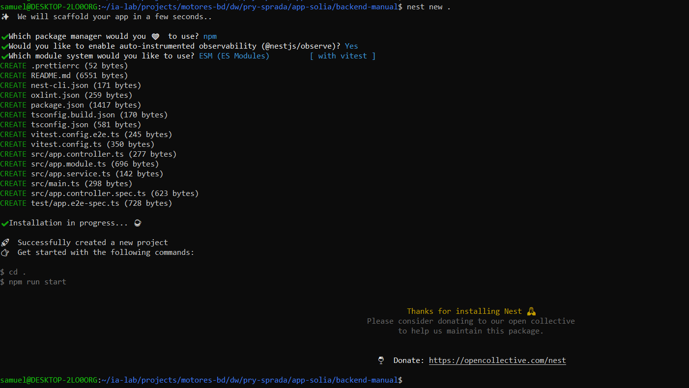

**Sugerencia de commit (issue):**

``` bash
git add .
git commit -m "chore: scaffold nestjs project backend_ia"
```

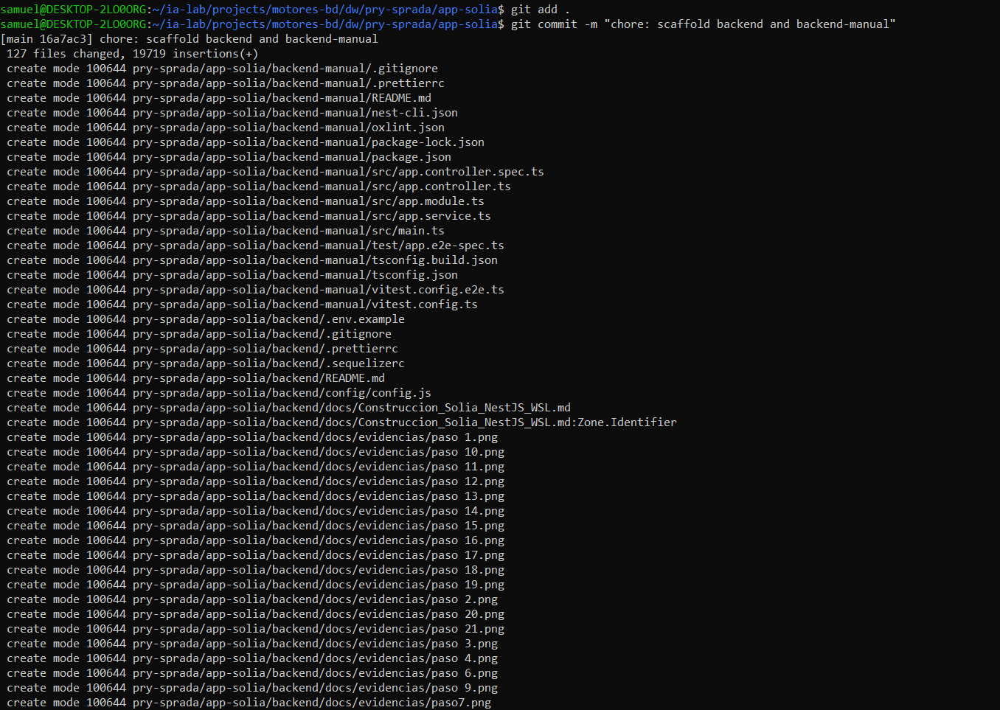

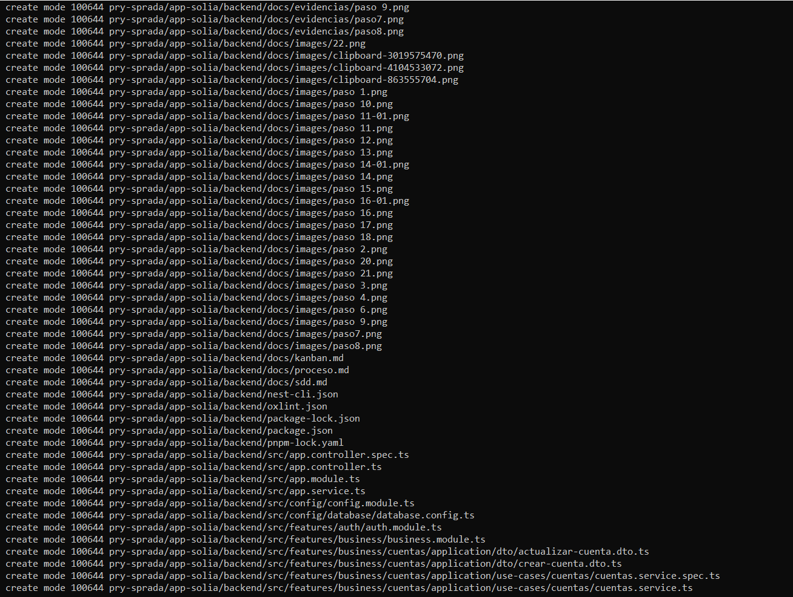

#### 1.4 — Crear `.env` mínimo (puerto)

El puerto `3002` evita choques con el 3000.
Más adelante el `.env` crecerá con BD y JWT.

``` bash
 cat > .env <<'EOF_BACKEND-MANUAL'
PORT=3002
NODE_ENV=development
EOF_BACKEND-MANUAL
```

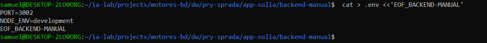

**Sugerencia de commit (issue):**

``` bash
git add .
git commit -m "chore: add initial .env with PORT=3002"
```

#### 1.5 — Commit inicial del esqueleto

Congela el punto de partida reproducible.

``` bash
git init
git add .
git commit -m "chore: inicialización del proyecto NestJS"
```

------------------------------------------------------------------------

## FASE 2 — `01_BASE_DEPS_Y_PUERTO`

### Dependencias + manejo de puerto (EADDRINUSE)

> **Objetivo de la fase:** Instalar el stack profesional y evitar que un `start:dev` colgado bloquee el puerto.

#### 2.1 — Dependencias de producción

Config, Swagger, JWT/Passport, Sequelize + drivers de 4 motores, validación, bcrypt y utilidades HTTP.

``` bash
npm install @nestjs/config @nestjs/swagger @nestjs/jwt @nestjs/passport @nestjs/mapped-types \
  passport passport-jwt sequelize sequelize-typescript mysql2 pg tedious oracledb \
  class-validator class-transformer bcrypt reflect-metadata express compression helmet
```

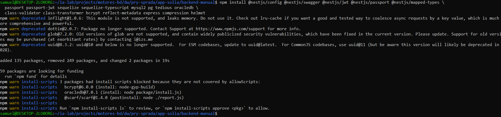

**Sugerencia de commit (issue):**

``` bash
git add .
git commit -m "chore: install production dependencies for ca backend"
```

#### 2.2 — Dependencias de desarrollo

Tipados y sequelize-cli para herramientas de BD.

``` bash
npm install -D @types/bcrypt @types/passport-jwt sequelize-cli
```

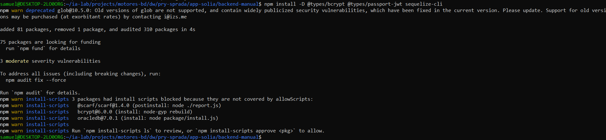

**Sugerencia de commit (issue):**

``` bash
git add .
git commit -m "chore: install auth and sequelize-cli devDependencies"
```

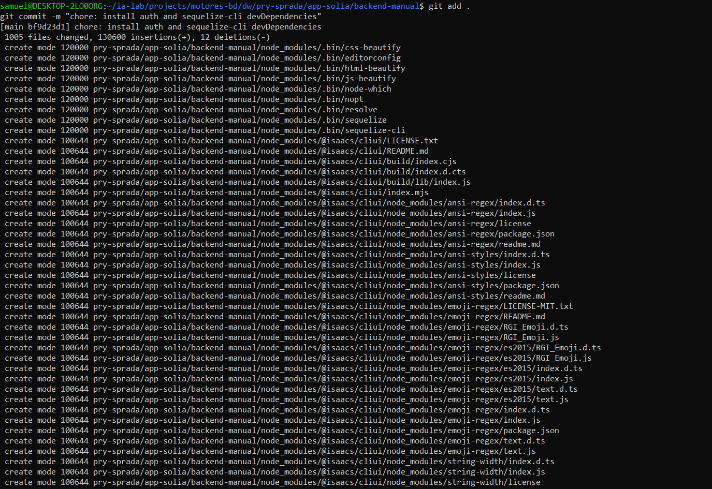

#### 2.3 — Script para liberar puerto (evita EADDRINUSE)

Si reinicias Nest sin matar el proceso anterior, Node lanza `listen EADDRINUSE`.
Este script lee `PORT` del `.env` y libera el puerto en Linux/WSL.

``` bash
mkdir -p scripts
cat > scripts/free-port.js <<'EOF_BACKEND_IA'
/**
 * Libera el puerto configurado en .env (PORT) antes de arrancar Nest.
 * Evita EADDRINUSE cuando queda una instancia previa de start:dev.
 */
const { execSync } = require('child_process');
const fs = require('fs');
const path = require('path');

function readPortFromEnv() {
  const envPath = path.join(__dirname, '..', '.env');
  let port = 3002;

  if (fs.existsSync(envPath)) {
    const content = fs.readFileSync(envPath, 'utf8');
    const match = content.match(/^\s*PORT\s*=\s*(\d+)\s*$/m);
    if (match) {
      port = parseInt(match[1], 10);
    }
  }

  if (process.env.PORT) {
    port = parseInt(process.env.PORT, 10) || port;
  }

  return port;
}

function freePort(port) {
  try {
    // Linux/WSL: mata el proceso que escucha en el puerto
    execSync(`fuser -k ${port}/tcp`, { stdio: 'ignore' });
    console.log(`✅ Puerto ${port} liberado`);
  } catch {
    // No había proceso escuchando: ok
    console.log(`ℹ️  Puerto ${port} disponible`);
  }
}

const port = readPortFromEnv();
freePort(port);
EOF_BACKEND_IA
```

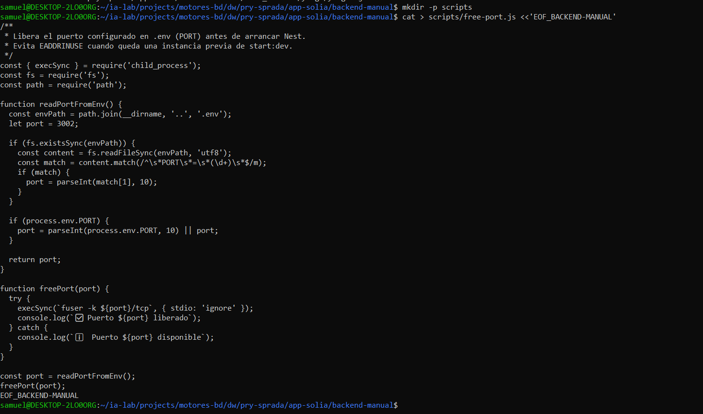

**Sugerencia de commit (issue):**

``` bash
git add .
git commit -m "chore: add scripts/free-port.js to avoid EADDRINUSE"
```

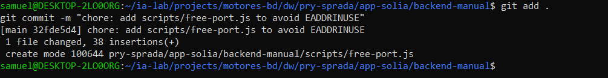

#### 2.4 — Actualizar scripts npm en package.json

Integra `free:port` en `start:dev` / `start:debug`.
Aplica el cambio con Node para no editar JSON a mano.

``` bash
node <<'EOF_BACKEND_IA'
const fs = require('fs');
const pkg = JSON.parse(fs.readFileSync('package.json', 'utf8'));
pkg.scripts = {
  ...pkg.scripts,
  'free:port': 'node scripts/free-port.js',
  'start:dev': 'npm run free:port && nest start --watch',
  'start:debug': 'npm run free:port && nest start --debug --watch',
};
fs.writeFileSync('package.json', JSON.stringify(pkg, null, 2) + '\n');
console.log('✅ package.json scripts actualizados');
EOF_BACKEND_IA
```

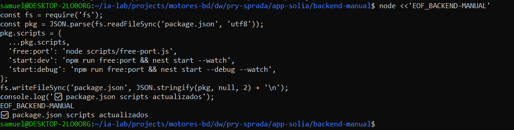

**Sugerencia de commit (issue):**

``` bash
git add .
git commit -m "chore: wire free:port into nest start scripts"
```

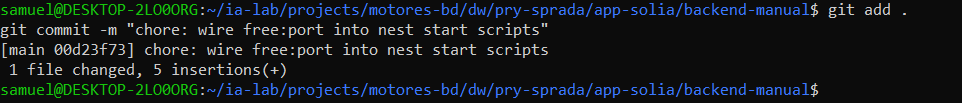

#### 2.5 — Verificar arranque base

Debe levantar el Hello World de Nest en el puerto del `.env`.

``` bash
npm run start:dev
# Ctrl+C cuando veas el log de arranque
curl -s http://localhost:3002 || true
```

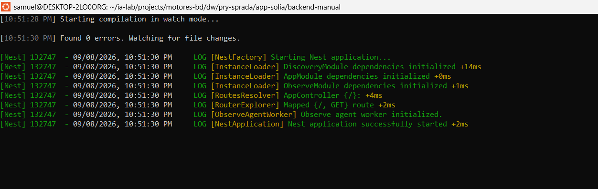

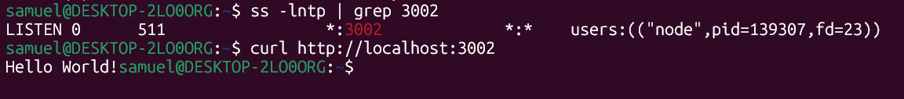

**Sugerencia de commit (issue):**

``` bash
git add .
git commit -m "test: verify nest boots after dependency install"
```

------------------------------------------------------------------------

## FASE 3 — `02_BASE_ESTRUCTURA_CA`

### Estructura de carpetas Clean Architecture

> **Objetivo de la fase:** Crear el mapa mental: config / common / infrastructure / features (business + auth).

#### 3.1 — Crear árbol base de carpetas

Aún no hay código de dominio.
Solo directorios y módulos vacíos de features para anclar imports futuros.

``` bash
mkdir -p src/config/{app,database,environment,jwt,logger,swagger}
mkdir -p src/common/{constants,decorators,enums,exceptions,filters,guards,interceptors,interfaces,pipes,types,utils,validators}
mkdir -p src/infrastructure/database/{sequelize,migrations,seeders}
mkdir -p src/infrastructure/{logging,security/hashing,security/tokens}
mkdir -p src/features/business/{clients,product-types,products,sales}/{application/{dto,mappers,use-cases},domain/{entities,enums,exceptions,interfaces,services,validators},infrastructure/persistence/{models,repositories,migrations,seeders},presentation/http/{controllers,decorators,serializers,swagger},tests}
mkdir -p src/features/auth/{users,roles,role-users,resources,resource-roles,refresh-tokens}/{application/{dto,mappers,use-cases},domain/{entities,enums,exceptions,interfaces,services,validators},infrastructure/persistence/{models,repositories,migrations,seeders},presentation/http/{controllers,decorators,serializers,swagger},tests}
mkdir -p src/features/auth/authentication/{application/{dto,mappers,use-cases},domain/{entities,enums,exceptions,interfaces,services,validators},infrastructure/{jwt,password},presentation/http/{controllers,decorators,serializers,swagger},tests}
mkdir -p src/features/auth/infrastructure/database
cat > src/features/business/business.module.ts <<'EOF_BACKEND_IA'
import { Module } from '@nestjs/common';

@Module({
  imports: [],
  exports: [],
})
export class BusinessModule {}
EOF_BACKEND_IA
cat > src/features/auth/auth.module.ts <<'EOF_BACKEND_IA'
import { Module } from '@nestjs/common';

@Module({
  imports: [],
  exports: [],
})
export class AuthModule {}
EOF_BACKEND_IA
```

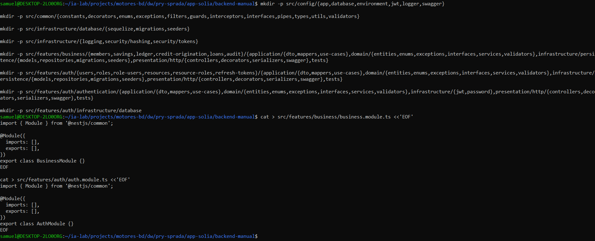

**Sugerencia de commit (issue):**

``` bash
git add .
git commit -m "chore: create clean architecture folder tree and empty feature modules"
```

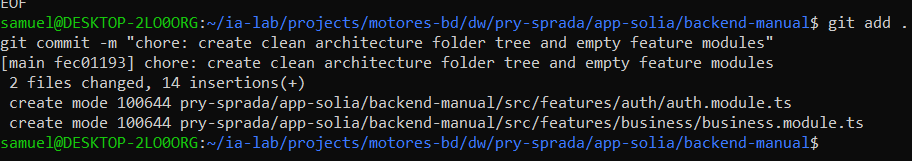

#### 3.2 — Recordatorio de responsabilidades

| Carpeta           | Responsabilidad                              |
|-------------------|----------------------------------------------|
| `config/`         | Cómo se configura la app (env, jwt, swagger) |
| `common/`         | Piezas transversales reutilizables           |
| `infrastructure/` | Detalles técnicos (Sequelize, bcrypt, JWT)   |
| `features/*`      | Dominios (business/auth) con CA interna      |

**Error típico:** poner `@Table` de Sequelize dentro de `domain/entities`.

**Sugerencia de commit (issue):**

``` bash
git add .
git commit -m "docs: note clean architecture folder responsibilities"
```

------------------------------------------------------------------------

## FASE 4 — `03_BASE_ENTORNO_ENV`

### Configuración del entorno tipado (multi-base)

> **Objetivo de la fase:** Centralizar variables en `.env`: selector `DB_DIALECT` y un bloque de credenciales por motor (MySQL, PostgreSQL, SQL Server, Oracle).
> Validar antes del boot.

#### 4.1 — Crear `.env.example` y actualizar `.env` completo

El `.env` real NO se sube a Git.
Usa BD dedicada `tecnogua_ia`.

**Contrato multi-base (igual que `docs/Prompt.md`):** - `DB_DIALECT` = `mysql` \| `postgres` \| `mssql` \| `oracle` (elige qué motor corre).
- MySQL: `DB_MYSQL_HOST`, `DB_MYSQL_PORT`, `DB_MYSQL_USERNAME`, `DB_MYSQL_PASSWORD`, `DB_MYSQL_NAME`.
- PostgreSQL: `DB_POSTGRES_*` (puerto lab 5432).
- SQL Server: `DB_MSSQL_*` (puerto lab 1433, usuario `sa`).
- Oracle: `DB_ORACLE_*` + `DB_ORACLE_CONNECT_STRING` (puerto lab 1521).
- Para cambiar de motor, cambia **solo** `DB_DIALECT`.
No uses `DB_HOST` / `DB_USERNAME` genéricos.

``` bash
cat > .env.example <<'EOF_BACKEND_IA'
# ==========================================
# APP
# ==========================================
PORT=3002
NODE_ENV=development

# ==========================================
# DATABASE
# ==========================================
# Selector del motor en ejecución (un solo valor):
# mysql | postgres | mssql | oracle
DB_DIALECT=mysql

# --- MYSQL ---
DB_MYSQL_HOST=localhost
DB_MYSQL_PORT=3306
DB_MYSQL_USERNAME=root
DB_MYSQL_PASSWORD=root
DB_MYSQL_NAME=tecnogua_ia

# --- POSTGRES ---
DB_POSTGRES_HOST=localhost
DB_POSTGRES_PORT=5432
DB_POSTGRES_USERNAME=postgres
DB_POSTGRES_PASSWORD=postgres
DB_POSTGRES_NAME=tecnogua_ia

# --- MSSQL (SQL Server) ---
DB_MSSQL_HOST=localhost
DB_MSSQL_PORT=1433
DB_MSSQL_USERNAME=sa
DB_MSSQL_PASSWORD=YourStrong@Passw0rd
DB_MSSQL_NAME=tecnogua_ia

# --- ORACLE ---
DB_ORACLE_HOST=localhost
DB_ORACLE_PORT=1521
DB_ORACLE_USERNAME=system
DB_ORACLE_PASSWORD=oracle
DB_ORACLE_NAME=tecnogua_ia
DB_ORACLE_CONNECT_STRING=localhost:1521/XEPDB1

# ==========================================
# JWT (pista completa; el guion simple no implementa login)
# ==========================================
JWT_SECRET=lab-jwt-secret-tecnogua-ia
JWT_EXPIRES_IN=1d
JWT_REFRESH_SECRET=lab-jwt-refresh-tecnogua-ia
JWT_REFRESH_EXPIRES_IN=7d
EOF_BACKEND_IA
```

``` bash
cp .env.example .env
# Laboratorio: DB_DIALECT + un bloque por motor (MYSQL/POSTGRES/MSSQL/ORACLE).
# Cambia solo el bloque del motor que uses. Mantén DB_*_NAME=tecnogua_ia
```

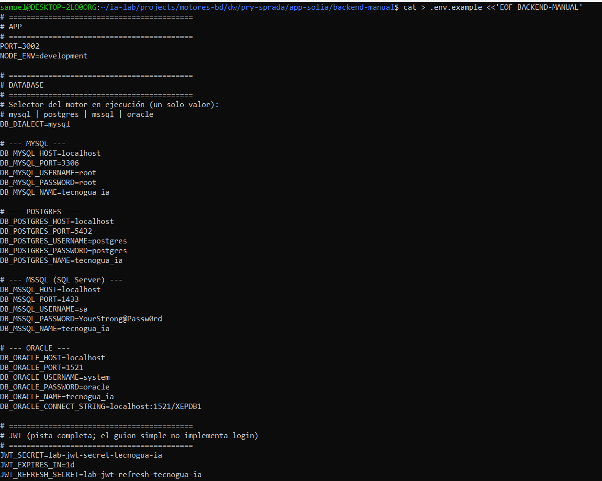

**Sugerencia de commit (issue):**

``` bash
git add .
git commit -m "chore: add typed env template and local .env for tecnogua_ia"
```

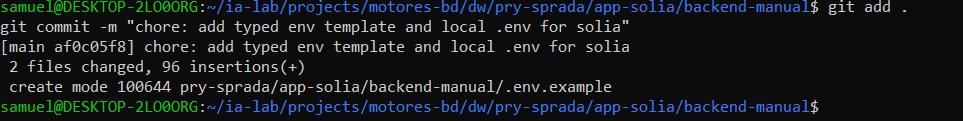

#### 4.2 — Interface de entorno

Tipos TypeScript de las variables de entorno (APP, DB, JWT) y enum de dialectos.

**Archivo:** `src/config/environment/env.interface.ts`

``` bash
mkdir -p src/config/environment
cat > src/config/environment/env.interface.ts <<'EOF_BACKEND-MANUAL'
export enum Environment {
  Development = 'development',
  Production = 'production',
  Test = 'test',
}

export enum DatabaseDialect {
  MySQL = 'mysql',
  Postgres = 'postgres',
  MSSQL = 'mssql',
  Oracle = 'oracle',
}

export interface AppConfig {
  port: number;
  nodeEnv: Environment;
}

export interface DatabaseConfig {
  dialect: DatabaseDialect;
  host: string;
  port: number;
  username: string;
  password: string;
  database: string;
  connectString?: string;
}

export interface JwtConfig {
  secret: string;
  expiresIn: string;
  refreshSecret: string;
  refreshExpiresIn: string;
}

export interface EnvironmentConfig {
  app: AppConfig;
  database: DatabaseConfig;
  jwt: JwtConfig;
}
EOF_BACKEND-MANUAL
```

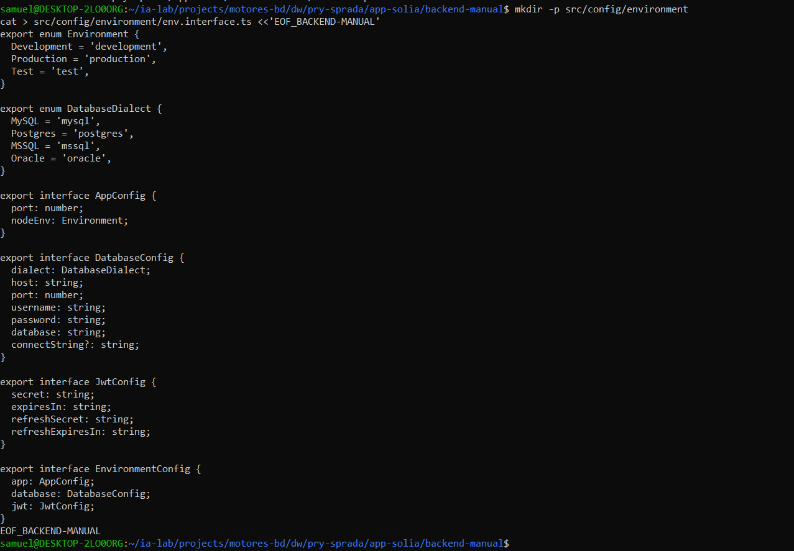

**Sugerencia de commit (issue):**

``` bash
git add .
git commit -m "feat: add environment interfaces and DatabaseDialect enum"
```

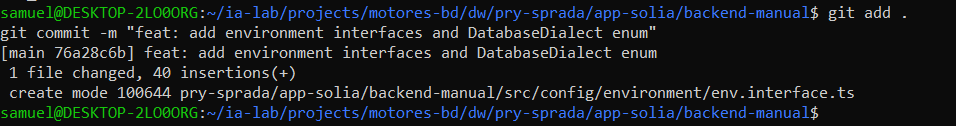

#### 4.3 — Validación de entorno con class-validator

Si falta JWT_SECRET o DB_DIALECT es inválido, o el bloque del motor activo está vacío, el boot falla con mensaje claro.

**Archivo:** `src/config/environment/env.validation.ts`

``` bash
mkdir -p src/config/environment
cat > src/config/environment/env.validation.ts <<'EOF_BACKEND-MANUAL'
import { plainToInstance } from 'class-transformer';
import {
  IsEnum,
  IsNumber,
  IsOptional,
  IsString,
  Max,
  Min,
  validateSync,
} from 'class-validator';
import {
  assertActiveDialectCredentials,
  resolveDialectCredentials,
} from './db-env';
import { DatabaseDialect, Environment } from './env.interface';

export class EnvironmentVariables {
  @IsEnum(Environment)
  @IsOptional()
  NODE_ENV: Environment = Environment.Development;

  @IsNumber()
  @Min(0)
  @Max(65535)
  @IsOptional()
  PORT: number = 3002;

  @IsEnum(DatabaseDialect)
  DB_DIALECT: DatabaseDialect;

  @IsString()
  @IsOptional()
  DB_MYSQL_HOST?: string;

  @IsNumber()
  @IsOptional()
  DB_MYSQL_PORT?: number;

  @IsString()
  @IsOptional()
  DB_MYSQL_USERNAME?: string;

  @IsString()
  @IsOptional()
  DB_MYSQL_PASSWORD?: string;

  @IsString()
  @IsOptional()
  DB_MYSQL_NAME?: string;

  @IsString()
  @IsOptional()
  DB_POSTGRES_HOST?: string;

  @IsNumber()
  @IsOptional()
  DB_POSTGRES_PORT?: number;

  @IsString()
  @IsOptional()
  DB_POSTGRES_USERNAME?: string;

  @IsString()
  @IsOptional()
  DB_POSTGRES_PASSWORD?: string;

  @IsString()
  @IsOptional()
  DB_POSTGRES_NAME?: string;

  @IsString()
  @IsOptional()
  DB_MSSQL_HOST?: string;

  @IsNumber()
  @IsOptional()
  DB_MSSQL_PORT?: number;

  @IsString()
  @IsOptional()
  DB_MSSQL_USERNAME?: string;

  @IsString()
  @IsOptional()
  DB_MSSQL_PASSWORD?: string;

  @IsString()
  @IsOptional()
  DB_MSSQL_NAME?: string;

  @IsString()
  @IsOptional()
  DB_ORACLE_HOST?: string;

  @IsNumber()
  @IsOptional()
  DB_ORACLE_PORT?: number;

  @IsString()
  @IsOptional()
  DB_ORACLE_USERNAME?: string;

  @IsString()
  @IsOptional()
  DB_ORACLE_PASSWORD?: string;

  @IsString()
  @IsOptional()
  DB_ORACLE_NAME?: string;

  @IsString()
  @IsOptional()
  DB_ORACLE_CONNECT_STRING?: string;

  @IsString()
  JWT_SECRET: string;

  @IsString()
  @IsOptional()
  JWT_EXPIRES_IN: string = '1d';

  @IsString()
  JWT_REFRESH_SECRET: string;

  @IsString()
  @IsOptional()
  JWT_REFRESH_EXPIRES_IN: string = '7d';
}

function formatValidationErrors(
  errors: ReturnType<typeof validateSync>,
): string {
  return errors
    .map((error) => {
      const constraints = error.constraints
        ? Object.values(error.constraints).join(', ')
        : 'valor inválido';
      return `${error.property}: ${constraints}`;
    })
    .join('; ');
}

export function validate(config: Record<string, unknown>): EnvironmentVariables {
  const validatedConfig = plainToInstance(EnvironmentVariables, config, {
    enableImplicitConversion: true,
    exposeDefaultValues: true,
  });

  const errors = validateSync(validatedConfig, {
    skipMissingProperties: false,
  });

  if (errors.length > 0) {
    throw new Error(
      `Error de configuración: variable(s) crítica(s) inválida(s) o ausente(s). ${formatValidationErrors(errors)}. Copia .env.example a .env y completa el bloque del motor elegido (DB_DIALECT).`,
    );
  }

  assertActiveDialectCredentials(resolveDialectCredentials(validatedConfig));

  return validatedConfig;
}
EOF_BACKEND-MANUAL
```

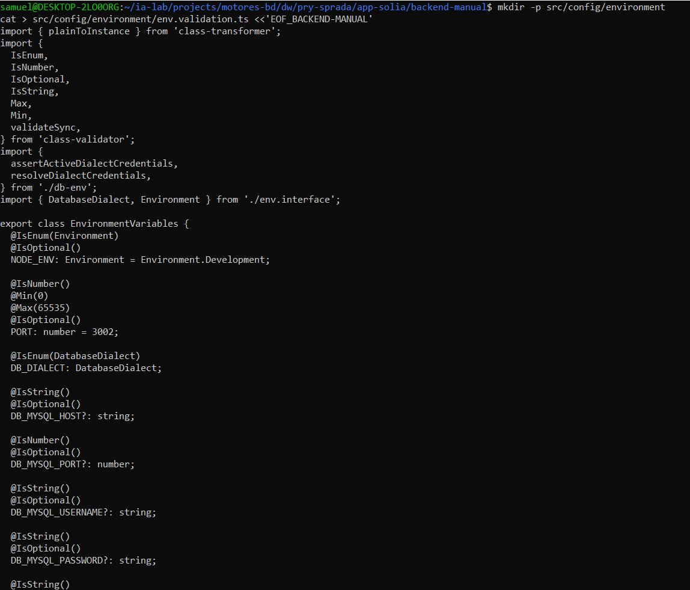

**Sugerencia de commit (issue):**

``` bash
git add .
git commit -m "feat: validate environment variables with class-validator"
```

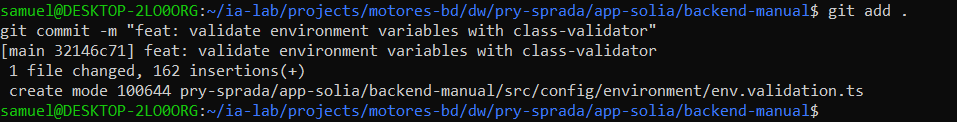

#### 4.4 — Resolver de credenciales por motor

Lee el bloque DB_MYSQL\_\* / DB_POSTGRES\_\* / DB_MSSQL\_\* / DB_ORACLE\_\* según DB_DIALECT.

**Archivo:** `src/config/environment/db-env.ts`

``` bash
mkdir -p src/config/environment
cat > src/config/environment/db-env.ts <<'EOF_BACKEND_IA'
import { DatabaseConfig, DatabaseDialect } from './env.interface';

export const DEFAULT_DB_PORTS: Record<DatabaseDialect, number> = {
  [DatabaseDialect.MySQL]: 3306,
  [DatabaseDialect.Postgres]: 5432,
  [DatabaseDialect.MSSQL]: 1433,
  [DatabaseDialect.Oracle]: 1521,
};

export type DialectEnvSource = {
  DB_DIALECT: DatabaseDialect;
  DB_MYSQL_HOST?: string;
  DB_MYSQL_PORT?: string | number;
  DB_MYSQL_USERNAME?: string;
  DB_MYSQL_PASSWORD?: string;
  DB_MYSQL_NAME?: string;
  DB_POSTGRES_HOST?: string;
  DB_POSTGRES_PORT?: string | number;
  DB_POSTGRES_USERNAME?: string;
  DB_POSTGRES_PASSWORD?: string;
  DB_POSTGRES_NAME?: string;
  DB_MSSQL_HOST?: string;
  DB_MSSQL_PORT?: string | number;
  DB_MSSQL_USERNAME?: string;
  DB_MSSQL_PASSWORD?: string;
  DB_MSSQL_NAME?: string;
  DB_ORACLE_HOST?: string;
  DB_ORACLE_PORT?: string | number;
  DB_ORACLE_USERNAME?: string;
  DB_ORACLE_PASSWORD?: string;
  DB_ORACLE_NAME?: string;
  DB_ORACLE_CONNECT_STRING?: string;
};

function toPort(value: string | number | undefined, fallback: number): number {
  if (typeof value === 'number' && Number.isFinite(value)) {
    return value;
  }
  if (typeof value === 'string' && value.trim() !== '') {
    const parsed = parseInt(value, 10);
    if (Number.isFinite(parsed)) {
      return parsed;
    }
  }
  return fallback;
}

function text(value: string | undefined): string {
  return value?.trim() ?? '';
}

export function resolveDialectCredentials(
  env: DialectEnvSource,
): DatabaseConfig {
  const dialect = env.DB_DIALECT;
  const port = DEFAULT_DB_PORTS[dialect];

  switch (dialect) {
    case DatabaseDialect.MySQL:
      return {
        dialect,
        host: text(env.DB_MYSQL_HOST),
        port: toPort(env.DB_MYSQL_PORT, port),
        username: text(env.DB_MYSQL_USERNAME),
        password: text(env.DB_MYSQL_PASSWORD),
        database: text(env.DB_MYSQL_NAME),
      };
    case DatabaseDialect.Postgres:
      return {
        dialect,
        host: text(env.DB_POSTGRES_HOST),
        port: toPort(env.DB_POSTGRES_PORT, port),
        username: text(env.DB_POSTGRES_USERNAME),
        password: text(env.DB_POSTGRES_PASSWORD),
        database: text(env.DB_POSTGRES_NAME),
      };
    case DatabaseDialect.MSSQL:
      return {
        dialect,
        host: text(env.DB_MSSQL_HOST),
        port: toPort(env.DB_MSSQL_PORT, port),
        username: text(env.DB_MSSQL_USERNAME),
        password: text(env.DB_MSSQL_PASSWORD),
        database: text(env.DB_MSSQL_NAME),
      };
    case DatabaseDialect.Oracle:
      return {
        dialect,
        host: text(env.DB_ORACLE_HOST),
        port: toPort(env.DB_ORACLE_PORT, port),
        username: text(env.DB_ORACLE_USERNAME),
        password: text(env.DB_ORACLE_PASSWORD),
        database: text(env.DB_ORACLE_NAME),
        connectString: text(env.DB_ORACLE_CONNECT_STRING) || undefined,
      };
    default:
      throw new Error(
        `Error de configuración: DB_DIALECT inválido. Use mysql, postgres, mssql u oracle.`,
      );
  }
}

export function assertActiveDialectCredentials(config: DatabaseConfig): void {
  const prefix: Record<DatabaseDialect, string> = {
    [DatabaseDialect.MySQL]: 'DB_MYSQL',
    [DatabaseDialect.Postgres]: 'DB_POSTGRES',
    [DatabaseDialect.MSSQL]: 'DB_MSSQL',
    [DatabaseDialect.Oracle]: 'DB_ORACLE',
  };
  const tag = prefix[config.dialect];
  const missing: string[] = [];

  if (!config.host) missing.push(`${tag}_HOST`);
  if (!config.username) missing.push(`${tag}_USERNAME`);
  if (!config.database) missing.push(`${tag}_NAME`);
  if (config.dialect === DatabaseDialect.Oracle && !config.connectString) {
    missing.push('DB_ORACLE_CONNECT_STRING');
  }

  if (missing.length > 0) {
    throw new Error(
      `Error de configuración: variable(s) crítica(s) inválida(s) o ausente(s) para ${config.dialect}: ${missing.join(', ')}. Completa el bloque de ese motor en .env (no commitees secretos).`,
    );
  }
}
EOF_BACKEND_IA
```

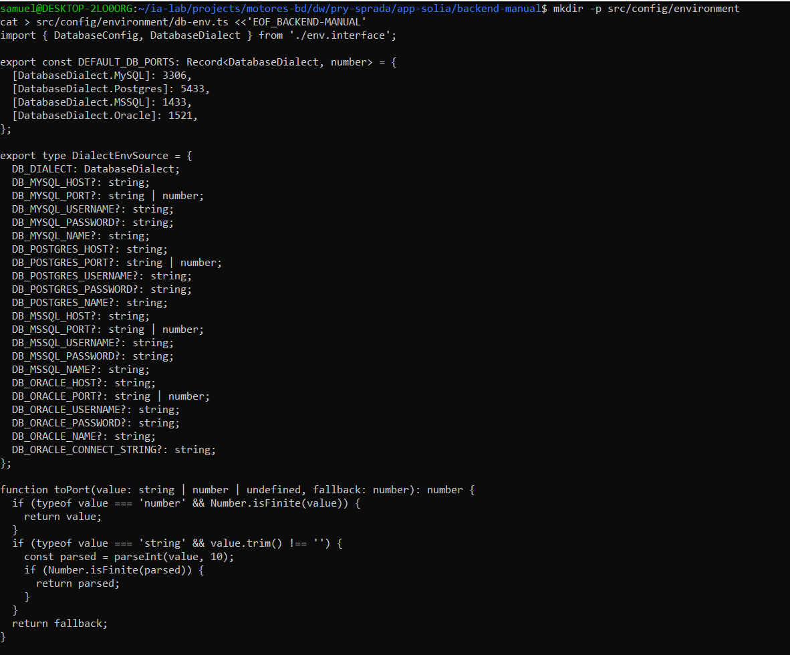

**Sugerencia de commit (issue):**

``` bash
git add .
git commit -m "feat: resolve database credentials per dialect"
```

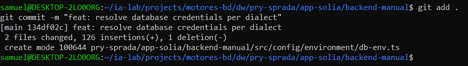

#### 4.5 — Factory registerAs de entorno

Expone `environment.*` vía ConfigService (`registerAs`).

**Archivo:** `src/config/environment/env.config.ts`

``` bash
mkdir -p src/config/environment
cat > src/config/environment/env.config.ts <<'EOF_BACKEND-MANUAL'
import { registerAs } from '@nestjs/config';
import { resolveDialectCredentials } from './db-env';
import { Environment } from './env.interface';
import { validate } from './env.validation';

export const ENV_CONFIG_NAME = 'environment';

export const envConfig = registerAs(ENV_CONFIG_NAME, () => {
  const validated = validate(process.env);

  return {
    app: {
      port: validated.PORT,
      nodeEnv: validated.NODE_ENV ?? Environment.Development,
    },
    database: resolveDialectCredentials(validated),
    jwt: {
      secret: validated.JWT_SECRET,
      expiresIn: validated.JWT_EXPIRES_IN,
      refreshSecret: validated.JWT_REFRESH_SECRET,
      refreshExpiresIn: validated.JWT_REFRESH_EXPIRES_IN,
    },
  };
});
EOF_BACKEND-MANUAL
```

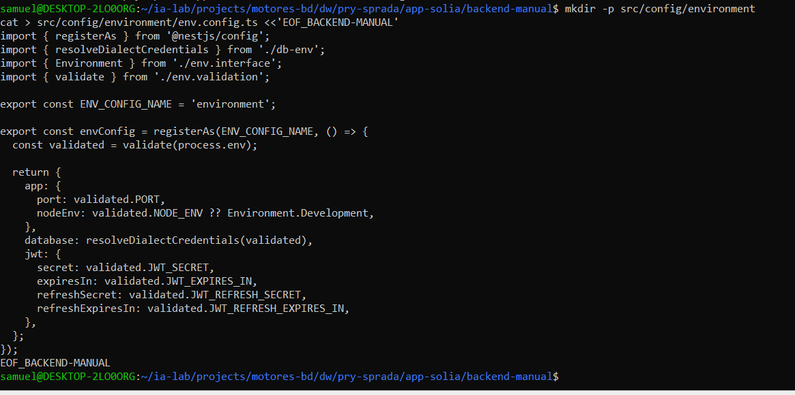

**Sugerencia de commit (issue):**

``` bash
git add .
git commit -m "feat: register environment config factory"
```

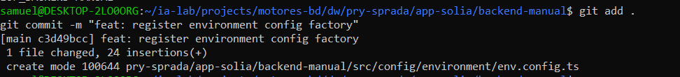

------------------------------------------------------------------------

## FASE 5 — `04_BASE_DATABASE_SEQUELIZE`

### Base de datos multi-dialecto (Sequelize)

> **Objetivo de la fase:** Conectar Sequelize al motor de `DB_DIALECT` usando el bloque `DB_MYSQL_*` / `DB_POSTGRES_*` / `DB_MSSQL_*` / `DB_ORACLE_*`.
> Aún sin features (ALL_MODELS vacío).

#### 5.1 — Constante SEQUELIZE_TOKEN

Token DI para inyectar la instancia Sequelize en repositorios.

**Archivo:** `src/common/constants/database.constants.ts`

``` bash
mkdir -p src/common/constants
cat > src/common/constants/database.constants.ts <<'EOF_BACKEND-MANUAL'
export const SEQUELIZE_TOKEN = 'SEQUELIZE';
EOF_BACKEND-MANUAL
```

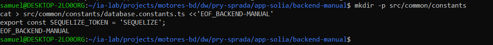

**Sugerencia de commit (issue):**

``` bash
git add .
git commit -m "feat: add SEQUELIZE_TOKEN constant"
```

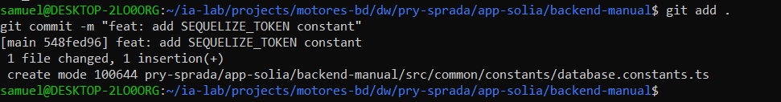

#### 5.2 — Tipos auxiliares de database config

Tipos auxiliares del bloque config/database (legado/compat).

**Archivo:** `src/config/database/database.types.ts`

``` bash
mkdir -p src/config/database
cat > src/config/database/database.types.ts <<'EOF_BACKEND-MANUAL'
import { Options as SequelizeOptions } from 'sequelize';

export type DialectOptions =
  | { dialect: 'mysql'; options?: SequelizeOptions }
  | { dialect: 'postgres'; options?: SequelizeOptions }
  | { dialect: 'mssql'; options?: SequelizeOptions }
  | { dialect: 'oracle'; options?: SequelizeOptions };
EOF_BACKEND-MANUAL
```

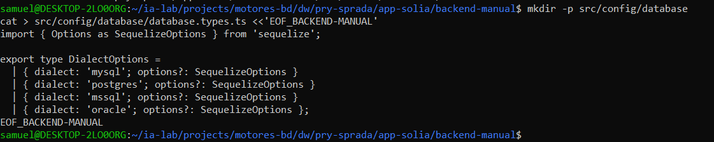

**Sugerencia de commit (issue):**

``` bash
git add .
git commit -m "chore: add database.types helpers"
```

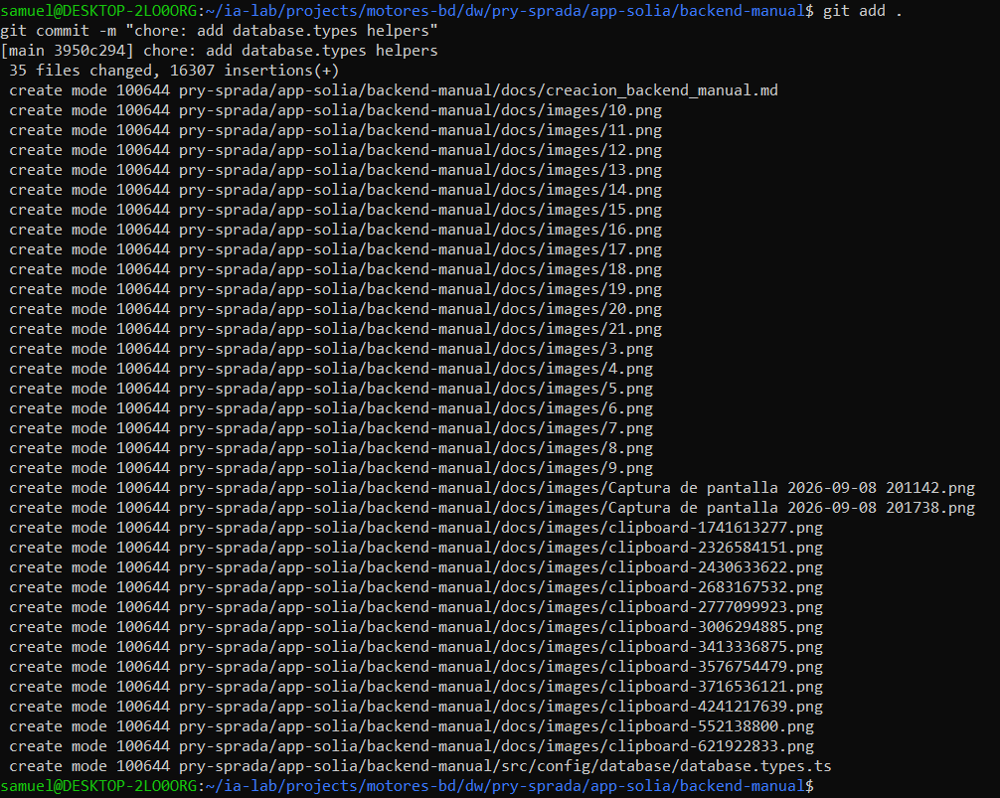

#### 5.3 — database.config.ts

Factory registerAs opcional para namespace `database` (complementa environment).

**Archivo:** `src/config/database/database.config.ts`

``` bash
mkdir -p src/config/database
cat > src/config/database/database.config.ts <<'EOF_BACKEND-MANUAL'
import { registerAs } from '@nestjs/config';
import { resolveDialectCredentials } from '../environment/db-env';
import { DatabaseDialect } from '../environment/env.interface';

export const DATABASE_CONFIG_NAME = 'database';

const dialectModuleMap: Record<DatabaseDialect, string> = {
  [DatabaseDialect.MySQL]: 'mysql2',
  [DatabaseDialect.Postgres]: 'pg',
  [DatabaseDialect.MSSQL]: 'tedious',
  [DatabaseDialect.Oracle]: 'oracledb',
};

export const databaseConfig = registerAs(DATABASE_CONFIG_NAME, () => {
  const dialect =
    (process.env.DB_DIALECT as DatabaseDialect) || DatabaseDialect.MySQL;
  const credentials = resolveDialectCredentials({
    DB_DIALECT: dialect,
    ...process.env,
  });

  return {
    ...credentials,
    dialectModulePath: dialectModuleMap[dialect],
    autoLoadModels: true,
    synchronize: process.env.NODE_ENV !== 'production',
    logging: process.env.NODE_ENV === 'development' ? console.log : false,
  };
});
EOF_BACKEND-MANUAL
```

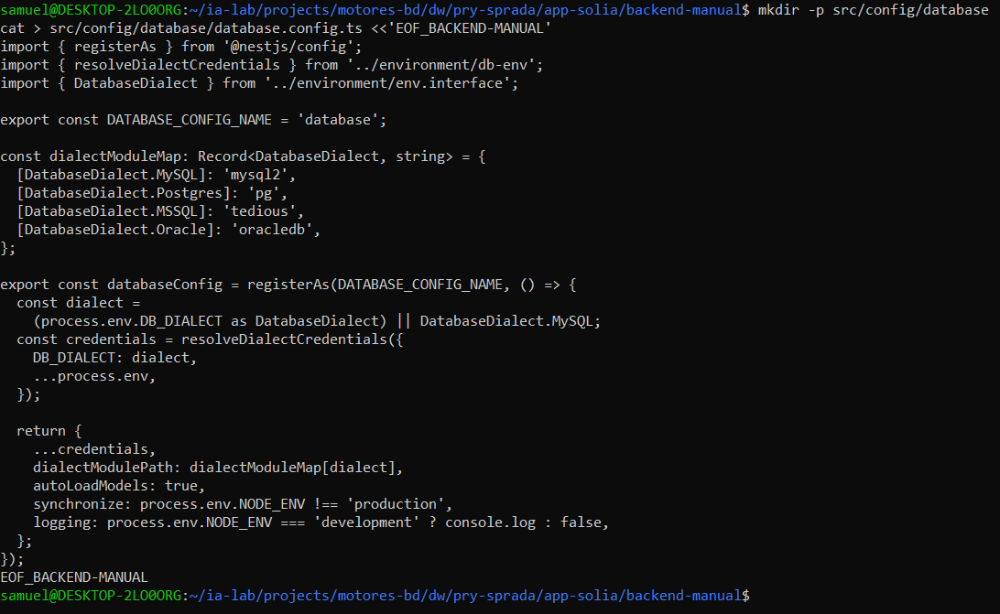

**Sugerencia de commit (issue):**

``` bash
git add .
git commit -m "feat: add database.config registerAs"
```

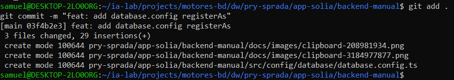

#### 5.4 — database.module.ts / providers

Módulo de configuración de BD (forFeature).
Los providers quedan vacíos a propósito.

**Archivo:** `src/config/database/database.module.ts`

``` bash
mkdir -p src/config/database
cat > src/config/database/database.module.ts <<'EOF_BACKEND-MANUAL'
import { Module } from '@nestjs/common';
import { ConfigModule } from '@nestjs/config';
import { databaseConfig } from './database.config';

@Module({
  imports: [ConfigModule.forFeature(databaseConfig)],
  exports: [ConfigModule],
})
export class DatabaseConfigModule {}
EOF_BACKEND-MANUAL
```

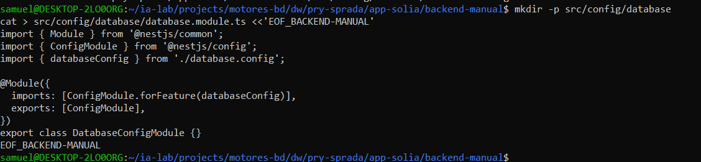

**Sugerencia de commit (issue):**

``` bash
git add .
git commit -m "feat: add DatabaseConfigModule"
```

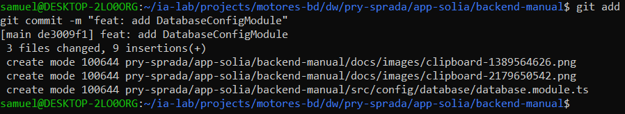

#### 5.5 — database.providers.ts

Placeholder de providers de config/database.

**Archivo:** `src/config/database/database.providers.ts`

``` bash
mkdir -p src/config/database
cat > src/config/database/database.providers.ts <<'EOF_BACKEND-MANUAL'
export const DATABASE_PROVIDERS = [];
EOF_BACKEND-MANUAL
```

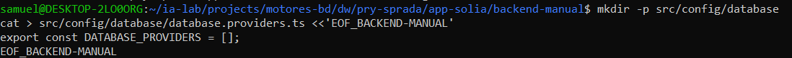

**Sugerencia de commit (issue):**

``` bash
git add .
git commit -m "chore: add empty DATABASE_PROVIDERS"
```

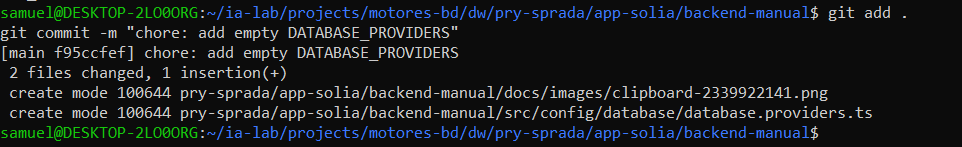

#### 5.6 — Opciones Sequelize por dialecto

Arma host/port/user/password/logging con el bloque del motor seleccionado por DB_DIALECT.

**Archivo:** `src/infrastructure/database/sequelize/sequelize.options.ts`

``` bash
mkdir -p src/infrastructure/database/sequelize
cat > src/infrastructure/database/sequelize/sequelize.options.ts <<'EOF_BACKEND-MANUAL'
import { SequelizeOptions } from 'sequelize-typescript';
import { resolveDialectCredentials } from '../../../config/environment/db-env';
import { DatabaseDialect } from '../../../config/environment/env.interface';

export function getSequelizeOptions(
  dialect: DatabaseDialect,
): Partial<SequelizeOptions> {
  const credentials = resolveDialectCredentials({
    DB_DIALECT: dialect,
    ...process.env,
  });

  const base: SequelizeOptions = {
    dialect: dialect as SequelizeOptions['dialect'],
    host: credentials.host,
    port: credentials.port,
    username: credentials.username,
    password: credentials.password,
    database: credentials.database,
    logging: process.env.NODE_ENV === 'development' ? console.log : false,
    define: {
      underscored: false,
      freezeTableName: true,
    },
  };

  switch (dialect) {
    case DatabaseDialect.MSSQL:
      return {
        ...base,
        dialectOptions: {
          options: {
            encrypt: true,
            trustServerCertificate: true,
          },
        },
      };
    case DatabaseDialect.Oracle:
      return {
        ...base,
        dialectOptions: {
          connectString: credentials.connectString,
        },
      };
    default:
      return base;
  }
}
EOF_BACKEND-MANUAL
```

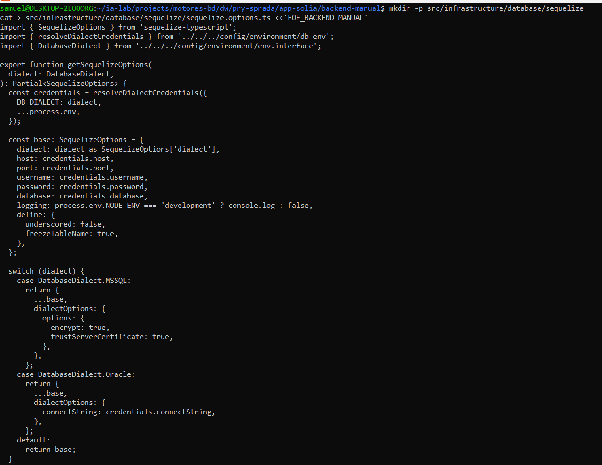

**Sugerencia de commit (issue):**

``` bash
git add .
git commit -m "feat: add getSequelizeOptions multi-dialect"
```

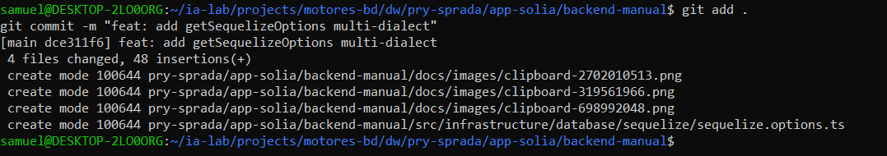

#### 5.7 — Factory Sequelize (sin modelos aún)

Crea la instancia Sequelize.
`ALL_MODELS` empieza vacío: se llena al crear cada entidad.

**Archivo:** `src/infrastructure/database/sequelize/sequelize.factory.ts`

``` bash
mkdir -p src/infrastructure/database/sequelize
cat > src/infrastructure/database/sequelize/sequelize.factory.ts <<'EOF_BACKEND-MANUAL'
import { Sequelize } from 'sequelize-typescript';
import { DatabaseDialect } from '../../../config/environment/env.interface';
import { getSequelizeOptions } from './sequelize.options';


export const ALL_MODELS = [
  // (aún sin modelos — se agregan por feature)
];

export async function createSequelizeInstance(
  dialect: DatabaseDialect,
): Promise<Sequelize> {
  const options = getSequelizeOptions(dialect);

  let dialectModule: any;

  switch (dialect) {
    case DatabaseDialect.MySQL:
      dialectModule = require('mysql2');
      break;
    case DatabaseDialect.Postgres:
      dialectModule = require('pg');
      break;
    case DatabaseDialect.MSSQL:
      dialectModule = require('tedious');
      break;
    case DatabaseDialect.Oracle:
      dialectModule = require('oracledb');
      break;
    default:
      throw new Error(`Dialecto no soportado: ${dialect}`);
  }

  const sequelize = new Sequelize({
    ...options,
    dialectModule,
    models: ALL_MODELS,
  } as any);

  try {
    await sequelize.authenticate();
    console.log(`✅ Conexión exitosa a ${dialect.toUpperCase()}`);
  } catch (error: any) {
    console.error(
      `❌ Error conectando a ${dialect.toUpperCase()}:`,
      error.message,
    );
    throw error;
  }

  if (process.env.NODE_ENV !== 'production') {
    await sequelize.sync({ alter: false });
    console.log('✅ Tablas sincronizadas');
  }

  return sequelize;
}
EOF_BACKEND-MANUAL
```

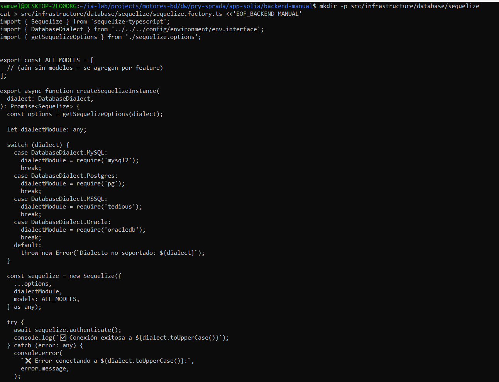

**Sugerencia de commit (issue):**

``` bash
git add .
git commit -m "feat: add createSequelizeInstance with empty ALL_MODELS"
```

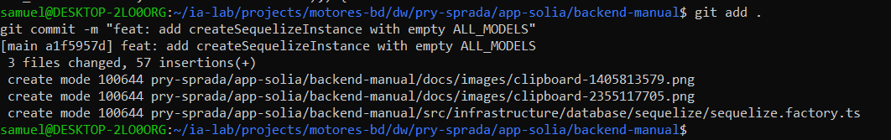

#### 5.8 — DatabaseSeederService (sin seeders aún)

Hook OnModuleInit para seeders.
Todavía no llama a ningún seeder de feature.

**Archivo:** `src/infrastructure/database/seeders/database-seeder.service.ts`

``` bash
mkdir -p src/infrastructure/database/seeders
cat > src/infrastructure/database/seeders/database-seeder.service.ts <<'EOF_BACKEND-MANUAL'
import { Injectable, Logger, OnModuleInit } from '@nestjs/common';


/**
 * Ejecuta seeders en orden de dependencias.
 * Solo en entornos no productivos.
 */
@Injectable()
export class DatabaseSeederService implements OnModuleInit {
  private readonly logger = new Logger(DatabaseSeederService.name);

  async onModuleInit(): Promise<void> {
    if (process.env.NODE_ENV === 'production') {
      return;
    }

    try {
      // sin seeders aún
      this.logger.log('✅ Seeders ejecutados');
    } catch (error: any) {
      this.logger.error(`❌ Error en seeders: ${error.message}`, error.stack);
      throw error;
    }
  }
}
EOF_BACKEND-MANUAL
```

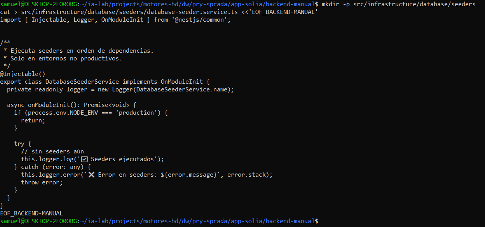

**Sugerencia de commit (issue):**

``` bash
git add .
git commit -m "feat: add DatabaseSeederService scaffold"
```

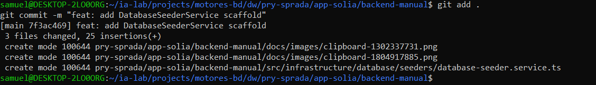

#### 5.9 — Módulo global Sequelize

Módulo `@Global()` que provee `SEQUELIZE_TOKEN` + ejecuta seeders.

**Archivo:** `src/infrastructure/database/sequelize/sequelize.module.ts`

``` bash
mkdir -p src/infrastructure/database/sequelize
cat > src/infrastructure/database/sequelize/sequelize.module.ts <<'EOF_BACKEND-MANUAL'
import { Module, Global } from '@nestjs/common';
import { ConfigService } from '@nestjs/config';
import { Sequelize } from 'sequelize-typescript';
import { DatabaseDialect } from '../../../config/environment/env.interface';
import { SEQUELIZE_TOKEN } from '../../../common/constants/database.constants';
import { createSequelizeInstance } from './sequelize.factory';
import { DatabaseSeederService } from '../seeders/database-seeder.service';

@Global()
@Module({
  providers: [
    {
      provide: SEQUELIZE_TOKEN,
      useFactory: async (configService: ConfigService): Promise<Sequelize> => {
        const dialect = configService.get<DatabaseDialect>(
          'environment.database.dialect',
          DatabaseDialect.MySQL,
        );
        return createSequelizeInstance(dialect);
      },
      inject: [ConfigService],
    },
    DatabaseSeederService,
  ],
  exports: [SEQUELIZE_TOKEN],
})
export class SequelizeDatabaseModule {}
EOF_BACKEND-MANUAL
```

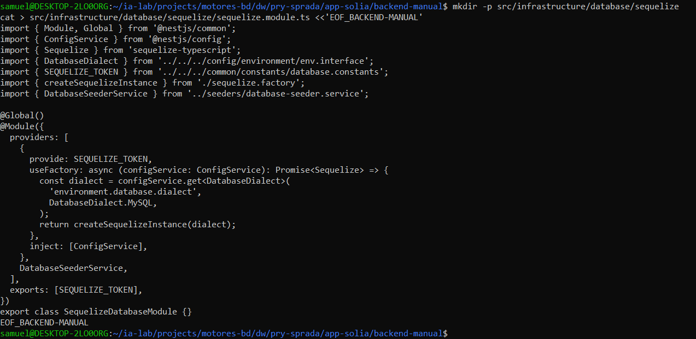

**Sugerencia de commit (issue):**

``` bash
git add .
git commit -m "feat: add global SequelizeDatabaseModule"
```

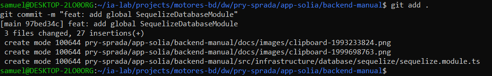

#### 5.10 — Verificar conexión a BD

Crea la BD vacía `tecnogua_ia` en el motor que indica `DB_DIALECT`.
Aún no hay tablas de negocio.
Si falla el authenticate, corrige el **bloque de ese motor** en `.env` (no el de otro).

``` bash
# mysql:
# mysql -u root -p -e "CREATE DATABASE IF NOT EXISTS tecnogua_ia;"
# postgres:
# createdb tecnogua_ia
# mssql (sqlcmd):
# sqlcmd -S localhost -U sa -Q "CREATE DATABASE tecnogua_ia;"
# oracle: crea el schema/PDB que apunte DB_ORACLE_CONNECT_STRING
npm run start:dev
# Busca: ✅ Conexión exitosa a MYSQL (o POSTGRES / MSSQL / ORACLE según DB_DIALECT)
# Ctrl+C
```

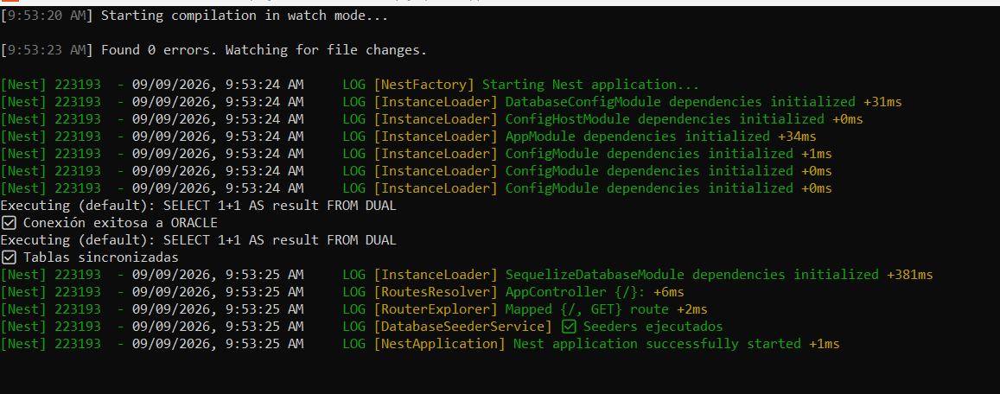

**Sugerencia de commit (issue):**

``` bash
git add .
git commit -m "test: verify sequelize authenticates against tecnogua_ia"
```

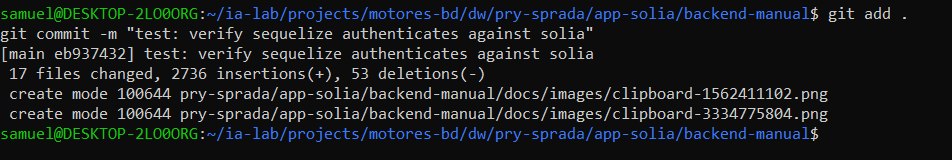

------------------------------------------------------------------------

## FASE 6 — `05_BASE_APP_COMMON_SECURITY`

### App config + Logger + Common + Security + bootstrap

> **Objetivo de la fase:** Dejar la infraestructura transversal lista antes de la primera entidad de negocio.
> Aún sin Business/Auth en AppModule y sin guards globales.

#### 6.1 — config/app/app.constants.ts

Archivo del feature en Clean Architecture.

**Archivo:** `src/config/app/app.constants.ts`

``` bash
mkdir -p src/config/app
cat > src/config/app/app.constants.ts <<'EOF_BACKEND-MANUAL'
export const APP_CONFIG_NAME = 'app';

export const APP_DEFAULTS = {
  PORT: 3002,
  NODE_ENV: 'development',
};
EOF_BACKEND-MANUAL
```

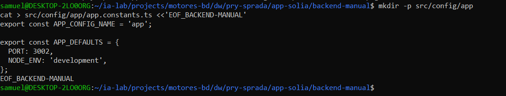

**Sugerencia de commit (issue):**

``` bash
git add .
git commit -m "feat: add app.constants.ts"
```

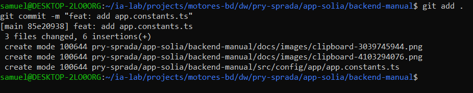

#### 6.2 — config/app/app.config.ts

Archivo del feature en Clean Architecture.

**Archivo:** `src/config/app/app.config.ts`

``` bash
mkdir -p src/config/app
cat > src/config/app/app.config.ts <<'EOF_BACKEND-MANUAL'
import { registerAs } from '@nestjs/config';
import { APP_CONFIG_NAME, APP_DEFAULTS } from './app.constants';
import { Environment } from '../environment/env.interface';

export const appConfig = registerAs(APP_CONFIG_NAME, () => ({
  port: parseInt(process.env.PORT || String(APP_DEFAULTS.PORT), 10),
  nodeEnv: (process.env.NODE_ENV as Environment) || APP_DEFAULTS.NODE_ENV,
}));
EOF_BACKEND-MANUAL
```

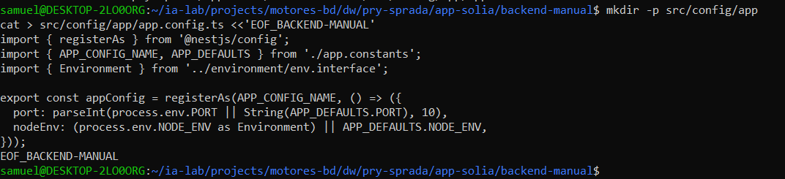

**Sugerencia de commit (issue):**

``` bash
git add .
git commit -m "feat: add app.config.ts"
```

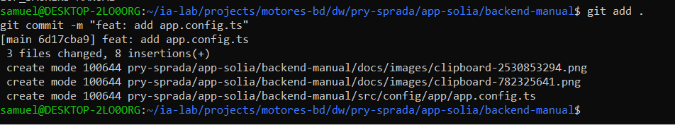

#### 6.3 — config/logger/logger.config.ts

Archivo del feature en Clean Architecture.

**Archivo:** `src/config/logger/logger.config.ts`

``` bash
mkdir -p src/config/logger
cat > src/config/logger/logger.config.ts <<'EOF_BACKEND-MANUAL'
import { LogLevel } from '@nestjs/common';

export function getLoggerConfig(): { logLevels: LogLevel[] } {
  const isDev = process.env.NODE_ENV === 'development';

  return {
    logLevels: isDev
      ? ['log', 'error', 'warn', 'debug', 'verbose', 'fatal']
      : ['log', 'error', 'warn'],
  };
}
EOF_BACKEND-MANUAL
```

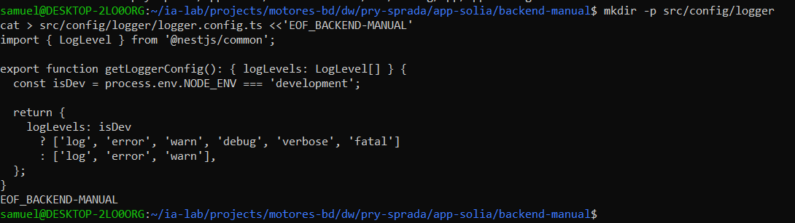

**Sugerencia de commit (issue):**

``` bash
git add .
git commit -m "feat: add logger.config.ts"
```


#### 6.4 — config/logger/logger.module.ts

Módulo Nest del feature: cablea providers, tokens DI y controller.

**Archivo:** `src/config/logger/logger.module.ts`

``` bash
mkdir -p src/config/logger
cat > src/config/logger/logger.module.ts <<'EOF_BACKEND-MANUAL'
import { Module, Global, Logger } from '@nestjs/common';

@Global()
@Module({
  providers: [Logger],
  exports: [Logger],
})
export class LoggerModule {}
EOF_BACKEND-MANUAL
```


**Sugerencia de commit (issue):**

``` bash
git add .
git commit -m "feat: wire nest module logger.module.ts"
```


#### 6.5 — config/jwt/jwt.constants.ts

Archivo del feature en Clean Architecture.

**Archivo:** `src/config/jwt/jwt.constants.ts`

``` bash
mkdir -p src/config/jwt
cat > src/config/jwt/jwt.constants.ts <<'EOF_BACKEND-MANUAL'
export const JWT_CONFIG_NAME = 'jwt';

export const JWT_DEFAULTS = {
  EXPIRES_IN: '1d',
  REFRESH_EXPIRES_IN: '7d',
};
EOF_BACKEND-MANUAL
```


**Sugerencia de commit (issue):**

``` bash
git add .
git commit -m "feat: add jwt.constants.ts"
```


#### 6.6 — config/jwt/jwt.config.ts

Archivo del feature en Clean Architecture.

**Archivo:** `src/config/jwt/jwt.config.ts`

``` bash
mkdir -p src/config/jwt
cat > src/config/jwt/jwt.config.ts <<'EOF_BACKEND-MANUAL'
import { registerAs } from '@nestjs/config';
import { JWT_CONFIG_NAME, JWT_DEFAULTS } from './jwt.constants';

export const jwtConfig = registerAs(JWT_CONFIG_NAME, () => ({
  secret: process.env.JWT_SECRET || '',
  expiresIn: process.env.JWT_EXPIRES_IN || JWT_DEFAULTS.EXPIRES_IN,
  refreshSecret: process.env.JWT_REFRESH_SECRET || '',
  refreshExpiresIn:
    process.env.JWT_REFRESH_EXPIRES_IN || JWT_DEFAULTS.REFRESH_EXPIRES_IN,
}));
EOF_BACKEND-MANUAL
```


**Sugerencia de commit (issue):**

``` bash
git add .
git commit -m "feat: add jwt.config.ts"
```


#### 6.7 — config/swagger/swagger.constants.ts

Archivo del feature en Clean Architecture.

**Archivo:** `src/config/swagger/swagger.constants.ts`

``` bash
mkdir -p src/config/swagger
cat > src/config/swagger/swagger.constants.ts <<'EOF_BACKEND-MANUAL'
export const SWAGGER_TITLE = 'Backend NestJS + Sequelize API';
export const SWAGGER_DESCRIPTION =
  'API profesional con Clean Architecture / DDD, JWT y RBAC';
export const SWAGGER_VERSION = '1.0';
export const SWAGGER_PATH = 'api/docs';
EOF_BACKEND-MANUAL
```


**Sugerencia de commit (issue):**

``` bash
git add .
git commit -m "feat: add swagger.constants.ts"
```


#### 6.8 — config/swagger/swagger.config.ts

Archivo del feature en Clean Architecture.

**Archivo:** `src/config/swagger/swagger.config.ts`

``` bash
mkdir -p src/config/swagger
cat > src/config/swagger/swagger.config.ts <<'EOF_BACKEND-MANUAL'
import { INestApplication } from '@nestjs/common';
import { DocumentBuilder, SwaggerModule } from '@nestjs/swagger';
import {
  SWAGGER_DESCRIPTION,
  SWAGGER_PATH,
  SWAGGER_TITLE,
  SWAGGER_VERSION,
} from './swagger.constants';

export function setupSwagger(app: INestApplication): void {
  const config = new DocumentBuilder()
    .setTitle(SWAGGER_TITLE)
    .setDescription(SWAGGER_DESCRIPTION)
    .setVersion(SWAGGER_VERSION)
    .addBearerAuth(
      {
        type: 'http',
        scheme: 'bearer',
        bearerFormat: 'JWT',
        name: 'Authorization',
        in: 'header',
      },
      'access-token',
    )
    .build();

  const document = SwaggerModule.createDocument(app, config);
  SwaggerModule.setup(SWAGGER_PATH, app, document);
}
EOF_BACKEND-MANUAL
```


**Sugerencia de commit (issue):**

``` bash
git add .
git commit -m "feat: add swagger.config.ts"
```


#### 6.9 — common/enums/status.enum.ts

Archivo del feature en Clean Architecture.

**Archivo:** `src/common/enums/status.enum.ts`

``` bash
mkdir -p src/common/enums
cat > src/common/enums/status.enum.ts <<'EOF_BACKEND-MANUAL'
export enum Status {
  ACTIVE = 'ACTIVE',
  INACTIVE = 'INACTIVE',
}
EOF_BACKEND-MANUAL
```


**Sugerencia de commit (issue):**

``` bash
git add .
git commit -m "feat: add status.enum.ts"
```


#### 6.10 — common/enums/http-method.enum.ts

Archivo del feature en Clean Architecture.

**Archivo:** `src/common/enums/http-method.enum.ts`

``` bash
mkdir -p src/common/enums
cat > src/common/enums/http-method.enum.ts <<'EOF_BACKEND-MANUAL'
export enum HttpMethod {
  GET = 'GET',
  POST = 'POST',
  PUT = 'PUT',
  PATCH = 'PATCH',
  DELETE = 'DELETE',
}
EOF_BACKEND-MANUAL
```


**Sugerencia de commit (issue):**

``` bash
git add .
git commit -m "feat: add http-method.enum.ts"
```


#### 6.11 — common/enums/sort-order.enum.ts

Archivo del feature en Clean Architecture.

**Archivo:** `src/common/enums/sort-order.enum.ts`

``` bash
mkdir -p src/common/enums
cat > src/common/enums/sort-order.enum.ts <<'EOF_BACKEND-MANUAL'
export enum SortOrder {
  ASC = 'ASC',
  DESC = 'DESC',
}
EOF_BACKEND-MANUAL
```


**Sugerencia de commit (issue):**

``` bash
git add .
git commit -m "feat: add sort-order.enum.ts"
```


#### 6.12 — common/constants/app.constants.ts

Archivo del feature en Clean Architecture.

**Archivo:** `src/common/constants/app.constants.ts`

``` bash
mkdir -p src/common/constants
cat > src/common/constants/app.constants.ts <<'EOF_BACKEND-MANUAL'
export const APP_NAME = 'backend_ia';
export const GLOBAL_PREFIX = 'api';
EOF_BACKEND-MANUAL
```


**Sugerencia de commit (issue):**

``` bash
git add .
git commit -m "feat: add app.constants.ts"
```


#### 6.13 — common/constants/pagination.constants.ts

Archivo del feature en Clean Architecture.

**Archivo:** `src/common/constants/pagination.constants.ts`

``` bash
mkdir -p src/common/constants
cat > src/common/constants/pagination.constants.ts <<'EOF_BACKEND-MANUAL'
export const DEFAULT_PAGE = 1;
export const DEFAULT_LIMIT = 10;
export const MAX_LIMIT = 100;
EOF_BACKEND-MANUAL
```


**Sugerencia de commit (issue):**

``` bash
git add .
git commit -m "feat: add pagination.constants.ts"
```


#### 6.14 — common/exceptions/application.exception.ts

Archivo del feature en Clean Architecture.

**Archivo:** `src/common/exceptions/application.exception.ts`

``` bash
mkdir -p src/common/exceptions
cat > src/common/exceptions/application.exception.ts <<'EOF_BACKEND-MANUAL'
export class ApplicationException extends Error {
  public readonly timestamp: string;

  constructor(
    public readonly message: string,
    public readonly statusCode: number = 500,
  ) {
    super(message);
    this.timestamp = new Date().toISOString();
    Error.captureStackTrace(this, this.constructor);
  }
}
EOF_BACKEND-MANUAL
```


**Sugerencia de commit (issue):**

``` bash
git add .
git commit -m "feat: add application.exception.ts"
```


#### 6.15 — common/exceptions/domain.exception.ts

Archivo del feature en Clean Architecture.

**Archivo:** `src/common/exceptions/domain.exception.ts`

``` bash
mkdir -p src/common/exceptions
cat > src/common/exceptions/domain.exception.ts <<'EOF_BACKEND-MANUAL'
import { ApplicationException } from './application.exception';

export class DomainException extends ApplicationException {
  constructor(message: string) {
    super(message, 400);
  }
}
EOF_BACKEND-MANUAL
```


**Sugerencia de commit (issue):**

``` bash
git add .
git commit -m "feat: add domain.exception.ts"
```


#### 6.16 — common/exceptions/entity-not-found.exception.ts

Archivo del feature en Clean Architecture.

**Archivo:** `src/common/exceptions/entity-not-found.exception.ts`

``` bash
mkdir -p src/common/exceptions
cat > src/common/exceptions/entity-not-found.exception.ts <<'EOF_BACKEND-MANUAL'
import { ApplicationException } from './application.exception';

export class EntityNotFoundException extends ApplicationException {
  constructor(entityName: string, identifier: string | number) {
    super(`${entityName} con ID ${identifier} no encontrado`, 404);
  }
}
EOF_BACKEND-MANUAL
```


**Sugerencia de commit (issue):**

``` bash
git add .
git commit -m "feat: add entity-not-found.exception.ts"
```


#### 6.17 — common/exceptions/validation.exception.ts

Archivo del feature en Clean Architecture.

**Archivo:** `src/common/exceptions/validation.exception.ts`

``` bash
mkdir -p src/common/exceptions
cat > src/common/exceptions/validation.exception.ts <<'EOF_BACKEND-MANUAL'
import { ApplicationException } from './application.exception';

export class ValidationException extends ApplicationException {
  constructor(message: string = 'Error de validación') {
    super(message, 422);
  }
}
EOF_BACKEND-MANUAL
```


**Sugerencia de commit (issue):**

``` bash
git add .
git commit -m "feat: add validation.exception.ts"
```


#### 6.18 — common/filters/global-exception.filter.ts

Archivo del feature en Clean Architecture.

**Archivo:** `src/common/filters/global-exception.filter.ts`

``` bash
mkdir -p src/common/filters
cat > src/common/filters/global-exception.filter.ts <<'EOF_BACKEND-MANUAL'
import {
  ExceptionFilter,
  Catch,
  ArgumentsHost,
  HttpException,
  HttpStatus,
} from '@nestjs/common';
import { Request, Response } from 'express';
import { ApplicationException } from '../exceptions/application.exception';

@Catch()
export class GlobalExceptionFilter implements ExceptionFilter {
  catch(exception: unknown, host: ArgumentsHost): void {
    const ctx = host.switchToHttp();
    const response = ctx.getResponse<Response>();
    const request = ctx.getRequest<Request>();

    let status = HttpStatus.INTERNAL_SERVER_ERROR;
    let message: string | string[] = 'Error interno del servidor';

    if (exception instanceof ApplicationException) {
      status = exception.statusCode;
      message = exception.message;
    } else if (exception instanceof HttpException) {
      status = exception.getStatus();
      const res = exception.getResponse();
      message = typeof res === 'string' ? res : (res as any).message;
    }

    response.status(status).json({
      statusCode: status,
      message,
      timestamp: new Date().toISOString(),
      path: request.url,
    });
  }
}
EOF_BACKEND-MANUAL
```


**Sugerencia de commit (issue):**

``` bash
git add .
git commit -m "feat: add global-exception.filter.ts"
```


#### 6.19 — common/filters/sequelize-exception.filter.ts

Archivo del feature en Clean Architecture.

**Archivo:** `src/common/filters/sequelize-exception.filter.ts`

``` bash
mkdir -p src/common/filters
cat > src/common/filters/sequelize-exception.filter.ts <<'EOF_BACKEND-MANUAL'
import { ExceptionFilter, Catch, ArgumentsHost } from '@nestjs/common';
import { Response } from 'express';

@Catch()
export class SequelizeExceptionFilter implements ExceptionFilter {
  catch(exception: any, host: ArgumentsHost): void {
    const ctx = host.switchToHttp();
    const response = ctx.getResponse<Response>();

    const sequelizeErrors = [
      'SequelizeUniqueConstraintError',
      'SequelizeForeignKeyConstraintError',
      'SequelizeConnectionError',
      'SequelizeValidationError',
      'SequelizeDatabaseError',
    ];

    if (!exception?.name || !sequelizeErrors.includes(exception.name)) {
      throw exception;
    }

    let status = 500;
    let message = 'Error de base de datos';

    if (exception.name === 'SequelizeUniqueConstraintError') {
      status = 409;
      message = 'El recurso ya existe (violación de unicidad)';
    } else if (exception.name === 'SequelizeForeignKeyConstraintError') {
      status = 400;
      message = 'Violación de clave foránea';
    } else if (exception.name === 'SequelizeConnectionError') {
      status = 503;
      message = 'No se pudo conectar a la base de datos';
    } else if (exception.name === 'SequelizeValidationError') {
      status = 422;
      message = exception.message || 'Error de validación en base de datos';
    }

    response.status(status).json({
      statusCode: status,
      message,
      timestamp: new Date().toISOString(),
    });
  }
}
EOF_BACKEND-MANUAL
```


**Sugerencia de commit (issue):**

``` bash
git add .
git commit -m "feat: add sequelize-exception.filter.ts"
```


#### 6.20 — common/interceptors/response.interceptor.ts

Archivo del feature en Clean Architecture.

**Archivo:** `src/common/interceptors/response.interceptor.ts`

``` bash
mkdir -p src/common/interceptors
cat > src/common/interceptors/response.interceptor.ts <<'EOF_BACKEND-MANUAL'
import {
  Injectable,
  NestInterceptor,
  ExecutionContext,
  CallHandler,
} from '@nestjs/common';
import { Observable } from 'rxjs';
import { map } from 'rxjs/operators';

export interface ApiResponse<T> {
  statusCode: number;
  message: string;
  data: T;
  timestamp: string;
}

@Injectable()
export class ResponseInterceptor<T>
  implements NestInterceptor<T, ApiResponse<T>>
{
  intercept(
    context: ExecutionContext,
    next: CallHandler,
  ): Observable<ApiResponse<T>> {
    const response = context.switchToHttp().getResponse();
    const statusCode = response.statusCode;

    return next.handle().pipe(
      map((data) => ({
        statusCode,
        message: 'Operación exitosa',
        data,
        timestamp: new Date().toISOString(),
      })),
    );
  }
}
EOF_BACKEND-MANUAL
```


**Sugerencia de commit (issue):**

``` bash
git add .
git commit -m "feat: add response.interceptor.ts"
```


#### 6.21 — common/interceptors/logging.interceptor.ts

Archivo del feature en Clean Architecture.

**Archivo:** `src/common/interceptors/logging.interceptor.ts`

``` bash
mkdir -p src/common/interceptors
cat > src/common/interceptors/logging.interceptor.ts <<'EOF_BACKEND-MANUAL'
import {
  Injectable,
  NestInterceptor,
  ExecutionContext,
  CallHandler,
  Logger,
} from '@nestjs/common';
import { Observable } from 'rxjs';
import { tap } from 'rxjs/operators';

@Injectable()
export class LoggingInterceptor implements NestInterceptor {
  private readonly logger = new Logger('HTTP');

  intercept(context: ExecutionContext, next: CallHandler): Observable<any> {
    const req = context.switchToHttp().getRequest();
    const { method, url } = req;
    const now = Date.now();

    return next.handle().pipe(
      tap(() => {
        const res = context.switchToHttp().getResponse();
        const delay = Date.now() - now;
        this.logger.log(`${method} ${url} ${res.statusCode} - ${delay}ms`);
      }),
    );
  }
}
EOF_BACKEND-MANUAL
```


**Sugerencia de commit (issue):**

``` bash
git add .
git commit -m "feat: add logging.interceptor.ts"
```


#### 6.22 — common/interceptors/timeout.interceptor.ts

Archivo del feature en Clean Architecture.

**Archivo:** `src/common/interceptors/timeout.interceptor.ts`

``` bash
mkdir -p src/common/interceptors
cat > src/common/interceptors/timeout.interceptor.ts <<'EOF_BACKEND-MANUAL'
import {
  Injectable,
  NestInterceptor,
  ExecutionContext,
  CallHandler,
  RequestTimeoutException,
} from '@nestjs/common';
import { Observable, throwError, TimeoutError } from 'rxjs';
import { catchError, timeout } from 'rxjs/operators';

@Injectable()
export class TimeoutInterceptor implements NestInterceptor {
  intercept(context: ExecutionContext, next: CallHandler): Observable<any> {
    return next.handle().pipe(
      timeout(30000),
      catchError((err) => {
        if (err instanceof TimeoutError) {
          return throwError(() => new RequestTimeoutException());
        }
        return throwError(() => err);
      }),
    );
  }
}
EOF_BACKEND-MANUAL
```


**Sugerencia de commit (issue):**

``` bash
git add .
git commit -m "feat: add timeout.interceptor.ts"
```


#### 6.23 — common/pipes/validation.pipe.ts

Archivo del feature en Clean Architecture.

**Archivo:** `src/common/pipes/validation.pipe.ts`

``` bash
mkdir -p src/common/pipes
cat > src/common/pipes/validation.pipe.ts <<'EOF_BACKEND-MANUAL'
import {
  PipeTransform,
  Injectable,
  ArgumentMetadata,
  BadRequestException,
} from '@nestjs/common';
import { validate } from 'class-validator';
import { plainToInstance } from 'class-transformer';

@Injectable()
export class CustomValidationPipe implements PipeTransform<any> {
  async transform(value: any, { metatype }: ArgumentMetadata) {
    if (!metatype || !this.toValidate(metatype)) {
      return value;
    }

    const object = plainToInstance(metatype, value);
    const errors = await validate(object);

    if (errors.length > 0) {
      const messages = errors.map(
        (err) =>
          `${err.property}: ${Object.values(err.constraints || {}).join(', ')}`,
      );
      throw new BadRequestException(messages);
    }

    return object;
  }

  private toValidate(metatype: any): boolean {
    const types = [String, Boolean, Number, Array, Object];
    return !types.includes(metatype);
  }
}
EOF_BACKEND-MANUAL
```


**Sugerencia de commit (issue):**

``` bash
git add .
git commit -m "feat: add validation.pipe.ts"
```


#### 6.24 — common/pipes/parse-positive-int.pipe.ts

Archivo del feature en Clean Architecture.

**Archivo:** `src/common/pipes/parse-positive-int.pipe.ts`

``` bash
mkdir -p src/common/pipes
cat > src/common/pipes/parse-positive-int.pipe.ts <<'EOF_BACKEND-MANUAL'
import {
  PipeTransform,
  Injectable,
  BadRequestException,
} from '@nestjs/common';

@Injectable()
export class ParsePositiveIntPipe implements PipeTransform<string, number> {
  transform(value: string): number {
    const parsed = parseInt(value, 10);

    if (isNaN(parsed) || parsed <= 0) {
      throw new BadRequestException(
        `El valor '${value}' no es un entero positivo`,
      );
    }

    return parsed;
  }
}
EOF_BACKEND-MANUAL
```


**Sugerencia de commit (issue):**

``` bash
git add .
git commit -m "feat: add parse-positive-int.pipe.ts"
```


#### 6.25 — common/decorators/public.decorator.ts

Archivo del feature en Clean Architecture.

**Archivo:** `src/common/decorators/public.decorator.ts`

``` bash
mkdir -p src/common/decorators
cat > src/common/decorators/public.decorator.ts <<'EOF_BACKEND-MANUAL'
import { SetMetadata } from '@nestjs/common';

export const IS_PUBLIC_KEY = 'isPublic';
export const Public = () => SetMetadata(IS_PUBLIC_KEY, true);
EOF_BACKEND-MANUAL
```


**Sugerencia de commit (issue):**

``` bash
git add .
git commit -m "feat: add public.decorator.ts"
```


#### 6.26 — common/decorators/roles.decorator.ts

Archivo del feature en Clean Architecture.

**Archivo:** `src/common/decorators/roles.decorator.ts`

``` bash
mkdir -p src/common/decorators
cat > src/common/decorators/roles.decorator.ts <<'EOF_BACKEND-MANUAL'
import { SetMetadata } from '@nestjs/common';

export const ROLES_KEY = 'roles';
export const Roles = (...roles: string[]) => SetMetadata(ROLES_KEY, roles);
EOF_BACKEND-MANUAL
```


**Sugerencia de commit (issue):**

``` bash
git add .
git commit -m "feat: add roles.decorator.ts"
```


#### 6.27 — common/decorators/current-user.decorator.ts

Archivo del feature en Clean Architecture.

**Archivo:** `src/common/decorators/current-user.decorator.ts`

``` bash
mkdir -p src/common/decorators
cat > src/common/decorators/current-user.decorator.ts <<'EOF_BACKEND-MANUAL'
import { createParamDecorator, ExecutionContext } from '@nestjs/common';

export const CurrentUser = createParamDecorator(
  (data: string | undefined, ctx: ExecutionContext) => {
    const request = ctx.switchToHttp().getRequest();
    const user = request.user;
    return data ? user?.[data] : user;
  },
);
EOF_BACKEND-MANUAL
```


**Sugerencia de commit (issue):**

``` bash
git add .
git commit -m "feat: add current-user.decorator.ts"
```


#### 6.28 — common/decorators/resource.decorator.ts

Archivo del feature en Clean Architecture.

**Archivo:** `src/common/decorators/resource.decorator.ts`

``` bash
mkdir -p src/common/decorators
cat > src/common/decorators/resource.decorator.ts <<'EOF_BACKEND-MANUAL'
import { SetMetadata } from '@nestjs/common';

export const RESOURCE_KEY = 'resource';
export const ResourceMeta = (path: string, method: string) =>
  SetMetadata(RESOURCE_KEY, { path, method });
EOF_BACKEND-MANUAL
```


**Sugerencia de commit (issue):**

``` bash
git add .
git commit -m "feat: add resource.decorator.ts"
```


#### 6.29 — common/interfaces/authenticated-user.interface.ts

Archivo del feature en Clean Architecture.

**Archivo:** `src/common/interfaces/authenticated-user.interface.ts`

``` bash
mkdir -p src/common/interfaces
cat > src/common/interfaces/authenticated-user.interface.ts <<'EOF_BACKEND-MANUAL'
export interface AuthenticatedUser {
  id: number;
  email: string;
  username: string;
  roles: string[];
}
EOF_BACKEND-MANUAL
```


**Sugerencia de commit (issue):**

``` bash
git add .
git commit -m "feat: add authenticated-user.interface.ts"
```


#### 6.30 — common/interfaces/pagination.interface.ts

Archivo del feature en Clean Architecture.

**Archivo:** `src/common/interfaces/pagination.interface.ts`

``` bash
mkdir -p src/common/interfaces
cat > src/common/interfaces/pagination.interface.ts <<'EOF_BACKEND-MANUAL'
export interface PaginationMeta {
  page: number;
  limit: number;
  total: number;
  totalPages: number;
}

export interface PaginatedResult<T> {
  items: T[];
  meta: PaginationMeta;
}
EOF_BACKEND-MANUAL
```


**Sugerencia de commit (issue):**

``` bash
git add .
git commit -m "feat: add pagination.interface.ts"
```


#### 6.31 — common/interfaces/api-response.interface.ts

Archivo del feature en Clean Architecture.

**Archivo:** `src/common/interfaces/api-response.interface.ts`

``` bash
mkdir -p src/common/interfaces
cat > src/common/interfaces/api-response.interface.ts <<'EOF_BACKEND-MANUAL'
export interface ApiResponseBody<T> {
  statusCode: number;
  message: string;
  data: T;
  timestamp: string;
}
EOF_BACKEND-MANUAL
```


**Sugerencia de commit (issue):**

``` bash
git add .
git commit -m "feat: add api-response.interface.ts"
```


#### 6.32 — common/types/nullable.type.ts

Archivo del feature en Clean Architecture.

**Archivo:** `src/common/types/nullable.type.ts`

``` bash
mkdir -p src/common/types
cat > src/common/types/nullable.type.ts <<'EOF_BACKEND-MANUAL'
export type Nullable<T> = T | null;
EOF_BACKEND-MANUAL
```


**Sugerencia de commit (issue):**

``` bash
git add .
git commit -m "feat: add nullable.type.ts"
```


#### 6.33 — common/types/optional.type.ts

Archivo del feature en Clean Architecture.

**Archivo:** `src/common/types/optional.type.ts`

``` bash
mkdir -p src/common/types
cat > src/common/types/optional.type.ts <<'EOF_BACKEND-MANUAL'
export type Optional<T> = T | undefined;
EOF_BACKEND-MANUAL
```


**Sugerencia de commit (issue):**

``` bash
git add .
git commit -m "feat: add optional.type.ts"
```


#### 6.34 — common/utils/pagination.util.ts

Archivo del feature en Clean Architecture.

**Archivo:** `src/common/utils/pagination.util.ts`

``` bash
mkdir -p src/common/utils
cat > src/common/utils/pagination.util.ts <<'EOF_BACKEND-MANUAL'
import {
  DEFAULT_LIMIT,
  DEFAULT_PAGE,
  MAX_LIMIT,
} from '../constants/pagination.constants';
import { PaginatedResult } from '../interfaces/pagination.interface';

export function normalizePagination(page?: number, limit?: number) {
  const safePage = !page || page < 1 ? DEFAULT_PAGE : page;
  const safeLimit = !limit || limit < 1 ? DEFAULT_LIMIT : Math.min(limit, MAX_LIMIT);
  const offset = (safePage - 1) * safeLimit;
  return { page: safePage, limit: safeLimit, offset };
}

export function buildPaginatedResult<T>(
  items: T[],
  total: number,
  page: number,
  limit: number,
): PaginatedResult<T> {
  return {
    items,
    meta: {
      page,
      limit,
      total,
      totalPages: Math.ceil(total / limit) || 0,
    },
  };
}
EOF_BACKEND-MANUAL
```


**Sugerencia de commit (issue):**

``` bash
git add .
git commit -m "feat: add pagination.util.ts"
```


#### 6.35 — common/utils/date.util.ts

Archivo del feature en Clean Architecture.

**Archivo:** `src/common/utils/date.util.ts`

``` bash
mkdir -p src/common/utils
cat > src/common/utils/date.util.ts <<'EOF_BACKEND-MANUAL'
export function addDays(date: Date, days: number): Date {
  const result = new Date(date);
  result.setDate(result.getDate() + days);
  return result;
}

export function parseDurationToMs(duration: string): number {
  const match = /^(\d+)([smhd])$/.exec(duration);
  if (!match) {
    return 24 * 60 * 60 * 1000;
  }

  const value = parseInt(match[1], 10);
  const unit = match[2];

  switch (unit) {
    case 's':
      return value * 1000;
    case 'm':
      return value * 60 * 1000;
    case 'h':
      return value * 60 * 60 * 1000;
    case 'd':
      return value * 24 * 60 * 60 * 1000;
    default:
      return 24 * 60 * 60 * 1000;
  }
}
EOF_BACKEND-MANUAL
```


**Sugerencia de commit (issue):**

``` bash
git add .
git commit -m "feat: add date.util.ts"
```


#### 6.36 — common/utils/string.util.ts

Archivo del feature en Clean Architecture.

**Archivo:** `src/common/utils/string.util.ts`

``` bash
mkdir -p src/common/utils
cat > src/common/utils/string.util.ts <<'EOF_BACKEND-MANUAL'
export function normalizeEmail(email: string): string {
  return email.trim().toLowerCase();
}

export function isBlank(value?: string | null): boolean {
  return !value || value.trim().length === 0;
}
EOF_BACKEND-MANUAL
```


**Sugerencia de commit (issue):**

``` bash
git add .
git commit -m "feat: add string.util.ts"
```


#### 6.37 — infrastructure/security/hashing/password-hasher.interface.ts

Archivo del feature en Clean Architecture.

**Archivo:** `src/infrastructure/security/hashing/password-hasher.interface.ts`

``` bash
mkdir -p src/infrastructure/security/hashing
cat > src/infrastructure/security/hashing/password-hasher.interface.ts <<'EOF_BACKEND-MANUAL'
export const PASSWORD_HASHER = 'PASSWORD_HASHER';

export interface IPasswordHasher {
  hash(plain: string): Promise<string>;
  compare(plain: string, hashed: string): Promise<boolean>;
}
EOF_BACKEND-MANUAL
```


**Sugerencia de commit (issue):**

``` bash
git add .
git commit -m "feat: add password-hasher.interface.ts"
```


#### 6.38 — infrastructure/security/hashing/bcrypt-password-hasher.service.ts

Archivo del feature en Clean Architecture.

**Archivo:** `src/infrastructure/security/hashing/bcrypt-password-hasher.service.ts`

``` bash
mkdir -p src/infrastructure/security/hashing
cat > src/infrastructure/security/hashing/bcrypt-password-hasher.service.ts <<'EOF_BACKEND-MANUAL'
import { Injectable } from '@nestjs/common';
import * as bcrypt from 'bcrypt';
import { IPasswordHasher } from './password-hasher.interface';

@Injectable()
export class BcryptPasswordHasherService implements IPasswordHasher {
  private readonly rounds = 10;

  async hash(plain: string): Promise<string> {
    return bcrypt.hash(plain, this.rounds);
  }

  async compare(plain: string, hashed: string): Promise<boolean> {
    return bcrypt.compare(plain, hashed);
  }
}
EOF_BACKEND-MANUAL
```


**Sugerencia de commit (issue):**

``` bash
git add .
git commit -m "feat: add bcrypt-password-hasher.service.ts"
```


#### 6.39 — infrastructure/security/tokens/token.interface.ts

Archivo del feature en Clean Architecture.

**Archivo:** `src/infrastructure/security/tokens/token.interface.ts`

``` bash
mkdir -p src/infrastructure/security/tokens
cat > src/infrastructure/security/tokens/token.interface.ts <<'EOF_BACKEND-MANUAL'
export const TOKEN_SERVICE = 'TOKEN_SERVICE';

export interface TokenPayload {
  sub: number;
  email: string;
  username: string;
  roles: string[];
}

export interface IssuedTokens {
  accessToken: string;
  refreshToken: string;
  expiresIn: string;
}

export interface ITokenService {
  signAccessToken(payload: TokenPayload): Promise<string>;
  signRefreshToken(payload: TokenPayload): Promise<string>;
  verifyAccessToken(token: string): Promise<TokenPayload>;
  verifyRefreshToken(token: string): Promise<TokenPayload>;
  issueTokens(payload: TokenPayload): Promise<IssuedTokens>;
}
EOF_BACKEND-MANUAL
```


**Sugerencia de commit (issue):**

``` bash
git add .
git commit -m "feat: add token.interface.ts"
```


#### 6.40 — infrastructure/security/tokens/token.service.ts

Archivo del feature en Clean Architecture.

**Archivo:** `src/infrastructure/security/tokens/token.service.ts`

``` bash
mkdir -p src/infrastructure/security/tokens
cat > src/infrastructure/security/tokens/token.service.ts <<'EOF_BACKEND-MANUAL'
import { Injectable } from '@nestjs/common';
import { ConfigService } from '@nestjs/config';
import { JwtService } from '@nestjs/jwt';
import {
  ITokenService,
  IssuedTokens,
  TokenPayload,
} from './token.interface';

@Injectable()
export class TokenService implements ITokenService {
  constructor(
    private readonly jwtService: JwtService,
    private readonly configService: ConfigService,
  ) {}

  async signAccessToken(payload: TokenPayload): Promise<string> {
    return this.jwtService.signAsync(payload, {
      secret: this.configService.get<string>('environment.jwt.secret'),
      expiresIn: this.configService.get<string>('environment.jwt.expiresIn') as any,
    });
  }

  async signRefreshToken(payload: TokenPayload): Promise<string> {
    return this.jwtService.signAsync(payload, {
      secret: this.configService.get<string>('environment.jwt.refreshSecret'),
      expiresIn: this.configService.get<string>(
        'environment.jwt.refreshExpiresIn',
      ) as any,
    });
  }

  async verifyAccessToken(token: string): Promise<TokenPayload> {
    return this.jwtService.verifyAsync<TokenPayload>(token, {
      secret: this.configService.get<string>('environment.jwt.secret'),
    });
  }

  async verifyRefreshToken(token: string): Promise<TokenPayload> {
    return this.jwtService.verifyAsync<TokenPayload>(token, {
      secret: this.configService.get<string>('environment.jwt.refreshSecret'),
    });
  }

  async issueTokens(payload: TokenPayload): Promise<IssuedTokens> {
    const [accessToken, refreshToken] = await Promise.all([
      this.signAccessToken(payload),
      this.signRefreshToken(payload),
    ]);

    return {
      accessToken,
      refreshToken,
      expiresIn:
        this.configService.get<string>('environment.jwt.expiresIn') || '1d',
    };
  }
}
EOF_BACKEND-MANUAL
```


**Sugerencia de commit (issue):**

``` bash
git add .
git commit -m "feat: add token.service.ts"
```


#### 6.41 — infrastructure/security/security.module.ts

Módulo Nest del feature: cablea providers, tokens DI y controller.

**Archivo:** `src/infrastructure/security/security.module.ts`

``` bash
mkdir -p src/infrastructure/security
cat > src/infrastructure/security/security.module.ts <<'EOF_BACKEND-MANUAL'
import { Global, Module } from '@nestjs/common';
import { ConfigModule, ConfigService } from '@nestjs/config';
import { JwtModule } from '@nestjs/jwt';
import { PASSWORD_HASHER } from './hashing/password-hasher.interface';
import { BcryptPasswordHasherService } from './hashing/bcrypt-password-hasher.service';
import { TOKEN_SERVICE } from './tokens/token.interface';
import { TokenService } from './tokens/token.service';

@Global()
@Module({
  imports: [
    JwtModule.registerAsync({
      imports: [ConfigModule],
      inject: [ConfigService],
      useFactory: (configService: ConfigService) => ({
        secret: configService.get<string>('environment.jwt.secret') ?? '',
        signOptions: {
          expiresIn: (configService.get<string>('environment.jwt.expiresIn') ??
            '1d') as any,
        },
      }),
    }),
  ],
  providers: [
    BcryptPasswordHasherService,
    {
      provide: PASSWORD_HASHER,
      useExisting: BcryptPasswordHasherService,
    },
    TokenService,
    {
      provide: TOKEN_SERVICE,
      useExisting: TokenService,
    },
  ],
  exports: [
    JwtModule,
    BcryptPasswordHasherService,
    PASSWORD_HASHER,
    TokenService,
    TOKEN_SERVICE,
  ],
})
export class SecurityModule {}
EOF_BACKEND-MANUAL
```


**Sugerencia de commit (issue):**

``` bash
git add .
git commit -m "feat: wire nest module security.module.ts"
```


#### 6.42 — Actualizar main.ts (bootstrap completo)

Prefix global, filters, interceptors, pipes, Swagger y manejo amigable de EADDRINUSE.

**Archivo:** `src/main.ts`

``` bash
mkdir -p src
cat > src/main.ts <<'EOF_BACKEND-MANUAL'
import { NestFactory } from '@nestjs/core';
import { ConfigService } from '@nestjs/config';
import { AppModule } from './app.module';
import { getLoggerConfig } from './config/logger/logger.config';
import { GlobalExceptionFilter } from './common/filters/global-exception.filter';
import { ResponseInterceptor } from './common/interceptors/response.interceptor';
import { LoggingInterceptor } from './common/interceptors/logging.interceptor';
import { TimeoutInterceptor } from './common/interceptors/timeout.interceptor';
import { CustomValidationPipe } from './common/pipes/validation.pipe';
import { setupSwagger } from './config/swagger/swagger.config';
import { GLOBAL_PREFIX } from './common/constants/app.constants';

async function bootstrap() {
  const app = await NestFactory.create(AppModule, {
    logger: getLoggerConfig().logLevels,
  });

  const configService = app.get(ConfigService);
  const port = configService.get<number>('app.port', 3002);

  app.setGlobalPrefix(GLOBAL_PREFIX);

  app.useGlobalFilters(new GlobalExceptionFilter());

  app.useGlobalInterceptors(
    new ResponseInterceptor(),
    new LoggingInterceptor(),
    new TimeoutInterceptor(),
  );

  app.useGlobalPipes(new CustomValidationPipe());

  setupSwagger(app);

  try {
    await app.listen(port);
    console.log(`🚀 Application running on: http://localhost:${port}`);
    console.log(`📘 Swagger: http://localhost:${port}/api/docs`);
  } catch (error: any) {
    if (error?.code === 'EADDRINUSE') {
      console.error(
        `❌ El puerto ${port} ya está en uso (EADDRINUSE).\n` +
          `   Solución rápida:\n` +
          `   1) npm run free:port\n` +
          `   2) npm run start:dev\n` +
          `   O cambia PORT en el archivo .env`,
      );
      await app.close();
      process.exit(1);
    }
    throw error;
  }
}
bootstrap();
EOF_BACKEND-MANUAL
```


**Sugerencia de commit (issue):**

``` bash
git add .
git commit -m "feat: harden main.ts bootstrap with swagger and global pipes"
```


#### 6.43 — Actualizar app.module.ts (base sin features ni guards)

Cablea Config + Sequelize + Security + Logger.
Business/Auth y guards llegan en fases posteriores.

**Archivo:** `src/app.module.ts`

``` bash
mkdir -p src
cat > src/app.module.ts <<'EOF_BACKEND-MANUAL'
import { Module } from '@nestjs/common';
import { ConfigModule } from '@nestjs/config';
import { envConfig } from './config/environment/env.config';
import { appConfig } from './config/app/app.config';
import { jwtConfig } from './config/jwt/jwt.config';
import { LoggerModule } from './config/logger/logger.module';
import { SequelizeDatabaseModule } from './infrastructure/database/sequelize/sequelize.module';
import { SecurityModule } from './infrastructure/security/security.module';
import { AppController } from './app.controller';
import { AppService } from './app.service';

@Module({
  imports: [
    ConfigModule.forRoot({
      isGlobal: true,
      load: [envConfig, appConfig, jwtConfig],
      envFilePath: '.env',
    }),
    SequelizeDatabaseModule,
    SecurityModule,
    LoggerModule,
  ],
  controllers: [AppController],
  providers: [
    AppService,
  ],
})
export class AppModule {}
EOF_BACKEND-MANUAL
```


**Sugerencia de commit (issue):**

``` bash
git add .
git commit -m "feat: wire AppModule with config database security logger"
```


#### 6.44 — Verificar bootstrap transversal

La app debe arrancar, mostrar Swagger en `/api/docs` y conectar a BD.
Todavía no hay endpoints de negocio.

``` bash
 
# Abre http://localhost:3002/api/docs
# Ctrl+C
```


**Sugerencia de commit (issue):**

``` bash
git add .
git commit -m "test: verify base infrastructure bootstrap"
```


------------------------------------------------------------------------

## FASE 7 — `06_BUSINESS_member`

### Business — member (socio completo CA)

> **Objetivo de la fase:** Primera entidad de negocio.
> Orden lógico: dominio → infraestructura → aplicación → presentación → módulo → cableado → verificación.

#### 7.1 — features/business/clients/domain/entities/member.entity.ts

Entidad de dominio (TypeScript puro).
No extiende Sequelize `Model`.
Aquí viven las reglas del negocio.

**Archivo:** `src/features/business/member/domain/entities/member.entity.ts`

``` bash
mkdir -p src/features/business/members/domain/entities
cat > src/features/business/members/domain/entities/member.entity.ts <<'EOF'
import { Status } from '../../../../../common/enums/status.enum.js';

export interface MemberProps {
  id?: number;
  name: string;
  description?: string;
  isActive?: boolean;
  status?: Status;
  createdAt?: Date;
  updatedAt?: Date;
}

export class Member {
  id?: number;
  name: string;
  description?: string;
  isActive: boolean;
  status: Status;
  createdAt?: Date;
  updatedAt?: Date;

  private constructor(props: MemberProps) {
    this.id = props.id;
    this.name = props.name;
    this.description = props.description;
    this.isActive = props.isActive ?? true;
    this.status = props.status ?? Status.ACTIVE;
    this.createdAt = props.createdAt;
    this.updatedAt = props.updatedAt;
  }

  static create(
    props: Omit<
      MemberProps,
      'id' | 'isActive' | 'status' | 'createdAt' | 'updatedAt'
    >,
  ): Member {
    if (!props.name?.trim()) {
      throw new Error('El nombre del socio es requerido');
    }

    return new Member(props);
  }

  static reconstitute(props: MemberProps): Member {
    return new Member(props);
  }

  update(
    props: Partial<
      Omit<
        MemberProps,
        'id' | 'isActive' | 'status' | 'createdAt' | 'updatedAt'
      >
    >,
  ): void {
    if (props.name !== undefined) {
      if (!props.name.trim()) {
        throw new Error('El nombre del socio es requerido');
      }

      this.name = props.name;
    }

    if (props.description !== undefined) {
      this.description = props.description;
    }
  }

  deactivate(): void {
    this.isActive = false;
    this.status = Status.INACTIVE;
  }

  activate(): void {
    this.isActive = true;
    this.status = Status.ACTIVE;
  }
}
EOF
```


**Sugerencia de commit (issue):**

``` bash
git add .
git commit -m "feat: add domain entity member.entity.ts"
```


#### 7.2 — features/business/clients/domain/exceptions/member-email-already-exists.exception.ts

Excepción de dominio.
El caso de uso la lanza; el filter HTTP la traduce a status code.

**Archivo:** `src/features/business/member/domain/exceptions/member-email-already-exists.exception.ts`

``` bash
mkdir -p src/features/business/members/domain/exceptions
cat > src/features/business/members/domain/exceptions/member-already-exists.exception.ts <<'EOF'
import { DomainException } from '../../../../../common/exceptions/domain.exception.js';

export class MemberAlreadyExistsException extends DomainException {
  constructor(identifier: string) {
    super(`El socio '${identifier}' ya está registrado`);
  }
}
EOF
```


**Sugerencia de commit (issue):**

``` bash
git add .
git commit -m "feat: add domain exception member-email-already-exists.exception.ts"
```


#### 7.3 — features/business/member/domain/exceptions/member-not-found.exception.ts

Excepción de dominio.
El caso de uso la lanza; el filter HTTP la traduce a status code.

**Archivo:** `src/features/business/member/domain/exceptions/member-not-found.exception.ts`

``` bash
mkdir -p src/features/business/members/domain/exceptions
cat > src/features/business/members/domain/exceptions/member-not-found.exception.ts <<'EOF'
import { EntityNotFoundException } from '../../../../../common/exceptions/entity-not-found.exception.js';

export class MemberNotFoundException extends EntityNotFoundException {
  constructor(id: number) {
    super('Socio', id);
  }
}
EOF
```


**Sugerencia de commit (issue):**

``` bash
git add .
git commit -m "feat: add domain exception member-not-found.exception.ts"
```


#### 7.4 — features/business/member/domain/interfaces/member-repository.interface.ts

Puerto (contrato) del repositorio.
La aplicación depende de esta interface, no de Sequelize.

**Archivo:** `src/features/business/member/domain/interfaces/member-repository.interface.ts`

``` bash
mkdir -p src/features/business/members/domain/interfaces
cat > src/features/business/members/domain/interfaces/member-repository.interface.ts <<'EOF'
import { PaginatedResult } from '../../../../../common/interfaces/pagination.interface.js';
import { Member } from '../entities/member.entity.js';

export const MEMBER_REPOSITORY = 'MEMBER_REPOSITORY';

export interface MemberFindAllParams {
  page?: number;
  limit?: number;
  search?: string;
}

export interface IMemberRepository {
  create(member: Member): Promise<Member>;
  update(member: Member): Promise<Member>;
  delete(id: number): Promise<void>;
  findById(id: number): Promise<Member | null>;
  findAll(params: MemberFindAllParams): Promise<PaginatedResult<Member>>;
}
EOF
```


**Sugerencia de commit (issue):**

``` bash
git add .
git commit -m "feat: add repository port member-repository.interface.ts"git add .
```


#### 7.5 — features/business/clients/infrastructure/persistence/models/client.model.ts

Modelo Sequelize (`@Table`).
Solo infraestructura: mapeo a tabla física.

**Archivo:** `src/features/business/clients/infrastructure/persistence/models/client.model.ts`

``` bash
mkdir -p src/features/business/members/infrastructure/persistence/models

cat > src/features/business/members/infrastructure/persistence/models/member.model.ts <<'EOF_BACKEND-MANUAL'
import {
  AutoIncrement,
  Column,
  CreatedAt,
  DataType,
  Model,
  PrimaryKey,
  Table,
  UpdatedAt,
} from 'sequelize-typescript';
import { Status } from '../../../../../../common/enums/status.enum.js';

@Table({ tableName: 'members' })
export class MemberModel extends Model {
  @PrimaryKey
  @AutoIncrement
  @Column(DataType.INTEGER)
  declare id: number;

  @Column({
    type: DataType.STRING(150),
    allowNull: false,
  })
  declare name: string;

  @Column({
    type: DataType.STRING(255),
    allowNull: true,
  })
  declare description: string | null;

  @Column({
    type: DataType.BOOLEAN,
    allowNull: false,
    defaultValue: true,
  })
  declare isActive: boolean;

  @Column({
    type: DataType.ENUM(...Object.values(Status)),
    allowNull: false,
    defaultValue: Status.ACTIVE,
  })
  declare status: Status;

  @CreatedAt
  declare createdAt: Date;

  @UpdatedAt
  declare updatedAt: Date;
}
EOF_BACKEND-MANUAL
```


**Sugerencia de commit (issue):**

``` bash
git add .
git commit -m "feat: add sequelize model client.model.ts"
```


#### 7.6— features/business/member/infrastructure/persistence/repositories/member.repository.ts

Adaptador del repositorio: implementa el puerto de dominio con Sequelize.

**Archivo:** `src/features/business/members/infrastructure/persistence/repositories/member.repository.ts`

``` bash
mkdir -p src/features/business/members/infrastructure/persistence/repositories

cat > src/features/business/members/infrastructure/persistence/repositories/member.repository.ts <<'EOF_BACKEND-MANUAL'
import { Injectable } from '@nestjs/common';
import { Op } from 'sequelize';
import {
  buildPaginatedResult,
  normalizePagination,
} from '../../../../../../common/utils/pagination.util.js';
import { Member } from '../../../domain/entities/member.entity.js';
import {
  MemberFindAllParams,
  IMemberRepository,
} from '../../../domain/interfaces/member-repository.interface.js';
import { MemberMapper } from '../../../application/mappers/member.mapper.js';
import { MemberModel } from '../models/member.model.js';

@Injectable()
export class MemberRepository implements IMemberRepository {
  async create(member: Member): Promise<Member> {
    const model = await MemberModel.create(
      MemberMapper.toPersistence(member),
    );

    return MemberMapper.toDomain(model);
  }

  async update(member: Member): Promise<Member> {
    await MemberModel.update(MemberMapper.toPersistence(member), {
      where: { id: member.id },
    });

    const updated = await MemberModel.findByPk(member.id!);

    return MemberMapper.toDomain(updated!);
  }

  async delete(id: number): Promise<void> {
    await MemberModel.destroy({
      where: { id },
    });
  }

  async findById(id: number): Promise<Member | null> {
    const model = await MemberModel.findByPk(id);

    return model ? MemberMapper.toDomain(model) : null;
  }

  async findAll(
    params: MemberFindAllParams,
  ) {
    const { page, limit, offset } = normalizePagination(
      params.page,
      params.limit,
    );

    const where = params.search
      ? {
          [Op.or]: [
            {
              name: {
                [Op.like]: `%${params.search}%`,
              },
            },
            {
              description: {
                [Op.like]: `%${params.search}%`,
              },
            },
          ],
        }
      : {};

    const { rows, count } = await MemberModel.findAndCountAll({
      where,
      limit,
      offset,
      order: [['createdAt', 'DESC']],
    });

    return buildPaginatedResult(
      rows.map((row) => MemberMapper.toDomain(row)),
      count,
      page,
      limit,
    );
  }
}
EOF_BACKEND-MANUAL
```


**Sugerencia de commit (issue):**

``` bash
git add .
git commit -m "feat: add sequelize repository member.repository.ts"
```


#### 7.7 — features/business/members/infrastructure/persistence/migrations/create-member-table.migration.ts

Migración documental/auxiliar de la tabla.
En dev el sync de Sequelize crea el esquema.

**Archivo:** `src/features/business/members/infrastructure/persistence/migrations/create-clients-table.migration.ts`

``` bash
mkdir -p src/features/business/members/infrastructure/persistence/migrations

cat > src/features/business/members/infrastructure/persistence/migrations/create-members-table.migration.ts <<'EOF_BACKEND-MANUAL'
export const createMembersTableMigration = {
  name: 'create-members-table',

  async up(): Promise<void> {
    // Sequelize sync handles table creation in development.
    // Production:
    // CREATE TABLE members (
    //   id,
    //   name,
    //   description,
    //   isActive,
    //   status,
    //   createdAt,
    //   updatedAt
    // );
  },

  async down(): Promise<void> {
    // Production: DROP TABLE members
  },
};
EOF_BACKEND-MANUAL
```


**Sugerencia de commit (issue):**

``` bash
git add .
git commit -m "chore: add migration create-members-table.migration.ts"
```


#### 7.8— features/business/members/infrastructure/persistence/seeders/member.sseeder.ts

Seeder de datos iniciales para desarrollo y verificación física en BD.

**Archivo:** `src/features/business/member/infrastructure/persistence/seeders/members.seeder.ts`

``` bash
mkdir -p src/features/business/members/infrastructure/persistence/seeders

cat > src/features/business/members/infrastructure/persistence/seeders/members.seeder.ts <<'EOF_BACKEND-MANUAL'
import { Status } from '../../../../../../common/enums/status.enum.js';
import { MemberModel } from '../models/member.model.js';

export async function seedMembers(): Promise<void> {
  const count = await MemberModel.count();

  if (count > 0) {
    return;
  }

  await MemberModel.bulkCreate([
    {
      name: 'Juan Pérez',
      description: 'Socio fundador de Solia',
      isActive: true,
      status: Status.ACTIVE,
    },
    {
      name: 'María García',
      description: 'Socia de Solia',
      isActive: true,
      status: Status.ACTIVE,
    },
  ]);
}
EOF_BACKEND-MANUAL
```


**Sugerencia de commit (issue):**

``` bash
git add .
git commit -m "chore: add seeder members.seeder.ts"
```


#### 7.9 — features/business/members/application/dto/member-filter.dto.ts

DTO de entrada/salida HTTP con `class-validator` / Swagger.

**Archivo:** `src/features/business/members/application/dto/member-filter.dto.ts`

``` bash
mkdir -p src/features/business/members/application/dto

cat > src/features/business/members/application/dto/member-filter.dto.ts <<'EOF_BACKEND-MANUAL'
import { ApiPropertyOptional } from '@nestjs/swagger';
import { Type } from 'class-transformer';
import {
  IsInt,
  IsOptional,
  IsPositive,
  IsString,
  Min,
} from 'class-validator';

export class MemberFilterDto {
  @ApiPropertyOptional({ example: 1, default: 1 })
  @IsOptional()
  @Type(() => Number)
  @IsInt()
  @Min(1)
  page?: number;

  @ApiPropertyOptional({ example: 10, default: 10 })
  @IsOptional()
  @Type(() => Number)
  @IsInt()
  @IsPositive()
  limit?: number;

  @ApiPropertyOptional({ example: 'Juan' })
  @IsOptional()
  @IsString()
  search?: string;
}
EOF_BACKEND-MANUAL
```


**Sugerencia de commit (issue):**

``` bash
git add .
git commit -m "feat: add dto member-filter.dto.ts"
```


#### 7.10 — features/business/clients/application/dto/client-response.dto.ts

DTO de entrada/salida HTTP con `class-validator` / Swagger.

**Archivo:** `src/features/business/clients/application/dto/client-response.dto.ts`

``` bash
mkdir -p src/features/business/members/application/dto

cat > src/features/business/members/application/dto/member-response.dto.ts <<'EOF_BACKEND-MANUAL'
import { ApiProperty, ApiPropertyOptional } from '@nestjs/swagger';
import { Status } from '../../../../../common/enums/status.enum.js';

export class MemberResponseDto {
  @ApiProperty({ example: 1 })
  id: number;

  @ApiProperty({ example: 'Juan Pérez' })
  name: string;

  @ApiPropertyOptional({
    example: 'Socio fundador de Solia',
  })
  description?: string;

  @ApiProperty({ example: true })
  isActive: boolean;

  @ApiProperty({ enum: Status, example: Status.ACTIVE })
  status: Status;

  @ApiProperty()
  createdAt: Date;

  @ApiProperty()
  updatedAt: Date;
}
EOF_BACKEND-MANUAL
```


**Sugerencia de commit (issue):**

``` bash
git add .
git commit -m "feat: add dto member-response.dto.ts"
```


#### 7.11 — features/business/members/application/dto/create-member.dto.ts

DTO de entrada/salida HTTP con `class-validator` / Swagger.

**Archivo:** `src/features/business/members/application/dto/create-member.dto.ts`

``` bash
mkdir -p src/features/business/members/application/dto

cat > src/features/business/members/application/dto/create-member.dto.ts <<'EOF_BACKEND-MANUAL'
import { ApiProperty, ApiPropertyOptional } from '@nestjs/swagger';
import {
  IsNotEmpty,
  IsOptional,
  IsString,
  MaxLength,
} from 'class-validator';

export class CreateMemberDto {
  @ApiProperty({ example: 'Juan Pérez' })
  @IsString()
  @IsNotEmpty()
  @MaxLength(150)
  name: string;

  @ApiPropertyOptional({
    example: 'Socio fundador de Solia',
  })
  @IsOptional()
  @IsString()
  @MaxLength(255)
  description?: string;
}
EOF_BACKEND-MANUAL
```


**Sugerencia de commit (issue):**

``` bash
git add .
git commit -m "feat: add dto create-member.dto.ts"
```


#### 7.12— features/business/members/application/dto/update-member.dto.ts

DTO de entrada/salida HTTP con `class-validator` / Swagger.

**Archivo:** `src/features/business/members/application/dto/update-member.dto.ts`

``` bash
mkdir -p src/features/business/members/application/dto

cat > src/features/business/members/application/dto/update-member.dto.ts <<'EOF_BACKEND-MANUAL'
import { PartialType } from '@nestjs/mapped-types';
import { CreateMemberDto } from './create-member.dto.js';

export class UpdateMemberDto extends PartialType(CreateMemberDto) {}
EOF_BACKEND-MANUAL
```


**Sugerencia de commit (issue):**

``` bash
git add .
git commit -m "feat: add dto update-member.dto.ts"
```


#### 7.13— features/business/members/application/mappers/member.mapper.ts

Mapper entre entidad de dominio y DTO de respuesta.

**Archivo:** `src/features/business/members/application/mappers/member.mapper.ts`

``` bash
mkdir -p src/features/business/members/application/mappers

cat > src/features/business/members/application/mappers/member.mapper.ts <<'EOF_BACKEND-MANUAL'
import { Status } from '../../../../../common/enums/status.enum.js';
import { Member } from '../../domain/entities/member.entity.js';
import { MemberResponseDto } from '../dto/member-response.dto.js';
import { MemberModel } from '../../infrastructure/persistence/models/member.model.js';

export class MemberMapper {
  static toDomain(model: MemberModel): Member {
    return Member.reconstitute({
      id: model.id,
      name: model.name,
      description: model.description ?? undefined,
      isActive: model.isActive,
      status: model.status,
      createdAt: model.createdAt,
      updatedAt: model.updatedAt,
    });
  }

  static toResponse(entity: Member): MemberResponseDto {
    return {
      id: entity.id!,
      name: entity.name,
      description: entity.description,
      isActive: entity.isActive,
      status: entity.status,
      createdAt: entity.createdAt!,
      updatedAt: entity.updatedAt!,
    };
  }

  static toPersistence(entity: Member): Partial<MemberModel> {
    return {
      id: entity.id,
      name: entity.name,
      description: entity.description ?? null,
      isActive: entity.isActive,
      status: entity.status ?? Status.ACTIVE,
    };
  }
}
EOF_BACKEND-MANUAL
```


**Sugerencia de commit (issue):**

``` bash
git add .
git commit -m "feat: add mapper member.mapper.ts"
```


#### 7.14 — features/business/clients/application/use-cases/create-client.use-case.ts

Caso de uso (aplicación).
Orquesta dominio + repositorio.
El controller solo lo invoca.

**Archivo:** `src/features/business/clients/application/use-cases/create-client.use-case.ts`

``` bash
mkdir -p src/features/business/members/application/use-cases

cat > src/features/business/members/application/use-cases/create-member.use-case.ts <<'EOF_BACKEND-MANUAL'
import { Inject, Injectable } from '@nestjs/common';
import { Member } from '../../domain/entities/member.entity.js';
import {
  MEMBER_REPOSITORY,
  type IMemberRepository,
} from '../../domain/interfaces/member-repository.interface.js';
import { CreateMemberDto } from '../dto/create-member.dto.js';
import { MemberMapper } from '../mappers/member.mapper.js';

@Injectable()
export class CreateMemberUseCase {
  constructor(
    @Inject(MEMBER_REPOSITORY)
    private readonly memberRepository: IMemberRepository,
  ) {}

  async execute(dto: CreateMemberDto) {
    const member = Member.create({
      name: dto.name,
      description: dto.description,
    });

    const created = await this.memberRepository.create(member);

    return MemberMapper.toResponse(created);
  }
}
EOF_BACKEND-MANUAL
```


**Sugerencia de commit (issue):**

``` bash
git add .
git commit -m "feat: add use case create-member.use-case.ts"
```


#### 7.15— features/business/members/application/use-cases/delete-member.use-case.ts

Caso de uso (aplicación).
Orquesta dominio + repositorio.
El controller solo lo invoca.

**Archivo:** `src/features/business/members/application/use-cases/delete-member.use-case.ts`

``` bash
mkdir -p src/features/business/members/application/use-cases

cat > src/features/business/members/application/use-cases/delete-member.use-case.ts <<'EOF_BACKEND-MANUAL'
import { Inject, Injectable } from '@nestjs/common';
import { MemberNotFoundException } from '../../domain/exceptions/member-not-found.exception.js';
import {
  MEMBER_REPOSITORY,
  type IMemberRepository,
} from '../../domain/interfaces/member-repository.interface.js';

@Injectable()
export class DeleteMemberUseCase {
  constructor(
    @Inject(MEMBER_REPOSITORY)
    private readonly memberRepository: IMemberRepository,
  ) {}

  async execute(id: number): Promise<void> {
    const member = await this.memberRepository.findById(id);

    if (!member) {
      throw new MemberNotFoundException(id);
    }

    await this.memberRepository.delete(id);
  }
}
EOF_BACKEND-MANUAL
```


**Sugerencia de commit (issue):**

``` bash
git add .
git commit -m "feat: add use case delete-member.use-case.ts"
```


#### 7.16 — features/business/members/application/use-cases/get-member.use-case.ts

Caso de uso (aplicación).
Orquesta dominio + repositorio.
El controller solo lo invoca.

**Archivo:** `src/features/business/members/application/use-cases/get-member.use-case.ts`

``` bash
mkdir -p src/features/business/members/application/use-cases

cat > src/features/business/members/application/use-cases/delete-member.use-case.ts <<'EOF_BACKEND-MANUAL'
import { Inject, Injectable } from '@nestjs/common';
import { MemberNotFoundException } from '../../domain/exceptions/member-not-found.exception.js';
import {
  MEMBER_REPOSITORY,
  type IMemberRepository,
} from '../../domain/interfaces/member-repository.interface.js';

@Injectable()
export class DeleteMemberUseCase {
  constructor(
    @Inject(MEMBER_REPOSITORY)
    private readonly memberRepository: IMemberRepository,
  ) {}

  async execute(id: number): Promise<void> {
    const member = await this.memberRepository.findById(id);

    if (!member) {
      throw new MemberNotFoundException(id);
    }

    await this.memberRepository.delete(id);
  }
}
EOF_BACKEND-MANUAL
```


**Sugerencia de commit (issue):**

``` bash
git add .
git commit -m "feat: add use case delete-member.use-case.ts"
```


#### 7.17 — features/business/members/application/use-cases/list-member.use-case.ts

Caso de uso (aplicación).
Orquesta dominio + repositorio.
El controller solo lo invoca.

**Archivo:** `src/features/business/members/application/use-cases/list-members.use-case.ts`

``` bash
mkdir -p src/features/business/members/application/use-cases

cat > src/features/business/members/application/use-cases/list-members.use-case.ts <<'EOF_BACKEND-MANUAL'
import { Inject, Injectable } from '@nestjs/common';
import {
  MEMBER_REPOSITORY,
  type IMemberRepository,
} from '../../domain/interfaces/member-repository.interface.js';
import { MemberFilterDto } from '../dto/member-filter.dto.js';
import { MemberMapper } from '../mappers/member.mapper.js';

@Injectable()
export class ListMembersUseCase {
  constructor(
    @Inject(MEMBER_REPOSITORY)
    private readonly memberRepository: IMemberRepository,
  ) {}

  async execute(filter: MemberFilterDto) {
    const result = await this.memberRepository.findAll(filter);

    return {
      items: result.items.map((member) =>
        MemberMapper.toResponse(member),
      ),
      meta: result.meta,
    };
  }
}
EOF_BACKEND-MANUAL
```


**Sugerencia de commit (issue):**

``` bash
git add .
git commit -m "feat: add use case list-members.use-case.ts"
```

#### 7.18 — features/business/members/application/use-cases/update-member.use-case.ts

Caso de uso (aplicación).
Orquesta dominio + repositorio.
El controller solo lo invoca.

**Archivo:** `src/features/business/members/application/use-cases/update-member.use-case.ts`

``` bash
mkdir -p src/features/business/members/application/use-cases

cat > src/features/business/members/application/use-cases/update-member.use-case.ts <<'EOF_BACKEND-MANUAL'
import { Inject, Injectable } from '@nestjs/common';
import { MemberNotFoundException } from '../../domain/exceptions/member-not-found.exception.js';
import {
  MEMBER_REPOSITORY,
  type IMemberRepository,
} from '../../domain/interfaces/member-repository.interface.js';
import { UpdateMemberDto } from '../dto/update-member.dto.js';
import { MemberMapper } from '../mappers/member.mapper.js';

@Injectable()
export class UpdateMemberUseCase {
  constructor(
    @Inject(MEMBER_REPOSITORY)
    private readonly memberRepository: IMemberRepository,
  ) {}

  async execute(id: number, dto: UpdateMemberDto) {
    const member = await this.memberRepository.findById(id);

    if (!member) {
      throw new MemberNotFoundException(id);
    }

    member.update({
      name: dto.name,
      description: dto.description,
    });

    const updated = await this.memberRepository.update(member);

    return MemberMapper.toResponse(updated);
  }
}
EOF_BACKEND-MANUAL
```


**Sugerencia de commit (issue):**

``` bash
git add .
git commit -m "feat: add use case update-member.use-case.ts"
```


#### 7.19 — features/business/members/presentation/http/serializers/member.serializer.ts

Serializer de presentación (forma estable de la respuesta HTTP).

**Archivo:** `src/features/business/members/presentation/http/serializers/member.serializer.ts`

``` bash
mkdir -p src/features/business/members/presentation/http/serializers

cat > src/features/business/members/presentation/http/serializers/member.serializer.ts <<'EOF_BACKEND-MANUAL'
import { Member } from '../../../domain/entities/member.entity.js';
import { MemberResponseDto } from '../../../application/dto/member-response.dto.js';
import { MemberMapper } from '../../../application/mappers/member.mapper.js';

export class MemberSerializer {
  static serialize(entity: Member): MemberResponseDto {
    return MemberMapper.toResponse(entity);
  }
}
EOF_BACKEND-MANUAL
```


**Sugerencia de commit (issue):**

``` bash
git add .
git commit -m "feat: add serializer member.serializer.ts"
```


#### 7.20 — features/business/clients/presentation/http/controllers/clients.controller.ts

Controller delgado: valida DTO, llama use-case, devuelve respuesta.

**Archivo:** `src/features/business/clients/presentation/http/controllers/clients.controller.ts`

``` bash
mkdir -p src/features/business/members/presentation/http/controllers

cat > src/features/business/members/presentation/http/controllers/members.controller.ts <<'EOF_BACKEND-MANUAL'
import {
  Body,
  Controller,
  Delete,
  Get,
  HttpCode,
  HttpStatus,
  Param,
  Patch,
  Post,
  Query,
} from '@nestjs/common';
import {
  ApiCreatedResponse,
  ApiNoContentResponse,
  ApiOkResponse,
  ApiOperation,
  ApiTags,
} from '@nestjs/swagger';
import { ParsePositiveIntPipe } from '../../../../../../common/pipes/parse-positive-int.pipe.js';
import { CreateMemberDto } from '../../../application/dto/create-member.dto.js';
import { UpdateMemberDto } from '../../../application/dto/update-member.dto.js';
import { MemberFilterDto } from '../../../application/dto/member-filter.dto.js';
import { MemberResponseDto } from '../../../application/dto/member-response.dto.js';
import { CreateMemberUseCase } from '../../../application/use-cases/create-member.use-case.js';
import { UpdateMemberUseCase } from '../../../application/use-cases/update-member.use-case.js';
import { DeleteMemberUseCase } from '../../../application/use-cases/delete-member.use-case.js';
import { GetMemberUseCase } from '../../../application/use-cases/get-member.use-case.js';
import { ListMembersUseCase } from '../../../application/use-cases/list-members.use-case.js';

@ApiTags('Members')
@Controller('members')
export class MembersController {
  constructor(
    private readonly createMemberUseCase: CreateMemberUseCase,
    private readonly updateMemberUseCase: UpdateMemberUseCase,
    private readonly deleteMemberUseCase: DeleteMemberUseCase,
    private readonly getMemberUseCase: GetMemberUseCase,
    private readonly listMembersUseCase: ListMembersUseCase,
  ) {}

  @Post()
  @ApiOperation({ summary: 'Crear un socio' })
  @ApiCreatedResponse({ type: MemberResponseDto })
  create(@Body() dto: CreateMemberDto) {
    return this.createMemberUseCase.execute(dto);
  }

  @Get()
  @ApiOperation({ summary: 'Listar socios' })
  @ApiOkResponse({ type: [MemberResponseDto] })
  findAll(@Query() filter: MemberFilterDto) {
    return this.listMembersUseCase.execute(filter);
  }

  @Get(':id')
  @ApiOperation({ summary: 'Obtener un socio por ID' })
  @ApiOkResponse({ type: MemberResponseDto })
  findOne(@Param('id', ParsePositiveIntPipe) id: number) {
    return this.getMemberUseCase.execute(id);
  }

  @Patch(':id')
  @ApiOperation({ summary: 'Actualizar un socio' })
  @ApiOkResponse({ type: MemberResponseDto })
  update(
    @Param('id', ParsePositiveIntPipe) id: number,
    @Body() dto: UpdateMemberDto,
  ) {
    return this.updateMemberUseCase.execute(id, dto);
  }

  @Delete(':id')
  @HttpCode(HttpStatus.NO_CONTENT)
  @ApiOperation({ summary: 'Eliminar un socio' })
  @ApiNoContentResponse()
  remove(@Param('id', ParsePositiveIntPipe) id: number) {
    return this.deleteMemberUseCase.execute(id);
  }
}
EOF_BACKEND-MANUAL
```


**Sugerencia de commit (issue):**

``` bash
git add .
git commit -m "feat: add controller members.controller.ts"
```


#### 7.21 — features/business/members/index.ts

Barrel export del feature para imports limpios.

**Archivo:** `src/features/business/memberss/index.ts`

``` bash
mkdir -p src/features/business/members

cat > src/features/business/members/index.ts <<'EOF_BACKEND-MANUAL'
export { MembersModule } from './members.module.js';
EOF_BACKEND-MANUAL
```


**Sugerencia de commit (issue):**

``` bash
git add .
git commit -m "chore: add barrel export members"
```


#### 7.22 — features/business/members/members.module.ts

Módulo Nest del feature: cablea providers, tokens DI y controller.

**Archivo:** `src/features/business/member`

`members/members.module.ts`

``` bash
mkdir -p src/features/business/members

cat > src/features/business/members/members.module.ts <<'EOF_BACKEND-MANUAL'
import { Module } from '@nestjs/common';
import { MEMBER_REPOSITORY } from './domain/interfaces/member-repository.interface.js';
import { MemberRepository } from './infrastructure/persistence/repositories/member.repository.js';
import { CreateMemberUseCase } from './application/use-cases/create-member.use-case.js';
import { UpdateMemberUseCase } from './application/use-cases/update-member.use-case.js';
import { DeleteMemberUseCase } from './application/use-cases/delete-member.use-case.js';
import { GetMemberUseCase } from './application/use-cases/get-member.use-case.js';
import { ListMembersUseCase } from './application/use-cases/list-members.use-case.js';
import { MembersController } from './presentation/http/controllers/members.controller.js';

@Module({
  controllers: [MembersController],
  providers: [
    MemberRepository,
    { provide: MEMBER_REPOSITORY, useExisting: MemberRepository },
    CreateMemberUseCase,
    UpdateMemberUseCase,
    DeleteMemberUseCase,
    GetMemberUseCase,
    ListMembersUseCase,
  ],
  exports: [MEMBER_REPOSITORY],
})
export class MembersModule {}
EOF_BACKEND-MANUAL
```


**Sugerencia de commit (issue):**

``` bash
git add .
git commit -m "feat: wire nest module members.module.ts"
```


#### 7.25 — Actualizar sequelize.factory.ts (registrar modelos)

Registra en ALL_MODELS solo los modelos ya creados (orden de dependencias).

**Archivo:** `src/infrastructure/database/sequelize/sequelize.factory.ts`

``` bash
mkdir -p src/infrastructure/database/sequelize

cat > src/infrastructure/database/sequelize/sequelize.factory.ts <<'EOF_BACKEND-MANUAL'
import { Sequelize } from 'sequelize-typescript';
import { DatabaseDialect } from '../../../config/environment/env.interface.js';
import { getSequelizeOptions } from './sequelize.options.js';

import mysql2 from 'mysql2';
import pg from 'pg';
import tedious from 'tedious';
import oracledb from 'oracledb';

import { MemberModel } from '../../../features/business/members/infrastructure/persistence/models/member.model.js';

export const ALL_MODELS = [
  MemberModel,
];

export async function createSequelizeInstance(
  dialect: DatabaseDialect,
): Promise<Sequelize> {
  const options = getSequelizeOptions(dialect);

  let dialectModule: any;

  switch (dialect) {
    case DatabaseDialect.MySQL:
      dialectModule = mysql2;
      break;
    case DatabaseDialect.Postgres:
      dialectModule = pg;
      break;
    case DatabaseDialect.MSSQL:
      dialectModule = tedious;
      break;
    case DatabaseDialect.Oracle:
      dialectModule = oracledb;
      break;
    default:
      throw new Error(`Dialecto no soportado: ${dialect}`);
  }

  const sequelize = new Sequelize({
    ...options,
    dialectModule,
    models: ALL_MODELS,
  } as any);

  try {
    await sequelize.authenticate();
    console.log(`✅ Conexión exitosa a ${dialect.toUpperCase()}`);
  } catch (error: any) {
    console.error(
      `❌ Error conectando a ${dialect.toUpperCase()}:`,
      error.message,
    );
    throw error;
  }

  if (process.env.NODE_ENV !== 'production') {
    await sequelize.sync({ alter: false });
    console.log('✅ Tablas sincronizadas');
  }

  return sequelize;
}
EOF_BACKEND-MANUAL
```


**Sugerencia de commit (issue):**

``` bash
git add .
git commit -m "feat: register MemberModel in sequelize factory"
```


#### 7.26 — Actualizar business.module.ts

Agrega el feature module de negocio recién terminado.

**Archivo:** `src/features/business/business.module.ts`

``` bash
mkdir -p src/features/business

cat > src/features/business/business.module.ts <<'EOF_BACKEND-MANUAL'
import { Module } from '@nestjs/common';
import { MembersModule } from './members/members.module.js';

@Module({
  imports: [MembersModule],
  exports: [MembersModule],
})
export class BusinessModule {}
EOF_BACKEND-MANUAL
```


**Sugerencia de commit (issue):**

``` bash
git add .
git commit -m "feat: export MembersModule from BusinessModule"
```


#### 7.27 — Actualizar database-seeder.service.ts

Ejecuta seeders en orden de dependencias al arrancar (dev).

**Archivo:** `src/infrastructure/database/seeders/database-seeder.service.ts`

``` bash
mkdir -p src/infrastructure/database/seeders

cat > src/infrastructure/database/seeders/database-seeder.service.ts <<'EOF_BACKEND-MANUAL'
import { Injectable, Logger, OnModuleInit } from '@nestjs/common';
import { seedMembers } from '../../../features/business/members/infrastructure/persistence/seeders/members.seeder.js';

/**
 * Ejecuta seeders en orden de dependencias.
 * Solo en entornos no productivos.
 */
@Injectable()
export class DatabaseSeederService implements OnModuleInit {
  private readonly logger = new Logger(DatabaseSeederService.name);

  async onModuleInit(): Promise<void> {
    if (process.env.NODE_ENV === 'production') {
      return;
    }

    try {
      await seedMembers();
      this.logger.log('✅ Seeders ejecutados');
    } catch (error: any) {
      this.logger.error(
        `❌ Error en seeders: ${error.message}`,
        error.stack,
      );
      throw error;
    }
  }
}
EOF_BACKEND-MANUAL
```


**Sugerencia de commit (issue):**

``` bash
git add .
git commit -m "chore: run seedMembers on bootstrap"
```


#### 7.28 — Actualizar app.module.ts

Importa BusinessModule y/o AuthModule según el avance.
Los guards globales llegan en la fase RBAC.

**Archivo:** `src/app.module.ts`

``` bash
mkdir -p src

cat > src/app.module.ts <<'EOF_BACKEND-MANUAL'
import { Module } from '@nestjs/common';
import { ConfigModule } from '@nestjs/config';
import { envConfig } from './config/environment/env.config.js';
import { appConfig } from './config/app/app.config.js';
import { jwtConfig } from './config/jwt/jwt.config.js';
import { LoggerModule } from './config/logger/logger.module.js';
import { SequelizeDatabaseModule } from './infrastructure/database/sequelize/sequelize.module.js';
import { BusinessModule } from './features/business/business.module.js';
import { AppController } from './app.controller.js';
import { AppService } from './app.service.js';

@Module({
  imports: [
    ConfigModule.forRoot({
      isGlobal: true,
      load: [envConfig, appConfig, jwtConfig],
      envFilePath: '.env',
    }),
    SequelizeDatabaseModule,
    LoggerModule,
    BusinessModule,
  ],
  controllers: [AppController],
  providers: [AppService],
})
export class AppModule {}
EOF_BACKEND-MANUAL
```


**Sugerencia de commit (issue):**

``` bash
git add .
git commit -m "feat: import BusinessModule into AppModule"
```


#### 7.29 — Verificar tabla física `clients` y API

Arranca la app.
Debe crear/sync tabla `clients`, correr seeder y exponer `/api/clients`.
Prueba list/create en Swagger o curl.

``` bash
npm run start:dev
```


**Sugerencia de commit (issue):**

``` bash
git add .
git commit -m "feat: import BusinessModule into AppModule"
```

------------------------------------------------------------------------

## FASE 8 — `07_BUSINESS_Account`

### Account — ProductTypes

> **Objetivo de la fase:** Catálogo de cuentas.
> Misma plantilla CA que Clients.

#### 8.1 — features/business/accountndefinedndefined/domain/entities/acount

Entidad de dominio (TypeScript puro).
No extiende Sequelize `Model`.
Aquí viven las reglas del negocio.

**Archivo:** `src/features/business/accounts/domain/entities/account.entity.ts`

``` bash
mkdir -p src/features/business/accounts/domain/entities

cat > src/features/business/accounts/domain/entities/account.entity.ts <<'EOF_BACKEND-MANUAL'
import { Status } from '../../../../../common/enums/status.enum.js';

export interface AccountProps {
  id?: number;
  name: string;
  description?: string;
  isActive?: boolean;
  status?: Status;
  createdAt?: Date;
  updatedAt?: Date;
}

export class Account {
  id?: number;
  name: string;
  description?: string;
  isActive: boolean;
  status: Status;
  createdAt?: Date;
  updatedAt?: Date;

  private constructor(props: AccountProps) {
    this.id = props.id;
    this.name = props.name;
    this.description = props.description;
    this.isActive = props.isActive ?? true;
    this.status = props.status ?? Status.ACTIVE;
    this.createdAt = props.createdAt;
    this.updatedAt = props.updatedAt;
  }

  static create(
    props: Omit<
      AccountProps,
      'id' | 'isActive' | 'status' | 'createdAt' | 'updatedAt'
    >,
  ): Account {
    if (!props.name?.trim()) {
      throw new Error('El nombre de la cuenta es requerido');
    }

    return new Account(props);
  }

  static reconstitute(props: AccountProps): Account {
    return new Account(props);
  }

  update(
    props: Partial<
      Omit<
        AccountProps,
        'id' | 'isActive' | 'status' | 'createdAt' | 'updatedAt'
      >
    >,
  ): void {
    if (props.name !== undefined) {
      if (!props.name.trim()) {
        throw new Error('El nombre de la cuenta es requerido');
      }

      this.name = props.name;
    }

    if (props.description !== undefined) {
      this.description = props.description;
    }
  }

  deactivate(): void {
    this.isActive = false;
    this.status = Status.INACTIVE;
  }

  activate(): void {
    this.isActive = true;
    this.status = Status.ACTIVE;
  }
}
EOF_BACKEND-MANUAL
```


**Sugerencia de commit (issue):**

``` bash
git add .
git commit -m "feat: add domain entity account"
```


#### 8.2 — features/business/accounts/domain/exceptions/account-not-found.exception.ts

Excepción de dominio.
El caso de uso la lanza; el filter HTTP la traduce a status code.

**Archivo:** `src/features/business/accounts/domain/exceptions/account-not-found.exception.ts`

``` bash
mkdir -p src/features/business/accounts/domain/exceptions

cat > src/features/business/accounts/domain/exceptions/account-not-found.exception.ts <<'EOF_BACKEND-MANUAL'
import { EntityNotFoundException } from '../../../../../common/exceptions/entity-not-found.exception.js';

export class AccountNotFoundException extends EntityNotFoundException {
  constructor(id: number) {
    super('Cuenta', id);
  }
}
EOF_BACKEND-MANUAL
```


**Sugerencia de commit (issue):**

``` bash
git add .
git commit -m "feat: add domain exception account-not-found.exception.ts"
```


#### 8.3 — features/business/accounts/domain/interfaces/account-repository.interface.ts

Puerto (contrato) del repositorio.
La aplicación depende de esta interface, no de Sequelize.

**Archivo:** `src/features/business/accouts/domain/interfaces/account-repository.interface.ts`

``` bash
mkdir -p src/features/business/accounts/domain/interfaces

cat > src/features/business/accounts/domain/interfaces/account-repository.interface.ts <<'EOF_BACKEND-MANUAL'
import { PaginatedResult } from '../../../../../common/interfaces/pagination.interface.js';
import { Account } from '../entities/account.entity.js';

export const ACCOUNT_REPOSITORY = 'ACCOUNT_REPOSITORY';

export interface AccountFindAllParams {
  page?: number;
  limit?: number;
  search?: string;
}

export interface IAccountRepository {
  create(account: Account): Promise<Account>;
  update(account: Account): Promise<Account>;
  delete(id: number): Promise<void>;
  findById(id: number): Promise<Account | null>;
  findAll(params: AccountFindAllParams): Promise<PaginatedResult<Account>>;
}
EOF_BACKEND-MANUAL
```


**Sugerencia de commit (issue):**

``` bash
git add .
git commit -m "feat: add repository port account-repository.interface.ts"
```


#### 8.4 — features/business/accounts/infrastructure/persistence/models/account.model.ts

Modelo Sequelize (`@Table`).
Solo infraestructura: mapeo a tabla física.

**Archivo:** `src/features/business/accounts/infrastructure/persistence/models/account.model.ts`

``` bash
mkdir -p src/features/business/accounts/infrastructure/persistence/models

cat > src/features/business/accounts/infrastructure/persistence/models/account.model.ts <<'EOF_BACKEND-MANUAL'
import {
  AutoIncrement,
  Column,
  CreatedAt,
  DataType,
  Model,
  PrimaryKey,
  Table,
  UpdatedAt,
} from 'sequelize-typescript';
import { Status } from '../../../../../../common/enums/status.enum.js';

@Table({ tableName: 'accounts' })
export class AccountModel extends Model {
  @PrimaryKey
  @AutoIncrement
  @Column(DataType.INTEGER)
  declare id: number;

  @Column({
    type: DataType.STRING(150),
    allowNull: false,
  })
  declare name: string;

  @Column({
    type: DataType.STRING(255),
    allowNull: true,
  })
  declare description: string | null;

  @Column({
    type: DataType.BOOLEAN,
    allowNull: false,
    defaultValue: true,
  })
  declare isActive: boolean;

  @Column({
    type: DataType.ENUM(...Object.values(Status)),
    allowNull: false,
    defaultValue: Status.ACTIVE,
  })
  declare status: Status;

  @CreatedAt
  declare createdAt: Date;

  @UpdatedAt
  declare updatedAt: Date;
}
EOF_BACKEND-MANUAL
```


**Sugerencia de commit (issue):**

``` bash
git add .
git commit -m "feat: add sequelize model account.model.ts"
```


#### 8.5 — features/business/account/infrastructure/persistence/repositories/account.repository.ts

Adaptador del repositorio: implementa el puerto de dominio con Sequelize.

**Archivo:** `src/features/business/accounts/infrastructure/persistence/repositories`

``` bash
mkdir -p src/features/business/accounts/infrastructure/persistence/repositories

cat > src/features/business/accounts/infrastructure/persistence/repositories/account.repository.ts <<'EOF_BACKEND-MANUAL'
import { Injectable } from '@nestjs/common';
import { Op } from 'sequelize';
import {
  buildPaginatedResult,
  normalizePagination,
} from '../../../../../../common/utils/pagination.util.js';
import { Account } from '../../../domain/entities/account.entity.js';
import {
  IAccountRepository,
  AccountFindAllParams,
} from '../../../domain/interfaces/account-repository.interface.js';
import { AccountMapper } from '../../../application/mappers/account.mapper.js';
import { AccountModel } from '../models/account.model.js';

@Injectable()
export class AccountRepository implements IAccountRepository {
  async create(account: Account): Promise<Account> {
    const model = await AccountModel.create(
      AccountMapper.toPersistence(account),
    );

    return AccountMapper.toDomain(model);
  }

  async update(account: Account): Promise<Account> {
    await AccountModel.update(
      AccountMapper.toPersistence(account),
      {
        where: { id: account.id },
      },
    );

    const updated = await AccountModel.findByPk(account.id!);

    return AccountMapper.toDomain(updated!);
  }

  async delete(id: number): Promise<void> {
    await AccountModel.destroy({
      where: { id },
    });
  }

  async findById(id: number): Promise<Account | null> {
    const model = await AccountModel.findByPk(id);

    return model ? AccountMapper.toDomain(model) : null;
  }

  async findAll(params: AccountFindAllParams) {
    const { page, limit, offset } = normalizePagination(
      params.page,
      params.limit,
    );

    const where = params.search
      ? {
          [Op.or]: [
            {
              name: {
                [Op.like]: `%${params.search}%`,
              },
            },
            {
              description: {
                [Op.like]: `%${params.search}%`,
              },
            },
          ],
        }
      : {};

    const { rows, count } = await AccountModel.findAndCountAll({
      where,
      limit,
      offset,
      order: [['createdAt', 'DESC']],
    });

    return buildPaginatedResult(
      rows.map((row) => AccountMapper.toDomain(row)),
      count,
      page,
      limit,
    );
  }
}
EOF_BACKEND-MANUAL
```


**Sugerencia de commit (issue):**

``` bash
git add .
git commit -m "feat: add sequelize repository account.repository.ts"
```


#### 8.6 — features/business/account/infrastructure/persistence/migrations/create-account table.migration.ts

Migración documental/auxiliar de la tabla.
En dev el sync de Sequelize crea el esquema.

**Archivo:** src/features/business/accounts/infrastructure/persistence/migrations

``` bash
mkdir -p src/features/business/accounts/infrastructure/persistence/migrations

cat > src/features/business/accounts/infrastructure/persistence/migrations/create-accounts-table.migration.ts <<'EOF_BACKEND-MANUAL'
export const createAccountsTableMigration = {
  name: 'create-accounts-table',

  async up(): Promise<void> {
    // Sequelize sync handles table creation in development.
    // Production:
    // CREATE TABLE accounts (
    //   id,
    //   name,
    //   description,
    //   isActive,
    //   status,
    //   createdAt,
    //   updatedAt
    // );
  },

  async down(): Promise<void> {
    // Production: DROP TABLE accounts
  },
};
EOF_BACKEND-MANUAL
```


**Sugerencia de commit (issue):**

``` bash
git add .
git commit -m "chore: add migration create-accounts-table.migration.ts"
```


#### 8.7 — features/business/product-types/infrastructure/persistence/seeders/product-types.seeder.ts

Seeder de datos iniciales para desarrollo y verificación física en BD.

**Archivo:** `src/features/business/product-types/infrastructure/persistence/seeders/product-types.seeder.ts`

``` bash
mkdir -p src/features/business/accounts/infrastructure/persistence/seeders

cat > src/features/business/accounts/infrastructure/persistence/seeders/accounts.seeder.ts <<'EOF_BACKEND-MANUAL'
import { AccountModel } from '../models/account.model.js';
import { Status } from '../../../../../../common/enums/status.enum.js';

export async function seedAccounts(): Promise<void> {
  const count = await AccountModel.count();

  if (count > 0) {
    return;
  }

  await AccountModel.bulkCreate([
    {
      name: 'Cuenta de Ahorros',
      description: 'Cuenta destinada al ahorro de los socios de FondoSolidario',
      isActive: true,
      status: Status.ACTIVE,
    },
    {
      name: 'Cuenta de Aportes',
      description: 'Cuenta para registrar los aportes de los socios de FondoSolidario',
      isActive: true,
      status: Status.ACTIVE,
    },
  ]);
}
EOF_BACKEND-MANUAL
```


**Sugerencia de commit (issue):**

``` bash
git add .
git commit -m "chore: add seeder accounts.seeder.ts"
```


#### 8.8 — features/business/account/application/dto/create-account.dto.ts

DTO de entrada/salida HTTP con `class-validator` / Swagger.

**Archivo:** `src/features/business/accounts/application/dto/create-account.dto.ts`

``` bash
mkdir -p src/features/business/accounts/application/dto

cat > src/features/business/accounts/application/dto/create-account.dto.ts <<'EOF_BACKEND-MANUAL'
import { ApiProperty, ApiPropertyOptional } from '@nestjs/swagger';
import {
  IsNotEmpty,
  IsOptional,
  IsString,
  MaxLength,
} from 'class-validator';

export class CreateAccountDto {
  @ApiProperty({ example: 'Cuenta de Ahorros' })
  @IsString()
  @IsNotEmpty()
  @MaxLength(150)
  name: string;

  @ApiPropertyOptional({
    example: 'Cuenta destinada al ahorro de los socios de FondoSolidario',
  })
  @IsOptional()
  @IsString()
  @MaxLength(255)
  description?: string;
}
EOF_BACKEND-MANUAL
```


**Sugerencia de commit (issue):**

``` bash
git add .
git commit -m "feat: add dto create-account.dto.ts"
```


#### 8.9 — features/business/account/application/dto/account-filter.dto.ts

DTO de entrada/salida HTTP con `class-validator` / Swagger.

**Archivo:** `src/features/business/accounts/application/dto/account-filter.dto.ts`

``` bash
mkdir -p src/features/business/accounts/application/dto

cat > src/features/business/accounts/application/dto/account-filter.dto.ts <<'EOF_BACKEND-MANUAL'
import { ApiPropertyOptional } from '@nestjs/swagger';
import { Type } from 'class-transformer';
import {
  IsInt,
  IsOptional,
  IsPositive,
  IsString,
  Min,
} from 'class-validator';

export class AccountFilterDto {
  @ApiPropertyOptional({ example: 1, default: 1 })
  @IsOptional()
  @Type(() => Number)
  @IsInt()
  @Min(1)
  page?: number;

  @ApiPropertyOptional({ example: 10, default: 10 })
  @IsOptional()
  @Type(() => Number)
  @IsInt()
  @IsPositive()
  limit?: number;

  @ApiPropertyOptional({ example: 'ahorros' })
  @IsOptional()
  @IsString()
  search?: string;
}
EOF_BACKEND-MANUAL
```


**Sugerencia de commit (issue):**

``` bash
git add .
git commit -m "feat: add dto account-filter.dto.ts"
```


#### 8.10 — features/business/account/application/dto/account-response.dto.ts

DTO de entrada/salida HTTP con `class-validator` / Swagger.

**Archivo:** src/features/business/accounts/application/dto/account-response.dto.ts

``` bash
mkdir -p src/features/business/accounts/application/dto

cat > src/features/business/accounts/application/dto/account-response.dto.ts <<'EOF_BACKEND-MANUAL'
import { ApiProperty, ApiPropertyOptional } from '@nestjs/swagger';
import { Status } from '../../../../../common/enums/status.enum.js';

export class AccountResponseDto {
  @ApiProperty({ example: 1 })
  id: number;

  @ApiProperty({ example: 'Cuenta de Ahorros' })
  name: string;

  @ApiPropertyOptional({
    example: 'Cuenta destinada al ahorro de los socios de FondoSolidario',
  })
  description?: string;

  @ApiProperty({ example: true })
  isActive: boolean;

  @ApiProperty({ enum: Status, example: Status.ACTIVE })
  status: Status;

  @ApiProperty()
  createdAt: Date;

  @ApiProperty()
  updatedAt: Date;
}
EOF_BACKEND-MANUAL
```


**Sugerencia de commit (issue):**

``` bash
git add .
git commit -m "feat: add dto account-response.dto.ts"
```


#### 8.11 — features/business/accounts/application/dto/update-account.dto.ts

DTO de entrada/salida HTTP con `class-validator` / Swagger.

**Archivo:** `src/features/business/accounts/application/dto/update-account.dto.ts`

``` bash
mkdir -p src/features/business/accounts/application/dto

cat > src/features/business/accounts/application/dto/update-account.dto.ts <<'EOF_BACKEND-MANUAL'
import { PartialType } from '@nestjs/mapped-types';
import { CreateAccountDto } from './create-account.dto.js';

export class UpdateAccountDto extends PartialType(CreateAccountDto) {}
EOF_BACKEND-MANUAL
```


**Sugerencia de commit (issue):**

``` bash
git add .
git commit -m "feat: add dto update-account.dto.ts"
```


#### 8.12 — features/business/product-types/application/mappers/product-type.mapper.ts

Mapper entre entidad de dominio y DTO de respuesta.

**Archivo:** `src/features/business/product-types/application/mappers/product-type.mapper.ts`

``` bash
mkdir -p src/features/business/accounts/application/mappers

cat > src/features/business/accounts/application/mappers/account.mapper.ts <<'EOF_BACKEND-MANUAL'
import { Status } from '../../../../../common/enums/status.enum.js';
import { Account } from '../../domain/entities/account.entity.js';
import { AccountResponseDto } from '../dto/account-response.dto.js';
import { AccountModel } from '../../infrastructure/persistence/models/account.model.js';

export class AccountMapper {
  static toDomain(model: AccountModel): Account {
    return Account.reconstitute({
      id: model.id,
      name: model.name,
      description: model.description ?? undefined,
      isActive: model.isActive,
      status: model.status,
      createdAt: model.createdAt,
      updatedAt: model.updatedAt,
    });
  }

  static toResponse(entity: Account): AccountResponseDto {
    return {
      id: entity.id!,
      name: entity.name,
      description: entity.description,
      isActive: entity.isActive,
      status: entity.status,
      createdAt: entity.createdAt!,
      updatedAt: entity.updatedAt!,
    };
  }

  static toPersistence(entity: Account): Partial<AccountModel> {
    return {
      id: entity.id,
      name: entity.name,
      description: entity.description ?? null,
      isActive: entity.isActive,
      status: entity.status ?? Status.ACTIVE,
    };
  }
}
EOF_BACKEND-MANUAL
```

 

**Sugerencia de commit (issue):**

``` bash
git add .
git commit -m "feat: add mapper account.mapper.ts"
```


#### 8.13 — features/business/product-types/application/use-cases/create-product-type.use-case.ts

Caso de uso (aplicación).
Orquesta dominio + repositorio.
El controller solo lo invoca.

**Archivo:** `src/features/business/product-types/application/use-cases/create-product-type.use-case.ts`

``` bash
mkdir -p src/features/business/accounts/application/use-cases

cat > src/features/business/accounts/application/use-cases/create-account.use-case.ts <<'EOF_BACKEND-MANUAL'
import { Inject, Injectable } from '@nestjs/common';
import { Account } from '../../domain/entities/account.entity.js';
import {
  type IAccountRepository,
  ACCOUNT_REPOSITORY,
} from '../../domain/interfaces/account-repository.interface.js';
import { CreateAccountDto } from '../dto/create-account.dto.js';
import { AccountMapper } from '../mappers/account.mapper.js';

@Injectable()
export class CreateAccountUseCase {
  constructor(
    @Inject(ACCOUNT_REPOSITORY)
    private readonly accountRepository: IAccountRepository,
  ) {}

  async execute(dto: CreateAccountDto) {
    const account = Account.create({
      name: dto.name,
      description: dto.description,
    });

    const created = await this.accountRepository.create(account);

    return AccountMapper.toResponse(created);
  }
}
EOF_BACKEND-MANUAL
```


**Sugerencia de commit (issue):**

``` bash
git add .
git commit -m "feat: add use case create-account.use-case.ts"
```


#### 8.16 — features/business/accounts/application/use-cases/list-account.use-case.ts

Caso de uso (aplicación).
Orquesta dominio + repositorio.
El controller solo lo invoca.

**Archivo:** `src/features/business/accounts/application/use-cases/list-account.use-case.ts`

``` bash
mkdir -p src/features/business/accounts/application/use-cases

cat > src/features/business/accounts/application/use-cases/get-account.use-case.ts <<'EOF_BACKEND-MANUAL'
import { Inject, Injectable } from '@nestjs/common';
import { AccountNotFoundException } from '../../domain/exceptions/account-not-found.exception.js';
import {
  type IAccountRepository,
  ACCOUNT_REPOSITORY,
} from '../../domain/interfaces/account-repository.interface.js';
import { AccountMapper } from '../mappers/account.mapper.js';

@Injectable()
export class GetAccountUseCase {
  constructor(
    @Inject(ACCOUNT_REPOSITORY)
    private readonly accountRepository: IAccountRepository,
  ) {}

  async execute(id: number) {
    const account = await this.accountRepository.findById(id);

    if (!account) {
      throw new AccountNotFoundException(id);
    }

    return AccountMapper.toResponse(account);
  }
}
EOF_BACKEND-MANUAL
```


**Sugerencia de commit (issue):**

``` bash
git add .
git commit -m "feat: add use case get-account.use-case.ts"
```


#### 8.17 — features/business/accounts/application/use-cases/update-account.use-case.ts

Caso de uso (aplicación).
Orquesta dominio + repositorio.
El controller solo lo invoca.

**Archivo:** `src/features/business/accounts/application/use-cases/update-account.use-case.ts`

``` bash
mkdir -p src/features/business/accounts/application/use-cases

cat > src/features/business/accounts/application/use-cases/update-account.use-case.ts <<'EOF_BACKEND-MANUAL'
import { Inject, Injectable } from '@nestjs/common';
import { AccountNotFoundException } from '../../domain/exceptions/account-not-found.exception.js';
import {
  type IAccountRepository,
  ACCOUNT_REPOSITORY,
} from '../../domain/interfaces/account-repository.interface.js';
import { UpdateAccountDto } from '../dto/update-account.dto.js';
import { AccountMapper } from '../mappers/account.mapper.js';

@Injectable()
export class UpdateAccountUseCase {
  constructor(
    @Inject(ACCOUNT_REPOSITORY)
    private readonly accountRepository: IAccountRepository,
  ) {}

  async execute(id: number, dto: UpdateAccountDto) {
    const account = await this.accountRepository.findById(id);

    if (!account) {
      throw new AccountNotFoundException(id);
    }

    account.update({
      name: dto.name,
      description: dto.description,
    });

    const updated = await this.accountRepository.update(account);

    return AccountMapper.toResponse(updated);
  }
}
EOF_BACKEND-MANUAL
```


**Sugerencia de commit (issue):**

``` bash
git add .
git commit -m "feat: add use case update-account.use-case.ts"
```


#### 8.18 — features/business/product-types/presentation/http/serializers/product-type.serializer.ts

Serializer de presentación (forma estable de la respuesta HTTP).

**Archivo:** `src/features/business/product-types/presentation/http/serializers/product-type.serializer.ts`

``` bash
mkdir -p src/features/business/accounts/presentation/http/serializers

cat > src/features/business/accounts/presentation/http/serializers/account.serializer.ts <<'EOF_BACKEND-MANUAL'
import { Account } from '../../../domain/entities/account.entity.js';
import { AccountResponseDto } from '../../../application/dto/account-response.dto.js';
import { AccountMapper } from '../../../application/mappers/account.mapper.js';

export class AccountSerializer {
  static serialize(entity: Account): AccountResponseDto {
    return AccountMapper.toResponse(entity);
  }
}
EOF_BACKEND-MANUAL
```


**Sugerencia de commit (issue):**

``` bash
git add .
git commit -m "feat: add serializer account.serializer.ts"
```


#### 8.19 — features/business/accounts/presentation/http/controllers/account.controller.ts

Controller delgado: valida DTO, llama use-case, devuelve respuesta.

**Archivo:** `src/features/business/accounts/presentation/http/controllers/account.controller.ts`

``` bash
mkdir -p src/features/business/accounts/presentation/http/controllers

cat > src/features/business/accounts/presentation/http/controllers/accounts.controller.ts <<'EOF_BACKEND-MANUAL'
import {
  Body,
  Controller,
  Delete,
  Get,
  HttpCode,
  HttpStatus,
  Param,
  Patch,
  Post,
  Query,
} from '@nestjs/common';
import {
  ApiCreatedResponse,
  ApiNoContentResponse,
  ApiOkResponse,
  ApiOperation,
  ApiTags,
} from '@nestjs/swagger';
import { ParsePositiveIntPipe } from '../../../../../../common/pipes/parse-positive-int.pipe.js';
import { CreateAccountDto } from '../../../application/dto/create-account.dto.js';
import { UpdateAccountDto } from '../../../application/dto/update-account.dto.js';
import { AccountFilterDto } from '../../../application/dto/account-filter.dto.js';
import { AccountResponseDto } from '../../../application/dto/account-response.dto.js';
import { CreateAccountUseCase } from '../../../application/use-cases/create-account.use-case.js';
import { UpdateAccountUseCase } from '../../../application/use-cases/update-account.use-case.js';
import { DeleteAccountUseCase } from '../../../application/use-cases/delete-account.use-case.js';
import { GetAccountUseCase } from '../../../application/use-cases/get-account.use-case.js';
import { ListAccountsUseCase } from '../../../application/use-cases/list-accounts.use-case.js';

@ApiTags('Accounts')
@Controller('accounts')
export class AccountsController {
  constructor(
    private readonly createAccountUseCase: CreateAccountUseCase,
    private readonly updateAccountUseCase: UpdateAccountUseCase,
    private readonly deleteAccountUseCase: DeleteAccountUseCase,
    private readonly getAccountUseCase: GetAccountUseCase,
    private readonly listAccountsUseCase: ListAccountsUseCase,
  ) {}

  @Post()
  @ApiOperation({ summary: 'Crear una cuenta' })
  @ApiCreatedResponse({ type: AccountResponseDto })
  create(@Body() dto: CreateAccountDto) {
    return this.createAccountUseCase.execute(dto);
  }

  @Get()
  @ApiOperation({ summary: 'Listar cuentas' })
  @ApiOkResponse({ type: [AccountResponseDto] })
  findAll(@Query() filter: AccountFilterDto) {
    return this.listAccountsUseCase.execute(filter);
  }

  @Get(':id')
  @ApiOperation({ summary: 'Obtener una cuenta por ID' })
  @ApiOkResponse({ type: AccountResponseDto })
  findOne(@Param('id', ParsePositiveIntPipe) id: number) {
    return this.getAccountUseCase.execute(id);
  }

  @Patch(':id')
  @ApiOperation({ summary: 'Actualizar una cuenta' })
  @ApiOkResponse({ type: AccountResponseDto })
  update(
    @Param('id', ParsePositiveIntPipe) id: number,
    @Body() dto: UpdateAccountDto,
  ) {
    return this.updateAccountUseCase.execute(id, dto);
  }

  @Delete(':id')
  @HttpCode(HttpStatus.NO_CONTENT)
  @ApiOperation({ summary: 'Eliminar una cuenta' })
  @ApiNoContentResponse()
  remove(@Param('id', ParsePositiveIntPipe) id: number) {
    return this.deleteAccountUseCase.execute(id);
  }
}
EOF_BACKEND-MANUAL
```


**Sugerencia de commit (issue):**

``` bash
git add .
git commit -m "feat: add controller accounts.controller.ts"
```


#### 8.20 — features/business/account/index.ts

Barrel export del feature para imports limpios.

**Archivo:** `src/features/business/accounts/index.ts`

``` bash
mkdir -p src/features/business/accounts

cat > src/features/business/accounts/index.ts <<'EOF_BACKEND-MANUAL'
export { AccountsModule } from './accounts.module.js';
EOF_BACKEND-MANUAL
```


**Sugerencia de commit (issue):**

``` bash
git add .
git commit -m "chore: add barrel export accounts"
```


#### 8.21 — features/business/accounts/account.module.ts

Módulo Nest del feature: cablea providers, tokens DI y controller.

**Archivo:** `src/features/business/accounts/accounts.module.ts`

``` bash
mkdir -p src/features/business/accounts

cat > src/features/business/accounts/accounts.module.ts <<'EOF_BACKEND-MANUAL'
import { Module } from '@nestjs/common';
import { ACCOUNT_REPOSITORY } from './domain/interfaces/account-repository.interface.js';
import { AccountRepository } from './infrastructure/persistence/repositories/account.repository.js';
import { CreateAccountUseCase } from './application/use-cases/create-account.use-case.js';
import { UpdateAccountUseCase } from './application/use-cases/update-account.use-case.js';
import { DeleteAccountUseCase } from './application/use-cases/delete-account.use-case.js';
import { GetAccountUseCase } from './application/use-cases/get-account.use-case.js';
import { ListAccountsUseCase } from './application/use-cases/list-accounts.use-case.js';
import { AccountsController } from './presentation/http/controllers/accounts.controller.js';

@Module({
  controllers: [AccountsController],
  providers: [
    AccountRepository,
    { provide: ACCOUNT_REPOSITORY, useExisting: AccountRepository },
    CreateAccountUseCase,
    UpdateAccountUseCase,
    DeleteAccountUseCase,
    GetAccountUseCase,
    ListAccountsUseCase,
  ],
  exports: [ACCOUNT_REPOSITORY],
})
export class AccountsModule {}
EOF_BACKEND-MANUAL
```


**Sugerencia de commit (issue):**

``` bash
git add .
git commit -m "feat: wire nest module accounts.module.ts"
```


#### 8.22 — Actualizar sequelize.factory.ts (registrar modelos)

Registra en ALL_MODELS solo los modelos ya creados (orden de dependencias).

**Archivo:** `src/infrastructure/database/sequelize/sequelize.factory.ts`

``` bash
mkdir -p src/infrastructure/database/sequelize
cat > src/infrastructure/database/sequelize/sequelize.factory.ts <<'EOF_BACKEND_IA'
import { Sequelize } from 'sequelize-typescript';
import { DatabaseDialect } from '../../../config/environment/env.interface';
import { getSequelizeOptions } from './sequelize.options';

import { ClientModel } from '../../../features/business/clients/infrastructure/persistence/models/client.model';
import { ProductTypeModel } from '../../../features/business/product-types/infrastructure/persistence/models/product-type.model';

export const ALL_MODELS = [
  ClientModel,
  ProductTypeModel,
];

export async function createSequelizeInstance(
  dialect: DatabaseDialect,
): Promise<Sequelize> {
  const options = getSequelizeOptions(dialect);

  let dialectModule: any;

  switch (dialect) {
    case DatabaseDialect.MySQL:
      dialectModule = require('mysql2');
      break;
    case DatabaseDialect.Postgres:
      dialectModule = require('pg');
      break;
    case DatabaseDialect.MSSQL:
      dialectModule = require('tedious');
      break;
    case DatabaseDialect.Oracle:
      dialectModule = require('oracledb');
      break;
    default:
      throw new Error(`Dialecto no soportado: ${dialect}`);
  }

  const sequelize = new Sequelize({
    ...options,
    dialectModule,
    models: ALL_MODELS,
  } as any);

  try {
    await sequelize.authenticate();
    console.log(`✅ Conexión exitosa a ${dialect.toUpperCase()}`);
  } catch (error: any) {
    console.error(
      `❌ Error conectando a ${dialect.toUpperCase()}:`,
      error.message,
    );
    throw error;
  }

  if (process.env.NODE_ENV !== 'production') {
    await sequelize.sync({ alter: false });
    console.log('✅ Tablas sincronizadas');
  }

  return sequelize;
}
EOF_BACKEND_IA
```


**Sugerencia de commit (issue):**

``` bash
git add .
git commit -m "feat: register AccountModel in sequelize factory"
```


#### 8.23 — Actualizar business.module.ts

Agrega el feature module de negocio recién terminado.

**Archivo:** `src/features/business/business.module.ts`

``` bash
mkdir -p src/features/business
cat > src/features/business/business.module.ts <<'EOF_BACKEND_IA'
import { Module } from '@nestjs/common';
import { ClientsModule } from './clients/clients.module';
import { ProductTypesModule } from './product-types/product-types.module';

@Module({
  imports: [ClientsModule, ProductTypesModule],
  exports: [ClientsModule, ProductTypesModule],
})
export class BusinessModule {}
EOF_BACKEND_IA
```


**Sugerencia de commit (issue):**

``` bash
git add .
git commit -m "feat: add AccountsModule to BusinessModule"
```


#### 8.24 — Actualizar database-seeder.service.ts

Ejecuta seeders en orden de dependencias al arrancar (dev).

**Archivo:** `src/infrastructure/database/seeders/database-seeder.service.ts`

``` bash
mkdir -p src/infrastructure/database/seeders
cat > src/infrastructure/database/seeders/database-seeder.service.ts <<'EOF_BACKEND_IA'
import { Injectable, Logger, OnModuleInit } from '@nestjs/common';
import { seedClients } from '../../../features/business/clients/infrastructure/persistence/seeders/clients.seeder';
import { seedProductTypes } from '../../../features/business/product-types/infrastructure/persistence/seeders/product-types.seeder';

/**
 * Ejecuta seeders en orden de dependencias.
 * Solo en entornos no productivos.
 */
@Injectable()
export class DatabaseSeederService implements OnModuleInit {
  private readonly logger = new Logger(DatabaseSeederService.name);

  async onModuleInit(): Promise<void> {
    if (process.env.NODE_ENV === 'production') {
      return;
    }

    try {
      await seedClients();
      await seedProductTypes();
      this.logger.log('✅ Seeders ejecutados');
    } catch (error: any) {
      this.logger.error(`❌ Error en seeders: ${error.message}`, error.stack);
      throw error;
    }
  }
}
EOF_BACKEND_IA
```


**Sugerencia de commit (issue):**

``` bash
git add .
git commit -m "chore: run seedAccounts on bootstrap"
```


#### 8.25 — Actualizar app.module.ts

Importa BusinessModule y/o AuthModule según el avance.
Los guards globales llegan en la fase RBAC.

**Archivo:** `src/app.module.ts`

``` bash
mkdir -p src
cat > src/app.module.ts <<'EOF_BACKEND_IA'
import { Module } from '@nestjs/common';
import { ConfigModule } from '@nestjs/config';
import { envConfig } from './config/environment/env.config';
import { appConfig } from './config/app/app.config';
import { jwtConfig } from './config/jwt/jwt.config';
import { LoggerModule } from './config/logger/logger.module';
import { SequelizeDatabaseModule } from './infrastructure/database/sequelize/sequelize.module';
import { SecurityModule } from './infrastructure/security/security.module';
import { BusinessModule } from './features/business/business.module';
import { AppController } from './app.controller';
import { AppService } from './app.service';

@Module({
  imports: [
    ConfigModule.forRoot({
      isGlobal: true,
      load: [envConfig, appConfig, jwtConfig],
      envFilePath: '.env',
    }),
    SequelizeDatabaseModule,
    SecurityModule,
    LoggerModule,
    BusinessModule,
  ],
  controllers: [AppController],
  providers: [
    AppService,
  ],
})
export class AppModule {}
EOF_BACKEND_IA
```


**Sugerencia de commit (issue):**

``` bash
git add .
git commit -m "chore: keep BusinessModule wired in AppModule"
```


#### 8.26 — Verificar tabla `product_types`

Confirma sync/seeder y endpoints `/api/product-types`.

``` bash
npm run start:dev
```


**Sugerencia de commit (issue):**

``` bash
git add .
git commit -m "test: verify product_types table and endpoints"
```

------------------------------------------------------------------------


## FASE 9 — `08_BUSINESS_movements`

### Business — movements

> **Objetivo de la fase:** Productos dependen de ProductTypes (FK).
> El modelo usa `require()` lazy para evitar ciclos.

#### 9.1 — features/business/movements/domain/entities/movement.entity.ts

Entidad de dominio (TypeScript puro).
No extiende Sequelize `Model`.
Aquí viven las reglas del negocio.

**Archivo:** src/features/business/movements/domain/entities/movement.entity.ts

``` bash
mkdir -p src/features/business/movements/domain/entities

cat > src/features/business/movements/domain/entities/movement.entity.ts <<'EOF_BACKEND-MANUAL'
import { Status } from '../../../../../common/enums/status.enum.js';

export interface MovementProps {
  id?: number;
  referenceId: number;
  type: string;
  date: Date;
  amount: number;
  observations?: string;
  status?: Status;
  createdAt?: Date;
  updatedAt?: Date;
}

export class Movement {
  id?: number;
  referenceId: number;
  type: string;
  date: Date;
  amount: number;
  observations?: string;
  status: Status;
  createdAt?: Date;
  updatedAt?: Date;

  private constructor(props: MovementProps) {
    this.id = props.id;
    this.referenceId = props.referenceId;
    this.type = props.type;
    this.date = props.date;
    this.amount = props.amount;
    this.observations = props.observations;
    this.status = props.status ?? Status.ACTIVE;
    this.createdAt = props.createdAt;
    this.updatedAt = props.updatedAt;
  }

  static create(
    props: Omit<
      MovementProps,
      'id' | 'status' | 'createdAt' | 'updatedAt'
    >,
  ): Movement {
    if (!props.referenceId || props.referenceId <= 0) {
      throw new Error('La referencia del movimiento es requerida');
    }

    if (!props.type?.trim()) {
      throw new Error('El tipo de movimiento es requerido');
    }

    if (!props.date) {
      throw new Error('La fecha del movimiento es requerida');
    }

    if (props.amount <= 0) {
      throw new Error('La cantidad del movimiento debe ser mayor que cero');
    }

    return new Movement(props);
  }

  static reconstitute(props: MovementProps): Movement {
    return new Movement(props);
  }

  update(
    props: Partial<
      Omit<
        MovementProps,
        'id' | 'status' | 'createdAt' | 'updatedAt'
      >
    >,
  ): void {
    if (props.referenceId !== undefined) {
      if (props.referenceId <= 0) {
        throw new Error('La referencia del movimiento debe ser válida');
      }

      this.referenceId = props.referenceId;
    }

    if (props.type !== undefined) {
      if (!props.type.trim()) {
        throw new Error('El tipo de movimiento es requerido');
      }

      this.type = props.type;
    }

    if (props.date !== undefined) {
      this.date = props.date;
    }

    if (props.amount !== undefined) {
      if (props.amount <= 0) {
        throw new Error('La cantidad del movimiento debe ser mayor que cero');
      }

      this.amount = props.amount;
    }

    if (props.observations !== undefined) {
      this.observations = props.observations;
    }
  }

  deactivate(): void {
    this.status = Status.INACTIVE;
  }

  activate(): void {
    this.status = Status.ACTIVE;
  }
}
EOF_BACKEND-MANUAL
```


**Sugerencia de commit (issue):**

``` bash
git add .
git commit -m "feat: add domain entity movement.entity.ts"
```


#### 9.2 — features/business/movements/domain/exceptions/invalid-movement-amount.exception.ts

Excepción de dominio.
El caso de uso la lanza; el filter HTTP la traduce a status code.

**Archivo:** src/features/business/movements/domain/exceptions/invalid-movement-amount.exception.ts

``` bash
mkdir -p src/features/business/movements/domain/exceptions

cat > src/features/business/movements/domain/exceptions/invalid-movement-amount.exception.ts <<'EOF_BACKEND-MANUAL'
import { DomainException } from '../../../../../common/exceptions/domain.exception.js';

export class InvalidMovementAmountException extends DomainException {
  constructor(amount: number) {
    super(`La cantidad '${amount}' debe ser mayor a 0`);
  }
}
EOF_BACKEND-MANUAL
```


**Sugerencia de commit (issue):**

``` bash
git add .
git commit -m "feat: add domain exception invalid-movement-amount.exception.ts"
```


#### 9.3 — features/business/movements/domain/exceptions/movement-not-found.exception.ts

Excepción de dominio.
El caso de uso la lanza; el filter HTTP la traduce a status code.

**Archivo:** src/features/business/movements/domain/exceptions/movement-not-found.exception.ts

``` bash
mkdir -p src/features/business/movements/domain/exceptions

cat > src/features/business/movements/domain/exceptions/movement-not-found.exception.ts <<'EOF_BACKEND-MANUAL'
import { EntityNotFoundException } from '../../../../../common/exceptions/entity-not-found.exception.js';

export class MovementNotFoundException extends EntityNotFoundException {
  constructor(id: number) {
    super('Movimiento', id);
  }
}
EOF_BACKEND-MANUAL
```


**Sugerencia de commit (issue):**

``` bash
git add .
git commit -m "feat: add domain exception movement-not-found.exception.ts"
```


#### 9.4 — features/business/movements/domain/interfaces/movement-repository.interface.ts

Puerto (contrato) del repositorio.
La aplicación depende de esta interface, no de Sequelize.

**Archivo:** src/features/business/movements/domain/interfaces/movement-repository.interface.ts

``` bash
mkdir -p src/features/business/movements/domain/interfaces

cat > src/features/business/movements/domain/interfaces/movement-repository.interface.ts <<'EOF_BACKEND-MANUAL'
import { PaginatedResult } from '../../../../../common/interfaces/pagination.interface.js';
import { Movement } from '../entities/movement.entity.js';

export const MOVEMENT_REPOSITORY = 'MOVEMENT_REPOSITORY';

export interface MovementFindAllParams {
  page?: number;
  limit?: number;
  search?: string;
  referenceId?: number;
  type?: string;
}

export interface IMovementRepository {
  create(movement: Movement): Promise<Movement>;
  update(movement: Movement): Promise<Movement>;
  delete(id: number): Promise<void>;
  findById(id: number): Promise<Movement | null>;
  findAll(
    params: MovementFindAllParams,
  ): Promise<PaginatedResult<Movement>>;
}
EOF_BACKEND-MANUAL
```


**Sugerencia de commit (issue):**

``` bash
git add .
git commit -m "feat: add repository port movement-repository.interface.ts"
```


#### 9.5 — features/business/movements/domain/validators

Validador de dominio reutilizable (reglas independientes del framework HTTP).

**Archivo:** src/features/business/movements/domain/validators

``` bash
mkdir -p src/features/business/movements/domain/validators

cat > src/features/business/movements/domain/validators/movement-amount.validator.ts <<'EOF_BACKEND-MANUAL'
export function isValidMovementAmount(amount: number): boolean {
  return amount > 0;
}
EOF_BACKEND-MANUAL
```


**Sugerencia de commit (issue):**

``` bash
git add .
git commit -m "feat: add domain validator movement-amount.validator.ts"
```


#### 9.6 features/business/movements/infrastructure/persistence/models/movement.model.ts

Modelo Sequelize (`@Table`).
Solo infraestructura: mapeo a tabla física.

**Archivo:** src/features/business/movements/infrastructure/persistence/models/movement.model.ts

``` bash
mkdir -p src/features/business/movements/infrastructure/persistence/models

cat > src/features/business/movements/infrastructure/persistence/models/movement.model.ts <<'EOF_BACKEND-MANUAL'
import {
  AutoIncrement,
  BelongsTo,
  Column,
  CreatedAt,
  DataType,
  ForeignKey,
  Model,
  PrimaryKey,
  Table,
  UpdatedAt,
} from 'sequelize-typescript';
import { Status } from '../../../../../../common/enums/status.enum.js';
import { AccountModel } from '../../../../accounts/infrastructure/persistence/models/account.model.js';

@Table({ tableName: 'movements' })
export class MovementModel extends Model {
  @PrimaryKey
  @AutoIncrement
  @Column(DataType.INTEGER)
  declare id: number;

  @ForeignKey(() => AccountModel)
  @Column({
    type: DataType.INTEGER,
    allowNull: false,
  })
  declare referenceId: number;

  @BelongsTo(() => AccountModel)
  declare account: AccountModel;

  @Column({
    type: DataType.STRING(50),
    allowNull: false,
  })
  declare type: string;

  @Column({
    type: DataType.DATE,
    allowNull: false,
  })
  declare date: Date;

  @Column({
    type: DataType.DECIMAL(15, 2),
    allowNull: false,
  })
  declare amount: number;

  @Column({
    type: DataType.STRING(500),
    allowNull: true,
  })
  declare observations: string | null;

  @Column({
    type: DataType.ENUM(...Object.values(Status)),
    allowNull: false,
    defaultValue: Status.ACTIVE,
  })
  declare status: Status;

  @CreatedAt
  declare createdAt: Date;

  @UpdatedAt
  declare updatedAt: Date;
}
EOF_BACKEND-MANUAL
```


**Sugerencia de commit (issue):**

``` bash
git add .
git commit -m "feat: add sequelize model movement.model.ts"
```


#### 9.7 features/business/movements/infrastructure/persistence/repositories/movement.repository.ts

Adaptador del repositorio: implementa el puerto de dominio con Sequelize.

**Archivo:** src/features/business/movements/infrastructure/persistence/repositories/movement.repository.ts

``` bash
mkdir -p src/features/business/movements/infrastructure/persistence/repositories

cat > src/features/business/movements/infrastructure/persistence/repositories/movement.repository.ts <<'EOF_BACKEND-MANUAL'
import { Injectable } from '@nestjs/common';
import { Op, WhereOptions } from 'sequelize';
import {
  buildPaginatedResult,
  normalizePagination,
} from '../../../../../../common/utils/pagination.util.js';
import { Movement } from '../../../domain/entities/movement.entity.js';
import {
  IMovementRepository,
  MovementFindAllParams,
} from '../../../domain/interfaces/movement-repository.interface.js';
import { MovementMapper } from '../../../application/mappers/movement.mapper.js';
import { MovementModel } from '../models/movement.model.js';

@Injectable()
export class MovementRepository implements IMovementRepository {
  async create(movement: Movement): Promise<Movement> {
    const model = await MovementModel.create(
      MovementMapper.toPersistence(movement),
    );

    return MovementMapper.toDomain(model);
  }

  async update(movement: Movement): Promise<Movement> {
    await MovementModel.update(
      MovementMapper.toPersistence(movement),
      {
        where: { id: movement.id },
      },
    );

    const updated = await MovementModel.findByPk(movement.id!);

    return MovementMapper.toDomain(updated!);
  }

  async delete(id: number): Promise<void> {
    await MovementModel.destroy({
      where: { id },
    });
  }

  async findById(id: number): Promise<Movement | null> {
    const model = await MovementModel.findByPk(id);

    return model ? MovementMapper.toDomain(model) : null;
  }

  async findAll(params: MovementFindAllParams) {
    const { page, limit, offset } = normalizePagination(
      params.page,
      params.limit,
    );

    const where: WhereOptions = {};

    if (params.search) {
      Object.assign(where, {
        [Op.or]: [
          { type: { [Op.like]: `%${params.search}%` } },
          { observations: { [Op.like]: `%${params.search}%` } },
        ],
      });
    }

    if (params.referenceId) {
      where.referenceId = params.referenceId;
    }

    if (params.type) {
      where.type = params.type;
    }

    const { rows, count } = await MovementModel.findAndCountAll({
      where,
      limit,
      offset,
      order: [['createdAt', 'DESC']],
    });

    return buildPaginatedResult(
      rows.map((row) => MovementMapper.toDomain(row)),
      count,
      page,
      limit,
    );
  }
}
EOF_BACKEND-MANUAL
```


**Sugerencia de commit (issue):**

``` bash
git add .
git commit -m "feat: add sequelize repository movement.repository.ts"
```

#### 9.8 — features/business/movements/infrastructure/persistence/migrations/create-movements-table.migration.ts

Migración documental/auxiliar de la tabla.
En dev el sync de Sequelize crea el esquema.

**Archivo:** src/features/business/movements/infrastructure/persistence/migrations/create-movements-table.migration.ts

``` bash
mkdir -p src/features/business/movements/infrastructure/persistence/migrations

cat > src/features/business/movements/infrastructure/persistence/migrations/create-movements-table.migration.ts <<'EOF_BACKEND-MANUAL'
export const createMovementsTableMigration = {
  name: 'create-movements-table',

  async up(): Promise<void> {
    // Sequelize sync handles table creation in development.
    // Production:
    // CREATE TABLE movements (
    //   id,
    //   referenceId,
    //   type,
    //   date,
    //   amount,
    //   observations,
    //   status,
    //   createdAt,
    //   updatedAt
    // );
  },

  async down(): Promise<void> {
    // Production: DROP TABLE movements
  },
};
EOF_BACKEND-MANUAL
```


**Sugerencia de commit (issue):**

``` bash
git add .
git commit -m "chore: add migration create-movements-table.migration.ts"
```


#### 9.9

#### features/business/movements/infrastructure/persistence/seeders/movements.seeder.ts

Seeder de datos iniciales para desarrollo y verificación física en BD.

**Archivo:** src/features/business/movements/infrastructure/persistence/seeders/movements.seeder.ts

``` bash
mkdir -p src/features/business/movements/infrastructure/persistence/seeders

cat > src/features/business/movements/infrastructure/persistence/seeders/movements.seeder.ts <<'EOF_BACKEND-MANUAL'
import { MovementModel } from '../models/movement.model.js';
import { Status } from '../../../../../../common/enums/status.enum.js';

export async function seedMovements(): Promise<void> {
  const count = await MovementModel.count();

  if (count > 0) {
    return;
  }

  await MovementModel.bulkCreate([
    {
      referenceId: 1,
      type: 'APORTE',
      date: new Date(),
      amount: 50000,
      observations: 'Aporte inicial registrado en la cuenta de ahorros',
      status: Status.ACTIVE,
    },
    {
      referenceId: 1,
      type: 'ABONO',
      date: new Date(),
      amount: 100000,
      observations: 'Abono de prueba a la cuenta de ahorros',
      status: Status.ACTIVE,
    },
    {
      referenceId: 2,
      type: 'APORTE',
      date: new Date(),
      amount: 75000,
      observations: 'Aporte inicial registrado en la cuenta de aportes',
      status: Status.ACTIVE,
    },
  ]);
}
EOF_BACKEND-MANUAL
```


**Sugerencia de commit (issue):**

``` bash
git add .
git commit -m "chore: add seeder movements.seeder.ts"
```


#### 9.10 — features/business/movements/application/dto

DTO de entrada/salida HTTP con `class-validator` / Swagger.

**Archivo:** src/features/business/movements/application/dto

``` bash
mkdir -p src/features/business/movements/application/dto

cat > src/features/business/movements/application/dto/create-movement.dto.ts <<'EOF_BACKEND-MANUAL'
import { ApiProperty, ApiPropertyOptional } from '@nestjs/swagger';
import {
  IsDateString,
  IsInt,
  IsNotEmpty,
  IsNumber,
  IsOptional,
  IsPositive,
  IsString,
  MaxLength,
} from 'class-validator';

export class CreateMovementDto {
  @ApiProperty({
    example: 1,
    description: 'ID de la cuenta asociada al movimiento',
  })
  @IsInt()
  @IsPositive()
  referenceId: number;

  @ApiProperty({
    example: 'APORTE',
    description: 'Tipo de movimiento',
  })
  @IsString()
  @IsNotEmpty()
  @MaxLength(50)
  type: string;

  @ApiProperty({
    example: '2026-09-10',
    description: 'Fecha del movimiento',
  })
  @IsDateString()
  date: string;

  @ApiProperty({
    example: 50000,
    description: 'Cantidad monetaria del movimiento',
  })
  @IsNumber()
  @IsPositive()
  amount: number;

  @ApiPropertyOptional({
    example: 'Aporte inicial del socio',
  })
  @IsOptional()
  @IsString()
  @MaxLength(500)
  observations?: string;
}
EOF_BACKEND-MANUAL
```


**Sugerencia de commit (issue):**

``` bash
git add .
git commit -m "feat: add dto create-movement.dto.ts"
```


#### 9.11 — features/business/movements/application/dto/movement-filter.dto.ts

DTO de entrada/salida HTTP con `class-validator` / Swagger.

**Archivo:** src/features/business/movements/application/dto/movement-filter.dto.ts

``` bash
mkdir -p src/features/business/movements/application/dto

cat > src/features/business/movements/application/dto/movement-filter.dto.ts <<'EOF_BACKEND-MANUAL'
import { ApiPropertyOptional } from '@nestjs/swagger';
import { Type } from 'class-transformer';
import {
  IsInt,
  IsOptional,
  IsPositive,
  IsString,
  Min,
} from 'class-validator';

export class MovementFilterDto {
  @ApiPropertyOptional({ example: 1, default: 1 })
  @IsOptional()
  @Type(() => Number)
  @IsInt()
  @Min(1)
  page?: number;

  @ApiPropertyOptional({ example: 10, default: 10 })
  @IsOptional()
  @Type(() => Number)
  @IsInt()
  @IsPositive()
  limit?: number;

  @ApiPropertyOptional({ example: 'aporte' })
  @IsOptional()
  @IsString()
  search?: string;

  @ApiPropertyOptional({
    example: 1,
    description: 'ID de la cuenta asociada',
  })
  @IsOptional()
  @Type(() => Number)
  @IsInt()
  @IsPositive()
  referenceId?: number;

  @ApiPropertyOptional({
    example: 'APORTE',
    description: 'Tipo de movimiento',
  })
  @IsOptional()
  @IsString()
  type?: string;
}
EOF_BACKEND-MANUAL
```


**Sugerencia de commit (issue):**

``` bash
git add .
git commit -m "feat: add dto movement-filter.dto.ts"
```


#### 9.12 — features/business/movements/application/dto/movement-response.dto.ts

DTO de entrada/salida HTTP con `class-validator` / Swagger.

**Archivo:** src/features/business/movements/application/dto/movement-response.dto.ts

``` bash
mkdir -p src/features/business/movements/application/dto

cat > src/features/business/movements/application/dto/movement-response.dto.ts <<'EOF_BACKEND-MANUAL'
import { ApiProperty, ApiPropertyOptional } from '@nestjs/swagger';
import { Status } from '../../../../../common/enums/status.enum.js';

export class MovementResponseDto {
  @ApiProperty({ example: 1 })
  id: number;

  @ApiProperty({
    example: 1,
    description: 'ID de la cuenta asociada al movimiento',
  })
  referenceId: number;

  @ApiProperty({
    example: 'APORTE',
    description: 'Tipo de movimiento',
  })
  type: string;

  @ApiProperty({
    example: '2026-09-10',
    description: 'Fecha del movimiento',
  })
  date: Date;

  @ApiProperty({
    example: 50000,
    description: 'Cantidad monetaria del movimiento',
  })
  amount: number;

  @ApiPropertyOptional({
    example: 'Aporte inicial del socio',
  })
  observations?: string;

  @ApiProperty({ enum: Status, example: Status.ACTIVE })
  status: Status;

  @ApiProperty()
  createdAt: Date;

  @ApiProperty()
  updatedAt: Date;
}
EOF_BACKEND-MANUAL
```


**Sugerencia de commit (issue):**

``` bash
git add .
git commit -m "feat: add dto movement-response.dto.ts"
```


#### 9.13 — features/business/movements/application/dto/update-movement.dto.ts

DTO de entrada/salida HTTP con `class-validator` / Swagger.

**Archivo:** src/features/business/movements/application/dto/update-movement.dto.ts

``` bash
mkdir -p src/features/business/movements/application/dto

cat > src/features/business/movements/application/dto/update-movement.dto.ts <<'EOF_BACKEND-MANUAL'
import { PartialType } from '@nestjs/mapped-types';
import { CreateMovementDto } from './create-movement.dto.js';

export class UpdateMovementDto extends PartialType(CreateMovementDto) {}
EOF_BACKEND-MANUAL
```


**Sugerencia de commit (issue):**

``` bash
git add .
git commit -m "feat: add dto update-movement.dto.ts"
```


#### 9.14 — features/business/products/application/mappers/product.mapper.ts

Mapper entre entidad de dominio y DTO de respuesta.

**Archivo:** `src/features/business/products/application/mappers/product.mapper.ts`

``` bash
mkdir -p src/features/business/movements/application/mappers

cat > src/features/business/movements/application/mappers/movement.mapper.ts <<'EOF_BACKEND-MANUAL'
import { Status } from '../../../../../common/enums/status.enum.js';
import { Movement } from '../../domain/entities/movement.entity.js';
import { MovementResponseDto } from '../dto/movement-response.dto.js';
import { MovementModel } from '../../infrastructure/persistence/models/movement.model.js';

export class MovementMapper {
  static toDomain(model: MovementModel): Movement {
    return Movement.reconstitute({
      id: model.id,
      referenceId: model.referenceId,
      type: model.type,
      date: model.date,
      amount: Number(model.amount),
      observations: model.observations ?? undefined,
      status: model.status,
      createdAt: model.createdAt,
      updatedAt: model.updatedAt,
    });
  }

  static toResponse(entity: Movement): MovementResponseDto {
    return {
      id: entity.id!,
      referenceId: entity.referenceId,
      type: entity.type,
      date: entity.date,
      amount: entity.amount,
      observations: entity.observations,
      status: entity.status,
      createdAt: entity.createdAt!,
      updatedAt: entity.updatedAt!,
    };
  }

  static toPersistence(entity: Movement): Partial<MovementModel> {
    return {
      id: entity.id,
      referenceId: entity.referenceId,
      type: entity.type,
      date: entity.date,
      amount: entity.amount,
      observations: entity.observations ?? null,
      status: entity.status ?? Status.ACTIVE,
    };
  }
}
EOF_BACKEND-MANUAL
```


**Sugerencia de commit (issue):**

``` bash
git add .
git commit -m "feat: add mapper movement.mapper.ts"
```


#### 9.15 — features/business/movements/application/use-cases/create-movement.use-case.ts

Caso de uso (aplicación).
Orquesta dominio + repositorio.
El controller solo lo invoca.

**Archivo:** src/features/business/movements/application/use-cases/create-movement.use-case.ts

``` bash
mkdir -p src/features/business/movements/application/use-cases

cat > src/features/business/movements/application/use-cases/create-movement.use-case.ts <<'EOF_BACKEND-MANUAL'
import { Inject, Injectable } from '@nestjs/common';
import { Movement } from '../../domain/entities/movement.entity.js';
import {
  type IMovementRepository,
  MOVEMENT_REPOSITORY,
} from '../../domain/interfaces/movement-repository.interface.js';
import { CreateMovementDto } from '../dto/create-movement.dto.js';
import { MovementMapper } from '../mappers/movement.mapper.js';

@Injectable()
export class CreateMovementUseCase {
  constructor(
    @Inject(MOVEMENT_REPOSITORY)
    private readonly movementRepository: IMovementRepository,
  ) {}

  async execute(dto: CreateMovementDto) {
    const movement = Movement.create({
      referenceId: dto.referenceId,
      type: dto.type,
      date: new Date(dto.date),
      amount: dto.amount,
      observations: dto.observations,
    });

    const created = await this.movementRepository.create(movement);

    return MovementMapper.toResponse(created);
  }
}
EOF_BACKEND-MANUAL
```


**Sugerencia de commit (issue):**

``` bash
git add .
git commit -m "feat: add use case create-movement.use-case.ts"
```


#### 9.16 — features/business/movements/application/use-cases/delete-movement.use-case.ts

Caso de uso (aplicación).
Orquesta dominio + repositorio.
El controller solo lo invoca.

**Archivo:** src/features/business/movements/application/use-cases/delete-movement.use-case.ts

``` bash
mkdir -p src/features/business/movements/application/use-cases

cat > src/features/business/movements/application/use-cases/delete-movement.use-case.ts <<'EOF_BACKEND-MANUAL'
import { Inject, Injectable } from '@nestjs/common';
import { MovementNotFoundException } from '../../domain/exceptions/movement-not-found.exception.js';
import {
  type IMovementRepository,
  MOVEMENT_REPOSITORY,
} from '../../domain/interfaces/movement-repository.interface.js';

@Injectable()
export class DeleteMovementUseCase {
  constructor(
    @Inject(MOVEMENT_REPOSITORY)
    private readonly movementRepository: IMovementRepository,
  ) {}

  async execute(id: number): Promise<void> {
    const movement = await this.movementRepository.findById(id);

    if (!movement) {
      throw new MovementNotFoundException(id);
    }

    await this.movementRepository.delete(id);
  }
}
EOF_BACKEND-MANUAL
```


**Sugerencia de commit (issue):**

``` bash
git add .
git commit -m "feat: add use case delete-movement.use-case.ts"
```


#### 9.17 — features/business/movements/application/use-cases/get-movement.use-case.ts

Caso de uso (aplicación).
Orquesta dominio + repositorio.
El controller solo lo invoca.

**Archivo:** src/features/business/movements/application/use-cases/get-movement.use-case.ts

``` bash
mkdir -p src/features/business/movements/application/use-cases

cat > src/features/business/movements/application/use-cases/get-movement.use-case.ts <<'EOF_BACKEND-MANUAL'
import { Inject, Injectable } from '@nestjs/common';
import { MovementNotFoundException } from '../../domain/exceptions/movement-not-found.exception.js';
import {
  type IMovementRepository,
  MOVEMENT_REPOSITORY,
} from '../../domain/interfaces/movement-repository.interface.js';
import { MovementMapper } from '../mappers/movement.mapper.js';

@Injectable()
export class GetMovementUseCase {
  constructor(
    @Inject(MOVEMENT_REPOSITORY)
    private readonly movementRepository: IMovementRepository,
  ) {}

  async execute(id: number) {
    const movement = await this.movementRepository.findById(id);

    if (!movement) {
      throw new MovementNotFoundException(id);
    }

    return MovementMapper.toResponse(movement);
  }
}
EOF_BACKEND-MANUAL
```


**Sugerencia de commit (issue):**

``` bash
git add .
git commit -m "feat: add use case get-movement.use-case.ts"
```


#### 9.18 — features/business/movements/application/use-cases/list-movements.use-case.ts

Caso de uso (aplicación).
Orquesta dominio + repositorio.
El controller solo lo invoca.

**Archivo:** src/features/business/movements/application/use-cases/list-movements.use-case.ts

``` bash
mkdir -p src/features/business/movements/application/use-cases

cat > src/features/business/movements/application/use-cases/list-movements.use-case.ts <<'EOF_BACKEND-MANUAL'
import { Inject, Injectable } from '@nestjs/common';
import {
  type IMovementRepository,
  MOVEMENT_REPOSITORY,
} from '../../domain/interfaces/movement-repository.interface.js';
import { MovementFilterDto } from '../dto/movement-filter.dto.js';
import { MovementMapper } from '../mappers/movement.mapper.js';

@Injectable()
export class ListMovementsUseCase {
  constructor(
    @Inject(MOVEMENT_REPOSITORY)
    private readonly movementRepository: IMovementRepository,
  ) {}

  async execute(filter: MovementFilterDto) {
    const result = await this.movementRepository.findAll(filter);

    return {
      items: result.items.map((movement) =>
        MovementMapper.toResponse(movement),
      ),
      meta: result.meta,
    };
  }
}
EOF_BACKEND-MANUAL
```


**Sugerencia de commit (issue):**

``` bash
git add .
git commit -m "feat: add use case list-movements.use-case.ts"
```


#### 9.19 — features/business/movements/application/use-cases/update-movement.use-case.ts

Caso de uso (aplicación).
Orquesta dominio + repositorio.
El controller solo lo invoca.

**Archivo:** src/features/business/movements/application/use-cases/update-movement.use-case.ts

``` bash
mkdir -p src/features/business/movements/application/use-cases

cat > src/features/business/movements/application/use-cases/update-movement.use-case.ts <<'EOF_BACKEND-MANUAL'
import { Inject, Injectable } from '@nestjs/common';
import { MovementNotFoundException } from '../../domain/exceptions/movement-not-found.exception.js';
import {
  type IMovementRepository,
  MOVEMENT_REPOSITORY,
} from '../../domain/interfaces/movement-repository.interface.js';
import { UpdateMovementDto } from '../dto/update-movement.dto.js';
import { MovementMapper } from '../mappers/movement.mapper.js';

@Injectable()
export class UpdateMovementUseCase {
  constructor(
    @Inject(MOVEMENT_REPOSITORY)
    private readonly movementRepository: IMovementRepository,
  ) {}

  async execute(id: number, dto: UpdateMovementDto) {
    const movement = await this.movementRepository.findById(id);

    if (!movement) {
      throw new MovementNotFoundException(id);
    }

    movement.update({
      referenceId: dto.referenceId,
      type: dto.type,
      date: dto.date ? new Date(dto.date) : undefined,
      amount: dto.amount,
      observations: dto.observations,
    });

    const updated = await this.movementRepository.update(movement);

    return MovementMapper.toResponse(updated);
  }
}
EOF_BACKEND-MANUAL
```


**Sugerencia de commit (issue):**

``` bash
git add .
git commit -m "feat: add use case update-movement.use-case.ts"
```


#### 9.20 — features/business/movements/presentation/http/serializers/movement.serializer.ts

Serializer de presentación (forma estable de la respuesta HTTP).

**Archivo:** src/features/business/movements/presentation/http/serializers/movement.serializer.ts

``` bash
mkdir -p src/features/business/movements/presentation/http/serializers

cat > src/features/business/movements/presentation/http/serializers/movement.serializer.ts <<'EOF_BACKEND-MANUAL'
import { Movement } from '../../../domain/entities/movement.entity.js';
import { MovementResponseDto } from '../../../application/dto/movement-response.dto.js';
import { MovementMapper } from '../../../application/mappers/movement.mapper.js';

export class MovementSerializer {
  static serialize(entity: Movement): MovementResponseDto {
    return MovementMapper.toResponse(entity);
  }
}
EOF_BACKEND-MANUAL
```


**Sugerencia de commit (issue):**

``` bash
git add .
git commit -m "feat: add serializer movement.serializer.ts"
```


#### 9.21 — features/business/movements/presentation/http/controllers/movements.controller.ts

Controller delgado: valida DTO, llama use-case, devuelve respuesta.

**Archivo:** src/features/business/movements/presentation/http/controllers/movements.controller.ts

``` bash
mkdir -p src/features/business/movements/presentation/http/controllers

cat > src/features/business/movements/presentation/http/controllers/movements.controller.ts <<'EOF_BACKEND-MANUAL'
import {
  Body,
  Controller,
  Delete,
  Get,
  HttpCode,
  HttpStatus,
  Param,
  Patch,
  Post,
  Query,
} from '@nestjs/common';
import {
  ApiCreatedResponse,
  ApiNoContentResponse,
  ApiOkResponse,
  ApiOperation,
  ApiTags,
} from '@nestjs/swagger';
import { ParsePositiveIntPipe } from '../../../../../../common/pipes/parse-positive-int.pipe.js';
import { CreateMovementDto } from '../../../application/dto/create-movement.dto.js';
import { UpdateMovementDto } from '../../../application/dto/update-movement.dto.js';
import { MovementFilterDto } from '../../../application/dto/movement-filter.dto.js';
import { MovementResponseDto } from '../../../application/dto/movement-response.dto.js';
import { CreateMovementUseCase } from '../../../application/use-cases/create-movement.use-case.js';
import { UpdateMovementUseCase } from '../../../application/use-cases/update-movement.use-case.js';
import { DeleteMovementUseCase } from '../../../application/use-cases/delete-movement.use-case.js';
import { GetMovementUseCase } from '../../../application/use-cases/get-movement.use-case.js';
import { ListMovementsUseCase } from '../../../application/use-cases/list-movements.use-case.js';

@ApiTags('Movements')
@Controller('movements')
export class MovementsController {
  constructor(
    private readonly createMovementUseCase: CreateMovementUseCase,
    private readonly updateMovementUseCase: UpdateMovementUseCase,
    private readonly deleteMovementUseCase: DeleteMovementUseCase,
    private readonly getMovementUseCase: GetMovementUseCase,
    private readonly listMovementsUseCase: ListMovementsUseCase,
  ) {}

  @Post()
  @ApiOperation({ summary: 'Crear un movimiento' })
  @ApiCreatedResponse({ type: MovementResponseDto })
  create(@Body() dto: CreateMovementDto) {
    return this.createMovementUseCase.execute(dto);
  }

  @Get()
  @ApiOperation({ summary: 'Listar movimientos' })
  @ApiOkResponse({ type: [MovementResponseDto] })
  findAll(@Query() filter: MovementFilterDto) {
    return this.listMovementsUseCase.execute(filter);
  }

  @Get(':id')
  @ApiOperation({ summary: 'Obtener un movimiento por ID' })
  @ApiOkResponse({ type: MovementResponseDto })
  findOne(@Param('id', ParsePositiveIntPipe) id: number) {
    return this.getMovementUseCase.execute(id);
  }

  @Patch(':id')
  @ApiOperation({ summary: 'Actualizar un movimiento' })
  @ApiOkResponse({ type: MovementResponseDto })
  update(
    @Param('id', ParsePositiveIntPipe) id: number,
    @Body() dto: UpdateMovementDto,
  ) {
    return this.updateMovementUseCase.execute(id, dto);
  }

  @Delete(':id')
  @HttpCode(HttpStatus.NO_CONTENT)
  @ApiOperation({ summary: 'Eliminar un movimiento' })
  @ApiNoContentResponse()
  remove(@Param('id', ParsePositiveIntPipe) id: number) {
    return this.deleteMovementUseCase.execute(id);
  }
}
EOF_BACKEND-MANUAL
```


**Sugerencia de commit (issue):**

``` bash
git add .
git commit -m "feat: add controller movements.controller.ts"
```


#### 9.22 — features/business/movements/index.ts

Barrel export del feature para imports limpios.

**Archivo:** `src/features/business/movements/index.ts`

``` bash
mkdir -p src/features/business/movements

cat > src/features/business/movements/index.ts <<'EOF_BACKEND-MANUAL'
export { MovementsModule } from './movements.module.js';
EOF_BACKEND-MANUAL
```


**Sugerencia de commit (issue):**

``` bash
git add .
git commit -m "chore: add barrel export movements"
```


#### 9.23 — features/business/movements/products.module.ts

Módulo Nest del feature: cablea providers, tokens DI y controller.

**Archivo:** `src/features/business/movements/movement.module.ts`

``` bash
mkdir -p src/features/business/movements

cat > src/features/business/movements/movements.module.ts <<'EOF_BACKEND-MANUAL'
import { Module } from '@nestjs/common';
import { MOVEMENT_REPOSITORY } from './domain/interfaces/movement-repository.interface.js';
import { MovementRepository } from './infrastructure/persistence/repositories/movement.repository.js';
import { CreateMovementUseCase } from './application/use-cases/create-movement.use-case.js';
import { UpdateMovementUseCase } from './application/use-cases/update-movement.use-case.js';
import { DeleteMovementUseCase } from './application/use-cases/delete-movement.use-case.js';
import { GetMovementUseCase } from './application/use-cases/get-movement.use-case.js';
import { ListMovementsUseCase } from './application/use-cases/list-movements.use-case.js';
import { MovementsController } from './presentation/http/controllers/movements.controller.js';

@Module({
  controllers: [MovementsController],
  providers: [
    MovementRepository,
    {
      provide: MOVEMENT_REPOSITORY,
      useExisting: MovementRepository,
    },
    CreateMovementUseCase,
    UpdateMovementUseCase,
    DeleteMovementUseCase,
    GetMovementUseCase,
    ListMovementsUseCase,
  ],
  exports: [MOVEMENT_REPOSITORY],
})
export class MovementsModule {}
EOF_BACKEND-MANUAL
```


**Sugerencia de commit (issue):**

``` bash
git add .
git commit -m "feat: wire nest module movements.module.ts"
```


#### 9.24 — Actualizar sequelize.factory.ts (registrar modelos)

Registra en ALL_MODELS solo los modelos ya creados (orden de dependencias).

**Archivo:** `src/infrastructure/database/sequelize/sequelize.factory.ts`

``` bash
cat > src/infrastructure/database/sequelize/sequelize.factory.ts <<'EOF_BACKEND-MANUAL'
import { Sequelize } from 'sequelize-typescript';
import { DatabaseDialect } from '../../../config/environment/env.interface.js';
import { getSequelizeOptions } from './sequelize.options.js';

import mysql2 from 'mysql2';
import pg from 'pg';
import tedious from 'tedious';
import oracledb from 'oracledb';

import { MemberModel } from '../../../features/business/members/infrastructure/persistence/models/member.model.js';
import { AccountModel } from '../../../features/business/accounts/infrastructure/persistence/models/account.model.js';
import { MovementModel } from '../../../features/business/movements/infrastructure/persistence/models/movement.model.js';

export const ALL_MODELS = [
  MemberModel,
  AccountModel,
  MovementModel,
];

export async function createSequelizeInstance(
  dialect: DatabaseDialect,
): Promise<Sequelize> {
  const options = getSequelizeOptions(dialect);

  let dialectModule: any;

  switch (dialect) {
    case DatabaseDialect.MySQL:
      dialectModule = mysql2;
      break;
    case DatabaseDialect.Postgres:
      dialectModule = pg;
      break;
    case DatabaseDialect.MSSQL:
      dialectModule = tedious;
      break;
    case DatabaseDialect.Oracle:
      dialectModule = oracledb;
      break;
    default:
      throw new Error(`Dialecto no soportado: ${dialect}`);
  }

  const sequelize = new Sequelize({
    ...options,
    dialectModule,
    models: ALL_MODELS,
  } as any);

  try {
    await sequelize.authenticate();
    console.log(`✅ Conexión exitosa a ${dialect.toUpperCase()}`);
  } catch (error: any) {
    console.error(
      `❌ Error conectando a ${dialect.toUpperCase()}:`,
      error.message,
    );
    throw error;
  }

  if (process.env.NODE_ENV !== 'production') {
    await sequelize.sync({ alter: false });
    console.log('✅ Tablas sincronizadas');
  }

  return sequelize;
}
EOF_BACKEND-MANUAL
```


**Sugerencia de commit (issue):**

``` bash
git add .
git commit -m "feat: register MovementModel in sequelize factory"
```


#### 9.25 — Actualizar business.module.ts

Agrega el feature module de negocio recién terminado.

**Archivo:** `src/features/business/business.module.ts`

``` bash
cat > src/features/business/business.module.ts <<'EOF_BACKEND-MANUAL'
import { Module } from '@nestjs/common';
import { MembersModule } from './members/members.module.js';
import { AccountsModule } from './accounts/accounts.module.js';
import { MovementsModule } from './movements/movements.module.js';

@Module({
  imports: [
    MembersModule,
    AccountsModule,
    MovementsModule,
  ],
  exports: [
    MembersModule,
    AccountsModule,
    MovementsModule,
  ],
})
export class BusinessModule {}
EOF_BACKEND-MANUAL
```


**Sugerencia de commit (issue):**

``` bash
git add .
git commit -m "feat: add MovementsModule to BusinessModule"
```


#### 9.26 — Actualizar database-seeder.service.ts

Ejecuta seeders en orden de dependencias al arrancar (dev).

**Archivo:** `src/infrastructure/database/seeders/database-seeder.service.ts`

``` bash
cat > src/infrastructure/database/seeders/database-seeder.service.ts <<'EOF_BACKEND-MANUAL'
import { Injectable, Logger, OnModuleInit } from '@nestjs/common';
import { seedMembers } from '../../../features/business/members/infrastructure/persistence/seeders/members.seeder.js';
import { seedAccounts } from '../../../features/business/accounts/infrastructure/persistence/seeders/accounts.seeder.js';
import { seedMovements } from '../../../features/business/movements/infrastructure/persistence/seeders/movements.seeder.js';

/**
 * Ejecuta seeders en orden de dependencias.
 * Solo en entornos no productivos.
 */
@Injectable()
export class DatabaseSeederService implements OnModuleInit {
  private readonly logger = new Logger(DatabaseSeederService.name);

  async onModuleInit(): Promise<void> {
    if (process.env.NODE_ENV === 'production') {
      return;
    }

    try {
      await seedMembers();
      await seedAccounts();
      await seedMovements();

      this.logger.log('✅ Seeders ejecutados');
    } catch (error: any) {
      this.logger.error(
        `❌ Error en seeders: ${error.message}`,
        error.stack,
      );
      throw error;
    }
  }
}
EOF_BACKEND-MANUAL
```


**Sugerencia de commit (issue):**

``` bash
git add .
git commit -m "chore: run seedMovements on bootstrap"
```


#### 9.27 — Actualizar app.module.ts

Importa BusinessModule y/o AuthModule según el avance.
Los guards globales llegan en la fase RBAC.

**Archivo:** `src/app.module.ts`

``` bash
mkdir -p src
cat > src/app.module.ts <<'EOF_BACKEND-MANUAL'
import { Module } from '@nestjs/common';
import { ConfigModule } from '@nestjs/config';
import { envConfig } from './config/environment/env.config.js';
import { appConfig } from './config/app/app.config.js';
import { jwtConfig } from './config/jwt/jwt.config.js';
import { LoggerModule } from './config/logger/logger.module.js';
import { SequelizeDatabaseModule } from './infrastructure/database/sequelize/sequelize.module.js';
import { BusinessModule } from './features/business/business.module.js';
import { AppController } from './app.controller.js';
import { AppService } from './app.service.js';

@Module({
  imports: [
    ConfigModule.forRoot({
      isGlobal: true,
      load: [envConfig, appConfig, jwtConfig],
      envFilePath: '.env',
    }),
    SequelizeDatabaseModule,
    LoggerModule,
    BusinessModule,
  ],
  controllers: [AppController],
  providers: [AppService],
})
export class AppModule {}
EOF_BACKEND-MANUAL
```


**Sugerencia de commit (issue):**

``` bash
git add .
git commit -m "chore: keep BusinessModule wired in AppModule"
```


#### 9.30 — Verificar tabla `products`

Confirma FK a product_types, seeder y CRUD `/api/products`.

``` bash
npm run start:dev
```


**Sugerencia de commit (issue):**

``` bash
git add .
git commit -m "test: verify movements table and endpoints"
```


------------------------------------------------------------------------

## FASE 10 — `09_BUSINESS_CreditApplication`

### Business —`CreditApplication`

> **Objetivo de la fase:** Ventas con líneas (`CreditApplication`), cálculo de dominio y control de stock.

#### 10.1 — features/business/credit-applications/domain/entities/credit-application.entity.ts

Entidad de dominio (TypeScript puro).
No extiende Sequelize `Model`.
Aquí viven las reglas del negocio.

**Archivo:** src/features/business/credit-applications/domain/entities/credit-application.entity.ts

``` bash
mkdir -p src/features/business/credit-applications/domain/entities

cat > src/features/business/credit-applications/domain/entities/credit-application.entity.ts <<'EOF_BACKEND-MANUAL'
import { Status } from '../../../../../common/enums/status.enum.js';

export interface CreditApplicationProps {
  id?: number;
  referenceId: number;
  date: Date;
  amount: number;
  status?: Status;
  observations?: string;
  createdAt?: Date;
  updatedAt?: Date;
}

export class CreditApplication {
  id?: number;
  referenceId: number;
  date: Date;
  amount: number;
  status: Status;
  observations?: string;
  createdAt?: Date;
  updatedAt?: Date;

  private constructor(props: CreditApplicationProps) {
    this.id = props.id;
    this.referenceId = props.referenceId;
    this.date = props.date;
    this.amount = props.amount;
    this.status = props.status ?? Status.ACTIVE;
    this.observations = props.observations;
    this.createdAt = props.createdAt;
    this.updatedAt = props.updatedAt;
  }

  static create(
    props: Omit<
      CreditApplicationProps,
      'id' | 'status' | 'createdAt' | 'updatedAt'
    >,
  ): CreditApplication {
    if (!props.referenceId || props.referenceId <= 0) {
      throw new Error('La referencia de la solicitud de crédito es requerida');
    }

    if (!props.date) {
      throw new Error('La fecha de la solicitud de crédito es requerida');
    }

    if (props.amount <= 0) {
      throw new Error(
        'El valor de la solicitud de crédito debe ser mayor que cero',
      );
    }

    return new CreditApplication(props);
  }

  static reconstitute(props: CreditApplicationProps): CreditApplication {
    return new CreditApplication(props);
  }

  update(
    props: Partial<
      Omit<
        CreditApplicationProps,
        'id' | 'status' | 'createdAt' | 'updatedAt'
      >
    >,
  ): void {
    if (props.referenceId !== undefined) {
      if (props.referenceId <= 0) {
        throw new Error(
          'La referencia de la solicitud de crédito debe ser válida',
        );
      }

      this.referenceId = props.referenceId;
    }

    if (props.date !== undefined) {
      this.date = props.date;
    }

    if (props.amount !== undefined) {
      if (props.amount <= 0) {
        throw new Error(
          'El valor de la solicitud de crédito debe ser mayor que cero',
        );
      }

      this.amount = props.amount;
    }

    if (props.observations !== undefined) {
      this.observations = props.observations;
    }
  }

  deactivate(): void {
    this.status = Status.INACTIVE;
  }

  activate(): void {
    this.status = Status.ACTIVE;
  }
}
EOF_BACKEND-MANUAL
```


**Sugerencia de commit (issue):**

``` bash
git add .
git commit -m "feat: add domain entity credit-application.entity.ts"
```


#### 10.2 — features/business/credit-applications/domain/exceptions/credit-application-not-found.exception.ts

Excepción de dominio.
El caso de uso la lanza; el filter HTTP la traduce a status code.

**Archivo:** `src/features/business/`credit-applications`/domain/exceptions/`credit-applications`-not-found.exception.ts`

``` bash
mkdir -p src/features/business/credit-applications/domain/exceptions

cat > src/features/business/credit-applications/domain/exceptions/credit-application-not-found.exception.ts <<'EOF_BACKEND-MANUAL'
import { EntityNotFoundException } from '../../../../../common/exceptions/entity-not-found.exception.js';

export class CreditApplicationNotFoundException extends EntityNotFoundException {
  constructor(id: number) {
    super('Solicitud de crédito', id);
  }
}
EOF_BACKEND-MANUAL
```


**Sugerencia de commit (issue):**

``` bash
git add .
git commit -m "feat: add domain exception credit-application-not-found.exception.ts"
```


#### 10.3 — features/business/credit-applications/domain/interfaces/credit-applications-repository.interface.ts

Puerto (contrato) del repositorio.
La aplicación depende de esta interface, no de Sequelize.

**Archivo:** `src/features/business/`credit-applications`/domain/interfaces/`credit-applications`-repository.interface.ts`

``` bash
mkdir -p src/features/business/credit-applications/domain/interfaces

cat > src/features/business/credit-applications/domain/interfaces/credit-application-repository.interface.ts <<'EOF_BACKEND-MANUAL'
import { PaginatedResult } from '../../../../../common/interfaces/pagination.interface.js';
import { CreditApplication } from '../entities/credit-application.entity.js';

export const CREDIT_APPLICATION_REPOSITORY =
  'CREDIT_APPLICATION_REPOSITORY';

export interface CreditApplicationFindAllParams {
  page?: number;
  limit?: number;
  search?: string;
  referenceId?: number;
}

export interface ICreditApplicationRepository {
  create(
    creditApplication: CreditApplication,
  ): Promise<CreditApplication>;

  update(
    creditApplication: CreditApplication,
  ): Promise<CreditApplication>;

  delete(id: number): Promise<void>;

  findById(id: number): Promise<CreditApplication | null>;

  findAll(
    params: CreditApplicationFindAllParams,
  ): Promise<PaginatedResult<CreditApplication>>;
}
EOF_BACKEND-MANUAL
```


**Sugerencia de commit (issue):**

``` bash
git add .
git commit -m "feat: add repository port credit-application-repository.interface.ts"
```


#### 10.4 — features/business/credit-applications/infrastructure/persistence/models/credit-application.model.ts

Modelo Sequelize (`@Table`).
Solo infraestructura: mapeo a tabla física.

**Archivo:** src/features/business/credit-applications/infrastructure/persistence/models/credit-application.model.ts

``` bash
mkdir -p src/features/business/credit-applications/infrastructure/persistence/models

cat > src/features/business/credit-applications/infrastructure/persistence/models/credit-application.model.ts <<'EOF_BACKEND-MANUAL'
import {
  AutoIncrement,
  BelongsTo,
  Column,
  CreatedAt,
  DataType,
  ForeignKey,
  Model,
  PrimaryKey,
  Table,
  UpdatedAt,
} from 'sequelize-typescript';
import { Status } from '../../../../../../common/enums/status.enum.js';
import { MemberModel } from '../../../../members/infrastructure/persistence/models/member.model.js';

@Table({ tableName: 'credit_applications' })
export class CreditApplicationModel extends Model {
  @PrimaryKey
  @AutoIncrement
  @Column(DataType.INTEGER)
  declare id: number;

  @ForeignKey(() => MemberModel)
  @Column({
    type: DataType.INTEGER,
    allowNull: false,
  })
  declare referenceId: number;

  @BelongsTo(() => MemberModel)
  declare member: MemberModel;

  @Column({
    type: DataType.DATE,
    allowNull: false,
  })
  declare date: Date;

  @Column({
    type: DataType.DECIMAL(15, 2),
    allowNull: false,
  })
  declare amount: number;

  @Column({
    type: DataType.ENUM(...Object.values(Status)),
    allowNull: false,
    defaultValue: Status.ACTIVE,
  })
  declare status: Status;

  @Column({
    type: DataType.STRING(500),
    allowNull: true,
  })
  declare observations: string | null;

  @CreatedAt
  declare createdAt: Date;

  @UpdatedAt
  declare updatedAt: Date;
}
EOF_BACKEND-MANUAL
```


**Sugerencia de commit (issue):**

``` bash
git add .
git commit -m "feat: add sequelize model credit-application.model.ts"
```


#### 10.5 — features/business/credit-applications/infrastructure/persistence/repositories/credit-application.repository.ts

Adaptador del repositorio: implementa el puerto de dominio con Sequelize.

**Archivo:** src/features/business/credit-applications/infrastructure/persistence/repositories/credit-application.repository.ts

``` bash
mkdir -p src/features/business/credit-applications/infrastructure/persistence/repositories

cat > src/features/business/credit-applications/infrastructure/persistence/repositories/credit-application.repository.ts <<'EOF_BACKEND-MANUAL'
import { Injectable } from '@nestjs/common';
import {
  buildPaginatedResult,
  normalizePagination,
} from '../../../../../../common/utils/pagination.util.js';
import { CreditApplication } from '../../../domain/entities/credit-application.entity.js';
import {
  CreditApplicationFindAllParams,
  ICreditApplicationRepository,
} from '../../../domain/interfaces/credit-application-repository.interface.js';
import { CreditApplicationMapper } from '../../../application/mappers/credit-application.mapper.js';
import { CreditApplicationModel } from '../models/credit-application.model.js';

@Injectable()
export class CreditApplicationRepository
  implements ICreditApplicationRepository
{
  async create(
    creditApplication: CreditApplication,
  ): Promise<CreditApplication> {
    const model = await CreditApplicationModel.create(
      CreditApplicationMapper.toPersistence(creditApplication),
    );

    return CreditApplicationMapper.toDomain(model);
  }

  async update(
    creditApplication: CreditApplication,
  ): Promise<CreditApplication> {
    await CreditApplicationModel.update(
      CreditApplicationMapper.toPersistence(creditApplication),
      {
        where: { id: creditApplication.id },
      },
    );

    const updated = await CreditApplicationModel.findByPk(
      creditApplication.id!,
    );

    return CreditApplicationMapper.toDomain(updated!);
  }

  async delete(id: number): Promise<void> {
    await CreditApplicationModel.destroy({
      where: { id },
    });
  }

  async findById(id: number): Promise<CreditApplication | null> {
    const model = await CreditApplicationModel.findByPk(id);

    if (!model) {
      return null;
    }

    return CreditApplicationMapper.toDomain(model);
  }

  async findAll(params: CreditApplicationFindAllParams) {
    const { page, limit, offset } = normalizePagination(
      params.page,
      params.limit,
    );

    const where: Record<string, unknown> = {};

    if (params.search) {
      where['observations'] = {
        [Symbol.for('like')]: `%${params.search}%`,
      };
    }

    if (params.referenceId) {
      where['referenceId'] = params.referenceId;
    }

    const { rows, count } =
      await CreditApplicationModel.findAndCountAll({
        where,
        limit,
        offset,
        order: [['createdAt', 'DESC']],
      });

    return buildPaginatedResult(
      rows.map((row) => CreditApplicationMapper.toDomain(row)),
      count,
      page,
      limit,
    );
  }
}
EOF_BACKEND-MANUAL
```


**Sugerencia de commit (issue):**

``` bash
git add .
git commit -m "feat: add sequelize repository sale.repository.ts"
```

#### 10.6 — features/business/credit-applications/infrastructure/persistence/migrations/create-credit-applications-table.migration.ts

Migración documental/auxiliar de la tabla.
En dev el sync de Sequelize crea el esquema.

**Archivo:** src/features/business/credit-applications/infrastructure/persistence/migrations/create-credit-applications-table.migration.ts

``` bash
mkdir -p src/features/business/credit-applications/infrastructure/persistence/migrations

cat > src/features/business/credit-applications/infrastructure/persistence/migrations/create-credit-applications-table.migration.ts <<'EOF_BACKEND-MANUAL'
export const createCreditApplicationsTableMigration = {
  name: 'create-credit-applications-table',

  async up(): Promise<void> {
    // Sequelize sync handles table creation in development.
    //
    // Production:
    // CREATE TABLE credit_applications (
    //   id,
    //   referenceId,
    //   date,
    //   amount,
    //   status,
    //   observations,
    //   createdAt,
    //   updatedAt
    // );
  },

  async down(): Promise<void> {
    // Production:
    // DROP TABLE credit_applications
  },
};
EOF_BACKEND-MANUAL
```


**Sugerencia de commit (issue):**

``` bash
git add .
git commit -m "chore: add migration create-credit-applications-table.migration.ts"
```


#### 10.7 — features/business/credit-applications/infrastructure/persistence/seeders/credit-applications.seeder.ts

Seeder de datos iniciales para desarrollo y verificación física en BD.

**Archivo:** src/features/business/credit-applications/infrastructure/persistence/seeders/credit-applications.seeder.ts

``` bash
mkdir -p src/features/business/credit-applications/infrastructure/persistence/seeders

cat > src/features/business/credit-applications/infrastructure/persistence/seeders/credit-applications.seeder.ts <<'EOF_BACKEND-MANUAL'
import { CreditApplicationModel } from '../models/credit-application.model.js';
import { MemberModel } from '../../../../members/infrastructure/persistence/models/member.model.js';
import { Status } from '../../../../../../common/enums/status.enum.js';

export async function seedCreditApplications(): Promise<void> {
  const count = await CreditApplicationModel.count();

  if (count > 0) {
    return;
  }

  const memberCount = await MemberModel.count();

  if (memberCount === 0) {
    return;
  }

  const member = await MemberModel.findByPk(1);

  if (!member) {
    return;
  }

  await CreditApplicationModel.create({
    referenceId: member.id,
    date: new Date(),
    amount: 1000000,
    status: Status.ACTIVE,
    observations: 'Solicitud de crédito inicial para desarrollo',
  });
}
EOF_BACKEND-MANUAL
```


**Sugerencia de commit (issue):**

``` bash
git add .
git commit -m "chore: add seeder credit-applications.seeder.ts"
```


#### 10.8 — features/business/credit-applications/application/dto/create-credit-application.dto.ts

DTO de entrada/salida HTTP con `class-validator` / Swagger.

**Archivo:** src/features/business/credit-applications/application/dto/create-credit-application.dto.ts

``` bash
mkdir -p src/features/business/credit-applications/application/dto

cat > src/features/business/credit-applications/application/dto/create-credit-application.dto.ts <<'EOF_BACKEND-MANUAL'
import { ApiProperty, ApiPropertyOptional } from '@nestjs/swagger';
import {
  IsDateString,
  IsInt,
  IsNotEmpty,
  IsNumber,
  IsOptional,
  IsPositive,
  IsString,
  MaxLength,
} from 'class-validator';

export class CreateCreditApplicationDto {
  @ApiProperty({
    example: 1,
    description: 'ID del socio que realiza la solicitud de crédito',
  })
  @IsInt()
  @IsPositive()
  referenceId: number;

  @ApiProperty({
    example: '2026-09-11',
    description: 'Fecha de la solicitud de crédito',
  })
  @IsDateString()
  date: string;

  @ApiProperty({
    example: 1000000,
    description: 'Valor solicitado en el crédito',
  })
  @IsNumber()
  @IsPositive()
  amount: number;

  @ApiPropertyOptional({
    example: 'Solicitud de crédito para inversión personal',
    description: 'Observaciones de la solicitud',
  })
  @IsOptional()
  @IsString()
  @IsNotEmpty()
  @MaxLength(500)
  observations?: string;
}
EOF_BACKEND-MANUAL
```


**Sugerencia de commit (issue):**

``` bash
git add .
git commit -m "feat: add dto create-credit-application.dto.ts"
```


#### 10.9 — features/business/credit-applications/application/dto/credit-application-filter.dto.ts

DTO de entrada/salida HTTP con `class-validator` / Swagger.

**Archivo:** src/features/business/credit-applications/application/dto/credit-application-filter.dto.ts

``` bash
mkdir -p src/features/business/credit-applications/application/dto

cat > src/features/business/credit-applications/application/dto/credit-application-filter.dto.ts <<'EOF_BACKEND-MANUAL'
import { ApiPropertyOptional } from '@nestjs/swagger';
import { Type } from 'class-transformer';
import {
  IsInt,
  IsOptional,
  IsPositive,
  IsString,
  Min,
} from 'class-validator';

export class CreditApplicationFilterDto {
  @ApiPropertyOptional({ example: 1, default: 1 })
  @IsOptional()
  @Type(() => Number)
  @IsInt()
  @Min(1)
  page?: number;

  @ApiPropertyOptional({ example: 10, default: 10 })
  @IsOptional()
  @Type(() => Number)
  @IsInt()
  @IsPositive()
  limit?: number;

  @ApiPropertyOptional({
    example: 'inversión',
    description: 'Texto para buscar en las observaciones',
  })
  @IsOptional()
  @IsString()
  search?: string;

  @ApiPropertyOptional({
    example: 1,
    description: 'ID del socio asociado a la solicitud',
  })
  @IsOptional()
  @Type(() => Number)
  @IsInt()
  @IsPositive()
  referenceId?: number;
}
EOF_BACKEND-MANUAL
```


**Sugerencia de commit (issue):**

``` bash
git add .
git commit -m "feat: add dto credit-application-filter.dto.ts"
```


#### 10.10 — features/business/credit-applications/application/dto/credit-application-response.dto.ts

DTO de entrada/salida HTTP con `class-validator` / Swagger.

**Archivo:** src/features/business/credit-applications/application/dto/credit-application-response.dto.ts

``` bash
mkdir -p src/features/business/credit-applications/application/dto

cat > src/features/business/credit-applications/application/dto/credit-application-response.dto.ts <<'EOF_BACKEND-MANUAL'
import { ApiProperty, ApiPropertyOptional } from '@nestjs/swagger';
import { Status } from '../../../../../common/enums/status.enum.js';

export class CreditApplicationResponseDto {
  @ApiProperty({ example: 1 })
  id: number;

  @ApiProperty({
    example: 1,
    description: 'ID del socio asociado a la solicitud',
  })
  referenceId: number;

  @ApiProperty({
    example: '2026-09-11',
    description: 'Fecha de la solicitud de crédito',
  })
  date: Date;

  @ApiProperty({
    example: 1000000,
    description: 'Valor solicitado',
  })
  amount: number;

  @ApiProperty({
    enum: Status,
    example: Status.ACTIVE,
  })
  status: Status;

  @ApiPropertyOptional({
    example: 'Solicitud de crédito para inversión personal',
  })
  observations?: string;

  @ApiProperty()
  createdAt: Date;

  @ApiProperty()
  updatedAt: Date;
}
EOF_BACKEND-MANUAL
```


**Sugerencia de commit (issue):**

``` bash
git add .
git commit -m "feat: add dto sale-response.dto.ts"
```


#### 10.11 — features/business/credit-applications/application/mappers/credit-application.mapper.ts

Mapper entre entidad de dominio y DTO de respuesta.

**Archivo:** src/features/business/credit-applications/application/mappers/credit-application.mapper.ts

``` bash
mkdir -p src/features/business/credit-applications/application/mappers

cat > src/features/business/credit-applications/application/mappers/credit-application.mapper.ts <<'EOF_BACKEND-MANUAL'
import { Status } from '../../../../../common/enums/status.enum.js';
import { CreditApplication } from '../../domain/entities/credit-application.entity.js';
import { CreditApplicationResponseDto } from '../dto/credit-application-response.dto.js';
import { CreditApplicationModel } from '../../infrastructure/persistence/models/credit-application.model.js';

export class CreditApplicationMapper {
  static toDomain(
    model: CreditApplicationModel,
  ): CreditApplication {
    return CreditApplication.reconstitute({
      id: model.id,
      referenceId: model.referenceId,
      date: model.date,
      amount: Number(model.amount),
      status: model.status,
      observations: model.observations ?? undefined,
      createdAt: model.createdAt,
      updatedAt: model.updatedAt,
    });
  }

  static toResponse(
    entity: CreditApplication,
  ): CreditApplicationResponseDto {
    return {
      id: entity.id!,
      referenceId: entity.referenceId,
      date: entity.date,
      amount: entity.amount,
      status: entity.status,
      observations: entity.observations,
      createdAt: entity.createdAt!,
      updatedAt: entity.updatedAt!,
    };
  }

  static toPersistence(
    entity: CreditApplication,
  ): Partial<CreditApplicationModel> {
    return {
      id: entity.id,
      referenceId: entity.referenceId,
      date: entity.date,
      amount: entity.amount,
      status: entity.status ?? Status.ACTIVE,
      observations: entity.observations ?? null,
    };
  }
}
EOF_BACKEND-MANUAL
```


**Sugerencia de commit (issue):**

``` bash
git add .
git commit -m "feat: add mapper credit-application.mapper.ts"
```


#### 10.12 — features/business/credit-applications/application/use-cases/cancel-credit-application.use-case.ts

Caso de uso (aplicación).
Orquesta dominio + repositorio.
El controller solo lo invoca.

**Archivo:** src/features/business/credit-applications/application/use-cases/cancel-credit-application.use-case.ts

``` bash
mkdir -p src/features/business/credit-applications/application/use-cases

cat > src/features/business/credit-applications/application/use-cases/cancel-credit-application.use-case.ts <<'EOF_BACKEND-MANUAL'
import { Inject, Injectable } from '@nestjs/common';
import { Status } from '../../../../../common/enums/status.enum.js';
import { CreditApplicationNotFoundException } from '../../domain/exceptions/credit-application-not-found.exception.js';
import {
  type ICreditApplicationRepository,
  CREDIT_APPLICATION_REPOSITORY,
} from '../../domain/interfaces/credit-application-repository.interface.js';
import { CreditApplicationMapper } from '../mappers/credit-application.mapper.js';

@Injectable()
export class CancelCreditApplicationUseCase {
  constructor(
    @Inject(CREDIT_APPLICATION_REPOSITORY)
    private readonly creditApplicationRepository: ICreditApplicationRepository,
  ) {}

  async execute(id: number) {
    const creditApplication =
      await this.creditApplicationRepository.findById(id);

    if (!creditApplication) {
      throw new CreditApplicationNotFoundException(id);
    }

    if (creditApplication.status === Status.INACTIVE) {
      return CreditApplicationMapper.toResponse(creditApplication);
    }

    creditApplication.deactivate();

    const updated =
      await this.creditApplicationRepository.update(creditApplication);

    return CreditApplicationMapper.toResponse(updated);
  }
}
EOF_BACKEND-MANUAL
```


**Sugerencia de commit (issue):**

``` bash
git add .
git commit -m "feat: add use case cancel-credit-application.use-case.ts"
```


#### 10.13 — features/business/credit-applications/application/use-cases/create-credit-application.use-case.ts

Caso de uso (aplicación).
Orquesta dominio + repositorio.
El controller solo lo invoca.

**Archivo:** src/features/business/credit-applications/application/use-cases/create-credit-application.use-case.ts

``` bash
mkdir -p src/features/business/credit-applications/application/use-cases

cat > src/features/business/credit-applications/application/use-cases/create-credit-application.use-case.ts <<'EOF_BACKEND-MANUAL'
import { Inject, Injectable } from '@nestjs/common';
import { CreditApplicationNotFoundException } from '../../domain/exceptions/credit-application-not-found.exception.js';
import {
  CREDIT_APPLICATION_REPOSITORY,
  type ICreditApplicationRepository,
} from '../../domain/interfaces/credit-application-repository.interface.js';
import { MemberNotFoundException } from '../../../members/domain/exceptions/member-not-found.exception.js';
import {
  MEMBER_REPOSITORY,
  type IMemberRepository,
} from '../../../members/domain/interfaces/member-repository.interface.js';
import { CreditApplication } from '../../domain/entities/credit-application.entity.js';
import { CreateCreditApplicationDto } from '../dto/create-credit-application.dto.js';
import { CreditApplicationMapper } from '../mappers/credit-application.mapper.js';

@Injectable()
export class CreateCreditApplicationUseCase {
  constructor(
    @Inject(CREDIT_APPLICATION_REPOSITORY)
    private readonly creditApplicationRepository: ICreditApplicationRepository,

    @Inject(MEMBER_REPOSITORY)
    private readonly memberRepository: IMemberRepository,
  ) {}

  async execute(dto: CreateCreditApplicationDto) {
    const member = await this.memberRepository.findById(dto.referenceId);

    if (!member) {
      throw new MemberNotFoundException(dto.referenceId);
    }

    const creditApplication = CreditApplication.create({
      referenceId: dto.referenceId,
      date: new Date(dto.date),
      amount: dto.amount,
      observations: dto.observations,
    });

    const created =
      await this.creditApplicationRepository.create(creditApplication);

    return CreditApplicationMapper.toResponse(created);
  }
}
EOF_BACKEND-MANUAL
```


**Sugerencia de commit (issue):**

``` bash
git add .
git commit -m "feat: add use case create-credit-application.use-case.ts"
```


#### 10.14 — features/business/credit-applications/application/use-cases/get-credit-application.use-case.ts

Caso de uso (aplicación).
Orquesta dominio + repositorio.
El controller solo lo invoca.

**Archivo:** src/features/business/credit-applications/application/use-cases/get-credit-application.use-case.ts

``` bash
mkdir -p src/features/business/credit-applications/application/use-cases

cat > src/features/business/credit-applications/application/use-cases/get-credit-application.use-case.ts <<'EOF_BACKEND-MANUAL'
import { Inject, Injectable } from '@nestjs/common';
import { CreditApplicationNotFoundException } from '../../domain/exceptions/credit-application-not-found.exception.js';
import {
  type ICreditApplicationRepository,
  CREDIT_APPLICATION_REPOSITORY,
} from '../../domain/interfaces/credit-application-repository.interface.js';
import { CreditApplicationMapper } from '../mappers/credit-application.mapper.js';

@Injectable()
export class GetCreditApplicationUseCase {
  constructor(
    @Inject(CREDIT_APPLICATION_REPOSITORY)
    private readonly creditApplicationRepository: ICreditApplicationRepository,
  ) {}

  async execute(id: number) {
    const creditApplication =
      await this.creditApplicationRepository.findById(id);

    if (!creditApplication) {
      throw new CreditApplicationNotFoundException(id);
    }

    return CreditApplicationMapper.toResponse(creditApplication);
  }
}
EOF_BACKEND-MANUAL
```


**Sugerencia de commit (issue):**

``` bash
git add .
git commit -m "feat: add use case get-credit-application.use-case.ts"
```


#### 10.15 — features/business/credit-applications/application/use-cases/list-credit-applications.use-case.ts

Caso de uso (aplicación).
Orquesta dominio + repositorio.
El controller solo lo invoca.

**Archivo:** src/features/business/credit-applications/application/use-cases/list-credit-applications.use-case.ts

``` bash
mkdir -p src/features/business/credit-applications/application/use-cases

cat > src/features/business/credit-applications/application/use-cases/list-credit-applications.use-case.ts <<'EOF_BACKEND-MANUAL'
import { Inject, Injectable } from '@nestjs/common';
import {
  type ICreditApplicationRepository,
  CREDIT_APPLICATION_REPOSITORY,
} from '../../domain/interfaces/credit-application-repository.interface.js';
import { CreditApplicationFilterDto } from '../dto/credit-application-filter.dto.js';
import { CreditApplicationMapper } from '../mappers/credit-application.mapper.js';

@Injectable()
export class ListCreditApplicationsUseCase {
  constructor(
    @Inject(CREDIT_APPLICATION_REPOSITORY)
    private readonly creditApplicationRepository: ICreditApplicationRepository,
  ) {}

  async execute(filter: CreditApplicationFilterDto) {
    const result =
      await this.creditApplicationRepository.findAll(filter);

    return {
      items: result.items.map((creditApplication) =>
        CreditApplicationMapper.toResponse(creditApplication),
      ),
      meta: result.meta,
    };
  }
}
EOF_BACKEND-MANUAL
```


**Sugerencia de commit (issue):**

``` bash
git add .
git commit -m "feat: add use case list-credit-applications.use-case.ts"
```


#### 10.16 — features/business/credit-applications/presentation/http/serializers/credit-application.serializer.ts

Serializer de presentación (forma estable de la respuesta HTTP).

**Archivo:** src/features/business/credit-applications/presentation/http/serializers/credit-application.serializer.ts

``` bash
mkdir -p src/features/business/credit-applications/presentation/http/serializers

cat > src/features/business/credit-applications/presentation/http/serializers/credit-application.serializer.ts <<'EOF_BACKEND-MANUAL'
import { CreditApplication } from '../../../domain/entities/credit-application.entity.js';
import { CreditApplicationResponseDto } from '../../../application/dto/credit-application-response.dto.js';
import { CreditApplicationMapper } from '../../../application/mappers/credit-application.mapper.js';

export class CreditApplicationSerializer {
  static serialize(
    entity: CreditApplication,
  ): CreditApplicationResponseDto {
    return CreditApplicationMapper.toResponse(entity);
  }
}
EOF_BACKEND-MANUAL
```


**Sugerencia de commit (issue):**

``` bash
git add .
git commit -m "feat: add serializer credit-application.serializer.ts"
```


#### 10.17 — features/business/credit-applications/presentation/http/controllers/credit-applications.controller.tsController delgado: valida DTO, llama use-case, devuelve respuesta.

**Archivo:** src/features/business/credit-applications/presentation/http/controllers/credit-applications.controller.ts

``` bash
mkdir -p src/features/business/credit-applications/presentation/http/controllers

cat > src/features/business/credit-applications/presentation/http/controllers/credit-applications.controller.ts <<'EOF_BACKEND-MANUAL'
import {
  Body,
  Controller,
  Get,
  Param,
  Patch,
  Post,
  Query,
} from '@nestjs/common';
import {
  ApiCreatedResponse,
  ApiOkResponse,
  ApiOperation,
  ApiTags,
} from '@nestjs/swagger';
import { ParsePositiveIntPipe } from '../../../../../../common/pipes/parse-positive-int.pipe.js';
import { CreateCreditApplicationDto } from '../../../application/dto/create-credit-application.dto.js';
import { CreditApplicationFilterDto } from '../../../application/dto/credit-application-filter.dto.js';
import { CreditApplicationResponseDto } from '../../../application/dto/credit-application-response.dto.js';
import { CreateCreditApplicationUseCase } from '../../../application/use-cases/create-credit-application.use-case.js';
import { CancelCreditApplicationUseCase } from '../../../application/use-cases/cancel-credit-application.use-case.js';
import { GetCreditApplicationUseCase } from '../../../application/use-cases/get-credit-application.use-case.js';
import { ListCreditApplicationsUseCase } from '../../../application/use-cases/list-credit-applications.use-case.js';

@ApiTags('Credit Applications')
@Controller('credit-applications')
export class CreditApplicationsController {
  constructor(
    private readonly createCreditApplicationUseCase: CreateCreditApplicationUseCase,
    private readonly cancelCreditApplicationUseCase: CancelCreditApplicationUseCase,
    private readonly getCreditApplicationUseCase: GetCreditApplicationUseCase,
    private readonly listCreditApplicationsUseCase: ListCreditApplicationsUseCase,
  ) {}

  @Post()
  @ApiOperation({ summary: 'Crear una solicitud de crédito' })
  @ApiCreatedResponse({ type: CreditApplicationResponseDto })
  create(@Body() dto: CreateCreditApplicationDto) {
    return this.createCreditApplicationUseCase.execute(dto);
  }

  @Get()
  @ApiOperation({ summary: 'Listar solicitudes de crédito' })
  @ApiOkResponse({ type: [CreditApplicationResponseDto] })
  findAll(@Query() filter: CreditApplicationFilterDto) {
    return this.listCreditApplicationsUseCase.execute(filter);
  }

  @Get(':id')
  @ApiOperation({ summary: 'Obtener una solicitud de crédito por ID' })
  @ApiOkResponse({ type: CreditApplicationResponseDto })
  findOne(@Param('id', ParsePositiveIntPipe) id: number) {
    return this.getCreditApplicationUseCase.execute(id);
  }

  @Patch(':id/cancel')
  @ApiOperation({ summary: 'Cancelar una solicitud de crédito' })
  @ApiOkResponse({ type: CreditApplicationResponseDto })
  cancel(@Param('id', ParsePositiveIntPipe) id: number) {
    return this.cancelCreditApplicationUseCase.execute(id);
  }
}
EOF_BACKEND-MANUAL
```


**Sugerencia de commit (issue):**

``` bash
git add .
git commit -m "feat: add controller credit-applications.controller.ts"
```


#### 10.18 — /features/business/credit-applications/index.ts

Barrel export del feature para imports limpios.

**Archivo:** src/features/business/credit-applications/index.ts

``` bash
mkdir -p src/features/business/credit-applications

cat > src/features/business/credit-applications/index.ts <<'EOF_BACKEND-MANUAL'
export { CreditApplicationsModule } from './credit-applications.module.js';
EOF_BACKEND-MANUAL
```


**Sugerencia de commit (issue):**

``` bash
git add .
git commit -m "chore: add barrel export credit-applications"
```


#### 10.19 — features/business/credit-applications/credit-applications.module.ts

Módulo Nest del feature: cablea providers, tokens DI y controller.

**Archivo:** src/features/business/credit-applications/credit-applications.module.ts

``` bash
mkdir -p src/features/business/credit-applications

cat > src/features/business/credit-applications/credit-applications.module.ts <<'EOF_BACKEND-MANUAL'
import { Module } from '@nestjs/common';
import { MembersModule } from '../members/members.module.js';
import { CREDIT_APPLICATION_REPOSITORY } from './domain/interfaces/credit-application-repository.interface.js';
import { CreditApplicationRepository } from './infrastructure/persistence/repositories/credit-application.repository.js';
import { CreateCreditApplicationUseCase } from './application/use-cases/create-credit-application.use-case.js';
import { CancelCreditApplicationUseCase } from './application/use-cases/cancel-credit-application.use-case.js';
import { GetCreditApplicationUseCase } from './application/use-cases/get-credit-application.use-case.js';
import { ListCreditApplicationsUseCase } from './application/use-cases/list-credit-applications.use-case.js';
import { CreditApplicationsController } from './presentation/http/controllers/credit-applications.controller.js';

@Module({
  imports: [MembersModule],
  controllers: [CreditApplicationsController],
  providers: [
    CreditApplicationRepository,
    {
      provide: CREDIT_APPLICATION_REPOSITORY,
      useExisting: CreditApplicationRepository,
    },
    CreateCreditApplicationUseCase,
    CancelCreditApplicationUseCase,
    GetCreditApplicationUseCase,
    ListCreditApplicationsUseCase,
  ],
  exports: [CREDIT_APPLICATION_REPOSITORY],
})
export class CreditApplicationsModule {}
EOF_BACKEND-MANUAL
```


**Sugerencia de commit (issue):**

``` bash
git add .
git commit -m "feat: wire nest module credit-applications.module.ts"
```


#### 10.20 — Barrel business/index.ts

Exports públicos del bounded context business.

**Archivo:** `src/features/business/index.ts`

``` bash
mkdir -p src/features/business

cat > src/features/business/index.ts <<'EOF_BACKEND-MANUAL'
export { BusinessModule } from './business.module.js';
EOF_BACKEND-MANUAL
```


**Sugerencia de commit (issue):**

``` bash
git add .
git commit -m "chore: add business barrel exports"
```


#### 10.21 — Actualizar sequelize.factory.ts (registrar modelos)

Registra en ALL_MODELS solo los modelos ya creados (orden de dependencias).

**Archivo:** `src/infrastructure/database/sequelize/sequelize.factory.ts`

``` bash
mkdir -p src/infrastructure/database/sequelize
cat > src/infrastructure/database/sequelize/sequelize.factory.ts <<'EOF_BACKEND_IA'
import { Sequelize } from 'sequelize-typescript';
import { DatabaseDialect } from '../../../config/environment/env.interface';
import { getSequelizeOptions } from './sequelize.options';

import { ClientModel } from '../../../features/business/clients/infrastructure/persistence/models/client.model';
import { ProductTypeModel } from '../../../features/business/product-types/infrastructure/persistence/models/product-type.model';
import { ProductModel } from '../../../features/business/products/infrastructure/persistence/models/product.model';
import { SaleModel } from '../../../features/business/sales/infrastructure/persistence/models/sale.model';
import { ProductSaleModel } from '../../../features/business/sales/infrastructure/persistence/models/product-sale.model';

export const ALL_MODELS = [
  ClientModel,
  ProductTypeModel,
  ProductModel,
  SaleModel,
  ProductSaleModel,
];

export async function createSequelizeInstance(
  dialect: DatabaseDialect,
): Promise<Sequelize> {
  const options = getSequelizeOptions(dialect);

  let dialectModule: any;

  switch (dialect) {
    case DatabaseDialect.MySQL:
      dialectModule = require('mysql2');
      break;
    case DatabaseDialect.Postgres:
      dialectModule = require('pg');
      break;
    case DatabaseDialect.MSSQL:
      dialectModule = require('tedious');
      break;
    case DatabaseDialect.Oracle:
      dialectModule = require('oracledb');
      break;
    default:
      throw new Error(`Dialecto no soportado: ${dialect}`);
  }

  const sequelize = new Sequelize({
    ...options,
    dialectModule,
    models: ALL_MODELS,
  } as any);

  try {
    await sequelize.authenticate();
    console.log(`✅ Conexión exitosa a ${dialect.toUpperCase()}`);
  } catch (error: any) {
    console.error(
      `❌ Error conectando a ${dialect.toUpperCase()}:`,
      error.message,
    );
    throw error;
  }

  if (process.env.NODE_ENV !== 'production') {
    await sequelize.sync({ alter: false });
    console.log('✅ Tablas sincronizadas');
  }

  return sequelize;
}
EOF_BACKEND_IA
```


**Sugerencia de commit (issue):**

``` bash
git add .
git commit -m "feat: register CreditApplicationModel"
```


#### 10.22 — Actualizar business.module.ts

Agrega el feature module de negocio recién terminado.

**Archivo:** `src/features/business/business.module.ts`

``` bash
cat > src/features/business/business.module.ts <<'EOF_BACKEND-MANUAL'
import { Module } from '@nestjs/common';
import { MembersModule } from './members/members.module.js';
import { AccountsModule } from './accounts/accounts.module.js';
import { MovementsModule } from './movements/movements.module.js';
import { CreditApplicationsModule } from './credit-applications/credit-applications.module.js';

@Module({
  imports: [
    MembersModule,
    AccountsModule,
    MovementsModule,
    CreditApplicationsModule,
  ],
  exports: [
    MembersModule,
    AccountsModule,
    MovementsModule,
    CreditApplicationsModule,
  ],
})
export class BusinessModule {}
EOF_BACKEND-MANUAL
```


**Sugerencia de commit (issue):**

``` bash
git add .
git commit -m "feat: add CreditApplicationsModule to BusinessModule"
```


#### 10.23 — Actualizar database-seeder.service.ts

Ejecuta seeders en orden de dependencias al arrancar (dev).

**Archivo:** `src/infrastructure/database/seeders/database-seeder.service.ts`

``` bash
cat > src/infrastructure/database/seeders/database-seeder.service.ts <<'EOF_BACKEND-MANUAL'
import { Injectable, Logger, OnModuleInit } from '@nestjs/common';
import { seedMembers } from '../../../features/business/members/infrastructure/persistence/seeders/members.seeder.js';
import { seedAccounts } from '../../../features/business/accounts/infrastructure/persistence/seeders/accounts.seeder.js';
import { seedMovements } from '../../../features/business/movements/infrastructure/persistence/seeders/movements.seeder.js';
import { seedCreditApplications } from '../../../features/business/credit-applications/infrastructure/persistence/seeders/credit-applications.seeder.js';

/**
 * Ejecuta seeders en orden de dependencias.
 * Solo en entornos no productivos.
 */
@Injectable()
export class DatabaseSeederService implements OnModuleInit {
  private readonly logger = new Logger(DatabaseSeederService.name);

  async onModuleInit(): Promise<void> {
    if (process.env.NODE_ENV === 'production') {
      return;
    }

    try {
      await seedMembers();
      await seedAccounts();
      await seedMovements();
      await seedCreditApplications();

      this.logger.log('✅ Seeders ejecutados');
    } catch (error: any) {
      this.logger.error(
        `❌ Error en seeders: ${error.message}`,
        error.stack,
      );
      throw error;
    }
  }
}
EOF_BACKEND-MANUAL
```


**Sugerencia de commit (issue):**

``` bash
git add .
git commit -m "chore: run seedCreditApplications on bootstrap"
```


#### 10.24 — Actualizar app.module.ts

Importa BusinessModule y/o AuthModule según el avance.
Los guards globales llegan en la fase RBAC.

**Archivo:** `src/app.module.ts`

``` bash
cat > src/app.module.ts <<'EOF_BACKEND-MANUAL'
import { Module } from '@nestjs/common';
import { ConfigModule } from '@nestjs/config';
import { envConfig } from './config/environment/env.config.js';
import { appConfig } from './config/app/app.config.js';
import { jwtConfig } from './config/jwt/jwt.config.js';
import { LoggerModule } from './config/logger/logger.module.js';
import { SequelizeDatabaseModule } from './infrastructure/database/sequelize/sequelize.module.js';
import { BusinessModule } from './features/business/business.module.js';
import { AppController } from './app.controller.js';
import { AppService } from './app.service.js';

@Module({
  imports: [
    ConfigModule.forRoot({
      isGlobal: true,
      load: [envConfig, appConfig, jwtConfig],
      envFilePath: '.env',
    }),
    SequelizeDatabaseModule,
    LoggerModule,
    BusinessModule,
  ],
  controllers: [AppController],
  providers: [AppService],
})
export class AppModule {}
EOF_BACKEND-MANUAL
```


**Sugerencia de commit (issue):**

``` bash
git add .
git commit -m "chore: keep BusinessModule wired in AppModule"
```


#### 10.25 — Verificar tablas `sales` / `product_sales`

Prueba crear una venta y cancelarla.
Revisa stock de productos y filas en product_sales.

``` bash
npm run start:dev
```


**Sugerencia de commit (issue):**

``` bash
git add .
git commit -m "test: verify credit application flow"
```


------------------------------------------------------------------------

## FASE 11 — `10_BUSINESS_credits`

### Business — credits (patrón completo CA)

> **Objetivo de la fase:** Primera entidad de negocio.
> Orden lógico: dominio → infraestructura → aplicación → presentación → módulo → cableado → verificación.

#### 11.1 — features/business/credits/domain/entities/credit.entity.ts

Entidad de dominio (TypeScript puro).
No extiende Sequelize `Model`.
Aquí viven las reglas del negocio.

**Archivo:** `src/features/business/credits/domain/entities/credit.entity.ts`

``` bash
cd ~/ia-lab/projects/motores-bd/dw/pry-sprada/app-solia/backend-manual

mkdir -p src/features/business/credits/domain/entities

cat > src/features/business/credits/domain/entities/credit.entity.ts <<'EOF_BACKEND-MANUAL'
import { Status } from '../../../../../common/enums/status.enum.js';

export interface CreditProps {
  id?: number;
  referenceId: number;
  date: Date;
  amount: number;
  status?: Status;
  observations?: string;
  createdAt?: Date;
  updatedAt?: Date;
}

export class Credit {
  id?: number;
  referenceId: number;
  date: Date;
  amount: number;
  status: Status;
  observations?: string;
  createdAt?: Date;
  updatedAt?: Date;

  private constructor(props: CreditProps) {
    this.id = props.id;
    this.referenceId = props.referenceId;
    this.date = props.date;
    this.amount = props.amount;
    this.status = props.status ?? Status.ACTIVE;
    this.observations = props.observations;
    this.createdAt = props.createdAt;
    this.updatedAt = props.updatedAt;
  }

  static create(
    props: Omit<
      CreditProps,
      'id' | 'status' | 'createdAt' | 'updatedAt'
    >,
  ): Credit {
    if (!props.referenceId || props.referenceId <= 0) {
      throw new Error('La referencia del crédito es requerida');
    }

    if (!props.date) {
      throw new Error('La fecha del crédito es requerida');
    }

    if (props.amount <= 0) {
      throw new Error('El valor del crédito debe ser mayor que cero');
    }

    return new Credit(props);
  }

  static reconstitute(props: CreditProps): Credit {
    return new Credit(props);
  }

  update(
    props: Partial<
      Omit<
        CreditProps,
        'id' | 'status' | 'createdAt' | 'updatedAt'
      >
    >,
  ): void {
    if (props.referenceId !== undefined) {
      if (props.referenceId <= 0) {
        throw new Error(
          'La referencia del crédito debe ser válida',
        );
      }

      this.referenceId = props.referenceId;
    }

    if (props.date !== undefined) {
      this.date = props.date;
    }

    if (props.amount !== undefined) {
      if (props.amount <= 0) {
        throw new Error(
          'El valor del crédito debe ser mayor que cero',
        );
      }

      this.amount = props.amount;
    }

    if (props.observations !== undefined) {
      this.observations = props.observations;
    }
  }

  deactivate(): void {
    this.status = Status.INACTIVE;
  }

  activate(): void {
    this.status = Status.ACTIVE;
  }
}
EOF_BACKEND-MANUAL
```


**Sugerencia de commit (issue):**

``` bash
git add .
git commit -m "feat: add domain entity credit.entity.ts"
```


#### 11.2 — features/business/credits/domain/exceptions/credit-not-found.exception.ts

Excepción de dominio.
El caso de uso la lanza; el filter HTTP la traduce a status code.

**Archivo:** `src/features/business/credits/domain/exceptions/credit-not-found.exception.ts`

``` bash
mkdir -p src/features/business/credits/domain/exceptions

cat > src/features/business/credits/domain/exceptions/credit-not-found.exception.ts <<'EOF_BACKEND-MANUAL'
import { EntityNotFoundException } from '../../../../../common/exceptions/entity-not-found.exception.js';

export class CreditNotFoundException extends EntityNotFoundException {
  constructor(id: number) {
    super('Crédito', id);
  }
}
EOF_BACKEND-MANUAL
```


**Sugerencia de commit (issue):**

``` bash
git add .
git commit -m "feat: add domain exception credit-not-found.exception.ts"
```


#### 11.3 — features/business/credits/domain/interfaces/credit-repository.interface.ts

Puerto (contrato) del repositorio.
La aplicación depende de esta interface, no de Sequelize.

**Archivo:** `src/features/business/credits/domain/interfaces/credit-repository.interface.ts`

``` bash
mkdir -p src/features/business/credits/domain/interfaces

cat > src/features/business/credits/domain/interfaces/credit-repository.interface.ts <<'EOF_BACKEND-MANUAL'
import { PaginatedResult } from '../../../../../common/interfaces/pagination.interface.js';
import { Credit } from '../entities/credit.entity.js';

export const CREDIT_REPOSITORY = 'CREDIT_REPOSITORY';

export interface CreditFindAllParams {
  page?: number;
  limit?: number;
  search?: string;
  referenceId?: number;
}

export interface ICreditRepository {
  create(credit: Credit): Promise<Credit>;

  update(credit: Credit): Promise<Credit>;

  delete(id: number): Promise<void>;

  findById(id: number): Promise<Credit | null>;

  findAll(
    params: CreditFindAllParams,
  ): Promise<PaginatedResult<Credit>>;
}
EOF_BACKEND-MANUAL
```


**Sugerencia de commit (issue):**

``` bash
git add .
git commit -m "feat: add repository port credit-repository.interface.ts"
```


#### 11.4 — features/business/credits/infrastructure/persistence/models/credit.model.ts

Modelo Sequelize (`@Table`).
Solo infraestructura: mapeo a tabla física.

**Archivo:** `src/features/business/credits/infrastructure/persistence/models/creditt.model.ts`

``` bash
mkdir -p src/features/business/credits/infrastructure/persistence/models

cat > src/features/business/credits/infrastructure/persistence/models/credit.model.ts <<'EOF_BACKEND-MANUAL'
import {
  AutoIncrement,
  BelongsTo,
  Column,
  CreatedAt,
  DataType,
  ForeignKey,
  Model,
  PrimaryKey,
  Table,
  UpdatedAt,
} from 'sequelize-typescript';
import { Status } from '../../../../../../common/enums/status.enum.js';
import { CreditApplicationModel } from '../../../../credit-applications/infrastructure/persistence/models/credit-application.model.js';

@Table({ tableName: 'credits' })
export class CreditModel extends Model {
  @PrimaryKey
  @AutoIncrement
  @Column(DataType.INTEGER)
  declare id: number;

  @ForeignKey(() => CreditApplicationModel)
  @Column({
    type: DataType.INTEGER,
    allowNull: false,
  })
  declare referenceId: number;

  @BelongsTo(() => CreditApplicationModel)
  declare creditApplication: CreditApplicationModel;

  @Column({
    type: DataType.DATE,
    allowNull: false,
  })
  declare date: Date;

  @Column({
    type: DataType.DECIMAL(15, 2),
    allowNull: false,
  })
  declare amount: number;

  @Column({
    type: DataType.ENUM(...Object.values(Status)),
    allowNull: false,
    defaultValue: Status.ACTIVE,
  })
  declare status: Status;

  @Column({
    type: DataType.STRING(500),
    allowNull: true,
  })
  declare observations: string | null;

  @CreatedAt
  declare createdAt: Date;

  @UpdatedAt
  declare updatedAt: Date;
}
EOF_BACKEND-MANUAL
```


**Sugerencia de commit (issue):**

``` bash
git add .
git commit -m "feat: add sequelize model credit.model.ts"
```


#### 11.5 — features/business/credits/infrastructure/persistence/repositories/credit.repository.ts

Adaptador del repositorio: implementa el puerto de dominio con Sequelize.

**Archivo:** `src/features/business/credits/infrastructure/persistence/repositories/credit.repository.ts`

``` bash
mkdir -p src/features/business/credits/infrastructure/persistence/repositories

cat > src/features/business/credits/infrastructure/persistence/repositories/credit.repository.ts <<'EOF_BACKEND-MANUAL'
import { Injectable } from '@nestjs/common';
import { Op, WhereOptions } from 'sequelize';
import {
  buildPaginatedResult,
  normalizePagination,
} from '../../../../../../common/utils/pagination.util.js';
import { Credit } from '../../../domain/entities/credit.entity.js';
import {
  CreditFindAllParams,
  ICreditRepository,
} from '../../../domain/interfaces/credit-repository.interface.js';
import { CreditMapper } from '../../../application/mappers/credit.mapper.js';
import { CreditModel } from '../models/credit.model.js';

@Injectable()
export class CreditRepository implements ICreditRepository {
  async create(credit: Credit): Promise<Credit> {
    const model = await CreditModel.create(
      CreditMapper.toPersistence(credit),
    );

    return CreditMapper.toDomain(model);
  }

  async update(credit: Credit): Promise<Credit> {
    await CreditModel.update(
      CreditMapper.toPersistence(credit),
      {
        where: { id: credit.id },
      },
    );

    const updated = await CreditModel.findByPk(credit.id!);

    return CreditMapper.toDomain(updated!);
  }

  async delete(id: number): Promise<void> {
    await CreditModel.destroy({
      where: { id },
    });
  }

  async findById(id: number): Promise<Credit | null> {
    const model = await CreditModel.findByPk(id);

    return model ? CreditMapper.toDomain(model) : null;
  }

  async findAll(params: CreditFindAllParams) {
    const { page, limit, offset } = normalizePagination(
      params.page,
      params.limit,
    );

    const where: WhereOptions = {};

    if (params.search) {
      Object.assign(where, {
        [Op.or]: [
          {
            observations: {
              [Op.like]: `%${params.search}%`,
            },
          },
        ],
      });
    }

    if (params.referenceId) {
      where.referenceId = params.referenceId;
    }

    const { rows, count } = await CreditModel.findAndCountAll({
      where,
      limit,
      offset,
      order: [['createdAt', 'DESC']],
    });

    return buildPaginatedResult(
      rows.map((row) => CreditMapper.toDomain(row)),
      count,
      page,
      limit,
    );
  }
}
EOF_BACKEND-MANUAL
```


**Sugerencia de commit (issue):**

``` bash
git add .
git commit -m "feat: add sequelize repository credit.repository.ts"
```


#### 11.6 — features/business/credits/infrastructure/persistence/migrations/create-credits-table.migration.ts

Migración documental/auxiliar de la tabla.
En dev el sync de Sequelize crea el esquema.

**Archivo:** `src/features/business/credits/infrastructure/persistence/migrations/create-credits-table.migration.ts`

``` bash
mkdir -p src/features/business/credits/infrastructure/persistence/migrations

cat > src/features/business/credits/infrastructure/persistence/migrations/create-credits-table.migration.ts <<'EOF_BACKEND-MANUAL'
export const createCreditsTableMigration = {
  name: 'create-credits-table',

  async up(): Promise<void> {
    // Sequelize sync handles table creation in development.
    // Production:
    // CREATE TABLE credits (
    //   id,
    //   referenceId,
    //   date,
    //   amount,
    //   status,
    //   observations,
    //   createdAt,
    //   updatedAt
    // )
  },

  async down(): Promise<void> {
    // Production: DROP TABLE credits
  },
};
EOF_BACKEND-MANUAL
```


**Sugerencia de commit (issue):**

``` bash
git add .
git commit -m "chore: add migration create-credits-table.migration.ts"
```


#### 11.7 — features/business/credits/infrastructure/persistence/seeders/credits.seeder.ts

Seeder de datos iniciales para desarrollo y verificación física en BD.

**Archivo:** `src/features/business/credits/infrastructure/persistence/seeders/credits.seeder.ts`

``` bash
mkdir -p src/features/business/credits/infrastructure/persistence/seeders

cat > src/features/business/credits/infrastructure/persistence/seeders/credits.seeder.ts <<'EOF_BACKEND-MANUAL'
import { CreditModel } from '../models/credit.model.js';
import { CreditApplicationModel } from '../../../../credit-applications/infrastructure/persistence/models/credit-application.model.js';
import { Status } from '../../../../../../common/enums/status.enum.js';

export async function seedCredits(): Promise<void> {
  const count = await CreditModel.count();

  if (count > 0) {
    return;
  }

  const creditApplication = await CreditApplicationModel.findByPk(1);

  if (!creditApplication) {
    return;
  }

  await CreditModel.create({
    referenceId: creditApplication.id,
    date: new Date(),
    amount: creditApplication.amount,
    status: Status.ACTIVE,
    observations: 'Crédito inicial para desarrollo',
  });
}
EOF_BACKEND-MANUAL
```


**Sugerencia de commit (issue):**

``` bash
git add .
git commit -m "chore: add seeder credits.seeder.ts"
```


#### 11.8 — features/business/credits/application/dto/credit-filter.dto.ts

DTO de entrada/salida HTTP con `class-validator` / Swagger.

**Archivo:** `src/features/business/credits/application/dto/credit-filter.dto.ts`

``` bash
mkdir -p src/features/business/credits/application/dto

cat > src/features/business/credits/application/dto/credit-filter.dto.ts <<'EOF_BACKEND-MANUAL'
import { ApiPropertyOptional } from '@nestjs/swagger';
import { Type } from 'class-transformer';
import {
  IsInt,
  IsOptional,
  IsPositive,
  IsString,
  Min,
} from 'class-validator';

export class CreditFilterDto {
  @ApiPropertyOptional({ example: 1, default: 1 })
  @IsOptional()
  @Type(() => Number)
  @IsInt()
  @Min(1)
  page?: number;

  @ApiPropertyOptional({ example: 10, default: 10 })
  @IsOptional()
  @Type(() => Number)
  @IsInt()
  @IsPositive()
  limit?: number;

  @ApiPropertyOptional({
    example: 'desarrollo',
    description: 'Texto para buscar en las observaciones del crédito',
  })
  @IsOptional()
  @IsString()
  search?: string;

  @ApiPropertyOptional({
    example: 1,
    description: 'ID de la solicitud de crédito asociada',
  })
  @IsOptional()
  @Type(() => Number)
  @IsInt()
  @IsPositive()
  referenceId?: number;
}
EOF_BACKEND-MANUAL
```


**Sugerencia de commit (issue):**

``` bash
git add .
git commit -m "feat: add dto credit-filter.dto.ts"
```


#### 11.9 — features/business/credits/application/dto/credit-response.dto.ts

DTO de entrada/salida HTTP con `class-validator` / Swagger.

**Archivo:** `src/features/business/credits/application/dto/credit-response.dto.ts`

``` bash
mkdir -p src/features/business/credits/application/dto

cat > src/features/business/credits/application/dto/credit-response.dto.ts <<'EOF_BACKEND-MANUAL'
import { ApiProperty, ApiPropertyOptional } from '@nestjs/swagger';
import { Status } from '../../../../../common/enums/status.enum.js';

export class CreditResponseDto {
  @ApiProperty({ example: 1 })
  id: number;

  @ApiProperty({
    example: 1,
    description: 'ID de la solicitud de crédito asociada',
  })
  referenceId: number;

  @ApiProperty({
    example: '2026-09-11',
    description: 'Fecha de otorgamiento del crédito',
  })
  date: Date;

  @ApiProperty({
    example: 1000000,
    description: 'Valor del crédito',
  })
  amount: number;

  @ApiProperty({
    enum: Status,
    example: Status.ACTIVE,
  })
  status: Status;

  @ApiPropertyOptional({
    example: 'Crédito aprobado para desarrollo',
    description: 'Observaciones del crédito',
  })
  observations?: string;

  @ApiProperty()
  createdAt: Date;

  @ApiProperty()
  updatedAt: Date;
}
EOF_BACKEND-MANUAL
```


**Sugerencia de commit (issue):**

``` bash
git add .
git commit -m "feat: add dto credit-response.dto.ts"
```


#### 11.10 — features/business/credits/application/dto/credit-client.dto.ts

DTO de entrada/salida HTTP con `class-validator` / Swagger.

**Archivo:** `src/features/business/credits/application/dto/credit-client.dto.ts`

``` bash
mkdir -p src/features/business/credits/application/dto

cat > src/features/business/credits/application/dto/create-credit.dto.ts <<'EOF_BACKEND-MANUAL'
import { ApiProperty, ApiPropertyOptional } from '@nestjs/swagger';
import {
  IsDateString,
  IsInt,
  IsNotEmpty,
  IsNumber,
  IsOptional,
  IsPositive,
  IsString,
  MaxLength,
} from 'class-validator';

export class CreateCreditDto {
  @ApiProperty({
    example: 1,
    description: 'ID de la solicitud de crédito asociada',
  })
  @IsInt()
  @IsPositive()
  referenceId: number;

  @ApiProperty({
    example: '2026-09-11',
    description: 'Fecha de otorgamiento del crédito',
  })
  @IsDateString()
  date: string;

  @ApiProperty({
    example: 1000000,
    description: 'Valor otorgado del crédito',
  })
  @IsNumber()
  @IsPositive()
  amount: number;

  @ApiPropertyOptional({
    example: 'Crédito aprobado para desarrollo',
    description: 'Observaciones del crédito',
  })
  @IsOptional()
  @IsString()
  @IsNotEmpty()
  @MaxLength(500)
  observations?: string;
}
EOF_BACKEND-MANUAL
```


**Sugerencia de commit (issue):**

``` bash
git add .
git commit -m "feat: add dto create-credit.dto.ts"
```


#### 11.11 — features/business/credits/application/dto/update-credit.dto.ts

DTO de entrada/salida HTTP con `class-validator` / Swagger.

**Archivo:** `src/features/business/creditts/application/dto/update-creditt.dto.ts`

``` bash
mkdir -p src/features/business/credits/application/dto

cat > src/features/business/credits/application/dto/update-credit.dto.ts <<'EOF_BACKEND-MANUAL'
import { PartialType } from '@nestjs/mapped-types';
import { CreateCreditDto } from './create-credit.dto.js';

export class UpdateCreditDto extends PartialType(CreateCreditDto) {}
EOF_BACKEND-MANUAL
```


**Sugerencia de commit (issue):**

``` bash
git add .
git commit -m "feat: add dto update-credit.dto.ts"
```


#### 11.12 — features/business/credits/application/mappers/credit.mapper.ts

Mapper entre entidad de dominio y DTO de respuesta.

**Archivo:** `src/features/business/credits/application/mappers/credit.mapper.ts`

``` bash
mkdir -p src/features/business/credits/application/mappers

cat > src/features/business/credits/application/mappers/credit.mapper.ts <<'EOF_BACKEND-MANUAL'
import { Status } from '../../../../../common/enums/status.enum.js';
import { Credit } from '../../domain/entities/credit.entity.js';
import { CreditResponseDto } from '../dto/credit-response.dto.js';
import { CreditModel } from '../../infrastructure/persistence/models/credit.model.js';

export class CreditMapper {
  static toDomain(model: CreditModel): Credit {
    return Credit.reconstitute({
      id: model.id,
      referenceId: model.referenceId,
      date: model.date,
      amount: Number(model.amount),
      status: model.status,
      observations: model.observations ?? undefined,
      createdAt: model.createdAt,
      updatedAt: model.updatedAt,
    });
  }

  static toResponse(entity: Credit): CreditResponseDto {
    return {
      id: entity.id!,
      referenceId: entity.referenceId,
      date: entity.date,
      amount: entity.amount,
      status: entity.status,
      observations: entity.observations,
      createdAt: entity.createdAt!,
      updatedAt: entity.updatedAt!,
    };
  }

  static toPersistence(
    entity: Credit,
  ): Partial<CreditModel> {
    return {
      id: entity.id,
      referenceId: entity.referenceId,
      date: entity.date,
      amount: entity.amount,
      status: entity.status ?? Status.ACTIVE,
      observations: entity.observations ?? null,
    };
  }
}
EOF_BACKEND-MANUAL
```


**Sugerencia de commit (issue):**

``` bash
git add .
git commit -m "feat: add mapper credit.mapper.ts"
```


#### 11.13 — features/business/credits/application/use-cases/create-credit.use-case.ts

Caso de uso (aplicación).
Orquesta dominio + repositorio.
El controller solo lo invoca.

**Archivo:** `src/features/business/credits/application/use-cases/create-credit.use-case.ts`

``` bash
mkdir -p src/features/business/credits/application/use-cases

cat > src/features/business/credits/application/use-cases/create-credit.use-case.ts <<'EOF_BACKEND-MANUAL'
import { Inject, Injectable } from '@nestjs/common';
import { Credit } from '../../domain/entities/credit.entity.js';
import {
  CREDIT_REPOSITORY,
  type ICreditRepository,
} from '../../domain/interfaces/credit-repository.interface.js';
import {
  CREDIT_APPLICATION_REPOSITORY,
  type ICreditApplicationRepository,
} from '../../../credit-applications/domain/interfaces/credit-application-repository.interface.js';
import { CreditNotFoundException } from '../../domain/exceptions/credit-not-found.exception.js';
import { CreateCreditDto } from '../dto/create-credit.dto.js';
import { CreditMapper } from '../mappers/credit.mapper.js';

@Injectable()
export class CreateCreditUseCase {
  constructor(
    @Inject(CREDIT_REPOSITORY)
    private readonly creditRepository: ICreditRepository,

    @Inject(CREDIT_APPLICATION_REPOSITORY)
    private readonly creditApplicationRepository: ICreditApplicationRepository,
  ) {}

  async execute(dto: CreateCreditDto) {
    const creditApplication =
      await this.creditApplicationRepository.findById(dto.referenceId);

    if (!creditApplication) {
      throw new CreditNotFoundException(dto.referenceId);
    }

    const credit = Credit.create({
      referenceId: dto.referenceId,
      date: new Date(dto.date),
      amount: dto.amount,
      observations: dto.observations,
    });

    const created = await this.creditRepository.create(credit);

    return CreditMapper.toResponse(created);
  }
}
EOF_BACKEND-MANUAL
```


**Sugerencia de commit (issue):**

``` bash
git add .
git commit -m "feat: add use case create-credit.use-case.ts"
```


#### 11.14 — features/business/credits/application/use-cases/delete-credit.use-case.ts

Caso de uso (aplicación).
Orquesta dominio + repositorio.
El controller solo lo invoca.

**Archivo:** `src/features/business/credits/application/use-cases/delete-credit.use-case.ts`

``` bash
mkdir -p src/features/business/credits/application/use-cases

cat > src/features/business/credits/application/use-cases/delete-credit.use-case.ts <<'EOF_BACKEND-MANUAL'
import { Inject, Injectable } from '@nestjs/common';
import { CreditNotFoundException } from '../../domain/exceptions/credit-not-found.exception.js';
import {
  CREDIT_REPOSITORY,
  type ICreditRepository,
} from '../../domain/interfaces/credit-repository.interface.js';

@Injectable()
export class DeleteCreditUseCase {
  constructor(
    @Inject(CREDIT_REPOSITORY)
    private readonly creditRepository: ICreditRepository,
  ) {}

  async execute(id: number): Promise<void> {
    const credit = await this.creditRepository.findById(id);

    if (!credit) {
      throw new CreditNotFoundException(id);
    }

    await this.creditRepository.delete(id);
  }
}
EOF_BACKEND-MANUAL
```


**Sugerencia de commit (issue):**

``` bash
git add .
git commit -m "feat: add use case delete-credit.use-case.ts"
```


#### 11.15 — features/business/credits/application/use-cases/get-credit.use-case.ts

Caso de uso (aplicación).
Orquesta dominio + repositorio.
El controller solo lo invoca.

**Archivo:** `src/features/business/credits/application/use-cases/get-credit.use-case.ts`

``` bash
mkdir -p src/features/business/credits/application/use-cases

cat > src/features/business/credits/application/use-cases/get-credit.use-case.ts <<'EOF_BACKEND-MANUAL'
import { Inject, Injectable } from '@nestjs/common';
import { CreditNotFoundException } from '../../domain/exceptions/credit-not-found.exception.js';
import {
  CREDIT_REPOSITORY,
  type ICreditRepository,
} from '../../domain/interfaces/credit-repository.interface.js';
import { CreditMapper } from '../mappers/credit.mapper.js';

@Injectable()
export class GetCreditUseCase {
  constructor(
    @Inject(CREDIT_REPOSITORY)
    private readonly creditRepository: ICreditRepository,
  ) {}

  async execute(id: number) {
    const credit = await this.creditRepository.findById(id);

    if (!credit) {
      throw new CreditNotFoundException(id);
    }

    return CreditMapper.toResponse(credit);
  }
}
EOF_BACKEND-MANUAL
```


**Sugerencia de commit (issue):**

``` bash
git add .
git commit -m "feat: add use case get-credit.use-case.ts"
```


#### 11.16 — features/business/credits/application/use-cases/list-credits.use-case.ts

Caso de uso (aplicación).
Orquesta dominio + repositorio.
El controller solo lo invoca.

**Archivo:** `src/features/business/credits/application/use-cases/list-credits.use-case.ts`

``` bash
mkdir -p src/features/business/credits/application/use-cases

cat > src/features/business/credits/application/use-cases/list-credits.use-case.ts <<'EOF_BACKEND-MANUAL'
import { Inject, Injectable } from '@nestjs/common';
import {
  CREDIT_REPOSITORY,
  type ICreditRepository,
} from '../../domain/interfaces/credit-repository.interface.js';
import { CreditFilterDto } from '../dto/credit-filter.dto.js';
import { CreditMapper } from '../mappers/credit.mapper.js';

@Injectable()
export class ListCreditsUseCase {
  constructor(
    @Inject(CREDIT_REPOSITORY)
    private readonly creditRepository: ICreditRepository,
  ) {}

  async execute(filter: CreditFilterDto) {
    const result = await this.creditRepository.findAll(filter);

    return {
      items: result.items.map((credit) =>
        CreditMapper.toResponse(credit),
      ),
      meta: result.meta,
    };
  }
}
EOF_BACKEND-MANUAL
```


**Sugerencia de commit (issue):**

``` bash
git add .
git commit -m "feat: add use case list-credits.use-case.ts"
```


#### 11.17 — features/business/credits/application/use-cases/update-credit.use-case.ts

Caso de uso (aplicación).
Orquesta dominio + repositorio.
El controller solo lo invoca.

**Archivo:** `src/features/business/credits/application/use-cases/update-credit.use-case.ts`

``` bash
mkdir -p src/features/business/credits/application/use-cases

cat > src/features/business/credits/application/use-cases/update-credit.use-case.ts <<'EOF_BACKEND-MANUAL'
import { Inject, Injectable } from '@nestjs/common';
import { CreditNotFoundException } from '../../domain/exceptions/credit-not-found.exception.js';
import {
  CREDIT_REPOSITORY,
  type ICreditRepository,
} from '../../domain/interfaces/credit-repository.interface.js';
import { UpdateCreditDto } from '../dto/update-credit.dto.js';
import { CreditMapper } from '../mappers/credit.mapper.js';

@Injectable()
export class UpdateCreditUseCase {
  constructor(
    @Inject(CREDIT_REPOSITORY)
    private readonly creditRepository: ICreditRepository,
  ) {}

  async execute(id: number, dto: UpdateCreditDto) {
    const credit = await this.creditRepository.findById(id);

    if (!credit) {
      throw new CreditNotFoundException(id);
    }

    credit.update({
      referenceId: dto.referenceId,
      date: dto.date ? new Date(dto.date) : undefined,
      amount: dto.amount,
      observations: dto.observations,
    });

    const updated = await this.creditRepository.update(credit);

    return CreditMapper.toResponse(updated);
  }
}
EOF_BACKEND-MANUAL
```


**Sugerencia de commit (issue):**

``` bash
git add .
git commit -m "feat: add use case update-credit.use-case.ts"
```


#### 11.18 — features/business/credits/presentation/http/serializers/credit.serializer.ts

Serializer de presentación (forma estable de la respuesta HTTP).

**Archivo:** `src/features/business/credits/presentation/http/serializers/credit.serializer.ts`

``` bash
mkdir -p src/features/business/credits/presentation/http/serializers

cat > src/features/business/credits/presentation/http/serializers/credit.serializer.ts <<'EOF_BACKEND-MANUAL'
import { Credit } from '../../../domain/entities/credit.entity.js';
import { CreditResponseDto } from '../../../application/dto/credit-response.dto.js';
import { CreditMapper } from '../../../application/mappers/credit.mapper.js';

export class CreditSerializer {
  static serialize(entity: Credit): CreditResponseDto {
    return CreditMapper.toResponse(entity);
  }
}
EOF_BACKEND-MANUAL
```


**Sugerencia de commit (issue):**

``` bash
git add .
git commit -m "feat: add serializer credit.serializer.ts"
```


#### 11.19 — features/business/credits/presentation/http/controllers/credits.controller.ts

Controller delgado: valida DTO, llama use-case, devuelve respuesta.

**Archivo:** `src/features/business/credits/presentation/http/controllers/credits.controller.ts`

``` bash
mkdir -p src/features/business/credits/presentation/http/controllers

cat > src/features/business/credits/presentation/http/controllers/credits.controller.ts <<'EOF_BACKEND-MANUAL'
import {
  Body,
  Controller,
  Delete,
  Get,
  HttpCode,
  HttpStatus,
  Param,
  Patch,
  Post,
  Query,
} from '@nestjs/common';
import {
  ApiCreatedResponse,
  ApiNoContentResponse,
  ApiOkResponse,
  ApiOperation,
  ApiTags,
} from '@nestjs/swagger';
import { ParsePositiveIntPipe } from '../../../../../../common/pipes/parse-positive-int.pipe.js';
import { CreateCreditDto } from '../../../application/dto/create-credit.dto.js';
import { UpdateCreditDto } from '../../../application/dto/update-credit.dto.js';
import { CreditFilterDto } from '../../../application/dto/credit-filter.dto.js';
import { CreditResponseDto } from '../../../application/dto/credit-response.dto.js';
import { CreateCreditUseCase } from '../../../application/use-cases/create-credit.use-case.js';
import { UpdateCreditUseCase } from '../../../application/use-cases/update-credit.use-case.js';
import { DeleteCreditUseCase } from '../../../application/use-cases/delete-credit.use-case.js';
import { GetCreditUseCase } from '../../../application/use-cases/get-credit.use-case.js';
import { ListCreditsUseCase } from '../../../application/use-cases/list-credits.use-case.js';

@ApiTags('Credits')
@Controller('credits')
export class CreditsController {
  constructor(
    private readonly createCreditUseCase: CreateCreditUseCase,
    private readonly updateCreditUseCase: UpdateCreditUseCase,
    private readonly deleteCreditUseCase: DeleteCreditUseCase,
    private readonly getCreditUseCase: GetCreditUseCase,
    private readonly listCreditsUseCase: ListCreditsUseCase,
  ) {}

  @Post()
  @ApiOperation({ summary: 'Crear un crédito' })
  @ApiCreatedResponse({ type: CreditResponseDto })
  create(@Body() dto: CreateCreditDto) {
    return this.createCreditUseCase.execute(dto);
  }

  @Get()
  @ApiOperation({ summary: 'Listar créditos' })
  @ApiOkResponse({ type: [CreditResponseDto] })
  findAll(@Query() filter: CreditFilterDto) {
    return this.listCreditsUseCase.execute(filter);
  }

  @Get(':id')
  @ApiOperation({ summary: 'Obtener un crédito por ID' })
  @ApiOkResponse({ type: CreditResponseDto })
  findOne(@Param('id', ParsePositiveIntPipe) id: number) {
    return this.getCreditUseCase.execute(id);
  }

  @Patch(':id')
  @ApiOperation({ summary: 'Actualizar un crédito' })
  @ApiOkResponse({ type: CreditResponseDto })
  update(
    @Param('id', ParsePositiveIntPipe) id: number,
    @Body() dto: UpdateCreditDto,
  ) {
    return this.updateCreditUseCase.execute(id, dto);
  }

  @Delete(':id')
  @HttpCode(HttpStatus.NO_CONTENT)
  @ApiOperation({ summary: 'Eliminar un crédito' })
  @ApiNoContentResponse()
  remove(@Param('id', ParsePositiveIntPipe) id: number) {
    return this.deleteCreditUseCase.execute(id);
  }
}
EOF_BACKEND-MANUAL
```


**Sugerencia de commit (issue):**

``` bash
git add .
git commit -m "feat: add controller credits.controller.ts"
```


#### 11.20 — features/business/credits/index.ts

Barrel export del feature para imports limpios.

**Archivo:** `src/features/business/credits/index.ts`

``` bash
mkdir -p src/features/business/credits

cat > src/features/business/credits/index.ts <<'EOF_BACKEND-MANUAL'
export { CreditsModule } from './credits.module.js';
EOF_BACKEND-MANUAL
```


**Sugerencia de commit (issue):**

``` bash
git add .
git commit -m "chore: add barrel export credits"
```


#### 11.21 — features/business/credits/credits.module.ts

Módulo Nest del feature: cablea providers, tokens DI y controller.

**Archivo:** `src/features/business/credits/credits.module.ts`

``` bash
mkdir -p src/features/business/credits

cat > src/features/business/credits/credits.module.ts <<'EOF_BACKEND-MANUAL'
import { Module } from '@nestjs/common';
import { CreditApplicationsModule } from '../credit-applications/credit-applications.module.js';
import { CREDIT_REPOSITORY } from './domain/interfaces/credit-repository.interface.js';
import { CreditRepository } from './infrastructure/persistence/repositories/credit.repository.js';
import { CreateCreditUseCase } from './application/use-cases/create-credit.use-case.js';
import { UpdateCreditUseCase } from './application/use-cases/update-credit.use-case.js';
import { DeleteCreditUseCase } from './application/use-cases/delete-credit.use-case.js';
import { GetCreditUseCase } from './application/use-cases/get-credit.use-case.js';
import { ListCreditsUseCase } from './application/use-cases/list-credits.use-case.js';
import { CreditsController } from './presentation/http/controllers/credits.controller.js';

@Module({
  imports: [CreditApplicationsModule],
  controllers: [CreditsController],
  providers: [
    CreditRepository,
    {
      provide: CREDIT_REPOSITORY,
      useExisting: CreditRepository,
    },
    CreateCreditUseCase,
    UpdateCreditUseCase,
    DeleteCreditUseCase,
    GetCreditUseCase,
    ListCreditsUseCase,
  ],
  exports: [CREDIT_REPOSITORY],
})
export class CreditsModule {}
EOF_BACKEND-MANUAL
```


**Sugerencia de commit (issue):**

``` bash
git add .
git commit -m "feat: wire nest module credits.module.ts"
```


#### 11.22 — Actualizar sequelize.factory.ts (registrar modelos)

Registra en ALL_MODELS solo los modelos ya creados (orden de dependencias).

**Archivo:** `src/infrastructure/database/sequelize/sequelize.factory.ts`

``` bash
cat > src/infrastructure/database/sequelize/sequelize.factory.ts <<'EOF_BACKEND-MANUAL'
import { Sequelize } from 'sequelize-typescript';
import { DatabaseDialect } from '../../../config/environment/env.interface.js';
import { getSequelizeOptions } from './sequelize.options.js';

import mysql2 from 'mysql2';
import pg from 'pg';
import tedious from 'tedious';
import oracledb from 'oracledb';

import { MemberModel } from '../../../features/business/members/infrastructure/persistence/models/member.model.js';
import { AccountModel } from '../../../features/business/accounts/infrastructure/persistence/models/account.model.js';
import { MovementModel } from '../../../features/business/movements/infrastructure/persistence/models/movement.model.js';
import { CreditApplicationModel } from '../../../features/business/credit-applications/infrastructure/persistence/models/credit-application.model.js';
import { CreditModel } from '../../../features/business/credits/infrastructure/persistence/models/credit.model.js';

export const ALL_MODELS = [
  MemberModel,
  AccountModel,
  MovementModel,
  CreditApplicationModel,
  CreditModel,
];

export async function createSequelizeInstance(
  dialect: DatabaseDialect,
): Promise<Sequelize> {
  const options = getSequelizeOptions(dialect);

  let dialectModule: any;

  switch (dialect) {
    case DatabaseDialect.MySQL:
      dialectModule = mysql2;
      break;
    case DatabaseDialect.Postgres:
      dialectModule = pg;
      break;
    case DatabaseDialect.MSSQL:
      dialectModule = tedious;
      break;
    case DatabaseDialect.Oracle:
      dialectModule = oracledb;
      break;
    default:
      throw new Error(`Dialecto no soportado: ${dialect}`);
  }

  const sequelize = new Sequelize({
    ...options,
    dialectModule,
    models: ALL_MODELS,
  } as any);

  try {
    await sequelize.authenticate();
    console.log(`✅ Conexión exitosa a ${dialect.toUpperCase()}`);
  } catch (error: any) {
    console.error(
      `❌ Error conectando a ${dialect.toUpperCase()}:`,
      error.message,
    );
    throw error;
  }

  if (process.env.NODE_ENV !== 'production') {
    await sequelize.sync({ alter: false });
    console.log('✅ Tablas sincronizadas');
  }

  return sequelize;
}
EOF_BACKEND-MANUAL
```


**Sugerencia de commit (issue):**

``` bash
git add .
git commit -m "feat: register CreditModel in sequelize factory"
```


#### 11.23 — Actualizar business.module.ts

Agrega el feature module de negocio recién terminado.

**Archivo:** `src/features/business/business.module.ts`

``` bash
cat > src/features/business/business.module.ts <<'EOF_BACKEND-MANUAL'
import { Module } from '@nestjs/common';
import { MembersModule } from './members/members.module.js';
import { AccountsModule } from './accounts/accounts.module.js';
import { MovementsModule } from './movements/movements.module.js';
import { CreditApplicationsModule } from './credit-applications/credit-applications.module.js';
import { CreditsModule } from './credits/credits.module.js';

@Module({
  imports: [
    MembersModule,
    AccountsModule,
    MovementsModule,
    CreditApplicationsModule,
    CreditsModule,
  ],
  exports: [
    MembersModule,
    AccountsModule,
    MovementsModule,
    CreditApplicationsModule,
    CreditsModule,
  ],
})
export class BusinessModule {}
EOF_BACKEND-MANUAL
```


**Sugerencia de commit (issue):**

``` bash
git add .
git commit -m "feat: export CreditsModule from BusinessModule"
```


#### 11.24 — Actualizar database-seeder.service.ts

Ejecuta seeders en orden de dependencias al arrancar (dev).

**Archivo:** `src/infrastructure/database/seeders/database-seeder.service.ts`

``` bash
cat > src/infrastructure/database/seeders/database-seeder.service.ts <<'EOF_BACKEND-MANUAL'
import { Injectable, Logger, OnModuleInit } from '@nestjs/common';
import { seedMembers } from '../../../features/business/members/infrastructure/persistence/seeders/members.seeder.js';
import { seedAccounts } from '../../../features/business/accounts/infrastructure/persistence/seeders/accounts.seeder.js';
import { seedMovements } from '../../../features/business/movements/infrastructure/persistence/seeders/movements.seeder.js';
import { seedCreditApplications } from '../../../features/business/credit-applications/infrastructure/persistence/seeders/credit-applications.seeder.js';
import { seedCredits } from '../../../features/business/credits/infrastructure/persistence/seeders/credits.seeder.js';

/**
 * Ejecuta seeders en orden de dependencias.
 * Solo en entornos no productivos.
 */
@Injectable()
export class DatabaseSeederService implements OnModuleInit {
  private readonly logger = new Logger(DatabaseSeederService.name);

  async onModuleInit(): Promise<void> {
    if (process.env.NODE_ENV === 'production') {
      return;
    }

    try {
      await seedMembers();
      await seedAccounts();
      await seedMovements();
      await seedCreditApplications();
      await seedCredits();

      this.logger.log('✅ Seeders ejecutados');
    } catch (error: any) {
      this.logger.error(
        `❌ Error en seeders: ${error.message}`,
        error.stack,
      );
      throw error;
    }
  }
}
EOF_BACKEND-MANUAL
```


**Sugerencia de commit (issue):**

``` bash
git add .
git commit -m "chore: run seedCredits on bootstrap"
```


#### 11.25 — Actualizar app.module.ts

Importa BusinessModule y/o AuthModule según el avance.
Los guards globales llegan en la fase RBAC.

**Archivo:** `src/app.module.ts`

``` bash
cat > src/app.module.ts <<'EOF_BACKEND-MANUAL'
import { Module } from '@nestjs/common';
import { ConfigModule } from '@nestjs/config';
import { envConfig } from './config/environment/env.config.js';
import { appConfig } from './config/app/app.config.js';
import { jwtConfig } from './config/jwt/jwt.config.js';
import { LoggerModule } from './config/logger/logger.module.js';
import { SequelizeDatabaseModule } from './infrastructure/database/sequelize/sequelize.module.js';
import { BusinessModule } from './features/business/business.module.js';
import { AppController } from './app.controller.js';
import { AppService } from './app.service.js';

@Module({
  imports: [
    ConfigModule.forRoot({
      isGlobal: true,
      load: [envConfig, appConfig, jwtConfig],
      envFilePath: '.env',
    }),
    SequelizeDatabaseModule,
    LoggerModule,
    BusinessModule,
  ],
  controllers: [AppController],
  providers: [AppService],
})
export class AppModule {}
EOF_BACKEND-MANUAL
```


**Sugerencia de commit (issue):**

``` bash
git add .
git commit -m "feat: import BusinessModule into AppModule"
```


#### 11.26 — Verificar tabla física `clients` y API

Arranca la app.
Debe crear/sync tabla `clients`, correr seeder y exponer `/api/clients`.
Prueba list/create en Swagger o curl.

``` bash
npm run start:dev
```


**Sugerencia de commitissue):**

``` bash
git add .
git commit -m "test: verify credits table and crud endpoints"
```


## FASE 12 — `11_BUSINESS_installments`

### Business — installments

> **Objetivo de la fase:** Catálogo de tipos de producto.
> Misma plantilla CA que Clients.

#### 12.1 — features/business/installments/domain/entities/installments.entity.ts

Entidad de dominio (TypeScript puro).
No extiende Sequelize `Model`.
Aquí viven las reglas del negocio.

**Archivo:** src/features/business/installments/domain/entities/installment.entity.ts

``` bash
mkdir -p src/features/business/installments/domain/entities

cat > src/features/business/installments/domain/entities/installment.entity.ts <<'EOF_BACKEND-MANUAL'
import { Status } from '../../../../../common/enums/status.enum.js';

export interface InstallmentProps {
  id?: number;
  name: string;
  description?: string;
  isActive?: boolean;
  status?: Status;
  createdAt?: Date;
  updatedAt?: Date;
}

export class Installment {
  id?: number;
  name: string;
  description?: string;
  isActive: boolean;
  status: Status;
  createdAt?: Date;
  updatedAt?: Date;

  private constructor(props: InstallmentProps) {
    this.id = props.id;
    this.name = props.name;
    this.description = props.description;
    this.isActive = props.isActive ?? true;
    this.status = props.status ?? Status.ACTIVE;
    this.createdAt = props.createdAt;
    this.updatedAt = props.updatedAt;
  }

  static create(
    props: Omit<
      InstallmentProps,
      'id' | 'isActive' | 'status' | 'createdAt' | 'updatedAt'
    >,
  ): Installment {
    if (!props.name?.trim()) {
      throw new Error('El nombre de la cuota es requerido');
    }

    return new Installment(props);
  }

  static reconstitute(props: InstallmentProps): Installment {
    return new Installment(props);
  }

  update(
    props: Partial<
      Omit<
        InstallmentProps,
        'id' | 'isActive' | 'status' | 'createdAt' | 'updatedAt'
      >
    >,
  ): void {
    if (props.name !== undefined) {
      if (!props.name.trim()) {
        throw new Error('El nombre de la cuota es requerido');
      }

      this.name = props.name;
    }

    if (props.description !== undefined) {
      this.description = props.description;
    }
  }

  deactivate(): void {
    this.isActive = false;
    this.status = Status.INACTIVE;
  }

  activate(): void {
    this.isActive = true;
    this.status = Status.ACTIVE;
  }
}
EOF_BACKEND-MANUAL
```


**Sugerencia de commit (issue):**

``` bash
git add .
git commit -m "feat: add domain entity installment.entity.ts"
```


#### 12.2 — features/business/installments/domain/exceptions/installment-not-found.exception.ts

Excepción de dominio.
El caso de uso la lanza; el filter HTTP la traduce a status code.

**Archivo:** src/features/business/installments/domain/exceptions/installment-not-found.exception.ts

``` bash
mkdir -p src/features/business/installments/domain/exceptions

cat > src/features/business/installments/domain/exceptions/installment-not-found.exception.ts <<'EOF_BACKEND-MANUAL'
import { EntityNotFoundException } from '../../../../../common/exceptions/entity-not-found.exception.js';

export class InstallmentNotFoundException extends EntityNotFoundException {
  constructor(id: number) {
    super('Cuota', id);
  }
}
EOF_BACKEND-MANUAL
```


**Sugerencia de commit (issue):**

``` bash
git add .
git commit -m "feat: add domain exception installment-not-found.exception.ts"
```


#### 12.3 — features/business/installments/domain/interfaces/installment-repository.interface.ts

Puerto (contrato) del repositorio.
La aplicación depende de esta interface, no de Sequelize.

**Archivo:** src/features/business/installments/domain/interfaces/installment-repository.interface.ts

``` bash
mkdir -p src/features/business/installments/domain/interfaces

cat > src/features/business/installments/domain/interfaces/installment-repository.interface.ts <<'EOF_BACKEND-MANUAL'
import { PaginatedResult } from '../../../../../common/interfaces/pagination.interface.js';
import { Installment } from '../entities/installment.entity.js';

export const INSTALLMENT_REPOSITORY = 'INSTALLMENT_REPOSITORY';

export interface InstallmentFindAllParams {
  page?: number;
  limit?: number;
  search?: string;
}

export interface IInstallmentRepository {
  create(installment: Installment): Promise<Installment>;

  update(installment: Installment): Promise<Installment>;

  delete(id: number): Promise<void>;

  findById(id: number): Promise<Installment | null>;

  findAll(
    params: InstallmentFindAllParams,
  ): Promise<PaginatedResult<Installment>>;
}
EOF_BACKEND-MANUAL
```


**de commit (issue):**

``` bash
git add .
git commit -m "feat: add repository port installment-repository.interface.ts"
```


#### 12.4 — features/business/installments/infrastructure/persistence/models/installment.model.ts

Modelo Sequelize (`@Table`).
Solo infraestructura: mapeo a tabla física.

**Archivo:** src/features/business/installments/infrastructure/persistence/models/installment.model.ts

``` bash
mkdir -p src/features/business/installments/infrastructure/persistence/models

cat > src/features/business/installments/infrastructure/persistence/models/installment.model.ts <<'EOF_BACKEND-MANUAL'
import {
  AutoIncrement,
  Column,
  CreatedAt,
  DataType,
  Model,
  PrimaryKey,
  Table,
  UpdatedAt,
} from 'sequelize-typescript';
import { Status } from '../../../../../../common/enums/status.enum.js';

@Table({ tableName: 'installments' })
export class InstallmentModel extends Model {
  @PrimaryKey
  @AutoIncrement
  @Column(DataType.INTEGER)
  declare id: number;

  @Column({
    type: DataType.STRING(100),
    allowNull: false,
  })
  declare name: string;

  @Column({
    type: DataType.TEXT,
    allowNull: true,
  })
  declare description: string | null;

  @Column({
    type: DataType.BOOLEAN,
    allowNull: false,
    defaultValue: true,
  })
  declare isActive: boolean;

  @Column({
    type: DataType.ENUM(...Object.values(Status)),
    allowNull: false,
    defaultValue: Status.ACTIVE,
  })
  declare status: Status;

  @CreatedAt
  declare createdAt: Date;

  @UpdatedAt
  declare updatedAt: Date;
}
EOF_BACKEND-MANUAL
```


**Sugerencia de commit (issue):**

``` bash
git add .
git commit -m "feat: add sequelize model installment.model.ts"
```


#### 12.5 — features/business/installments/infrastructure/persistence/repositories/installment.repository.ts

Adaptador del repositorio: implementa el puerto de dominio con Sequelize.

**Archivo:** src/features/business/installments/infrastructure/persistence/repositories/installment.repository.ts

``` bash
mkdir -p src/features/business/installments/infrastructure/persistence/repositories

cat > src/features/business/installments/infrastructure/persistence/repositories/installment.repository.ts <<'EOF_BACKEND-MANUAL'
import { Injectable } from '@nestjs/common';
import { Op } from 'sequelize';
import {
  buildPaginatedResult,
  normalizePagination,
} from '../../../../../../common/utils/pagination.util.js';
import { Installment } from '../../../domain/entities/installment.entity.js';
import {
  IInstallmentRepository,
  InstallmentFindAllParams,
} from '../../../domain/interfaces/installment-repository.interface.js';
import { InstallmentMapper } from '../../../application/mappers/installment.mapper.js';
import { InstallmentModel } from '../models/installment.model.js';

@Injectable()
export class InstallmentRepository implements IInstallmentRepository {
  async create(installment: Installment): Promise<Installment> {
    const model = await InstallmentModel.create(
      InstallmentMapper.toPersistence(installment),
    );

    return InstallmentMapper.toDomain(model);
  }

  async update(installment: Installment): Promise<Installment> {
    await InstallmentModel.update(
      InstallmentMapper.toPersistence(installment),
      {
        where: { id: installment.id },
      },
    );

    const updated = await InstallmentModel.findByPk(installment.id!);

    return InstallmentMapper.toDomain(updated!);
  }

  async delete(id: number): Promise<void> {
    await InstallmentModel.destroy({
      where: { id },
    });
  }

  async findById(id: number): Promise<Installment | null> {
    const model = await InstallmentModel.findByPk(id);

    return model ? InstallmentMapper.toDomain(model) : null;
  }

  async findAll(params: InstallmentFindAllParams) {
    const { page, limit, offset } = normalizePagination(
      params.page,
      params.limit,
    );

    const where = params.search
      ? {
          [Op.or]: [
            {
              name: {
                [Op.like]: `%${params.search}%`,
              },
            },
            {
              description: {
                [Op.like]: `%${params.search}%`,
              },
            },
          ],
        }
      : {};

    const { rows, count } =
      await InstallmentModel.findAndCountAll({
        where,
        limit,
        offset,
        order: [['createdAt', 'DESC']],
      });

    return buildPaginatedResult(
      rows.map((row) => InstallmentMapper.toDomain(row)),
      count,
      page,
      limit,
    );
  }
}
EOF_BACKEND-MANUAL
```


**Sugerencia de commit (issue):**

``` bash
git add .
git commit -m "feat: add sequelize repository installment.repository.ts"
```


#### 12.6 — features/business/installments/infrastructure/persistence/migrations/create-installments-table.migration.ts

Migración documental/auxiliar de la tabla.
En dev el sync de Sequelize crea el esquema.

**Archivo:** src/features/business/installments/infrastructure/persistence/migrations/create-installments-table.migration.ts

``` bash
mkdir -p src/features/business/installments/infrastructure/persistence/migrations

cat > src/features/business/installments/infrastructure/persistence/migrations/create-installments-table.migration.ts <<'EOF_BACKEND-MANUAL'
export const createInstallmentsTableMigration = {
  name: 'create-installments-table',

  async up(): Promise<void> {
    // Sequelize sync handles table creation in development.
    // Production:
    // CREATE TABLE installments (
    //   id,
    //   name,
    //   description,
    //   isActive,
    //   status,
    //   createdAt,
    //   updatedAt
    // )
  },

  async down(): Promise<void> {
    // Production: DROP TABLE installments
  },
};
EOF_BACKEND-MANUAL
```


**Sugerencia de commit (issue):**

``` bash
git add .
git commit -m "chore: add migration create-installments-table.migration.ts"
```


#### 12.7 — features/business/installments/infrastructure/persistence/seeders/installments.seeder.ts

Seeder de datos iniciales para desarrollo y verificación física en BD.

**Archivo:** src/features/business/installments/infrastructure/persistence/seeders/installments.seeder.ts

``` bash
mkdir -p src/features/business/installments/infrastructure/persistence/seeders

cat > src/features/business/installments/infrastructure/persistence/seeders/installments.seeder.ts <<'EOF_BACKEND-MANUAL'
import { InstallmentModel } from '../models/installment.model.js';
import { Status } from '../../../../../../common/enums/status.enum.js';

export async function seedInstallments(): Promise<void> {
  const count = await InstallmentModel.count();

  if (count > 0) {
    return;
  }

  await InstallmentModel.bulkCreate([
    {
      name: 'Cuota mensual',
      description: 'Cuota mensual para obligaciones de crédito',
      isActive: true,
      status: Status.ACTIVE,
    },
    {
      name: 'Cuota extraordinaria',
      description: 'Cuota extraordinaria asociada a una obligación de crédito',
      isActive: true,
      status: Status.ACTIVE,
    },
  ]);
}
EOF_BACKEND-MANUAL
```


**Sugerencia de commit (issue):**

``` bash
git add .
git commit -m "chore: add seeder installments.seeder.ts"
```

#### 

#### 12.8 — features/business/installments/application/dto/create-installment.dto.ts

DTO de entrada/salida HTTP con `class-validator` / Swagger.

**Archivo:** src/features/business/installments/application/dto/create-installment.dto.ts

``` bash
mkdir -p src/features/business/installments/application/dto

cat > src/features/business/installments/application/dto/create-installment.dto.ts <<'EOF_BACKEND-MANUAL'
import { ApiProperty, ApiPropertyOptional } from '@nestjs/swagger';
import {
  IsNotEmpty,
  IsOptional,
  IsString,
  MaxLength,
} from 'class-validator';

export class CreateInstallmentDto {
  @ApiProperty({
    example: 'Cuota mensual',
    description: 'Nombre de la cuota',
  })
  @IsString()
  @IsNotEmpty()
  @MaxLength(100)
  name: string;

  @ApiPropertyOptional({
    example: 'Cuota mensual para obligaciones de crédito',
    description: 'Descripción de la cuota',
  })
  @IsOptional()
  @IsString()
  @MaxLength(500)
  description?: string;
}
EOF_BACKEND-MANUAL
```


**Sugerencia de commit (issue):**

``` bash
git add .
git commit -m "feat: add dto create-installment.dto.ts"
```


#### 12.9 — features/business/installments/application/dto/installment-filter.dto.ts

DTO de entrada/salida HTTP con `class-validator` / Swagger.

**Archivo:** src/features/business/installments/application/dto/installment-filter.dto.ts

``` bash
mkdir -p src/features/business/installments/application/dto

cat > src/features/business/installments/application/dto/installment-filter.dto.ts <<'EOF_BACKEND-MANUAL'
import { ApiPropertyOptional } from '@nestjs/swagger';
import { Type } from 'class-transformer';
import {
  IsInt,
  IsOptional,
  IsPositive,
  IsString,
  Min,
} from 'class-validator';

export class InstallmentFilterDto {
  @ApiPropertyOptional({ example: 1, default: 1 })
  @IsOptional()
  @Type(() => Number)
  @IsInt()
  @Min(1)
  page?: number;

  @ApiPropertyOptional({ example: 10, default: 10 })
  @IsOptional()
  @Type(() => Number)
  @IsInt()
  @IsPositive()
  limit?: number;

  @ApiPropertyOptional({
    example: 'mensual',
    description: 'Texto para buscar en el nombre o descripción de la cuota',
  })
  @IsOptional()
  @IsString()
  search?: string;
}
EOF_BACKEND-MANUAL
```


**Sugerencia de commit (issue):**

``` bash
git add .
git commit -m "feat: add dto installment-filter.dto.ts"
```


#### 12.10 — features/business/installments/application/dto/installment-response.dto.ts

DTO de entrada/salida HTTP con `class-validator` / Swagger.

**Archivo:** src/features/business/installments/application/dto/installment-response.dto.ts

``` bash
mkdir -p src/features/business/installments/application/dto

cat > src/features/business/installments/application/dto/installment-response.dto.ts <<'EOF_BACKEND-MANUAL'
import { ApiProperty, ApiPropertyOptional } from '@nestjs/swagger';
import { Status } from '../../../../../common/enums/status.enum.js';

export class InstallmentResponseDto {
  @ApiProperty({ example: 1 })
  id: number;

  @ApiProperty({
    example: 'Cuota mensual',
    description: 'Nombre de la cuota',
  })
  name: string;

  @ApiPropertyOptional({
    example: 'Cuota mensual para obligaciones de crédito',
    description: 'Descripción de la cuota',
  })
  description?: string;

  @ApiProperty({
    example: true,
    description: 'Indica si la cuota está activa',
  })
  isActive: boolean;

  @ApiProperty({
    enum: Status,
    example: Status.ACTIVE,
  })
  status: Status;

  @ApiProperty()
  createdAt: Date;

  @ApiProperty()
  updatedAt: Date;
}
EOF_BACKEND-MANUAL
```


**Sugerencia de commit (issue):**

``` bash
git add .
git commit -m "feat: add dto installment-response.dto.ts"
```


#### 12.11 — features/business/installments/application/dto/update-installment.dto.tsDTO de entrada/salida HTTP con `class-validator` / Swagger.

**Archivo:** src/features/business/installments/application/dto/update-installment.dto.ts

``` bash
mkdir -p src/features/business/installments/application/dto

cat > src/features/business/installments/application/dto/update-installment.dto.ts <<'EOF_BACKEND-MANUAL'
import { PartialType } from '@nestjs/mapped-types';
import { CreateInstallmentDto } from './create-installment.dto.js';

export class UpdateInstallmentDto extends PartialType(
  CreateInstallmentDto,
) {}
EOF_BACKEND-MANUAL
```


**Sugerencia de commit (issue):**

``` bash
git add .
git commit -m "feat: add dto update-installment.dto.ts"
```


#### 12.12 — features/business/installments/application/mappers/installment.mapper.ts

Mapper entre entidad de dominio y DTO de respuesta.

**Archivo:** src/features/business/installments/application/mappers/installment.mapper.ts

``` bash
mkdir -p src/features/business/installments/application/mappers

cat > src/features/business/installments/application/mappers/installment.mapper.ts <<'EOF_BACKEND-MANUAL'
import { Status } from '../../../../../common/enums/status.enum.js';
import { Installment } from '../../domain/entities/installment.entity.js';
import { InstallmentResponseDto } from '../dto/installment-response.dto.js';
import { InstallmentModel } from '../../infrastructure/persistence/models/installment.model.js';

export class InstallmentMapper {
  static toDomain(model: InstallmentModel): Installment {
    return Installment.reconstitute({
      id: model.id,
      name: model.name,
      description: model.description ?? undefined,
      isActive: model.isActive,
      status: model.status,
      createdAt: model.createdAt,
      updatedAt: model.updatedAt,
    });
  }

  static toResponse(
    entity: Installment,
  ): InstallmentResponseDto {
    return {
      id: entity.id!,
      name: entity.name,
      description: entity.description,
      isActive: entity.isActive,
      status: entity.status,
      createdAt: entity.createdAt!,
      updatedAt: entity.updatedAt!,
    };
  }

  static toPersistence(
    entity: Installment,
  ): Partial<InstallmentModel> {
    return {
      id: entity.id,
      name: entity.name,
      description: entity.description ?? null,
      isActive: entity.isActive,
      status: entity.status ?? Status.ACTIVE,
    };
  }
}
EOF_BACKEND-MANUAL
```


**Sugerencia de commit (issue):**

``` bash
git add .
git commit -m "feat: add mapper installment.mapper.ts"
```


#### 12.13 — features/business/installments/application/use-cases/create-installment.use-case.ts

Caso de uso (aplicación).
Orquesta dominio + repositorio.
El controller solo lo invoca.

**Archivo:** src/features/business/installments/application/use-cases/create-installment.use-case.ts

``` bash
mkdir -p src/features/business/installments/application/use-cases

cat > src/features/business/installments/application/use-cases/create-installment.use-case.ts <<'EOF_BACKEND-MANUAL'
import { Inject, Injectable } from '@nestjs/common';
import { Installment } from '../../domain/entities/installment.entity.js';
import {
  type IInstallmentRepository,
  INSTALLMENT_REPOSITORY,
} from '../../domain/interfaces/installment-repository.interface.js';
import { CreateInstallmentDto } from '../dto/create-installment.dto.js';
import { InstallmentMapper } from '../mappers/installment.mapper.js';

@Injectable()
export class CreateInstallmentUseCase {
  constructor(
    @Inject(INSTALLMENT_REPOSITORY)
    private readonly installmentRepository: IInstallmentRepository,
  ) {}

  async execute(dto: CreateInstallmentDto) {
    const installment = Installment.create(dto);

    const created =
      await this.installmentRepository.create(installment);

    return InstallmentMapper.toResponse(created);
  }
}
EOF_BACKEND-MANUAL
```


**Sugerencia de commit (issue):**

``` bash
git add .
git commit -m "feat: add use case create-installment.use-case.ts"
```


#### 12.14 — features/business/installments/application/use-cases/delete-installment.use-case.ts

Caso de uso (aplicación).
Orquesta dominio + repositorio.
El controller solo lo invoca.

**Archivo:** src/features/business/installments/application/use-cases/delete-installment.use-case.ts

``` bash
mkdir -p src/features/business/installments/application/use-cases

cat > src/features/business/installments/application/use-cases/delete-installment.use-case.ts <<'EOF_BACKEND-MANUAL'
import { Inject, Injectable } from '@nestjs/common';
import { InstallmentNotFoundException } from '../../domain/exceptions/installment-not-found.exception.js';
import {
  type IInstallmentRepository,
  INSTALLMENT_REPOSITORY,
} from '../../domain/interfaces/installment-repository.interface.js';

@Injectable()
export class DeleteInstallmentUseCase {
  constructor(
    @Inject(INSTALLMENT_REPOSITORY)
    private readonly installmentRepository: IInstallmentRepository,
  ) {}

  async execute(id: number): Promise<void> {
    const installment =
      await this.installmentRepository.findById(id);

    if (!installment) {
      throw new InstallmentNotFoundException(id);
    }

    await this.installmentRepository.delete(id);
  }
}
EOF_BACKEND-MANUAL
```


**Sugerencia de commit (issue):**

``` bash
git add .
git commit -m "feat: add use case delete-installment.use-case.ts"
```


#### 12.15 — features/business/installments/application/use-cases/get-installment.use-case.ts

Caso de uso (aplicación).
Orquesta dominio + repositorio.
El controller solo lo invoca.

**Archivo:** `src/features/business/installments/application/use-cases/get-installment.use-case.ts`

``` bash
mkdir -p src/features/business/installments/application/use-cases

cat > src/features/business/installments/application/use-cases/get-installment.use-case.ts <<'EOF_BACKEND-MANUAL'
import { Inject, Injectable } from '@nestjs/common';
import { InstallmentNotFoundException } from '../../domain/exceptions/installment-not-found.exception.js';
import {
  type IInstallmentRepository,
  INSTALLMENT_REPOSITORY,
} from '../../domain/interfaces/installment-repository.interface.js';
import { InstallmentMapper } from '../mappers/installment.mapper.js';

@Injectable()
export class GetInstallmentUseCase {
  constructor(
    @Inject(INSTALLMENT_REPOSITORY)
    private readonly installmentRepository: IInstallmentRepository,
  ) {}

  async execute(id: number) {
    const installment =
      await this.installmentRepository.findById(id);

    if (!installment) {
      throw new InstallmentNotFoundException(id);
    }

    return InstallmentMapper.toResponse(installment);
  }
}
EOF_BACKEND-MANUAL
```


**Sugerencia de commit (issue):**

``` bash
git add .
git commit -m "feat: add use case get-installment.use-case.ts"
```


#### 12.16 — features/business/installments/application/use-cases/list-installments.use-case.ts

Caso de uso (aplicación).
Orquesta dominio + repositorio.
El controller solo lo invoca.

**Archivo:** `src/features/business/intallment/application/use-cases/list-installments.use-case.ts`

``` bash
mkdir -p src/features/business/installments/application/use-cases

cat > src/features/business/installments/application/use-cases/list-installments.use-case.ts <<'EOF_BACKEND-MANUAL'
import { Inject, Injectable } from '@nestjs/common';
import {
  type IInstallmentRepository,
  INSTALLMENT_REPOSITORY,
} from '../../domain/interfaces/installment-repository.interface.js';
import { InstallmentFilterDto } from '../dto/installment-filter.dto.js';
import { InstallmentMapper } from '../mappers/installment.mapper.js';

@Injectable()
export class ListInstallmentsUseCase {
  constructor(
    @Inject(INSTALLMENT_REPOSITORY)
    private readonly installmentRepository: IInstallmentRepository,
  ) {}

  async execute(filter: InstallmentFilterDto) {
    const result =
      await this.installmentRepository.findAll(filter);

    return {
      items: result.items.map((installment) =>
        InstallmentMapper.toResponse(installment),
      ),
      meta: result.meta,
    };
  }
}
EOF_BACKEND-MANUAL
```


**Sugerencia de commit (issue):**

``` bash
git add .
git commit -m "feat: add use case list-installments.use-case.ts"
```


#### 12.17 — features/business/installments/application/use-cases/update-installment.use-case.ts

Caso de uso (aplicación).
Orquesta dominio + repositorio.
El controller solo lo invoca.

**Archivo:** `src/features/business/installments/application/use-cases/update-installment.use-case.ts`

``` bash
mkdir -p src/features/business/installments/application/use-cases

cat > src/features/business/installments/application/use-cases/update-installment.use-case.ts <<'EOF_BACKEND-MANUAL'
import { Inject, Injectable } from '@nestjs/common';
import { InstallmentNotFoundException } from '../../domain/exceptions/installment-not-found.exception.js';
import {
  type IInstallmentRepository,
  INSTALLMENT_REPOSITORY,
} from '../../domain/interfaces/installment-repository.interface.js';
import { UpdateInstallmentDto } from '../dto/update-installment.dto.js';
import { InstallmentMapper } from '../mappers/installment.mapper.js';

@Injectable()
export class UpdateInstallmentUseCase {
  constructor(
    @Inject(INSTALLMENT_REPOSITORY)
    private readonly installmentRepository: IInstallmentRepository,
  ) {}

  async execute(id: number, dto: UpdateInstallmentDto) {
    const installment =
      await this.installmentRepository.findById(id);

    if (!installment) {
      throw new InstallmentNotFoundException(id);
    }

    installment.update(dto);

    const updated =
      await this.installmentRepository.update(installment);

    return InstallmentMapper.toResponse(updated);
  }
}
EOF_BACKEND-MANUAL
```


**Sugerencia de commit (issue):**

``` bash
git add .
git commit -m "feat: add use case update-installment.use-case.ts"
```


#### 12.18 — features/business/installments/presentation/http/serializers/installment.serializer.ts

Serializer de presentación (forma estable de la respuesta HTTP).

**Archivo:** `src/features/business/installments/presentation/http/serializers/installment.serializer.ts`

``` bash
mkdir -p src/features/business/installments/presentation/http/serializers

cat > src/features/business/installments/presentation/http/serializers/installment.serializer.ts <<'EOF_BACKEND-MANUAL'
import { Installment } from '../../../domain/entities/installment.entity.js';
import { InstallmentResponseDto } from '../../../application/dto/installment-response.dto.js';
import { InstallmentMapper } from '../../../application/mappers/installment.mapper.js';

export class InstallmentSerializer {
  static serialize(entity: Installment): InstallmentResponseDto {
    return InstallmentMapper.toResponse(entity);
  }
}
EOF_BACKEND-MANUAL
```


**Sugerencia de commit (issue):**

``` bash
git add .
git commit -m "feat: add serializer installment.serializer.ts"
```


#### 12.19 — features/business/installments/presentation/http/controllers/installments.controller.ts

Controller delgado: valida DTO, llama use-case, devuelve respuesta.

**Archivo:** `src/features/business/installments/presentation/http/controllers/installments.controller.ts`

``` bash
mkdir -p src/features/business/installments/presentation/http/controllers

cat > src/features/business/installments/presentation/http/controllers/installments.controller.ts <<'EOF_BACKEND-MANUAL'
import {
  Body,
  Controller,
  Delete,
  Get,
  HttpCode,
  HttpStatus,
  Param,
  Patch,
  Post,
  Query,
} from '@nestjs/common';
import {
  ApiCreatedResponse,
  ApiNoContentResponse,
  ApiOkResponse,
  ApiOperation,
  ApiTags,
} from '@nestjs/swagger';
import { ParsePositiveIntPipe } from '../../../../../../common/pipes/parse-positive-int.pipe.js';
import { CreateInstallmentDto } from '../../../application/dto/create-installment.dto.js';
import { UpdateInstallmentDto } from '../../../application/dto/update-installment.dto.js';
import { InstallmentFilterDto } from '../../../application/dto/installment-filter.dto.js';
import { InstallmentResponseDto } from '../../../application/dto/installment-response.dto.js';
import { CreateInstallmentUseCase } from '../../../application/use-cases/create-installment.use-case.js';
import { UpdateInstallmentUseCase } from '../../../application/use-cases/update-installment.use-case.js';
import { DeleteInstallmentUseCase } from '../../../application/use-cases/delete-installment.use-case.js';
import { GetInstallmentUseCase } from '../../../application/use-cases/get-installment.use-case.js';
import { ListInstallmentsUseCase } from '../../../application/use-cases/list-installments.use-case.js';

@ApiTags('Installments')
@Controller('installments')
export class InstallmentsController {
  constructor(
    private readonly createInstallmentUseCase: CreateInstallmentUseCase,
    private readonly updateInstallmentUseCase: UpdateInstallmentUseCase,
    private readonly deleteInstallmentUseCase: DeleteInstallmentUseCase,
    private readonly getInstallmentUseCase: GetInstallmentUseCase,
    private readonly listInstallmentsUseCase: ListInstallmentsUseCase,
  ) {}

  @Post()
  @ApiOperation({ summary: 'Crear una cuota' })
  @ApiCreatedResponse({ type: InstallmentResponseDto })
  create(@Body() dto: CreateInstallmentDto) {
    return this.createInstallmentUseCase.execute(dto);
  }

  @Get()
  @ApiOperation({ summary: 'Listar cuotas' })
  @ApiOkResponse({ type: [InstallmentResponseDto] })
  findAll(@Query() filter: InstallmentFilterDto) {
    return this.listInstallmentsUseCase.execute(filter);
  }

  @Get(':id')
  @ApiOperation({ summary: 'Obtener una cuota por ID' })
  @ApiOkResponse({ type: InstallmentResponseDto })
  findOne(@Param('id', ParsePositiveIntPipe) id: number) {
    return this.getInstallmentUseCase.execute(id);
  }

  @Patch(':id')
  @ApiOperation({ summary: 'Actualizar una cuota' })
  @ApiOkResponse({ type: InstallmentResponseDto })
  update(
    @Param('id', ParsePositiveIntPipe) id: number,
    @Body() dto: UpdateInstallmentDto,
  ) {
    return this.updateInstallmentUseCase.execute(id, dto);
  }

  @Delete(':id')
  @HttpCode(HttpStatus.NO_CONTENT)
  @ApiOperation({ summary: 'Eliminar una cuota' })
  @ApiNoContentResponse()
  remove(@Param('id', ParsePositiveIntPipe) id: number) {
    return this.deleteInstallmentUseCase.execute(id);
  }
}
EOF_BACKEND-MANUAL
```


**Sugerencia de commit (issue):**

``` bash
git add .
git commit -m "feat: add controller installments.controller.ts"
```


#### 12.20 — features/business/installments/index.ts

Barrel export del feature para imports limpios.

**Archivo:** `src/features/business/installments/index.ts`

``` bash
mkdir -p src/features/business/installments

cat > src/features/business/installments/index.ts <<'EOF_BACKEND-MANUAL'
export { InstallmentsModule } from './installments.module.js';
EOF_BACKEND-MANUAL
```


**Sugerencia de commit (issue):**

``` bash
git add .
git commit -m "chore: add barrel export installments"
```


#### 12.21 — features/business/installments/installments.module.ts

Módulo Nest del feature: cablea providers, tokens DI y controller.

**Archivo:** `src/features/business/installments/installments.module.ts`

``` bash
cat > src/features/business/installments/installments.module.ts <<'EOF_BACKEND-MANUAL'
import { Module } from '@nestjs/common';
import { INSTALLMENT_REPOSITORY } from './domain/interfaces/installment-repository.interface.js';
import { InstallmentRepository } from './infrastructure/persistence/repositories/installment.repository.js';
import { CreateInstallmentUseCase } from './application/use-cases/create-installment.use-case.js';
import { UpdateInstallmentUseCase } from './application/use-cases/update-installment.use-case.js';
import { DeleteInstallmentUseCase } from './application/use-cases/delete-installment.use-case.js';
import { GetInstallmentUseCase } from './application/use-cases/get-installment.use-case.js';
import { ListInstallmentsUseCase } from './application/use-cases/list-installments.use-case.js';
import { InstallmentsController } from './presentation/http/controllers/installments.controller.js';

@Module({
  controllers: [InstallmentsController],
  providers: [
    InstallmentRepository,
    {
      provide: INSTALLMENT_REPOSITORY,
      useExisting: InstallmentRepository,
    },
    CreateInstallmentUseCase,
    UpdateInstallmentUseCase,
    DeleteInstallmentUseCase,
    GetInstallmentUseCase,
    ListInstallmentsUseCase,
  ],
  exports: [INSTALLMENT_REPOSITORY],
})
export class InstallmentsModule {}
EOF_BACKEND-MANUAL
```


**Sugerencia de commit (issue):**

``` bash
git add .
git commit -m "feat: wire nest module installments.module.ts"
```


#### 12.22 — Actualizar sequelize.factory.ts (registrar modelos)

Registra en ALL_MODELS solo los modelos ya creados (orden de dependencias).

**Archivo:** `src/infrastructure/database/sequelize/sequelize.factory.ts`

``` bash
cd ~/ia-lab/projects/motores-bd/dw/pry-sprada/app-solia/backend-manual

mkdir -p src/infrastructure/database/sequelize

cat > src/infrastructure/database/sequelize/sequelize.factory.ts <<'EOF_BACKEND-MANUAL'
import { Sequelize } from 'sequelize-typescript';
import { DatabaseDialect } from '../../../config/environment/env.interface.js';
import { getSequelizeOptions } from './sequelize.options.js';

import mysql2 from 'mysql2';
import pg from 'pg';
import tedious from 'tedious';
import oracledb from 'oracledb';

import { MemberModel } from '../../../features/business/members/infrastructure/persistence/models/member.model.js';
import { AccountModel } from '../../../features/business/accounts/infrastructure/persistence/models/account.model.js';
import { MovementModel } from '../../../features/business/movements/infrastructure/persistence/models/movement.model.js';
import { CreditApplicationModel } from '../../../features/business/credit-applications/infrastructure/persistence/models/credit-application.model.js';
import { CreditModel } from '../../../features/business/credits/infrastructure/persistence/models/credit.model.js';
import { InstallmentModel } from '../../../features/business/installments/infrastructure/persistence/models/installment.model.js';

export const ALL_MODELS = [
  MemberModel,
  AccountModel,
  MovementModel,
  CreditApplicationModel,
  CreditModel,
  InstallmentModel,
];

export async function createSequelizeInstance(
  dialect: DatabaseDialect,
): Promise<Sequelize> {
  const options = getSequelizeOptions(dialect);

  let dialectModule: any;

  switch (dialect) {
    case DatabaseDialect.MySQL:
      dialectModule = mysql2;
      break;
    case DatabaseDialect.Postgres:
      dialectModule = pg;
      break;
    case DatabaseDialect.MSSQL:
      dialectModule = tedious;
      break;
    case DatabaseDialect.Oracle:
      dialectModule = oracledb;
      break;
    default:
      throw new Error(`Dialecto no soportado: ${dialect}`);
  }

  const sequelize = new Sequelize({
    ...options,
    dialectModule,
    models: ALL_MODELS,
  } as any);

  try {
    await sequelize.authenticate();
    console.log(`✅ Conexión exitosa a ${dialect.toUpperCase()}`);
  } catch (error: any) {
    console.error(
      `❌ Error conectando a ${dialect.toUpperCase()}:`,
      error.message,
    );
    throw error;
  }

  if (process.env.NODE_ENV !== 'production') {
    await sequelize.sync({ alter: false });
    console.log('✅ Tablas sincronizadas');
  }

  return sequelize;
}
EOF_BACKEND-MANUAL
```


**Sugerencia de commit (issue):**

``` bash
git add .
git commit -m "feat: register InstallmentModel in sequelize factory"
```


#### 12.23 — Actualizar business.module.ts

Agrega el feature module de negocio recién terminado.

**Archivo:** `src/features/business/business.module.ts`

``` bash
mkdir -p src/features/business

cat > src/features/business/business.module.ts <<'EOF_BACKEND-MANUAL'
import { Module } from '@nestjs/common';
import { MembersModule } from './members/members.module.js';
import { AccountsModule } from './accounts/accounts.module.js';
import { MovementsModule } from './movements/movements.module.js';
import { CreditApplicationsModule } from './credit-applications/credit-applications.module.js';
import { CreditsModule } from './credits/credits.module.js';
import { InstallmentsModule } from './installments/installments.module.js';

@Module({
  imports: [
    MembersModule,
    AccountsModule,
    MovementsModule,
    CreditApplicationsModule,
    CreditsModule,
    InstallmentsModule,
  ],
  exports: [
    MembersModule,
    AccountsModule,
    MovementsModule,
    CreditApplicationsModule,
    CreditsModule,
    InstallmentsModule,
  ],
})
export class BusinessModule {}
EOF_BACKEND-MANUAL
```


**Sugerencia de commit (issue):**

``` bash
git add .
git commit -m "feat: add InstallmentsModule to BusinessModule"
```


#### 12.24 — Actualizar database-seeder.service.ts

Ejecuta seeders en orden de dependencias al arrancar (dev).

**Archivo:** `src/infrastructure/database/seeders/database-seeder.service.ts`

``` bash
mkdir -p src/infrastructure/database/seeders

cat > src/infrastructure/database/seeders/database-seeder.service.ts <<'EOF_BACKEND-MANUAL'
import { Injectable, Logger, OnModuleInit } from '@nestjs/common';
import { seedMembers } from '../../../features/business/members/infrastructure/persistence/seeders/members.seeder.js';
import { seedAccounts } from '../../../features/business/accounts/infrastructure/persistence/seeders/accounts.seeder.js';
import { seedMovements } from '../../../features/business/movements/infrastructure/persistence/seeders/movements.seeder.js';
import { seedCreditApplications } from '../../../features/business/credit-applications/infrastructure/persistence/seeders/credit-applications.seeder.js';
import { seedCredits } from '../../../features/business/credits/infrastructure/persistence/seeders/credits.seeder.js';
import { seedInstallments } from '../../../features/business/installments/infrastructure/persistence/seeders/installments.seeder.js';

/**
 * Ejecuta seeders en orden de dependencias.
 * Solo en entornos no productivos.
 */
@Injectable()
export class DatabaseSeederService implements OnModuleInit {
  private readonly logger = new Logger(DatabaseSeederService.name);

  async onModuleInit(): Promise<void> {
    if (process.env.NODE_ENV === 'production') {
      return;
    }

    try {
      await seedMembers();
      await seedAccounts();
      await seedMovements();
      await seedCreditApplications();
      await seedCredits();
      await seedInstallments();

      this.logger.log('✅ Seeders ejecutados');
    } catch (error: any) {
      this.logger.error(
        `❌ Error en seeders: ${error.message}`,
        error.stack,
      );
      throw error;
    }
  }
}
EOF_BACKEND-MANUAL
```


**Sugerencia de commit (issue):**

``` bash
git add .
git commit -m "chore: run seedInstallments on bootstrap"
```


#### 12.25 — Actualizar app.module.ts

Importa BusinessModule y/o AuthModule según el avance.
Los guards globales llegan en la fase RBAC.

**Archivo:** `src/app.module.ts`

``` bash
mkdir -p src

cat > src/app.module.ts <<'EOF_BACKEND-MANUAL'
import { Module } from '@nestjs/common';
import { ConfigModule } from '@nestjs/config';
import { envConfig } from './config/environment/env.config.js';
import { appConfig } from './config/app/app.config.js';
import { jwtConfig } from './config/jwt/jwt.config.js';
import { LoggerModule } from './config/logger/logger.module.js';
import { SequelizeDatabaseModule } from './infrastructure/database/sequelize/sequelize.module.js';
import { BusinessModule } from './features/business/business.module.js';
import { AppController } from './app.controller.js';
import { AppService } from './app.service.js';

@Module({
  imports: [
    ConfigModule.forRoot({
      isGlobal: true,
      load: [envConfig, appConfig, jwtConfig],
      envFilePath: '.env',
    }),
    SequelizeDatabaseModule,
    LoggerModule,
    BusinessModule,
  ],
  controllers: [AppController],
  providers: [AppService],
})
export class AppModule {}
EOF_BACKEND-MANUAL
```


**Sugerencia de commit (issue):**

``` bash
git add .
git commit -m "chore: keep BusinessModule wired in AppModule"
```


#### 12.26 — Verificar tabla Installments

Confirma sync/seeder y endpoints `/api/Installments`.

``` bash
npm run start:dev
```


**Sugerencia de commit (issue):**

``` bash
git add . 
git commit -m "test: verify installments table and endpoints"
```


------------------------------------------------------------------------

## 

## FASE 13 — `12_BUSINESS_InstallmentPayment`

### Business — InstallmentPayment

> **Objetivo de la fase:** Catálogo de Pago de cuotas.
> Misma plantilla CA que Clients.

#### 13.1 — features/business/InstallmentPayment/domain/entities/InstallmentPayment.entity.ts

Entidad de dominio (TypeScript puro).
No extiende Sequelize `Model`.
Aquí viven las reglas del negocio.

**Archivo:** src/features/business/installment-payments/domain/entities/installment-payment.entity.ts

``` bash
mkdir -p src/features/business/installment-payments/domain/entities

cat > src/features/business/installment-payments/domain/entities/installment-payment.entity.ts <<'EOF_BACKEND-MANUAL'
import { Status } from '../../../../../common/enums/status.enum.js';

export interface InstallmentPaymentProps {
  id?: number;
  name: string;
  description?: string;
  isActive?: boolean;
  status?: Status;
  createdAt?: Date;
  updatedAt?: Date;
}

export class InstallmentPayment {
  id?: number;
  name: string;
  description?: string;
  isActive: boolean;
  status: Status;
  createdAt?: Date;
  updatedAt?: Date;

  private constructor(props: InstallmentPaymentProps) {
    this.id = props.id;
    this.name = props.name;
    this.description = props.description;
    this.isActive = props.isActive ?? true;
    this.status = props.status ?? Status.ACTIVE;
    this.createdAt = props.createdAt;
    this.updatedAt = props.updatedAt;
  }

  static create(
    props: Omit<
      InstallmentPaymentProps,
      'id' | 'isActive' | 'status' | 'createdAt' | 'updatedAt'
    >,
  ): InstallmentPayment {
    if (!props.name?.trim()) {
      throw new Error('El nombre del pago de cuota es requerido');
    }

    return new InstallmentPayment(props);
  }

  static reconstitute(
    props: InstallmentPaymentProps,
  ): InstallmentPayment {
    return new InstallmentPayment(props);
  }

  update(
    props: Partial<
      Omit<
        InstallmentPaymentProps,
        'id' | 'isActive' | 'status' | 'createdAt' | 'updatedAt'
      >
    >,
  ): void {
    if (props.name !== undefined) {
      if (!props.name.trim()) {
        throw new Error('El nombre del pago de cuota es requerido');
      }

      this.name = props.name;
    }

    if (props.description !== undefined) {
      this.description = props.description;
    }
  }

  deactivate(): void {
    this.isActive = false;
    this.status = Status.INACTIVE;
  }

  activate(): void {
    this.isActive = true;
    this.status = Status.ACTIVE;
  }
}
EOF_BACKEND-MANUAL
```


**Sugerencia de commit (issue):**

``` bash
ggit add .
git commit -m "feat: add domain entity installment-payment.entity.ts"
```


#### 13.2 — features/business/installment-payments/domain/exceptions/installment-payment-not-found.exception.ts

Excepción de dominio.
El caso de uso la lanza; el filter HTTP la traduce a status code.

**Archivo:** src/features/business/installment-payments/domain/exceptions/installment-payment-not-found.exception.ts

``` bash
mkdir -p src/features/business/installment-payments/domain/exceptions

cat > src/features/business/installment-payments/domain/exceptions/installment-payment-not-found.exception.ts <<'EOF_BACKEND-MANUAL'
import { EntityNotFoundException } from '../../../../../common/exceptions/entity-not-found.exception.js';

export class InstallmentPaymentNotFoundException extends EntityNotFoundException {
  constructor(id: number) {
    super('Pago de cuota', id);
  }
}
EOF_BACKEND-MANUAL
```


**Sugerencia de commit (issue):**

``` bash
git add .
git commit -m "feat: add domain exception installment-payment-not-found.exception.ts"
```


#### 13.3 — features/business/installment-payments/domain/interfaces/installment-payment-pro-repository.interface.ts

Puerto (contrato) del repositorio.
La aplicación depende de esta interface, no de Sequelize

**Archivo:** `src/features/business/installment-payment/domain/interfaces/installment-payment-repository.interface.ts`

``` bash
mkdir -p src/features/business/installment-payments/domain/interfaces

cat > src/features/business/installment-payments/domain/interfaces/installment-payment-repository.interface.ts <<'EOF_BACKEND-MANUAL'
import { PaginatedResult } from '../../../../../common/interfaces/pagination.interface.js';
import { InstallmentPayment } from '../entities/installment-payment.entity.js';

export const INSTALLMENT_PAYMENT_REPOSITORY =
  'INSTALLMENT_PAYMENT_REPOSITORY';

export interface InstallmentPaymentFindAllParams {
  page?: number;
  limit?: number;
  search?: string;
}

export interface IInstallmentPaymentRepository {
  create(
    installmentPayment: InstallmentPayment,
  ): Promise<InstallmentPayment>;

  update(
    installmentPayment: InstallmentPayment,
  ): Promise<InstallmentPayment>;

  delete(id: number): Promise<void>;

  findById(id: number): Promise<InstallmentPayment | null>;

  findAll(
    params: InstallmentPaymentFindAllParams,
  ): Promise<PaginatedResult<InstallmentPayment>>;
}
EOF_BACKEND-MANUAL
```


**Sugerencia de commit (issue):**

``` bash
git add src/features/business/installment-payments/domain/interfaces/installment-payment-repository.interface.ts

git commit -m "feat: add repository port installment-payment-repository.interface.ts"
```


#### 13.4 — features/business/installment-payments/infrastructure/persistence/models/installment-payment.model.ts

Modelo Sequelize (`@Table`).
Solo infraestructura: mapeo a tabla física.

**Archivo:** src/features/business/installment-payments/infrastructure/persistence/models/installment-payment.model.ts

``` bash
mkdir -p src/features/business/installment-payments/infrastructure/persistence/models

cat > src/features/business/installment-payments/infrastructure/persistence/models/installment-payment.model.ts <<'EOF_BACKEND-MANUAL'
import {
  AutoIncrement,
  Column,
  CreatedAt,
  DataType,
  Model,
  PrimaryKey,
  Table,
  UpdatedAt,
} from 'sequelize-typescript';
import { Status } from '../../../../../../common/enums/status.enum.js';

@Table({ tableName: 'installment_payments' })
export class InstallmentPaymentModel extends Model {
  @PrimaryKey
  @AutoIncrement
  @Column(DataType.INTEGER)
  declare id: number;

  @Column({
    type: DataType.STRING(100),
    allowNull: false,
  })
  declare name: string;

  @Column({
    type: DataType.TEXT,
    allowNull: true,
  })
  declare description: string | null;

  @Column({
    type: DataType.BOOLEAN,
    allowNull: false,
    defaultValue: true,
  })
  declare isActive: boolean;

  @Column({
    type: DataType.ENUM(...Object.values(Status)),
    allowNull: false,
    defaultValue: Status.ACTIVE,
  })
  declare status: Status;

  @CreatedAt
  declare createdAt: Date;

  @UpdatedAt
  declare updatedAt: Date;
}
EOF_BACKEND-MANUAL
```


**Sugerencia de commit (issue):**

``` bash
git add . 
git commit -m "feat: add sequelize model installment-payment.model.ts"
```


#### 13.5 — features/business/installment-payment/infrastructure/persistence/repositories/installment-payment.repository.ts

Adaptador del repositorio: implementa el puerto de dominio con Sequelize.

**Archivo:** `src/features/business/installment-payment/infrastructure/persistence/repositories/installment-payment.repository.ts`

``` bash
mkdir -p src/features/business/installment-payments/infrastructure/persistence/repositories

cat > src/features/business/installment-payments/infrastructure/persistence/repositories/installment-payment.repository.ts <<'EOF_BACKEND-MANUAL'
import { Injectable } from '@nestjs/common';
import { Op } from 'sequelize';
import {
  buildPaginatedResult,
  normalizePagination,
} from '../../../../../../common/utils/pagination.util.js';
import { InstallmentPayment } from '../../../domain/entities/installment-payment.entity.js';
import {
  IInstallmentPaymentRepository,
  InstallmentPaymentFindAllParams,
} from '../../../domain/interfaces/installment-payment-repository.interface.js';
import { InstallmentPaymentMapper } from '../../../application/mappers/installment-payment.mapper.js';
import { InstallmentPaymentModel } from '../models/installment-payment.model.js';

@Injectable()
export class InstallmentPaymentRepository
  implements IInstallmentPaymentRepository
{
  async create(
    installmentPayment: InstallmentPayment,
  ): Promise<InstallmentPayment> {
    const model = await InstallmentPaymentModel.create(
      InstallmentPaymentMapper.toPersistence(installmentPayment),
    );

    return InstallmentPaymentMapper.toDomain(model);
  }

  async update(
    installmentPayment: InstallmentPayment,
  ): Promise<InstallmentPayment> {
    await InstallmentPaymentModel.update(
      InstallmentPaymentMapper.toPersistence(installmentPayment),
      {
        where: { id: installmentPayment.id },
      },
    );

    const updated = await InstallmentPaymentModel.findByPk(
      installmentPayment.id!,
    );

    return InstallmentPaymentMapper.toDomain(updated!);
  }

  async delete(id: number): Promise<void> {
    await InstallmentPaymentModel.destroy({
      where: { id },
    });
  }

  async findById(id: number): Promise<InstallmentPayment | null> {
    const model = await InstallmentPaymentModel.findByPk(id);

    return model
      ? InstallmentPaymentMapper.toDomain(model)
      : null;
  }

  async findAll(params: InstallmentPaymentFindAllParams) {
    const { page, limit, offset } = normalizePagination(
      params.page,
      params.limit,
    );

    const where = params.search
      ? {
          [Op.or]: [
            {
              name: {
                [Op.like]: `%${params.search}%`,
              },
            },
            {
              description: {
                [Op.like]: `%${params.search}%`,
              },
            },
          ],
        }
      : {};

    const { rows, count } =
      await InstallmentPaymentModel.findAndCountAll({
        where,
        limit,
        offset,
        order: [['createdAt', 'DESC']],
      });

    return buildPaginatedResult(
      rows.map((row) =>
        InstallmentPaymentMapper.toDomain(row),
      ),
      count,
      page,
      limit,
    );
  }
}
EOF_BACKEND-MANUAL
```

**Sugerencia de commit (issue):**

``` bash
git add .
git commit -m "feat: add sequelize repository installment-payment.repository.ts"
```


#### 13.6 — features/business/installment-payments/infrastructure/persistence/migrations/create-installment-payments-table.migration.ts

Migración documental/auxiliar de la tabla.
En dev el sync de Sequelize crea el esquema.

**Archivo:** src/features/business/installment-payments/infrastructure/persistence/migrations/create-installment-payments-table.migration.ts

``` bash
mkdir -p src/features/business/installment-payments/infrastructure/persistence/migrations

cat > src/features/business/installment-payments/infrastructure/persistence/migrations/create-installment-payments-table.migration.ts <<'EOF_BACKEND-MANUAL'
export const createInstallmentPaymentsTableMigration = {
  name: 'create-installment-payments-table',

  async up(): Promise<void> {
    // Sequelize sync handles table creation in development.
    // Production:
    // CREATE TABLE installment_payments
    // (id, name, description, isActive, status, createdAt, updatedAt)
  },

  async down(): Promise<void> {
    // Production: DROP TABLE installment_payments
  },
};
EOF_BACKEND-MANUAL
```


**Sugerencia de commit (issue):**

``` bash
git add . 
git commit -m "chore: add migration create-installment-payments-table.migration.ts"
```


#### 13.7 — features/business/installment-payments/infrastructure/persistence/seeders/installment-payments.seeder.ts

Seeder de datos iniciales para desarrollo y verificación física en BD.

**Archivo:** src/features/business/installment-payments/infrastructure/persistence/seeders/installment-payments.seeder.ts

``` bash
mkdir -p src/features/business/installment-payments/infrastructure/persistence/seeders

cat > src/features/business/installment-payments/infrastructure/persistence/seeders/installment-payments.seeder.ts <<'EOF_BACKEND-MANUAL'
import { InstallmentPaymentModel } from '../models/installment-payment.model.js';
import { Status } from '../../../../../../common/enums/status.enum.js';

export async function seedInstallmentPayments(): Promise<void> {
  const count = await InstallmentPaymentModel.count();

  if (count > 0) {
    return;
  }

  await InstallmentPaymentModel.bulkCreate([
    {
      name: 'Pago de cuota mensual',
      description: 'Registro de pago correspondiente a una cuota mensual',
      isActive: true,
      status: Status.ACTIVE,
    },
    {
      name: 'Pago de cuota extraordinaria',
      description: 'Registro de pago correspondiente a una cuota extraordinaria',
      isActive: true,
      status: Status.ACTIVE,
    },
  ]);
}
EOF_BACKEND-MANUAL
```


**Sugerencia de commit (issue):**

``` bash
git add . 
git commit -m "chore: add seeder installment-payments.seeder.ts"
```


#### 13.8 — features/business/installment-payments/application/dto/create-installment-payment.dto.ts

DTO de entrada/salida HTTP con `class-validator` / Swagger.

**Archivo:** src/features/business/installment-payments/application/dto/create-installment-payment.dto.ts

``` bash
mkdir -p src/features/business/installment-payments/application/dto

cat > src/features/business/installment-payments/application/dto/create-installment-payment.dto.ts <<'EOF_BACKEND-MANUAL'
import {
  ApiProperty,
  ApiPropertyOptional,
} from '@nestjs/swagger';
import {
  IsNotEmpty,
  IsOptional,
  IsString,
  MaxLength,
} from 'class-validator';

export class CreateInstallmentPaymentDto {
  @ApiProperty({
    example: 'Pago de cuota mensual',
    description: 'Nombre del pago de cuota',
  })
  @IsString()
  @IsNotEmpty()
  @MaxLength(100)
  name: string;

  @ApiPropertyOptional({
    example: 'Registro de pago correspondiente a una cuota mensual',
    description: 'Descripción del pago de cuota',
  })
  @IsOptional()
  @IsString()
  @MaxLength(500)
  description?: string;
}
EOF_BACKEND-MANUAL
```


**Sugerencia de commit (issue):**

``` bash
git add . 
git commit -m "feat: add dto create-installment-payment.dto.ts"
```


#### 13.9 — features/business/installment-payments/application/dto/installment-payment-filter.dto.ts

DTO de entrada/salida HTTP con `class-validator` / Swagger.

**Archivo:** src/features/business/installment-payments/application/dto/installment-payment-filter.dto.ts

``` bash
mkdir -p src/features/business/installment-payments/application/dto

cat > src/features/business/installment-payments/application/dto/installment-payment-filter.dto.ts <<'EOF_BACKEND-MANUAL'
import { ApiPropertyOptional } from '@nestjs/swagger';
import { Type } from 'class-transformer';
import {
  IsInt,
  IsOptional,
  IsPositive,
  IsString,
  Min,
} from 'class-validator';

export class InstallmentPaymentFilterDto {
  @ApiPropertyOptional({ example: 1, default: 1 })
  @IsOptional()
  @Type(() => Number)
  @IsInt()
  @Min(1)
  page?: number;

  @ApiPropertyOptional({ example: 10, default: 10 })
  @IsOptional()
  @Type(() => Number)
  @IsInt()
  @IsPositive()
  limit?: number;

  @ApiPropertyOptional({
    example: 'mensual',
    description: 'Texto para buscar en el nombre o descripción del pago de cuota',
  })
  @IsOptional()
  @IsString()
  search?: string;
}
EOF_BACKEND-MANUAL
```


**Sugerencia de commit (issue):**

``` bash
git add . 
git commit -m "feat: add dto installment-payment-filter.dto.ts"
```


#### 13.10 — features/business/installment-payments/application/dto/installment-payment-response.dto.ts

DTO de entrada/salida HTTP con `class-validator` / Swagger.

**Archivo:** src/features/business/installment-payments/application/dto/installment-payment-response.dto.ts

``` bash
mkdir -p src/features/business/installment-payments/application/dto

cat > src/features/business/installment-payments/application/dto/installment-payment-response.dto.ts <<'EOF_BACKEND-MANUAL'
import {
  ApiProperty,
  ApiPropertyOptional,
} from '@nestjs/swagger';
import { Status } from '../../../../../common/enums/status.enum.js';

export class InstallmentPaymentResponseDto {
  @ApiProperty({ example: 1 })
  id: number;

  @ApiProperty({
    example: 'Pago de cuota mensual',
    description: 'Nombre del pago de cuota',
  })
  name: string;

  @ApiPropertyOptional({
    example: 'Registro de pago correspondiente a una cuota mensual',
    description: 'Descripción del pago de cuota',
  })
  description?: string;

  @ApiProperty({
    example: true,
    description: 'Indica si el pago de cuota está activo',
  })
  isActive: boolean;

  @ApiProperty({
    enum: Status,
    example: Status.ACTIVE,
  })
  status: Status;

  @ApiProperty()
  createdAt: Date;

  @ApiProperty()
  updatedAt: Date;
}
EOF_BACKEND-MANUAL
```


**Sugerencia de commit (issue):**

``` bash
git add .
git commit -m "feat: add dto installment-payment-response.dto.ts"
```


#### 13.11 — features/business/installment-payments/application/dto/update-installment-payment.dto.ts

DTO de entrada/salida HTTP con `class-validator` / Swagger.

**Archivo:** src/features/business/installment-payments/application/dto/update-installment-payment.dto.ts

``` bash
mkdir -p src/features/business/installment-payments/application/dto

cat > src/features/business/installment-payments/application/dto/update-installment-payment.dto.ts <<'EOF_BACKEND-MANUAL'
import { PartialType } from '@nestjs/mapped-types';
import { CreateInstallmentPaymentDto } from './create-installment-payment.dto.js';

export class UpdateInstallmentPaymentDto extends PartialType(
  CreateInstallmentPaymentDto,
) {}
EOF_BACKEND-MANUAL
```


**Sugerencia de commit (issue):**

``` bash
git add . 
git commit -m "feat: add dto update-installment-payment.dto.ts"
```


#### 13.12 — features/business/product-types/application/mappers/product-type.mapper.ts

Mapper entre entidad de dominio y DTO de respuesta.

**Archivo:** `src/features/business/product-types/application/mappers/product-type.mapper.ts`

``` bash
mkdir -p src/features/business/installment-payments/application/mappers

cat > src/features/business/installment-payments/application/mappers/installment-payment.mapper.ts <<'EOF_BACKEND-MANUAL'
import { Status } from '../../../../../common/enums/status.enum.js';
import { InstallmentPayment } from '../../domain/entities/installment-payment.entity.js';
import { InstallmentPaymentResponseDto } from '../dto/installment-payment-response.dto.js';
import { InstallmentPaymentModel } from '../../infrastructure/persistence/models/installment-payment.model.js';

export class InstallmentPaymentMapper {
  static toDomain(
    model: InstallmentPaymentModel,
  ): InstallmentPayment {
    return InstallmentPayment.reconstitute({
      id: model.id,
      name: model.name,
      description: model.description ?? undefined,
      isActive: model.isActive,
      status: model.status,
      createdAt: model.createdAt,
      updatedAt: model.updatedAt,
    });
  }

  static toResponse(
    entity: InstallmentPayment,
  ): InstallmentPaymentResponseDto {
    return {
      id: entity.id!,
      name: entity.name,
      description: entity.description,
      isActive: entity.isActive,
      status: entity.status,
      createdAt: entity.createdAt!,
      updatedAt: entity.updatedAt!,
    };
  }

  static toPersistence(
    entity: InstallmentPayment,
  ): Partial<InstallmentPaymentModel> {
    return {
      id: entity.id,
      name: entity.name,
      description: entity.description ?? null,
      isActive: entity.isActive,
      status: entity.status ?? Status.ACTIVE,
    };
  }
}
EOF_BACKEND-MANUAL
```


**Sugerencia de commit (issue):**

``` bash
git add .
git commit -m "feat: add mapper installment-payment.mapper.ts"
```

#### 

#### 13.13 — features/business/installment-payments/application/use-cases/create-installment-payment.use-case.ts

Caso de uso (aplicación).
Orquesta dominio + repositorio.
El controller solo lo invoca.

**Archivo:** src/features/business/installment-payments/application/use-cases/create-installment-payment.use-case.ts

``` bash
mkdir -p src/features/business/installment-payments/application/use-cases

cat > src/features/business/installment-payments/application/use-cases/create-installment-payment.use-case.ts <<'EOF_BACKEND-MANUAL'
import { Inject, Injectable } from '@nestjs/common';
import { InstallmentPayment } from '../../domain/entities/installment-payment.entity.js';
import {
  type IInstallmentPaymentRepository,
  INSTALLMENT_PAYMENT_REPOSITORY,
} from '../../domain/interfaces/installment-payment-repository.interface.js';
import { CreateInstallmentPaymentDto } from '../dto/create-installment-payment.dto.js';
import { InstallmentPaymentMapper } from '../mappers/installment-payment.mapper.js';

@Injectable()
export class CreateInstallmentPaymentUseCase {
  constructor(
    @Inject(INSTALLMENT_PAYMENT_REPOSITORY)
    private readonly installmentPaymentRepository: IInstallmentPaymentRepository,
  ) {}

  async execute(dto: CreateInstallmentPaymentDto) {
    const installmentPayment = InstallmentPayment.create(dto);

    const created =
      await this.installmentPaymentRepository.create(
        installmentPayment,
      );

    return InstallmentPaymentMapper.toResponse(created);
  }
}
EOF_BACKEND-MANUAL
```


**Sugerencia de commit (issue):**

``` bash
git add .
git commit -m "feat: add use case create-installment-payment.use-case.ts"
```


#### 13.14 — features/business/installment-payments/application/use-cases/delete-installment-payment.use-case.ts

Caso de uso (aplicación).
Orquesta dominio + repositorio.
El controller solo lo invoca.

**Archivo:** src/features/business/installment-payments/application/use-cases/delete-installment-payment.use-case.ts

``` bash
mkdir -p src/features/business/installment-payments/application/use-cases

cat > src/features/business/installment-payments/application/use-cases/delete-installment-payment.use-case.ts <<'EOF_BACKEND-MANUAL'
import { Inject, Injectable } from '@nestjs/common';
import { InstallmentPaymentNotFoundException } from '../../domain/exceptions/installment-payment-not-found.exception.js';
import {
  type IInstallmentPaymentRepository,
  INSTALLMENT_PAYMENT_REPOSITORY,
} from '../../domain/interfaces/installment-payment-repository.interface.js';

@Injectable()
export class DeleteInstallmentPaymentUseCase {
  constructor(
    @Inject(INSTALLMENT_PAYMENT_REPOSITORY)
    private readonly installmentPaymentRepository: IInstallmentPaymentRepository,
  ) {}

  async execute(id: number): Promise<void> {
    const installmentPayment =
      await this.installmentPaymentRepository.findById(id);

    if (!installmentPayment) {
      throw new InstallmentPaymentNotFoundException(id);
    }

    await this.installmentPaymentRepository.delete(id);
  }
}
EOF_BACKEND-MANUAL
```


**Sugerencia de commit (issue):**

``` bash
git add . 
git commit -m "feat: add use case delete-installment-payment.use-case.ts"
```


#### 13.15 — features/business/installment-payments/application/use-cases/get-installment-payment.use-case.ts

Caso de uso (aplicación).
Orquesta dominio + repositorio.
El controller solo lo invoca.

**Archivo:** src/features/business/installment-payments/application/use-cases/get-installment-payment.use-case.ts

``` bash
mkdir -p src/features/business/installment-payments/application/use-cases

cat > src/features/business/installment-payments/application/use-cases/get-installment-payment.use-case.ts <<'EOF_BACKEND-MANUAL'
import { Inject, Injectable } from '@nestjs/common';
import { InstallmentPaymentNotFoundException } from '../../domain/exceptions/installment-payment-not-found.exception.js';
import {
  type IInstallmentPaymentRepository,
  INSTALLMENT_PAYMENT_REPOSITORY,
} from '../../domain/interfaces/installment-payment-repository.interface.js';
import { InstallmentPaymentMapper } from '../mappers/installment-payment.mapper.js';

@Injectable()
export class GetInstallmentPaymentUseCase {
  constructor(
    @Inject(INSTALLMENT_PAYMENT_REPOSITORY)
    private readonly installmentPaymentRepository: IInstallmentPaymentRepository,
  ) {}

  async execute(id: number) {
    const installmentPayment =
      await this.installmentPaymentRepository.findById(id);

    if (!installmentPayment) {
      throw new InstallmentPaymentNotFoundException(id);
    }

    return InstallmentPaymentMapper.toResponse(installmentPayment);
  }
}
EOF_BACKEND-MANUAL
```


**Sugerencia de commit (issue):**

``` bash
git add . 
git commit -m "feat: add use case get-installment-payment.use-case.ts"
```

#### 

#### 13.16 — features/business/installment-payments/application/use-cases/list-installment-payments.use-case.ts

Caso de uso (aplicación).
Orquesta dominio + repositorio.
El controller solo lo invoca.

**Archivo:** src/features/business/installment-payments/application/use-cases/list-installment-payments.use-case.ts

``` bash
mkdir -p src/features/business/installment-payments/application/use-cases

cat > src/features/business/installment-payments/application/use-cases/list-installment-payments.use-case.ts <<'EOF_BACKEND-MANUAL'
import { Inject, Injectable } from '@nestjs/common';
import {
  type IInstallmentPaymentRepository,
  INSTALLMENT_PAYMENT_REPOSITORY,
} from '../../domain/interfaces/installment-payment-repository.interface.js';
import { InstallmentPaymentFilterDto } from '../dto/installment-payment-filter.dto.js';
import { InstallmentPaymentMapper } from '../mappers/installment-payment.mapper.js';

@Injectable()
export class ListInstallmentPaymentsUseCase {
  constructor(
    @Inject(INSTALLMENT_PAYMENT_REPOSITORY)
    private readonly installmentPaymentRepository: IInstallmentPaymentRepository,
  ) {}

  async execute(filter: InstallmentPaymentFilterDto) {
    const result =
      await this.installmentPaymentRepository.findAll(filter);

    return {
      items: result.items.map((installmentPayment) =>
        InstallmentPaymentMapper.toResponse(installmentPayment),
      ),
      meta: result.meta,
    };
  }
}
EOF_BACKEND-MANUAL
```


**Sugerencia de commit (issue):**

``` bash
git add . 
git commit -m "feat: add use case list-installment-payments.use-case.ts"
```


#### 13.17 — features/business/installment-payments/application/use-cases/update-installment-payment.use-case.ts

Caso de uso (aplicación).
Orquesta dominio + repositorio.
El controller solo lo invoca.

**Archivo:** src/features/business/installment-payments/application/use-cases/update-installment-payment.use-case.ts

``` bash
mkdir -p src/features/business/installment-payments/application/use-cases

cat > src/features/business/installment-payments/application/use-cases/update-installment-payment.use-case.ts <<'EOF_BACKEND-MANUAL'
import { Inject, Injectable } from '@nestjs/common';
import { InstallmentPaymentNotFoundException } from '../../domain/exceptions/installment-payment-not-found.exception.js';
import {
  type IInstallmentPaymentRepository,
  INSTALLMENT_PAYMENT_REPOSITORY,
} from '../../domain/interfaces/installment-payment-repository.interface.js';
import { UpdateInstallmentPaymentDto } from '../dto/update-installment-payment.dto.js';
import { InstallmentPaymentMapper } from '../mappers/installment-payment.mapper.js';

@Injectable()
export class UpdateInstallmentPaymentUseCase {
  constructor(
    @Inject(INSTALLMENT_PAYMENT_REPOSITORY)
    private readonly installmentPaymentRepository: IInstallmentPaymentRepository,
  ) {}

  async execute(
    id: number,
    dto: UpdateInstallmentPaymentDto,
  ) {
    const installmentPayment =
      await this.installmentPaymentRepository.findById(id);

    if (!installmentPayment) {
      throw new InstallmentPaymentNotFoundException(id);
    }

    installmentPayment.update(dto);

    const updated =
      await this.installmentPaymentRepository.update(
        installmentPayment,
      );

    return InstallmentPaymentMapper.toResponse(updated);
  }
}
EOF_BACKEND-MANUAL
```


**Sugerencia de commit (issue):**

``` bash
git add . 
git commit -m "feat: add use case update-installment-payment.use-case.ts"
```


#### 13.18 — features/business/installment-payments/presentation/http/serializers/installment-payment.serializer.ts

Serializer de presentación (forma estable de la respuesta HTTP).

**Archivo:** src/features/business/installment-payments/presentation/http/serializers/installment-payment.serializer.ts

``` bash
mkdir -p src/features/business/installment-payments/presentation/http/serializers

cat > src/features/business/installment-payments/presentation/http/serializers/installment-payment.serializer.ts <<'EOF_BACKEND-MANUAL'
import { InstallmentPayment } from '../../../domain/entities/installment-payment.entity.js';
import { InstallmentPaymentResponseDto } from '../../../application/dto/installment-payment-response.dto.js';
import { InstallmentPaymentMapper } from '../../../application/mappers/installment-payment.mapper.js';

export class InstallmentPaymentSerializer {
  static serialize(
    entity: InstallmentPayment,
  ): InstallmentPaymentResponseDto {
    return InstallmentPaymentMapper.toResponse(entity);
  }
}
EOF_BACKEND-MANUAL
```


**Sugerencia de commit (issue):**

``` bash
git add . 
git commit -m "feat: add serializer installment-payment.serializer.ts"
```


#### 13.19 — features/business/installment-payments/presentation/http/controllers/installment-payments.controller.ts

Controller delgado: valida DTO, llama use-case, devuelve respuesta.

**Archivo:** src/features/business/installment-payments/presentation/http/controllers/installment-payments.controller.ts

``` bash
cat > src/features/business/installment-payments/presentation/http/controllers/installment-payments.controller.ts <<'EOF_BACKEND-MANUAL'
import {
  Body,
  Controller,
  Delete,
  Get,
  HttpCode,
  HttpStatus,
  Param,
  Patch,
  Post,
  Query,
} from '@nestjs/common';
import {
  ApiCreatedResponse,
  ApiNoContentResponse,
  ApiOkResponse,
  ApiOperation,
  ApiTags,
} from '@nestjs/swagger';
import { ParsePositiveIntPipe } from '../../../../../../common/pipes/parse-positive-int.pipe.js';
import { CreateInstallmentPaymentDto } from '../../../application/dto/create-installment-payment.dto.js';
import { UpdateInstallmentPaymentDto } from '../../../application/dto/update-installment-payment.dto.js';
import { InstallmentPaymentFilterDto } from '../../../application/dto/installment-payment-filter.dto.js';
import { InstallmentPaymentResponseDto } from '../../../application/dto/installment-payment-response.dto.js';
import { CreateInstallmentPaymentUseCase } from '../../../application/use-cases/create-installment-payment.use-case.js';
import { UpdateInstallmentPaymentUseCase } from '../../../application/use-cases/update-installment-payment.use-case.js';
import { DeleteInstallmentPaymentUseCase } from '../../../application/use-cases/delete-installment-payment.use-case.js';
import { GetInstallmentPaymentUseCase } from '../../../application/use-cases/get-installment-payment.use-case.js';
import { ListInstallmentPaymentsUseCase } from '../../../application/use-cases/list-installment-payments.use-case.js';

@ApiTags('Installment Payments')
@Controller('installment-payments')
export class InstallmentPaymentsController {
  constructor(
    private readonly createInstallmentPaymentUseCase: CreateInstallmentPaymentUseCase,
    private readonly updateInstallmentPaymentUseCase: UpdateInstallmentPaymentUseCase,
    private readonly deleteInstallmentPaymentUseCase: DeleteInstallmentPaymentUseCase,
    private readonly getInstallmentPaymentUseCase: GetInstallmentPaymentUseCase,
    private readonly listInstallmentPaymentsUseCase: ListInstallmentPaymentsUseCase,
  ) {}

  @Post()
  @ApiOperation({ summary: 'Crear un pago de cuota' })
  @ApiCreatedResponse({ type: InstallmentPaymentResponseDto })
  create(@Body() dto: CreateInstallmentPaymentDto) {
    return this.createInstallmentPaymentUseCase.execute(dto);
  }

  @Get()
  @ApiOperation({ summary: 'Listar pagos de cuota' })
  @ApiOkResponse({ type: [InstallmentPaymentResponseDto] })
  findAll(@Query() filter: InstallmentPaymentFilterDto) {
    return this.listInstallmentPaymentsUseCase.execute(filter);
  }

  @Get(':id')
  @ApiOperation({ summary: 'Obtener un pago de cuota por ID' })
  @ApiOkResponse({ type: InstallmentPaymentResponseDto })
  findOne(@Param('id', ParsePositiveIntPipe) id: number) {
    return this.getInstallmentPaymentUseCase.execute(id);
  }

  @Patch(':id')
  @ApiOperation({ summary: 'Actualizar un pago de cuota' })
  @ApiOkResponse({ type: InstallmentPaymentResponseDto })
  update(
    @Param('id', ParsePositiveIntPipe) id: number,
    @Body() dto: UpdateInstallmentPaymentDto,
  ) {
    return this.updateInstallmentPaymentUseCase.execute(id, dto);
  }

  @Delete(':id')
  @HttpCode(HttpStatus.NO_CONTENT)
  @ApiOperation({ summary: 'Eliminar un pago de cuota' })
  @ApiNoContentResponse()
  remove(@Param('id', ParsePositiveIntPipe) id: number) {
    return this.deleteInstallmentPaymentUseCase.execute(id);
  }
}
EOF_BACKEND-MANUAL
```


**Sugerencia de commit (issue):**

``` bash
git add . 
git commit -m "feat: add controller installment-payments.controller.ts"
```


#### 13.20 — features/business/installment-payments/index.ts

Barrel export del feature para imports limpios.

**Archivo:** src/features/business/installment-payments/index.ts

``` bash
cd ~/ia-lab/projects/motores-bd/dw/pry-sprada/app-solia/backend-manual

mkdir -p src/features/business/installment-payments

cat > src/features/business/installment-payments/index.ts <<'EOF_BACKEND-MANUAL'
export { InstallmentPaymentsModule } from './installment-payments.module.js';
EOF_BACKEND-MANUAL
```


**Sugerencia de commit (issue):**

``` bash
git add . 
git commit -m "chore: add barrel export installment-payments"
```


#### 13.21 — features/business/installment-payments/installment-payments.module.ts

Módulo Nest del feature: cablea providers, tokens DI y controller.

**Archivo:** src/features/business/installment-payments/installment-payments.module.ts

``` bash
mkdir -p src/features/business/installment-payments

cat > src/features/business/installment-payments/installment-payments.module.ts <<'EOF_BACKEND-MANUAL'
import { Module } from '@nestjs/common';
import { INSTALLMENT_PAYMENT_REPOSITORY } from './domain/interfaces/installment-payment-repository.interface.js';
import { InstallmentPaymentRepository } from './infrastructure/persistence/repositories/installment-payment.repository.js';
import { CreateInstallmentPaymentUseCase } from './application/use-cases/create-installment-payment.use-case.js';
import { UpdateInstallmentPaymentUseCase } from './application/use-cases/update-installment-payment.use-case.js';
import { DeleteInstallmentPaymentUseCase } from './application/use-cases/delete-installment-payment.use-case.js';
import { GetInstallmentPaymentUseCase } from './application/use-cases/get-installment-payment.use-case.js';
import { ListInstallmentPaymentsUseCase } from './application/use-cases/list-installment-payments.use-case.js';
import { InstallmentPaymentsController } from './presentation/http/controllers/installment-payments.controller.js';

@Module({
  controllers: [InstallmentPaymentsController],
  providers: [
    InstallmentPaymentRepository,
    {
      provide: INSTALLMENT_PAYMENT_REPOSITORY,
      useExisting: InstallmentPaymentRepository,
    },
    CreateInstallmentPaymentUseCase,
    UpdateInstallmentPaymentUseCase,
    DeleteInstallmentPaymentUseCase,
    GetInstallmentPaymentUseCase,
    ListInstallmentPaymentsUseCase,
  ],
  exports: [INSTALLMENT_PAYMENT_REPOSITORY],
})
export class InstallmentPaymentsModule {}
EOF_BACKEND-MANUAL
```


**Sugerencia de commit (issue):**

``` bash
git add .
git commit -m "feat: wire nest module installment-payments.module.ts"
```


#### 13.22 — Actualizar sequelize.factory.ts (registrar modelos)

Registra en ALL_MODELS solo los modelos ya creados (orden de dependencias).

**Archivo:** `src/infrastructure/database/sequelize/sequelize.factory.ts`

``` bash
mkdir -p src/infrastructure/database/sequelize

cat > src/infrastructure/database/sequelize/sequelize.factory.ts <<'EOF_BACKEND-MANUAL'
import { Sequelize } from 'sequelize-typescript';
import { DatabaseDialect } from '../../../config/environment/env.interface.js';
import { getSequelizeOptions } from './sequelize.options.js';

import mysql2 from 'mysql2';
import pg from 'pg';
import tedious from 'tedious';
import oracledb from 'oracledb';

import { MemberModel } from '../../../features/business/members/infrastructure/persistence/models/member.model.js';
import { AccountModel } from '../../../features/business/accounts/infrastructure/persistence/models/account.model.js';
import { MovementModel } from '../../../features/business/movements/infrastructure/persistence/models/movement.model.js';
import { CreditApplicationModel } from '../../../features/business/credit-applications/infrastructure/persistence/models/credit-application.model.js';
import { CreditModel } from '../../../features/business/credits/infrastructure/persistence/models/credit.model.js';
import { InstallmentModel } from '../../../features/business/installments/infrastructure/persistence/models/installment.model.js';
import { InstallmentPaymentModel } from '../../../features/business/installment-payments/infrastructure/persistence/models/installment-payment.model.js';

export const ALL_MODELS = [
  MemberModel,
  AccountModel,
  MovementModel,
  CreditApplicationModel,
  CreditModel,
  InstallmentModel,
  InstallmentPaymentModel,
];

export async function createSequelizeInstance(
  dialect: DatabaseDialect,
): Promise<Sequelize> {
  const options = getSequelizeOptions(dialect);

  let dialectModule: any;

  switch (dialect) {
    case DatabaseDialect.MySQL:
      dialectModule = mysql2;
      break;
    case DatabaseDialect.Postgres:
      dialectModule = pg;
      break;
    case DatabaseDialect.MSSQL:
      dialectModule = tedious;
      break;
    case DatabaseDialect.Oracle:
      dialectModule = oracledb;
      break;
    default:
      throw new Error(`Dialecto no soportado: ${dialect}`);
  }

  const sequelize = new Sequelize({
    ...options,
    dialectModule,
    models: ALL_MODELS,
  } as any);

  try {
    await sequelize.authenticate();
    console.log(`✅ Conexión exitosa a ${dialect.toUpperCase()}`);
  } catch (error: any) {
    console.error(
      `❌ Error conectando a ${dialect.toUpperCase()}:`,
      error.message,
    );
    throw error;
  }

  if (process.env.NODE_ENV !== 'production') {
    await sequelize.sync({ alter: false });
    console.log('✅ Tablas sincronizadas');
  }

  return sequelize;
}
EOF_BACKEND-MANUAL
```


**Sugerencia de commit (issue):**

``` bash
git add . 
git commit -m "feat: register InstallmentPaymentModel in sequelize factory"
```


#### 13.23 — Actualizar business.module.ts

Agrega el feature module de negocio recién terminado.

**Archivo:** `src/features/business/business.module.ts`

``` bash
mkdir -p src/features/business

cat > src/features/business/business.module.ts <<'EOF_BACKEND-MANUAL'
import { Module } from '@nestjs/common';
import { MembersModule } from './members/members.module.js';
import { AccountsModule } from './accounts/accounts.module.js';
import { MovementsModule } from './movements/movements.module.js';
import { CreditApplicationsModule } from './credit-applications/credit-applications.module.js';
import { CreditsModule } from './credits/credits.module.js';
import { InstallmentsModule } from './installments/installments.module.js';
import { InstallmentPaymentsModule } from './installment-payments/installment-payments.module.js';

@Module({
  imports: [
    MembersModule,
    AccountsModule,
    MovementsModule,
    CreditApplicationsModule,
    CreditsModule,
    InstallmentsModule,
    InstallmentPaymentsModule,
  ],
  exports: [
    MembersModule,
    AccountsModule,
    MovementsModule,
    CreditApplicationsModule,
    CreditsModule,
    InstallmentsModule,
    InstallmentPaymentsModule,
  ],
})
export class BusinessModule {}
EOF_BACKEND-MANUAL
```


**Sugerencia de commit (issue):**

``` bash
git add .
git commit -m "feat: add InstallmentPaymentsModule to BusinessModule"
```


#### 13.24 — Actualizar database-seeder.service.ts

Ejecuta seeders en orden de dependencias al arrancar (dev).

**Archivo:** `src/infrastructure/database/seeders/database-seeder.service.ts`

``` bash
mkdir -p src/infrastructure/database/seeders

cat > src/infrastructure/database/seeders/database-seeder.service.ts <<'EOF_BACKEND-MANUAL'
import { Injectable, Logger, OnModuleInit } from '@nestjs/common';
import { seedMembers } from '../../../features/business/members/infrastructure/persistence/seeders/members.seeder.js';
import { seedAccounts } from '../../../features/business/accounts/infrastructure/persistence/seeders/accounts.seeder.js';
import { seedMovements } from '../../../features/business/movements/infrastructure/persistence/seeders/movements.seeder.js';
import { seedCreditApplications } from '../../../features/business/credit-applications/infrastructure/persistence/seeders/credit-applications.seeder.js';
import { seedCredits } from '../../../features/business/credits/infrastructure/persistence/seeders/credits.seeder.js';
import { seedInstallments } from '../../../features/business/installments/infrastructure/persistence/seeders/installments.seeder.js';
import { seedInstallmentPayments } from '../../../features/business/installment-payments/infrastructure/persistence/seeders/installment-payments.seeder.js';

/**
 * Ejecuta seeders en orden de dependencias.
 * Solo en entornos no productivos.
 */
@Injectable()
export class DatabaseSeederService implements OnModuleInit {
  private readonly logger = new Logger(DatabaseSeederService.name);

  async onModuleInit(): Promise<void> {
    if (process.env.NODE_ENV === 'production') {
      return;
    }

    try {
      await seedMembers();
      await seedAccounts();
      await seedMovements();
      await seedCreditApplications();
      await seedCredits();
      await seedInstallments();
      await seedInstallmentPayments();

      this.logger.log('✅ Seeders ejecutados');
    } catch (error: any) {
      this.logger.error(
        `❌ Error en seeders: ${error.message}`,
        error.stack,
      );
      throw error;
    }
  }
}
EOF_BACKEND-MANUAL
```


**Sugerencia de commit (issue):**

``` bash
git add .
git commit -m "chore: run seedInstallmentPayments on bootstrap"
```


#### 13.25 — Actualizar app.module.ts

Importa BusinessModule y/o AuthModule según el avance.
Los guards globales llegan en la fase RBAC.

**Archivo:** `src/app.module.ts`

``` bash
mkdir -p src

cat > src/app.module.ts <<'EOF_BACKEND-MANUAL'
import { Module } from '@nestjs/common';
import { ConfigModule } from '@nestjs/config';
import { envConfig } from './config/environment/env.config.js';
import { appConfig } from './config/app/app.config.js';
import { jwtConfig } from './config/jwt/jwt.config.js';
import { LoggerModule } from './config/logger/logger.module.js';
import { SequelizeDatabaseModule } from './infrastructure/database/sequelize/sequelize.module.js';
import { BusinessModule } from './features/business/business.module.js';
import { AppController } from './app.controller.js';
import { AppService } from './app.service.js';

@Module({
  imports: [
    ConfigModule.forRoot({
      isGlobal: true,
      load: [envConfig, appConfig, jwtConfig],
      envFilePath: '.env',
    }),
    SequelizeDatabaseModule,
    LoggerModule,
    BusinessModule,
  ],
  controllers: [AppController],
  providers: [AppService],
})
export class AppModule {}
EOF_BACKEND-MANUAL
```


**Sugerencia de commit (issue):**

``` bash
git add .
git commit -m "chore: keep BusinessModule wired in AppModule"
```


#### 13.26 — Verificar tabla Installment Payment

Confirma sync/seeder y endpoints `/api/Installment-Payment`.

``` bash
npm run start:dev
```


**Sugerencia de commit (issue):**

``` bash
git add . 
git commit -m "test: verify InstallmentPayment table and endpoints"
```


------------------------------------------------------------------------

## 

## FASE 14 — `13_BUSINESS_RATES`

### Business — Rates

> **Objetivo de la fase:** Catálogo de Tasas.
> Misma plantilla CA que Clients.

#### 14.1 — features/business/rates/domain/entities/rate.entity.ts

Entidad de dominio (TypeScript puro).
No extiende Sequelize `Model`.
Aquí viven las reglas del negocio.

**Archivo:** src/features/business/rates/domain/entities/rate.entity.ts

``` bash
cd ~/ia-lab/projects/motores-bd/dw/pry-sprada/app-solia/backend-manual

mkdir -p src/features/business/rates/domain/entities

cat > src/features/business/rates/domain/entities/rate.entity.ts <<'EOF_BACKEND-MANUAL'
import { Status } from '../../../../../common/enums/status.enum.js';

export interface RateProps {
  id?: number;
  name: string;
  description?: string;
  isActive?: boolean;
  status?: Status;
  createdAt?: Date;
  updatedAt?: Date;
}

export class Rate {
  id?: number;
  name: string;
  description?: string;
  isActive: boolean;
  status: Status;
  createdAt?: Date;
  updatedAt?: Date;

  private constructor(props: RateProps) {
    this.id = props.id;
    this.name = props.name;
    this.description = props.description;
    this.isActive = props.isActive ?? true;
    this.status = props.status ?? Status.ACTIVE;
    this.createdAt = props.createdAt;
    this.updatedAt = props.updatedAt;
  }

  static create(
    props: Omit<
      RateProps,
      'id' | 'isActive' | 'status' | 'createdAt' | 'updatedAt'
    >,
  ): Rate {
    if (!props.name?.trim()) {
      throw new Error('El nombre de la tasa es requerido');
    }

    return new Rate(props);
  }

  static reconstitute(props: RateProps): Rate {
    return new Rate(props);
  }

  update(
    props: Partial<
      Omit<
        RateProps,
        'id' | 'isActive' | 'status' | 'createdAt' | 'updatedAt'
      >
    >,
  ): void {
    if (props.name !== undefined) {
      if (!props.name.trim()) {
        throw new Error('El nombre de la tasa es requerido');
      }

      this.name = props.name;
    }

    if (props.description !== undefined) {
      this.description = props.description;
    }
  }

  deactivate(): void {
    this.isActive = false;
    this.status = Status.INACTIVE;
  }

  activate(): void {
    this.isActive = true;
    this.status = Status.ACTIVE;
  }
}
EOF_BACKEND-MANUAL
```


**Sugerencia de commit (issue):**

``` bash
git add .
git commit -m "feat: add domain entity rate.entity.ts"
```


#### 14.2 — features/business/rates/domain/exceptions/rate-not-found.exception.ts

Excepción de dominio.
El caso de uso la lanza; el filter HTTP la traduce a status code.

**Archivo:** src/features/business/rates/domain/exceptions/rate-not-found.exception.ts

``` bash
mkdir -p src/features/business/rates/domain/exceptions

cat > src/features/business/rates/domain/exceptions/rate-not-found.exception.ts <<'EOF_BACKEND-MANUAL'
import { EntityNotFoundException } from '../../../../../common/exceptions/entity-not-found.exception.js';

export class RateNotFoundException extends EntityNotFoundException {
  constructor(id: number) {
    super('Tasa', id);
  }
}
EOF_BACKEND-MANUAL
```


**Sugerencia de commit (issue):**

``` bash
git add .
git commit -m "feat: add domain exception rate-not-found.exception.ts"
```


#### 14.3 — features/business/rates/domain/interfaces/rate-repository.interface.ts

Puerto (contrato) del repositorio.
La aplicación depende de esta interface, no de Sequelize.

**Archivo:** src/features/business/rates/domain/interfaces/rate-repository.interface.ts

``` bash
mkdir -p src/features/business/rates/domain/interfaces

cat > src/features/business/rates/domain/interfaces/rate-repository.interface.ts <<'EOF_BACKEND-MANUAL'
import { PaginatedResult } from '../../../../../common/interfaces/pagination.interface.js';
import { Rate } from '../entities/rate.entity.js';

export const RATE_REPOSITORY = 'RATE_REPOSITORY';

export interface RateFindAllParams {
  page?: number;
  limit?: number;
  search?: string;
}

export interface IRateRepository {
  create(rate: Rate): Promise<Rate>;
  update(rate: Rate): Promise<Rate>;
  delete(id: number): Promise<void>;
  findById(id: number): Promise<Rate | null>;
  findAll(params: RateFindAllParams): Promise<PaginatedResult<Rate>>;
}
EOF_BACKEND-MANUAL
```


**Sugerencia de commit (issue):**

``` bash
git add .
git commit -m "feat: add repository port rate-repository.interface.ts"
```


#### 14.4 — features/business/product-types/infrastructure/persistence/models/product-type.model.ts

Modelo Sequelize (`@Table`).
Solo infraestructura: mapeo a tabla física.

**Archivo:** `src/features/business/product-types/infrastructure/persistence/models/product-type.model.ts`

``` bash
mkdir -p src/features/business/rates/infrastructure/persistence/models

cat > src/features/business/rates/infrastructure/persistence/models/rate.model.ts <<'EOF_BACKEND-MANUAL'
import {
  AutoIncrement,
  Column,
  CreatedAt,
  DataType,
  Model,
  PrimaryKey,
  Table,
  UpdatedAt,
} from 'sequelize-typescript';
import { Status } from '../../../../../../common/enums/status.enum.js';

@Table({ tableName: 'rates' })
export class RateModel extends Model {
  @PrimaryKey
  @AutoIncrement
  @Column(DataType.INTEGER)
  declare id: number;

  @Column({
    type: DataType.STRING(100),
    allowNull: false,
  })
  declare name: string;

  @Column({
    type: DataType.TEXT,
    allowNull: true,
  })
  declare description: string | null;

  @Column({
    type: DataType.BOOLEAN,
    allowNull: false,
    defaultValue: true,
  })
  declare isActive: boolean;

  @Column({
    type: DataType.ENUM(...Object.values(Status)),
    allowNull: false,
    defaultValue: Status.ACTIVE,
  })
  declare status: Status;

  @CreatedAt
  declare createdAt: Date;

  @UpdatedAt
  declare updatedAt: Date;
}
EOF_BACKEND-MANUAL
```


**Sugerencia de commit (issue):**

``` bash
git add .
git commit -m "feat: add sequelize model rate.model.ts"
```

 

#### 14.5 — features/business/rates/infrastructure/persistence/repositories/rate.repository.ts

Adaptador del repositorio: implementa el puerto de dominio con Sequelize.

**Archivo:** src/features/business/rates/infrastructure/persistence/repositories/rate.repository.ts

``` bash
mkdir -p src/features/business/rates/infrastructure/persistence/repositories

cat > src/features/business/rates/infrastructure/persistence/repositories/rate.repository.ts <<'EOF_BACKEND-MANUAL'
import { Injectable } from '@nestjs/common';
import { Op } from 'sequelize';
import {
  buildPaginatedResult,
  normalizePagination,
} from '../../../../../../common/utils/pagination.util.js';
import { Rate } from '../../../domain/entities/rate.entity.js';
import {
  IRateRepository,
  RateFindAllParams,
} from '../../../domain/interfaces/rate-repository.interface.js';
import { RateMapper } from '../../../application/mappers/rate.mapper.js';
import { RateModel } from '../models/rate.model.js';

@Injectable()
export class RateRepository implements IRateRepository {
  async create(rate: Rate): Promise<Rate> {
    const model = await RateModel.create(
      RateMapper.toPersistence(rate),
    );

    return RateMapper.toDomain(model);
  }

  async update(rate: Rate): Promise<Rate> {
    await RateModel.update(
      RateMapper.toPersistence(rate),
      {
        where: { id: rate.id },
      },
    );

    const updated = await RateModel.findByPk(rate.id!);

    return RateMapper.toDomain(updated!);
  }

  async delete(id: number): Promise<void> {
    await RateModel.destroy({
      where: { id },
    });
  }

  async findById(id: number): Promise<Rate | null> {
    const model = await RateModel.findByPk(id);

    return model ? RateMapper.toDomain(model) : null;
  }

  async findAll(params: RateFindAllParams) {
    const { page, limit, offset } = normalizePagination(
      params.page,
      params.limit,
    );

    const where = params.search
      ? {
          [Op.or]: [
            {
              name: {
                [Op.like]: `%${params.search}%`,
              },
            },
            {
              description: {
                [Op.like]: `%${params.search}%`,
              },
            },
          ],
        }
      : {};

    const { rows, count } = await RateModel.findAndCountAll({
      where,
      limit,
      offset,
      order: [['createdAt', 'DESC']],
    });

    return buildPaginatedResult(
      rows.map((row) => RateMapper.toDomain(row)),
      count,
      page,
      limit,
    );
  }
}
EOF_BACKEND-MANUAL
```


**Sugerencia de commit (issue):**

``` bash
git add . 
git commit -m "feat: add sequelize repository rate.repository.ts"
```


#### 14.6 — features/business/rates/infrastructure/persistence/migrations/create-rates-table.migration.ts

Migración documental/auxiliar de la tabla.
En dev el sync de Sequelize crea el esquema.

**Archivo:** src/features/business/rates/infrastructure/persistence/migrations/create-rates-table.migration.ts

``` bash
mkdir -p src/features/business/rates/infrastructure/persistence/migrations

cat > src/features/business/rates/infrastructure/persistence/migrations/create-rates-table.migration.ts <<'EOF_BACKEND-MANUAL'
export const createRatesTableMigration = {
  name: 'create-rates-table',

  async up(): Promise<void> {
    // Sequelize sync handles table creation in development.
    // Production:
    // CREATE TABLE rates (
    //   id,
    //   name,
    //   description,
    //   isActive,
    //   status,
    //   createdAt,
    //   updatedAt
    // )
  },

  async down(): Promise<void> {
    // Production: DROP TABLE rates
  },
};
EOF_BACKEND-MANUAL
```


**Sugerencia de commit (issue):**

``` bash
git add . 
git commit -m "chore: add migration create-rates-table.migration.ts"
```


#### 14.7 — features/business/rates/infrastructure/persistence/seeders/rates.seeder.ts

Seeder de datos iniciales para desarrollo y verificación física en BD.

**Archivo:** src/features/business/rates/infrastructure/persistence/seeders/rates.seeder.ts

``` bash
mkdir -p src/features/business/rates/infrastructure/persistence/seeders

cat > src/features/business/rates/infrastructure/persistence/seeders/rates.seeder.ts <<'EOF_BACKEND-MANUAL'
import { RateModel } from '../models/rate.model.js';
import { Status } from '../../../../../../common/enums/status.enum.js';

export async function seedRates(): Promise<void> {
  const count = await RateModel.count();

  if (count > 0) {
    return;
  }

  await RateModel.bulkCreate([
    {
      name: 'Tasa ordinaria',
      description: 'Tasa de interés ordinaria para operaciones de crédito',
      isActive: true,
      status: Status.ACTIVE,
    },
    {
      name: 'Tasa especial',
      description: 'Tasa de interés especial para operaciones autorizadas',
      isActive: true,
      status: Status.ACTIVE,
    },
  ]);
}
EOF_BACKEND-MANUAL
```


**Sugerencia de commit (issue):**

``` bash
git add . 
git commit -m "chore: add seeder rates.seeder.ts"
```


#### 14.8 — src/features/business/rates/application/dto/create-rate.dto.ts

DTO de entrada/salida HTTP con `class-validator` / Swagger.

**Archivo:** src/features/business/rates/application/dto/create-rate.dto.ts

``` bash
mkdir -p src/features/business/rates/application/dto

cat > src/features/business/rates/application/dto/create-rate.dto.ts <<'EOF_BACKEND-MANUAL'
import { ApiProperty, ApiPropertyOptional } from '@nestjs/swagger';
import {
  IsNotEmpty,
  IsOptional,
  IsString,
  MaxLength,
} from 'class-validator';

export class CreateRateDto {
  @ApiProperty({
    example: 'Tasa ordinaria',
    description: 'Nombre de la tasa',
  })
  @IsString()
  @IsNotEmpty()
  @MaxLength(100)
  name: string;

  @ApiPropertyOptional({
    example: 'Tasa de interés ordinaria para operaciones de crédito',
    description: 'Descripción de la tasa',
  })
  @IsOptional()
  @IsString()
  @MaxLength(500)
  description?: string;
}
EOF_BACKEND-MANUAL
```


**Sugerencia de commit (issue):**

``` bash
git add . 
git commit -m "feat: add dto create-rate.dto.ts"
```


#### 14.9 — features/business/rates/application/dto/rate-filter.dto.ts

DTO de entrada/salida HTTP con `class-validator` / Swagger.

**Archivo:** src/features/business/rates/application/dto/rate-filter.dto.ts

``` bash
mkdir -p src/features/business/rates/application/dto

cat > src/features/business/rates/application/dto/rate-filter.dto.ts <<'EOF_BACKEND-MANUAL'
import { ApiPropertyOptional } from '@nestjs/swagger';
import { Type } from 'class-transformer';
import {
  IsInt,
  IsOptional,
  IsPositive,
  IsString,
  Min,
} from 'class-validator';

export class RateFilterDto {
  @ApiPropertyOptional({
    example: 1,
    default: 1,
  })
  @IsOptional()
  @Type(() => Number)
  @IsInt()
  @Min(1)
  page?: number;

  @ApiPropertyOptional({
    example: 10,
    default: 10,
  })
  @IsOptional()
  @Type(() => Number)
  @IsInt()
  @IsPositive()
  limit?: number;

  @ApiPropertyOptional({
    example: 'ordinaria',
    description: 'Texto para buscar en el nombre o descripción de la tasa',
  })
  @IsOptional()
  @IsString()
  search?: string;
}
EOF_BACKEND-MANUAL
```


**Sugerencia de commit (issue):**

``` bash
git add . 
git commit -m "feat: add dto rate-filter.dto.ts"
```


#### 14.10 — features/business/product-types/application/dto/product-type-response.dto.ts

DTO de entrada/salida HTTP con `class-validator` / Swagger.

**Archivo:** `src/features/business/product-types/application/dto/product-type-response.dto.ts`

``` bash
mkdir -p src/features/business/rates/application/dto

cat > src/features/business/rates/application/dto/rate-response.dto.ts <<'EOF_BACKEND-MANUAL'
import { ApiProperty, ApiPropertyOptional } from '@nestjs/swagger';
import { Status } from '../../../../../common/enums/status.enum.js';

export class RateResponseDto {
  @ApiProperty({
    example: 1,
  })
  id: number;

  @ApiProperty({
    example: 'Tasa ordinaria',
    description: 'Nombre de la tasa',
  })
  name: string;

  @ApiPropertyOptional({
    example: 'Tasa de interés ordinaria para operaciones de crédito',
    description: 'Descripción de la tasa',
  })
  description?: string;

  @ApiProperty({
    example: true,
    description: 'Indica si la tasa está activa',
  })
  isActive: boolean;

  @ApiProperty({
    enum: Status,
    example: Status.ACTIVE,
  })
  status: Status;

  @ApiProperty()
  createdAt: Date;

  @ApiProperty()
  updatedAt: Date;
}
EOF_BACKEND-MANUAL
```


**Sugerencia de commit (issue):**

``` bash
git add . 
git commit -m "feat: add dto rate-response.dto.ts"
```


#### 14.11 — features/business/rates/application/dto/update-rate.dto.ts

DTO de entrada/salida HTTP con `class-validator` / Swagger.

**Archivo:** src/features/business/rates/application/dto/update-rate.dto.ts

``` bash
mkdir -p src/features/business/rates/application/dto

cat > src/features/business/rates/application/dto/update-rate.dto.ts <<'EOF_BACKEND-MANUAL'
import { PartialType } from '@nestjs/mapped-types';
import { CreateRateDto } from './create-rate.dto.js';

export class UpdateRateDto extends PartialType(CreateRateDto) {}
EOF_BACKEND-MANUAL
```


**Sugerencia de commit (issue):**

``` bash
git add .
git commit -m "feat: add dto update-rate.dto.ts"
```


#### 14.12 — features/business/rates/application/mappers/rate.mapper.ts

Mapper entre entidad de dominio y DTO de respuesta.

**Archivo:** src/features/business/rates/application/mappers/rate.mapper.ts

``` bash
mkdir -p src/features/business/rates/application/mappers

cat > src/features/business/rates/application/mappers/rate.mapper.ts <<'EOF_BACKEND-MANUAL'
import { Status } from '../../../../../common/enums/status.enum.js';
import { Rate } from '../../domain/entities/rate.entity.js';
import { RateResponseDto } from '../dto/rate-response.dto.js';
import { RateModel } from '../../infrastructure/persistence/models/rate.model.js';

export class RateMapper {
  static toDomain(model: RateModel): Rate {
    return Rate.reconstitute({
      id: model.id,
      name: model.name,
      description: model.description ?? undefined,
      isActive: model.isActive,
      status: model.status,
      createdAt: model.createdAt,
      updatedAt: model.updatedAt,
    });
  }

  static toResponse(entity: Rate): RateResponseDto {
    return {
      id: entity.id!,
      name: entity.name,
      description: entity.description,
      isActive: entity.isActive,
      status: entity.status,
      createdAt: entity.createdAt!,
      updatedAt: entity.updatedAt!,
    };
  }

  static toPersistence(entity: Rate): Partial<RateModel> {
    return {
      id: entity.id,
      name: entity.name,
      description: entity.description ?? null,
      isActive: entity.isActive,
      status: entity.status ?? Status.ACTIVE,
    };
  }
}
EOF_BACKEND-MANUAL
```


**Sugerencia de commit (issue):**

``` bash
git add . 
git commit -m "feat: add mapper rate.mapper.ts"
```


#### 14.13 —features/business/rates/application/use-cases/create-rate.use-case.ts

Caso de uso (aplicación).
Orquesta dominio + repositorio.
El controller solo lo invoca.

**Archivo:** src/features/business/rates/application/use-cases/create-rate.use-case.ts

``` bash
mkdir -p src/features/business/rates/application/use-cases

cat > src/features/business/rates/application/use-cases/create-rate.use-case.ts <<'EOF_BACKEND-MANUAL'
import { Inject, Injectable } from '@nestjs/common';
import { Rate } from '../../domain/entities/rate.entity.js';
import {
  type IRateRepository,
  RATE_REPOSITORY,
} from '../../domain/interfaces/rate-repository.interface.js';
import { CreateRateDto } from '../dto/create-rate.dto.js';
import { RateMapper } from '../mappers/rate.mapper.js';

@Injectable()
export class CreateRateUseCase {
  constructor(
    @Inject(RATE_REPOSITORY)
    private readonly rateRepository: IRateRepository,
  ) {}

  async execute(dto: CreateRateDto) {
    const rate = Rate.create(dto);

    const created = await this.rateRepository.create(rate);

    return RateMapper.toResponse(created);
  }
}
EOF_BACKEND-MANUAL
```


**Sugerencia de commit (issue):**

``` bash
git add . 
git commit -m "feat: add use case create-rate.use-case.ts"
```


#### 14.14 — features/business/rates/application/use-cases/delete-rate.use-case.ts

Caso de uso (aplicación).
Orquesta dominio + repositorio.
El controller solo lo invoca.

**Archivo:** src/features/business/rates/application/use-cases/delete-rate.use-case.ts

``` bash
mkdir -p src/features/business/rates/application/use-cases

cat > src/features/business/rates/application/use-cases/delete-rate.use-case.ts <<'EOF_BACKEND-MANUAL'
import { Inject, Injectable } from '@nestjs/common';
import { RateNotFoundException } from '../../domain/exceptions/rate-not-found.exception.js';
import {
  type IRateRepository,
  RATE_REPOSITORY,
} from '../../domain/interfaces/rate-repository.interface.js';

@Injectable()
export class DeleteRateUseCase {
  constructor(
    @Inject(RATE_REPOSITORY)
    private readonly rateRepository: IRateRepository,
  ) {}

  async execute(id: number): Promise<void> {
    const rate = await this.rateRepository.findById(id);

    if (!rate) {
      throw new RateNotFoundException(id);
    }

    await this.rateRepository.delete(id);
  }
}
EOF_BACKEND-MANUAL
```


**Sugerencia de commit (issue):**

``` bash
git add .
git commit -m "feat: add use case delete-rate.use-case.ts"
```


#### 14.15 — features/business/rates/application/use-cases/get-rate.use-case.ts

Caso de uso (aplicación).
Orquesta dominio + repositorio.
El controller solo lo invoca.

**Archivo:** src/features/business/rates/application/use-cases/get-rate.use-case.ts

``` bash
mkdir -p src/features/business/rates/application/use-cases

cat > src/features/business/rates/application/use-cases/get-rate.use-case.ts <<'EOF_BACKEND-MANUAL'
import { Inject, Injectable } from '@nestjs/common';
import { RateNotFoundException } from '../../domain/exceptions/rate-not-found.exception.js';
import {
  type IRateRepository,
  RATE_REPOSITORY,
} from '../../domain/interfaces/rate-repository.interface.js';
import { RateMapper } from '../mappers/rate.mapper.js';

@Injectable()
export class GetRateUseCase {
  constructor(
    @Inject(RATE_REPOSITORY)
    private readonly rateRepository: IRateRepository,
  ) {}

  async execute(id: number) {
    const rate = await this.rateRepository.findById(id);

    if (!rate) {
      throw new RateNotFoundException(id);
    }

    return RateMapper.toResponse(rate);
  }
}
EOF_BACKEND-MANUAL
```


**Sugerencia de commit (issue):**

``` bash
git add . 
git commit -m "feat: add use case get-rate.use-case.ts"
```


#### 14.16 — features/business/rates/application/use-cases/list-rates.use-case.ts

Caso de uso (aplicación).
Orquesta dominio + repositorio.
El controller solo lo invoca.

**Archivo:** src/features/business/rates/application/use-cases/list-rates.use-case.ts

``` bash
mkdir -p src/features/business/rates/application/use-cases

cat > src/features/business/rates/application/use-cases/list-rates.use-case.ts <<'EOF_BACKEND-MANUAL'
import { Inject, Injectable } from '@nestjs/common';
import {
  type IRateRepository,
  RATE_REPOSITORY,
} from '../../domain/interfaces/rate-repository.interface.js';
import { RateFilterDto } from '../dto/rate-filter.dto.js';
import { RateMapper } from '../mappers/rate.mapper.js';

@Injectable()
export class ListRatesUseCase {
  constructor(
    @Inject(RATE_REPOSITORY)
    private readonly rateRepository: IRateRepository,
  ) {}

  async execute(filter: RateFilterDto) {
    const result = await this.rateRepository.findAll(filter);

    return {
      items: result.items.map((rate) =>
        RateMapper.toResponse(rate),
      ),
      meta: result.meta,
    };
  }
}
EOF_BACKEND-MANUAL
```


**Sugerencia de commit (issue):**

``` bash
git add . 
git commit -m "feat: add use case list-rates.use-case.ts"
```


#### 14.17 — features/business/rates/application/use-cases/update-rate.use-case.ts

Caso de uso (aplicación).
Orquesta dominio + repositorio.
El controller solo lo invoca.

**Archivo:** src/features/business/rates/application/use-cases/update-rate.use-case.ts

``` bash
mkdir -p src/features/business/rates/application/use-cases

cat > src/features/business/rates/application/use-cases/update-rate.use-case.ts <<'EOF_BACKEND-MANUAL'
import { Inject, Injectable } from '@nestjs/common';
import { RateNotFoundException } from '../../domain/exceptions/rate-not-found.exception.js';
import {
  type IRateRepository,
  RATE_REPOSITORY,
} from '../../domain/interfaces/rate-repository.interface.js';
import { UpdateRateDto } from '../dto/update-rate.dto.js';
import { RateMapper } from '../mappers/rate.mapper.js';

@Injectable()
export class UpdateRateUseCase {
  constructor(
    @Inject(RATE_REPOSITORY)
    private readonly rateRepository: IRateRepository,
  ) {}

  async execute(id: number, dto: UpdateRateDto) {
    const rate = await this.rateRepository.findById(id);

    if (!rate) {
      throw new RateNotFoundException(id);
    }

    rate.update(dto);

    const updated = await this.rateRepository.update(rate);

    return RateMapper.toResponse(updated);
  }
}
EOF_BACKEND-MANUAL
```


**Sugerencia de commit (issue):**

``` bash
git add . 
git commit -m "feat: add use case update-rate.use-case.ts"
```


#### 14.18 — features/business/rates/presentation/http/serializers/rate.serializer.ts

Serializer de presentación (forma estable de la respuesta HTTP).

**Archivo:** `ssrc/features/business/rates/presentation/http/serializers/rate.serializer.ts`

``` bash
mkdir -p src/features/business/rates/presentation/http/serializers

cat > src/features/business/rates/presentation/http/serializers/rate.serializer.ts <<'EOF_BACKEND-MANUAL'
import { Rate } from '../../../domain/entities/rate.entity.js';
import { RateResponseDto } from '../../../application/dto/rate-response.dto.js';
import { RateMapper } from '../../../application/mappers/rate.mapper.js';

export class RateSerializer {
  static serialize(entity: Rate): RateResponseDto {
    return RateMapper.toResponse(entity);
  }
}
EOF_BACKEND-MANUAL
```


**Sugerencia de commit (issue):**

``` bash
git add . 
git commit -m "feat: add serializer rate.serializer.ts"
```


#### 14.19 — features/business/rates/presentation/http/controllers/rates.controller.ts

Controller delgado: valida DTO, llama use-case, devuelve respuesta.

**Archivo:** src/features/business/rates/presentation/http/controllers/rates.controller.ts

``` bash
mkdir -p src/features/business/rates/presentation/http/controllers

cat > src/features/business/rates/presentation/http/controllers/rates.controller.ts <<'EOF_BACKEND-MANUAL'
import {
  Body,
  Controller,
  Delete,
  Get,
  HttpCode,
  HttpStatus,
  Param,
  Patch,
  Post,
  Query,
} from '@nestjs/common';
import {
  ApiCreatedResponse,
  ApiNoContentResponse,
  ApiOkResponse,
  ApiOperation,
  ApiTags,
} from '@nestjs/swagger';
import { ParsePositiveIntPipe } from '../../../../../../common/pipes/parse-positive-int.pipe.js';
import { CreateRateDto } from '../../../application/dto/create-rate.dto.js';
import { UpdateRateDto } from '../../../application/dto/update-rate.dto.js';
import { RateFilterDto } from '../../../application/dto/rate-filter.dto.js';
import { RateResponseDto } from '../../../application/dto/rate-response.dto.js';
import { CreateRateUseCase } from '../../../application/use-cases/create-rate.use-case.js';
import { UpdateRateUseCase } from '../../../application/use-cases/update-rate.use-case.js';
import { DeleteRateUseCase } from '../../../application/use-cases/delete-rate.use-case.js';
import { GetRateUseCase } from '../../../application/use-cases/get-rate.use-case.js';
import { ListRatesUseCase } from '../../../application/use-cases/list-rates.use-case.js';

@ApiTags('Rates')
@Controller('rates')
export class RatesController {
  constructor(
    private readonly createRateUseCase: CreateRateUseCase,
    private readonly updateRateUseCase: UpdateRateUseCase,
    private readonly deleteRateUseCase: DeleteRateUseCase,
    private readonly getRateUseCase: GetRateUseCase,
    private readonly listRatesUseCase: ListRatesUseCase,
  ) {}

  @Post()
  @ApiOperation({ summary: 'Crear una tasa' })
  @ApiCreatedResponse({ type: RateResponseDto })
  create(@Body() dto: CreateRateDto) {
    return this.createRateUseCase.execute(dto);
  }

  @Get()
  @ApiOperation({ summary: 'Listar tasas' })
  @ApiOkResponse({ type: [RateResponseDto] })
  findAll(@Query() filter: RateFilterDto) {
    return this.listRatesUseCase.execute(filter);
  }

  @Get(':id')
  @ApiOperation({ summary: 'Obtener una tasa por ID' })
  @ApiOkResponse({ type: RateResponseDto })
  findOne(@Param('id', ParsePositiveIntPipe) id: number) {
    return this.getRateUseCase.execute(id);
  }

  @Patch(':id')
  @ApiOperation({ summary: 'Actualizar una tasa' })
  @ApiOkResponse({ type: RateResponseDto })
  update(
    @Param('id', ParsePositiveIntPipe) id: number,
    @Body() dto: UpdateRateDto,
  ) {
    return this.updateRateUseCase.execute(id, dto);
  }

  @Delete(':id')
  @HttpCode(HttpStatus.NO_CONTENT)
  @ApiOperation({ summary: 'Eliminar una tasa' })
  @ApiNoContentResponse()
  remove(@Param('id', ParsePositiveIntPipe) id: number) {
    return this.deleteRateUseCase.execute(id);
  }
}
EOF_BACKEND-MANUAL
```


**Sugerencia de commit (issue):**

``` bash
git add .
git commit -m "feat: add controller rates.controller.ts"
```


#### 14.20 — features/business/rates/index.ts

Barrel export del feature para imports limpios.

**Archivo:** src/features/business/rates/index.ts

``` bash
mkdir -p src/features/business/rates

cat > src/features/business/rates/index.ts <<'EOF_BACKEND-MANUAL'
export { RatesModule } from './rates.module.js';
EOF_BACKEND-MANUAL
```


**Sugerencia de commit (issue):**

``` bash
git add . 
git commit -m "chore: add barrel export rates"
```


#### 14.21— Actualizar sequelize.factory.ts (registrar modelos)

Registra en ALL_MODELS solo los modelos ya creados (orden de dependencias).

**Archivo:** `src/infrastructure/database/sequelize/sequelize.factory.ts`

``` bash
mkdir -p src/infrastructure/database/sequelize

cat > src/infrastructure/database/sequelize/sequelize.factory.ts <<'EOF_BACKEND-MANUAL'
import { Sequelize } from 'sequelize-typescript';
import { DatabaseDialect } from '../../../config/environment/env.interface.js';
import { getSequelizeOptions } from './sequelize.options.js';

import mysql2 from 'mysql2';
import pg from 'pg';
import tedious from 'tedious';
import oracledb from 'oracledb';

import { MemberModel } from '../../../features/business/members/infrastructure/persistence/models/member.model.js';
import { AccountModel } from '../../../features/business/accounts/infrastructure/persistence/models/account.model.js';
import { MovementModel } from '../../../features/business/movements/infrastructure/persistence/models/movement.model.js';
import { CreditApplicationModel } from '../../../features/business/credit-applications/infrastructure/persistence/models/credit-application.model.js';
import { CreditModel } from '../../../features/business/credits/infrastructure/persistence/models/credit.model.js';
import { InstallmentModel } from '../../../features/business/installments/infrastructure/persistence/models/installment.model.js';
import { InstallmentPaymentModel } from '../../../features/business/installment-payments/infrastructure/persistence/models/installment-payment.model.js';
import { RateModel } from '../../../features/business/rates/infrastructure/persistence/models/rate.model.js';

export const ALL_MODELS = [
  MemberModel,
  AccountModel,
  MovementModel,
  CreditApplicationModel,
  CreditModel,
  InstallmentModel,
  InstallmentPaymentModel,
  RateModel,
];

export async function createSequelizeInstance(
  dialect: DatabaseDialect,
): Promise<Sequelize> {
  const options = getSequelizeOptions(dialect);

  let dialectModule: any;

  switch (dialect) {
    case DatabaseDialect.MySQL:
      dialectModule = mysql2;
      break;
    case DatabaseDialect.Postgres:
      dialectModule = pg;
      break;
    case DatabaseDialect.MSSQL:
      dialectModule = tedious;
      break;
    case DatabaseDialect.Oracle:
      dialectModule = oracledb;
      break;
    default:
      throw new Error(`Dialecto no soportado: ${dialect}`);
  }

  const sequelize = new Sequelize({
    ...options,
    dialectModule,
    models: ALL_MODELS,
  } as any);

  try {
    await sequelize.authenticate();
    console.log(`✅ Conexión exitosa a ${dialect.toUpperCase()}`);
  } catch (error: any) {
    console.error(
      `❌ Error conectando a ${dialect.toUpperCase()}:`,
      error.message,
    );
    throw error;
  }

  if (process.env.NODE_ENV !== 'production') {
    await sequelize.sync({ alter: false });
    console.log('✅ Tablas sincronizadas');
  }

  return sequelize;
}
EOF_BACKEND-MANUAL
```


**Sugerencia de commit (issue):**

``` bash
git add .
git commit -m "feat: register RateModel in sequelize factory"
```


#### 14.23 — Actualizar business.module.ts

Agrega el feature module de negocio recién terminado.

**Archivo:** `src/features/business/business.module.ts`

``` bash
mkdir -p src/features/business

cat > src/features/business/business.module.ts <<'EOF_BACKEND-MANUAL'
import { Module } from '@nestjs/common';

import { MembersModule } from './members/members.module.js';
import { AccountsModule } from './accounts/accounts.module.js';
import { MovementsModule } from './movements/movements.module.js';
import { CreditApplicationsModule } from './credit-applications/credit-applications.module.js';
import { CreditsModule } from './credits/credits.module.js';
import { InstallmentsModule } from './installments/installments.module.js';
import { InstallmentPaymentsModule } from './installment-payments/installment-payments.module.js';
import { RatesModule } from './rates/rates.module.js';

@Module({
  imports: [
    MembersModule,
    AccountsModule,
    MovementsModule,
    CreditApplicationsModule,
    CreditsModule,
    InstallmentsModule,
    InstallmentPaymentsModule,
    RatesModule,
  ],
  exports: [
    MembersModule,
    AccountsModule,
    MovementsModule,
    CreditApplicationsModule,
    CreditsModule,
    InstallmentsModule,
    InstallmentPaymentsModule,
    RatesModule,
  ],
})
export class BusinessModule {}
EOF_BACKEND-MANUAL
```


**Sugerencia de commit (issue):**

``` bash
git add .
git commit -m "feat: add RatesModule to BusinessModule"
```


#### 14.24 — Actualizar database-seeder.service.ts

Ejecuta seeders en orden de dependencias al arrancar (dev).

**Archivo:** `src/infrastructure/database/seeders/database-seeder.service.ts`

``` bash
mkdir -p src/infrastructure/database/seeders

cat > src/infrastructure/database/seeders/database-seeder.service.ts <<'EOF_BACKEND-MANUAL'
import { Injectable, Logger, OnModuleInit } from '@nestjs/common';

import { seedMembers } from '../../../features/business/members/infrastructure/persistence/seeders/members.seeder.js';
import { seedAccounts } from '../../../features/business/accounts/infrastructure/persistence/seeders/accounts.seeder.js';
import { seedMovements } from '../../../features/business/movements/infrastructure/persistence/seeders/movements.seeder.js';
import { seedCreditApplications } from '../../../features/business/credit-applications/infrastructure/persistence/seeders/credit-applications.seeder.js';
import { seedCredits } from '../../../features/business/credits/infrastructure/persistence/seeders/credits.seeder.js';
import { seedInstallments } from '../../../features/business/installments/infrastructure/persistence/seeders/installments.seeder.js';
import { seedInstallmentPayments } from '../../../features/business/installment-payments/infrastructure/persistence/seeders/installment-payments.seeder.js';
import { seedRates } from '../../../features/business/rates/infrastructure/persistence/seeders/rates.seeder.js';

/**
 * Ejecuta seeders en orden de dependencias.
 * Solo en entornos no productivos.
 */
@Injectable()
export class DatabaseSeederService implements OnModuleInit {
  private readonly logger = new Logger(DatabaseSeederService.name);

  async onModuleInit(): Promise<void> {
    if (process.env.NODE_ENV === 'production') {
      return;
    }

    try {
      await seedMembers();
      await seedAccounts();
      await seedMovements();
      await seedCreditApplications();
      await seedCredits();
      await seedInstallments();
      await seedInstallmentPayments();
      await seedRates();

      this.logger.log('✅ Seeders ejecutados');
    } catch (error: any) {
      this.logger.error(
        `❌ Error en seeders: ${error.message}`,
        error.stack,
      );
      throw error;
    }
  }
}
EOF_BACKEND-MANUAL
```


**Sugerencia de commit (issue):**

``` bash
git add .
git commit -m "chore: run seedRates on bootstrap"
```


#### 14.25 — Actualizar app.module.ts

Importa BusinessModule y/o AuthModule según el avance.
Los guards globales llegan en la fase RBAC.

**Archivo:** `src/app.module.ts`

``` bash
mkdir -p src

cat > src/app.module.ts <<'EOF_BACKEND-MANUAL'
import { Module } from '@nestjs/common';
import { ConfigModule } from '@nestjs/config';

import { envConfig } from './config/environment/env.config.js';
import { appConfig } from './config/app/app.config.js';
import { jwtConfig } from './config/jwt/jwt.config.js';
import { LoggerModule } from './config/logger/logger.module.js';

import { SequelizeDatabaseModule } from './infrastructure/database/sequelize/sequelize.module.js';
import { BusinessModule } from './features/business/business.module.js';

import { AppController } from './app.controller.js';
import { AppService } from './app.service.js';

@Module({
  imports: [
    ConfigModule.forRoot({
      isGlobal: true,
      load: [envConfig, appConfig, jwtConfig],
      envFilePath: '.env',
    }),
    SequelizeDatabaseModule,
    LoggerModule,
    BusinessModule,
  ],
  controllers: [AppController],
  providers: [AppService],
})
export class AppModule {}
EOF_BACKEND-MANUAL
```


**Sugerencia de commit (issue):**

``` bash
git add .
git commit -m "chore: keep BusinessModule wired in AppModule"
```


#### 14.26 — Verificar tabla Rates

Confirma sync/seeder y endpoints `/api/Rates`.

``` bash
npm run start:dev
```


**Sugerencia de commit (issue):**

``` bash
git add . git commit -m "test: verify Rates table and endpoints"
```

------------------------------------------------------------------------

## FASE 15 — `14_AUTH_USERS`

### Auth — Users

> **Objetivo de la fase:** Usuarios del sistema (credenciales).
> Modelo sin asociaciones a Roles/RefreshTokens todavía.

#### 15.1 — features/auth/users/domain/entities/user.entity.ts

Entidad de dominio (TypeScript puro).
No extiende Sequelize `Model`.
Aquí viven las reglas del negocio.

**Archivo:** `src/features/auth/users/domain/entities/user.entity.ts`

``` bash
mkdir -p src/features/auth/users/domain/entities

cat > src/features/auth/users/domain/entities/user.entity.ts <<'EOF'
import { Status } from '../../../../../common/enums/status.enum.js';

export class User {
  id?: number;
  username: string;
  email: string;
  password: string;
  isActive: Status;
  avatar?: string;
  createdAt?: Date;
  updatedAt?: Date;

  constructor(partial: Partial<User>) {
    Object.assign(this, partial);
  }
}
EOF
```


**Sugerencia de commit (issue):**

``` bash
git add . 
git commit -m "feat: add domain entity user.entity.ts"
```


#### 15.2 — features/auth/users/domain/exceptions/user-email-exists.exception.ts

Excepción de dominio.
El caso de uso la lanza; el filter HTTP la traduce a status code.

**Archivo:** `src/features/auth/users/domain/exceptions/user-email-exists.exception.ts`

``` bash
mkdir -p src/features/auth/users/domain/exceptions

cat > src/features/auth/users/domain/exceptions/user-email-exists.exception.ts <<'EOF'
import { DomainException } from '../../../../../common/exceptions/domain.exception.js';

export class UserEmailExistsException extends DomainException {
  constructor(email: string) {
    super(`El email ${email} ya está registrado`);
  }
}
EOF
```


**Sugerencia de commit (issue):**

``` bash
git add .
git commit -m "feat: add domain exception user-email-exists.exception.ts"
```


#### 15.3 — features/auth/users/domain/exceptions/user-not-found.exception.ts

Excepción de dominio.
El caso de uso la lanza; el filter HTTP la traduce a status code.

**Archivo:** `src/features/auth/users/domain/exceptions/user-not-found.exception.ts`

``` bash
mkdir -p src/features/auth/users/domain/exceptions

cat > src/features/auth/users/domain/exceptions/user-not-found.exception.ts <<'EOF'
import { EntityNotFoundException } from '../../../../../common/exceptions/entity-not-found.exception.js';

export class UserNotFoundException extends EntityNotFoundException {
  constructor(identifier: string | number) {
    super('Usuario', identifier);
  }
}
EOF
```


**Sugerencia de commit (issue):**

``` bash
git add . 
git commit -m "feat: add domain exception user-not-found.exception.ts"
```


#### 15.4 — features/auth/users/domain/exceptions/user-username-exists.exception.ts

Excepción de dominio.
El caso de uso la lanza; el filter HTTP la traduce a status code.

**Archivo:** `src/features/auth/users/domain/exceptions/user-username-exists.exception.ts`

``` bash
mkdir -p src/features/auth/users/domain/exceptions

cat > src/features/auth/users/domain/exceptions/user-username-exists.exception.ts <<'EOF'
import { DomainException } from '../../../../../common/exceptions/domain.exception.js';

export class UserUsernameExistsException extends DomainException {
  constructor(username: string) {
    super(`El username ${username} ya está registrado`);
  }
}
EOF
```


**Sugerencia de commit (issue):**

``` bash
git add . 
git commit -m "feat: add domain exception user-username-exists.exception.ts"
```


#### 15.5 — features/auth/users/domain/interfaces/user-repository.interface.ts

Puerto (contrato) del repositorio.
La aplicación depende de esta interface, no de Sequelize.

**Archivo:** `src/features/auth/users/domain/interfaces/user-repository.interface.ts`

``` bash
mkdir -p src/features/auth/users/domain/interfaces

cat > src/features/auth/users/domain/interfaces/user-repository.interface.ts <<'EOF'
import { User } from '../entities/user.entity.js';

export const USER_REPOSITORY = 'USER_REPOSITORY';

export interface IUserRepository {
  create(user: User): Promise<User>;
  findAll(): Promise<User[]>;
  findById(id: number): Promise<User | null>;
  findByEmail(email: string): Promise<User | null>;
  findByUsername(username: string): Promise<User | null>;
  update(id: number, data: Partial<User>): Promise<User>;
  delete(id: number): Promise<void>;
}
EOF
```


**Sugerencia de commit (issue):**

``` bash
git add . 
git commit -m "feat: add repository port user-repository.interface.ts"
```


#### 15.6 — features/auth/users/infrastructure/persistence/models/user.model.ts (sin asociaciones cruzadas aún)

Modelo Sequelize (`@Table`).
Solo infraestructura: mapeo a tabla física.
En esta fase se crea **sin** BelongsToMany/HasMany hacia módulos aún no creados, para poder compilar y sincronizar la tabla.

**Archivo:** `src/features/auth/users/infrastructure/persistence/models/user.model.ts`

``` bash
mkdir -p src/features/auth/users/infrastructure/persistence/models

cat > src/features/auth/users/infrastructure/persistence/models/user.model.ts <<'EOF'
import {
  Table,
  Column,
  Model,
  DataType,
  CreatedAt,
  UpdatedAt,
} from 'sequelize-typescript';
import { Status } from '../../../../../../common/enums/status.enum.js';

@Table({ tableName: 'users' })
export class UserModel extends Model {
  @Column({
    type: DataType.INTEGER,
    primaryKey: true,
    autoIncrement: true,
  })
  declare id: number;

  @Column({
    type: DataType.STRING(100),
    allowNull: false,
    unique: true,
  })
  declare username: string;

  @Column({
    type: DataType.STRING(150),
    allowNull: false,
    unique: true,
  })
  declare email: string;

  @Column({
    type: DataType.STRING(255),
    allowNull: false,
  })
  declare password: string;

  @Column({
    type: DataType.ENUM(...Object.values(Status)),
    allowNull: false,
    defaultValue: Status.ACTIVE,
  })
  declare isActive: Status;

  @Column({
    type: DataType.STRING(500),
    allowNull: true,
  })
  declare avatar: string | null;

  @CreatedAt
  declare createdAt: Date;

  @UpdatedAt
  declare updatedAt: Date;
}
EOF
```


**Sugerencia de commit (issue):**

``` bash
git add .
git commit -m "feat: add sequelize model user.model.ts without cross associations"
```


#### 15.7 — features/auth/users/infrastructure/persistence/repositories/sequelize-user.repository.ts

Adaptador del repositorio: implementa el puerto de dominio con Sequelize.

**Archivo:** `src/features/auth/users/infrastructure/persistence/repositories/sequelize-user.repository.ts`

``` bash
mkdir -p src/features/auth/users/infrastructure/persistence/repositories

cat > src/features/auth/users/infrastructure/persistence/repositories/sequelize-user.repository.ts <<'EOF'
import { Injectable } from '@nestjs/common';
import { User } from '../../../domain/entities/user.entity.js';
import { USER_REPOSITORY } from '../../../domain/interfaces/user-repository.interface.js';
import type { IUserRepository } from '../../../domain/interfaces/user-repository.interface.js';
import { UserModel } from '../models/user.model.js';
import { UserMapper } from '../../../application/mappers/user.mapper.js';

@Injectable()
export class SequelizeUserRepository implements IUserRepository {
  async create(user: User): Promise<User> {
    const model = await UserModel.create(UserMapper.toPersistence(user));
    return UserMapper.toDomain(model);
  }

  async findAll(): Promise<User[]> {
    const models = await UserModel.findAll({
      order: [['id', 'ASC']],
    });

    return models.map(UserMapper.toDomain);
  }

  async findById(id: number): Promise<User | null> {
    const model = await UserModel.findByPk(id);

    return model ? UserMapper.toDomain(model) : null;
  }

  async findByEmail(email: string): Promise<User | null> {
    const model = await UserModel.findOne({
      where: { email },
    });

    return model ? UserMapper.toDomain(model) : null;
  }

  async findByUsername(username: string): Promise<User | null> {
    const model = await UserModel.findOne({
      where: { username },
    });

    return model ? UserMapper.toDomain(model) : null;
  }

  async update(id: number, data: Partial<User>): Promise<User> {
    const model = await UserModel.findByPk(id);

    if (!model) {
      throw new Error(`User ${id} not found`);
    }

    const currentUser = UserMapper.toDomain(model);

    await model.update(
      UserMapper.toPersistence({
        ...currentUser,
        ...data,
      }),
    );

    return UserMapper.toDomain(model);
  }

  async delete(id: number): Promise<void> {
    await UserModel.destroy({
      where: { id },
    });
  }
}

export const userRepositoryProvider = {
  provide: USER_REPOSITORY,
  useClass: SequelizeUserRepository,
};
EOF
```


**Sugerencia de commit (issue):**

``` bash
git add .
git commit -m "feat: add sequelize repository sequelize-user.repository.ts"
```


#### 15.8 — features/auth/users/infrastructure/persistence/seeders/users.seeder.ts

Seeder de datos iniciales para desarrollo y verificación física en BD.

**Archivo:** `src/features/auth/users/infrastructure/persistence/seeders/users.seeder.ts`

``` bash
mkdir -p src/features/auth/users/infrastructure/persistence/seeders

cat > src/features/auth/users/infrastructure/persistence/seeders/users.seeder.ts <<'EOF'
/**
 * Seeder de feature deshabilitado.
 * El bootstrap central vive en:
 * src/infrastructure/database/seeders/auth-bootstrap.seeder.ts
 * para respetar el orden de dependencias Business → Auth.
 */
export class FeatureSeederDisabled {}
EOF
```


**Sugerencia de commit (issue):**

``` bash
git add . 
git commit -m "chore: add seeder users.seeder.ts"
```


#### 15.9 — features/auth/users/application/dto/create-user.dto.ts

DTO de entrada/salida HTTP con `class-validator` / Swagger.

**Archivo:** `src/features/auth/users/application/dto/create-user.dto.ts`

``` bash
mkdir -p src/features/auth/users/application/dto

cat > src/features/auth/users/application/dto/create-user.dto.ts <<'EOF'
import {
  IsEmail,
  IsEnum,
  IsNotEmpty,
  IsOptional,
  IsString,
  MinLength,
} from 'class-validator';
import { Status } from '../../../../../common/enums/status.enum.js';

export class CreateUserDto {
  @IsString()
  @IsNotEmpty()
  username: string;

  @IsEmail()
  email: string;

  @IsString()
  @MinLength(6)
  password: string;

  @IsOptional()
  @IsEnum(Status)
  isActive?: Status;

  @IsOptional()
  @IsString()
  avatar?: string;
}

export class UpdateUserDto {
  @IsOptional()
  @IsString()
  @IsNotEmpty()
  username?: string;

  @IsOptional()
  @IsEmail()
  email?: string;

  @IsOptional()
  @IsString()
  @MinLength(6)
  password?: string;

  @IsOptional()
  @IsEnum(Status)
  isActive?: Status;

  @IsOptional()
  @IsString()
  avatar?: string;
}
EOF
```


**Sugerencia de commit (issue):**

``` bash
git add .
git commit -m "feat: add dto create-user.dto.ts"
```


#### 15.10 — features/auth/users/application/dto/update-user.dto.ts

DTO de entrada/salida HTTP con `class-validator` / Swagger.

**Archivo:** `src/features/auth/users/application/dto/update-user.dto.ts`

``` bash
mkdir -p src/features/auth/users/application/dto

cat > src/features/auth/users/application/dto/update-user.dto.ts <<'EOF'
export { UpdateUserDto } from './create-user.dto.js';
EOF
```

**Sugerencia de commit (issue):**

``` bash
git add . 
git commit -m "feat: add dto update-user.dto.ts"
```


#### 15.11 — features/auth/users/application/mappers/user.mapper.ts

Mapper entre entidad de dominio y DTO de respuesta.

**Archivo:** `src/features/auth/users/application/mappers/user.mapper.ts`

``` bash
mkdir -p src/features/auth/users/application/mappers

cat > src/features/auth/users/application/mappers/user.mapper.ts <<'EOF'
import { User } from '../../domain/entities/user.entity.js';
import { UserModel } from '../../infrastructure/persistence/models/user.model.js';

export class UserMapper {
  static toDomain(model: UserModel): User {
    return new User({
      id: model.id,
      username: model.username,
      email: model.email,
      password: model.password,
      isActive: model.isActive,
      avatar: model.avatar ?? undefined,
      createdAt: model.createdAt,
      updatedAt: model.updatedAt,
    });
  }

  static toPersistence(entity: User): Partial<UserModel> {
    return {
      id: entity.id,
      username: entity.username,
      email: entity.email,
      password: entity.password,
      isActive: entity.isActive,
      avatar: entity.avatar ?? null,
    };
  }

  static toResponse(entity: User) {
    return {
      id: entity.id,
      username: entity.username,
      email: entity.email,
      isActive: entity.isActive,
      avatar: entity.avatar,
      createdAt: entity.createdAt,
      updatedAt: entity.updatedAt,
    };
  }
}
EOF
```


**Sugerencia de commit (issue):**

``` bash
git add . 
git commit -m "feat: add mapper user.mapper.ts"
```


#### 15.12 — features/auth/users/application/use-cases/create-user.use-case.ts

Caso de uso (aplicación).
Orquesta dominio + repositorio.
El controller solo lo invoca.

**Archivo:** `src/features/auth/users/application/use-cases/create-user.use-case.ts`

``` bash
mkdir -p src/features/auth/users/application/use-cases

cat > src/features/auth/users/application/use-cases/create-user.use-case.ts <<'EOF'
import { Inject, Injectable } from '@nestjs/common';
import { Status } from '../../../../../common/enums/status.enum.js';
import { PASSWORD_HASHER } from '../../../../../infrastructure/security/hashing/password-hasher.interface.js';
import type { IPasswordHasher } from '../../../../../infrastructure/security/hashing/password-hasher.interface.js';
import { User } from '../../domain/entities/user.entity.js';
import { UserEmailExistsException } from '../../domain/exceptions/user-email-exists.exception.js';
import { UserUsernameExistsException } from '../../domain/exceptions/user-username-exists.exception.js';
import { USER_REPOSITORY } from '../../domain/interfaces/user-repository.interface.js';
import type { IUserRepository } from '../../domain/interfaces/user-repository.interface.js';
import { CreateUserDto } from '../dto/create-user.dto.js';
import { UserMapper } from '../mappers/user.mapper.js';

@Injectable()
export class CreateUserUseCase {
  constructor(
    @Inject(USER_REPOSITORY)
    private readonly userRepository: IUserRepository,
    @Inject(PASSWORD_HASHER)
    private readonly passwordHasher: IPasswordHasher,
  ) {}

  async execute(dto: CreateUserDto) {
    const existingEmail = await this.userRepository.findByEmail(dto.email);

    if (existingEmail) {
      throw new UserEmailExistsException(dto.email);
    }

    const existingUsername = await this.userRepository.findByUsername(
      dto.username,
    );

    if (existingUsername) {
      throw new UserUsernameExistsException(dto.username);
    }

    const hashedPassword = await this.passwordHasher.hash(dto.password);

    const user = new User({
      username: dto.username,
      email: dto.email,
      password: hashedPassword,
      isActive: dto.isActive ?? Status.ACTIVE,
      avatar: dto.avatar,
    });

    const created = await this.userRepository.create(user);

    return UserMapper.toResponse(created);
  }
}
EOF
```


**Sugerencia de commit (issue):**

``` bash
git add .
git commit -m "feat: add use case create-user.use-case.ts"
```


#### 15.13 — features/auth/users/application/use-cases/delete-user.use-case.ts

Caso de uso (aplicación).
Orquesta dominio + repositorio.
El controller solo lo invoca.

**Archivo:** `src/features/auth/users/application/use-cases/delete-user.use-case.ts`

``` bash
mkdir -p src/features/auth/users/application/use-cases

cat > src/features/auth/users/application/use-cases/delete-user.use-case.ts <<'EOF'
import { Inject, Injectable } from '@nestjs/common';
import { USER_REPOSITORY } from '../../domain/interfaces/user-repository.interface.js';
import type { IUserRepository } from '../../domain/interfaces/user-repository.interface.js';
import { UserNotFoundException } from '../../domain/exceptions/user-not-found.exception.js';

@Injectable()
export class DeleteUserUseCase {
  constructor(
    @Inject(USER_REPOSITORY)
    private readonly userRepository: IUserRepository,
  ) {}

  async execute(id: number): Promise<void> {
    const existing = await this.userRepository.findById(id);

    if (!existing) {
      throw new UserNotFoundException(id);
    }

    await this.userRepository.delete(id);
  }
}
EOF
```


**Sugerencia de commit (issue):**

``` bash
git add . 
git commit -m "feat: add use case delete-user.use-case.ts"
```


#### 15.14 — features/auth/users/application/use-cases/get-user.use-case.ts

Caso de uso (aplicación).
Orquesta dominio + repositorio.
El controller solo lo invoca.

**Archivo:** `src/features/auth/users/application/use-cases/get-user.use-case.ts`

``` bash
mkdir -p src/features/auth/users/application/use-cases

cat > src/features/auth/users/application/use-cases/get-user.use-case.ts <<'EOF'
import { Inject, Injectable } from '@nestjs/common';
import { USER_REPOSITORY } from '../../domain/interfaces/user-repository.interface.js';
import type { IUserRepository } from '../../domain/interfaces/user-repository.interface.js';
import { UserNotFoundException } from '../../domain/exceptions/user-not-found.exception.js';
import { UserMapper } from '../mappers/user.mapper.js';

@Injectable()
export class GetUserUseCase {
  constructor(
    @Inject(USER_REPOSITORY)
    private readonly userRepository: IUserRepository,
  ) {}

  async execute(id: number) {
    const user = await this.userRepository.findById(id);

    if (!user) {
      throw new UserNotFoundException(id);
    }

    return UserMapper.toResponse(user);
  }
}
EOF
```


**Sugerencia de commit (issue):**

``` bash
git add . 
git commit -m "feat: add use case get-user.use-case.ts"
```


#### 15.15 — features/auth/users/application/use-cases/list-users.use-case.ts

Caso de uso (aplicación).
Orquesta dominio + repositorio.
El controller solo lo invoca.

**Archivo:** `src/features/auth/users/application/use-cases/list-users.use-case.ts`

``` bash
mkdir -p src/features/auth/users/application/use-cases

cat > src/features/auth/users/application/use-cases/list-users.use-case.ts <<'EOF'
import { Inject, Injectable } from '@nestjs/common';
import { USER_REPOSITORY } from '../../domain/interfaces/user-repository.interface.js';
import type { IUserRepository } from '../../domain/interfaces/user-repository.interface.js';
import { UserMapper } from '../mappers/user.mapper.js';

@Injectable()
export class ListUsersUseCase {
  constructor(
    @Inject(USER_REPOSITORY)
    private readonly userRepository: IUserRepository,
  ) {}

  async execute() {
    const users = await this.userRepository.findAll();

    return users.map(UserMapper.toResponse);
  }
}
EOF
```


**Sugerencia de commit (issue):**

``` bash
git add .
git commit -m "feat: add use case list-users.use-case.ts"
```


#### 15.16 — features/auth/users/application/use-cases/update-user.use-case.ts

Caso de uso (aplicación).
Orquesta dominio + repositorio.
El controller solo lo invoca.

**Archivo:** `src/features/auth/users/application/use-cases/update-user.use-case.ts`

``` bash
mkdir -p src/features/auth/users/application/use-cases

cat > src/features/auth/users/application/use-cases/update-user.use-case.ts <<'EOF'
import { Inject, Injectable } from '@nestjs/common';
import { PASSWORD_HASHER } from '../../../../../infrastructure/security/hashing/password-hasher.interface.js';
import type { IPasswordHasher } from '../../../../../infrastructure/security/hashing/password-hasher.interface.js';
import { UserEmailExistsException } from '../../domain/exceptions/user-email-exists.exception.js';
import { UserNotFoundException } from '../../domain/exceptions/user-not-found.exception.js';
import { UserUsernameExistsException } from '../../domain/exceptions/user-username-exists.exception.js';
import { USER_REPOSITORY } from '../../domain/interfaces/user-repository.interface.js';
import type { IUserRepository } from '../../domain/interfaces/user-repository.interface.js';
import { UpdateUserDto } from '../dto/update-user.dto.js';
import { UserMapper } from '../mappers/user.mapper.js';

@Injectable()
export class UpdateUserUseCase {
  constructor(
    @Inject(USER_REPOSITORY)
    private readonly userRepository: IUserRepository,
    @Inject(PASSWORD_HASHER)
    private readonly passwordHasher: IPasswordHasher,
  ) {}

  async execute(id: number, dto: UpdateUserDto) {
    const existing = await this.userRepository.findById(id);

    if (!existing) {
      throw new UserNotFoundException(id);
    }

    if (dto.email && dto.email !== existing.email) {
      const emailTaken = await this.userRepository.findByEmail(dto.email);

      if (emailTaken) {
        throw new UserEmailExistsException(dto.email);
      }
    }

    if (dto.username && dto.username !== existing.username) {
      const usernameTaken =
        await this.userRepository.findByUsername(dto.username);

      if (usernameTaken) {
        throw new UserUsernameExistsException(dto.username);
      }
    }

    const updateData: Partial<typeof existing> = {
      ...dto,
    };

    if (dto.password) {
      updateData.password = await this.passwordHasher.hash(dto.password);
    }

    const updated = await this.userRepository.update(id, updateData);

    return UserMapper.toResponse(updated);
  }
}
EOF
```


**Sugerencia de commit (issue):**

``` bash
git add .
git commit -m "feat: add use case update-user.use-case.ts"
```


#### 15.17 — features/auth/users/presentation/http/controllers/users.controller.ts

Controller delgado: valida DTO, llama use-case, devuelve respuesta.

**Archivo:** `src/features/auth/users/presentation/http/controllers/users.controller.ts`

``` bash
mkdir -p src/features/auth/users/presentation/http/controllers

cat > src/features/auth/users/presentation/http/controllers/users.controller.ts <<'EOF'
import {
  Body,
  Controller,
  Delete,
  Get,
  Param,
  ParseIntPipe,
  Post,
  Put,
} from '@nestjs/common';
import { CreateUserDto } from '../../../application/dto/create-user.dto.js';
import { UpdateUserDto } from '../../../application/dto/update-user.dto.js';
import { CreateUserUseCase } from '../../../application/use-cases/create-user.use-case.js';
import { DeleteUserUseCase } from '../../../application/use-cases/delete-user.use-case.js';
import { GetUserUseCase } from '../../../application/use-cases/get-user.use-case.js';
import { ListUsersUseCase } from '../../../application/use-cases/list-users.use-case.js';
import { UpdateUserUseCase } from '../../../application/use-cases/update-user.use-case.js';

@Controller('users')
export class UsersController {
  constructor(
    private readonly createUserUseCase: CreateUserUseCase,
    private readonly listUsersUseCase: ListUsersUseCase,
    private readonly getUserUseCase: GetUserUseCase,
    private readonly updateUserUseCase: UpdateUserUseCase,
    private readonly deleteUserUseCase: DeleteUserUseCase,
  ) {}

  @Post()
  create(@Body() dto: CreateUserDto) {
    return this.createUserUseCase.execute(dto);
  }

  @Get()
  findAll() {
    return this.listUsersUseCase.execute();
  }

  @Get(':id')
  findOne(@Param('id', ParseIntPipe) id: number) {
    return this.getUserUseCase.execute(id);
  }

  @Put(':id')
  update(
    @Param('id', ParseIntPipe) id: number,
    @Body() dto: UpdateUserDto,
  ) {
    return this.updateUserUseCase.execute(id, dto);
  }

  @Delete(':id')
  async remove(@Param('id', ParseIntPipe) id: number) {
    await this.deleteUserUseCase.execute(id);

    return {
      message: 'Usuario eliminado',
    };
  }
}
EOF
```


**Sugerencia de commit (issue):**

``` bash
git add .
git commit -m "feat: add controller users.controller.ts"
```


#### 15.18 — features/auth/users/users.module.ts

Módulo Nest del feature: cablea providers, tokens DI y controller.

**Archivo:** `src/features/auth/users/users.module.ts`

``` bash
mkdir -p src/features/auth/users

cat > src/features/auth/users/users.module.ts <<'EOF'
import { Module } from '@nestjs/common';
import { CreateUserUseCase } from './application/use-cases/create-user.use-case.js';
import { DeleteUserUseCase } from './application/use-cases/delete-user.use-case.js';
import { GetUserUseCase } from './application/use-cases/get-user.use-case.js';
import { ListUsersUseCase } from './application/use-cases/list-users.use-case.js';
import { UpdateUserUseCase } from './application/use-cases/update-user.use-case.js';
import { userRepositoryProvider } from './infrastructure/persistence/repositories/sequelize-user.repository.js';
import { UsersController } from './presentation/http/controllers/users.controller.js';

@Module({
  controllers: [UsersController],
  providers: [
    userRepositoryProvider,
    CreateUserUseCase,
    GetUserUseCase,
    ListUsersUseCase,
    UpdateUserUseCase,
    DeleteUserUseCase,
  ],
  exports: [userRepositoryProvider],
})
export class UsersModule {}
EOF
```


**Sugerencia de commit (issue):**

``` bash
git add .
git commit -m "feat: wire nest module users.module.ts"
```


#### 15.19 — Actualizar sequelize.factory.ts (registrar modelos)

Registra en ALL_MODELS solo los modelos ya creados (orden de dependencias).

**Archivo:** `src/infrastructure/database/sequelize/sequelize.factory.ts`

``` bash
mkdir -p src/infrastructure/database/sequelize

cat > src/infrastructure/database/sequelize/sequelize.factory.ts <<'EOF_BACKEND_IA'
import { Sequelize } from 'sequelize-typescript';
import { DatabaseDialect } from '../../../config/environment/env.interface.js';
import { getSequelizeOptions } from './sequelize.options.js';

import { ClientModel } from '../../../features/business/clients/infrastructure/persistence/models/client.model.js';
import { ProductTypeModel } from '../../../features/business/product-types/infrastructure/persistence/models/product-type.model.js';
import { ProductModel } from '../../../features/business/products/infrastructure/persistence/models/product.model.js';
import { SaleModel } from '../../../features/business/sales/infrastructure/persistence/models/sale.model.js';
import { ProductSaleModel } from '../../../features/business/sales/infrastructure/persistence/models/product-sale.model.js';
import { UserModel } from '../../../features/auth/users/infrastructure/persistence/models/user.model.js';

export const ALL_MODELS = [
  ClientModel,
  ProductTypeModel,
  ProductModel,
  SaleModel,
  ProductSaleModel,
  UserModel,
];

export async function createSequelizeInstance(
  dialect: DatabaseDialect,
): Promise<Sequelize> {
  const options = getSequelizeOptions(dialect);

  let dialectModule: any;

  switch (dialect) {
    case DatabaseDialect.MySQL:
      dialectModule = require('mysql2');
      break;

    case DatabaseDialect.Postgres:
      dialectModule = require('pg');
      break;

    case DatabaseDialect.MSSQL:
      dialectModule = require('tedious');
      break;

    case DatabaseDialect.Oracle:
      dialectModule = require('oracledb');
      break;

    default:
      throw new Error(`Dialecto no soportado: ${dialect}`);
  }

  const sequelize = new Sequelize({
    ...options,
    dialectModule,
    models: ALL_MODELS,
  } as any);

  try {
    await sequelize.authenticate();
    console.log(`✅ Conexión exitosa a ${dialect.toUpperCase()}`);
  } catch (error: any) {
    console.error(
      `❌ Error conectando a ${dialect.toUpperCase()}:`,
      error.message,
    );
    throw error;
  }

  if (process.env.NODE_ENV !== 'production') {
    await sequelize.sync({ alter: false });
    console.log('✅ Tablas sincronizadas');
  }

  return sequelize;
}
EOF_BACKEND_IA
```


**Sugerencia de commit (issue):**

``` bash
git add .
git commit -m "feat: register auth models up to user"
```


#### 15.20 — Actualizar auth.module.ts

Agrega el feature module de auth recién terminado.

**Archivo:** `src/features/auth/auth.module.ts`

``` bash
mkdir -p src/features/auth

cat > src/features/auth/auth.module.ts <<'EOF_BACKEND_IA'
import { Module } from '@nestjs/common';
import { UsersModule } from './users/users.module.js';

@Module({
  imports: [UsersModule],
  exports: [UsersModule],
})
export class AuthModule {}
EOF_BACKEND_IA
```


**Sugerencia de commit (issue):**

``` bash
git add .
git commit -m "feat: add users to AuthModule"
```


#### 15.21 — Actualizar database-seeder.service.ts

Ejecuta seeders en orden de dependencias al arrancar (dev).

**Archivo:** `src/infrastructure/database/seeders/database-seeder.service.ts`

``` bash
mkdir -p src/infrastructure/database/seeders

cat > src/infrastructure/database/seeders/database-seeder.service.ts <<'EOF_BACKEND_IA'
import { Injectable, Logger, OnModuleInit } from '@nestjs/common';

import { seedClients } from '../../../features/business/clients/infrastructure/persistence/seeders/clients.seeder.js';
import { seedProductTypes } from '../../../features/business/product-types/infrastructure/persistence/seeders/product-types.seeder.js';
import { seedProducts } from '../../../features/business/products/infrastructure/persistence/seeders/products.seeder.js';
import { seedSales } from '../../../features/business/sales/infrastructure/persistence/seeders/sales.seeder.js';

/**
 * Ejecuta seeders en orden de dependencias.
 * Solo en entornos no productivos.
 */
@Injectable()
export class DatabaseSeederService implements OnModuleInit {
  private readonly logger = new Logger(DatabaseSeederService.name);

  async onModuleInit(): Promise<void> {
    if (process.env.NODE_ENV === 'production') {
      return;
    }

    try {
      await seedClients();
      await seedProductTypes();
      await seedProducts();
      await seedSales();

      this.logger.log('✅ Seeders ejecutados');
    } catch (error: any) {
      this.logger.error(
        `❌ Error en seeders: ${error.message}`,
        error.stack,
      );

      throw error;
    }
  }
}
EOF_BACKEND_IA
```


**Sugerencia de commit (issue):**

``` bash
git add .
git commit -m "chore: update auth/business seeders bootstrap order"
```


#### 15.22 — Actualizar app.module.ts

Importa BusinessModule y/o AuthModule según el avance.
Los guards globales llegan en la fase RBAC.

**Archivo:** `src/app.module.ts`

``` bash

mkdir -p src

cat > src/app.module.ts <<'EOF_BACKEND_IA'
import { Module } from '@nestjs/common';
import { ConfigModule } from '@nestjs/config';

import { envConfig } from './config/environment/env.config.js';
import { appConfig } from './config/app/app.config.js';
import { jwtConfig } from './config/jwt/jwt.config.js';

import { LoggerModule } from './config/logger/logger.module.js';
import { SequelizeDatabaseModule } from './infrastructure/database/sequelize/sequelize.module.js';
import { SecurityModule } from './infrastructure/security/security.module.js';

import { BusinessModule } from './features/business/business.module.js';
import { AuthModule } from './features/auth/auth.module.js';

import { AppController } from './app.controller.js';
import { AppService } from './app.service.js';

@Module({
  imports: [
    ConfigModule.forRoot({
      isGlobal: true,
      load: [envConfig, appConfig, jwtConfig],
      envFilePath: '.env',
    }),
    SequelizeDatabaseModule,
    SecurityModule,
    LoggerModule,
    BusinessModule,
    AuthModule,
  ],
  controllers: [AppController],
  providers: [
    AppService,
  ],
})
export class AppModule {}
EOF_BACKEND_IA
```


**Sugerencia de commit (issue):**

``` bash
git add . 
git commit -m "feat: import AuthModule into AppModule"
```


#### 15.23 — Verificar feature auth (Auth — Users)

Arranca y confirma tablas/endpoints del feature.
Si hay asociaciones pendientes, el sync de columnas principales ya debe existir.

``` bash
npm run start:dev
```


**Sugerencia de commit (issue):**

``` bash
git add . 
git commit -m "test: verify 10_auth_users auth feature"
```


------------------------------------------------------------------------

## 

## FASE 16 — `15_AUTH_ROLES`

### Auth — Roles

> **Objetivo de la fase:** Roles del sistema.
> Modelo sin asociaciones a Users/Resources todavía.

#### 16.1 — features/auth/roles/domain/entities/role.entity.ts

Entidad de dominio (TypeScript puro).
No extiende Sequelize `Model`.
Aquí viven las reglas del negocio.

**Archivo:** `src/features/auth/roles/domain/entities/role.entity.ts`

``` bash
mkdir -p src/features/auth/roles/domain/entities
cat > src/features/auth/roles/domain/entities/role.entity.ts <<'EOF_BACKEND_IA'
import { Status } from '../../../../../common/enums/status.enum';

export class Role {
  id?: number;
  name: string;
  isActive: Status;
  createdAt?: Date;
  updatedAt?: Date;

  constructor(partial: Partial<Role>) {
    Object.assign(this, partial);
  }
}
EOF_BACKEND_IA
```

**Sugerencia de commit (issue):**

``` bash
git add .
git commit -m "feat: add domain entity role.entity.ts"
```

#### 

#### 16.2 — features/auth/roles/domain/exceptions/role-name-exists.exception.ts

Excepción de dominio.
El caso de uso la lanza; el filter HTTP la traduce a status code.

**Archivo:** `src/features/auth/roles/domain/exceptions/role-name-exists.exception.ts`

``` bash
mkdir -p src/features/auth/roles/domain/exceptions
cat > src/features/auth/roles/domain/exceptions/role-name-exists.exception.ts <<'EOF_BACKEND_IA'
import { DomainException } from '../../../../../common/exceptions/domain.exception';

export class RoleNameExistsException extends DomainException {
  constructor(name: string) {
    super(`El rol ${name} ya existe`);
  }
}
EOF_BACKEND_IA
```

**Sugerencia de commit (issue):**

``` bash
git add .
git commit -m "feat: add domain exception role-name-exists.exception.ts"
```

#### 16.3 — features/auth/roles/domain/exceptions/role-not-found.exception.ts

Excepción de dominio.
El caso de uso la lanza; el filter HTTP la traduce a status code.

**Archivo:** `src/features/auth/roles/domain/exceptions/role-not-found.exception.ts`

``` bash
mkdir -p src/features/auth/roles/domain/exceptions
cat > src/features/auth/roles/domain/exceptions/role-not-found.exception.ts <<'EOF_BACKEND_IA'
import { EntityNotFoundException } from '../../../../../common/exceptions/entity-not-found.exception';

export class RoleNotFoundException extends EntityNotFoundException {
  constructor(identifier: string | number) {
    super('Rol', identifier);
  }
}
EOF_BACKEND_IA
```

**Sugerencia de commit (issue):**

``` bash
git add .
git commit -m "feat: add domain exception role-not-found.exception.ts"
```

#### 16.4 — features/auth/roles/domain/interfaces/role-repository.interface.ts

Puerto (contrato) del repositorio.
La aplicación depende de esta interface, no de Sequelize.

**Archivo:** `src/features/auth/roles/domain/interfaces/role-repository.interface.ts`

``` bash
mkdir -p src/features/auth/roles/domain/interfaces
cat > src/features/auth/roles/domain/interfaces/role-repository.interface.ts <<'EOF_BACKEND_IA'
import { Role } from '../entities/role.entity';

export const ROLE_REPOSITORY = 'ROLE_REPOSITORY';

export interface IRoleRepository {
  create(role: Role): Promise<Role>;
  findAll(): Promise<Role[]>;
  findById(id: number): Promise<Role | null>;
  findByName(name: string): Promise<Role | null>;
  findByIds(ids: number[]): Promise<Role[]>;
  update(id: number, data: Partial<Role>): Promise<Role>;
  delete(id: number): Promise<void>;
}
EOF_BACKEND_IA
```

**Sugerencia de commit (issue):**

``` bash
git add .
git commit -m "feat: add repository port role-repository.interface.ts"
```

#### 16.5 — features/auth/roles/infrastructure/persistence/models/role.model.ts (sin asociaciones cruzadas aún)

Modelo Sequelize (`@Table`).
Solo infraestructura: mapeo a tabla física.
En esta fase se crea **sin** BelongsToMany/HasMany hacia módulos aún no creados, para poder compilar y sincronizar la tabla.

**Archivo:** `src/features/auth/roles/infrastructure/persistence/models/role.model.ts`

``` bash
mkdir -p src/features/auth/roles/infrastructure/persistence/models
cat > src/features/auth/roles/infrastructure/persistence/models/role.model.ts <<'EOF_BACKEND_IA'
import {
  Table,
  Column,
  Model,
  DataType,
  CreatedAt,
  UpdatedAt,
} from 'sequelize-typescript';
import { Status } from '../../../../../../common/enums/status.enum';

@Table({ tableName: 'roles' })
export class RoleModel extends Model {
  @Column({
    type: DataType.INTEGER,
    primaryKey: true,
    autoIncrement: true,
  })
  declare id: number;

  @Column({ type: DataType.STRING(100), allowNull: false, unique: true })
  declare name: string;

  @Column({
    type: DataType.ENUM(...Object.values(Status)),
    allowNull: false,
    defaultValue: Status.ACTIVE,
  })
  declare isActive: Status;

  @CreatedAt
  declare createdAt: Date;

  @UpdatedAt
  declare updatedAt: Date;
}
EOF_BACKEND_IA
```

**Sugerencia de commit (issue):**

``` bash
git add .
git commit -m "feat: add sequelize model role.model.ts without cross associations"
```

#### 16.6 — features/auth/roles/infrastructure/persistence/repositories/sequelize-role.repository.ts

Adaptador del repositorio: implementa el puerto de dominio con Sequelize.

**Archivo:** `src/features/auth/roles/infrastructure/persistence/repositories/sequelize-role.repository.ts`

``` bash
mkdir -p src/features/auth/roles/infrastructure/persistence/repositories
cat > src/features/auth/roles/infrastructure/persistence/repositories/sequelize-role.repository.ts <<'EOF_BACKEND_IA'
import { Injectable } from '@nestjs/common';
import { Op } from 'sequelize';
import { Role } from '../../../domain/entities/role.entity';
import { ROLE_REPOSITORY } from '../../../domain/interfaces/role-repository.interface';
import type { IRoleRepository } from '../../../domain/interfaces/role-repository.interface';
import { RoleModel } from '../models/role.model';
import { RoleMapper } from '../../../application/mappers/role.mapper';

@Injectable()
export class SequelizeRoleRepository implements IRoleRepository {
  async create(role: Role): Promise<Role> {
    const model = await RoleModel.create(RoleMapper.toPersistence(role));
    return RoleMapper.toDomain(model);
  }

  async findAll(): Promise<Role[]> {
    const models = await RoleModel.findAll({ order: [['id', 'ASC']] });
    return models.map(RoleMapper.toDomain);
  }

  async findById(id: number): Promise<Role | null> {
    const model = await RoleModel.findByPk(id);
    return model ? RoleMapper.toDomain(model) : null;
  }

  async findByName(name: string): Promise<Role | null> {
    const model = await RoleModel.findOne({ where: { name } });
    return model ? RoleMapper.toDomain(model) : null;
  }

  async findByIds(ids: number[]): Promise<Role[]> {
    if (ids.length === 0) return [];
    const models = await RoleModel.findAll({ where: { id: { [Op.in]: ids } } });
    return models.map(RoleMapper.toDomain);
  }

  async update(id: number, data: Partial<Role>): Promise<Role> {
    const model = await RoleModel.findByPk(id);
    if (!model) {
      throw new Error(`Role ${id} not found`);
    }
    await model.update(RoleMapper.toPersistence({ ...RoleMapper.toDomain(model), ...data }));
    return RoleMapper.toDomain(model);
  }

  async delete(id: number): Promise<void> {
    await RoleModel.destroy({ where: { id } });
  }
}

export const roleRepositoryProvider = {
  provide: ROLE_REPOSITORY,
  useClass: SequelizeRoleRepository,
};
EOF_BACKEND_IA
```

**Sugerencia de commit (issue):**

``` bash
git add .
git commit -m "feat: add sequelize repository sequelize-role.repository.ts"
```

#### 16.7 — features/auth/roles/infrastructure/persistence/seeders/roles.seeder.ts

Seeder de datos iniciales para desarrollo y verificación física en BD.

**Archivo:** `src/features/auth/roles/infrastructure/persistence/seeders/roles.seeder.ts`

``` bash
mkdir -p src/features/auth/roles/infrastructure/persistence/seeders
cat > src/features/auth/roles/infrastructure/persistence/seeders/roles.seeder.ts <<'EOF_BACKEND_IA'
/**
 * Seeder de feature deshabilitado.
 * El bootstrap central vive en:
 * src/infrastructure/database/seeders/auth-bootstrap.seeder.ts
 * para respetar el orden de dependencias Business → Auth.
 */
export class FeatureSeederDisabled {}
EOF_BACKEND_IA
```

**Sugerencia de commit (issue):**

``` bash
git add .
git commit -m "chore: add seeder roles.seeder.ts"
```

#### 16.8 — features/auth/roles/application/dto/create-role.dto.ts

DTO de entrada/salida HTTP con `class-validator` / Swagger.

**Archivo:** `src/features/auth/roles/application/dto/create-role.dto.ts`

``` bash
mkdir -p src/features/auth/roles/application/dto
cat > src/features/auth/roles/application/dto/create-role.dto.ts <<'EOF_BACKEND_IA'
import { IsEnum, IsNotEmpty, IsOptional, IsString } from 'class-validator';
import { Status } from '../../../../../common/enums/status.enum';

export class CreateRoleDto {
  @IsString()
  @IsNotEmpty()
  name: string;

  @IsOptional()
  @IsEnum(Status)
  isActive?: Status;
}

export class UpdateRoleDto {
  @IsOptional()
  @IsString()
  @IsNotEmpty()
  name?: string;

  @IsOptional()
  @IsEnum(Status)
  isActive?: Status;
}
EOF_BACKEND_IA
```

**Sugerencia de commit (issue):**

``` bash
git add .
git commit -m "feat: add dto create-role.dto.ts"
```

#### 16.9 — features/auth/roles/application/dto/update-role.dto.ts

DTO de entrada/salida HTTP con `class-validator` / Swagger.

**Archivo:** `src/features/auth/roles/application/dto/update-role.dto.ts`

``` bash
mkdir -p src/features/auth/roles/application/dto
cat > src/features/auth/roles/application/dto/update-role.dto.ts <<'EOF_BACKEND_IA'
export { UpdateRoleDto } from './create-role.dto';
EOF_BACKEND_IA
```

**Sugerencia de commit (issue):**

``` bash
git add .
git commit -m "feat: add dto update-role.dto.ts"
```

#### 

#### 16.10 — features/auth/roles/application/mappers/role.mapper.ts

Mapper entre entidad de dominio y DTO de respuesta.

**Archivo:** `src/features/auth/roles/application/mappers/role.mapper.ts`

``` bash
mkdir -p src/features/auth/roles/application/mappers
cat > src/features/auth/roles/application/mappers/role.mapper.ts <<'EOF_BACKEND_IA'
import { Role } from '../../domain/entities/role.entity';
import { RoleModel } from '../../infrastructure/persistence/models/role.model';

export class RoleMapper {
  static toDomain(model: RoleModel): Role {
    return new Role({
      id: model.id,
      name: model.name,
      isActive: model.isActive,
      createdAt: model.createdAt,
      updatedAt: model.updatedAt,
    });
  }

  static toPersistence(entity: Role): Partial<RoleModel> {
    return {
      id: entity.id,
      name: entity.name,
      isActive: entity.isActive,
    };
  }

  static toResponse(entity: Role) {
    return {
      id: entity.id,
      name: entity.name,
      isActive: entity.isActive,
      createdAt: entity.createdAt,
      updatedAt: entity.updatedAt,
    };
  }
}
EOF_BACKEND_IA
```

**Sugerencia de commit (issue):**

``` bash
git add .
git commit -m "feat: add mapper role.mapper.ts"
```

#### 16.11 — features/auth/roles/application/use-cases/create-role.use-case.ts

Caso de uso (aplicación).
Orquesta dominio + repositorio.
El controller solo lo invoca.

**Archivo:** `src/features/auth/roles/application/use-cases/create-role.use-case.ts`

``` bash
mkdir -p src/features/auth/roles/application/use-cases
cat > src/features/auth/roles/application/use-cases/create-role.use-case.ts <<'EOF_BACKEND_IA'
import { Inject, Injectable } from '@nestjs/common';
import { Status } from '../../../../../common/enums/status.enum';
import { Role } from '../../domain/entities/role.entity';
import { RoleNameExistsException } from '../../domain/exceptions/role-name-exists.exception';
import { ROLE_REPOSITORY } from '../../domain/interfaces/role-repository.interface';
import type { IRoleRepository } from '../../domain/interfaces/role-repository.interface';
import { CreateRoleDto } from '../dto/create-role.dto';
import { RoleMapper } from '../mappers/role.mapper';

@Injectable()
export class CreateRoleUseCase {
  constructor(
    @Inject(ROLE_REPOSITORY)
    private readonly roleRepository: IRoleRepository,
  ) {}

  async execute(dto: CreateRoleDto) {
    const existing = await this.roleRepository.findByName(dto.name);
    if (existing) {
      throw new RoleNameExistsException(dto.name);
    }

    const role = new Role({
      name: dto.name,
      isActive: dto.isActive ?? Status.ACTIVE,
    });

    const created = await this.roleRepository.create(role);
    return RoleMapper.toResponse(created);
  }
}
EOF_BACKEND_IA
```

**Sugerencia de commit (issue):**

``` bash
git add .
git commit -m "feat: add use case create-role.use-case.ts"
```

#### 16.12 — features/auth/roles/application/use-cases/delete-role.use-case.ts

Caso de uso (aplicación).
Orquesta dominio + repositorio.
El controller solo lo invoca.

**Archivo:** `src/features/auth/roles/application/use-cases/delete-role.use-case.ts`

``` bash
mkdir -p src/features/auth/roles/application/use-cases
cat > src/features/auth/roles/application/use-cases/delete-role.use-case.ts <<'EOF_BACKEND_IA'
import { Inject, Injectable } from '@nestjs/common';
import { ROLE_REPOSITORY } from '../../domain/interfaces/role-repository.interface';
import type { IRoleRepository } from '../../domain/interfaces/role-repository.interface';
import { RoleNotFoundException } from '../../domain/exceptions/role-not-found.exception';

@Injectable()
export class DeleteRoleUseCase {
  constructor(
    @Inject(ROLE_REPOSITORY)
    private readonly roleRepository: IRoleRepository,
  ) {}

  async execute(id: number): Promise<void> {
    const existing = await this.roleRepository.findById(id);
    if (!existing) {
      throw new RoleNotFoundException(id);
    }
    await this.roleRepository.delete(id);
  }
}
EOF_BACKEND_IA
```

**Sugerencia de commit (issue):**

``` bash
git add .
git commit -m "feat: add use case delete-role.use-case.ts"
```

#### 16.13 — features/auth/roles/application/use-cases/get-role.use-case.ts

Caso de uso (aplicación).
Orquesta dominio + repositorio.
El controller solo lo invoca.

**Archivo:** `src/features/auth/roles/application/use-cases/get-role.use-case.ts`

``` bash
mkdir -p src/features/auth/roles/application/use-cases
cat > src/features/auth/roles/application/use-cases/get-role.use-case.ts <<'EOF_BACKEND_IA'
import { Inject, Injectable } from '@nestjs/common';
import { ROLE_REPOSITORY } from '../../domain/interfaces/role-repository.interface';
import type { IRoleRepository } from '../../domain/interfaces/role-repository.interface';
import { RoleNotFoundException } from '../../domain/exceptions/role-not-found.exception';
import { RoleMapper } from '../mappers/role.mapper';

@Injectable()
export class GetRoleUseCase {
  constructor(
    @Inject(ROLE_REPOSITORY)
    private readonly roleRepository: IRoleRepository,
  ) {}

  async execute(id: number) {
    const role = await this.roleRepository.findById(id);
    if (!role) {
      throw new RoleNotFoundException(id);
    }
    return RoleMapper.toResponse(role);
  }
}
EOF_BACKEND_IA
```

**Sugerencia de commit (issue):**

``` bash
git add .
git commit -m "feat: add use case get-role.use-case.ts"
```

#### 16.14 — features/auth/roles/application/use-cases/list-roles.use-case.ts

Caso de uso (aplicación).
Orquesta dominio + repositorio.
El controller solo lo invoca.

**Archivo:** `src/features/auth/roles/application/use-cases/list-roles.use-case.ts`

``` bash
mkdir -p src/features/auth/roles/application/use-cases
cat > src/features/auth/roles/application/use-cases/list-roles.use-case.ts <<'EOF_BACKEND_IA'
import { Inject, Injectable } from '@nestjs/common';
import { ROLE_REPOSITORY } from '../../domain/interfaces/role-repository.interface';
import type { IRoleRepository } from '../../domain/interfaces/role-repository.interface';
import { RoleMapper } from '../mappers/role.mapper';

@Injectable()
export class ListRolesUseCase {
  constructor(
    @Inject(ROLE_REPOSITORY)
    private readonly roleRepository: IRoleRepository,
  ) {}

  async execute() {
    const roles = await this.roleRepository.findAll();
    return roles.map(RoleMapper.toResponse);
  }
}
EOF_BACKEND_IA
```

**Sugerencia de commit (issue):**

``` bash
git add .
git commit -m "feat: add use case list-roles.use-case.ts"
```

#### 16.15 — features/auth/roles/application/use-cases/update-role.use-case.ts

Caso de uso (aplicación).
Orquesta dominio + repositorio.
El controller solo lo invoca.

**Archivo:** `src/features/auth/roles/application/use-cases/update-role.use-case.ts`

``` bash
mkdir -p src/features/auth/roles/application/use-cases
cat > src/features/auth/roles/application/use-cases/update-role.use-case.ts <<'EOF_BACKEND_IA'
import { Inject, Injectable } from '@nestjs/common';
import { RoleNameExistsException } from '../../domain/exceptions/role-name-exists.exception';
import { RoleNotFoundException } from '../../domain/exceptions/role-not-found.exception';
import { ROLE_REPOSITORY } from '../../domain/interfaces/role-repository.interface';
import type { IRoleRepository } from '../../domain/interfaces/role-repository.interface';
import { UpdateRoleDto } from '../dto/update-role.dto';
import { RoleMapper } from '../mappers/role.mapper';

@Injectable()
export class UpdateRoleUseCase {
  constructor(
    @Inject(ROLE_REPOSITORY)
    private readonly roleRepository: IRoleRepository,
  ) {}

  async execute(id: number, dto: UpdateRoleDto) {
    const existing = await this.roleRepository.findById(id);
    if (!existing) {
      throw new RoleNotFoundException(id);
    }

    if (dto.name && dto.name !== existing.name) {
      const nameTaken = await this.roleRepository.findByName(dto.name);
      if (nameTaken) {
        throw new RoleNameExistsException(dto.name);
      }
    }

    const updated = await this.roleRepository.update(id, dto);
    return RoleMapper.toResponse(updated);
  }
}
EOF_BACKEND_IA
```

**Sugerencia de commit (issue):**

``` bash
git add .
git commit -m "feat: add use case update-role.use-case.ts"
```

#### 16.16 — features/auth/roles/presentation/http/controllers/roles.controller.ts

Controller delgado: valida DTO, llama use-case, devuelve respuesta.

**Archivo:** `src/features/auth/roles/presentation/http/controllers/roles.controller.ts`

``` bash
mkdir -p src/features/auth/roles/presentation/http/controllers
cat > src/features/auth/roles/presentation/http/controllers/roles.controller.ts <<'EOF_BACKEND_IA'
import {
  Body,
  Controller,
  Delete,
  Get,
  Param,
  ParseIntPipe,
  Post,
  Put,
} from '@nestjs/common';
import { CreateRoleDto } from '../../../application/dto/create-role.dto';
import { UpdateRoleDto } from '../../../application/dto/update-role.dto';
import { CreateRoleUseCase } from '../../../application/use-cases/create-role.use-case';
import { DeleteRoleUseCase } from '../../../application/use-cases/delete-role.use-case';
import { GetRoleUseCase } from '../../../application/use-cases/get-role.use-case';
import { ListRolesUseCase } from '../../../application/use-cases/list-roles.use-case';
import { UpdateRoleUseCase } from '../../../application/use-cases/update-role.use-case';

@Controller('roles')
export class RolesController {
  constructor(
    private readonly createRoleUseCase: CreateRoleUseCase,
    private readonly listRolesUseCase: ListRolesUseCase,
    private readonly getRoleUseCase: GetRoleUseCase,
    private readonly updateRoleUseCase: UpdateRoleUseCase,
    private readonly deleteRoleUseCase: DeleteRoleUseCase,
  ) {}

  @Post()
  create(@Body() dto: CreateRoleDto) {
    return this.createRoleUseCase.execute(dto);
  }

  @Get()
  findAll() {
    return this.listRolesUseCase.execute();
  }

  @Get(':id')
  findOne(@Param('id', ParseIntPipe) id: number) {
    return this.getRoleUseCase.execute(id);
  }

  @Put(':id')
  update(@Param('id', ParseIntPipe) id: number, @Body() dto: UpdateRoleDto) {
    return this.updateRoleUseCase.execute(id, dto);
  }

  @Delete(':id')
  async remove(@Param('id', ParseIntPipe) id: number) {
    await this.deleteRoleUseCase.execute(id);
    return { message: 'Rol eliminado' };
  }
}
EOF_BACKEND_IA
```

**Sugerencia de commit (issue):**

``` bash
git add .
git commit -m "feat: add controller roles.controller.ts"
```

#### 16.17 — features/auth/roles/roles.module.ts

Módulo Nest del feature: cablea providers, tokens DI y controller.

**Archivo:** `src/features/auth/roles/roles.module.ts`

``` bash
mkdir -p src/features/auth/roles
cat > src/features/auth/roles/roles.module.ts <<'EOF_BACKEND_IA'
import { Module } from '@nestjs/common';
import { CreateRoleUseCase } from './application/use-cases/create-role.use-case';
import { DeleteRoleUseCase } from './application/use-cases/delete-role.use-case';
import { GetRoleUseCase } from './application/use-cases/get-role.use-case';
import { ListRolesUseCase } from './application/use-cases/list-roles.use-case';
import { UpdateRoleUseCase } from './application/use-cases/update-role.use-case';
import { roleRepositoryProvider } from './infrastructure/persistence/repositories/sequelize-role.repository';
import { RolesController } from './presentation/http/controllers/roles.controller';

@Module({
  controllers: [RolesController],
  providers: [
    roleRepositoryProvider,
    CreateRoleUseCase,
    GetRoleUseCase,
    ListRolesUseCase,
    UpdateRoleUseCase,
    DeleteRoleUseCase,
  ],
  exports: [roleRepositoryProvider],
})
export class RolesModule {}
EOF_BACKEND_IA
```


**Sugerencia de commit (issue):**

``` bash
git add .
git commit -m "feat: wire nest module roles.module.ts"
```

#### 

#### 16.18 — Actualizar sequelize.factory.ts (registrar modelos)

Registra en ALL_MODELS solo los modelos ya creados (orden de dependencias).

**Archivo:** `src/infrastructure/database/sequelize/sequelize.factory.ts`

``` bash
mkdir -p src/infrastructure/database/sequelize
cat > src/infrastructure/database/sequelize/sequelize.factory.ts <<'EOF_BACKEND_IA'
import { Sequelize } from 'sequelize-typescript';
import { DatabaseDialect } from '../../../config/environment/env.interface';
import { getSequelizeOptions } from './sequelize.options';

import { ClientModel } from '../../../features/business/clients/infrastructure/persistence/models/client.model';
import { ProductTypeModel } from '../../../features/business/product-types/infrastructure/persistence/models/product-type.model';
import { ProductModel } from '../../../features/business/products/infrastructure/persistence/models/product.model';
import { SaleModel } from '../../../features/business/sales/infrastructure/persistence/models/sale.model';
import { ProductSaleModel } from '../../../features/business/sales/infrastructure/persistence/models/product-sale.model';
import { UserModel } from '../../../features/auth/users/infrastructure/persistence/models/user.model';
import { RoleModel } from '../../../features/auth/roles/infrastructure/persistence/models/role.model';

export const ALL_MODELS = [
  ClientModel,
  ProductTypeModel,
  ProductModel,
  SaleModel,
  ProductSaleModel,
  UserModel,
  RoleModel,
];

export async function createSequelizeInstance(
  dialect: DatabaseDialect,
): Promise<Sequelize> {
  const options = getSequelizeOptions(dialect);

  let dialectModule: any;

  switch (dialect) {
    case DatabaseDialect.MySQL:
      dialectModule = require('mysql2');
      break;
    case DatabaseDialect.Postgres:
      dialectModule = require('pg');
      break;
    case DatabaseDialect.MSSQL:
      dialectModule = require('tedious');
      break;
    case DatabaseDialect.Oracle:
      dialectModule = require('oracledb');
      break;
    default:
      throw new Error(`Dialecto no soportado: ${dialect}`);
  }

  const sequelize = new Sequelize({
    ...options,
    dialectModule,
    models: ALL_MODELS,
  } as any);

  try {
    await sequelize.authenticate();
    console.log(`✅ Conexión exitosa a ${dialect.toUpperCase()}`);
  } catch (error: any) {
    console.error(
      `❌ Error conectando a ${dialect.toUpperCase()}:`,
      error.message,
    );
    throw error;
  }

  if (process.env.NODE_ENV !== 'production') {
    await sequelize.sync({ alter: false });
    console.log('✅ Tablas sincronizadas');
  }

  return sequelize;
}
EOF_BACKEND_IA
```

**Sugerencia de commit (issue):**

``` bash
git add .
git commit -m "feat: register auth models up to role"
```

#### 16.19 — Actualizar auth.module.ts

Agrega el feature module de auth recién terminado.

**Archivo:** `src/features/auth/auth.module.ts`

``` bash
mkdir -p src/features/auth
cat > src/features/auth/auth.module.ts <<'EOF_BACKEND_IA'
import { Module } from '@nestjs/common';
import { UsersModule } from './users/users.module';
import { RolesModule } from './roles/roles.module';

@Module({
  imports: [UsersModule, RolesModule],
  exports: [UsersModule, RolesModule],
})
export class AuthModule {}
EOF_BACKEND_IA
```

**Sugerencia de commit (issue):**

``` bash
git add .
git commit -m "feat: add roles to AuthModule"
```

#### 

#### 16.20 — Actualizar database-seeder.service.ts

Ejecuta seeders en orden de dependencias al arrancar (dev).

**Archivo:** `src/infrastructure/database/seeders/database-seeder.service.ts`

``` bash
mkdir -p src/infrastructure/database/seeders
cat > src/infrastructure/database/seeders/database-seeder.service.ts <<'EOF_BACKEND_IA'
import { Injectable, Logger, OnModuleInit } from '@nestjs/common';
import { seedClients } from '../../../features/business/clients/infrastructure/persistence/seeders/clients.seeder';
import { seedProductTypes } from '../../../features/business/product-types/infrastructure/persistence/seeders/product-types.seeder';
import { seedProducts } from '../../../features/business/products/infrastructure/persistence/seeders/products.seeder';
import { seedSales } from '../../../features/business/sales/infrastructure/persistence/seeders/sales.seeder';

/**
 * Ejecuta seeders en orden de dependencias.
 * Solo en entornos no productivos.
 */
@Injectable()
export class DatabaseSeederService implements OnModuleInit {
  private readonly logger = new Logger(DatabaseSeederService.name);

  async onModuleInit(): Promise<void> {
    if (process.env.NODE_ENV === 'production') {
      return;
    }

    try {
      await seedClients();
      await seedProductTypes();
      await seedProducts();
      await seedSales();
      this.logger.log('✅ Seeders ejecutados');
    } catch (error: any) {
      this.logger.error(`❌ Error en seeders: ${error.message}`, error.stack);
      throw error;
    }
  }
}
EOF_BACKEND_IA
```


**Sugerencia de commit (issue):**

``` bash
git add .
git commit -m "chore: update auth/business seeders bootstrap order"
```


#### 16.21 — Actualizar app.module.ts

Importa BusinessModule y/o AuthModule según el avance.
Los guards globales llegan en la fase RBAC.

**Archivo:** `src/app.module.ts`

``` bash
mkdir -p src
cat > src/app.module.ts <<'EOF_BACKEND_IA'
import { Module } from '@nestjs/common';
import { ConfigModule } from '@nestjs/config';
import { envConfig } from './config/environment/env.config';
import { appConfig } from './config/app/app.config';
import { jwtConfig } from './config/jwt/jwt.config';
import { LoggerModule } from './config/logger/logger.module';
import { SequelizeDatabaseModule } from './infrastructure/database/sequelize/sequelize.module';
import { SecurityModule } from './infrastructure/security/security.module';
import { BusinessModule } from './features/business/business.module';
import { AuthModule } from './features/auth/auth.module';
import { AppController } from './app.controller';
import { AppService } from './app.service';

@Module({
  imports: [
    ConfigModule.forRoot({
      isGlobal: true,
      load: [envConfig, appConfig, jwtConfig],
      envFilePath: '.env',
    }),
    SequelizeDatabaseModule,
    SecurityModule,
    LoggerModule,
    BusinessModule,
    AuthModule,
  ],
  controllers: [AppController],
  providers: [
    AppService,
  ],
})
export class AppModule {}
EOF_BACKEND_IA
```


**Sugerencia de commit (issue):**

``` bash
git add .
git commit -m "feat: import AuthModule into AppModule"
```


#### 16.22 — Verificar feature auth (Auth — Roles)

Arranca y confirma tablas/endpoints del feature.
Si hay asociaciones pendientes, el sync de columnas principales ya debe existir.

``` bash
npm run start:dev
```


**Sugerencia de commit (issue):**

``` bash
git add .
git commit -m "test: verify 11_auth_roles auth feature"
```


------------------------------------------------------------------------

## FASE 17 — `16_AUTH_ROLE_USERS`

### Auth — RoleUsers

> **Objetivo de la fase:** Pivote user↔role.
> Tras crearlo, se agregan asociaciones User↔Role (aún sin Resources/RefreshTokens).

#### 17.1 — features/auth/role-users/domain/entities/role-user.entity.ts

Entidad de dominio (TypeScript puro).
No extiende Sequelize `Model`.
Aquí viven las reglas del negocio.

**Archivo:** `src/features/auth/role-users/domain/entities/role-user.entity.ts`

``` bash
mkdir -p src/features/auth/role-users/domain/entities
cat > src/features/auth/role-users/domain/entities/role-user.entity.ts <<'EOF_BACKEND_IA'
import { Status } from '../../../../../common/enums/status.enum';

export class RoleUser {
  id?: number;
  roleId: number;
  userId: number;
  isActive: Status;
  createdAt?: Date;
  updatedAt?: Date;

  constructor(partial: Partial<RoleUser>) {
    Object.assign(this, partial);
  }
}
EOF_BACKEND_IA
```


**Sugerencia de commit (issue):**

``` bash
git add .
git commit -m "feat: add domain entity role-user.entity.ts"
```


#### 17.2 — features/auth/role-users/domain/exceptions/role-user-already-assigned.exception.ts

Excepción de dominio.
El caso de uso la lanza; el filter HTTP la traduce a status code.

**Archivo:** `src/features/auth/role-users/domain/exceptions/role-user-already-assigned.exception.ts`

``` bash
mkdir -p src/features/auth/role-users/domain/exceptions
cat > src/features/auth/role-users/domain/exceptions/role-user-already-assigned.exception.ts <<'EOF_BACKEND_IA'
import { DomainException } from '../../../../../common/exceptions/domain.exception';

export class RoleUserAlreadyAssignedException extends DomainException {
  constructor(userId: number, roleId: number) {
    super(`El usuario ${userId} ya tiene asignado el rol ${roleId}`);
  }
}
EOF_BACKEND_IA
```


**Sugerencia de commit (issue):**

``` bash
git add .
git commit -m "feat: add domain exception role-user-already-assigned.exception.ts"
```


#### 17.3 — features/auth/role-users/domain/exceptions/role-user-not-found.exception.ts

Excepción de dominio.
El caso de uso la lanza; el filter HTTP la traduce a status code.

**Archivo:** `src/features/auth/role-users/domain/exceptions/role-user-not-found.exception.ts`

``` bash
mkdir -p src/features/auth/role-users/domain/exceptions
cat > src/features/auth/role-users/domain/exceptions/role-user-not-found.exception.ts <<'EOF_BACKEND_IA'
import { EntityNotFoundException } from '../../../../../common/exceptions/entity-not-found.exception';

export class RoleUserNotFoundException extends EntityNotFoundException {
  constructor(identifier: string | number) {
    super('Asignación de rol', identifier);
  }
}
EOF_BACKEND_IA
```


**Sugerencia de commit (issue):**

``` bash
git add .
git commit -m "feat: add domain exception role-user-not-found.exception.ts"
```


#### 17.4 — features/auth/role-users/domain/interfaces/role-user-repository.interface.ts

Puerto (contrato) del repositorio.
La aplicación depende de esta interface, no de Sequelize.

**Archivo:** `src/features/auth/role-users/domain/interfaces/role-user-repository.interface.ts`

``` bash
mkdir -p src/features/auth/role-users/domain/interfaces
cat > src/features/auth/role-users/domain/interfaces/role-user-repository.interface.ts <<'EOF_BACKEND_IA'
import { RoleUser } from '../entities/role-user.entity';

export const ROLE_USER_REPOSITORY = 'ROLE_USER_REPOSITORY';

export interface IRoleUserRepository {
  assign(roleUser: RoleUser): Promise<RoleUser>;
  revoke(id: number): Promise<void>;
  findByUserId(userId: number): Promise<RoleUser[]>;
  findByUserIdAndRoleId(userId: number, roleId: number): Promise<RoleUser | null>;
  findActiveByUserId(userId: number): Promise<RoleUser[]>;
}
EOF_BACKEND_IA
```


**Sugerencia de commit (issue):**

``` bash
git add .
git commit -m "feat: add repository port role-user-repository.interface.ts"
```


#### 17.5 — features/auth/role-users/infrastructure/persistence/models/role-user.model.ts

Modelo Sequelize (`@Table`).
Solo infraestructura: mapeo a tabla física.

**Archivo:** `src/features/auth/role-users/infrastructure/persistence/models/role-user.model.ts`

``` bash
mkdir -p src/features/auth/role-users/infrastructure/persistence/models
cat > src/features/auth/role-users/infrastructure/persistence/models/role-user.model.ts <<'EOF_BACKEND_IA'
import {
  Table,
  Column,
  Model,
  DataType,
  CreatedAt,
  UpdatedAt,
  ForeignKey,
  BelongsTo,
} from 'sequelize-typescript';
import { Status } from '../../../../../../common/enums/status.enum';
import { UserModel } from '../../../../users/infrastructure/persistence/models/user.model';
import { RoleModel } from '../../../../roles/infrastructure/persistence/models/role.model';

@Table({ tableName: 'role_users' })
export class RoleUserModel extends Model {
  @Column({
    type: DataType.INTEGER,
    primaryKey: true,
    autoIncrement: true,
  })
  declare id: number;

  @ForeignKey(() => RoleModel)
  @Column({ type: DataType.INTEGER, allowNull: false })
  declare roleId: number;

  @ForeignKey(() => UserModel)
  @Column({ type: DataType.INTEGER, allowNull: false })
  declare userId: number;

  @Column({
    type: DataType.ENUM(...Object.values(Status)),
    allowNull: false,
    defaultValue: Status.ACTIVE,
  })
  declare isActive: Status;

  @CreatedAt
  declare createdAt: Date;

  @UpdatedAt
  declare updatedAt: Date;

  @BelongsTo(() => RoleModel)
  declare role: RoleModel;

  @BelongsTo(() => UserModel)
  declare user: UserModel;
}
EOF_BACKEND_IA
```


**Sugerencia de commit (issue):**

``` bash
git add .
git commit -m "feat: add sequelize model role-user.model.ts"
```


#### 17.6 — features/auth/role-users/infrastructure/persistence/repositories/sequelize-role-user.repository.ts

Adaptador del repositorio: implementa el puerto de dominio con Sequelize.

**Archivo:** `src/features/auth/role-users/infrastructure/persistence/repositories/sequelize-role-user.repository.ts`

``` bash
mkdir -p src/features/auth/role-users/infrastructure/persistence/repositories
cat > src/features/auth/role-users/infrastructure/persistence/repositories/sequelize-role-user.repository.ts <<'EOF_BACKEND_IA'
import { Injectable } from '@nestjs/common';
import { Status } from '../../../../../../common/enums/status.enum';
import { RoleUser } from '../../../domain/entities/role-user.entity';
import { ROLE_USER_REPOSITORY } from '../../../domain/interfaces/role-user-repository.interface';
import type { IRoleUserRepository } from '../../../domain/interfaces/role-user-repository.interface';
import { RoleUserModel } from '../models/role-user.model';
import { RoleUserMapper } from '../../../application/mappers/role-user.mapper';

@Injectable()
export class SequelizeRoleUserRepository implements IRoleUserRepository {
  async assign(roleUser: RoleUser): Promise<RoleUser> {
    const model = await RoleUserModel.create(RoleUserMapper.toPersistence(roleUser));
    return RoleUserMapper.toDomain(model);
  }

  async revoke(id: number): Promise<void> {
    await RoleUserModel.update(
      { isActive: Status.INACTIVE },
      { where: { id } },
    );
  }

  async findByUserId(userId: number): Promise<RoleUser[]> {
    const models = await RoleUserModel.findAll({
      where: { userId },
      order: [['id', 'ASC']],
    });
    return models.map(RoleUserMapper.toDomain);
  }

  async findByUserIdAndRoleId(
    userId: number,
    roleId: number,
  ): Promise<RoleUser | null> {
    const model = await RoleUserModel.findOne({ where: { userId, roleId } });
    return model ? RoleUserMapper.toDomain(model) : null;
  }

  async findActiveByUserId(userId: number): Promise<RoleUser[]> {
    const models = await RoleUserModel.findAll({
      where: { userId, isActive: Status.ACTIVE },
    });
    return models.map(RoleUserMapper.toDomain);
  }
}

export const roleUserRepositoryProvider = {
  provide: ROLE_USER_REPOSITORY,
  useClass: SequelizeRoleUserRepository,
};
EOF_BACKEND_IA
```


**Sugerencia de commit (issue):**

``` bash
git add .
git commit -m "feat: add sequelize repository sequelize-role-user.repository.ts"
```


#### 17.7 — features/auth/role-users/infrastructure/persistence/seeders/role-users.seeder.ts

Seeder de datos iniciales para desarrollo y verificación física en BD.

**Archivo:** `src/features/auth/role-users/infrastructure/persistence/seeders/role-users.seeder.ts`

``` bash
mkdir -p src/features/auth/role-users/infrastructure/persistence/seeders
cat > src/features/auth/role-users/infrastructure/persistence/seeders/role-users.seeder.ts <<'EOF_BACKEND_IA'
/**
 * Seeder de feature deshabilitado.
 * El bootstrap central vive en:
 * src/infrastructure/database/seeders/auth-bootstrap.seeder.ts
 * para respetar el orden de dependencias Business → Auth.
 */
export class FeatureSeederDisabled {}
EOF_BACKEND_IA
```


**Sugerencia de commit (issue):**

``` bash
git add .
git commit -m "chore: add seeder role-users.seeder.ts"
```


#### 17.8 — features/auth/role-users/application/dto/assign-role-user.dto.ts

DTO de entrada/salida HTTP con `class-validator` / Swagger.

**Archivo:** `src/features/auth/role-users/application/dto/assign-role-user.dto.ts`

``` bash
mkdir -p src/features/auth/role-users/application/dto
cat > src/features/auth/role-users/application/dto/assign-role-user.dto.ts <<'EOF_BACKEND_IA'
import { IsEnum, IsInt, IsOptional } from 'class-validator';
import { Status } from '../../../../../common/enums/status.enum';

export class AssignRoleUserDto {
  @IsInt()
  roleId: number;

  @IsInt()
  userId: number;

  @IsOptional()
  @IsEnum(Status)
  isActive?: Status;
}
EOF_BACKEND_IA
```


**Sugerencia de commit (issue):**

``` bash
git add .
git commit -m "feat: add dto assign-role-user.dto.ts"
```


#### 17.9 — features/auth/role-users/application/mappers/role-user.mapper.ts

Mapper entre entidad de dominio y DTO de respuesta.

**Archivo:** `src/features/auth/role-users/application/mappers/role-user.mapper.ts`

``` bash
mkdir -p src/features/auth/role-users/application/mappers
cat > src/features/auth/role-users/application/mappers/role-user.mapper.ts <<'EOF_BACKEND_IA'
import { RoleUser } from '../../domain/entities/role-user.entity';
import { RoleUserModel } from '../../infrastructure/persistence/models/role-user.model';

export class RoleUserMapper {
  static toDomain(model: RoleUserModel): RoleUser {
    return new RoleUser({
      id: model.id,
      roleId: model.roleId,
      userId: model.userId,
      isActive: model.isActive,
      createdAt: model.createdAt,
      updatedAt: model.updatedAt,
    });
  }

  static toPersistence(entity: RoleUser): Partial<RoleUserModel> {
    return {
      id: entity.id,
      roleId: entity.roleId,
      userId: entity.userId,
      isActive: entity.isActive,
    };
  }

  static toResponse(entity: RoleUser) {
    return {
      id: entity.id,
      roleId: entity.roleId,
      userId: entity.userId,
      isActive: entity.isActive,
      createdAt: entity.createdAt,
      updatedAt: entity.updatedAt,
    };
  }
}
EOF_BACKEND_IA
```


**Sugerencia de commit (issue):**

``` bash
git add .
git commit -m "feat: add mapper role-user.mapper.ts"
```


#### 17.10 — features/auth/role-users/application/use-cases/assign-role-user.use-case.ts

Caso de uso (aplicación).
Orquesta dominio + repositorio.
El controller solo lo invoca.

**Archivo:** `src/features/auth/role-users/application/use-cases/assign-role-user.use-case.ts`

``` bash
mkdir -p src/features/auth/role-users/application/use-cases
cat > src/features/auth/role-users/application/use-cases/assign-role-user.use-case.ts <<'EOF_BACKEND_IA'
import { Inject, Injectable } from '@nestjs/common';
import { Status } from '../../../../../common/enums/status.enum';
import { RoleNotFoundException } from '../../../roles/domain/exceptions/role-not-found.exception';
import { ROLE_REPOSITORY } from '../../../roles/domain/interfaces/role-repository.interface';
import type { IRoleRepository } from '../../../roles/domain/interfaces/role-repository.interface';
import { UserNotFoundException } from '../../../users/domain/exceptions/user-not-found.exception';
import { USER_REPOSITORY } from '../../../users/domain/interfaces/user-repository.interface';
import type { IUserRepository } from '../../../users/domain/interfaces/user-repository.interface';
import { RoleUser } from '../../domain/entities/role-user.entity';
import { RoleUserAlreadyAssignedException } from '../../domain/exceptions/role-user-already-assigned.exception';
import { ROLE_USER_REPOSITORY } from '../../domain/interfaces/role-user-repository.interface';
import type { IRoleUserRepository } from '../../domain/interfaces/role-user-repository.interface';
import { AssignRoleUserDto } from '../dto/assign-role-user.dto';
import { RoleUserMapper } from '../mappers/role-user.mapper';

@Injectable()
export class AssignRoleUserUseCase {
  constructor(
    @Inject(ROLE_USER_REPOSITORY)
    private readonly roleUserRepository: IRoleUserRepository,
    @Inject(USER_REPOSITORY)
    private readonly userRepository: IUserRepository,
    @Inject(ROLE_REPOSITORY)
    private readonly roleRepository: IRoleRepository,
  ) {}

  async execute(dto: AssignRoleUserDto) {
    const user = await this.userRepository.findById(dto.userId);
    if (!user) {
      throw new UserNotFoundException(dto.userId);
    }

    const role = await this.roleRepository.findById(dto.roleId);
    if (!role) {
      throw new RoleNotFoundException(dto.roleId);
    }

    const existing = await this.roleUserRepository.findByUserIdAndRoleId(
      dto.userId,
      dto.roleId,
    );
    if (existing && existing.isActive === Status.ACTIVE) {
      throw new RoleUserAlreadyAssignedException(dto.userId, dto.roleId);
    }

    const roleUser = new RoleUser({
      roleId: dto.roleId,
      userId: dto.userId,
      isActive: dto.isActive ?? Status.ACTIVE,
    });

    const assigned = await this.roleUserRepository.assign(roleUser);
    return RoleUserMapper.toResponse(assigned);
  }
}
EOF_BACKEND_IA
```


**Sugerencia de commit (issue):**

``` bash
git add .
git commit -m "feat: add use case assign-role-user.use-case.ts"
```


#### 17.11 — features/auth/role-users/application/use-cases/list-role-users-by-user.use-case.ts

Caso de uso (aplicación).
Orquesta dominio + repositorio.
El controller solo lo invoca.

**Archivo:** `src/features/auth/role-users/application/use-cases/list-role-users-by-user.use-case.ts`

``` bash
mkdir -p src/features/auth/role-users/application/use-cases
cat > src/features/auth/role-users/application/use-cases/list-role-users-by-user.use-case.ts <<'EOF_BACKEND_IA'
import { Inject, Injectable } from '@nestjs/common';
import { ROLE_REPOSITORY } from '../../../roles/domain/interfaces/role-repository.interface';
import type { IRoleRepository } from '../../../roles/domain/interfaces/role-repository.interface';
import { ROLE_USER_REPOSITORY } from '../../domain/interfaces/role-user-repository.interface';
import type { IRoleUserRepository } from '../../domain/interfaces/role-user-repository.interface';
import { RoleUserMapper } from '../mappers/role-user.mapper';

@Injectable()
export class ListRoleUsersByUserUseCase {
  constructor(
    @Inject(ROLE_USER_REPOSITORY)
    private readonly roleUserRepository: IRoleUserRepository,
    @Inject(ROLE_REPOSITORY)
    private readonly roleRepository: IRoleRepository,
  ) {}

  async execute(userId: number) {
    const roleUsers = await this.roleUserRepository.findByUserId(userId);
    const roleIds = roleUsers.map((ru) => ru.roleId);
    const roles = await this.roleRepository.findByIds(roleIds);
    const roleMap = new Map(roles.map((r) => [r.id, r.name]));

    return roleUsers.map((ru) => ({
      ...RoleUserMapper.toResponse(ru),
      roleName: roleMap.get(ru.roleId),
    }));
  }
}
EOF_BACKEND_IA
```


**Sugerencia de commit (issue):**

``` bash
git add .
git commit -m "feat: add use case list-role-users-by-user.use-case.ts"
```


#### 17.12 — features/auth/role-users/application/use-cases/revoke-role-user.use-case.ts

Caso de uso (aplicación).
Orquesta dominio + repositorio.
El controller solo lo invoca.

**Archivo:** `src/features/auth/role-users/application/use-cases/revoke-role-user.use-case.ts`

``` bash
mkdir -p src/features/auth/role-users/application/use-cases
cat > src/features/auth/role-users/application/use-cases/revoke-role-user.use-case.ts <<'EOF_BACKEND_IA'
import { Inject, Injectable } from '@nestjs/common';
import { ROLE_USER_REPOSITORY } from '../../domain/interfaces/role-user-repository.interface';
import type { IRoleUserRepository } from '../../domain/interfaces/role-user-repository.interface';
import { RoleUserNotFoundException } from '../../domain/exceptions/role-user-not-found.exception';
import { RoleUserModel } from '../../infrastructure/persistence/models/role-user.model';

@Injectable()
export class RevokeRoleUserUseCase {
  constructor(
    @Inject(ROLE_USER_REPOSITORY)
    private readonly roleUserRepository: IRoleUserRepository,
  ) {}

  async execute(id: number): Promise<void> {
    const existing = await RoleUserModel.findByPk(id);
    if (!existing) {
      throw new RoleUserNotFoundException(id);
    }
    await this.roleUserRepository.revoke(id);
  }
}
EOF_BACKEND_IA
```


**Sugerencia de commit (issue):**

``` bash
git add .
git commit -m "feat: add use case revoke-role-user.use-case.ts"
```


#### 17.13 — features/auth/role-users/presentation/http/controllers/role-users.controller.ts

Controller delgado: valida DTO, llama use-case, devuelve respuesta.

**Archivo:** `src/features/auth/role-users/presentation/http/controllers/role-users.controller.ts`

``` bash
mkdir -p src/features/auth/role-users/presentation/http/controllers
cat > src/features/auth/role-users/presentation/http/controllers/role-users.controller.ts <<'EOF_BACKEND_IA'
import {
  Body,
  Controller,
  Delete,
  Get,
  Param,
  ParseIntPipe,
  Post,
} from '@nestjs/common';
import { AssignRoleUserDto } from '../../../application/dto/assign-role-user.dto';
import { AssignRoleUserUseCase } from '../../../application/use-cases/assign-role-user.use-case';
import { ListRoleUsersByUserUseCase } from '../../../application/use-cases/list-role-users-by-user.use-case';
import { RevokeRoleUserUseCase } from '../../../application/use-cases/revoke-role-user.use-case';

@Controller('role-users')
export class RoleUsersController {
  constructor(
    private readonly assignRoleUserUseCase: AssignRoleUserUseCase,
    private readonly revokeRoleUserUseCase: RevokeRoleUserUseCase,
    private readonly listRoleUsersByUserUseCase: ListRoleUsersByUserUseCase,
  ) {}

  @Post()
  assign(@Body() dto: AssignRoleUserDto) {
    return this.assignRoleUserUseCase.execute(dto);
  }

  @Delete(':id')
  async revoke(@Param('id', ParseIntPipe) id: number) {
    await this.revokeRoleUserUseCase.execute(id);
    return { message: 'Asignación revocada' };
  }

  @Get('user/:userId')
  listByUser(@Param('userId', ParseIntPipe) userId: number) {
    return this.listRoleUsersByUserUseCase.execute(userId);
  }
}
EOF_BACKEND_IA
```


**Sugerencia de commit (issue):**

``` bash
git add .
git commit -m "feat: add controller role-users.controller.ts"
```


#### 17.14 — features/auth/role-users/role-users.module.ts

Módulo Nest del feature: cablea providers, tokens DI y controller.

**Archivo:** `src/features/auth/role-users/role-users.module.ts`

``` bash
mkdir -p src/features/auth/role-users
cat > src/features/auth/role-users/role-users.module.ts <<'EOF_BACKEND_IA'
import { Module } from '@nestjs/common';
import { RolesModule } from '../roles/roles.module';
import { UsersModule } from '../users/users.module';
import { AssignRoleUserUseCase } from './application/use-cases/assign-role-user.use-case';
import { ListRoleUsersByUserUseCase } from './application/use-cases/list-role-users-by-user.use-case';
import { RevokeRoleUserUseCase } from './application/use-cases/revoke-role-user.use-case';
import { roleUserRepositoryProvider } from './infrastructure/persistence/repositories/sequelize-role-user.repository';
import { RoleUsersController } from './presentation/http/controllers/role-users.controller';

@Module({
  imports: [UsersModule, RolesModule],
  controllers: [RoleUsersController],
  providers: [
    roleUserRepositoryProvider,
    AssignRoleUserUseCase,
    RevokeRoleUserUseCase,
    ListRoleUsersByUserUseCase,
  ],
  exports: [roleUserRepositoryProvider],
})
export class RoleUsersModule {}
EOF_BACKEND_IA
```


**Sugerencia de commit (issue):**

``` bash
git add .
git commit -m "feat: wire nest module role-users.module.ts"
```


#### 17.15 — Actualizar user.model.ts (asociación roles, sin refreshTokens)

Ya existe RoleUserModel: se cablea BelongsToMany roles.
RefreshTokens llega en Fase 16.

**Archivo:** `src/features/auth/users/infrastructure/persistence/models/user.model.ts`

``` bash
mkdir -p src/features/auth/users/infrastructure/persistence/models
cat > src/features/auth/users/infrastructure/persistence/models/user.model.ts <<'EOF_BACKEND_IA'
import {
  Table,
  Column,
  Model,
  DataType,
  CreatedAt,
  UpdatedAt,
  BelongsToMany,
} from 'sequelize-typescript';
import { Status } from '../../../../../../common/enums/status.enum';
import { RoleModel } from '../../../../roles/infrastructure/persistence/models/role.model';
import { RoleUserModel } from '../../../../role-users/infrastructure/persistence/models/role-user.model';

@Table({ tableName: 'users' })
export class UserModel extends Model {
  @Column({
    type: DataType.INTEGER,
    primaryKey: true,
    autoIncrement: true,
  })
  declare id: number;

  @Column({ type: DataType.STRING(100), allowNull: false, unique: true })
  declare username: string;

  @Column({ type: DataType.STRING(150), allowNull: false, unique: true })
  declare email: string;

  @Column({ type: DataType.STRING(255), allowNull: false })
  declare password: string;

  @Column({
    type: DataType.ENUM(...Object.values(Status)),
    allowNull: false,
    defaultValue: Status.ACTIVE,
  })
  declare isActive: Status;

  @Column({ type: DataType.STRING(500), allowNull: true })
  declare avatar: string | null;

  @CreatedAt
  declare createdAt: Date;

  @UpdatedAt
  declare updatedAt: Date;

  @BelongsToMany(() => RoleModel, () => RoleUserModel)
  declare roles: RoleModel[];
}
EOF_BACKEND_IA
```


**Sugerencia de commit (issue):**

``` bash
git add .
git commit -m "feat: link UserModel BelongsToMany roles via RoleUserModel"
```


#### 17.16 — Actualizar role.model.ts (asociación users, sin resources)

Se cablea BelongsToMany users.
Resources llega en Fases 14–15.

**Archivo:** `src/features/auth/roles/infrastructure/persistence/models/role.model.ts`

``` bash
mkdir -p src/features/auth/roles/infrastructure/persistence/models
cat > src/features/auth/roles/infrastructure/persistence/models/role.model.ts <<'EOF_BACKEND_IA'
import {
  Table,
  Column,
  Model,
  DataType,
  CreatedAt,
  UpdatedAt,
  BelongsToMany,
} from 'sequelize-typescript';
import { Status } from '../../../../../../common/enums/status.enum';
import { UserModel } from '../../../../users/infrastructure/persistence/models/user.model';
import { RoleUserModel } from '../../../../role-users/infrastructure/persistence/models/role-user.model';

@Table({ tableName: 'roles' })
export class RoleModel extends Model {
  @Column({
    type: DataType.INTEGER,
    primaryKey: true,
    autoIncrement: true,
  })
  declare id: number;

  @Column({ type: DataType.STRING(100), allowNull: false, unique: true })
  declare name: string;

  @Column({
    type: DataType.ENUM(...Object.values(Status)),
    allowNull: false,
    defaultValue: Status.ACTIVE,
  })
  declare isActive: Status;

  @CreatedAt
  declare createdAt: Date;

  @UpdatedAt
  declare updatedAt: Date;

  @BelongsToMany(() => UserModel, () => RoleUserModel)
  declare users: UserModel[];
}
EOF_BACKEND_IA
```


**Sugerencia de commit (issue):**

``` bash
git add .
git commit -m "feat: link RoleModel BelongsToMany users via RoleUserModel"
```


#### 17.17 — Actualizar sequelize.factory.ts (registrar modelos)

Registra en ALL_MODELS solo los modelos ya creados (orden de dependencias).

**Archivo:** `src/infrastructure/database/sequelize/sequelize.factory.ts`

``` bash
mkdir -p src/infrastructure/database/sequelize
cat > src/infrastructure/database/sequelize/sequelize.factory.ts <<'EOF_BACKEND_IA'
import { Sequelize } from 'sequelize-typescript';
import { DatabaseDialect } from '../../../config/environment/env.interface';
import { getSequelizeOptions } from './sequelize.options';

import { ClientModel } from '../../../features/business/clients/infrastructure/persistence/models/client.model';
import { ProductTypeModel } from '../../../features/business/product-types/infrastructure/persistence/models/product-type.model';
import { ProductModel } from '../../../features/business/products/infrastructure/persistence/models/product.model';
import { SaleModel } from '../../../features/business/sales/infrastructure/persistence/models/sale.model';
import { ProductSaleModel } from '../../../features/business/sales/infrastructure/persistence/models/product-sale.model';
import { UserModel } from '../../../features/auth/users/infrastructure/persistence/models/user.model';
import { RoleModel } from '../../../features/auth/roles/infrastructure/persistence/models/role.model';
import { RoleUserModel } from '../../../features/auth/role-users/infrastructure/persistence/models/role-user.model';

export const ALL_MODELS = [
  ClientModel,
  ProductTypeModel,
  ProductModel,
  SaleModel,
  ProductSaleModel,
  UserModel,
  RoleModel,
  RoleUserModel,
];

export async function createSequelizeInstance(
  dialect: DatabaseDialect,
): Promise<Sequelize> {
  const options = getSequelizeOptions(dialect);

  let dialectModule: any;

  switch (dialect) {
    case DatabaseDialect.MySQL:
      dialectModule = require('mysql2');
      break;
    case DatabaseDialect.Postgres:
      dialectModule = require('pg');
      break;
    case DatabaseDialect.MSSQL:
      dialectModule = require('tedious');
      break;
    case DatabaseDialect.Oracle:
      dialectModule = require('oracledb');
      break;
    default:
      throw new Error(`Dialecto no soportado: ${dialect}`);
  }

  const sequelize = new Sequelize({
    ...options,
    dialectModule,
    models: ALL_MODELS,
  } as any);

  try {
    await sequelize.authenticate();
    console.log(`✅ Conexión exitosa a ${dialect.toUpperCase()}`);
  } catch (error: any) {
    console.error(
      `❌ Error conectando a ${dialect.toUpperCase()}:`,
      error.message,
    );
    throw error;
  }

  if (process.env.NODE_ENV !== 'production') {
    await sequelize.sync({ alter: false });
    console.log('✅ Tablas sincronizadas');
  }

  return sequelize;
}
EOF_BACKEND_IA
```


**Sugerencia de commit (issue):**

``` bash
git add .
git commit -m "feat: register auth models up to roleUser"
```


#### 17.18 — Actualizar auth.module.ts

Agrega el feature module de auth recién terminado.

**Archivo:** `src/features/auth/auth.module.ts`

``` bash
mkdir -p src/features/auth
cat > src/features/auth/auth.module.ts <<'EOF_BACKEND_IA'
import { Module } from '@nestjs/common';
import { UsersModule } from './users/users.module';
import { RolesModule } from './roles/roles.module';
import { RoleUsersModule } from './role-users/role-users.module';

@Module({
  imports: [UsersModule, RolesModule, RoleUsersModule],
  exports: [UsersModule, RolesModule, RoleUsersModule],
})
export class AuthModule {}
EOF_BACKEND_IA
```


**Sugerencia de commit (issue):**

``` bash
git add .
git commit -m "feat: add roleUsers to AuthModule"
```

#### 17.19 — Actualizar database-seeder.service.ts

Ejecuta seeders en orden de dependencias al arrancar (dev).

**Archivo:** `src/infrastructure/database/seeders/database-seeder.service.ts`

``` bash
mkdir -p src/infrastructure/database/seeders
cat > src/infrastructure/database/seeders/database-seeder.service.ts <<'EOF_BACKEND_IA'
import { Injectable, Logger, OnModuleInit } from '@nestjs/common';
import { seedClients } from '../../../features/business/clients/infrastructure/persistence/seeders/clients.seeder';
import { seedProductTypes } from '../../../features/business/product-types/infrastructure/persistence/seeders/product-types.seeder';
import { seedProducts } from '../../../features/business/products/infrastructure/persistence/seeders/products.seeder';
import { seedSales } from '../../../features/business/sales/infrastructure/persistence/seeders/sales.seeder';

/**
 * Ejecuta seeders en orden de dependencias.
 * Solo en entornos no productivos.
 */
@Injectable()
export class DatabaseSeederService implements OnModuleInit {
  private readonly logger = new Logger(DatabaseSeederService.name);

  async onModuleInit(): Promise<void> {
    if (process.env.NODE_ENV === 'production') {
      return;
    }

    try {
      await seedClients();
      await seedProductTypes();
      await seedProducts();
      await seedSales();
      this.logger.log('✅ Seeders ejecutados');
    } catch (error: any) {
      this.logger.error(`❌ Error en seeders: ${error.message}`, error.stack);
      throw error;
    }
  }
}
EOF_BACKEND_IA
```


**Sugerencia de commit (issue):**

``` bash
git add .
git commit -m "chore: update auth/business seeders bootstrap order"
```


#### 17.20 — Actualizar app.module.ts

Importa BusinessModule y/o AuthModule según el avance.
Los guards globales llegan en la fase RBAC.

**Archivo:** `src/app.module.ts`

``` bash
mkdir -p src
cat > src/app.module.ts <<'EOF_BACKEND_IA'
import { Module } from '@nestjs/common';
import { ConfigModule } from '@nestjs/config';
import { envConfig } from './config/environment/env.config';
import { appConfig } from './config/app/app.config';
import { jwtConfig } from './config/jwt/jwt.config';
import { LoggerModule } from './config/logger/logger.module';
import { SequelizeDatabaseModule } from './infrastructure/database/sequelize/sequelize.module';
import { SecurityModule } from './infrastructure/security/security.module';
import { BusinessModule } from './features/business/business.module';
import { AuthModule } from './features/auth/auth.module';
import { AppController } from './app.controller';
import { AppService } from './app.service';

@Module({
  imports: [
    ConfigModule.forRoot({
      isGlobal: true,
      load: [envConfig, appConfig, jwtConfig],
      envFilePath: '.env',
    }),
    SequelizeDatabaseModule,
    SecurityModule,
    LoggerModule,
    BusinessModule,
    AuthModule,
  ],
  controllers: [AppController],
  providers: [
    AppService,
  ],
})
export class AppModule {}
EOF_BACKEND_IA
```


**Sugerencia de commit (issue):**

``` bash
git add .
git commit -m "feat: import AuthModule into AppModule"
```


#### 17.21 — Verificar feature auth (Auth — RoleUsers)

Arranca y confirma tablas/endpoints del feature.
Si hay asociaciones pendientes, el sync de columnas principales ya debe existir.

``` bash
npm run start:dev
```


**Sugerencia de commit (issue):**

``` bash
git add .
git commit -m "test: verify 17_auth_role_users auth feature"
```


------------------------------------------------------------------------

## FASE 18 — `17_AUTH_RESOURCES`

### Auth — Resources

> **Objetivo de la fase:** Recursos HTTP protegibles (path + method).
> Modelo sin ResourceRoles aún.

#### 18.1 — features/auth/resources/domain/entities/resource.entity.ts

Entidad de dominio (TypeScript puro).
No extiende Sequelize `Model`.
Aquí viven las reglas del negocio.

**Archivo:** `src/features/auth/resources/domain/entities/resource.entity.ts`

``` bash
mkdir -p src/features/auth/resources/domain/entities

cat > src/features/auth/resources/domain/entities/resource.entity.ts <<'EOF_BACKEND-MANUAL'
import { Status } from '../../../../../common/enums/status.enum.js';

export interface ResourceProps {
  id?: number;
  path: string;
  method: string;
  isActive?: boolean;
  status?: Status;
  createdAt?: Date;
  updatedAt?: Date;
}

export class Resource {
  id?: number;
  path: string;
  method: string;
  isActive: boolean;
  status: Status;
  createdAt?: Date;
  updatedAt?: Date;

  private constructor(props: ResourceProps) {
    this.id = props.id;
    this.path = props.path;
    this.method = props.method;
    this.isActive = props.isActive ?? true;
    this.status = props.status ?? Status.ACTIVE;
    this.createdAt = props.createdAt;
    this.updatedAt = props.updatedAt;
  }

  static create(
    props: Omit<
      ResourceProps,
      'id' | 'isActive' | 'status' | 'createdAt' | 'updatedAt'
    >,
  ): Resource {
    if (!props.path?.trim()) {
      throw new Error('El path del recurso es requerido');
    }

    if (!props.method?.trim()) {
      throw new Error('El método HTTP del recurso es requerido');
    }

    return new Resource(props);
  }

  static reconstitute(props: ResourceProps): Resource {
    return new Resource(props);
  }

  update(
    props: Partial<
      Omit<
        ResourceProps,
        'id' | 'isActive' | 'status' | 'createdAt' | 'updatedAt'
      >
    >,
  ): void {
    if (props.path !== undefined) {
      if (!props.path.trim()) {
        throw new Error('El path del recurso es requerido');
      }

      this.path = props.path;
    }

    if (props.method !== undefined) {
      if (!props.method.trim()) {
        throw new Error('El método HTTP del recurso es requerido');
      }

      this.method = props.method;
    }
  }

  deactivate(): void {
    this.isActive = false;
    this.status = Status.INACTIVE;
  }

  activate(): void {
    this.isActive = true;
    this.status = Status.ACTIVE;
  }
}
EOF_BACKEND-MANUAL
```


**Sugerencia de commit (issue):**

``` bash
git add src/features/auth/resources/domain/entities/resource.entity.ts

git commit -m "feat(auth): add resource domain entity"
```


#### 18.2 — features/auth/resources/domain/exceptions/resource-not-found.exception.ts

Excepción de dominio.
El caso de uso la lanza; el filter HTTP la traduce a status code.

**Archivo:** `src/features/auth/resources/domain/exceptions/resource-not-found.exception.ts`

``` bash
mkdir -p src/features/auth/resources/domain/exceptions

cat > src/features/auth/resources/domain/exceptions/resource-not-found.exception.ts <<'EOF_BACKEND-MANUAL'
import { EntityNotFoundException } from '../../../../../common/exceptions/entity-not-found.exception.js';

export class ResourceNotFoundException extends EntityNotFoundException {
  constructor(identifier: string | number) {
    super('Recurso', identifier);
  }
}
EOF_BACKEND-MANUAL
```


**Sugerencia de commit (issue):**

``` bash
git add src/features/auth/resources/domain/exceptions/resource-not-found.exception.ts
git commit -m "feat(auth): add resource not found exception"
```


#### 18.3 — features/auth/resources/domain/interfaces/resource-repository.interface.ts

Puerto (contrato) del repositorio.
La aplicación depende de esta interface, no de Sequelize.

**Archivo:** `src/features/auth/resources/domain/interfaces/resource-repository.interface.ts`

``` bash
mkdir -p src/features/auth/resources/domain/interfaces

cat > src/features/auth/resources/domain/interfaces/resource-repository.interface.ts <<'EOF_BACKEND-MANUAL'
import { Resource } from '../entities/resource.entity.js';

export const RESOURCE_REPOSITORY = 'RESOURCE_REPOSITORY';

export interface IResourceRepository {
  create(resource: Resource): Promise<Resource>;
  findAll(): Promise<Resource[]>;
  findById(id: number): Promise<Resource | null>;
  findByPathAndMethod(
    path: string,
    method: string,
  ): Promise<Resource | null>;
  update(
    id: number,
    data: Partial<Resource>,
  ): Promise<Resource>;
  delete(id: number): Promise<void>;
}
EOF_BACKEND-MANUAL
```


**Sugerencia de commit (issue):**

``` bash
git add .
git commit -m "feat: add repository port resource-repository.interface.ts"
```


#### 18.4 — features/auth/resources/infrastructure/persistence/models/resource.model.ts (sin asociaciones cruzadas aún)

Modelo Sequelize (`@Table`).
Solo infraestructura: mapeo a tabla física.
En esta fase se crea **sin** BelongsToMany/HasMany hacia módulos aún no creados, para poder compilar y sincronizar la tabla.

**Archivo:** `src/features/auth/resources/infrastructure/persistence/models/resource.model.ts`

``` bash
mkdir -p src/features/auth/resources/infrastructure/persistence/models

cat > src/features/auth/resources/infrastructure/persistence/models/resource.model.ts <<'EOF_BACKEND-MANUAL'
import {
  Table,
  Column,
  Model,
  DataType,
  CreatedAt,
  UpdatedAt,
  PrimaryKey,
  AutoIncrement,
} from 'sequelize-typescript';

import { Status } from '../../../../../../common/enums/status.enum.js';

@Table({ tableName: 'resources' })
export class ResourceModel extends Model {
  @PrimaryKey
  @AutoIncrement
  @Column(DataType.INTEGER)
  declare id: number;

  @Column({
    type: DataType.STRING(255),
    allowNull: false,
  })
  declare path: string;

  @Column({
    type: DataType.STRING(10),
    allowNull: false,
  })
  declare method: string;

  @Column({
    type: DataType.BOOLEAN,
    allowNull: false,
    defaultValue: true,
  })
  declare isActive: boolean;

  @Column({
    type: DataType.ENUM(...Object.values(Status)),
    allowNull: false,
    defaultValue: Status.ACTIVE,
  })
  declare status: Status;

  @CreatedAt
  declare createdAt: Date;

  @UpdatedAt
  declare updatedAt: Date;
}
EOF_BACKEND-MANUAL
```


**Sugerencia de commit (issue):**

``` bash
git add src/features/auth/resources/infrastructure/persistence/models/resource.model.ts

git commit -m "feat(auth): add resource sequelize model"
```


#### 18.5 — features/auth/resources/infrastructure/persistence/repositories/sequelize-resource.repository.ts

Adaptador del repositorio: implementa el puerto de dominio con Sequelize.

**Archivo:** `src/features/auth/resources/infrastructure/persistence/repositories/sequelize-resource.repository.ts`

``` bash
mkdir -p src/features/auth/resources/infrastructure/persistence/repositories

cat > src/features/auth/resources/infrastructure/persistence/repositories/sequelize-resource.repository.ts <<'EOF_BACKEND-MANUAL'
import { Injectable } from '@nestjs/common';

import { Resource } from '../../../domain/entities/resource.entity.js';

import {
  RESOURCE_REPOSITORY,
  type IResourceRepository,
} from '../../../domain/interfaces/resource-repository.interface.js';

import { ResourceModel } from '../models/resource.model.js';

import { ResourceMapper } from '../../../application/mappers/resource.mapper.js';

@Injectable()
export class SequelizeResourceRepository implements IResourceRepository {
  async create(resource: Resource): Promise<Resource> {
    const model = await ResourceModel.create(
      ResourceMapper.toPersistence(resource),
    );

    return ResourceMapper.toDomain(model);
  }

  async findAll(): Promise<Resource[]> {
    const models = await ResourceModel.findAll({
      order: [['id', 'ASC']],
    });

    return models.map(ResourceMapper.toDomain);
  }

  async findById(id: number): Promise<Resource | null> {
    const model = await ResourceModel.findByPk(id);

    return model ? ResourceMapper.toDomain(model) : null;
  }

  async findByPathAndMethod(
    path: string,
    method: string,
  ): Promise<Resource | null> {
    const model = await ResourceModel.findOne({
      where: {
        path,
        method,
      },
    });

    return model ? ResourceMapper.toDomain(model) : null;
  }

  async update(
    id: number,
    data: Partial<Resource>,
  ): Promise<Resource> {
    const model = await ResourceModel.findByPk(id);

    if (!model) {
      throw new Error(`Recurso ${id} no encontrado`);
    }

    const currentResource = ResourceMapper.toDomain(model);

    const updatedResource = Resource.reconstitute({
      id: currentResource.id,
      path: data.path ?? currentResource.path,
      method: data.method ?? currentResource.method,
      isActive: data.isActive ?? currentResource.isActive,
      status: data.status ?? currentResource.status,
      createdAt: currentResource.createdAt,
      updatedAt: currentResource.updatedAt,
    });

    await model.update(
      ResourceMapper.toPersistence(updatedResource),
    );

    return ResourceMapper.toDomain(model);
  }

  async delete(id: number): Promise<void> {
    await ResourceModel.destroy({
      where: { id },
    });
  }
}

export const resourceRepositoryProvider = {
  provide: RESOURCE_REPOSITORY,
  useClass: SequelizeResourceRepository,
};
EOF_BACKEND-MANUAL
```


**Sugerencia de commit (issue):**

``` bash
git add src/features/auth/resources/infrastructure/persistence/repositories/sequelize-resource.repository.ts

git commit -m "feat(auth): add resource sequelize repository"
```


#### 18.6 — features/auth/resources/infrastructure/persistence/seeders/resources.seeder.ts

Seeder de datos iniciales para desarrollo y verificación física en BD.

**Archivo:** `src/features/auth/resources/infrastructure/persistence/seeders/resources.seeder.ts`

``` bash
mkdir -p src/features/auth/resources/infrastructure/persistence/seeders

cat > src/features/auth/resources/infrastructure/persistence/seeders/resources.seeder.ts <<'EOF_BACKEND-MANUAL'
/**
 * Seeder de feature deshabilitado.
 * El bootstrap central de la base de datos
 * controla el orden de ejecución de los seeders.
 */
export class FeatureSeederDisabled {}
EOF_BACKEND-MANUAL
```


**Sugerencia de commit (issue):**

``` bash
git add src/features/auth/resources/infrastructure/persistence/seeders/resources.seeder.ts

git commit -m "chore(auth): add resources feature seeder"
```


#### 18.7 — features/auth/resources/application/dto/create-resource.dto.ts

DTO de entrada/salida HTTP con `class-validator` / Swagger.

**Archivo:** `src/features/auth/resources/application/dto/create-resource.dto.ts`

``` bash
mkdir -p src/features/auth/resources/application/dto
cat > src/features/auth/resources/application/dto/create-resource.dto.ts <<'EOF_BACKEND_IA'
import { IsEnum, IsNotEmpty, IsOptional, IsString } from 'class-validator';
import { HttpMethod } from '../../../../../common/enums/http-method.enum';
import { Status } from '../../../../../common/enums/status.enum';

export class CreateResourceDto {
  @IsString()
  @IsNotEmpty()
  path: string;

  @IsEnum(HttpMethod)
  method: HttpMethod;

  @IsOptional()
  @IsEnum(Status)
  isActive?: Status;
}

export class UpdateResourceDto {
  @IsOptional()
  @IsString()
  @IsNotEmpty()
  path?: string;

  @IsOptional()
  @IsEnum(HttpMethod)
  method?: HttpMethod;

  @IsOptional()
  @IsEnum(Status)
  isActive?: Status;
}
EOF_BACKEND_IA
```


**Sugerencia de commit (issue):**

``` bash
git add .
git commit -m "feat: add dto create-resource.dto.ts"
```

#### 18.8 — features/auth/resources/application/mappers/resource.mapper.ts

Mapper entre entidad de dominio y DTO de respuesta.

**Archivo:** `src/features/auth/resources/application/mappers/resource.mapper.ts`

``` bash
mkdir -p src/features/auth/resources/application/mappers
cat > src/features/auth/resources/application/mappers/resource.mapper.ts <<'EOF_BACKEND_IA'
import { Resource } from '../../domain/entities/resource.entity';
import { ResourceModel } from '../../infrastructure/persistence/models/resource.model';

export class ResourceMapper {
  static toDomain(model: ResourceModel): Resource {
    return new Resource({
      id: model.id,
      path: model.path,
      method: model.method,
      isActive: model.isActive,
      createdAt: model.createdAt,
      updatedAt: model.updatedAt,
    });
  }

  static toPersistence(entity: Resource): Partial<ResourceModel> {
    return {
      id: entity.id,
      path: entity.path,
      method: entity.method,
      isActive: entity.isActive,
    };
  }

  static toResponse(entity: Resource) {
    return {
      id: entity.id,
      path: entity.path,
      method: entity.method,
      isActive: entity.isActive,
      createdAt: entity.createdAt,
      updatedAt: entity.updatedAt,
    };
  }
}
EOF_BACKEND_IA
```


**Sugerencia de commit (issue):**

``` bash
git add src/features/auth/resources/application/mappers/resource.mapper.ts

git commit -m "feat(auth): add resource mapper"
```


#### 18.9 — features/auth/resources/application/use-cases/create-resource.use-case.ts

Caso de uso (aplicación).
Orquesta dominio + repositorio.
El controller solo lo invoca.

**Archivo:** `src/features/auth/resources/application/use-cases/create-resource.use-case.ts`

``` bash
mkdir -p src/features/auth/resources/application/use-cases

cat > src/features/auth/resources/application/use-cases/create-resource.use-case.ts <<'EOF_BACKEND-MANUAL'
import { Inject, Injectable } from '@nestjs/common';

import { Resource } from '../../domain/entities/resource.entity.js';

import {
  RESOURCE_REPOSITORY,
  type IResourceRepository,
} from '../../domain/interfaces/resource-repository.interface.js';

import { CreateResourceDto } from '../dto/create-resource.dto.js';
import { ResourceMapper } from '../mappers/resource.mapper.js';

@Injectable()
export class CreateResourceUseCase {
  constructor(
    @Inject(RESOURCE_REPOSITORY)
    private readonly resourceRepository: IResourceRepository,
  ) {}

  async execute(dto: CreateResourceDto) {
    const resource = Resource.create({
      path: dto.path,
      method: dto.method,
    });

    const created = await this.resourceRepository.create(resource);

    return ResourceMapper.toResponse(created);
  }
}
EOF_BACKEND-MANUAL
```


**Sugerencia de commit (issue):**

``` bash
git add src/features/auth/resources/application/use-cases/create-resource.use-case.ts

git commit -m "feat(auth): add create resource use case"
```


#### 18.10 — features/auth/resources/application/use-cases/delete-resource.use-case.ts

Caso de uso (aplicación).
Orquesta dominio + repositorio.
El controller solo lo invoca.

**Archivo:** `src/features/auth/resources/application/use-cases/delete-resource.use-case.ts`

``` bash
mkdir -p src/features/auth/resources/application/use-cases

cat > src/features/auth/resources/application/use-cases/delete-resource.use-case.ts <<'EOF_BACKEND-MANUAL'
import { Inject, Injectable } from '@nestjs/common';

import { RESOURCE_REPOSITORY } from '../../domain/interfaces/resource-repository.interface.js';
import type { IResourceRepository } from '../../domain/interfaces/resource-repository.interface.js';

import { ResourceNotFoundException } from '../../domain/exceptions/resource-not-found.exception.js';

@Injectable()
export class DeleteResourceUseCase {
  constructor(
    @Inject(RESOURCE_REPOSITORY)
    private readonly resourceRepository: IResourceRepository,
  ) {}

  async execute(id: number): Promise<void> {
    const existing = await this.resourceRepository.findById(id);

    if (!existing) {
      throw new ResourceNotFoundException(id);
    }

    await this.resourceRepository.delete(id);
  }
}
EOF_BACKEND-MANUAL
```


**Sugerencia de commit (issue):**

``` bash
git add src/features/auth/resources/application/use-cases/delete-resource.use-case.ts

git commit -m "feat(auth): add delete resource use case"
```


#### 18.11 — features/auth/resources/application/use-cases/get-resource.use-case.ts

Caso de uso (aplicación).
Orquesta dominio + repositorio.
El controller solo lo invoca.

**Archivo:** `src/features/auth/resources/application/use-cases/get-resource.use-case.ts`

``` bash
mkdir -p src/features/auth/resources/application/use-cases

cat > src/features/auth/resources/application/use-cases/get-resource.use-case.ts <<'EOF_BACKEND-MANUAL'
import { Inject, Injectable } from '@nestjs/common';

import { RESOURCE_REPOSITORY } from '../../domain/interfaces/resource-repository.interface.js';
import type { IResourceRepository } from '../../domain/interfaces/resource-repository.interface.js';

import { ResourceNotFoundException } from '../../domain/exceptions/resource-not-found.exception.js';

import { ResourceMapper } from '../mappers/resource.mapper.js';

@Injectable()
export class GetResourceUseCase {
  constructor(
    @Inject(RESOURCE_REPOSITORY)
    private readonly resourceRepository: IResourceRepository,
  ) {}

  async execute(id: number) {
    const resource = await this.resourceRepository.findById(id);

    if (!resource) {
      throw new ResourceNotFoundException(id);
    }

    return ResourceMapper.toResponse(resource);
  }
}
EOF_BACKEND-MANUAL
```


**Sugerencia de commit (issue):**

``` bash
git add src/features/auth/resources/application/use-cases/get-resource.use-case.ts

git commit -m "feat(auth): add get resource use case"
```


#### 18.12 — features/auth/resources/application/use-cases/list-resources.use-case.ts

Caso de uso (aplicación).
Orquesta dominio + repositorio.
El controller solo lo invoca.

**Archivo:** `src/features/auth/resources/application/use-cases/list-resources.use-case.ts`

``` bash
mkdir -p src/features/auth/resources/application/use-cases

cat > src/features/auth/resources/application/use-cases/list-resources.use-case.ts <<'EOF_BACKEND-MANUAL'
import { Inject, Injectable } from '@nestjs/common';

import { RESOURCE_REPOSITORY } from '../../domain/interfaces/resource-repository.interface.js';
import type { IResourceRepository } from '../../domain/interfaces/resource-repository.interface.js';

import { ResourceMapper } from '../mappers/resource.mapper.js';

@Injectable()
export class ListResourcesUseCase {
  constructor(
    @Inject(RESOURCE_REPOSITORY)
    private readonly resourceRepository: IResourceRepository,
  ) {}

  async execute() {
    const resources = await this.resourceRepository.findAll();

    return resources.map(ResourceMapper.toResponse);
  }
}
EOF_BACKEND-MANUAL
```


**Sugerencia de commit (issue):**

``` bash
git add src/features/auth/resources/application/use-cases/list-resources.use-case.ts

git commit -m "feat(auth): add list resources use case"
```


#### 18.13 — features/auth/resources/application/use-cases/update-resource.use-case.ts

Caso de uso (aplicación).
Orquesta dominio + repositorio.
El controller solo lo invoca.

**Archivo:** `src/features/auth/resources/application/use-cases/update-resource.use-case.ts`

``` bash
mkdir -p src/features/auth/resources/application/use-cases

cat > src/features/auth/resources/application/use-cases/update-resource.use-case.ts <<'EOF_BACKEND-MANUAL'
import { Inject, Injectable } from '@nestjs/common';

import { RESOURCE_REPOSITORY } from '../../domain/interfaces/resource-repository.interface.js';
import type { IResourceRepository } from '../../domain/interfaces/resource-repository.interface.js';

import { ResourceNotFoundException } from '../../domain/exceptions/resource-not-found.exception.js';

import { UpdateResourceDto } from '../dto/create-resource.dto.js';
import { ResourceMapper } from '../mappers/resource.mapper.js';

@Injectable()
export class UpdateResourceUseCase {
  constructor(
    @Inject(RESOURCE_REPOSITORY)
    private readonly resourceRepository: IResourceRepository,
  ) {}

  async execute(id: number, dto: UpdateResourceDto) {
    const existing = await this.resourceRepository.findById(id);

    if (!existing) {
      throw new ResourceNotFoundException(id);
    }

    const updated = await this.resourceRepository.update(id, dto);

    return ResourceMapper.toResponse(updated);
  }
}
EOF_BACKEND-MANUAL
```


**Sugerencia de commit (issue):**

``` bash
git add src/features/auth/resources/application/use-cases/update-resource.use-case.ts

git commit -m "feat(auth): add update resource use case"
```


#### 18

#### 18.14 — features/auth/resources/presentation/http/controllers/resources.controller.ts

Controller delgado: valida DTO, llama use-case, devuelve respuesta.

**Archivo:** `src/features/auth/resources/presentation/http/controllers/resources.controller.ts`

``` bash
mkdir -p src/features/auth/resources/presentation/http/controllers

cat > src/features/auth/resources/presentation/http/controllers/resources.controller.ts <<'EOF_BACKEND-MANUAL'
import {
  Body,
  Controller,
  Delete,
  Get,
  Param,
  ParseIntPipe,
  Post,
  Put,
} from '@nestjs/common';

import {
  CreateResourceDto,
  UpdateResourceDto,
} from '../../../application/dto/create-resource.dto.js';

import { CreateResourceUseCase } from '../../../application/use-cases/create-resource.use-case.js';
import { DeleteResourceUseCase } from '../../../application/use-cases/delete-resource.use-case.js';
import { GetResourceUseCase } from '../../../application/use-cases/get-resource.use-case.js';
import { ListResourcesUseCase } from '../../../application/use-cases/list-resources.use-case.js';
import { UpdateResourceUseCase } from '../../../application/use-cases/update-resource.use-case.js';

@Controller('resources')
export class ResourcesController {
  constructor(
    private readonly createResourceUseCase: CreateResourceUseCase,
    private readonly listResourcesUseCase: ListResourcesUseCase,
    private readonly getResourceUseCase: GetResourceUseCase,
    private readonly updateResourceUseCase: UpdateResourceUseCase,
    private readonly deleteResourceUseCase: DeleteResourceUseCase,
  ) {}

  @Post()
  create(@Body() dto: CreateResourceDto) {
    return this.createResourceUseCase.execute(dto);
  }

  @Get()
  findAll() {
    return this.listResourcesUseCase.execute();
  }

  @Get(':id')
  findOne(@Param('id', ParseIntPipe) id: number) {
    return this.getResourceUseCase.execute(id);
  }

  @Put(':id')
  update(
    @Param('id', ParseIntPipe) id: number,
    @Body() dto: UpdateResourceDto,
  ) {
    return this.updateResourceUseCase.execute(id, dto);
  }

  @Delete(':id')
  async remove(@Param('id', ParseIntPipe) id: number) {
    await this.deleteResourceUseCase.execute(id);

    return {
      message: 'Recurso eliminado',
    };
  }
}
EOF_BACKEND-MANUAL
```


**Sugerencia de commit (issue):**

``` bash
git add src/features/auth/resources/presentation/http/controllers/resources.controller.ts

git commit -m "feat(auth): add resources controller"
```


#### 18.15 — features/auth/resources/resources.module.ts

Módulo Nest del feature: cablea providers, tokens DI y controller.

**Archivo:** `src/features/auth/resources/resources.module.ts`

``` bash
mkdir -p src/features/auth/resources

cat > src/features/auth/resources/resources.module.ts <<'EOF_BACKEND-MANUAL'
import { Module } from '@nestjs/common';

import { CreateResourceUseCase } from './application/use-cases/create-resource.use-case.js';
import { DeleteResourceUseCase } from './application/use-cases/delete-resource.use-case.js';
import { GetResourceUseCase } from './application/use-cases/get-resource.use-case.js';
import { ListResourcesUseCase } from './application/use-cases/list-resources.use-case.js';
import { UpdateResourceUseCase } from './application/use-cases/update-resource.use-case.js';

import { resourceRepositoryProvider } from './infrastructure/persistence/repositories/sequelize-resource.repository.js';

import { ResourcesController } from './presentation/http/controllers/resources.controller.js';

@Module({
  controllers: [ResourcesController],
  providers: [
    resourceRepositoryProvider,
    CreateResourceUseCase,
    GetResourceUseCase,
    ListResourcesUseCase,
    UpdateResourceUseCase,
    DeleteResourceUseCase,
  ],
  exports: [resourceRepositoryProvider],
})
export class ResourcesModule {}
EOF_BACKEND-MANUAL
```


**Sugerencia de commit (issue):**

``` bash
git add src/features/auth/resources/resources.module.ts

git commit -m "feat(auth): wire resources nest module"
```


#### 18.16 — Actualizar sequelize.factory.ts (registrar modelos)

Registra en ALL_MODELS solo los modelos ya creados (orden de dependencias).

**Archivo:** `src/infrastructure/database/sequelize/sequelize.factory.ts`

``` bash
mkdir -p src/infrastructure/database/sequelize

cat > src/infrastructure/database/sequelize/sequelize.factory.ts <<'EOF_BACKEND-MANUAL'
import { Sequelize } from 'sequelize-typescript';

import { DatabaseDialect } from '../../../config/environment/env.interface.js';
import { getSequelizeOptions } from './sequelize.options.js';

import mysql2 from 'mysql2';
import pg from 'pg';
import tedious from 'tedious';
import oracledb from 'oracledb';

import { MemberModel } from '../../../features/business/members/infrastructure/persistence/models/member.model.js';
import { AccountModel } from '../../../features/business/accounts/infrastructure/persistence/models/account.model.js';
import { MovementModel } from '../../../features/business/movements/infrastructure/persistence/models/movement.model.js';
import { CreditApplicationModel } from '../../../features/business/credit-applications/infrastructure/persistence/models/credit-application.model.js';
import { CreditModel } from '../../../features/business/credits/infrastructure/persistence/models/credit.model.js';
import { InstallmentModel } from '../../../features/business/installments/infrastructure/persistence/models/installment.model.js';
import { InstallmentPaymentModel } from '../../../features/business/installment-payments/infrastructure/persistence/models/installment-payment.model.js';
import { RateModel } from '../../../features/business/rates/infrastructure/persistence/models/rate.model.js';
import { DecisionCommitteeModel } from '../../../features/business/decision-committees/infrastructure/persistence/models/decision-committee.model.js';
import { AuditModel } from '../../../features/business/audits/infrastructure/persistence/models/audit.model.js';

import { UserModel } from '../../../features/auth/users/infrastructure/persistence/models/user.model.js';
import { RoleModel } from '../../../features/auth/roles/infrastructure/persistence/models/role.model.js';
import { ResourceModel } from '../../../features/auth/resources/infrastructure/persistence/models/resource.model.js';

export const ALL_MODELS = [
  // Business
  MemberModel,
  AccountModel,
  MovementModel,
  CreditApplicationModel,
  CreditModel,
  InstallmentModel,
  InstallmentPaymentModel,
  RateModel,
  DecisionCommitteeModel,
  AuditModel,

  // Auth
  UserModel,
  RoleModel,
  ResourceModel,
];

export async function createSequelizeInstance(
  dialect: DatabaseDialect,
): Promise<Sequelize> {
  const options = getSequelizeOptions(dialect);

  let dialectModule: any;

  switch (dialect) {
    case DatabaseDialect.MySQL:
      dialectModule = mysql2;
      break;

    case DatabaseDialect.Postgres:
      dialectModule = pg;
      break;

    case DatabaseDialect.MSSQL:
      dialectModule = tedious;
      break;

    case DatabaseDialect.Oracle:
      dialectModule = oracledb;
      break;

    default:
      throw new Error(`Dialecto no soportado: ${dialect}`);
  }

  const sequelize = new Sequelize({
    ...options,
    dialectModule,
    models: ALL_MODELS,
  } as any);

  try {
    await sequelize.authenticate();

    console.log(
      `✅ Conexión exitosa a ${dialect.toUpperCase()}`,
    );
  } catch (error: any) {
    console.error(
      `❌ Error conectando a ${dialect.toUpperCase()}:`,
      error.message,
    );

    throw error;
  }

  if (process.env.NODE_ENV !== 'production') {
    await sequelize.sync({ alter: false });

    console.log('✅ Tablas sincronizadas');
  }

  return sequelize;
}
EOF_BACKEND-MANUAL
```


**Sugerencia de commit (issue):**

``` bash
git add src/infrastructure/database/sequelize/sequelize.factory.ts
git commit -m "feat: register auth models up to resource"
```


#### 18.17 — Actualizar auth.module.ts

Agrega el feature module de auth recién terminado.

**Archivo:** `src/features/auth/auth.module.ts`

``` bash
mkdir -p src/features/auth

cat > src/features/auth/auth.module.ts <<'EOF_BACKEND-MANUAL'
import { Module } from '@nestjs/common';

import { UsersModule } from './users/users.module.js';
import { RolesModule } from './roles/roles.module.js';
import { ResourcesModule } from './resources/resources.module.js';

@Module({
  imports: [
    UsersModule,
    RolesModule,
    ResourcesModule,
  ],
  exports: [
    UsersModule,
    RolesModule,
    ResourcesModule,
  ],
})
export class AuthModule {}
EOF_BACKEND-MANUAL
```


**Sugerencia de commit (issue):**

``` bash
git add src/features/auth/auth.module.ts
git commit -m "feat: add resources to AuthModule"
```


#### 18.18 — Actualizar database-seeder.service.ts

Ejecuta seeders en orden de dependencias al arrancar (dev).

**Archivo:** `src/infrastructure/database/seeders/database-seeder.service.ts`

``` bash
cd ~/ia-lab/projects/motores-bd/dw/pry-sprada/app-solia/backend-manual

mkdir -p src/infrastructure/database/seeders

cat > src/infrastructure/database/seeders/database-seeder.service.ts <<'EOF_BACKEND-MANUAL'
import {
  Injectable,
  Logger,
  OnModuleInit,
} from '@nestjs/common';

import { seedMembers } from '../../../features/business/members/infrastructure/persistence/seeders/members.seeder.js';
import { seedAccounts } from '../../../features/business/accounts/infrastructure/persistence/seeders/accounts.seeder.js';
import { seedMovements } from '../../../features/business/movements/infrastructure/persistence/seeders/movements.seeder.js';
import { seedCreditApplications } from '../../../features/business/credit-applications/infrastructure/persistence/seeders/credit-applications.seeder.js';
import { seedAudits } from '../../../features/business/audits/infrastructure/persistence/seeders/audits.seeder.js';
import { seedCredits } from '../../../features/business/credits/infrastructure/persistence/seeders/credits.seeder.js';
import { seedInstallments } from '../../../features/business/installments/infrastructure/persistence/seeders/installments.seeder.js';
import { seedInstallmentPayments } from '../../../features/business/installment-payments/infrastructure/persistence/seeders/installment-payments.seeder.js';
import { seedRates } from '../../../features/business/rates/infrastructure/persistence/seeders/rates.seeder.js';

/**
 * Ejecuta los seeders en orden de dependencias.
 * Solo se ejecuta en entornos no productivos.
 */
@Injectable()
export class DatabaseSeederService implements OnModuleInit {
  private readonly logger = new Logger(
    DatabaseSeederService.name,
  );

  async onModuleInit(): Promise<void> {
    if (process.env.NODE_ENV === 'production') {
      return;
    }

    try {
      await seedMembers();
      await seedAccounts();
      await seedMovements();
      await seedCreditApplications();
      await seedAudits();
      await seedCredits();
      await seedInstallments();
      await seedInstallmentPayments();
      await seedRates();

      this.logger.log('✅ Seeders ejecutados');
    } catch (error: any) {
      this.logger.error(
        `❌ Error en seeders: ${error.message}`,
        error.stack,
      );

      throw error;
    }
  }
}
EOF_BACKEND-MANUAL
```


**Sugerencia de commit (issue):**

``` bash
git add src/infrastructure/database/seeders/database-seeder.service.ts
git commit -m "chore: update auth/business seeders bootstrap order"
```


#### 18.19 — Actualizar app.module.ts

Importa BusinessModule y/o AuthModule según el avance.
Los guards globales llegan en la fase RBAC.

**Archivo:** `src/app.module.ts`

``` bash
mkdir -p src

cat > src/app.module.ts <<'EOF_BACKEND-MANUAL'
import { Module } from '@nestjs/common';
import { ConfigModule } from '@nestjs/config';

import { envConfig } from './config/environment/env.config.js';
import { appConfig } from './config/app/app.config.js';
import { jwtConfig } from './config/jwt/jwt.config.js';
import { LoggerModule } from './config/logger/logger.module.js';

import { SequelizeDatabaseModule } from './infrastructure/database/sequelize/sequelize.module.js';
import { SecurityModule } from './infrastructure/security/security.module.js';

import { BusinessModule } from './features/business/business.module.js';
import { AuthModule } from './features/auth/auth.module.js';

import { AppController } from './app.controller.js';
import { AppService } from './app.service.js';

@Module({
  imports: [
    ConfigModule.forRoot({
      isGlobal: true,
      load: [envConfig, appConfig, jwtConfig],
      envFilePath: '.env',
    }),
    SequelizeDatabaseModule,
    SecurityModule,
    LoggerModule,
    BusinessModule,
    AuthModule,
  ],
  controllers: [AppController],
  providers: [AppService],
})
export class AppModule {}
EOF_BACKEND-MANUAL
```


**Sugerencia de commit (issue):**

``` bash
git add src/app.module.ts
git commit -m "feat: import AuthModule into AppModule"
```


#### 18.20 — Verificar feature auth (Auth — Resources)

Arranca y confirma tablas/endpoints del feature.
Si hay asociaciones pendientes, el sync de columnas principales ya debe existir.

``` bash
npm run start:dev
```


**Sugerencia de commit (issue):**

``` bash
git add .
git commit -m "test: verify 18_auth_resources auth feature"
```

------------------------------------------------------------------------


## FASE 19 — `18_AUTH_RESOURCE_ROLES`

### Auth — ResourceRoles

> **Objetivo de la fase:** Pivote resource↔role.
> Luego se restauran asociaciones finales Role/Resource.

#### 19.1 — features/auth/resource-roles/domain/entities/resource-role.entity.ts

Entidad de dominio (TypeScript puro).
No extiende Sequelize `Model`.
Aquí viven las reglas del negocio.

**Archivo:** `src/features/auth/resource-roles/domain/entities/resource-role.entity.ts`

``` bash
mkdir -p src/features/auth/resource-roles/domain/entities

cat > src/features/auth/resource-roles/domain/entities/resource-role.entity.ts <<'EOF_BACKEND-MANUAL'
import { Status } from '../../../../../common/enums/status.enum.js';

export interface ResourceRoleProps {
  id?: number;
  resourceId: number;
  roleId: number;
  isActive?: boolean;
  status?: Status;
  createdAt?: Date;
  updatedAt?: Date;
}

export class ResourceRole {
  id?: number;
  resourceId: number;
  roleId: number;
  isActive: boolean;
  status: Status;
  createdAt?: Date;
  updatedAt?: Date;

  constructor(partial: Partial<ResourceRole>) {
    this.id = partial.id;
    this.resourceId = partial.resourceId;
    this.roleId = partial.roleId;
    this.isActive = partial.isActive ?? true;
    this.status = partial.status ?? Status.ACTIVE;
    this.createdAt = partial.createdAt;
    this.updatedAt = partial.updatedAt;
  }
}
EOF_BACKEND-MANUAL
```


**Sugerencia de commit (issue):**

``` bash
git add src/features/auth/resource-roles/domain/entities/resource-role.entity.ts
git commit -m "feat: add domain entity resource-role.entity.ts"
```


#### 19.2 — features/auth/resource-roles/domain/exceptions/resource-role-not-found.exception.ts

Excepción de dominio.
El caso de uso la lanza; el filter HTTP la traduce a status code.

**Archivo:** `src/features/auth/resource-roles/domain/exceptions/resource-role-not-found.exception.ts`

``` bash
mkdir -p src/features/auth/resource-roles/domain/exceptions

cat > src/features/auth/resource-roles/domain/exceptions/resource-role-not-found.exception.ts <<'EOF_BACKEND-MANUAL'
import { EntityNotFoundException } from '../../../../../common/exceptions/entity-not-found.exception.js';

export class ResourceRoleNotFoundException extends EntityNotFoundException {
  constructor(identifier: string | number) {
    super('Permiso de recurso', identifier);
  }
}
EOF_BACKEND-MANUAL
```


**Sugerencia de commit (issue):**

``` bash
git add src/features/auth/resource-roles/domain/exceptions/resource-role-not-found.exception.ts
git commit -m "feat: add domain exception resource-role-not-found.exception.ts"
```


#### 19.3 — features/auth/resource-roles/domain/interfaces/resource-role-repository.interface.ts

Puerto (contrato) del repositorio.
La aplicación depende de esta interface, no de Sequelize.

**Archivo:** `src/features/auth/resource-roles/domain/interfaces/resource-role-repository.interface.ts`

``` bash
mkdir -p src/features/auth/resource-roles/domain/interfaces

cat > src/features/auth/resource-roles/domain/interfaces/resource-role-repository.interface.ts <<'EOF_BACKEND-MANUAL'
import { ResourceRole } from '../entities/resource-role.entity.js';

export const RESOURCE_ROLE_REPOSITORY = 'RESOURCE_ROLE_REPOSITORY';

export interface IResourceRoleRepository {
  assign(resourceRole: ResourceRole): Promise<ResourceRole>;

  revoke(id: number): Promise<void>;

  findAll(): Promise<ResourceRole[]>;

  findByRoleIds(roleIds: number[]): Promise<ResourceRole[]>;

  findByResourceIdAndRoleId(
    resourceId: number,
    roleId: number,
  ): Promise<ResourceRole | null>;
}
EOF_BACKEND-MANUAL
```


**Sugerencia de commit (issue):**

``` bash
git add src/features/auth/resource-roles/domain/interfaces/resource-role-repository.interface.ts
git commit -m "feat: add repository port resource-role-repository.interface.ts"
```


#### 19.4 — features/auth/resource-roles/infrastructure/persistence/models/resource-role.model.ts

Modelo Sequelize (`@Table`).
Solo infraestructura: mapeo a tabla física.

**Archivo:** `src/features/auth/resource-roles/infrastructure/persistence/models/resource-role.model.ts`

``` bash
mkdir -p src/features/auth/resource-roles/infrastructure/persistence/models

cat > src/features/auth/resource-roles/infrastructure/persistence/models/resource-role.model.ts <<'EOF_BACKEND-MANUAL'
import {
  Table,
  Column,
  Model,
  DataType,
  CreatedAt,
  UpdatedAt,
  PrimaryKey,
  AutoIncrement,
  ForeignKey,
  BelongsTo,
} from 'sequelize-typescript';

import { Status } from '../../../../../../common/enums/status.enum.js';

import { ResourceModel } from '../../../../resources/infrastructure/persistence/models/resource.model.js';
import { RoleModel } from '../../../../roles/infrastructure/persistence/models/role.model.js';

@Table({ tableName: 'resource_roles' })
export class ResourceRoleModel extends Model {
  @PrimaryKey
  @AutoIncrement
  @Column(DataType.INTEGER)
  declare id: number;

  @ForeignKey(() => ResourceModel)
  @Column({
    type: DataType.INTEGER,
    allowNull: false,
  })
  declare resourceId: number;

  @ForeignKey(() => RoleModel)
  @Column({
    type: DataType.INTEGER,
    allowNull: false,
  })
  declare roleId: number;

  @Column({
    type: DataType.BOOLEAN,
    allowNull: false,
    defaultValue: true,
  })
  declare isActive: boolean;

  @Column({
    type: DataType.ENUM(...Object.values(Status)),
    allowNull: false,
    defaultValue: Status.ACTIVE,
  })
  declare status: Status;

  @CreatedAt
  declare createdAt: Date;

  @UpdatedAt
  declare updatedAt: Date;

  @BelongsTo(() => ResourceModel)
  declare resource: ResourceModel;

  @BelongsTo(() => RoleModel)
  declare role: RoleModel;
}
EOF_BACKEND-MANUAL
```


**Sugerencia de commit (issue):**

``` bash
git add src/features/auth/resource-roles/infrastructure/persistence/models/resource-role.model.ts
git commit -m "feat: add sequelize model resource-role.model.ts"
```


#### 19.5— features/auth/resource-roles/infrastructure/persistence/repositories/sequelize-resource-role.repository.ts

Adaptador del repositorio: implementa el puerto de dominio con Sequelize.

**Archivo:** `src/features/auth/resource-roles/infrastructure/persistence/repositories/sequelize-resource-role.repository.ts`

``` bash
mkdir -p src/features/auth/resource-roles/infrastructure/persistence/repositories

cat > src/features/auth/resource-roles/infrastructure/persistence/repositories/sequelize-resource-role.repository.ts <<'EOF_BACKEND-MANUAL'
import { Injectable } from '@nestjs/common';
import { Op } from 'sequelize';

import { Status } from '../../../../../../common/enums/status.enum.js';

import { ResourceRole } from '../../../domain/entities/resource-role.entity.js';

import {
  RESOURCE_ROLE_REPOSITORY,
} from '../../../domain/interfaces/resource-role-repository.interface.js';

import type {
  IResourceRoleRepository,
} from '../../../domain/interfaces/resource-role-repository.interface.js';

import { ResourceRoleModel } from '../models/resource-role.model.js';

import { ResourceRoleMapper } from '../../../application/mappers/resource-role.mapper.js';

@Injectable()
export class SequelizeResourceRoleRepository
  implements IResourceRoleRepository
{
  async assign(resourceRole: ResourceRole): Promise<ResourceRole> {
    const model = await ResourceRoleModel.create(
      ResourceRoleMapper.toPersistence(resourceRole),
    );

    return ResourceRoleMapper.toDomain(model);
  }

  async revoke(id: number): Promise<void> {
    await ResourceRoleModel.update(
      {
        isActive: false,
        status: Status.INACTIVE,
      },
      {
        where: { id },
      },
    );
  }

  async findAll(): Promise<ResourceRole[]> {
    const models = await ResourceRoleModel.findAll({
      order: [['id', 'ASC']],
    });

    return models.map(ResourceRoleMapper.toDomain);
  }

  async findByRoleIds(
    roleIds: number[],
  ): Promise<ResourceRole[]> {
    if (roleIds.length === 0) {
      return [];
    }

    const models = await ResourceRoleModel.findAll({
      where: {
        roleId: {
          [Op.in]: roleIds,
        },
        isActive: true,
        status: Status.ACTIVE,
      },
    });

    return models.map(ResourceRoleMapper.toDomain);
  }

  async findByResourceIdAndRoleId(
    resourceId: number,
    roleId: number,
  ): Promise<ResourceRole | null> {
    const model = await ResourceRoleModel.findOne({
      where: {
        resourceId,
        roleId,
      },
    });

    return model
      ? ResourceRoleMapper.toDomain(model)
      : null;
  }
}

export const resourceRoleRepositoryProvider = {
  provide: RESOURCE_ROLE_REPOSITORY,
  useClass: SequelizeResourceRoleRepository,
};
EOF_BACKEND-MANUAL
```


**Sugerencia de commit (issue):**

``` bash
git add .
git commit -m "feat: add sequelize repository sequelize-resource-role.repository.ts"
```

#### 19.6 — features/auth/resource-roles/infrastructure/persistence/seeders/resource-roles.seeder.ts

Seeder de datos iniciales para desarrollo y verificación física en BD.

**Archivo:** `src/features/auth/resource-roles/infrastructure/persistence/seeders/resource-roles.seeder.ts`

``` bash
mkdir -p src/features/auth/resource-roles/infrastructure/persistence/seeders

cat > src/features/auth/resource-roles/infrastructure/persistence/seeders/resource-roles.seeder.ts <<'EOF_BACKEND-MANUAL'
/**
 * Seeder de feature deshabilitado.
 *
 * El bootstrap central de la base de datos
 * controla el orden de ejecución de los seeders.
 */
export class FeatureSeederDisabled {}
EOF_BACKEND-MANUAL
```


**Sugerencia de commit (issue):**

``` bash
git add src/features/auth/resource-roles/infrastructure/persistence/seeders/resource-roles.seeder.ts
git commit -m "chore: add seeder resource-roles.seeder.ts"
```


#### 19.7 — features/auth/resource-roles/application/dto/assign-resource-role.dto.ts

DTO de entrada/salida HTTP con `class-validator` / Swagger.

**Archivo:** `src/features/auth/resource-roles/application/dto/assign-resource-role.dto.ts`

``` bash
mkdir -p src/features/auth/resource-roles/application/dto

cat > src/features/auth/resource-roles/application/dto/assign-resource-role.dto.ts <<'EOF_BACKEND-MANUAL'
import {
  IsEnum,
  IsInt,
  IsOptional,
} from 'class-validator';

import { Status } from '../../../../../common/enums/status.enum.js';

export class AssignResourceRoleDto {
  @IsInt()
  resourceId: number;

  @IsInt()
  roleId: number;

  @IsOptional()
  @IsEnum(Status)
  status?: Status;

  @IsOptional()
  isActive?: boolean;
}
EOF_BACKEND-MANUAL
```


**Sugerencia de commit (issue):**

``` bash
git add src/features/auth/resource-roles/application/dto/assign-resource-role.dto.ts
git commit -m "feat: add dto assign-resource-role.dto.ts"
```


#### 19.8 — features/auth/resource-roles/application/mappers/resource-role.mapper.ts

Mapper entre entidad de dominio y DTO de respuesta.

**Archivo:** `src/features/auth/resource-roles/application/mappers/resource-role.mapper.ts`

``` bash
mkdir -p src/features/auth/resource-roles/application/mappers

cat > src/features/auth/resource-roles/application/mappers/resource-role.mapper.ts <<'EOF_BACKEND-MANUAL'
import { ResourceRole } from '../../domain/entities/resource-role.entity.js';
import { ResourceRoleModel } from '../../infrastructure/persistence/models/resource-role.model.js';

export class ResourceRoleMapper {
  static toDomain(model: ResourceRoleModel): ResourceRole {
    return new ResourceRole({
      id: model.id,
      resourceId: model.resourceId,
      roleId: model.roleId,
      isActive: model.isActive,
      status: model.status,
      createdAt: model.createdAt,
      updatedAt: model.updatedAt,
    });
  }

  static toPersistence(
    entity: ResourceRole,
  ): Partial<ResourceRoleModel> {
    return {
      id: entity.id,
      resourceId: entity.resourceId,
      roleId: entity.roleId,
      isActive: entity.isActive,
      status: entity.status,
    };
  }

  static toResponse(entity: ResourceRole) {
    return {
      id: entity.id,
      resourceId: entity.resourceId,
      roleId: entity.roleId,
      isActive: entity.isActive,
      status: entity.status,
      createdAt: entity.createdAt,
      updatedAt: entity.updatedAt,
    };
  }
}
EOF_BACKEND-MANUAL
```


**Sugerencia de commit (issue):**

``` bash
git add src/features/auth/resource-roles/application/mappers/resource-role.mapper.ts
git commit -m "feat: add mapper resource-role.mapper.ts"
```


#### 19.9 — features/auth/resource-roles/application/use-cases/assign-resource-role.use-case.ts

Caso de uso (aplicación).
Orquesta dominio + repositorio.
El controller solo lo invoca.

**Archivo:** `src/features/auth/resource-roles/application/use-cases/assign-resource-role.use-case.ts`

``` bash
mkdir -p src/features/auth/resource-roles/application/use-cases

cat > src/features/auth/resource-roles/application/use-cases/assign-resource-role.use-case.ts <<'EOF_BACKEND-MANUAL'
import { Inject, Injectable } from '@nestjs/common';

import { Status } from '../../../../../common/enums/status.enum.js';

import { ResourceNotFoundException } from '../../../resources/domain/exceptions/resource-not-found.exception.js';
import { RESOURCE_REPOSITORY } from '../../../resources/domain/interfaces/resource-repository.interface.js';
import type { IResourceRepository } from '../../../resources/domain/interfaces/resource-repository.interface.js';

import { RoleNotFoundException } from '../../../roles/domain/exceptions/role-not-found.exception.js';
import { ROLE_REPOSITORY } from '../../../roles/domain/interfaces/role-repository.interface.js';
import type { IRoleRepository } from '../../../roles/domain/interfaces/role-repository.interface.js';

import { ResourceRole } from '../../domain/entities/resource-role.entity.js';
import {
  RESOURCE_ROLE_REPOSITORY,
} from '../../domain/interfaces/resource-role-repository.interface.js';
import type {
  IResourceRoleRepository,
} from '../../domain/interfaces/resource-role-repository.interface.js';

import { AssignResourceRoleDto } from '../dto/assign-resource-role.dto.js';
import { ResourceRoleMapper } from '../mappers/resource-role.mapper.js';

@Injectable()
export class AssignResourceRoleUseCase {
  constructor(
    @Inject(RESOURCE_ROLE_REPOSITORY)
    private readonly resourceRoleRepository: IResourceRoleRepository,

    @Inject(RESOURCE_REPOSITORY)
    private readonly resourceRepository: IResourceRepository,

    @Inject(ROLE_REPOSITORY)
    private readonly roleRepository: IRoleRepository,
  ) {}

  async execute(dto: AssignResourceRoleDto) {
    const resource = await this.resourceRepository.findById(
      dto.resourceId,
    );

    if (!resource) {
      throw new ResourceNotFoundException(dto.resourceId);
    }

    const role = await this.roleRepository.findById(dto.roleId);

    if (!role) {
      throw new RoleNotFoundException(dto.roleId);
    }

    const resourceRole = new ResourceRole({
      resourceId: dto.resourceId,
      roleId: dto.roleId,
      isActive: dto.isActive ?? true,
      status: dto.status ?? Status.ACTIVE,
    });

    const assigned =
      await this.resourceRoleRepository.assign(resourceRole);

    return ResourceRoleMapper.toResponse(assigned);
  }
}
EOF_BACKEND-MANUAL
```

**Sugerencia de commit (issue):**

``` bash
git add src/features/auth/resource-roles/application/use-cases/assign-resource-role.use-case.ts

git commit -m "feat: add use case assign-resource-role.use-case.ts"
```


#### 19.10 — features/auth/resource-roles/application/use-cases/list-resource-roles.use-case.ts

Caso de uso (aplicación).
Orquesta dominio + repositorio.
El controller solo lo invoca.

**Archivo:** `src/features/auth/resource-roles/application/use-cases/list-resource-roles.use-case.ts`

``` bash
mkdir -p src/features/auth/resource-roles/application/use-cases

cat > src/features/auth/resource-roles/application/use-cases/list-resource-roles.use-case.ts <<'EOF_BACKEND-MANUAL'
import { Inject, Injectable } from '@nestjs/common';

import { RESOURCE_REPOSITORY } from '../../../resources/domain/interfaces/resource-repository.interface.js';
import type { IResourceRepository } from '../../../resources/domain/interfaces/resource-repository.interface.js';

import { ROLE_REPOSITORY } from '../../../roles/domain/interfaces/role-repository.interface.js';
import type { IRoleRepository } from '../../../roles/domain/interfaces/role-repository.interface.js';

import {
  RESOURCE_ROLE_REPOSITORY,
} from '../../domain/interfaces/resource-role-repository.interface.js';
import type {
  IResourceRoleRepository,
} from '../../domain/interfaces/resource-role-repository.interface.js';

import { ResourceRoleMapper } from '../mappers/resource-role.mapper.js';

@Injectable()
export class ListResourceRolesUseCase {
  constructor(
    @Inject(RESOURCE_ROLE_REPOSITORY)
    private readonly resourceRoleRepository: IResourceRoleRepository,

    @Inject(RESOURCE_REPOSITORY)
    private readonly resourceRepository: IResourceRepository,

    @Inject(ROLE_REPOSITORY)
    private readonly roleRepository: IRoleRepository,
  ) {}

  async execute() {
    const resourceRoles =
      await this.resourceRoleRepository.findAll();

    const resources =
      await this.resourceRepository.findAll();

    const roles =
      await this.roleRepository.findAll();

    const resourceMap = new Map(
      resources.map((resource) => [resource.id, resource]),
    );

    const roleMap = new Map(
      roles.map((role) => [role.id, role]),
    );

    return resourceRoles.map((resourceRole) => ({
      ...ResourceRoleMapper.toResponse(resourceRole),
      resource: resourceMap.get(resourceRole.resourceId),
      role: roleMap.get(resourceRole.roleId),
    }));
  }
}
EOF_BACKEND-MANUAL
```


**Sugerencia de commit (issue):**

``` bash
git add src/features/auth/resource-roles/application/use-cases/list-resource-roles.use-case.ts

git commit -m "feat: add use case list-resource-roles.use-case.ts"
```

#### 19.11 — features/auth/resource-roles/application/use-cases/revoke-resource-role.use-case.ts

Caso de uso (aplicación).
Orquesta dominio + repositorio.
El controller solo lo invoca.

**Archivo:** `src/features/auth/resource-roles/application/use-cases/revoke-resource-role.use-case.ts`

``` bash
mkdir -p src/features/auth/resource-roles/application/use-cases

cat > src/features/auth/resource-roles/application/use-cases/revoke-resource-role.use-case.ts <<'EOF_BACKEND-MANUAL'
import { Inject, Injectable } from '@nestjs/common';

import {
  RESOURCE_ROLE_REPOSITORY,
} from '../../domain/interfaces/resource-role-repository.interface.js';
import type {
  IResourceRoleRepository,
} from '../../domain/interfaces/resource-role-repository.interface.js';

import { ResourceRoleNotFoundException } from '../../domain/exceptions/resource-role-not-found.exception.js';

@Injectable()
export class RevokeResourceRoleUseCase {
  constructor(
    @Inject(RESOURCE_ROLE_REPOSITORY)
    private readonly resourceRoleRepository: IResourceRoleRepository,
  ) {}

  async execute(id: number): Promise<void> {
    const existing =
      await this.resourceRoleRepository.findAll();

    const resourceRole = existing.find(
      (item) => item.id === id,
    );

    if (!resourceRole) {
      throw new ResourceRoleNotFoundException(id);
    }

    await this.resourceRoleRepository.revoke(id);
  }
}
EOF_BACKEND-MANUAL
```


**Sugerencia de commit (issue):**

``` bash
git add src/features/auth/resource-roles/application/use-cases/revoke-resource-role.use-case.ts

git commit -m "feat: add use case revoke-resource-role.use-case.ts"
```


#### 19.12 — features/auth/resource-roles/presentation/http/controllers/resource-roles.controller.ts

Controller delgado: valida DTO, llama use-case, devuelve respuesta.

**Archivo:** `src/features/auth/resource-roles/presentation/http/controllers/resource-roles.controller.ts`

``` bash
mkdir -p src/features/auth/resource-roles/presentation/http/controllers

cat > src/features/auth/resource-roles/presentation/http/controllers/resource-roles.controller.ts <<'EOF_BACKEND-MANUAL'
import {
  Body,
  Controller,
  Delete,
  Get,
  Param,
  ParseIntPipe,
  Post,
} from '@nestjs/common';

import { AssignResourceRoleDto } from '../../../application/dto/assign-resource-role.dto.js';

import { AssignResourceRoleUseCase } from '../../../application/use-cases/assign-resource-role.use-case.js';
import { ListResourceRolesUseCase } from '../../../application/use-cases/list-resource-roles.use-case.js';
import { RevokeResourceRoleUseCase } from '../../../application/use-cases/revoke-resource-role.use-case.js';

@Controller('resource-roles')
export class ResourceRolesController {
  constructor(
    private readonly assignResourceRoleUseCase: AssignResourceRoleUseCase,
    private readonly revokeResourceRoleUseCase: RevokeResourceRoleUseCase,
    private readonly listResourceRolesUseCase: ListResourceRolesUseCase,
  ) {}

  @Post()
  assign(@Body() dto: AssignResourceRoleDto) {
    return this.assignResourceRoleUseCase.execute(dto);
  }

  @Get()
  findAll() {
    return this.listResourceRolesUseCase.execute();
  }

  @Delete(':id')
  async revoke(
    @Param('id', ParseIntPipe) id: number,
  ) {
    await this.revokeResourceRoleUseCase.execute(id);

    return {
      message: 'Permiso revocado',
    };
  }
}
EOF_BACKEND-MANUAL
```


**Sugerencia de commit (issue):**

``` bash
git add src/features/auth/resource-roles/presentation/http/controllers/resource-roles.controller.ts

git commit -m "feat: add controller resource-roles.controller.ts"
```


#### 19.13 — features/auth/resource-roles/resource-roles.module.ts

Módulo Nest del feature: cablea providers, tokens DI y controller.

**Archivo:** `src/features/auth/resource-roles/resource-roles.module.ts`

``` bash
mkdir -p src/features/auth/resource-roles

cat > src/features/auth/resource-roles/resource-roles.module.ts <<'EOF_BACKEND-MANUAL'
import { Module } from '@nestjs/common';

import { ResourcesModule } from '../resources/resources.module.js';
import { RolesModule } from '../roles/roles.module.js';

import { AssignResourceRoleUseCase } from './application/use-cases/assign-resource-role.use-case.js';
import { ListResourceRolesUseCase } from './application/use-cases/list-resource-roles.use-case.js';
import { RevokeResourceRoleUseCase } from './application/use-cases/revoke-resource-role.use-case.js';

import {
  resourceRoleRepositoryProvider,
} from './infrastructure/persistence/repositories/sequelize-resource-role.repository.js';

import { ResourceRolesController } from './presentation/http/controllers/resource-roles.controller.js';

@Module({
  imports: [
    ResourcesModule,
    RolesModule,
  ],
  controllers: [
    ResourceRolesController,
  ],
  providers: [
    resourceRoleRepositoryProvider,
    AssignResourceRoleUseCase,
    RevokeResourceRoleUseCase,
    ListResourceRolesUseCase,
  ],
  exports: [
    resourceRoleRepositoryProvider,
  ],
})
export class ResourceRolesModule {}
EOF_BACKEND-MANUAL
```


**Sugerencia de commit (issue):**

``` bash
git add src/features/auth/resource-roles/resource-roles.module.ts

git commit -m "feat: wire nest module resource-roles.module.ts"
```


#### 19.14 — Restaurar asociaciones finales en src/features/auth/roles/infrastructure/persistence/models/role.model.ts

Ya existen los modelos relacionados: se reintroducen las asociaciones Sequelize finales.

**Archivo:** `src/features/auth/roles/infrastructure/persistence/models/role.model.ts`

``` bash
cat > src/features/auth/roles/infrastructure/persistence/models/role.model.ts <<'EOF_BACKEND-MANUAL'
import {
  Table,
  Column,
  Model,
  DataType,
  CreatedAt,
  UpdatedAt,
  PrimaryKey,
  AutoIncrement,
  BelongsToMany,
} from 'sequelize-typescript';

import { Status } from '../../../../../../common/enums/status.enum.js';

import { ResourceModel } from '../../../../resources/infrastructure/persistence/models/resource.model.js';
import { ResourceRoleModel } from '../../../../resource-roles/infrastructure/persistence/models/resource-role.model.js';

@Table({ tableName: 'roles' })
export class RoleModel extends Model {
  @PrimaryKey
  @AutoIncrement
  @Column(DataType.INTEGER)
  declare id: number;

  @Column({
    type: DataType.STRING(100),
    allowNull: false,
    unique: true,
  })
  declare name: string;

  @Column({
    type: DataType.TEXT,
    allowNull: true,
  })
  declare description: string | null;

  @Column({
    type: DataType.BOOLEAN,
    allowNull: false,
    defaultValue: true,
  })
  declare isActive: boolean;

  @Column({
    type: DataType.ENUM(...Object.values(Status)),
    allowNull: false,
    defaultValue: Status.ACTIVE,
  })
  declare status: Status;

  @CreatedAt
  declare createdAt: Date;

  @UpdatedAt
  declare updatedAt: Date;

  @BelongsToMany(
    () => ResourceModel,
    () => ResourceRoleModel,
  )
  declare resources: ResourceModel[];
}
EOF_BACKEND-MANUAL
```


**Sugerencia de commit (issue):**

``` bash
git add src/features/auth/roles/infrastructure/persistence/models/role.model.ts

git commit -m "feat: restore sequelize associations in role.model.ts"
```


#### 19.15 — Restaurar asociaciones finales en src/features/auth/resources/infrastructure/persistence/models/resource.model.ts

Ya existen los modelos relacionados: se reintroducen las asociaciones Sequelize finales.

**Archivo:** `src/features/auth/resources/infrastructure/persistence/models/resource.model.ts`

``` bash
cat > src/features/auth/resources/infrastructure/persistence/models/resource.model.ts <<'EOF_BACKEND-MANUAL'
import {
  Table,
  Column,
  Model,
  DataType,
  CreatedAt,
  UpdatedAt,
  PrimaryKey,
  AutoIncrement,
  BelongsToMany,
} from 'sequelize-typescript';

import { Status } from '../../../../../../common/enums/status.enum.js';

import { RoleModel } from '../../../../roles/infrastructure/persistence/models/role.model.js';
import { ResourceRoleModel } from '../../../../resource-roles/infrastructure/persistence/models/resource-role.model.js';

@Table({ tableName: 'resources' })
export class ResourceModel extends Model {
  @PrimaryKey
  @AutoIncrement
  @Column(DataType.INTEGER)
  declare id: number;

  @Column({
    type: DataType.STRING(255),
    allowNull: false,
  })
  declare path: string;

  @Column({
    type: DataType.STRING(10),
    allowNull: false,
  })
  declare method: string;

  @Column({
    type: DataType.BOOLEAN,
    allowNull: false,
    defaultValue: true,
  })
  declare isActive: boolean;

  @Column({
    type: DataType.ENUM(...Object.values(Status)),
    allowNull: false,
    defaultValue: Status.ACTIVE,
  })
  declare status: Status;

  @CreatedAt
  declare createdAt: Date;

  @UpdatedAt
  declare updatedAt: Date;

  @BelongsToMany(
    () => RoleModel,
    () => ResourceRoleModel,
  )
  declare roles: RoleModel[];
}
EOF_BACKEND-MANUAL
```


**Sugerencia de commit (issue):**

``` bash
git add src/features/auth/resources/infrastructure/persistence/models/resource.model.ts

git commit -m "feat: restore sequelize associations in resource.model.ts"
```


#### 19.16 — Actualizar sequelize.factory.ts (registrar modelos)

Registra en ALL_MODELS solo los modelos ya creados (orden de dependencias).

**Archivo:** `src/infrastructure/database/sequelize/sequelize.factory.ts`

``` bash
cat > src/infrastructure/database/sequelize/sequelize.factory.ts <<'EOF_BACKEND-MANUAL'
import { Sequelize } from 'sequelize-typescript';

import { DatabaseDialect } from '../../../config/environment/env.interface.js';
import { getSequelizeOptions } from './sequelize.options.js';

import mysql2 from 'mysql2';
import pg from 'pg';
import tedious from 'tedious';
import oracledb from 'oracledb';

// Business
import { MemberModel } from '../../../features/business/members/infrastructure/persistence/models/member.model.js';
import { AccountModel } from '../../../features/business/accounts/infrastructure/persistence/models/account.model.js';
import { MovementModel } from '../../../features/business/movements/infrastructure/persistence/models/movement.model.js';
import { CreditApplicationModel } from '../../../features/business/credit-applications/infrastructure/persistence/models/credit-application.model.js';
import { CreditModel } from '../../../features/business/credits/infrastructure/persistence/models/credit.model.js';
import { InstallmentModel } from '../../../features/business/installments/infrastructure/persistence/models/installment.model.js';
import { InstallmentPaymentModel } from '../../../features/business/installment-payments/infrastructure/persistence/models/installment-payment.model.js';
import { RateModel } from '../../../features/business/rates/infrastructure/persistence/models/rate.model.js';
import { DecisionCommitteeModel } from '../../../features/business/decision-committees/infrastructure/persistence/models/decision-committee.model.js';
import { AuditModel } from '../../../features/business/audits/infrastructure/persistence/models/audit.model.js';

// Auth
import { UserModel } from '../../../features/auth/users/infrastructure/persistence/models/user.model.js';
import { RoleModel } from '../../../features/auth/roles/infrastructure/persistence/models/role.model.js';
import { ResourceModel } from '../../../features/auth/resources/infrastructure/persistence/models/resource.model.js';
import { ResourceRoleModel } from '../../../features/auth/resource-roles/infrastructure/persistence/models/resource-role.model.js';

export const ALL_MODELS = [
  // Business
  MemberModel,
  AccountModel,
  MovementModel,
  CreditApplicationModel,
  CreditModel,
  InstallmentModel,
  InstallmentPaymentModel,
  RateModel,
  DecisionCommitteeModel,
  AuditModel,

  // Auth
  UserModel,
  RoleModel,
  ResourceModel,
  ResourceRoleModel,
];

export async function createSequelizeInstance(
  dialect: DatabaseDialect,
): Promise<Sequelize> {
  const options = getSequelizeOptions(dialect);

  let dialectModule: any;

  switch (dialect) {
    case DatabaseDialect.MySQL:
      dialectModule = mysql2;
      break;

    case DatabaseDialect.Postgres:
      dialectModule = pg;
      break;

    case DatabaseDialect.MSSQL:
      dialectModule = tedious;
      break;

    case DatabaseDialect.Oracle:
      dialectModule = oracledb;
      break;

    default:
      throw new Error(`Dialecto no soportado: ${dialect}`);
  }

  const sequelize = new Sequelize({
    ...options,
    dialectModule,
    models: ALL_MODELS,
  } as any);

  try {
    await sequelize.authenticate();

    console.log(
      `✅ Conexión exitosa a ${dialect.toUpperCase()}`,
    );
  } catch (error: any) {
    console.error(
      `❌ Error conectando a ${dialect.toUpperCase()}:`,
      error.message,
    );

    throw error;
  }

  if (process.env.NODE_ENV !== 'production') {
    await sequelize.sync({ alter: false });

    console.log('✅ Tablas sincronizadas');
  }

  return sequelize;
}
EOF_BACKEND-MANUAL
```


**Sugerencia de commit (issue):**

``` bash
git add src/infrastructure/database/sequelize/sequelize.factory.ts

git commit -m "feat: register auth models up to resourceRole"
```


#### 19.17 — Actualizar auth.module.ts

Agrega el feature module de auth recién terminado.

**Archivo:** `src/features/auth/auth.module.ts`

``` bash
cat > src/features/auth/auth.module.ts <<'EOF_BACKEND-MANUAL'
import { Module } from '@nestjs/common';

import { UsersModule } from './users/users.module.js';
import { RolesModule } from './roles/roles.module.js';
import { ResourcesModule } from './resources/resources.module.js';
import { ResourceRolesModule } from './resource-roles/resource-roles.module.js';

@Module({
  imports: [
    UsersModule,
    RolesModule,
    ResourcesModule,
    ResourceRolesModule,
  ],
  exports: [
    UsersModule,
    RolesModule,
    ResourcesModule,
    ResourceRolesModule,
  ],
})
export class AuthModule {}
EOF_BACKEND-MANUAL
```


**Sugerencia de commit (issue):**

``` bash
git add src/features/auth/auth.module.ts

git commit -m "feat: add resourceRoles to AuthModule"
```


#### 19.18 — Actualizar database-seeder.service.ts

Ejecuta seeders en orden de dependencias al arrancar (dev).

**Archivo:** `src/infrastructure/database/seeders/database-seeder.service.ts`

``` bash
mkdir -p src/infrastructure/database/seeders

cat > src/infrastructure/database/seeders/database-seeder.service.ts <<'EOF_BACKEND-MANUAL'
import {
  Injectable,
  Logger,
  OnModuleInit,
} from '@nestjs/common';

import { seedMembers } from '../../../features/business/members/infrastructure/persistence/seeders/members.seeder.js';
import { seedAccounts } from '../../../features/business/accounts/infrastructure/persistence/seeders/accounts.seeder.js';
import { seedMovements } from '../../../features/business/movements/infrastructure/persistence/seeders/movements.seeder.js';
import { seedCreditApplications } from '../../../features/business/credit-applications/infrastructure/persistence/seeders/credit-applications.seeder.js';
import { seedAudits } from '../../../features/business/audits/infrastructure/persistence/seeders/audits.seeder.js';
import { seedCredits } from '../../../features/business/credits/infrastructure/persistence/seeders/credits.seeder.js';
import { seedInstallments } from '../../../features/business/installments/infrastructure/persistence/seeders/installments.seeder.js';
import { seedInstallmentPayments } from '../../../features/business/installment-payments/infrastructure/persistence/seeders/installment-payments.seeder.js';
import { seedRates } from '../../../features/business/rates/infrastructure/persistence/seeders/rates.seeder.js';

/**
 * Ejecuta los seeders en orden de dependencias.
 * Solo se ejecuta en entornos no productivos.
 */
@Injectable()
export class DatabaseSeederService implements OnModuleInit {
  private readonly logger = new Logger(
    DatabaseSeederService.name,
  );

  async onModuleInit(): Promise<void> {
    if (process.env.NODE_ENV === 'production') {
      return;
    }

    try {
      await seedMembers();
      await seedAccounts();
      await seedMovements();
      await seedCreditApplications();
      await seedAudits();
      await seedCredits();
      await seedInstallments();
      await seedInstallmentPayments();
      await seedRates();

      this.logger.log('✅ Seeders ejecutados');
    } catch (error: any) {
      this.logger.error(
        `❌ Error en seeders: ${error.message}`,
        error.stack,
      );

      throw error;
    }
  }
}
EOF_BACKEND-MANUAL
```


**Sugerencia de commit (issue):**

``` bash
git add src/infrastructure/database/seeders/database-seeder.service.ts

git commit -m "chore: update auth/business seeders bootstrap order"
```

#### 19.19 — Actualizar app.module.ts

Importa BusinessModule y/o AuthModule según el avance.
Los guards globales llegan en la fase RBAC.

**Archivo:** `src/app.module.ts`

``` bash
cd ~/ia-lab/projects/motores-bd/dw/pry-sprada/app-solia/backend-manual

cat > src/app.module.ts <<'EOF_BACKEND-MANUAL'
import { Module } from '@nestjs/common';
import { ConfigModule } from '@nestjs/config';

import { envConfig } from './config/environment/env.config.js';
import { appConfig } from './config/app/app.config.js';
import { jwtConfig } from './config/jwt/jwt.config.js';
import { LoggerModule } from './config/logger/logger.module.js';

import { SequelizeDatabaseModule } from './infrastructure/database/sequelize/sequelize.module.js';
import { SecurityModule } from './infrastructure/security/security.module.js';

import { BusinessModule } from './features/business/business.module.js';
import { AuthModule } from './features/auth/auth.module.js';

import { AppController } from './app.controller.js';
import { AppService } from './app.service.js';

@Module({
  imports: [
    ConfigModule.forRoot({
      isGlobal: true,
      load: [envConfig, appConfig, jwtConfig],
      envFilePath: '.env',
    }),
    SequelizeDatabaseModule,
    SecurityModule,
    LoggerModule,
    BusinessModule,
    AuthModule,
  ],
  controllers: [AppController],
  providers: [AppService],
})
export class AppModule {}
EOF_BACKEND-MANUAL
```


**Sugerencia de commit (issue):**

``` bash
git add .
git commit -m "feat: import AuthModule into AppModule"
```

#### 19.20 — Verificar feature auth (Auth — ResourceRoles)

Arranca y confirma tablas/endpoints del feature.
Si hay asociaciones pendientes, el sync de columnas principales ya debe existir.

``` bash
npm run start:dev
```


**Sugerencia de commit (issue):**

``` bash
git add .
git commit -m "test: verify 19_auth_resource_roles auth feature"
```


------------------------------------------------------------------------

## FASE 20 — `19_AUTH_REFRESH_TOKENS`

### Auth — RefreshTokens

> **Objetivo de la fase:** Persistencia de refresh tokens.
> Luego se restaura User.model con HasMany refreshTokens.

#### 20.1 — features/auth/refresh-tokens/domain/entities/refresh-token.entity.ts

Entidad de dominio (TypeScript puro).
No extiende Sequelize `Model`.
Aquí viven las reglas del negocio.

**Archivo:** `src/features/auth/refresh-tokens/domain/entities/refresh-token.entity.ts`

``` bash
mkdir -p src/features/auth/refresh-tokens/domain/entities

cat > src/features/auth/refresh-tokens/domain/entities/refresh-token.entity.ts <<'EOF_BACKEND_MANUAL'
import { Status } from '../../../../../common/enums/status.enum.js';

export class RefreshToken {
  id?: number;
  userId: number;
  token: string;
  deviceInfo?: string;
  isValid: Status;
  expiresAt: Date;
  createdAt?: Date;
  updatedAt?: Date;

  constructor(partial: Partial<RefreshToken>) {
    Object.assign(this, partial);
  }
}
EOF_BACKEND_MANUAL
```


**Sugerencia de commit (issue):**

``` bash
git add src/features/auth/refresh-tokens/domain/entities/refresh-token.entity.ts

git commit -m "feat: add domain entity refresh-token.entity.ts"
```


#### 20.2 — features/auth/refresh-tokens/domain/interfaces/refresh-token-repository.interface.ts

Puerto (contrato) del repositorio.
La aplicación depende de esta interface, no de Sequelize.

**Archivo:** `src/features/auth/refresh-tokens/domain/interfaces/refresh-token-repository.interface.ts`

``` bash
mkdir -p src/features/auth/refresh-tokens/domain/interfaces

cat > src/features/auth/refresh-tokens/domain/interfaces/refresh-token-repository.interface.ts <<'EOF_BACKEND_MANUAL'
import { RefreshToken } from '../entities/refresh-token.entity.js';

export const REFRESH_TOKEN_REPOSITORY = 'REFRESH_TOKEN_REPOSITORY';

export interface IRefreshTokenRepository {
  create(refreshToken: RefreshToken): Promise<RefreshToken>;
  findValidByToken(token: string): Promise<RefreshToken | null>;
  invalidate(id: number): Promise<void>;
  invalidateAllForUser(userId: number): Promise<void>;
}
EOF_BACKEND_MANUAL
```


**Sugerencia de commit (issue):**

``` bash
git add src/features/auth/refresh-tokens/domain/interfaces/refresh-token-repository.interface.ts

git commit -m "feat: add repository port refresh-token-repository.interface.ts"
```


#### 20.3 — features/auth/refresh-tokens/infrastructure/persistence/models/refresh-token.model.ts

Modelo Sequelize (`@Table`).
Solo infraestructura: mapeo a tabla física.

**Archivo:** `src/features/auth/refresh-tokens/infrastructure/persistence/models/refresh-token.model.ts`

``` bash
mkdir -p src/features/auth/refresh-tokens/infrastructure/persistence/models

cat > src/features/auth/refresh-tokens/infrastructure/persistence/models/refresh-token.model.ts <<'EOF_BACKEND_MANUAL'
import {
  Table,
  Column,
  Model,
  DataType,
  CreatedAt,
  UpdatedAt,
  ForeignKey,
  BelongsTo,
} from 'sequelize-typescript';

import { Status } from '../../../../../../common/enums/status.enum.js';
import { UserModel } from '../../../../users/infrastructure/persistence/models/user.model.js';

@Table({ tableName: 'refresh_tokens' })
export class RefreshTokenModel extends Model {
  @Column({
    type: DataType.INTEGER,
    primaryKey: true,
    autoIncrement: true,
  })
  declare id: number;

  @ForeignKey(() => UserModel)
  @Column({
    type: DataType.INTEGER,
    allowNull: false,
  })
  declare userId: number;

  @Column({
    type: DataType.STRING(500),
    allowNull: false,
  })
  declare token: string;

  @Column({
    type: DataType.STRING(255),
    allowNull: true,
  })
  declare deviceInfo: string | null;

  @Column({
    type: DataType.ENUM(...Object.values(Status)),
    allowNull: false,
    defaultValue: Status.ACTIVE,
  })
  declare isValid: Status;

  @Column({
    type: DataType.DATE,
    allowNull: false,
  })
  declare expiresAt: Date;

  @CreatedAt
  declare createdAt: Date;

  @UpdatedAt
  declare updatedAt: Date;

  @BelongsTo(() => UserModel)
  declare user: UserModel;
}
EOF_BACKEND_MANUAL
```


**Sugerencia de commit (issue):**

``` bash
git add src/features/auth/refresh-tokens/infrastructure/persistence/models/refresh-token.model.ts

git commit -m "feat: add sequelize model refresh-token.model.ts"
```


#### 20.4 — features/auth/refresh-tokens/infrastructure/persistence/repositories/sequelize-refresh-token.repository.ts

Adaptador del repositorio: implementa el puerto de dominio con Sequelize.

**Archivo:** `src/features/auth/refresh-tokens/infrastructure/persistence/repositories/sequelize-refresh-token.repository.ts`

``` bash
mkdir -p src/features/auth/refresh-tokens/infrastructure/persistence/repositories

cat > src/features/auth/refresh-tokens/infrastructure/persistence/repositories/sequelize-refresh-token.repository.ts <<'EOF_BACKEND_MANUAL'
import { Injectable } from '@nestjs/common';
import { Op } from 'sequelize';

import { Status } from '../../../../../../common/enums/status.enum.js';

import { RefreshToken } from '../../../domain/entities/refresh-token.entity.js';

import { REFRESH_TOKEN_REPOSITORY } from '../../../domain/interfaces/refresh-token-repository.interface.js';
import type { IRefreshTokenRepository } from '../../../domain/interfaces/refresh-token-repository.interface.js';

import { RefreshTokenModel } from '../models/refresh-token.model.js';

import { RefreshTokenMapper } from '../../../application/mappers/refresh-token.mapper.js';

@Injectable()
export class SequelizeRefreshTokenRepository
  implements IRefreshTokenRepository
{
  async create(refreshToken: RefreshToken): Promise<RefreshToken> {
    const model = await RefreshTokenModel.create(
      RefreshTokenMapper.toPersistence(refreshToken),
    );

    return RefreshTokenMapper.toDomain(model);
  }

  async findValidByToken(token: string): Promise<RefreshToken | null> {
    const model = await RefreshTokenModel.findOne({
      where: {
        token,
        isValid: Status.ACTIVE,
        expiresAt: {
          [Op.gt]: new Date(),
        },
      },
    });

    return model ? RefreshTokenMapper.toDomain(model) : null;
  }

  async invalidate(id: number): Promise<void> {
    await RefreshTokenModel.update(
      {
        isValid: Status.INACTIVE,
      },
      {
        where: { id },
      },
    );
  }

  async invalidateAllForUser(userId: number): Promise<void> {
    await RefreshTokenModel.update(
      {
        isValid: Status.INACTIVE,
      },
      {
        where: {
          userId,
          isValid: Status.ACTIVE,
        },
      },
    );
  }
}

export const refreshTokenRepositoryProvider = {
  provide: REFRESH_TOKEN_REPOSITORY,
  useClass: SequelizeRefreshTokenRepository,
};
EOF_BACKEND_MANUAL
```


**Sugerencia de commit (issue):**

``` bash
git add src/features/auth/refresh-tokens/infrastructure/persistence/repositories/sequelize-refresh-token.repository.ts

git commit -m "feat: add sequelize repository sequelize-refresh-token.repository.ts"
```


#### 16.5 — features/auth/refresh-tokens/infrastructure/persistence/seeders/refresh-tokens.seeder.ts

Seeder de datos iniciales para desarrollo y verificación física en BD.

**Archivo:** `src/features/auth/refresh-tokens/infrastructure/persistence/seeders/refresh-tokens.seeder.ts`

``` bash
mkdir -p src/features/auth/refresh-tokens/infrastructure/persistence/seeders

cat > src/features/auth/refresh-tokens/infrastructure/persistence/seeders/refresh-tokens.seeder.ts <<'EOF_BACKEND_MANUAL'
/**
 * Seeder de feature deshabilitado.
 * El bootstrap central vive en:
 * src/infrastructure/database/seeders/auth-bootstrap.seeder.ts
 * para respetar el orden de dependencias Business → Auth.
 */
export class FeatureSeederDisabled {}
EOF_BACKEND_MANUAL
```


**Sugerencia de commit (issue):**

``` bash
git add src/features/auth/refresh-tokens/infrastructure/persistence/seeders/refresh-tokens.seeder.ts

git commit -m "chore: add seeder refresh-tokens.seeder.ts"
```


#### 16.6 — features/auth/refresh-tokens/application/mappers/refresh-token.mapper.ts

Mapper entre entidad de dominio y DTO de respuesta.

**Archivo:** `src/features/auth/refresh-tokens/application/mappers/refresh-token.mapper.ts`

``` bash
mkdir -p src/features/auth/refresh-tokens/application/mappers

cat > src/features/auth/refresh-tokens/application/mappers/refresh-token.mapper.ts <<'EOF_BACKEND_MANUAL'
import { RefreshToken } from '../../domain/entities/refresh-token.entity.js';
import { RefreshTokenModel } from '../../infrastructure/persistence/models/refresh-token.model.js';

export class RefreshTokenMapper {
  static toDomain(model: RefreshTokenModel): RefreshToken {
    return new RefreshToken({
      id: model.id,
      userId: model.userId,
      token: model.token,
      deviceInfo: model.deviceInfo ?? undefined,
      isValid: model.isValid,
      expiresAt: model.expiresAt,
      createdAt: model.createdAt,
      updatedAt: model.updatedAt,
    });
  }

  static toPersistence(entity: RefreshToken): Partial<RefreshTokenModel> {
    return {
      id: entity.id,
      userId: entity.userId,
      token: entity.token,
      deviceInfo: entity.deviceInfo ?? null,
      isValid: entity.isValid,
      expiresAt: entity.expiresAt,
    };
  }
}
EOF_BACKEND_MANUAL
```


**Sugerencia de commit (issue):**

``` bash
git add src/features/auth/refresh-tokens/application/mappers/refresh-token.mapper.ts

git commit -m "feat: add mapper refresh-token.mapper.ts"
```


#### 16.7 — features/auth/refresh-tokens/application/use-cases/create-refresh-token.use-case.ts

Caso de uso (aplicación).
Orquesta dominio + repositorio.
El controller solo lo invoca.

**Archivo:** `src/features/auth/refresh-tokens/application/use-cases/create-refresh-token.use-case.ts`

``` bash
mkdir -p src/features/auth/refresh-tokens/application/use-cases

cat > src/features/auth/refresh-tokens/application/use-cases/create-refresh-token.use-case.ts <<'EOF_BACKEND_MANUAL'
import { Inject, Injectable } from '@nestjs/common';
import { ConfigService } from '@nestjs/config';

import { Status } from '../../../../../common/enums/status.enum.js';
import { parseDurationToMs } from '../../../../../common/utils/date.util.js';

import { RefreshToken } from '../../domain/entities/refresh-token.entity.js';

import { REFRESH_TOKEN_REPOSITORY } from '../../domain/interfaces/refresh-token-repository.interface.js';
import type { IRefreshTokenRepository } from '../../domain/interfaces/refresh-token-repository.interface.js';

export interface CreateRefreshTokenInput {
  userId: number;
  token: string;
  deviceInfo?: string;
}

@Injectable()
export class CreateRefreshTokenUseCase {
  constructor(
    @Inject(REFRESH_TOKEN_REPOSITORY)
    private readonly refreshTokenRepository: IRefreshTokenRepository,
    private readonly configService: ConfigService,
  ) {}

  async execute(input: CreateRefreshTokenInput): Promise<RefreshToken> {
    const refreshExpiresIn =
      this.configService.get<string>('environment.jwt.refreshExpiresIn') ||
      '7d';

    const expiresAt = new Date(
      Date.now() + parseDurationToMs(refreshExpiresIn),
    );

    return this.refreshTokenRepository.create(
      new RefreshToken({
        userId: input.userId,
        token: input.token,
        deviceInfo: input.deviceInfo,
        isValid: Status.ACTIVE,
        expiresAt,
      }),
    );
  }
}
EOF_BACKEND_MANUAL
```


**Sugerencia de commit (issue):**

``` bash
git add src/features/auth/refresh-tokens/application/use-cases/create-refresh-token.use-case.ts

git commit -m "feat: add use case create-refresh-token.use-case.ts"
```


#### 16.8 — features/auth/refresh-tokens/application/use-cases/invalidate-refresh-token.use-case.ts

Caso de uso (aplicación).
Orquesta dominio + repositorio.
El controller solo lo invoca.

**Archivo:** `src/features/auth/refresh-tokens/application/use-cases/invalidate-refresh-token.use-case.ts`

``` bash
mkdir -p src/features/auth/refresh-tokens/application/use-cases

cat > src/features/auth/refresh-tokens/application/use-cases/invalidate-refresh-token.use-case.ts <<'EOF_BACKEND_MANUAL'
import { Inject, Injectable } from '@nestjs/common';

import { REFRESH_TOKEN_REPOSITORY } from '../../domain/interfaces/refresh-token-repository.interface.js';
import type { IRefreshTokenRepository } from '../../domain/interfaces/refresh-token-repository.interface.js';

@Injectable()
export class InvalidateRefreshTokenUseCase {
  constructor(
    @Inject(REFRESH_TOKEN_REPOSITORY)
    private readonly refreshTokenRepository: IRefreshTokenRepository,
  ) {}

  async execute(id: number): Promise<void> {
    await this.refreshTokenRepository.invalidate(id);
  }

  async executeAllForUser(userId: number): Promise<void> {
    await this.refreshTokenRepository.invalidateAllForUser(userId);
  }
}
EOF_BACKEND_MANUAL
```


**Sugerencia de commit (issue):**

``` bash
git add .
git commit -m "feat: add use case invalidate-refresh-token.use-case.ts"
```


#### 16.9 — features/auth/refresh-tokens/application/use-cases/validate-refresh-token.use-case.ts

Caso de uso (aplicación).
Orquesta dominio + repositorio.
El controller solo lo invoca.

**Archivo:** `src/features/auth/refresh-tokens/application/use-cases/validate-refresh-token.use-case.ts`

``` bash
mkdir -p src/features/auth/refresh-tokens/application/use-cases

cat > src/features/auth/refresh-tokens/application/use-cases/validate-refresh-token.use-case.ts <<'EOF_BACKEND_MANUAL'
import { Inject, Injectable } from '@nestjs/common';

import { RefreshToken } from '../../domain/entities/refresh-token.entity.js';

import { REFRESH_TOKEN_REPOSITORY } from '../../domain/interfaces/refresh-token-repository.interface.js';
import type { IRefreshTokenRepository } from '../../domain/interfaces/refresh-token-repository.interface.js';

@Injectable()
export class ValidateRefreshTokenUseCase {
  constructor(
    @Inject(REFRESH_TOKEN_REPOSITORY)
    private readonly refreshTokenRepository: IRefreshTokenRepository,
  ) {}

  async execute(token: string): Promise<RefreshToken | null> {
    return this.refreshTokenRepository.findValidByToken(token);
  }
}
EOF_BACKEND_MANUAL
```


**Sugerencia de commit (issue):**

``` bash
git add .
git commit -m "feat: add use case validate-refresh-token.use-case.ts"
```


#### 16.10 — features/auth/refresh-tokens/refresh-tokens.module.ts

Módulo Nest del feature: cablea providers, tokens DI y controller.

**Archivo:** `src/features/auth/refresh-tokens/refresh-tokens.module.ts`

``` bash
mkdir -p src/features/auth/refresh-tokens

cat > src/features/auth/refresh-tokens/refresh-tokens.module.ts <<'EOF_BACKEND_MANUAL'
import { Module } from '@nestjs/common';

import { CreateRefreshTokenUseCase } from './application/use-cases/create-refresh-token.use-case.js';
import { InvalidateRefreshTokenUseCase } from './application/use-cases/invalidate-refresh-token.use-case.js';
import { ValidateRefreshTokenUseCase } from './application/use-cases/validate-refresh-token.use-case.js';

import { refreshTokenRepositoryProvider } from './infrastructure/persistence/repositories/sequelize-refresh-token.repository.js';

@Module({
  providers: [
    refreshTokenRepositoryProvider,
    CreateRefreshTokenUseCase,
    InvalidateRefreshTokenUseCase,
    ValidateRefreshTokenUseCase,
  ],
  exports: [
    refreshTokenRepositoryProvider,
    CreateRefreshTokenUseCase,
    InvalidateRefreshTokenUseCase,
    ValidateRefreshTokenUseCase,
  ],
})
export class RefreshTokensModule {}
EOF_BACKEND_MANUAL
```


**Sugerencia de commit (issue):**

``` bash
git add .
git commit -m "feat: wire nest module refresh-tokens.module.ts"
```


#### 16.11 — Restaurar asociaciones finales en src/features/auth/users/infrastructure/persistence/models/user.model.ts

Ya existen los modelos relacionados: se reintroducen las asociaciones Sequelize finales.

**Archivo:** `src/features/auth/users/infrastructure/persistence/models/user.model.ts`

``` bash
mkdir -p src/features/auth/users/infrastructure/persistence/models

cat > src/features/auth/users/infrastructure/persistence/models/user.model.ts <<'EOF_BACKEND_MANUAL'
import {
  Table,
  Column,
  Model,
  DataType,
  CreatedAt,
  UpdatedAt,
  BelongsToMany,
  HasMany,
} from 'sequelize-typescript';

import { Status } from '../../../../../../common/enums/status.enum.js';

import { RoleModel } from '../../../../roles/infrastructure/persistence/models/role.model.js';
import { RoleUserModel } from '../../../../role-users/infrastructure/persistence/models/role-user.model.js';
import { RefreshTokenModel } from '../../../../refresh-tokens/infrastructure/persistence/models/refresh-token.model.js';

@Table({ tableName: 'users' })
export class UserModel extends Model {
  @Column({
    type: DataType.INTEGER,
    primaryKey: true,
    autoIncrement: true,
  })
  declare id: number;

  @Column({
    type: DataType.STRING(100),
    allowNull: false,
    unique: true,
  })
  declare username: string;

  @Column({
    type: DataType.STRING(150),
    allowNull: false,
    unique: true,
  })
  declare email: string;

  @Column({
    type: DataType.STRING(255),
    allowNull: false,
  })
  declare password: string;

  @Column({
    type: DataType.ENUM(...Object.values(Status)),
    allowNull: false,
    defaultValue: Status.ACTIVE,
  })
  declare isActive: Status;

  @Column({
    type: DataType.STRING(500),
    allowNull: true,
  })
  declare avatar: string | null;

  @CreatedAt
  declare createdAt: Date;

  @UpdatedAt
  declare updatedAt: Date;

  @BelongsToMany(() => RoleModel, () => RoleUserModel)
  declare roles: RoleModel[];

  @HasMany(() => RefreshTokenModel)
  declare refreshTokens: RefreshTokenModel[];
}
EOF_BACKEND_MANUAL
```


**Sugerencia de commit (issue):**

``` bash
git add .
git commit -m "feat: restore sequelize associations in user.model.ts"
```


#### 16.12 — Actualizar sequelize.factory.ts (registrar modelos)

Registra en ALL_MODELS solo los modelos ya creados (orden de dependencias).

**Archivo:** `src/infrastructure/database/sequelize/sequelize.factory.ts`

``` bash
mkdir -p src/infrastructure/database/sequelize

cat > src/infrastructure/database/sequelize/sequelize.factory.ts <<'EOF_BACKEND_MANUAL'
import { Sequelize } from 'sequelize-typescript';

import { DatabaseDialect } from '../../../config/environment/env.interface.js';
import { getSequelizeOptions } from './sequelize.options.js';

import { ClientModel } from '../../../features/business/clients/infrastructure/persistence/models/client.model.js';
import { ProductTypeModel } from '../../../features/business/product-types/infrastructure/persistence/models/product-type.model.js';
import { ProductModel } from '../../../features/business/products/infrastructure/persistence/models/product.model.js';
import { SaleModel } from '../../../features/business/sales/infrastructure/persistence/models/sale.model.js';
import { ProductSaleModel } from '../../../features/business/sales/infrastructure/persistence/models/product-sale.model.js';

import { UserModel } from '../../../features/auth/users/infrastructure/persistence/models/user.model.js';
import { RoleModel } from '../../../features/auth/roles/infrastructure/persistence/models/role.model.js';
import { RoleUserModel } from '../../../features/auth/role-users/infrastructure/persistence/models/role-user.model.js';
import { ResourceModel } from '../../../features/auth/resources/infrastructure/persistence/models/resource.model.js';
import { ResourceRoleModel } from '../../../features/auth/resource-roles/infrastructure/persistence/models/resource-role.model.js';
import { RefreshTokenModel } from '../../../features/auth/refresh-tokens/infrastructure/persistence/models/refresh-token.model.js';

export const ALL_MODELS = [
  ClientModel,
  ProductTypeModel,
  ProductModel,
  SaleModel,
  ProductSaleModel,
  UserModel,
  RoleModel,
  RoleUserModel,
  ResourceModel,
  ResourceRoleModel,
  RefreshTokenModel,
];

export async function createSequelizeInstance(
  dialect: DatabaseDialect,
): Promise<Sequelize> {
  const options = getSequelizeOptions(dialect);

  let dialectModule: any;

  switch (dialect) {
    case DatabaseDialect.MySQL:
      dialectModule = require('mysql2');
      break;

    case DatabaseDialect.Postgres:
      dialectModule = require('pg');
      break;

    case DatabaseDialect.MSSQL:
      dialectModule = require('tedious');
      break;

    case DatabaseDialect.Oracle:
      dialectModule = require('oracledb');
      break;

    default:
      throw new Error(`Dialecto no soportado: ${dialect}`);
  }

  const sequelize = new Sequelize({
    ...options,
    dialectModule,
    models: ALL_MODELS,
  } as any);

  try {
    await sequelize.authenticate();
    console.log(`✅ Conexión exitosa a ${dialect.toUpperCase()}`);
  } catch (error: any) {
    console.error(
      `❌ Error conectando a ${dialect.toUpperCase()}:`,
      error.message,
    );
    throw error;
  }

  if (process.env.NODE_ENV !== 'production') {
    await sequelize.sync({ alter: false });
    console.log('✅ Tablas sincronizadas');
  }

  return sequelize;
}
EOF_BACKEND_MANUAL
```


**Sugerencia de commit (issue):**

``` bash
git add .
git commit -m "feat: register auth models up to refreshToken"
```


#### 16.13 — Actualizar auth.module.ts

Agrega el feature module de auth recién terminado.

**Archivo:** `src/features/auth/auth.module.ts`

``` bash
mkdir -p src/features/auth

cat > src/features/auth/auth.module.ts <<'EOF_BACKEND_MANUAL'
import { Module } from '@nestjs/common';

import { UsersModule } from './users/users.module.js';
import { RolesModule } from './roles/roles.module.js';
import { RoleUsersModule } from './role-users/role-users.module.js';
import { ResourcesModule } from './resources/resources.module.js';
import { ResourceRolesModule } from './resource-roles/resource-roles.module.js';
import { RefreshTokensModule } from './refresh-tokens/refresh-tokens.module.js';

@Module({
  imports: [
    UsersModule,
    RolesModule,
    RoleUsersModule,
    ResourcesModule,
    ResourceRolesModule,
    RefreshTokensModule,
  ],
  exports: [
    UsersModule,
    RolesModule,
    RoleUsersModule,
    ResourcesModule,
    ResourceRolesModule,
    RefreshTokensModule,
  ],
})
export class AuthModule {}
EOF_BACKEND_MANUAL
```


**Sugerencia de commit (issue):**

``` bash
git add .
git commit -m "feat: add refreshTokens to AuthModule"
```


#### 16.14 — Actualizar database-seeder.service.ts

Ejecuta seeders en orden de dependencias al arrancar (dev).

**Archivo:** `src/infrastructure/database/seeders/database-seeder.service.ts`

``` bash
mkdir -p src/infrastructure/database/seeders

cat > src/infrastructure/database/seeders/database-seeder.service.ts <<'EOF_BACKEND_MANUAL'
import { Injectable, Logger, OnModuleInit } from '@nestjs/common';

import { seedClients } from '../../../features/business/clients/infrastructure/persistence/seeders/clients.seeder.js';
import { seedProductTypes } from '../../../features/business/product-types/infrastructure/persistence/seeders/product-types.seeder.js';
import { seedProducts } from '../../../features/business/products/infrastructure/persistence/seeders/products.seeder.js';
import { seedSales } from '../../../features/business/sales/infrastructure/persistence/seeders/sales.seeder.js';

/**
 * Ejecuta seeders en orden de dependencias.
 * Solo en entornos no productivos.
 */
@Injectable()
export class DatabaseSeederService implements OnModuleInit {
  private readonly logger = new Logger(DatabaseSeederService.name);

  async onModuleInit(): Promise<void> {
    if (process.env.NODE_ENV === 'production') {
      return;
    }

    try {
      await seedClients();
      await seedProductTypes();
      await seedProducts();
      await seedSales();

      this.logger.log('✅ Seeders ejecutados');
    } catch (error: any) {
      this.logger.error(
        `❌ Error en seeders: ${error.message}`,
        error.stack,
      );

      throw error;
    }
  }
}
EOF_BACKEND_MANUAL
```


**Sugerencia de commit (issue):**

``` bash
git add .
git commit -m "chore: update auth/business seeders bootstrap order"
```


#### 16.15 — Actualizar app.module.ts

Importa BusinessModule y/o AuthModule según el avance.
Los guards globales llegan en la fase RBAC.

**Archivo:** `src/app.module.ts`

``` bash
mkdir -p src

cat > src/app.module.ts <<'EOF_BACKEND_MANUAL'
import { Module } from '@nestjs/common';
import { ConfigModule } from '@nestjs/config';

import { envConfig } from './config/environment/env.config.js';
import { appConfig } from './config/app/app.config.js';
import { jwtConfig } from './config/jwt/jwt.config.js';

import { LoggerModule } from './config/logger/logger.module.js';

import { SequelizeDatabaseModule } from './infrastructure/database/sequelize/sequelize.module.js';
import { SecurityModule } from './infrastructure/security/security.module.js';

import { BusinessModule } from './features/business/business.module.js';
import { AuthModule } from './features/auth/auth.module.js';

import { AppController } from './app.controller.js';
import { AppService } from './app.service.js';

@Module({
  imports: [
    ConfigModule.forRoot({
      isGlobal: true,
      load: [envConfig, appConfig, jwtConfig],
      envFilePath: '.env',
    }),

    SequelizeDatabaseModule,
    SecurityModule,
    LoggerModule,

    BusinessModule,
    AuthModule,
  ],
  controllers: [AppController],
  providers: [AppService],
})
export class AppModule {}
EOF_BACKEND_MANUAL
```


**Sugerencia de commit (issue):**

``` bash
git add .
git commit -m "feat: import AuthModule into AppModule"
```


#### 16.16 — Verificar feature auth (Auth — RefreshTokens)

Arranca y confirma tablas/endpoints del feature.
Si hay asociaciones pendientes, el sync de columnas principales ya debe existir.

``` bash
npm run start:dev
```


**Sugerencia de commit (issue):**

``` bash
git add .
git commit -m "test: verify 15_auth_refresh_tokens auth feature"
```

------------------------------------------------------------------------

## FASE 17 — `16_AUTH_JWT_LOGIN`

### JWT — login / refresh / logout

> **Objetivo de la fase:** Casos de uso de autenticación, strategy Passport JWT y endpoints públicos de auth.

#### 17.1 — features/auth/authentication/domain/exceptions/inactive-user.exception.ts

Excepción de dominio.
El caso de uso la lanza; el filter HTTP la traduce a status code.

**Archivo:** `src/features/auth/authentication/domain/exceptions/inactive-user.exception.ts`

``` bash
mkdir -p src/features/auth/authentication/domain/exceptions
cat > src/features/auth/authentication/domain/exceptions/inactive-user.exception.ts <<'EOF_BACKEND_IA'
import { DomainException } from '../../../../../common/exceptions/domain.exception';

export class InactiveUserException extends DomainException {
  constructor() {
    super('Usuario inactivo');
  }
}
EOF_BACKEND_IA
```

**Sugerencia de commit (issue):**

``` bash
git add .
git commit -m "feat: add domain exception inactive-user.exception.ts"
```

#### 17.2 — features/auth/authentication/domain/exceptions/invalid-credentials.exception.ts

Excepción de dominio.
El caso de uso la lanza; el filter HTTP la traduce a status code.

**Archivo:** `src/features/auth/authentication/domain/exceptions/invalid-credentials.exception.ts`

``` bash
mkdir -p src/features/auth/authentication/domain/exceptions
cat > src/features/auth/authentication/domain/exceptions/invalid-credentials.exception.ts <<'EOF_BACKEND_IA'
import { DomainException } from '../../../../../common/exceptions/domain.exception';

export class InvalidCredentialsException extends DomainException {
  constructor() {
    super('Credenciales inválidas');
  }
}
EOF_BACKEND_IA
```

**Sugerencia de commit (issue):**

``` bash
git add .
git commit -m "feat: add domain exception invalid-credentials.exception.ts"
```

#### 17.3 — features/auth/authentication/domain/exceptions/invalid-refresh-token.exception.ts

Excepción de dominio.
El caso de uso la lanza; el filter HTTP la traduce a status code.

**Archivo:** `src/features/auth/authentication/domain/exceptions/invalid-refresh-token.exception.ts`

``` bash
mkdir -p src/features/auth/authentication/domain/exceptions
cat > src/features/auth/authentication/domain/exceptions/invalid-refresh-token.exception.ts <<'EOF_BACKEND_IA'
import { DomainException } from '../../../../../common/exceptions/domain.exception';

export class InvalidRefreshTokenException extends DomainException {
  constructor() {
    super('Refresh token inválido o expirado');
  }
}
EOF_BACKEND_IA
```

**Sugerencia de commit (issue):**

``` bash
git add .
git commit -m "feat: add domain exception invalid-refresh-token.exception.ts"
```

#### 17.4 — features/auth/authentication/infrastructure/jwt/jwt-token.service.ts

Infraestructura JWT (strategy/payload/token service).

**Archivo:** `src/features/auth/authentication/infrastructure/jwt/jwt-token.service.ts`

``` bash
mkdir -p src/features/auth/authentication/infrastructure/jwt
cat > src/features/auth/authentication/infrastructure/jwt/jwt-token.service.ts <<'EOF_BACKEND_IA'
import { Injectable, Inject } from '@nestjs/common';
import { TOKEN_SERVICE } from '../../../../../infrastructure/security/tokens/token.interface';
import type {
  ITokenService,
  IssuedTokens,
  TokenPayload,
} from '../../../../../infrastructure/security/tokens/token.interface';

@Injectable()
export class JwtTokenService {
  constructor(
    @Inject(TOKEN_SERVICE)
    private readonly tokenService: ITokenService,
  ) {}

  issueTokens(payload: TokenPayload): Promise<IssuedTokens> {
    return this.tokenService.issueTokens(payload);
  }

  verifyAccessToken(token: string): Promise<TokenPayload> {
    return this.tokenService.verifyAccessToken(token);
  }

  verifyRefreshToken(token: string): Promise<TokenPayload> {
    return this.tokenService.verifyRefreshToken(token);
  }
}
EOF_BACKEND_IA
```

**Sugerencia de commit (issue):**

``` bash
git add .
git commit -m "feat: add jwt-token.service.ts"
```

#### 17.5 — features/auth/authentication/infrastructure/jwt/jwt.payload.ts

Infraestructura JWT (strategy/payload/token service).

**Archivo:** `src/features/auth/authentication/infrastructure/jwt/jwt.payload.ts`

``` bash
mkdir -p src/features/auth/authentication/infrastructure/jwt
cat > src/features/auth/authentication/infrastructure/jwt/jwt.payload.ts <<'EOF_BACKEND_IA'
export interface JwtPayload {
  sub: number;
  email: string;
  username: string;
  roles: string[];
}
EOF_BACKEND_IA
```

**Sugerencia de commit (issue):**

``` bash
git add .
git commit -m "feat: add jwt.payload.ts"
```

#### 17.6 — features/auth/authentication/infrastructure/jwt/jwt.strategy.ts

Infraestructura JWT (strategy/payload/token service).

**Archivo:** `src/features/auth/authentication/infrastructure/jwt/jwt.strategy.ts`

``` bash
mkdir -p src/features/auth/authentication/infrastructure/jwt
cat > src/features/auth/authentication/infrastructure/jwt/jwt.strategy.ts <<'EOF_BACKEND_IA'
import { Injectable, UnauthorizedException } from '@nestjs/common';
import { ConfigService } from '@nestjs/config';
import { PassportStrategy } from '@nestjs/passport';
import { ExtractJwt, Strategy } from 'passport-jwt';
import { AuthenticatedUser } from '../../../../../common/interfaces/authenticated-user.interface';
import { JwtPayload } from './jwt.payload';

@Injectable()
export class JwtStrategy extends PassportStrategy(Strategy) {
  constructor(configService: ConfigService) {
    super({
      jwtFromRequest: ExtractJwt.fromAuthHeaderAsBearerToken(),
      ignoreExpiration: false,
      secretOrKey: configService.get<string>('environment.jwt.secret') ?? '',
    });
  }

  validate(payload: JwtPayload): AuthenticatedUser {
    if (!payload.sub) {
      throw new UnauthorizedException();
    }

    return {
      id: payload.sub,
      email: payload.email,
      username: payload.username,
      roles: payload.roles ?? [],
    };
  }
}
EOF_BACKEND_IA
```

**Sugerencia de commit (issue):**

``` bash
git add .
git commit -m "feat: add jwt.strategy.ts"
```

#### 17.7 — features/auth/authentication/infrastructure/password/bcrypt-auth-password.service.ts

Hash de passwords específico de autenticación.

**Archivo:** `src/features/auth/authentication/infrastructure/password/bcrypt-auth-password.service.ts`

``` bash
mkdir -p src/features/auth/authentication/infrastructure/password
cat > src/features/auth/authentication/infrastructure/password/bcrypt-auth-password.service.ts <<'EOF_BACKEND_IA'
import { Injectable } from '@nestjs/common';
import { Inject } from '@nestjs/common';
import { PASSWORD_HASHER } from '../../../../../infrastructure/security/hashing/password-hasher.interface';
import type { IPasswordHasher } from '../../../../../infrastructure/security/hashing/password-hasher.interface';

@Injectable()
export class BcryptAuthPasswordService {
  constructor(
    @Inject(PASSWORD_HASHER)
    private readonly passwordHasher: IPasswordHasher,
  ) {}

  hash(plain: string): Promise<string> {
    return this.passwordHasher.hash(plain);
  }

  compare(plain: string, hashed: string): Promise<boolean> {
    return this.passwordHasher.compare(plain, hashed);
  }
}
EOF_BACKEND_IA
```

**Sugerencia de commit (issue):**

``` bash
git add .
git commit -m "feat: add bcrypt-auth-password.service.ts"
```

#### 17.8 — features/auth/authentication/application/dto/authentication-response.dto.ts

DTO de entrada/salida HTTP con `class-validator` / Swagger.

**Archivo:** `src/features/auth/authentication/application/dto/authentication-response.dto.ts`

``` bash
mkdir -p src/features/auth/authentication/application/dto
cat > src/features/auth/authentication/application/dto/authentication-response.dto.ts <<'EOF_BACKEND_IA'
export class AuthenticationResponseDto {
  accessToken: string;
  refreshToken: string;
  expiresIn: string;
  user: {
    id: number;
    email: string;
    username: string;
    roles: string[];
  };
}
EOF_BACKEND_IA
```

**Sugerencia de commit (issue):**

``` bash
git add .
git commit -m "feat: add dto authentication-response.dto.ts"
```

#### 17.9 — features/auth/authentication/application/dto/login.dto.ts

DTO de entrada/salida HTTP con `class-validator` / Swagger.

**Archivo:** `src/features/auth/authentication/application/dto/login.dto.ts`

``` bash
mkdir -p src/features/auth/authentication/application/dto
cat > src/features/auth/authentication/application/dto/login.dto.ts <<'EOF_BACKEND_IA'
import { IsEmail, IsNotEmpty, IsString, MinLength } from 'class-validator';

export class LoginDto {
  @IsEmail()
  email: string;

  @IsString()
  @MinLength(6)
  password: string;
}
EOF_BACKEND_IA
```

**Sugerencia de commit (issue):**

``` bash
git add .
git commit -m "feat: add dto login.dto.ts"
```

#### 17.10 — features/auth/authentication/application/dto/logout.dto.ts

DTO de entrada/salida HTTP con `class-validator` / Swagger.

**Archivo:** `src/features/auth/authentication/application/dto/logout.dto.ts`

``` bash
mkdir -p src/features/auth/authentication/application/dto
cat > src/features/auth/authentication/application/dto/logout.dto.ts <<'EOF_BACKEND_IA'
export { RefreshTokenDto as LogoutDto } from './refresh-token.dto';
EOF_BACKEND_IA
```

**Sugerencia de commit (issue):**

``` bash
git add .
git commit -m "feat: add dto logout.dto.ts"
```

#### 17.11 — features/auth/authentication/application/dto/refresh-token.dto.ts

DTO de entrada/salida HTTP con `class-validator` / Swagger.

**Archivo:** `src/features/auth/authentication/application/dto/refresh-token.dto.ts`

``` bash
mkdir -p src/features/auth/authentication/application/dto
cat > src/features/auth/authentication/application/dto/refresh-token.dto.ts <<'EOF_BACKEND_IA'
import { IsNotEmpty, IsString } from 'class-validator';

export class RefreshTokenDto {
  @IsString()
  @IsNotEmpty()
  refreshToken: string;
}
EOF_BACKEND_IA
```

**Sugerencia de commit (issue):**

``` bash
git add .
git commit -m "feat: add dto refresh-token.dto.ts"
```

#### 17.12 — features/auth/authentication/application/use-cases/login.use-case.ts

Caso de uso (aplicación).
Orquesta dominio + repositorio.
El controller solo lo invoca.

**Archivo:** `src/features/auth/authentication/application/use-cases/login.use-case.ts`

``` bash
mkdir -p src/features/auth/authentication/application/use-cases
cat > src/features/auth/authentication/application/use-cases/login.use-case.ts <<'EOF_BACKEND_IA'
import { Injectable } from '@nestjs/common';
import { Inject } from '@nestjs/common';
import { Status } from '../../../../../common/enums/status.enum';
import { ROLE_REPOSITORY } from '../../../roles/domain/interfaces/role-repository.interface';
import type { IRoleRepository } from '../../../roles/domain/interfaces/role-repository.interface';
import { ROLE_USER_REPOSITORY } from '../../../role-users/domain/interfaces/role-user-repository.interface';
import type { IRoleUserRepository } from '../../../role-users/domain/interfaces/role-user-repository.interface';
import { USER_REPOSITORY } from '../../../users/domain/interfaces/user-repository.interface';
import type { IUserRepository } from '../../../users/domain/interfaces/user-repository.interface';
import { CreateRefreshTokenUseCase } from '../../../refresh-tokens/application/use-cases/create-refresh-token.use-case';
import { AuthenticationResponseDto } from '../dto/authentication-response.dto';
import { LoginDto } from '../dto/login.dto';
import { InactiveUserException } from '../../domain/exceptions/inactive-user.exception';
import { InvalidCredentialsException } from '../../domain/exceptions/invalid-credentials.exception';
import { BcryptAuthPasswordService } from '../../infrastructure/password/bcrypt-auth-password.service';
import { JwtTokenService } from '../../infrastructure/jwt/jwt-token.service';

@Injectable()
export class LoginUseCase {
  constructor(
    @Inject(USER_REPOSITORY)
    private readonly userRepository: IUserRepository,
    @Inject(ROLE_USER_REPOSITORY)
    private readonly roleUserRepository: IRoleUserRepository,
    @Inject(ROLE_REPOSITORY)
    private readonly roleRepository: IRoleRepository,
    private readonly authPasswordService: BcryptAuthPasswordService,
    private readonly jwtTokenService: JwtTokenService,
    private readonly createRefreshTokenUseCase: CreateRefreshTokenUseCase,
  ) {}

  async execute(dto: LoginDto): Promise<AuthenticationResponseDto> {
    const user = await this.userRepository.findByEmail(dto.email);
    if (!user) {
      throw new InvalidCredentialsException();
    }

    if (user.isActive !== Status.ACTIVE) {
      throw new InactiveUserException();
    }

    const passwordValid = await this.authPasswordService.compare(
      dto.password,
      user.password,
    );
    if (!passwordValid) {
      throw new InvalidCredentialsException();
    }

    const roleUsers = await this.roleUserRepository.findActiveByUserId(user.id!);
    const roleIds = roleUsers.map((ru) => ru.roleId);
    const roles = await this.roleRepository.findByIds(roleIds);
    const roleNames = roles.map((r) => r.name);

    const tokens = await this.jwtTokenService.issueTokens({
      sub: user.id!,
      email: user.email,
      username: user.username,
      roles: roleNames,
    });

    await this.createRefreshTokenUseCase.execute({
      userId: user.id!,
      token: tokens.refreshToken,
    });

    return {
      accessToken: tokens.accessToken,
      refreshToken: tokens.refreshToken,
      expiresIn: tokens.expiresIn,
      user: {
        id: user.id!,
        email: user.email,
        username: user.username,
        roles: roleNames,
      },
    };
  }
}
EOF_BACKEND_IA
```

**Sugerencia de commit (issue):**

``` bash
git add .
git commit -m "feat: add use case login.use-case.ts"
```

#### 17.13 — features/auth/authentication/application/use-cases/logout.use-case.ts

Caso de uso (aplicación).
Orquesta dominio + repositorio.
El controller solo lo invoca.

**Archivo:** `src/features/auth/authentication/application/use-cases/logout.use-case.ts`

``` bash
mkdir -p src/features/auth/authentication/application/use-cases
cat > src/features/auth/authentication/application/use-cases/logout.use-case.ts <<'EOF_BACKEND_IA'
import { Injectable } from '@nestjs/common';
import { ValidateRefreshTokenUseCase } from '../../../refresh-tokens/application/use-cases/validate-refresh-token.use-case';
import { InvalidateRefreshTokenUseCase } from '../../../refresh-tokens/application/use-cases/invalidate-refresh-token.use-case';
import { LogoutDto } from '../dto/logout.dto';
import { InvalidRefreshTokenException } from '../../domain/exceptions/invalid-refresh-token.exception';
import { JwtTokenService } from '../../infrastructure/jwt/jwt-token.service';

@Injectable()
export class LogoutUseCase {
  constructor(
    private readonly jwtTokenService: JwtTokenService,
    private readonly validateRefreshTokenUseCase: ValidateRefreshTokenUseCase,
    private readonly invalidateRefreshTokenUseCase: InvalidateRefreshTokenUseCase,
  ) {}

  async execute(dto: LogoutDto): Promise<void> {
    try {
      await this.jwtTokenService.verifyRefreshToken(dto.refreshToken);
    } catch {
      throw new InvalidRefreshTokenException();
    }

    const stored = await this.validateRefreshTokenUseCase.execute(dto.refreshToken);
    if (!stored) {
      throw new InvalidRefreshTokenException();
    }

    await this.invalidateRefreshTokenUseCase.execute(stored.id!);
  }
}
EOF_BACKEND_IA
```

**Sugerencia de commit (issue):**

``` bash
git add .
git commit -m "feat: add use case logout.use-case.ts"
```

#### 17.14 — features/auth/authentication/application/use-cases/refresh-token.use-case.ts

Caso de uso (aplicación).
Orquesta dominio + repositorio.
El controller solo lo invoca.

**Archivo:** `src/features/auth/authentication/application/use-cases/refresh-token.use-case.ts`

``` bash
mkdir -p src/features/auth/authentication/application/use-cases
cat > src/features/auth/authentication/application/use-cases/refresh-token.use-case.ts <<'EOF_BACKEND_IA'
import { Injectable } from '@nestjs/common';
import { Inject } from '@nestjs/common';
import { Status } from '../../../../../common/enums/status.enum';
import { USER_REPOSITORY } from '../../../users/domain/interfaces/user-repository.interface';
import type { IUserRepository } from '../../../users/domain/interfaces/user-repository.interface';
import { ROLE_REPOSITORY } from '../../../roles/domain/interfaces/role-repository.interface';
import type { IRoleRepository } from '../../../roles/domain/interfaces/role-repository.interface';
import { ROLE_USER_REPOSITORY } from '../../../role-users/domain/interfaces/role-user-repository.interface';
import type { IRoleUserRepository } from '../../../role-users/domain/interfaces/role-user-repository.interface';
import { CreateRefreshTokenUseCase } from '../../../refresh-tokens/application/use-cases/create-refresh-token.use-case';
import { InvalidateRefreshTokenUseCase } from '../../../refresh-tokens/application/use-cases/invalidate-refresh-token.use-case';
import { ValidateRefreshTokenUseCase } from '../../../refresh-tokens/application/use-cases/validate-refresh-token.use-case';
import { AuthenticationResponseDto } from '../dto/authentication-response.dto';
import { RefreshTokenDto } from '../dto/refresh-token.dto';
import { InactiveUserException } from '../../domain/exceptions/inactive-user.exception';
import { InvalidRefreshTokenException } from '../../domain/exceptions/invalid-refresh-token.exception';
import { JwtTokenService } from '../../infrastructure/jwt/jwt-token.service';

@Injectable()
export class RefreshTokenUseCase {
  constructor(
    @Inject(USER_REPOSITORY)
    private readonly userRepository: IUserRepository,
    @Inject(ROLE_USER_REPOSITORY)
    private readonly roleUserRepository: IRoleUserRepository,
    @Inject(ROLE_REPOSITORY)
    private readonly roleRepository: IRoleRepository,
    private readonly jwtTokenService: JwtTokenService,
    private readonly validateRefreshTokenUseCase: ValidateRefreshTokenUseCase,
    private readonly invalidateRefreshTokenUseCase: InvalidateRefreshTokenUseCase,
    private readonly createRefreshTokenUseCase: CreateRefreshTokenUseCase,
  ) {}

  async execute(dto: RefreshTokenDto): Promise<AuthenticationResponseDto> {
    let payload;
    try {
      payload = await this.jwtTokenService.verifyRefreshToken(dto.refreshToken);
    } catch {
      throw new InvalidRefreshTokenException();
    }

    const stored = await this.validateRefreshTokenUseCase.execute(dto.refreshToken);
    if (!stored) {
      throw new InvalidRefreshTokenException();
    }

    const user = await this.userRepository.findById(payload.sub);
    if (!user || user.isActive !== Status.ACTIVE) {
      throw new InvalidRefreshTokenException();
    }

    const roleUsers = await this.roleUserRepository.findActiveByUserId(user.id!);
    const roleIds = roleUsers.map((ru) => ru.roleId);
    const roles = await this.roleRepository.findByIds(roleIds);
    const roleNames = roles.map((r) => r.name);

    const tokens = await this.jwtTokenService.issueTokens({
      sub: user.id!,
      email: user.email,
      username: user.username,
      roles: roleNames,
    });

    await this.invalidateRefreshTokenUseCase.execute(stored.id!);
    await this.createRefreshTokenUseCase.execute({
      userId: user.id!,
      token: tokens.refreshToken,
    });

    return {
      accessToken: tokens.accessToken,
      refreshToken: tokens.refreshToken,
      expiresIn: tokens.expiresIn,
      user: {
        id: user.id!,
        email: user.email,
        username: user.username,
        roles: roleNames,
      },
    };
  }
}
EOF_BACKEND_IA
```

**Sugerencia de commit (issue):**

``` bash
git add .
git commit -m "feat: add use case refresh-token.use-case.ts"
```

#### 17.15 — features/auth/authentication/presentation/http/controllers/authentication.controller.ts

Controller delgado: valida DTO, llama use-case, devuelve respuesta.

**Archivo:** `src/features/auth/authentication/presentation/http/controllers/authentication.controller.ts`

``` bash
mkdir -p src/features/auth/authentication/presentation/http/controllers
cat > src/features/auth/authentication/presentation/http/controllers/authentication.controller.ts <<'EOF_BACKEND_IA'
import { Body, Controller, Post } from '@nestjs/common';
import { Public } from '../../../../../../common/decorators/public.decorator';
import { LoginDto } from '../../../application/dto/login.dto';
import { LogoutDto } from '../../../application/dto/logout.dto';
import { RefreshTokenDto } from '../../../application/dto/refresh-token.dto';
import { LoginUseCase } from '../../../application/use-cases/login.use-case';
import { LogoutUseCase } from '../../../application/use-cases/logout.use-case';
import { RefreshTokenUseCase } from '../../../application/use-cases/refresh-token.use-case';

@Controller('auth')
export class AuthenticationController {
  constructor(
    private readonly loginUseCase: LoginUseCase,
    private readonly refreshTokenUseCase: RefreshTokenUseCase,
    private readonly logoutUseCase: LogoutUseCase,
  ) {}

  @Public()
  @Post('login')
  login(@Body() dto: LoginDto) {
    return this.loginUseCase.execute(dto);
  }

  @Public()
  @Post('refresh')
  refresh(@Body() dto: RefreshTokenDto) {
    return this.refreshTokenUseCase.execute(dto);
  }

  @Post('logout')
  async logout(@Body() dto: LogoutDto) {
    await this.logoutUseCase.execute(dto);
    return { message: 'Sesión cerrada' };
  }
}
EOF_BACKEND_IA
```

**Sugerencia de commit (issue):**

``` bash
git add .
git commit -m "feat: add controller authentication.controller.ts"
```

#### 17.16 — features/auth/authentication/authentication.module.ts

Módulo Nest del feature: cablea providers, tokens DI y controller.

**Archivo:** `src/features/auth/authentication/authentication.module.ts`

``` bash
mkdir -p src/features/auth/authentication
cat > src/features/auth/authentication/authentication.module.ts <<'EOF_BACKEND_IA'
import { Module } from '@nestjs/common';
import { RefreshTokensModule } from '../refresh-tokens/refresh-tokens.module';
import { RoleUsersModule } from '../role-users/role-users.module';
import { RolesModule } from '../roles/roles.module';
import { UsersModule } from '../users/users.module';
import { LoginUseCase } from './application/use-cases/login.use-case';
import { LogoutUseCase } from './application/use-cases/logout.use-case';
import { RefreshTokenUseCase } from './application/use-cases/refresh-token.use-case';
import { JwtStrategy } from './infrastructure/jwt/jwt.strategy';
import { JwtTokenService } from './infrastructure/jwt/jwt-token.service';
import { BcryptAuthPasswordService } from './infrastructure/password/bcrypt-auth-password.service';
import { AuthenticationController } from './presentation/http/controllers/authentication.controller';

@Module({
  imports: [UsersModule, RolesModule, RoleUsersModule, RefreshTokensModule],
  controllers: [AuthenticationController],
  providers: [
    LoginUseCase,
    LogoutUseCase,
    RefreshTokenUseCase,
    JwtStrategy,
    JwtTokenService,
    BcryptAuthPasswordService,
  ],
  exports: [JwtStrategy, JwtTokenService],
})
export class AuthenticationModule {}
EOF_BACKEND_IA
```

**Sugerencia de commit (issue):**

``` bash
git add .
git commit -m "feat: wire nest module authentication.module.ts"
```

#### 17.17 — features/auth/infrastructure/database/sequelize.provider.ts

Archivo del feature en Clean Architecture.

**Archivo:** `src/features/auth/infrastructure/database/sequelize.provider.ts`

``` bash
mkdir -p src/features/auth/infrastructure/database
cat > src/features/auth/infrastructure/database/sequelize.provider.ts <<'EOF_BACKEND_IA'
import { Provider } from '@nestjs/common';
import { ConfigService } from '@nestjs/config';
import { Sequelize } from 'sequelize-typescript';
import { SEQUELIZE_TOKEN } from '../../../../common/constants/database.constants';
import { RefreshTokenModel } from '../../refresh-tokens/infrastructure/persistence/models/refresh-token.model';
import { ResourceRoleModel } from '../../resource-roles/infrastructure/persistence/models/resource-role.model';
import { ResourceModel } from '../../resources/infrastructure/persistence/models/resource.model';
import { RoleUserModel } from '../../role-users/infrastructure/persistence/models/role-user.model';
import { RoleModel } from '../../roles/infrastructure/persistence/models/role.model';
import { UserModel } from '../../users/infrastructure/persistence/models/user.model';

export const AUTH_MODELS = [
  UserModel,
  RoleModel,
  RoleUserModel,
  ResourceModel,
  ResourceRoleModel,
  RefreshTokenModel,
];

export const sequelizeProvider: Provider = {
  provide: SEQUELIZE_TOKEN,
  useFactory: async (configService: ConfigService) => {
    const dbConfig = configService.get('environment.database');

    const sequelize = new Sequelize({
      dialect: dbConfig.dialect,
      host: dbConfig.host,
      port: dbConfig.port,
      username: dbConfig.username,
      password: dbConfig.password,
      database: dbConfig.database,
      logging: configService.get('environment.app.nodeEnv') === 'development',
      define: {
        underscored: false,
        freezeTableName: true,
      },
    });

    sequelize.addModels(AUTH_MODELS);
    await sequelize.authenticate();
    await sequelize.sync();

    return sequelize;
  },
  inject: [ConfigService],
};
EOF_BACKEND_IA
```

**Sugerencia de commit (issue):**

``` bash
git add .
git commit -m "feat: add sequelize.provider.ts"
```

#### 17.18 — features/auth/index.ts

Barrel export del feature para imports limpios.

**Archivo:** `src/features/auth/index.ts`

``` bash
mkdir -p src/features/auth
cat > src/features/auth/index.ts <<'EOF_BACKEND_IA'
export { AuthModule } from './auth.module';
export { UsersModule } from './users/users.module';
export { RolesModule } from './roles/roles.module';
export { RoleUsersModule } from './role-users/role-users.module';
export { ResourcesModule } from './resources/resources.module';
export { ResourceRolesModule } from './resource-roles/resource-roles.module';
export { RefreshTokensModule } from './refresh-tokens/refresh-tokens.module';
export { AuthenticationModule } from './authentication/authentication.module';
EOF_BACKEND_IA
```

**Sugerencia de commit (issue):**

``` bash
git add .
git commit -m "chore: add barrel export auth"
```

#### 17.19 — Crear auth-bootstrap.seeder.ts

Siembra roles, users, pivotes y resources iniciales (admin/vendedor).

**Archivo:** `src/infrastructure/database/seeders/auth-bootstrap.seeder.ts`

``` bash
mkdir -p src/infrastructure/database/seeders
cat > src/infrastructure/database/seeders/auth-bootstrap.seeder.ts <<'EOF_BACKEND_IA'
import * as bcrypt from 'bcrypt';
import { Status } from '../../../common/enums/status.enum';
import { HttpMethod } from '../../../common/enums/http-method.enum';
import { UserModel } from '../../../features/auth/users/infrastructure/persistence/models/user.model';
import { RoleModel } from '../../../features/auth/roles/infrastructure/persistence/models/role.model';
import { RoleUserModel } from '../../../features/auth/role-users/infrastructure/persistence/models/role-user.model';
import { ResourceModel } from '../../../features/auth/resources/infrastructure/persistence/models/resource.model';
import { ResourceRoleModel } from '../../../features/auth/resource-roles/infrastructure/persistence/models/resource-role.model';

export async function seedAuthBootstrap(): Promise<void> {
  // Roles
  if ((await RoleModel.count()) === 0) {
    await RoleModel.bulkCreate([
      { name: 'ADMIN', isActive: Status.ACTIVE },
      { name: 'MANAGER', isActive: Status.ACTIVE },
      { name: 'VENDEDOR', isActive: Status.ACTIVE },
    ]);
  }

  // Users
  if ((await UserModel.count()) === 0) {
    const adminPassword = await bcrypt.hash('Admin123*', 10);
    const vendorPassword = await bcrypt.hash('Vendedor123*', 10);

    await UserModel.bulkCreate([
      {
        username: 'admin',
        email: 'admin@tecnogua.com',
        password: adminPassword,
        isActive: Status.ACTIVE,
      },
      {
        username: 'vendedor',
        email: 'vendedor@tecnogua.com',
        password: vendorPassword,
        isActive: Status.ACTIVE,
      },
    ]);
  }

  // Role-Users
  if ((await RoleUserModel.count()) === 0) {
    const admin = await UserModel.findOne({ where: { email: 'admin@tecnogua.com' } });
    const vendor = await UserModel.findOne({
      where: { email: 'vendedor@tecnogua.com' },
    });
    const adminRole = await RoleModel.findOne({ where: { name: 'ADMIN' } });
    const vendorRole = await RoleModel.findOne({ where: { name: 'VENDEDOR' } });

    if (admin && adminRole) {
      await RoleUserModel.create({
        userId: admin.id,
        roleId: adminRole.id,
        isActive: Status.ACTIVE,
      });
    }
    if (vendor && vendorRole) {
      await RoleUserModel.create({
        userId: vendor.id,
        roleId: vendorRole.id,
        isActive: Status.ACTIVE,
      });
    }
  }

  // Resources
  if ((await ResourceModel.count()) === 0) {
    const resources = [
      { path: '/api/users', method: HttpMethod.GET },
      { path: '/api/users', method: HttpMethod.POST },
      { path: '/api/clients', method: HttpMethod.GET },
      { path: '/api/clients', method: HttpMethod.POST },
      { path: '/api/product-types', method: HttpMethod.GET },
      { path: '/api/product-types', method: HttpMethod.POST },
      { path: '/api/products', method: HttpMethod.GET },
      { path: '/api/products', method: HttpMethod.POST },
      { path: '/api/sales', method: HttpMethod.GET },
      { path: '/api/sales', method: HttpMethod.POST },
      { path: '/api/roles', method: HttpMethod.GET },
      { path: '/api/resources', method: HttpMethod.GET },
      { path: '/api/auth/login', method: HttpMethod.POST },
      { path: '/api/auth/refresh', method: HttpMethod.POST },
    ];

    await ResourceModel.bulkCreate(
      resources.map((r) => ({ ...r, isActive: Status.ACTIVE })),
    );
  }

  // Resource-Roles
  if ((await ResourceRoleModel.count()) === 0) {
    const adminRole = await RoleModel.findOne({ where: { name: 'ADMIN' } });
    const vendorRole = await RoleModel.findOne({ where: { name: 'VENDEDOR' } });
    const allResources = await ResourceModel.findAll();

    if (adminRole) {
      await ResourceRoleModel.bulkCreate(
        allResources.map((resource) => ({
          resourceId: resource.id,
          roleId: adminRole.id,
          isActive: Status.ACTIVE,
        })),
      );
    }

    if (vendorRole) {
      const vendorPaths = ['/api/clients', '/api/products', '/api/sales'];
      const vendorResources = allResources.filter(
        (r) =>
          vendorPaths.includes(r.path) &&
          (r.method === HttpMethod.GET || r.method === HttpMethod.POST),
      );

      await ResourceRoleModel.bulkCreate(
        vendorResources.map((resource) => ({
          resourceId: resource.id,
          roleId: vendorRole.id,
          isActive: Status.ACTIVE,
        })),
      );
    }
  }
}
EOF_BACKEND_IA
```

**Sugerencia de commit (issue):**

``` bash
git add .
git commit -m "feat: add auth-bootstrap.seeder for initial rbac data"
```

#### 17.20 — Actualizar auth.module.ts (con Passport + AuthenticationModule)

Estado final del AuthModule con PassportModule y AuthenticationModule.

**Archivo:** `src/features/auth/auth.module.ts`

``` bash
mkdir -p src/features/auth
cat > src/features/auth/auth.module.ts <<'EOF_BACKEND_IA'
import { Module } from '@nestjs/common';
import { PassportModule } from '@nestjs/passport';
import { AuthenticationModule } from './authentication/authentication.module';
import { RefreshTokensModule } from './refresh-tokens/refresh-tokens.module';
import { ResourceRolesModule } from './resource-roles/resource-roles.module';
import { ResourcesModule } from './resources/resources.module';
import { RoleUsersModule } from './role-users/role-users.module';
import { RolesModule } from './roles/roles.module';
import { UsersModule } from './users/users.module';

@Module({
  imports: [
    PassportModule.register({ defaultStrategy: 'jwt' }),
    UsersModule,
    RolesModule,
    RoleUsersModule,
    ResourcesModule,
    ResourceRolesModule,
    RefreshTokensModule,
    AuthenticationModule,
  ],
  exports: [
    PassportModule,
    UsersModule,
    RolesModule,
    RoleUsersModule,
    ResourcesModule,
    ResourceRolesModule,
    RefreshTokensModule,
    AuthenticationModule,
  ],
})
export class AuthModule {}
EOF_BACKEND_IA
```

**Sugerencia de commit (issue):**

``` bash
git add .
git commit -m "feat: wire AuthenticationModule and PassportModule"
```

#### 17.21 — Actualizar database-seeder.service.ts (incluye auth bootstrap)

Business seeders + seedAuthBootstrap en orden.

**Archivo:** `src/infrastructure/database/seeders/database-seeder.service.ts`

``` bash
mkdir -p src/infrastructure/database/seeders
cat > src/infrastructure/database/seeders/database-seeder.service.ts <<'EOF_BACKEND_IA'
import { Injectable, Logger, OnModuleInit } from '@nestjs/common';
import { seedClients } from '../../../features/business/clients/infrastructure/persistence/seeders/clients.seeder';
import { seedProductTypes } from '../../../features/business/product-types/infrastructure/persistence/seeders/product-types.seeder';
import { seedProducts } from '../../../features/business/products/infrastructure/persistence/seeders/products.seeder';
import { seedSales } from '../../../features/business/sales/infrastructure/persistence/seeders/sales.seeder';
import { seedAuthBootstrap } from './auth-bootstrap.seeder';

/**
 * Ejecuta seeders en orden de dependencias:
 * Business → Auth (users/roles/resources → pivotes)
 */
@Injectable()
export class DatabaseSeederService implements OnModuleInit {
  private readonly logger = new Logger(DatabaseSeederService.name);

  async onModuleInit(): Promise<void> {
    if (process.env.NODE_ENV === 'production') {
      return;
    }

    try {
      await seedClients();
      await seedProductTypes();
      await seedProducts();
      await seedSales();
      await seedAuthBootstrap();
      this.logger.log('✅ Seeders ejecutados');
    } catch (error: any) {
      this.logger.error(`❌ Error en seeders: ${error.message}`, error.stack);
      throw error;
    }
  }
}
EOF_BACKEND_IA
```

**Sugerencia de commit (issue):**

``` bash
git add .
git commit -m "chore: run seedAuthBootstrap after business seeders"
```

#### 17.22 — Actualizar sequelize.factory.ts (estado final de modelos)

Asegura ALL_MODELS completo idéntico al proyecto de referencia.

**Archivo:** `src/infrastructure/database/sequelize/sequelize.factory.ts`

``` bash
mkdir -p src/infrastructure/database/sequelize
cat > src/infrastructure/database/sequelize/sequelize.factory.ts <<'EOF_BACKEND_IA'
import { Sequelize } from 'sequelize-typescript';
import { DatabaseDialect } from '../../../config/environment/env.interface';
import { getSequelizeOptions } from './sequelize.options';

// Business models
import { ClientModel } from '../../../features/business/clients/infrastructure/persistence/models/client.model';
import { ProductTypeModel } from '../../../features/business/product-types/infrastructure/persistence/models/product-type.model';
import { ProductModel } from '../../../features/business/products/infrastructure/persistence/models/product.model';
import { SaleModel } from '../../../features/business/sales/infrastructure/persistence/models/sale.model';
import { ProductSaleModel } from '../../../features/business/sales/infrastructure/persistence/models/product-sale.model';

// Auth models
import { UserModel } from '../../../features/auth/users/infrastructure/persistence/models/user.model';
import { RoleModel } from '../../../features/auth/roles/infrastructure/persistence/models/role.model';
import { RoleUserModel } from '../../../features/auth/role-users/infrastructure/persistence/models/role-user.model';
import { ResourceModel } from '../../../features/auth/resources/infrastructure/persistence/models/resource.model';
import { ResourceRoleModel } from '../../../features/auth/resource-roles/infrastructure/persistence/models/resource-role.model';
import { RefreshTokenModel } from '../../../features/auth/refresh-tokens/infrastructure/persistence/models/refresh-token.model';

export const ALL_MODELS = [
  // Business first
  ClientModel,
  ProductTypeModel,
  ProductModel,
  SaleModel,
  ProductSaleModel,
  // Auth
  UserModel,
  RoleModel,
  RoleUserModel,
  ResourceModel,
  ResourceRoleModel,
  RefreshTokenModel,
];

export async function createSequelizeInstance(
  dialect: DatabaseDialect,
): Promise<Sequelize> {
  const options = getSequelizeOptions(dialect);

  let dialectModule: any;

  switch (dialect) {
    case DatabaseDialect.MySQL:
      dialectModule = require('mysql2');
      break;
    case DatabaseDialect.Postgres:
      dialectModule = require('pg');
      break;
    case DatabaseDialect.MSSQL:
      dialectModule = require('tedious');
      break;
    case DatabaseDialect.Oracle:
      dialectModule = require('oracledb');
      break;
    default:
      throw new Error(`Dialecto no soportado: ${dialect}`);
  }

  const sequelize = new Sequelize({
    ...options,
    dialectModule,
    models: ALL_MODELS,
  } as any);

  try {
    await sequelize.authenticate();
    console.log(`✅ Conexión exitosa a ${dialect.toUpperCase()}`);
  } catch (error: any) {
    console.error(
      `❌ Error conectando a ${dialect.toUpperCase()}:`,
      error.message,
    );
    throw error;
  }

  if (process.env.NODE_ENV !== 'production') {
    await sequelize.sync({ alter: false });
    console.log('✅ Tablas sincronizadas');
  }

  return sequelize;
}
EOF_BACKEND_IA
```

**Sugerencia de commit (issue):**

``` bash
git add .
git commit -m "chore: finalize ALL_MODELS registration"
```

#### 17.23 — Probar login / refresh / logout

Usa Swagger o curl:

``` bash
curl -s -X POST http://localhost:3002/api/auth/login \
  -H 'Content-Type: application/json' \
  -d '{"email":"admin@tecnogua.com","password":"Admin123*"}'
```

Guarda accessToken/refreshToken y prueba refresh + logout.

``` bash
npm run start:dev
```

**Sugerencia de commit (issue):**

``` bash
git add .
git commit -m "test: verify jwt login refresh logout flow"
```

------------------------------------------------------------------------

## FASE 18 — `17_AUTH_RBAC_GUARDS`

### RBAC — guards globales

> **Objetivo de la fase:** Activar JwtAuthGuard + RolesGuard (y ResourceAccessGuard disponible) a nivel aplicación.

#### 18.1 — common/guards/jwt-auth.guard.ts

Guard JWT global-ready.
Respeta `@Public()`.

**Archivo:** `src/common/guards/jwt-auth.guard.ts`

``` bash
mkdir -p src/common/guards
cat > src/common/guards/jwt-auth.guard.ts <<'EOF_BACKEND_IA'
import {
  ExecutionContext,
  ForbiddenException,
  Injectable,
  UnauthorizedException,
} from '@nestjs/common';
import { Reflector } from '@nestjs/core';
import { AuthGuard } from '@nestjs/passport';
import { IS_PUBLIC_KEY } from '../decorators/public.decorator';

@Injectable()
export class JwtAuthGuard extends AuthGuard('jwt') {
  constructor(private readonly reflector: Reflector) {
    super();
  }

  canActivate(context: ExecutionContext) {
    const isPublic = this.reflector.getAllAndOverride<boolean>(IS_PUBLIC_KEY, [
      context.getHandler(),
      context.getClass(),
    ]);

    if (isPublic) {
      return true;
    }

    return super.canActivate(context);
  }

  handleRequest<TUser>(err: Error | null, user: TUser): TUser {
    if (err || !user) {
      throw err || new UnauthorizedException('No autorizado');
    }
    return user;
  }
}
EOF_BACKEND_IA
```

**Sugerencia de commit (issue):**

``` bash
git add .
git commit -m "feat: add JwtAuthGuard"
```

#### 18.2 — common/guards/roles.guard.ts

Valida roles del usuario autenticado contra `@Roles()`.

**Archivo:** `src/common/guards/roles.guard.ts`

``` bash
mkdir -p src/common/guards
cat > src/common/guards/roles.guard.ts <<'EOF_BACKEND_IA'
import {
  CanActivate,
  ExecutionContext,
  ForbiddenException,
  Injectable,
} from '@nestjs/common';
import { Reflector } from '@nestjs/core';
import { AuthenticatedUser } from '../interfaces/authenticated-user.interface';
import { ROLES_KEY } from '../decorators/roles.decorator';

@Injectable()
export class RolesGuard implements CanActivate {
  constructor(private readonly reflector: Reflector) {}

  canActivate(context: ExecutionContext): boolean {
    const requiredRoles = this.reflector.getAllAndOverride<string[]>(ROLES_KEY, [
      context.getHandler(),
      context.getClass(),
    ]);

    if (!requiredRoles || requiredRoles.length === 0) {
      return true;
    }

    const request = context.switchToHttp().getRequest();
    const user = request.user as AuthenticatedUser | undefined;

    if (!user) {
      throw new ForbiddenException('Acceso denegado');
    }

    const hasRole = requiredRoles.some((role) => user.roles?.includes(role));
    if (!hasRole) {
      throw new ForbiddenException('No tiene permisos suficientes');
    }

    return true;
  }
}
EOF_BACKEND_IA
```

**Sugerencia de commit (issue):**

``` bash
git add .
git commit -m "feat: add RolesGuard"
```

#### 18.3 — common/guards/resource-access.guard.ts

Guard opcional por recurso HTTP (`@Resource()`).

**Archivo:** `src/common/guards/resource-access.guard.ts`

``` bash
mkdir -p src/common/guards
cat > src/common/guards/resource-access.guard.ts <<'EOF_BACKEND_IA'
import {
  CanActivate,
  ExecutionContext,
  ForbiddenException,
  Inject,
  Injectable,
} from '@nestjs/common';
import { Reflector } from '@nestjs/core';
import { Status } from '../enums/status.enum';
import { AuthenticatedUser } from '../interfaces/authenticated-user.interface';
import { ROLES_KEY } from '../decorators/roles.decorator';
import { RESOURCE_REPOSITORY } from '../../features/auth/resources/domain/interfaces/resource-repository.interface';
import type { IResourceRepository } from '../../features/auth/resources/domain/interfaces/resource-repository.interface';
import { RESOURCE_ROLE_REPOSITORY } from '../../features/auth/resource-roles/domain/interfaces/resource-role-repository.interface';
import type { IResourceRoleRepository } from '../../features/auth/resource-roles/domain/interfaces/resource-role-repository.interface';
import { ROLE_REPOSITORY } from '../../features/auth/roles/domain/interfaces/role-repository.interface';
import type { IRoleRepository } from '../../features/auth/roles/domain/interfaces/role-repository.interface';

@Injectable()
export class ResourceAccessGuard implements CanActivate {
  constructor(
    private readonly reflector: Reflector,
    @Inject(RESOURCE_REPOSITORY)
    private readonly resourceRepository: IResourceRepository,
    @Inject(RESOURCE_ROLE_REPOSITORY)
    private readonly resourceRoleRepository: IResourceRoleRepository,
    @Inject(ROLE_REPOSITORY)
    private readonly roleRepository: IRoleRepository,
  ) {}

  async canActivate(context: ExecutionContext): Promise<boolean> {
    const requiredRoles = this.reflector.getAllAndOverride<string[]>(ROLES_KEY, [
      context.getHandler(),
      context.getClass(),
    ]);

    const request = context.switchToHttp().getRequest();
    const user = request.user as AuthenticatedUser | undefined;

    if (!user) {
      throw new ForbiddenException('Acceso denegado');
    }

    if (requiredRoles?.length) {
      const hasRole = requiredRoles.some((role) => user.roles?.includes(role));
      if (!hasRole) {
        throw new ForbiddenException('No tiene permisos suficientes');
      }
      return true;
    }

    const method = request.method.toUpperCase();
    const path = this.normalizePath(request.route?.path ?? request.path);

    const resource = await this.resourceRepository.findByPathAndMethod(path, method);
    if (!resource || resource.isActive !== Status.ACTIVE) {
      return true;
    }

    const userRoles = await this.roleRepository.findByIds(
      await this.getRoleIdsByNames(user.roles),
    );
    const roleIds = userRoles.map((r) => r.id!);

    if (roleIds.length === 0) {
      throw new ForbiddenException('Acceso denegado al recurso');
    }

    const permissions = await this.resourceRoleRepository.findByRoleIds(roleIds);
    const allowed = permissions.some(
      (p) => p.resourceId === resource.id && p.isActive === Status.ACTIVE,
    );

    if (!allowed) {
      throw new ForbiddenException('Acceso denegado al recurso');
    }

    return true;
  }

  private normalizePath(path: string): string {
    const apiPath = path.startsWith('/api') ? path : `/api${path}`;
    return apiPath.replace(/\/:\w+/g, '');
  }

  private async getRoleIdsByNames(roleNames: string[]): Promise<number[]> {
    const roles = await Promise.all(
      roleNames.map((name) => this.roleRepository.findByName(name)),
    );
    return roles.filter(Boolean).map((r) => r!.id!);
  }
}
EOF_BACKEND_IA
```

**Sugerencia de commit (issue):**

``` bash
git add .
git commit -m "feat: add ResourceAccessGuard"
```

#### 18.4 — Activar guards globales en app.module.ts

APP_GUARD JwtAuthGuard + RolesGuard.
Desde aquí los endpoints requieren token salvo `@Public()`.

**Archivo:** `src/app.module.ts`

``` bash
mkdir -p src
cat > src/app.module.ts <<'EOF_BACKEND_IA'
import { Module } from '@nestjs/common';
import { ConfigModule } from '@nestjs/config';
import { APP_GUARD } from '@nestjs/core';
import { envConfig } from './config/environment/env.config';
import { appConfig } from './config/app/app.config';
import { jwtConfig } from './config/jwt/jwt.config';
import { LoggerModule } from './config/logger/logger.module';
import { SequelizeDatabaseModule } from './infrastructure/database/sequelize/sequelize.module';
import { SecurityModule } from './infrastructure/security/security.module';
import { BusinessModule } from './features/business/business.module';
import { AuthModule } from './features/auth/auth.module';
import { JwtAuthGuard } from './common/guards/jwt-auth.guard';
import { RolesGuard } from './common/guards/roles.guard';
import { AppController } from './app.controller';
import { AppService } from './app.service';

@Module({
  imports: [
    ConfigModule.forRoot({
      isGlobal: true,
      load: [envConfig, appConfig, jwtConfig],
      envFilePath: '.env',
    }),
    SequelizeDatabaseModule,
    SecurityModule,
    LoggerModule,
    BusinessModule,
    AuthModule,
  ],
  controllers: [AppController],
  providers: [
    AppService,
    {
      provide: APP_GUARD,
      useClass: JwtAuthGuard,
    },
    {
      provide: APP_GUARD,
      useClass: RolesGuard,
    },
  ],
})
export class AppModule {}
EOF_BACKEND_IA
```

**Sugerencia de commit (issue):**

``` bash
git add .
git commit -m "feat: register global JwtAuthGuard and RolesGuard"
```

#### 18.5 — Verificar que endpoints protegidos exigen Bearer

Sin token, `/api/clients` debe responder 401.
Con token admin, 200.
Login sigue público.

``` bash
npm run start:dev
```

**Sugerencia de commit (issue):**

``` bash
git add .
git commit -m "test: verify rbac guards enforce bearer auth"
```

------------------------------------------------------------------------

## FASE 19 — `18_SWAGGER_BEARER`

### Swagger Bearer

> **Objetivo de la fase:** Confirmar documentación Bearer JWT en Swagger (ya configurada en swagger.config; se reafirma el estado final).

#### 19.1 — Reafirmar swagger.config.ts (Bearer)

Documenta el esquema Bearer para Authorize en `/api/docs`.

**Archivo:** `src/config/swagger/swagger.config.ts`

``` bash
mkdir -p src/config/swagger
cat > src/config/swagger/swagger.config.ts <<'EOF_BACKEND_IA'
import { INestApplication } from '@nestjs/common';
import { DocumentBuilder, SwaggerModule } from '@nestjs/swagger';
import {
  SWAGGER_DESCRIPTION,
  SWAGGER_PATH,
  SWAGGER_TITLE,
  SWAGGER_VERSION,
} from './swagger.constants';

export function setupSwagger(app: INestApplication): void {
  const config = new DocumentBuilder()
    .setTitle(SWAGGER_TITLE)
    .setDescription(SWAGGER_DESCRIPTION)
    .setVersion(SWAGGER_VERSION)
    .addBearerAuth(
      {
        type: 'http',
        scheme: 'bearer',
        bearerFormat: 'JWT',
        name: 'Authorization',
        in: 'header',
      },
      'access-token',
    )
    .build();

  const document = SwaggerModule.createDocument(app, config);
  SwaggerModule.setup(SWAGGER_PATH, app, document);
}
EOF_BACKEND_IA
```

**Sugerencia de commit (issue):**

``` bash
git add .
git commit -m "docs: ensure swagger bearer auth scheme"
```

#### 19.2 — Reafirmar swagger.constants.ts

Constantes de título/path de Swagger.

**Archivo:** `src/config/swagger/swagger.constants.ts`

``` bash
mkdir -p src/config/swagger
cat > src/config/swagger/swagger.constants.ts <<'EOF_BACKEND_IA'
export const SWAGGER_TITLE = 'Backend NestJS + Sequelize API';
export const SWAGGER_DESCRIPTION =
  'API profesional con Clean Architecture / DDD, JWT y RBAC';
export const SWAGGER_VERSION = '1.0';
export const SWAGGER_PATH = 'api/docs';
EOF_BACKEND_IA
```

**Sugerencia de commit (issue):**

``` bash
git add .
git commit -m "chore: sync swagger constants"
```

#### 19.3 — Probar Authorize en Swagger UI

Abre `/api/docs` → Authorize → pega el accessToken del login → ejecuta un endpoint protegido.

``` bash
npm run start:dev
# http://localhost:3002/api/docs
```

**Sugerencia de commit (issue):**

``` bash
git add .
git commit -m "test: verify swagger authorize with bearer token"
```

------------------------------------------------------------------------

## FASE 20 — `19_INTEGRACION_FINAL`

### Integración final + checklist

> **Objetivo de la fase:** Alinear archivos raíz al estado del proyecto de referencia y cerrar con checklist de aceptación.

#### 20.1 — Alinear business.module.ts final

Estado final del agregador Business.

**Archivo:** `src/features/business/business.module.ts`

``` bash
mkdir -p src/features/business
cat > src/features/business/business.module.ts <<'EOF_BACKEND_IA'
import { Module } from '@nestjs/common';
import { ClientsModule } from './clients/clients.module';
import { ProductTypesModule } from './product-types/product-types.module';
import { ProductsModule } from './products/products.module';
import { SalesModule } from './sales/sales.module';

@Module({
  imports: [ClientsModule, ProductTypesModule, ProductsModule, SalesModule],
  exports: [ClientsModule, ProductTypesModule, ProductsModule, SalesModule],
})
export class BusinessModule {}
EOF_BACKEND_IA
```

**Sugerencia de commit (issue):**

``` bash
git add .
git commit -m "chore: finalize BusinessModule exports"
```

#### 20.2 — Alinear auth.module.ts final

Estado final del agregador Auth.

**Archivo:** `src/features/auth/auth.module.ts`

``` bash
mkdir -p src/features/auth
cat > src/features/auth/auth.module.ts <<'EOF_BACKEND_IA'
import { Module } from '@nestjs/common';
import { PassportModule } from '@nestjs/passport';
import { AuthenticationModule } from './authentication/authentication.module';
import { RefreshTokensModule } from './refresh-tokens/refresh-tokens.module';
import { ResourceRolesModule } from './resource-roles/resource-roles.module';
import { ResourcesModule } from './resources/resources.module';
import { RoleUsersModule } from './role-users/role-users.module';
import { RolesModule } from './roles/roles.module';
import { UsersModule } from './users/users.module';

@Module({
  imports: [
    PassportModule.register({ defaultStrategy: 'jwt' }),
    UsersModule,
    RolesModule,
    RoleUsersModule,
    ResourcesModule,
    ResourceRolesModule,
    RefreshTokensModule,
    AuthenticationModule,
  ],
  exports: [
    PassportModule,
    UsersModule,
    RolesModule,
    RoleUsersModule,
    ResourcesModule,
    ResourceRolesModule,
    RefreshTokensModule,
    AuthenticationModule,
  ],
})
export class AuthModule {}
EOF_BACKEND_IA
```

**Sugerencia de commit (issue):**

``` bash
git add .
git commit -m "chore: finalize AuthModule exports"
```

#### 20.3 — Alinear app.module.ts final

Estado final de AppModule (features + guards).

**Archivo:** `src/app.module.ts`

``` bash
mkdir -p src
cat > src/app.module.ts <<'EOF_BACKEND_IA'
import { Module } from '@nestjs/common';
import { ConfigModule } from '@nestjs/config';
import { APP_GUARD } from '@nestjs/core';
import { envConfig } from './config/environment/env.config';
import { appConfig } from './config/app/app.config';
import { jwtConfig } from './config/jwt/jwt.config';
import { LoggerModule } from './config/logger/logger.module';
import { SequelizeDatabaseModule } from './infrastructure/database/sequelize/sequelize.module';
import { SecurityModule } from './infrastructure/security/security.module';
import { BusinessModule } from './features/business/business.module';
import { AuthModule } from './features/auth/auth.module';
import { JwtAuthGuard } from './common/guards/jwt-auth.guard';
import { RolesGuard } from './common/guards/roles.guard';
import { AppController } from './app.controller';
import { AppService } from './app.service';

@Module({
  imports: [
    ConfigModule.forRoot({
      isGlobal: true,
      load: [envConfig, appConfig, jwtConfig],
      envFilePath: '.env',
    }),
    SequelizeDatabaseModule,
    SecurityModule,
    LoggerModule,
    BusinessModule,
    AuthModule,
  ],
  controllers: [AppController],
  providers: [
    AppService,
    {
      provide: APP_GUARD,
      useClass: JwtAuthGuard,
    },
    {
      provide: APP_GUARD,
      useClass: RolesGuard,
    },
  ],
})
export class AppModule {}
EOF_BACKEND_IA
```

**Sugerencia de commit (issue):**

``` bash
git add .
git commit -m "chore: finalize AppModule integration"
```

#### 20.4 — Alinear main.ts final

Bootstrap final idéntico al backend de referencia.

**Archivo:** `src/main.ts`

``` bash
mkdir -p src
cat > src/main.ts <<'EOF_BACKEND_IA'
import { NestFactory } from '@nestjs/core';
import { ConfigService } from '@nestjs/config';
import { AppModule } from './app.module';
import { getLoggerConfig } from './config/logger/logger.config';
import { GlobalExceptionFilter } from './common/filters/global-exception.filter';
import { ResponseInterceptor } from './common/interceptors/response.interceptor';
import { LoggingInterceptor } from './common/interceptors/logging.interceptor';
import { TimeoutInterceptor } from './common/interceptors/timeout.interceptor';
import { CustomValidationPipe } from './common/pipes/validation.pipe';
import { setupSwagger } from './config/swagger/swagger.config';
import { GLOBAL_PREFIX } from './common/constants/app.constants';

async function bootstrap() {
  const app = await NestFactory.create(AppModule, {
    logger: getLoggerConfig().logLevels,
  });

  const configService = app.get(ConfigService);
  const port = configService.get<number>('app.port', 3002);

  app.setGlobalPrefix(GLOBAL_PREFIX);

  app.useGlobalFilters(new GlobalExceptionFilter());

  app.useGlobalInterceptors(
    new ResponseInterceptor(),
    new LoggingInterceptor(),
    new TimeoutInterceptor(),
  );

  app.useGlobalPipes(new CustomValidationPipe());

  setupSwagger(app);

  try {
    await app.listen(port);
    console.log(`🚀 Application running on: http://localhost:${port}`);
    console.log(`📘 Swagger: http://localhost:${port}/api/docs`);
  } catch (error: any) {
    if (error?.code === 'EADDRINUSE') {
      console.error(
        `❌ El puerto ${port} ya está en uso (EADDRINUSE).\n` +
          `   Solución rápida:\n` +
          `   1) npm run free:port\n` +
          `   2) npm run start:dev\n` +
          `   O cambia PORT en el archivo .env`,
      );
      await app.close();
      process.exit(1);
    }
    throw error;
  }
}
bootstrap();
EOF_BACKEND_IA
```

**Sugerencia de commit (issue):**

``` bash
git add .
git commit -m "chore: finalize main.ts bootstrap"
```

#### 20.5 — Checklist de aceptación

Marca cada ítem:

-   [ ] `npm run start:dev` arranca sin errores
-   [ ] Swagger en `/api/docs`
-   [ ] Tablas business: clients, product_types, products, sales, product_sales
-   [ ] Tablas auth: users, roles, role_users, resources, resource_roles, refresh_tokens
-   [ ] Seeders cargan admin/vendedor y catálogo demo
-   [ ] Login → access + refresh
-   [ ] Endpoints business requieren Bearer (401 sin token)
-   [ ] Admin puede operar CRUD básico
-   [ ] Refresh y logout funcionan
-   [ ] `.env.example` documenta `DB_DIALECT` y los bloques `DB_MYSQL_*`, `DB_POSTGRES_*`, `DB_MSSQL_*`, `DB_ORACLE_*`

Si todo pasa, el backend_ia quedó reconstruido manualmente de punta a punta.

**Sugerencia de commit (issue):**

``` bash
git add .
git commit -m "test: complete integration checklist for backend_ia"
```

#### 20.6 — Commit de cierre

Cierra la épica de construcción manual.

``` bash
git add .
git commit -m "chore: complete backend_ia manual rebuild checklist"
```

------------------------------------------------------------------------

## Notas finales para issues / commits

-   Un subítem = un issue = un commit (mensaje sugerido al final de cada subítem).
-   Si un subítem solo crea carpetas, el commit puede ser `chore:`.
-   Si agrega capacidad de negocio/auth, usa `feat:`.
-   Si solo verifica, usa `test:`.
-   No subas `.env` real; sí `.env.example` con `DB_DIALECT` y un bloque por motor.
-   Fuente de verdad del código: este repo (`backend_ia`). La guía larga `docs/guia_del_backend.md` explica el *porqué*; este manual prioriza el *cómo ejecutar*.
